<h1 align="center">Managed Copilot SDK</h1>

<p align="center">
  <strong>Run unmodified GitHub Copilot SDK agents in environments you own:</strong><br>
  on your laptop with Aspire, or in your Azure subscription.
</p>

<p align="center">
  <a href="https://github.com/github/copilot-sdk"></a>
  <a href="https://aspire.dev"></a>
  
  <a href="LICENSE"></a>
</p>

<p align="center">
  <a href="#quickstart">Quickstart</a> ·
  <a href="docs/README.md">Docs</a> ·
  <a href="walkthroughs/README.md">Walkthroughs</a> ·
  <a href="#demos">Demos</a> ·
  <a href="docs/deployment.md">Deploy to Azure</a>
</p>

The [GitHub Copilot SDK](https://github.com/github/copilot-sdk) lets apps build Copilot agents. Managed Copilot keeps
that SDK exactly as published and changes only **where the agents run**: a platform you deploy decides whether a
session shares a runtime or gets its own sandbox, what it can reach on the network, which secrets it can use, and what
happens to its work while your app is offline. Only the setup lines change:

```diff
-import { CopilotClient, approveAll } from "@github/copilot-sdk";
+import { approveAll } from "@github/copilot-sdk";
+import { ManagedCopilot } from "@managed-copilot/sdk";

-const client = new CopilotClient();
-await client.start();
+const managed = await ManagedCopilot.connect(); // your local `aspire run`, or your Azure deployment
+const client = await managed.client("chat");    // a stock CopilotClient for the "chat" environment

 const session = await client.createSession({ model: "claude-sonnet-5", onPermissionRequest: approveAll });
 const reply = await session.sendAndWait({ prompt: "Summarize what changed in Aspire 13" });
 console.log(reply?.data.content);
```

<table>
  <tr>
    <td width="50%" valign="top">
      <b>Still the Copilot SDK</b><br>
      Genuine <code>CopilotClient</code> and <code>CopilotSession</code> objects, standard session events, and
      <code>defineTool</code> tools, on the published SDK and runtime.
    </td>
    <td width="50%" valign="top">
      <b>Sandboxes when you need them</b><br>
      Chat agents share one runtime; coding agents get their own container; a session can start shared and move into
      a sandbox mid-conversation.
    </td>
  </tr>
  <tr>
    <td width="50%" valign="top">
      <b>Policy you can see</b><br>
      Per-environment network allowlists, and secrets added at the egress proxy so they never enter a sandbox.
    </td>
    <td width="50%" valign="top">
      <b>Work that continues without you</b><br>
      Tool calls wait durably for your app, a webhook, or a poller; schedules run as you.
    </td>
  </tr>
  <tr>
    <td width="50%" valign="top">
      <b>Copilot CLI on a live session</b><br>
      <code>npx managed-copilot attach &lt;id&gt;</code> opens the stock Copilot CLI on the same conversation your app
      is using.
    </td>
    <td width="50%" valign="top">
      <b>Your identity, your plan</b><br>
      Callers sign in with GitHub and use their own Copilot entitlement. No GitHub token ever enters a sandbox.
    </td>
  </tr>
</table>

## How it works

<p align="center">
  <picture>
    <source media="(prefers-color-scheme: dark)" srcset="docs/images/architecture.png">
    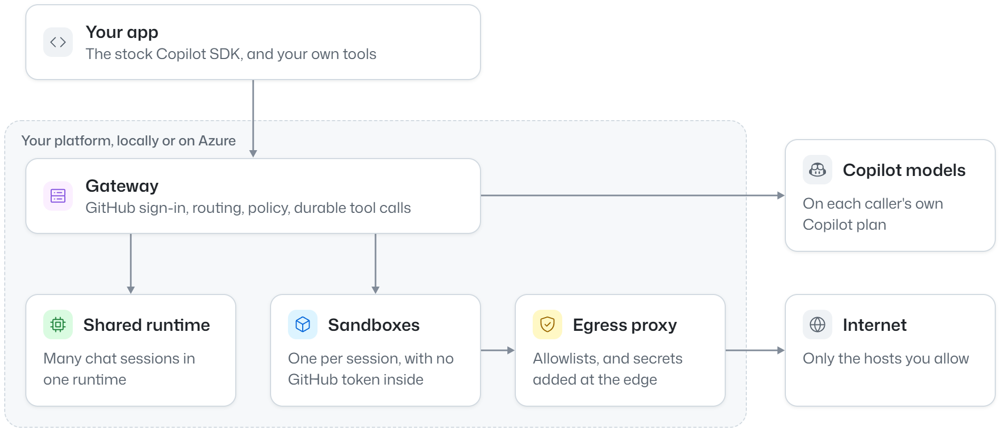
  </picture>
</p>

Your app uses the stock SDK; `ManagedCopilot.connect()` routes its connection to a **gateway** you run. The gateway
signs callers in with GitHub, places each session on the **shared runtime** or in its own **sandbox** (Docker locally,
Azure Container Apps Sandboxes on Azure), and brokers model calls on the caller's Copilot plan. Sandboxes reach the
Internet only through an **egress proxy** that enforces each environment's allowlist.

You declare environments once in an [Aspire AppHost](libraries/aspire/README.md): `aspire run` brings them up on your
machine, and `aspire deploy` puts the same AppHost on Azure. Each environment runs its agents in one of six patterns,
and your code only picks the environment's name:

```ts
await addManagedCopilot(builder, "copilot", {
  environments: {
    chat:     { type: "shared", network: ["learn.microsoft.com"] },               // Shared
    coder:    { type: "isolated", size: "medium" },                               // Isolated
    helper:   { type: "promotable", promoteTo: "coder" },                         // Promotable
    operator: { type: "orchestrator", workers: ["coder"], execution: "direct" },  // Direct
    team:     { type: "orchestrator", workers: ["coder"] },                       // Delegate
    lead:     { type: "orchestrator", workers: ["coder"], execution: "mixed" },   // Mixed
  },
});
```

Every agent has a **brain**, its model loop, and **hands**, the tools that act. The patterns differ in where each one
runs ([which should I use?](docs/concepts/patterns.md#which-pattern-should-i-use)):

| Pattern | Its brain runs | Its hands act | See it in |
| --- | --- | --- | --- |
| **Shared** | On the shared runtime, beside other sessions | Through your tools, in your app | [Help Desk](demos/help-desk/README.md), [Front Desk](demos/front-desk/README.md) |
| **Isolated** | In its own sandbox | In the same sandbox | [Repo Doctor](demos/repo-doctor/README.md) |
| **Promotable** | On the shared runtime, then in its own sandbox | Through your tools, plus a shell and files once it moves | [Data Desk](demos/data-desk/README.md) |
| **Direct** | On the shared runtime, with its sub-agents | In a sandbox with no agent in it | [Dispatch](demos/dispatch/README.md) |
| **Delegate** | On the shared runtime, as a coordinator | Through new agents, each in its own sandbox | [Research Swarm](demos/research-swarm/README.md), [Software Factory](demos/software-factory/README.md) |
| **Mixed** | On the shared runtime, as a coordinator | In its own sandbox, and through new agents | [Incident Commander](demos/incident-commander/README.md) |

## Quickstart

**1. Get the prerequisites:** Node 24, pnpm 10, Docker, the [Aspire CLI](https://aspire.dev) 13.6, a GitHub account
with Copilot (`gh auth login`), and [Copilot CLI](https://docs.github.com/copilot/how-tos/copilot-cli) for attaching to
sessions.

**2. Start the platform** and the demos:

```powershell
pnpm install
pnpm build
aspire run              # the platform at http://localhost:7400, plus the demos
```

**3. Try it** from another terminal:

```powershell
pnpm walkthrough 01                 # your first agent, in about a minute
npx managed-copilot new chat        # a new session, opened in Copilot CLI
npx managed-copilot console         # the operator console
pnpm gallery                        # every demo and walkthrough on one page
pnpm reset                          # stop aspire run and delete local state: sessions, sandboxes, demo data
```

**4. Deploy to Azure** when you're ready. Your code connects the same way, with `MANAGED_COPILOT_URL`;
[docs/deployment.md](docs/deployment.md) covers prerequisites, access, cost, and teardown.

```powershell
aspire secret set Azure:SubscriptionId <subscription-id>
aspire secret set Azure:Location westus2
aspire secret set Azure:ResourceGroup managed-copilot-dev
aspire secret set Parameters:copilot-github-users your-login   # who may use the deployment
aspire deploy
```

<details>
<summary>Troubleshooting</summary>

- **Stuck at "Trusting certificates…".** Run `aspire certs trust` once, or use `aspire run --non-interactive`.
- **nuget.org is blocked.** Set `ASPIRE_CLI_NUGET_SERVICE_INDEX=<proxy>/v3/index.json` and add an untracked
  `NuGet.config` at the repository root that maps `*` to that proxy.
- **A port is in use.** The gateway (7400), the gallery (7460), and the demos (7420 to 7490) use fixed ports. To run a
  second copy, set `MANAGED_COPILOT_PORT_OFFSET=300` and point tools at it with
  `MANAGED_COPILOT_URL=http://localhost:7700`.
- **Docker uses a lot of disk.** Each checkout runs its sandboxes under its own prefix (`mc-<hash of the AppHost
  path>`). A gateway removes another checkout's containers, volumes, and networks once that checkout's
  `.managed-copilot/data` folder is gone, and keeps them while it exists. Images and build cache are left to you;
  this keeps images in use and the last week's builds:

  ```powershell
  docker builder prune -a --filter until=168h -f
  docker image prune -a --filter until=168h -f
  docker volume prune -f    # anonymous volumes only (Docker Engine 23 and later)
  ```

</details>

## Demos

Twelve apps show the patterns doing real work, each built for its own use case. All of them run under `aspire run` with
real models and deploy to Azure with the same AppHost (except Hack the Harness, which is local only); `pnpm gallery`
opens every one.

<table>
  <tr>
    <td width="33%" valign="top">
      <a href="demos/downhill/README.md">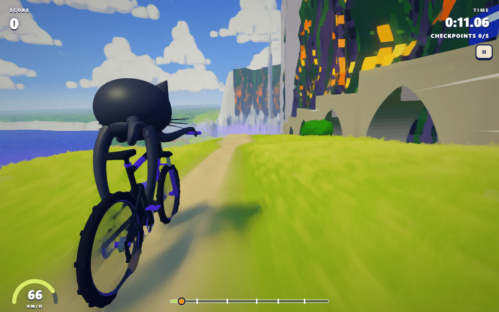</a><br>
      <b><a href="demos/downhill/README.md">Downhill</a></b> · <sub>Shared, through Help Desk</sub><br>
      Ride, shop, and the launch code fails at checkout
    </td>
    <td width="33%" valign="top">
      <a href="demos/help-desk/README.md">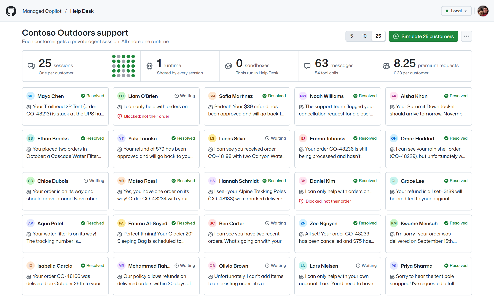</a><br>
      <b><a href="demos/help-desk/README.md">Help Desk</a></b> · <sub>Shared</sub><br>
      25 customers, 25 private sessions, one shared runtime
    </td>
    <td width="33%" valign="top">
      <a href="demos/data-desk/README.md">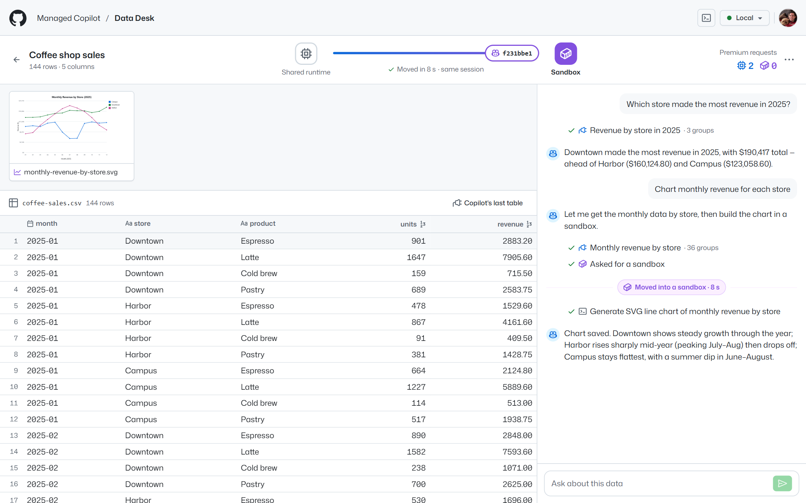</a><br>
      <b><a href="demos/data-desk/README.md">Data Desk</a></b> · <sub>Promotable</sub><br>
      Chat with a spreadsheet; it moves to a sandbox for code
    </td>
  </tr>
  <tr>
    <td width="33%" valign="top">
      <a href="demos/incident-commander/README.md">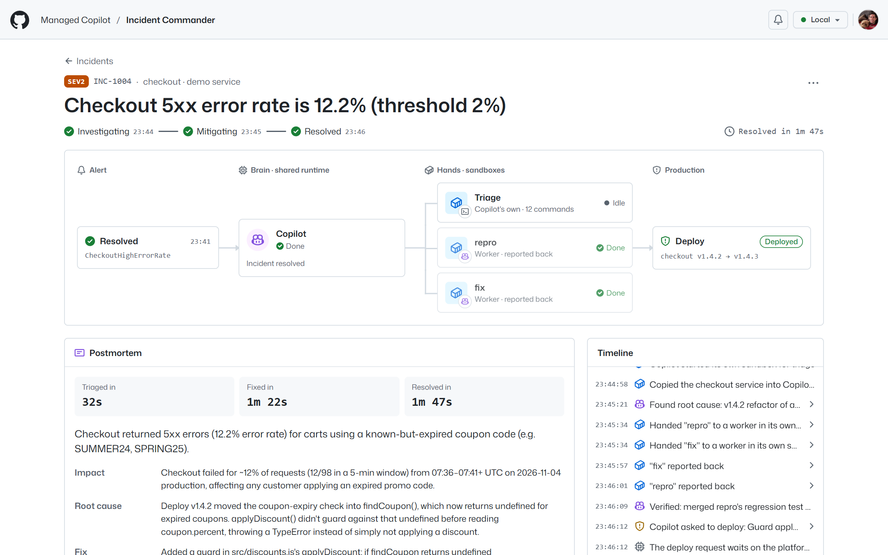</a><br>
      <b><a href="demos/incident-commander/README.md">Incident Commander</a></b> · <sub>Mixed</sub><br>
      On call: triage, fix, and deploy when you say so
    </td>
    <td width="33%" valign="top">
      <a href="demos/software-factory/README.md">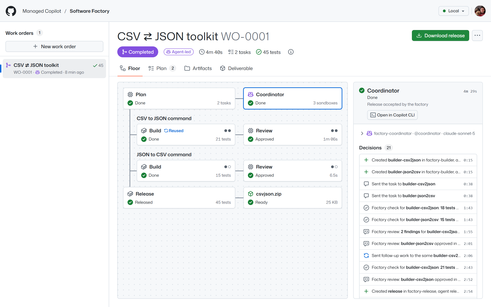</a><br>
      <b><a href="demos/software-factory/README.md">Software Factory</a></b> · <sub>Delegate, isolated</sub><br>
      A work order in, a tested and reviewed release out
    </td>
    <td width="33%" valign="top">
      <a href="demos/pattern-race/README.md">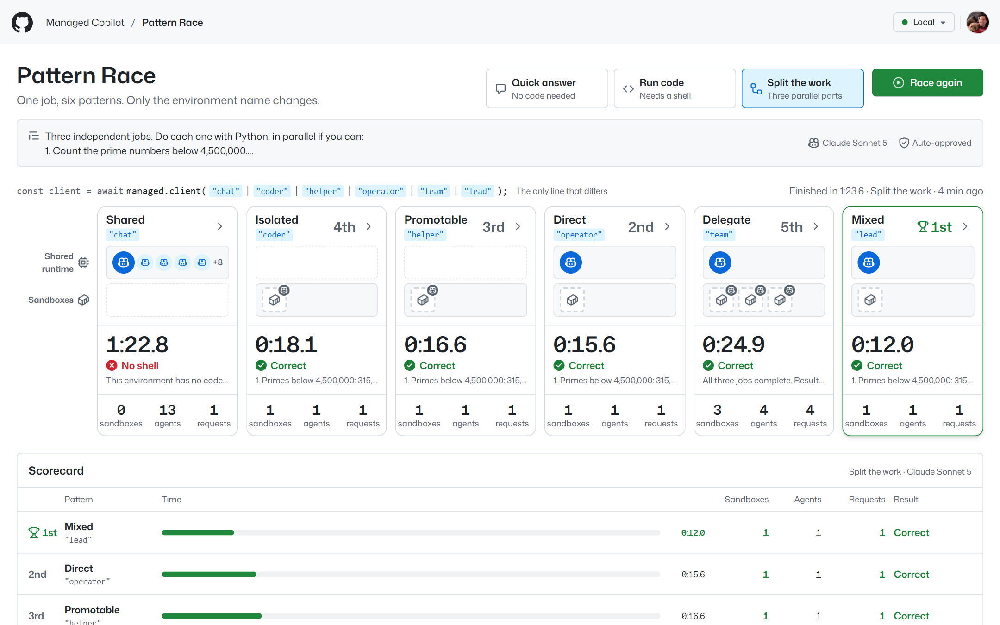</a><br>
      <b><a href="demos/pattern-race/README.md">Pattern Race</a></b> · <sub>All six</sub><br>
      One job raced through all six patterns at once
    </td>
  </tr>
  <tr>
    <td width="33%" valign="top">
      <a href="demos/research-swarm/README.md">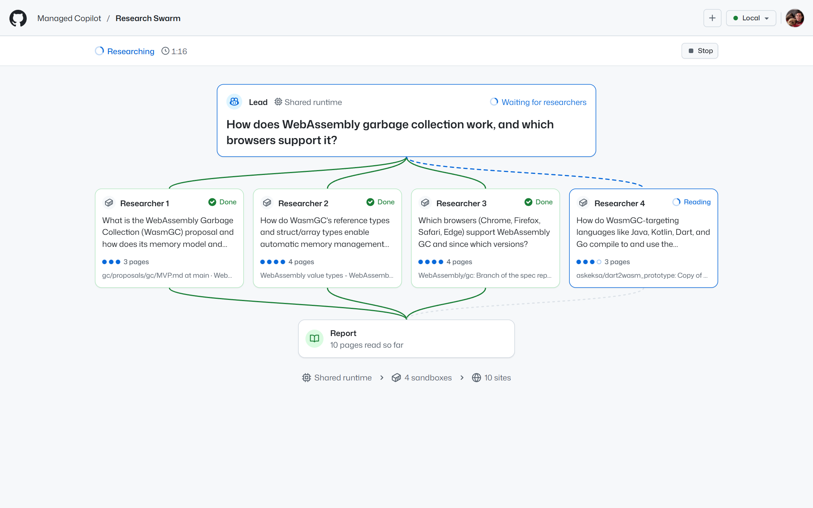</a><br>
      <b><a href="demos/research-swarm/README.md">Research Swarm</a></b> · <sub>Delegate</sub><br>
      One question, many researchers, one cited report
    </td>
    <td width="33%" valign="top">
      <a href="demos/dispatch/README.md">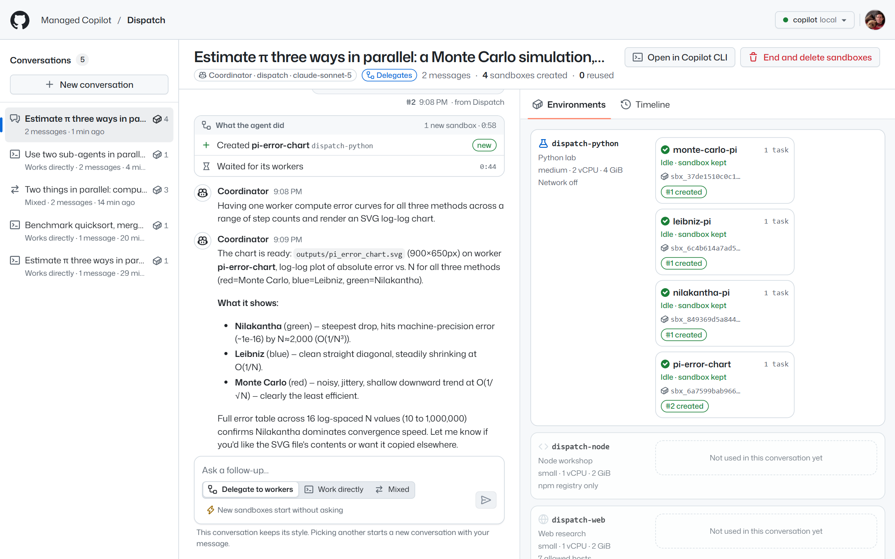</a><br>
      <b><a href="demos/dispatch/README.md">Dispatch</a></b> · <sub>Direct, delegate, mixed</sub><br>
      One conversation, as many sandboxes as the work needs
    </td>
    <td width="33%" valign="top">
      <a href="demos/hack-the-harness/README.md">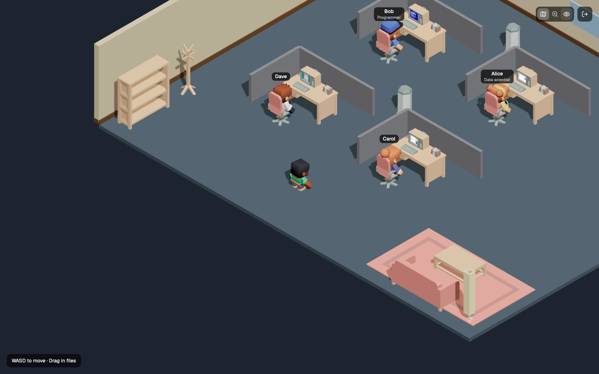</a><br>
      <b><a href="demos/hack-the-harness/README.md">Hack the Harness</a></b> · <sub>All six, local only</sub><br>
      One staff assistant, six agent deployment architectures
    </td>
  </tr>
  <tr>
    <td width="33%" valign="top">
      <a href="demos/front-desk/README.md">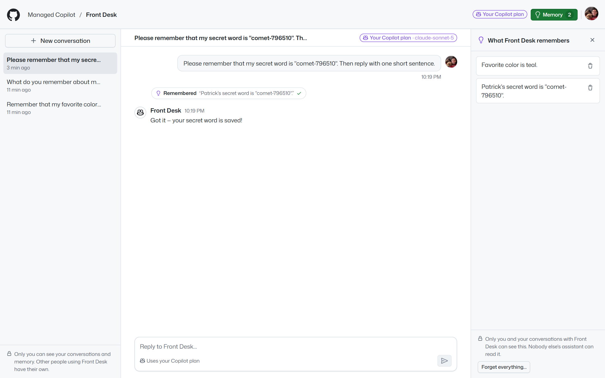</a><br>
      <b><a href="demos/front-desk/README.md">Front Desk</a></b> · <sub>Shared</sub><br>
      One app for many people, each with their own private conversations
    </td>
    <td width="33%" valign="top">
      <a href="demos/repo-doctor/README.md">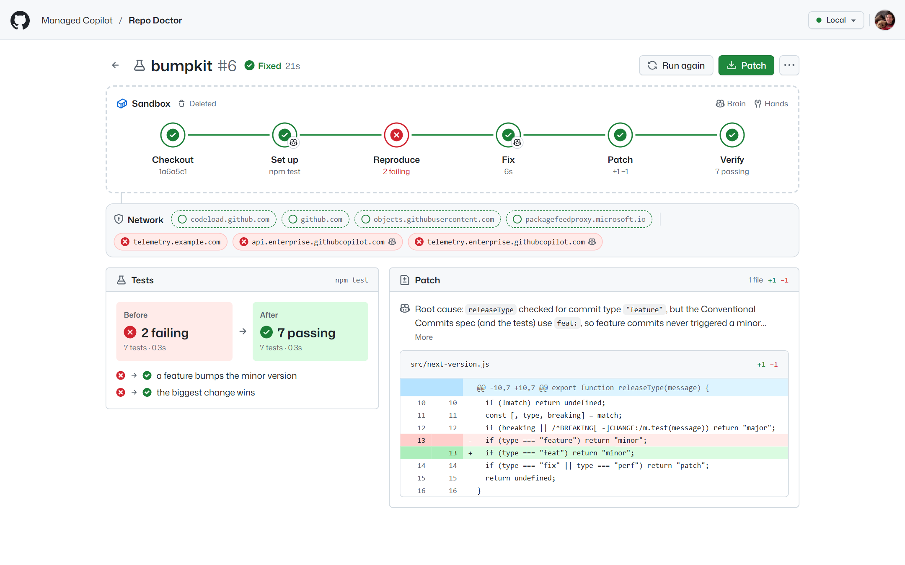</a><br>
      <b><a href="demos/repo-doctor/README.md">Repo Doctor</a></b> · <sub>Isolated</sub><br>
      A failing test in, a verified patch out
    </td>
    <td width="33%" valign="top">
      <a href="demos/assistant/README.md">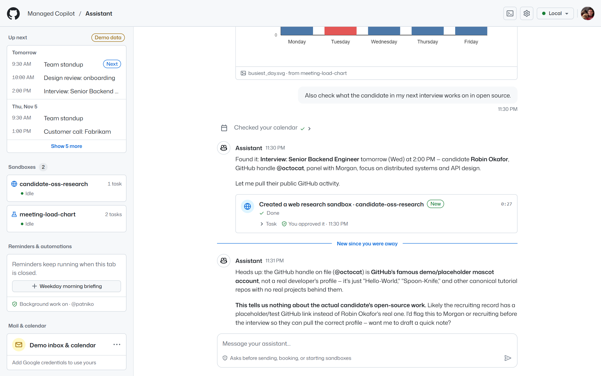</a><br>
      <b><a href="demos/assistant/README.md">Assistant</a></b> · <sub>Shared, delegate</sub><br>
      A long-running assistant that keeps working when you leave
    </td>
  </tr>
</table>

**One day at Contoso Outdoors.** Five of the demos share Downhill's launch day: **Downhill**'s shop rejects the launch
code, **Help Desk** takes the support rush, **Data Desk** finds what the open beta says about the game, **Incident
Commander** handles a checkout crash, and the **Software Factory** turns all three into tested releases. The gallery's
**Downhill Launch** tab lists them in order.

<details>
<summary>The story, step by step</summary>

1. **Downhill:** ride a run, then buy a new look in the game's shop. The launch offer's code is rejected at checkout,
   which runs Contoso Outdoors' storefront code, and **Contact support** opens a live chat.
2. **Help Desk:** that ticket appears on the wall beside the launch day's simulated players. Its refund waits for your
   approval, and its report joins the players' **Promo codes rejected at checkout**, which one click sends to the
   factory.
3. **Data Desk:** the beta's **frame rate** shows Auto graphics quality running as slowly as High on integrated
   graphics, and the insight goes to the factory as a fix to build. **Downhill shop sales** charts the rejected codes
   live.
4. **Incident Commander:** Downhill's order service, v1.4.2, crashes on expired codes such as the pre-registration
   reward. Copilot triages, routes the fix through the factory, and deploys when you approve it on the work order's
   **Deploy** gate.
5. **Software Factory:** the bug, the insight, and the fix arrive as work orders, each showing where it came from, and
   go back as tested releases.

</details>

## Learn more

| Guide | What's inside |
| --- | --- |
| [Start here](docs/README.md) | Learning path, concept pages, an "I want to…" index, and a glossary |
| [Walkthroughs](walkthroughs/README.md) | Thirteen short, runnable walkthroughs with real output |
| [Demo walkthrough](docs/walkthrough.md) | A checklist to run every demo locally and on Azure |
| [`managed-copilot` CLI](libraries/cli/README.md) | Sign-in, sessions, Copilot CLI attach, artifacts, schedules, and the console |
| [Spec snippets](tests/snippets/README.md) | Every spec example as a runnable script |
| [Quality assurance](docs/qa.md) | The checks every change and release is held to, by tier, and `pnpm qa` to run them |
| [Developer experience spec](docs/spec/developer-experience.md) | The full API contract and design decisions |
| [Architecture](docs/architecture.md) | Topology, protocol facts, and a code map |
| [Threat model](docs/threat-model.md) | Trust boundaries and what the platform defends against |
| [Video tour](docs/tutorial/README.md) | Source for a six-minute narrated tour (build it locally; predates Dispatch) |

> [!NOTE]
> **Status:** a working reference implementation, not a supported product. Every spec example runs as an automated
> check against the real platform, all six patterns run locally (four also on Azure), and `pnpm test` runs over 1,600
> tests. Known limits include a single gateway replica and no warm sandbox pools; see
> [live qualification](docs/deployment.md#live-qualification).

<details>
<summary>Repository layout</summary>

| Path | Contents |
| --- | --- |
| `libraries/` | The SDK, Aspire integration, CLI, shared protocol, UI theme, and the demos' shared logger |
| `services/` | The gateway, operator console, sandbox image, and egress proxy |
| `deployments/azure` | The Azure target for `aspire deploy` (AWS is a [roadmap](deployments/aws/README.md)) |
| `environments/` | Per-environment agents, skills, and instructions for the root AppHost |
| `demos/`, `walkthroughs/`, `tests/snippets`, `tests/qa` | The demo apps, walkthroughs, spec snippets, and QA checks |
| `apphost.mts` | The root AppHost that `aspire run` starts |

To work on the platform: `pnpm install`, `pnpm build`, `pnpm test`. Before a release, run [`pnpm qa all`](docs/qa.md).

</details>

Licensed under [MIT](LICENSE).
