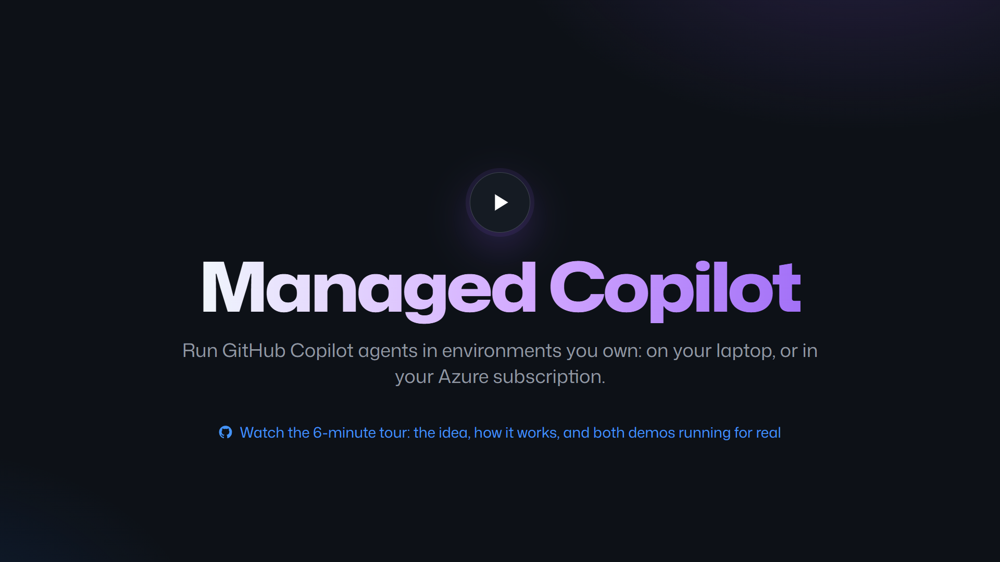
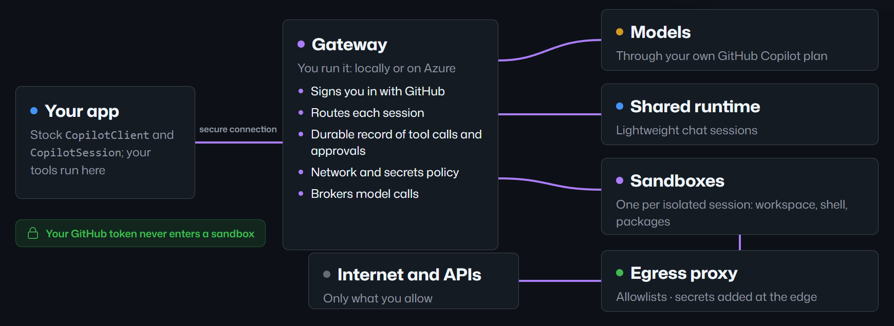
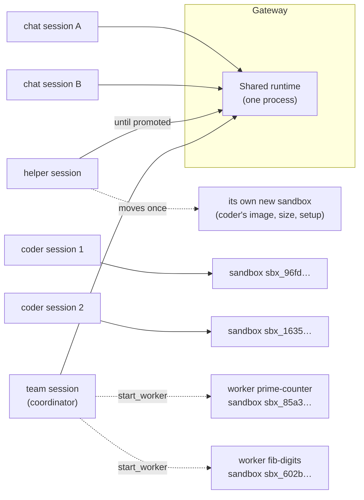
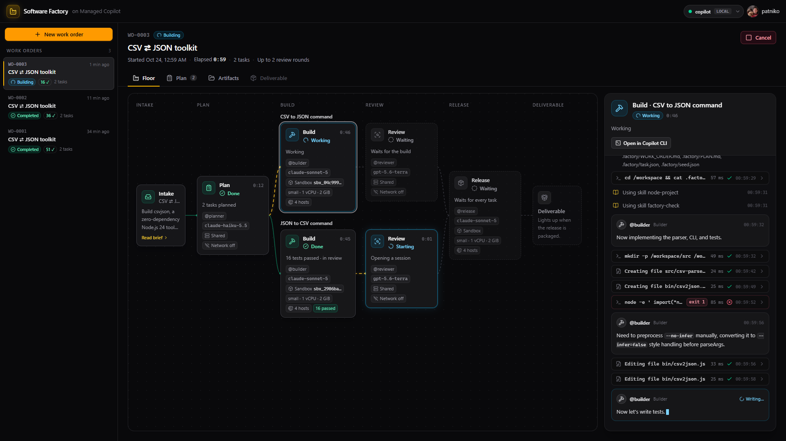
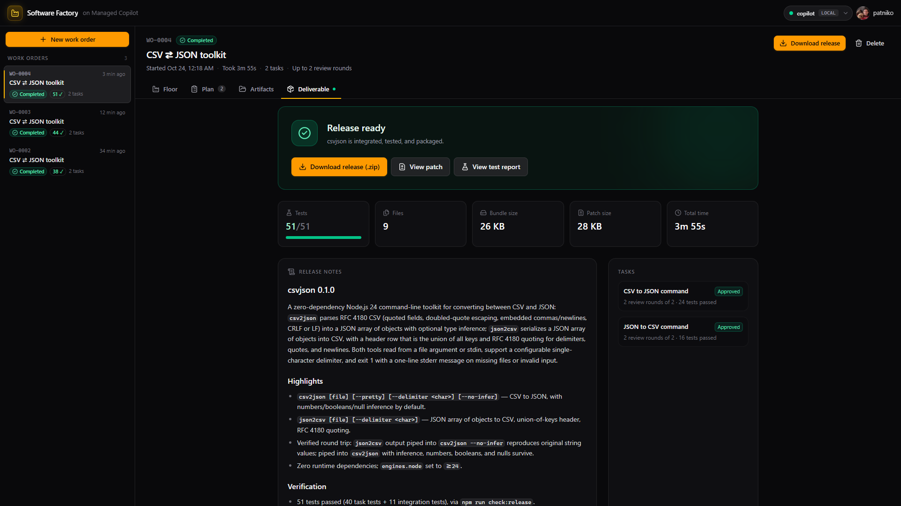
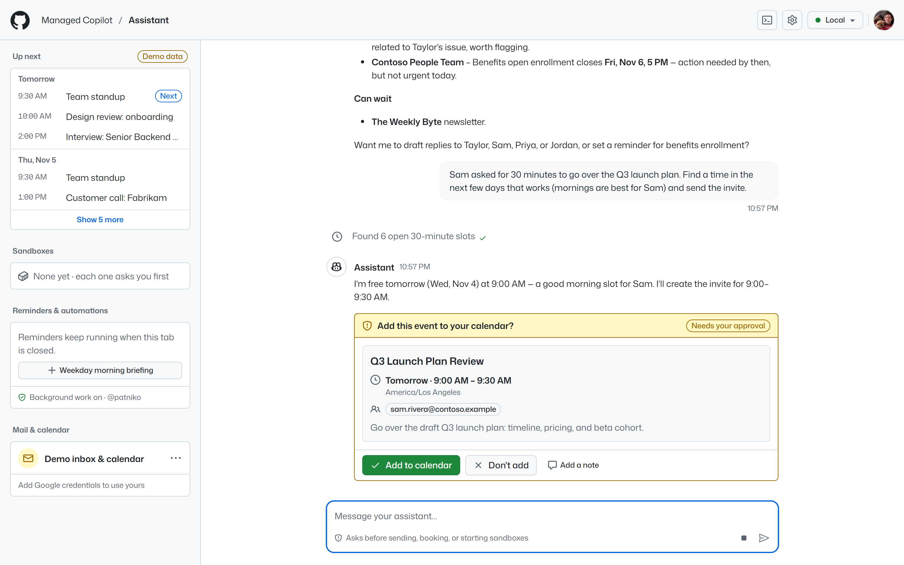
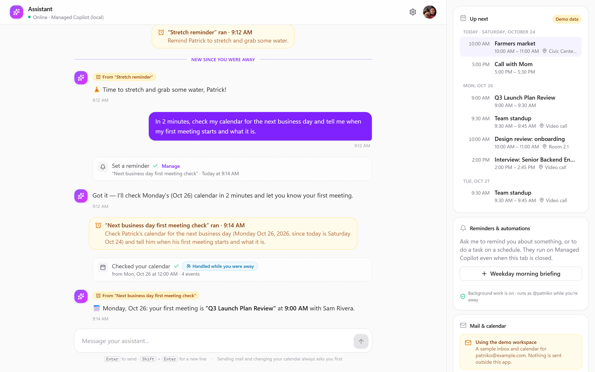

<h1 align="center">Managed Copilot SDK</h1>

<p align="center">
  Run <strong>stock</strong> GitHub Copilot SDK agents in environments you own:<br>
  on your laptop with Aspire, or in your Azure subscription.
</p>

<p align="center">
  <a href="docs/README.md">Start here</a> ·
  <a href="docs/tutorial/README.md">Video tour</a> ·
  <a href="#run-it-locally">Run it locally</a> ·
  <a href="samples/README.md">Walkthroughs</a> ·
  <a href="#the-demos">Demos</a> ·
  <a href="#how-it-works">How it works</a> ·
  <a href="docs/deployment.md">Deploy to Azure</a> ·
  <a href="docs/spec/developer-experience.md">Spec</a>
</p>

<p align="center">
  <a href="docs/tutorial/README.md"></a>
</p>

## Overview

Apps can already build Copilot agents in with the [GitHub Copilot SDK](https://github.com/github/copilot-sdk).
Managed Copilot keeps that SDK exactly as published and changes only **where the agents run**. A platform you deploy
decides whether a session runs on a shared runtime or in its own sandbox, what it may reach on the network, which
secrets it can use, and what happens to its work while your app is offline. Only the setup lines change:

```ts
import { approveAll } from "@github/copilot-sdk";
import { ManagedCopilot } from "@managed-copilot/sdk";

const managed = await ManagedCopilot.connect(); // your local `aspire run`, or your Azure deployment
const client = await managed.client("chat");    // a stock CopilotClient for the "chat" environment

const session = await client.createSession({ model: "claude-sonnet-5", onPermissionRequest: approveAll });
const reply = await session.sendAndWait({ prompt: "Summarize what changed in Aspire 13" });
console.log(reply?.data.content);
```

You declare environments once in an [Aspire AppHost](packages/aspire/README.md). `aspire run` brings the platform up
on your machine, and `aspire deploy` puts the same AppHost on Azure Container Apps. Your code keeps using genuine
`CopilotClient` and `CopilotSession` objects, standard session events, and `defineTool` tools. What works today, end
to end with real models:

- **Shared, isolated, promotable, and orchestrator environments.** Chat on a shared runtime, coding agents in their
  own sandboxes with setup, files, and artifacts, sessions that start cheap and move into a sandbox when they need
  one, and coordinators that split work across workers, each in its own sandbox.
- **Policy you can see.** Per-environment network allowlists, and vault credentials applied at the egress proxy so
  secrets never enter a sandbox.
- **Work that continues without you.** Tool calls wait durably and are answered later by your webhook or a poller;
  schedules and agent reminders run as you after `npx managed-copilot login`.
- **Copilot CLI on a live session.** `npx managed-copilot attach <id>` opens the stock Copilot CLI on the same
  conversation your app uses, and it follows the session when it moves into a sandbox. `npx managed-copilot new chat`
  starts a new session in an environment and opens it in Copilot CLI straight away.
- **Your identity, your plan.** Callers sign in with GitHub, sessions use the caller's own Copilot entitlement, and
  no GitHub token ever enters a sandbox.
- **An operator console.** `npx managed-copilot console` shows the platform as it runs: component health, every
  owner's sessions with their sandboxes and harness configuration, environments, schedules, webhooks, and a live feed,
  with secrets redacted and conversations private.

## How it works

<p align="center">
  
</p>

- **Your app** uses the stock SDK. `ManagedCopilot.connect()` hands it a client whose connection runs through a
  secure bridge to the gateway.
- **The gateway**, which you run, signs callers in with GitHub and places each session. It keeps a durable record of
  the tool calls and approvals your app must answer, enforces network and secrets policy, and brokers model calls on
  the caller's Copilot plan. It also serves the operator console, where the people who run the platform see its
  health and every session's configuration.
- **The shared runtime** hosts lightweight chat sessions whose tools run in your app. **Sandboxes** give each
  isolated session its own workspace, shell, and packages: Docker locally, Azure Container Apps Sandboxes on Azure.
- **The egress proxy** is a sandbox's only way out. It enforces each environment's allowlist and adds vault
  credentials at the edge, so code in a sandbox only ever sees placeholders.

More in [docs/architecture.md](docs/architecture.md): topology, protocol facts, and each module.

## Environments

| Type | What a session gets | Good for |
| --- | --- | --- |
| `shared` | A lightweight session on the shared runtime; its tools run inside your app | Chat agents and assistants |
| `isolated` | Its own sandbox: a workspace, a shell, the packages you set up, and network rules you control | Coding agents, builds, data work |
| `promotable` | Starts on the shared runtime, then moves into a sandbox as the same session when it needs one | Chats that sometimes need to run code |
| `orchestrator` | A coordinator on the shared runtime that starts workers, each a session with its own sandbox, and waits for their reports | Parallel and multi-agent work |

```ts
// apphost.mts: declared once, picked by name with managed.client("coder")
await addManagedCopilot(builder, "copilot", {
  environments: {
    chat:   { type: "shared", network: ["learn.microsoft.com"] },
    coder:  { type: "isolated", size: "medium" },
    helper: { type: "promotable", promoteTo: "coder" },
    team:   { type: "orchestrator", workers: ["coder"], maxWorkers: 3 },
  },
});
```

An environment is a template; a client only picks one. Every `chat` session shares one runtime, every `coder` session
gets its own new sandbox, a `helper` session moves once into a sandbox when it needs one, and a `team` session starts
workers that each get a sandbox of their own. From live runs:



More in [environments](docs/concepts/environments.md), [sandboxes](docs/concepts/sandboxes.md), and the
[orchestrator](docs/concepts/orchestrator.md).

## The demos

Both demos run under `aspire run` with real models, and both run on Azure from the same AppHost.

### AI software factory

<p align="center">
  
</p>

Describe the software you want. A planner splits it into tasks, and a builder per task works in **its own sandbox**,
all in parallel. A reviewer on a different model sends work back with file-and-line findings. A release agent then
integrates the tasks, adds integration tests and a README, and publishes a tested release you can download.

<p align="center">
  
</p>

→ [demos/software-factory](demos/software-factory/README.md)

### Long-running assistant

<p align="center">
  
  
</p>

A bot you chat with that reads your mail and manages your calendar. It uses a clearly labelled demo workspace until
you connect Google, and it always asks before it sends mail or changes your calendar. Reminders and recurring
briefings run as you, and it keeps working with the tab closed: the platform runs the turn and calls the assistant's
webhook for the tool calls it needs.

→ [demos/assistant](demos/assistant/README.md)

## Run it locally

You need Node 24, pnpm 10, Docker Desktop, the Aspire CLI 13.6, a GitHub account with Copilot (`gh auth login`), and
[Copilot CLI](https://docs.github.com/copilot/how-tos/copilot-cli) for attaching to sessions.

```powershell
pnpm install
pnpm build
aspire run        # the dashboard, the platform at http://localhost:7400, and the demos
```

`aspire run` starts the gateway, the software factory (http://localhost:7480), and the assistant
(http://localhost:7490). Your code finds the platform with no configuration: `ManagedCopilot.connect()` reads the
discovery record the local gateway writes. From another terminal:

```powershell
npx managed-copilot status             # the deployment, your account, and its environments
npx managed-copilot new chat           # a new session in the chat environment, opened in Copilot CLI
npx managed-copilot sessions           # your sessions
npx managed-copilot attach 7f3a2c1     # Copilot CLI on a live session (any unique ID prefix)
npx managed-copilot console            # the operator console: health, sessions, harness configuration
```

To run every snippet from the spec against your platform, start **quickstart** in the Aspire dashboard, or run
`pnpm --filter @managed-copilot/quickstart acceptance`. To learn by doing, follow the
[walkthroughs](samples/README.md): `pnpm sample 01` is your first agent, in about a minute.

- **Stuck at "Trusting certificates…".** The first `aspire run` asks to trust the dashboard's development
  certificate, and the prompt can be hidden. Run `aspire certs trust` once, or use `aspire run --non-interactive`,
  which continues without trusting it (the dashboard then shows a certificate warning).
- **Behind a NuGet proxy.** If nuget.org is blocked, point the Aspire CLI at your proxy with
  `ASPIRE_CLI_NUGET_SERVICE_INDEX=<proxy>/v3/index.json` and add an untracked `NuGet.config` at the repository root
  whose `packageSourceMapping` maps `*` to that proxy (the file is git-ignored).
- **A port is in use.** The gateway (7400), the factory (7480), and the assistant (7490) use fixed ports; the
  assistant's is fixed for its Google OAuth redirect. Stop whatever holds the port, then restart the resource.
- **A second copy beside the first** (for example another checkout): set `MANAGED_COPILOT_PORT_OFFSET=300` to move
  its ports to 7700, 7780, and 7790. It leaves zero-config discovery to the first copy, so point tools at it with
  `MANAGED_COPILOT_URL=http://localhost:7700`.

## Deploy to Azure

The same AppHost deploys with `aspire deploy`. The gateway, your apps, and the egress proxy run as Azure Container
Apps, each isolated session gets its own Container Apps sandbox, and the platform's state is kept on Azure Files. A
deployed gateway is on the Internet, so `aspire deploy` refuses to publish one until you say who may use it:

```powershell
aspire secret set Azure:SubscriptionId <subscription-id>
aspire secret set Azure:Location westus2
aspire secret set Azure:ResourceGroup managed-copilot-dev
aspire secret set Parameters:copilot-github-users your-login   # or Parameters:copilot-github-orgs
aspire deploy
```

Your code connects exactly as it does locally, with `MANAGED_COPILOT_URL` or `ManagedCopilot.connect({ url })`.
[docs/deployment.md](docs/deployment.md) covers prerequisites, the demo apps' access settings, costs, and teardown.

## What's verified

- **Every example in the spec runs as an automated check** against the real platform with real models. The first 13
  pass locally through the AppHost. On Azure, the 11 that don't need a local webhook receiver pass. The orchestrator
  example (14) passes locally and on Azure.
- **Unit and integration tests:** more than 1,100 run with `pnpm test`. Gated end-to-end suites use real Docker
  sandboxes and models for sandboxes, egress policy, promotion, and recovery when the gateway is replaced mid-turn.
- **Both demos run end to end** locally and on Azure.
- **Limits are written down.** Examples: no warm sandbox pools, a single gateway replica, and a turn whose runtime
  process dies ends as failed, so the user retries. The spec's [delivery gates](docs/spec/developer-experience.md#delivery-gates)
  list what each gate proved and what it did not.

## Documentation

| | |
| --- | --- |
| [Start here](docs/README.md) | A learning path, ten visual concept pages, an "I want to…" index, and a glossary |
| [Walkthroughs](samples/README.md) | Ten hands-on walkthroughs with runnable code (`pnpm sample 01`) and real output |
| [Video tour](docs/tutorial/README.md) | Six narrated minutes: the idea, how it works, and both demos running for real |
| [Quickstart](demos/quickstart/README.md) | Every spec snippet as a runnable script, plus one acceptance run against your platform |
| [AI software factory](demos/software-factory/README.md) | A work order goes in; parallel sandboxed agents build, review, and release it |
| [Long-running assistant](demos/assistant/README.md) | A bot you chat with that keeps working while you're away, with Gmail and Google Calendar |
| [`managed-copilot` CLI](packages/cli/README.md) | Background sign-in, sessions, Copilot CLI attach, promotion, artifacts, schedules, and the operator console |
| [Deploy to Azure](docs/deployment.md) | The same AppHost on Azure Container Apps in your subscription |
| [Developer experience spec](docs/spec/developer-experience.md) | The customer contract, decisions, and delivery gates |
| [Architecture](docs/architecture.md) | Topology, protocol facts, and how the pieces fit |

## Repository layout

| Path | Contents |
| --- | --- |
| `packages/protocol` | Shared contracts: AppHost config schema, REST DTOs, errors, events, network policy |
| `packages/sdk` | `@managed-copilot/sdk`: `ManagedCopilot.connect()`, stock clients over a secure bridge |
| `packages/aspire` | `@managed-copilot/aspire`: `addManagedCopilot(builder, name, options)` for Aspire TypeScript AppHosts |
| `packages/cli` | `npx managed-copilot`: background sign-in, sessions, Copilot CLI attach, artifacts, schedules |
| `platform/gateway` | Authenticated gateway: admission, routing, session ledger, platform services, operator API |
| `platform/console` | The operator console the gateway serves at `/console` |
| `platform/sandbox`, `platform/egress` | The sandbox image and its agent; the egress proxy that enforces network policy and vaults |
| `deploy/azure` | The Azure integration for `aspire deploy`: hosting, the gateway's lease supervisor, and qualification probes |
| `apphost.mts` | The AppHost: `aspire run` starts the platform, its environments, and the demos |
| `demos/quickstart` | Every spec snippet as a runnable script and one acceptance run |
| `samples` | The walkthroughs' code: small, commented scripts you run with `pnpm sample <number>` |
| `demos/software-factory`, `demos/assistant` | The AI software factory and the long-running assistant |
| `docs/` | Start here and the concept pages, spec, architecture, deployment, and the video tour |

## Develop

```powershell
pnpm install
pnpm build
pnpm test
```

Contributing: [AGENTS.md](AGENTS.md) has the hard rules (stock SDK and runtime only, no secrets in logs or
sandboxes), commands, and conventions.
