# Long-running assistant

A personal assistant that lives on Managed Copilot. You chat with it like a bot; it reads your mail, manages your
calendar, schedules its own reminders and recurring jobs, and **keeps working when no browser is open**. For hands-on
work (number crunching, charts, research on the web) it starts **sandboxes**: separate agents in their own isolated
environments, created on demand once you approve them and reused for follow-ups. It is built only from the stock
`@github/copilot-sdk` and `@managed-copilot/sdk`.

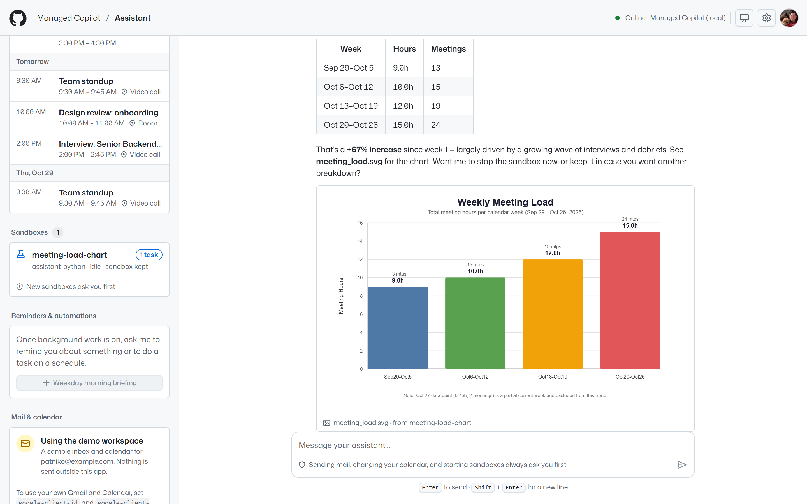

| What you see | How it works | Spec |
| --- | --- | --- |
| One conversation that survives restarts of this app and of the platform | A durable session per person: `client.resumeSession(id, …)` with `session.getEvents()` to rebuild the chat, and `managed.sessions.list()` to recover it if local state is lost | [§11](../../docs/spec/developer-experience.md#11-come-back-later) |
| Gmail and Google Calendar | Standard `defineTool` tools whose handlers run in this server, so Google tokens never leave it. Real Google OAuth, or a clearly labeled demo workspace | [Principle 4](../../docs/spec/developer-experience.md#principles), [§3](../../docs/spec/developer-experience.md#3-shared-a-chat-agent-with-your-own-tools) |
| "Send this email?" cards | Sending mail and creating, changing, or deleting events raise the SDK's native custom-tool permission request; the person approves in chat | [§12](../../docs/spec/developer-experience.md#callback-support-and-disconnection) |
| "Start a Python sandbox?" cards | The `assistant` environment is an `orchestrator`: its agent can start workers (`start_worker`), and starting one asks the SDK's permission handler first. Only the person answers, in chat; a scheduled run's request waits until they're back | [§17](../../docs/spec/developer-experience.md#17-orchestrator-a-coordinator-with-workers) |
| "Created a Python sandbox · new", "Sent the follow-up · reused" | Each sandbox is a worker: its own session of an isolated environment (`assistant-python` with no network, `assistant-web` limited to GitHub). Follow-ups go to the same worker (`message_worker`). The app follows them with `managed.workers(session)`, `managed.on("worker.*")`, and `managed.sessions.get(worker.id)` | [§17](../../docs/spec/developer-experience.md#17-orchestrator-a-coordinator-with-workers) |
| Charts under the reply | What a sandbox saves in `/workspace/outputs` publishes as its artifacts (`managed.artifacts(worker.id)`); this server keeps a copy of each image, so charts stay after the sandbox is deleted | [§6](../../docs/spec/developer-experience.md#6-get-results-out) |
| "Remind me at 4pm to call Sam" | The agent uses the platform's `schedule_task`, `list_schedules`, and `cancel_schedule` tools (`scheduling: true`); the side panel pauses, runs, and deletes them with `managed.schedules` | [§13](../../docs/spec/developer-experience.md#13-run-on-a-schedule) |
| Proactive messages, unread badges, notifications | Scheduled runs deliver their prompt with `source: "system"`; the reply arrives in the chat as a proactive message | [§13](../../docs/spec/developer-experience.md#13-run-on-a-schedule) |
| "Handled while you were away" | With no tab open the server detaches; a scheduled run's tool calls reach it through the signed webhook (`verifyWebhook` + `event.handleActions`), with polling as a safety net | [§12](../../docs/spec/developer-experience.md#12-keep-working-while-your-app-is-offline) |
| "Background work is off · Turn on background work" | The side panel shows whether the platform may run your scheduled work as you, and turns it on with one click after explaining what that means (the platform's background sign-in) | [§2](../../docs/spec/developer-experience.md#work-that-continues-without-you) |

<table>
  <tr>
    <td width="50%">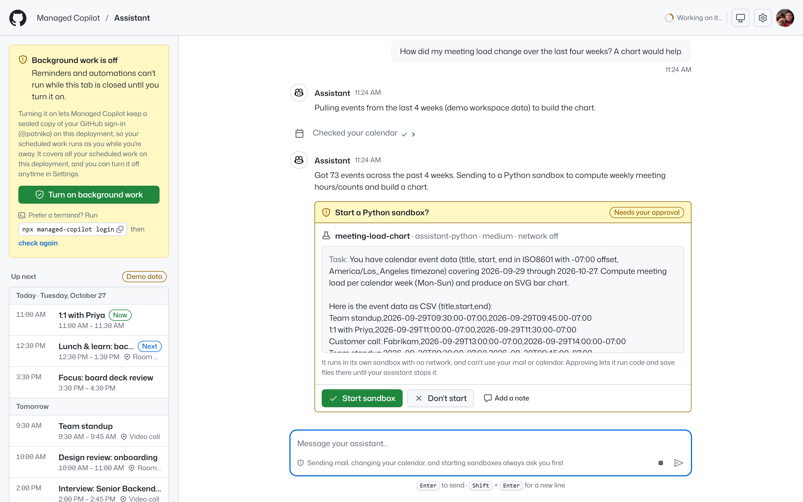</td>
    <td width="50%">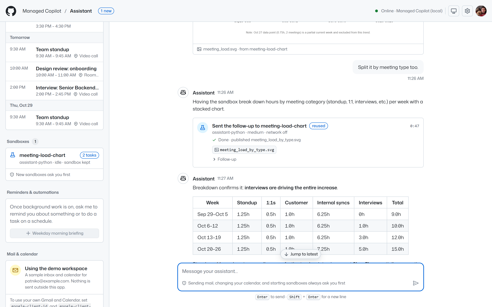</td>
  </tr>
  <tr>
    <td>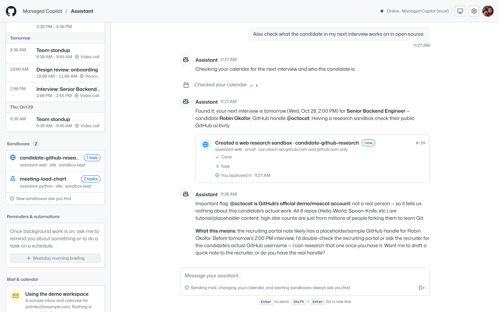</td>
    <td>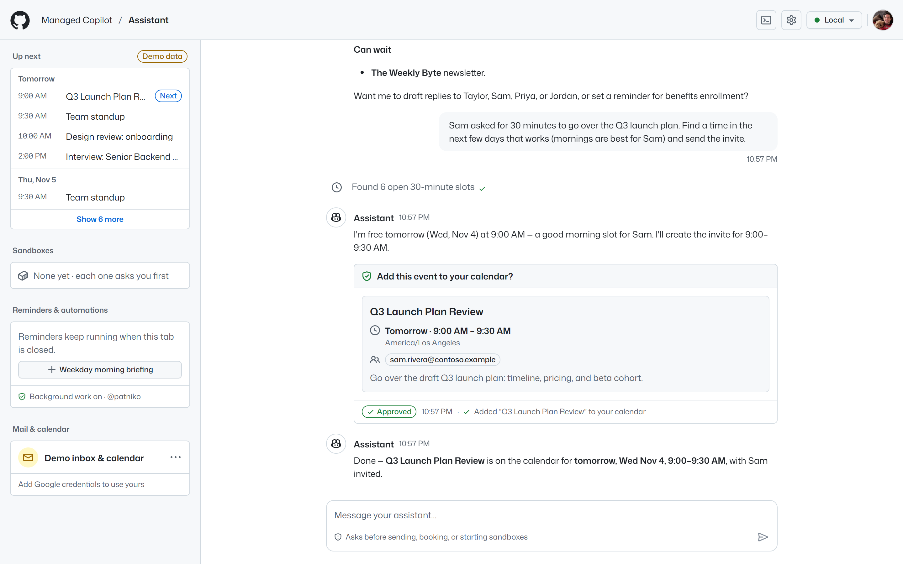</td>
  </tr>
  <tr>
    <td>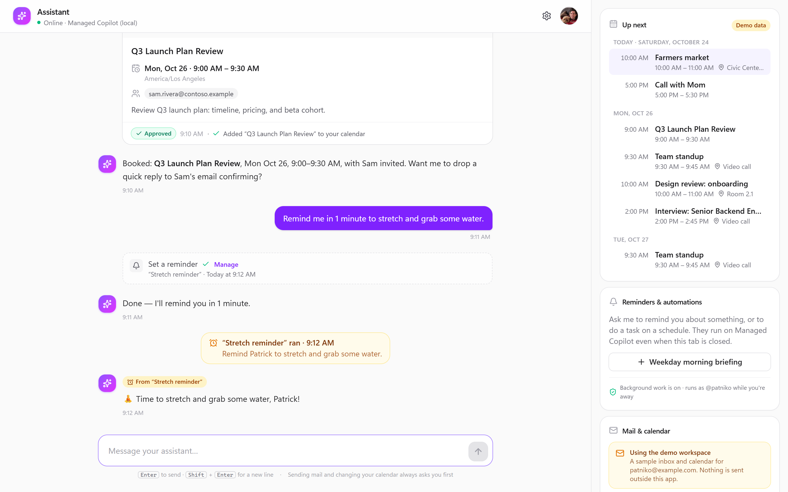</td>
    <td>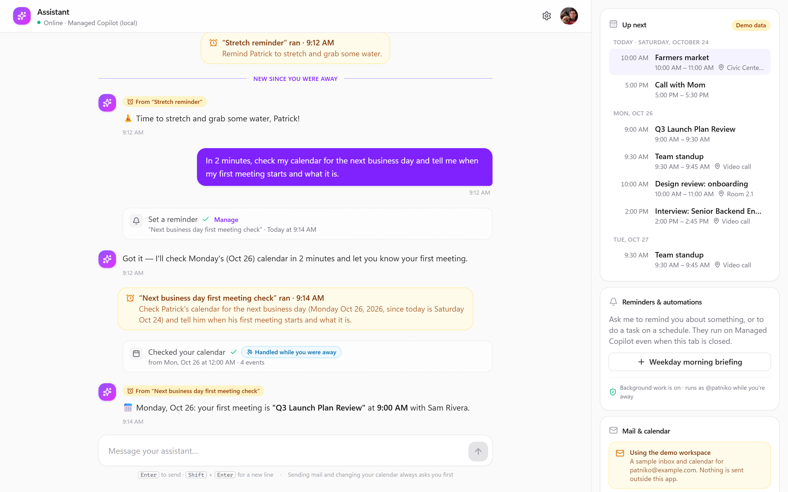</td>
  </tr>
  <tr>
    <td>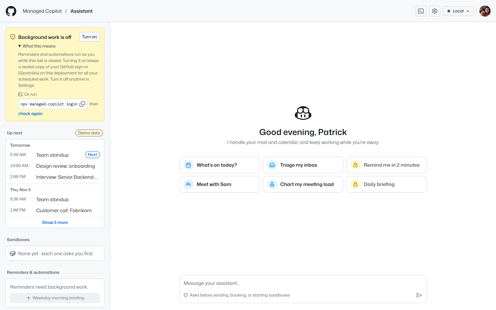</td>
    <td>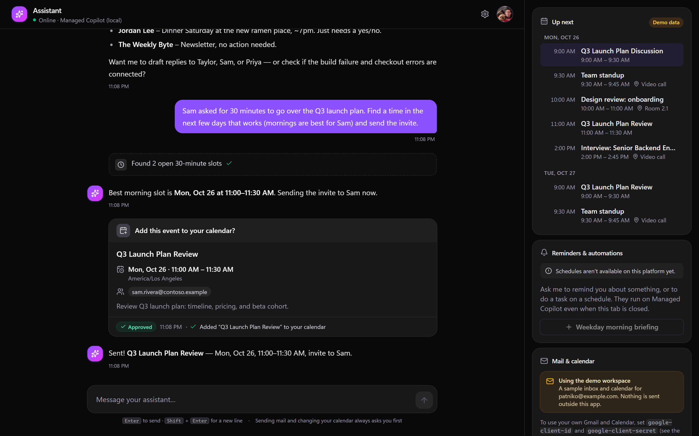</td>
  </tr>
  <tr>
    <td>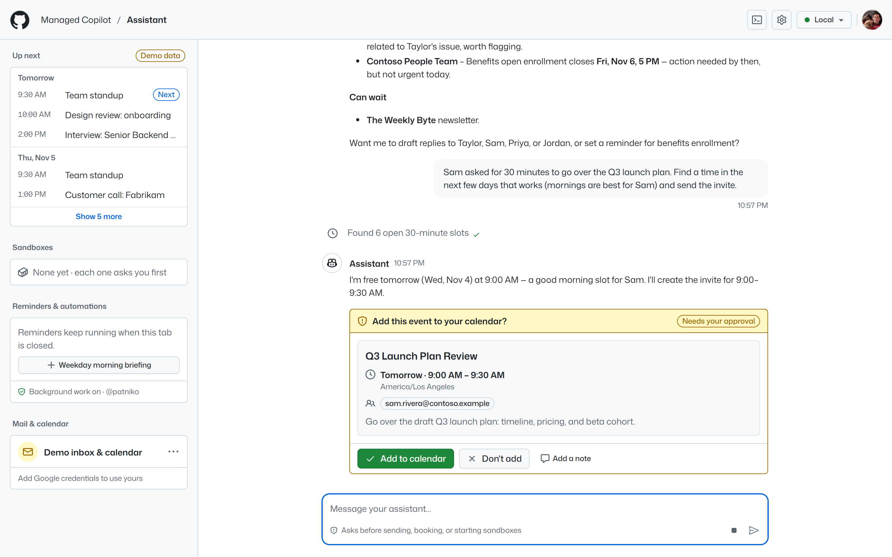</td>
    <td>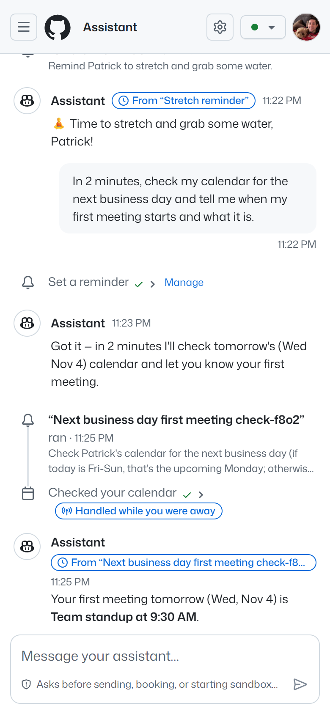</td>
  </tr>
</table>

## Run it

### With Aspire

From the repository root:

```powershell
pnpm install
pnpm build
aspire run                     # the platform plus this assistant (and the other demos)
```

Open **http://localhost:7490**. The assistant signs in to Managed Copilot as your GitHub account (`gh auth login` or
`GH_TOKEN`) and starts with the **demo workspace**: a realistic, fictional inbox and calendar, so everything works
without Google credentials. On a new deployment the side panel first asks you to **Turn on background work**, so
reminders and briefings can run as you while the tab is closed (or run `npx managed-copilot login` once instead).

The AppHost wiring comes from [`apphost.mts`](apphost.mts): an `orchestrator` environment named `assistant` with
`scheduling: true` and `network: false` (its tools run here, so the agent needs no Internet access); the two isolated
environments its sandboxes run in, `assistant-python` (medium, no network: Python's standard library, charts as SVG)
and `assistant-web` (small, only `github.com` and `api.github.com`); the `assistant` webhook pointing at
`http://localhost:7490/api/copilot-events`; and the parameters below.

### Without Aspire

```powershell
pnpm install; pnpm build
$env:ASSISTANT_WEBHOOK_SECRET = "<a long random string>"
$env:ASSISTANT_SEALING_KEY = "<another long random string>"

# 1. The platform, with the assistant's environment and webhook
node demos/assistant/scripts/platform-config.mjs          # writes demos/assistant/.data/apphost.json
$env:MANAGED_COPILOT_CONFIG_FILE = "demos/assistant/.data/apphost.json"
node platform/gateway/dist/main.js                        # prints its URL, e.g. http://127.0.0.1:7400

# 2. In another terminal (same two secrets): the assistant. It finds the local platform through its discovery
#    file; if you set MANAGED_COPILOT_URL, use exactly the URL the gateway prints.
pnpm --filter @managed-copilot/demo-assistant start       # http://localhost:7490
```

Then turn on background work once, from the side panel or with `npx managed-copilot login`, so scheduled runs can act
as you.

For UI work, `pnpm --filter @managed-copilot/demo-assistant dev` restarts the server on changes and
`pnpm --filter @managed-copilot/demo-assistant dev:web` serves the UI with hot reload on http://localhost:7491.
Open http://localhost:7491/?preview to work on the UI without the platform: a development-only preview replaces the
API and event stream with sample data (labeled **Preview data** in the header, whose menu switches between every UI
state), and production builds leave it out.

### Configuration

| Variable | AppHost parameter | Purpose |
| --- | --- | --- |
| `MANAGED_COPILOT_URL` | (gateway endpoint) | The deployment; defaults to the running local platform |
| `ASSISTANT_WEBHOOK_SECRET` | `assistant-webhook-secret` | Verifies the platform's signed webhooks. Without it, offline tool calls are picked up by polling only |
| `ASSISTANT_SEALING_KEY` | `assistant-sealing-key` | Seals Google tokens at rest (AES-256-GCM). Without it, a development key is generated in `.data/` |
| `GOOGLE_CLIENT_ID`, `GOOGLE_CLIENT_SECRET` | `google-client-id`, `google-client-secret` | Optional. Unset or empty means demo workspace only |
| `PORT`, `ASSISTANT_PUBLIC_URL` | | Default `7490` and `http://localhost:7490`; the OAuth redirect URI and webhook URL derive from them |
| `ASSISTANT_MODEL` | | Default `claude-sonnet-5` |
| `ASSISTANT_DATA_DIR` | | Default `demos/assistant/.data` (local SQLite state: conversation pointer, sealed tokens, demo data) |
| `ASSISTANT_DETACH_AFTER_MS` | | Default `30000`: how long after the last tab closes the server detaches, handing scheduled work to the platform |
| `ASSISTANT_HOSTS` | | Interfaces to listen on. Default `127.0.0.1,::1` (loopback only); containers set `0.0.0.0` |
| `ASSISTANT_ALLOWED_HOSTS` | | Extra host names the server answers to, besides loopback and `ASSISTANT_PUBLIC_URL`'s host (DNS-rebinding protection). For example `assistant`, the in-environment name a cloud deployment's gateway delivers webhooks to |
| `MANAGED_COPILOT_GITHUB_TOKEN` | | Signs in to the platform where `gh` isn't available (containers); locally the `gh` sign-in is used |

## Connect Google (optional)

1. In the [Google Cloud console](https://console.cloud.google.com/), create a project and enable the **Gmail API** and
   the **Google Calendar API**.
2. Configure the **OAuth consent screen** (External is fine for personal use). Add these scopes, and add yourself as a
   test user while the app is in testing:

   | Scope | Why |
   | --- | --- |
   | `https://www.googleapis.com/auth/gmail.readonly` | Search and read mail |
   | `https://www.googleapis.com/auth/gmail.compose` | Create drafts and send mail (no deleting, no label changes) |
   | `https://www.googleapis.com/auth/calendar.events` | Read and change events (no calendar settings or sharing) |

3. Under **Credentials**, create an **OAuth client ID** of type **Web application** with the authorized redirect URI
   `http://localhost:7490/api/google/callback`. For a deployed assistant it is `<ASSISTANT_PUBLIC_URL>/api/google/callback`
   instead, for example `https://assistant.<environment domain>/api/google/callback` on Azure Container Apps.
4. Give the assistant the client ID and secret:

   ```powershell
   aspire secret set Parameters:google-client-id "<client id>"
   aspire secret set Parameters:google-client-secret "<client secret>"
   ```

   Without Aspire, set `GOOGLE_CLIENT_ID` and `GOOGLE_CLIENT_SECRET` instead. Restart the assistant.
5. In the app, open **Mail & calendar → Connect Google** and approve the consent screen.

The server uses the authorization-code flow with PKCE and offline access. The refresh token is sealed with
`ASSISTANT_SEALING_KEY` and bound to your account; it is never sent to the platform, the model, or the browser.
**Disconnect** revokes the grant with Google and deletes the tokens. If Google access expires (testing-mode apps get
seven-day refresh tokens), the assistant tells you and offers **Reconnect**; it never falls back to the demo data
while Google is connected.

## Scripted happy path

1. Open http://localhost:7490. If the side panel says **Background work is off**, read what it explains and click
   **Turn on background work**: reminders and briefings run as you on the platform, so they need it. Until then the
   scheduling suggestions and buttons wait for it, and the assistant tells you the same if you ask for a reminder.
2. Click **Triage my inbox**. Watch the tool activity, then the triage grouped into *needs a reply*, *FYI*, and
   *can wait*.
3. Ask: *"Sam asked for 30 minutes to go over the Q3 launch plan. Find a time in the next few days and send the
   invite."* The assistant checks your calendar and shows an approval card. Click **Add to calendar**; the meeting
   appears under **Up next**.
4. Ask: *"Remind me in 1 minute to stretch and grab some water."* The reminder shows under **Reminders &
   automations**. A minute later the assistant messages you on its own (with a browser notification if you allowed
   them in Settings and the tab is in the background).
5. Ask: *"In 2 minutes, check my calendar for the next business day and tell me when my first meeting starts."*
   Close the tab. About three minutes later, reopen it: the reply is waiting under **New since you were away**, and
   its calendar lookup is marked **Handled while you were away**: the platform ran the turn and called this server's
   webhook to answer the tool call.
6. Optional: add the **Weekday morning briefing** from the side panel, or ask *"Every weekday at 8am, brief me on my
   calendar and important unread mail."*
7. Ask *"How did my meeting load change over the last four weeks? A chart would help."* (in a new conversation, it's
   the **Chart my meeting load** suggestion). The assistant reads four weeks of your calendar, then asks **Start a
   Python sandbox?**, showing the sandbox's name, size, network (off), and the exact task, events included. Click
   **Start sandbox**: a card shows the new sandbox at work, the chart appears under the reply, and the side panel lists
   it under **Sandboxes**.
8. Ask *"Split it by meeting type too."* The follow-up goes to the same sandbox, marked **reused**, with no new
   approval: it still has the events.
9. Ask *"Also check what the candidate in my next interview works on in open source."* That's different work, so the
   assistant asks to start a **web research sandbox**, which can reach only `github.com` and `api.github.com`. Once it
   has the report, the assistant stops it, and the side panel shows it as stopped.

The same journey runs automatically against the live platform, in your installed Microsoft Edge:

```powershell
pnpm --filter @managed-copilot/demo-assistant happy-path -- --fresh --reminder --offline --enable-background
pnpm --filter @managed-copilot/demo-assistant happy-path -- --fresh --skip-basics --sandbox --sandbox-away
pnpm --filter @managed-copilot/demo-assistant happy-path -- --fresh --reminder --offline --sandbox --enable-background --screenshots docs/screenshots
```

`--fresh` starts a new conversation and resets the demo workspace (also available as **Settings → Start over**).
`--enable-background` clicks **Turn on background work** if it's off: passing it is your consent, as the button's
explanation describes. Without it, the reminder and offline steps stop with a message when background work is off.
`--sandbox` runs steps 7 to 9, approving each sandbox in the chat. `--sandbox-away` starts a new conversation, closes
the tab while a new sandbox waits for approval, checks that nothing started, reopens the tab to approve it there, and
asks something else while the sandbox works.

## How it works

```mermaid
flowchart LR
  subgraph Browser
    UI["Web UI<br/>React + GitHub theme"]
  end
  subgraph Server["Assistant server (this demo)"]
    API["HTTP API + SSE"]
    Conv["Conversation<br/>stock CopilotClient / CopilotSession"]
    Tools["defineTool handlers<br/>Gmail · Calendar · demo workspace"]
    Sbx["Sandboxes<br/>managed.workers · artifacts · worker events"]
    Hook["/api/copilot-events<br/>verifyWebhook + handleActions"]
    State[("SQLite: conversation pointer,<br/>sealed Google tokens, demo data,<br/>sandbox images")]
  end
  subgraph Platform["Managed Copilot"]
    GW["Gateway: sessions, durable actions,<br/>schedules, webhooks, workers"]
    RT["Shared runtime<br/>the assistant (orchestrator)"]
    Py["assistant-python sandbox<br/>no network"]
    Web["assistant-web sandbox<br/>github.com only"]
  end
  Google["Gmail / Calendar APIs"]
  UI <--> API
  API --> Conv
  API --> Sbx
  Conv -- "bridge (WSS)" --> GW --> RT
  Conv --> Tools
  RT -- "start_worker, after you approve" --> GW
  GW --> Py
  GW --> Web
  Sbx -- "REST + events" --> GW
  GW -- "signed webhook" --> Hook --> Tools
  Tools --> Google
  Tools --> State
  Sbx --> State
```

**The conversation.** Each person has one session in the `assistant` environment. While a browser tab is open the
server attaches as a live client: it streams events to the UI over server-sent events, answers tool calls in process,
and holds approval prompts until you decide. The chat is rebuilt from `session.getEvents()` on every attach, so it
looks the same after restarts. A `ping` heartbeat detects a platform restart; the server reconnects with backoff
and reattaches. `session.idle` isn't persisted, so the timeline derives "still working" from unfinished turns.

**Approvals.** `send_email`, `create_event`, `update_event`, and `delete_event` are declared without `skipPermission`,
so the runtime asks the client before running them. The UI shows exactly what will be sent or changed (for updates,
the event as it is today), and your note on a denial goes back to the model. Read-only tools skip the prompt. Every
side effect is recorded by tool call ID before it runs, so a replayed or duplicated call returns the recorded result
instead of sending twice, and an interrupted call is reported as uncertain rather than retried blindly. Starting a
sandbox asks the same way (see **Sandboxes**).

**Sandboxes.** The `assistant` environment is an `orchestrator` (spec section 17), so besides this app's tools its
agent has the platform's worker tools. A sandbox is a worker: its own session of one of the declared isolated
environments, in its own sandbox. It can't see the conversation or use this app's tools, so the agent passes it the
data it needs in its task (for example the calendar events, as CSV). The agent's instructions keep sandboxes for
hands-on work (computation, charts and files, research on the web), send follow-ups on a sandbox's work to that same
sandbox (`message_worker`, shown as **reused**), and start a new one only for independent work or another kind of
sandbox, which the platform's own prompt describes from each environment's `description`. It stops sandboxes it won't
need again (`stop_worker`).

- **Asking first.** `start_worker` asks for permission, because approving it approves what the sandbox does in its
  sandbox. This app shows it as an approval card with the sandbox's environment, size, network, and exact task, and
  only the person answers it: the webhook and the poller never answer permission requests, so a sandbox a scheduled
  run wants waits until you're back (the platform keeps the request and delivers it again when the app resumes the
  conversation). The platform then answers the sandbox's own shell and file prompts within that approval.
- **Following them.** The server uses public SDK calls only, and never attaches a client to a sandbox (an attached
  client would answer its prompts): `managed.workers(session).list()`, `managed.on("worker.started" | "worker.idle"
  | "worker.failed" | "worker.stopped")`, `managed.sessions.get(worker.id)` for its sandbox, and
  `managed.artifacts(worker.id)` for the files it published from `/workspace/outputs`. Each card's time comes from
  those events and states and is kept in the server's store. Images are copied there too, so a chart stays in the chat
  after its sandbox is deleted; the route that serves them answers only this app's pages and sends a sandboxing
  Content Security Policy.
- **Talking while they work.** While a turn runs (for example while the agent waits for a sandbox), new messages are
  sent with `mode: "immediate"`, so the assistant answers them right away; the sandbox keeps working.
- **Older conversations.** A conversation created before the environment was an orchestrator can't start sandboxes;
  the side panel says so and points to **Settings → Start over**, and the app refuses a start without asking.

**Schedules.** The agent creates reminders and recurring jobs with the platform's scheduling tools; they always target
this conversation. When one fires, the platform delivers its prompt with `source: "system"`, which the UI shows as a
trigger followed by a proactive reply. The side panel lists them with `managed.schedules.list()` and pauses, resumes,
runs, or deletes them. Runs act as you through your background sign-in.

**Background work.** Scheduled runs act as you on the platform, so they need the person's background sign-in on the
deployment (spec section 2). The side panel shows it before it matters: on (with the account it runs as), or off with
a one-click **Turn on background work** whose explanation is the consent (a sealed copy of your GitHub sign-in stays on
the deployment for all your scheduled work, and **Settings** turns it off), plus the `npx managed-copilot login`
alternative and **check again**. The SDK doesn't wrap background sign-in yet, so the server calls the platform's
documented route, `POST`/`GET`/`DELETE /v1/credentials/background` (the same one the CLI uses), with the token it
connected with: it resolves that token once (`MANAGED_COPILOT_GITHUB_TOKEN`, `COPILOT_GITHUB_TOKEN`, `GH_TOKEN`,
`GITHUB_TOKEN`, then `gh auth token`, like the SDK) and passes it to `ManagedCopilot.connect({ gitHubToken })`, so the
route always acts as the connected account. Until it's confirmed on, adding the briefing, resuming, and **Run now** are
disabled and refused by the server, which checks again first. The scheduling suggestions wait too, pointing to the
card while it's off. If the agent's `schedule_task` fails for that reason, the chat offers the same button. The status
is re-checked when a tab opens, after scheduled runs and background-related failures, and every 30 seconds while it's
off (every 5 minutes while it's on), so a terminal login or a revoked sign-in shows up on its own.

**Work while you're away.** Thirty seconds after the last tab closes, the server detaches (`session.disconnect()`);
the session keeps running on the platform. When a scheduled run needs your mail or calendar, the tool call becomes a
durable action and the platform POSTs `session.action_required` to the webhook. The server verifies the signature,
checks that the event is for **its own conversation** (a webhook serves an environment, which other people's sessions
share), and calls `event.handleActions({ tools })`. It also polls `managed.sessions.get()` /
`managed.sessions.handleActions()` on startup and every minute while detached, to catch anything a webhook missed.
Neither path answers permission requests, so a send, a calendar change, or a new sandbox waits for you; it shows up
as an approval card when you return.

**Untrusted content.** Email bodies are data, not instructions: the system prompt says so, and every consequential
action still needs your approval, with the full message or event in front of you.

**Local security.** The server listens on loopback only, rejects requests whose `Host` isn't its own (DNS rebinding)
and cross-origin state changes (CSRF), serves the UI with a strict Content Security Policy, and redacts secrets from
logs. Google tokens are sealed with AES-256-GCM and bound to their purpose.

## Files

| Path | Contents |
| --- | --- |
| [`apphost.mts`](apphost.mts) | AppHost fragment: environment, webhook, ports, and parameters |
| [`src/server/assistant.ts`](src/server/assistant.ts) | Composition root and HTTP API |
| [`src/server/conversation.ts`](src/server/conversation.ts) | Attach, resume, detach, approvals, heartbeat |
| [`src/server/timeline.ts`](src/server/timeline.ts) | SDK session events → chat timeline |
| [`src/server/offline.ts`](src/server/offline.ts) | Webhook handler and polling reconciliation |
| [`src/server/schedules.ts`](src/server/schedules.ts) | `managed.schedules` for the side panel |
| [`src/server/sandboxes.ts`](src/server/sandboxes.ts) | The conversation's sandboxes: their state, outputs (images kept), each card's timing, and the output route |
| [`src/server/environments.ts`](src/server/environments.ts) | The kinds of sandbox, from the deployment's worker environments |
| [`src/server/background.ts`](src/server/background.ts) | Background work status, one-click turn on and off (`/v1/credentials/background`) |
| [`src/server/tools/`](src/server/tools) | Tools, Google OAuth and REST clients, the demo workspace, free-time search |
| [`src/web/`](src/web) | The web UI, styled with [`@managed-copilot/github-theme`](../../packages/github-theme) (Primer tokens, components, and Octicons); sandbox cards are in `src/web/src/components/Sandbox.tsx` and `src/web/src/sandboxCards.ts`; `src/web/src/dev/` is the development-only preview |
| [`scripts/happy-path.ts`](scripts/happy-path.ts) | The automated journey and screenshot capture |
| [`test/`](test) | Unit tests (`pnpm --filter @managed-copilot/demo-assistant test`) |

## Limits

- It's a personal assistant: one person per server, signed in as the GitHub account the server runs with.
- Browser notifications need an open tab; there is no web push.
- The demo workspace is sample data for a fictional company; nothing in it is delivered anywhere. The upcoming
  interview's candidate points at [@octocat](https://github.com/octocat), GitHub's own public demo account.
- Sandboxes can't use your mail or calendar; the assistant passes them what they need. The Python sandbox has no network
  and only Python's standard library, so it draws charts as SVG.
- At most three sandboxes exist at once, idle ones included; the assistant stops the ones it no longer needs.
- A sandbox's files other than images are available only while it exists.
