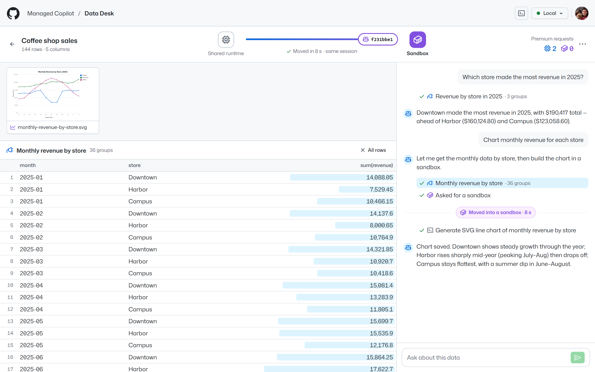
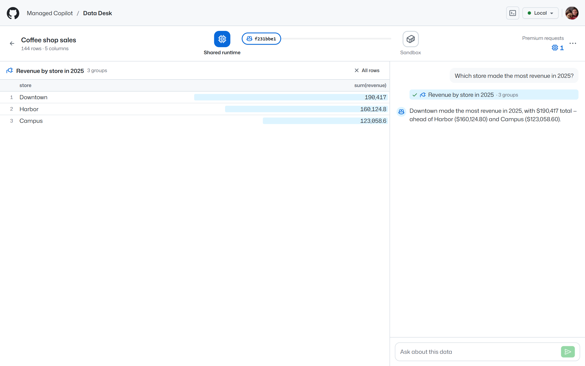
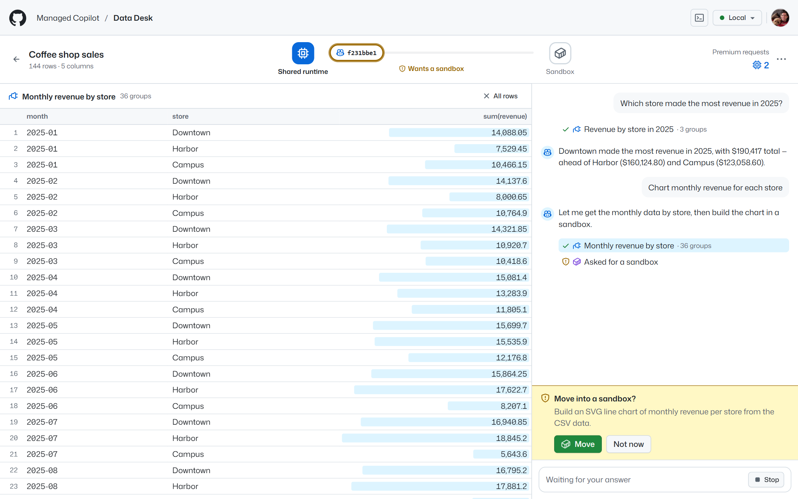
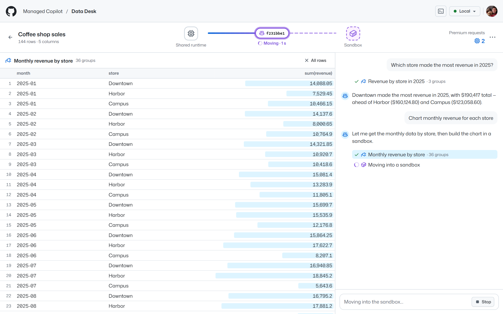

# Data Desk

Chat with a spreadsheet. Questions the app's own tools can answer run on the **shared runtime**; ask for a chart and
the agent asks to move, and the **same session** continues in its own Python sandbox, with an attached Copilot CLI
following it. It is the **promotable** pattern ([promotion](../../docs/concepts/promotion.md),
[spec section 9](../../docs/spec/developer-experience.md#9-promotable-start-cheap-move-when-needed)) in an app:
ordinary Node code on the stock `@github/copilot-sdk` and `@managed-copilot/sdk`.



*After the move. The first question was answered on the shared runtime with Data Desk's tools; the chart request moved
the session into its sandbox in a few seconds. The session ID on the track never changed, and the premium request count
carried across the move.*

## What it shows

- **Start cheap.** A new analysis is a session on the shared runtime: nothing to set up, nothing to pay for in compute.
  Data Desk's tools (`describe_dataset`, `query_rows`, `aggregate`) run in the app, and their tables show in the grid.
- **Move when the work needs code.** For a chart, a regression, or anything else that needs code, the agent calls the
  platform's `request_sandbox` tool. Data Desk asks you (**Move** or **Not now**), and the platform moves the session,
  history and all, into a sandbox with Python and no network.
- **The same session, visibly.** The placement track shows where the session runs, and its ID stays the same across the
  move. Premium requests (`session.usage.getMetrics`) keep counting: the meter splits them into before and after.
- **The data follows.** When `session.promoted` arrives, Data Desk writes the dataset into the sandbox
  (`managed.files`), and holds the agent's first command until it's there.
- **Charts come back.** The agent saves SVG charts under `outputs/`; they publish when its turn ends, and Data Desk
  shows them as cards you can open full size.
- **Copilot CLI follows.** **Open in Copilot CLI** (the terminal icon in the header) attaches to the same session.
  During the move it says *Connection lost. Reconnecting…*, reconnects to the sandbox by itself, and keeps going;
  messages typed there show in Data Desk, labeled **Copilot CLI**.
- **An insight becomes a work order.** **Send to Software Factory** hands what you pick (the table on screen, rows you
  selected, other tables, charts, the dataset, and Copilot's latest answer) to the
  [Software Factory](../software-factory/README.md) demo with what it should build. The work order shows it came from
  Data Desk, and the conversation follows its status.



*Before the move: Data Desk's `aggregate` tool answered on the shared runtime, and its table fills the grid.*



*The agent asks to move. Nothing is allocated until you choose **Move**.*



*Moving: the platform creates the sandbox, pauses the turn, carries the session over, and resumes the same turn there.*

## Demo it

1. Open Data Desk and pick **Coffee shop sales**.
2. Click **Which store made the most revenue in 2025?** It's answered on the shared runtime, and the table shows in the
   grid. The meter shows one premium request, on the shared runtime.
3. Click the terminal icon to open the session in Copilot CLI (on Windows it opens a window; elsewhere copy the
   command).
4. Click **Chart monthly revenue for each store**, then **Move**. Watch the track: the session slides into its sandbox
   with the same ID, and Copilot CLI reconnects.
5. Open the chart. Ask a follow-up, such as "Add a three-month moving average", here or in Copilot CLI: it runs in the
   sandbox right away.

The other samples work the same way: **City bike rides** (ask for rides against temperature with a trend line) and
**Support tickets** (does resolution time affect satisfaction?). **Upload a CSV** to bring your own, up to 5 MB.

### From an insight to a UX experiment

**Storefront checkout funnel** is twelve weeks of Contoso Outdoors checkouts by device and cart value, with how many
shoppers reached the shipping step, the payment step, and an order. Free shipping starts at $50; below that, the
shipping step adds a $5.99 fee. The story continues in [Software Factory](../software-factory/README.md), which
`aspire run` starts too.

1. Pick **Storefront checkout funnel** and click **Where do mobile shoppers drop out of checkout, by cart value?** Data
   Desk's tools answer on the shared runtime, and the table shows in the grid.
2. The insight: mobile shoppers with $40–$49 carts drop out at the shipping step, where the fee appears. Fewer than half
   of them go on to payment, against about 80% on desktop in the same band and about 85% for mobile carts at $50–$74,
   which ship free. It holds every week.
3. Select the rows that tell it in the grid (click a row's checkbox, shift-click for a range, or use the arrow keys), or
   keep Copilot's whole table. **Chart shipping-step drop-off by cart value for each device** adds a chart, which goes
   with the current view.
4. Click **Send to Software Factory** (the workflow icon in the top bar, or in the bar that counts the selected rows).
   Keep the current view, the selected rows, and Copilot's latest answer; add the whole dataset if you like. Say what to
   build, for example: *Build a free-shipping progress bar experiment for mobile carts under $50 ("Add $6.50 for free
   shipping"): variant assignment, the bar's copy and threshold logic, and the metrics to watch: mobile checkout
   conversion, with average order value as a guardrail.*
5. The conversation shows **Sent to Software Factory: WO-0012 · Queued**, and the status follows the work order.
   **Open in Software Factory**: the factory's floor shows the work order came from Data Desk, with a link back to the
   analysis, and its planner reads the insight and the data you sent.

## Run it

Everything runs locally against real models. You need the repository's prerequisites (see
[AGENTS.md](../../AGENTS.md)) and a GitHub sign-in with Copilot (`gh auth login`).

```powershell
pnpm install
pnpm build
aspire run          # the platform, sandboxes, and the demos; open the "data-desk" resource
```

Data Desk opens at <http://localhost:7430>. Measured live on a local deployment: the shared-runtime answer took 4
seconds, the move 4 to 8 seconds (about 10 with Copilot CLI attached, which is paused and reconnected), and the chart
request about 30 seconds from message to chart, approval included.

`pnpm --filter @managed-copilot/demo-data-desk happy-path` runs one real pass through the API, the move included, and
deletes what it created (about two premium requests). Pass `--url` for another deployment.

To run it against another deployment, set `MANAGED_COPILOT_URL` and run `pnpm dev` in `demos/data-desk`; the
deployment must declare Data Desk's environments ([`apphost.mts`](apphost.mts) exports them as plain data).
`aspire deploy` publishes it with the root AppHost, next to the other demos ([deployment](../../docs/deployment.md)).

## How it works

| Environment | Type | Network | What it's for |
| --- | --- | --- | --- |
| `data-desk` | promotable, `promoteTo: "data-desk-python"` | off | where every analysis starts: the shared runtime |
| `data-desk-python` | isolated, small | off | the sandbox a session moves into: Python 3 and its standard library |

- **An analysis is a session.** Data Desk keeps one stock `CopilotClient` for `data-desk` and creates each analysis with
  `client.createSession`: its three tools (`defineTool`, `skipPermission: true`), a short system message that names
  the dataset and where it will be in the sandbox, and a permission handler. The system message is the session's
  configuration, so the platform gives it to the sandbox runtime too.
- **The move is a permission.** `request_sandbox` reaches the permission handler as a `custom-tool` request. Data Desk
  holds the handler's promise until you answer, then resolves it with `approve-once` or `reject` (and a reason the agent
  reads). The platform then moves the session and continues the same turn in the sandbox; the one `session.promoted`
  platform event (`managed.on`) carries the sandbox and how long the move took.
- **The dataset goes in before the first command.** On `session.promoted`, Data Desk writes the file to
  `data/<file>.csv` with `managed.files(session).write`. Commands and file changes in the sandbox (`shell`, `write`,
  `read` permission requests) are approved once that write has finished, so the agent's first command already finds
  it. The sandbox has no network, so other requests are refused.
- **The view comes from the session's own events**, live or from `session.getEvents()` after a restart: messages,
  each tool call as one line, the move marker (`request_sandbox` completing), and the grid's tables, which are the data
  tools' results in the history. Messages Data Desk didn't send came from another client, so they're labeled
  **Copilot CLI**.
- **Usage and outputs.** After each reply Data Desk reads `session.rpc.usage.getMetrics()`; the reading taken when
  `session.promoted` arrives is the shared runtime's share. `artifact.published` events say when to list
  `managed.artifacts(session)`; charts are served from there as images with a sandboxing content security policy, so
  an SVG from the sandbox can never run as part of the app.
- **State is the platform's.** Sessions, sandboxes, and charts live in Managed Copilot. Data Desk's own records
  (`.data/data-desk.json`) keep each analysis's dataset, the messages it sent, the move it saw, the last usage it read,
  and the work orders it sent to Software Factory. Uploaded files are kept in `.data/uploads`: the newest 10, up to
  20 MB in all, and another upload drops the oldest. Only the most recently used ones stay parsed in memory (5 MB of
  files), so memory stays bounded.
- **Send to Software Factory.** Data Desk's server composes the work order from what the person picked: `INSIGHT.md`
  (what to build, Copilot's latest answer and the question it answered, the dataset's columns, and how each attached
  file was made), each table as CSV under `data/` (selected rows as `data/<table>-selection.csv`, the whole dataset as
  `data/<file>.csv`), and charts and text files under `artifacts/`. It checks the factory's limits first (12 files,
  256 KB each, 512 KB together) and says what to send less of. Then it calls `POST /api/work-orders` on
  `SOFTWARE_FACTORY_URL` with a brief (what to build first, then the insight in short), two review rounds, and an
  `origin`: Data Desk, the analysis and its dataset, a link back to the analysis, and the key `<session ID>:<n>`. The
  factory writes the files to `.factory/context/` in each of its sandboxes. Data Desk records the work order on the
  analysis and reads `GET /api/work-orders` every 5 seconds while any of its work orders is active, after a restart
  too; a work order sent just before a restart is found again by its key.

## Configuration

| Variable | Default | Purpose |
| --- | --- | --- |
| `PORT` | `7430` | HTTP port for the UI and API |
| `HOST` | `127.0.0.1` | Interface to listen on (`0.0.0.0` in a container, together with `DATA_DESK_ALLOWED_HOSTS`) |
| `MANAGED_COPILOT_URL` | local discovery | Gateway URL (Aspire sets it) |
| `DATA_DESK_ENVIRONMENT` | `data-desk` | The promotable environment analyses start in |
| `DATA_DESK_MODEL` | `claude-sonnet-5` | The agent's model |
| `DATA_DESK_DATA_DIR` | `.data` | Data Desk's records and uploaded files |
| `DATA_DESK_ALLOWED_HOSTS` | none | Extra host names allowed to address the server (it accepts loopback names only by default) |
| `DATA_DESK_ATTACH_URL` | none | Gateway URL added to "Open in Copilot CLI" commands (`--url`) when people reach the platform at another address |
| `SOFTWARE_FACTORY_URL` | none (the root AppHost sets it) | Software Factory's API, called from Data Desk's server. Unset, **Send to Software Factory** is off and says why |
| `SOFTWARE_FACTORY_PUBLIC_URL` | `SOFTWARE_FACTORY_URL` | Software Factory's address for people: the links to work orders |

## Layout

| Path | Contents |
| --- | --- |
| `apphost.mts` | AppHost fragment: the promotable environment, its Python sandbox environment, and the app resource |
| `datasets` | The four sample CSV files |
| `src/server` | Platform connection, analyses (one session each), the tools and tables, the event projection, the hand-off to Software Factory (`handoff.ts`, `factory.ts`), REST and server-sent events |
| `src/shared` | Types, routes, and Software Factory's limits, shared with the UI |
| `src/web` | The UI (React, Tailwind, and GitHub's Primer look from [`libraries/github-theme`](../../libraries/github-theme); light and dark follow the OS) |
| `src/scripts/happy-path.ts` | The scripted real run |
| `test` | Unit tests: tables, datasets (the checkout funnel's insight included), the projection, analyses and the move against an in-memory platform, the hand-off against an in-memory Software Factory, the API, and the fragment |
| `Dockerfile` | The container `aspire deploy` publishes |
