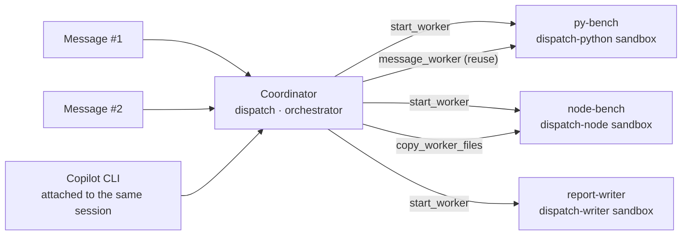
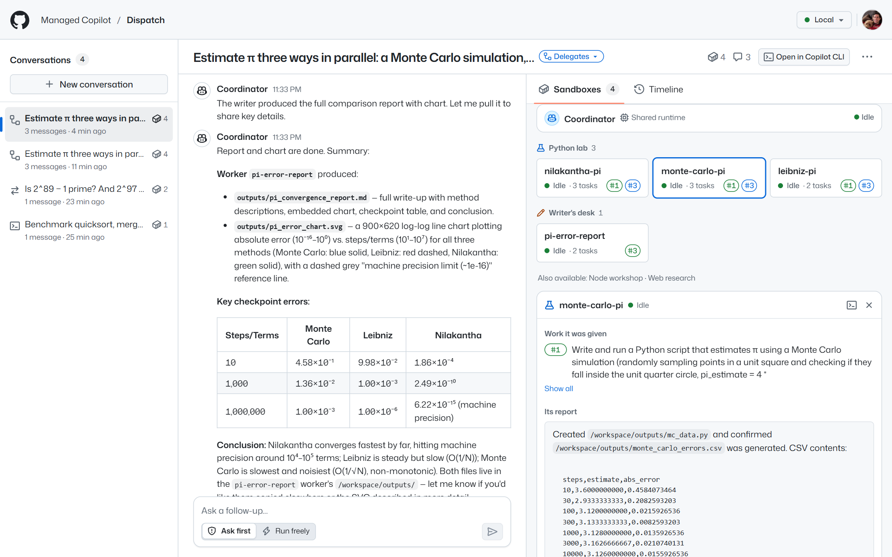
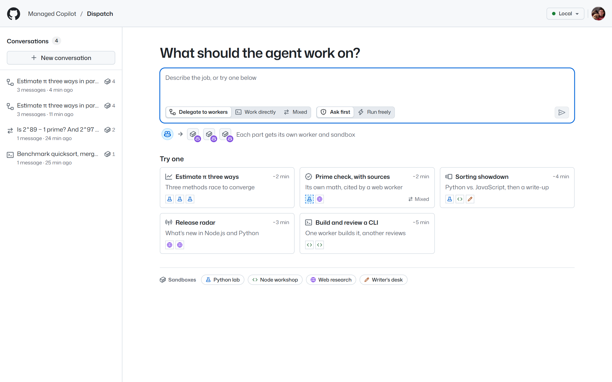
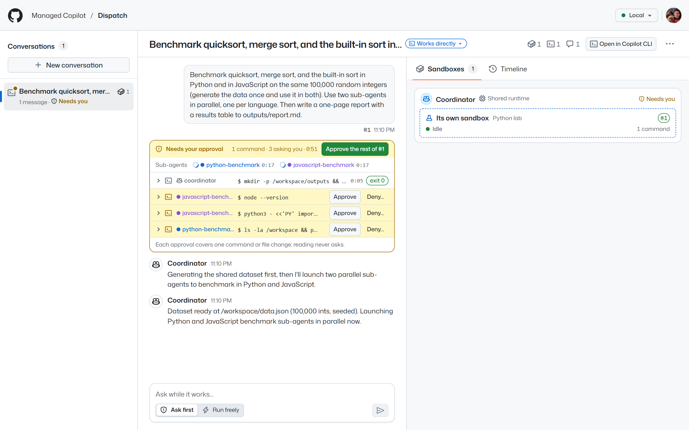
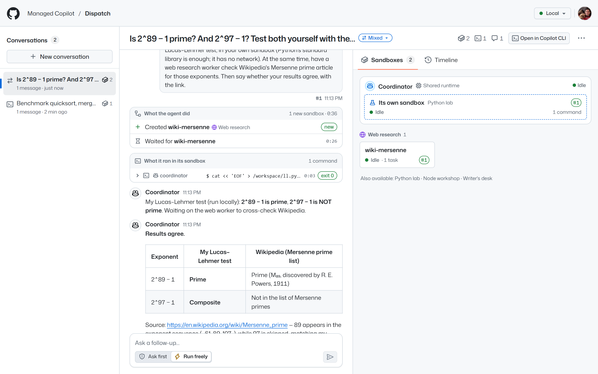

# Dispatch

Talk to one agent, and watch it build the environments your request needs. Dispatch is a chat with an
**orchestrator** agent on **Managed Copilot** ([spec section 17](../../docs/spec/developer-experience.md)). A switch in
the home page's message box picks how the coordinator gets the work done: **Delegate to workers** (it creates worker agents,
each in a sandbox of its own, or sends work to the ones it has), **Work directly** (it and its sub-agents run commands
and edit files themselves, in one sandbox with no agent in it), or **Mixed** (either, as it sees fit). Dispatch shows
each decision, each sandbox, and each command as it happens. The app is ordinary Node code built on the stock
`@github/copilot-sdk` and `@managed-copilot/sdk`.


*Delegate to workers: estimating π three ways. Message #1 started three workers, each in a Python lab sandbox of its
own. #2 sent a rerun to `monte-carlo-pi`, which already had the code, and #3 sent follow-ups to all three, created
`pi-error-report` in a writer's desk, and copied their results into it (the first copies failed while it was still
starting, so they show as **retried**). Each message's **What the agent did** card lists the coordinator's decisions.
The right pane shows the coordinator and only the blueprints in use; a tile's green badge is the message that created
it, and its blue badge the last one that reused it.*



## What it shows

- **One conversation, many environments.** A conversation is one coordinator session. It keeps its workers between
  messages, so a follow-up such as "add insertion sort to both benchmarks" goes to the sandboxes that already have the
  data instead of starting over.
- **Decisions you can follow.** Each user message gets a card with what the coordinator did for it: sandboxes it
  created (**new**), work it sent to existing ones (**reused**), files it copied between sandboxes, workers it stopped,
  and how long it waited for them. A step that failed and was then redone shows as **retried**. The coordinator spends
  no model time while it waits.
- **Blueprints, not one-off containers.** The AppHost declares four worker environments with their own size and
  network policy: a Python lab (network off), a Node workshop (the npm registry only), web research (a short
  allowlist of documentation sites), and a writer's desk (network off). The coordinator's instructions describe them,
  and it picks one for each part of a request.
- **You approve each new sandbox.** By default (**Ask first**), starting a worker asks first, and approving it also
  covers what that worker does in its sandbox. Deny with a reason ("give each method its own sandbox") and the
  coordinator tries again your way. Work sent to existing sandboxes never asks. Switch a conversation to **Run freely**
  (the toggle under its message box) to skip the questions.
- **The same session, from anywhere.** **Open in Copilot CLI** attaches Copilot CLI to the coordinator session (or to
  any worker's). Messages typed there appear in Dispatch, labeled **from Copilot CLI**, and the coordinator answers in
  both. Messages sent while the coordinator works go in right away: it answers between waits, then keeps waiting. While
  Dispatch has a conversation open, it answers that conversation's sandbox requests: the platform gives each request
  to the app holding it, so Copilot CLI can't approve it there, but Esc in Copilot CLI cancels its turn, and Dispatch
  drops the request.


*Asked first for one sandbox, the person declined with a reason ("give each method its own sandbox so they run in
parallel"); the coordinator followed it and asked for three. Each request shows in the chat and as a dashed tile in
its blueprint's lane, where it can be approved or denied too.*


*The **Timeline** tab: when each sandbox was preparing, working, or idle, against the messages that drove it (hover a
bar for what it means and how long it lasted).*

Select a sandbox to see the work it was given (each task with the message it came from, the first three lines until
you ask for all), its latest report, and its files (click one to read it; published outputs are marked). Its
blueprint, size, network policy, sandbox ID, model, and the command that opens it in Copilot CLI are under
**Details**.



## Three ways to get the work done

A multi-tenant harness doesn't always want an agent per sandbox: sometimes it wants its own agent and sub-agents to act
in a sandbox directly. Dispatch shows both, side by side, on the same worker environments. On the home page, the switch
in the message box picks a new conversation's style, and a one-line diagram under it shows that style: the coordinator
(its brain, on the shared runtime) and the sandboxes it works through (its hands). A conversation keeps the style it was
created with; its header shows it, and the badge's popover names the coordinator's environment and model. To try
another style, start a new conversation.



| Style | Environment | What the coordinator does | What a message's card shows |
| --- | --- | --- | --- |
| **Delegate to workers** | `dispatch` | Creates worker agents in sandboxes of the four blueprints, and sends follow-ups to the ones it has | **What the agent did**: sandboxes created and reused, files copied, waits |
| **Work directly** | `dispatch-direct` | Runs `bash`, `create`, `edit`, `view`, … itself in one Python lab sandbox (Python and Node, no network), and starts stock sub-agents with `task` for parallel parts; they share the sandbox | **What it ran in its sandbox**: every command and file change, by the coordinator or a named sub-agent, with exit codes and output |
| **Mixed** | `dispatch-mixed` | Works in its own Python lab sandbox, and creates workers in any blueprint when a part needs another environment or should run on its own; the model decides | Both cards |


*Work directly. The coordinator generated the data, then two sub-agents (**python-benchmark** and
**javascript-benchmark**, each with its color) wrote and ran their benchmarks in the same sandbox, and the coordinator
wrote the report. Click a row for its output. In the right pane, the coordinator's card holds **its own sandbox**
(dashed: no agent runs in it, so it has no task or report) with the sub-agents working there; selected, it lists the
commands the platform recorded (`managed.exec.list`), with the agent that ran each one, and its files.*

In direct and mixed conversations, every `bash`, `write_bash`, `create`, and `edit` asks first (reading files and
output never asks). There can be many per message, so each request shows inline, in the message's list, with
**Approve** and **Deny…** (with an optional reason the agent is told). **Approve the rest of #N**, in the card's header,
approves the waiting ones and every later command and file change for the same message. **Run freely** skips the
questions.





*Mixed, with the **Prime check, with sources** template. In one message the coordinator tested 2^89 − 1 and 2^97 − 1
itself, in its own Python lab sandbox (no network), and created `wiki-mersenne`, a web research worker, to check
Wikipedia, since only that blueprint can reach it. Its answer compares the two, with the link.*

## Run it

Everything runs locally against real models. You need the repository's prerequisites (see
[AGENTS.md](../../AGENTS.md)) and a GitHub sign-in with Copilot (`gh auth login`).

```powershell
pnpm install
pnpm build
aspire run          # the platform, sandboxes, and the demos; open the "dispatch" resource
```

Dispatch opens at <http://localhost:7470>. Pick a style and a template, such as **Estimate π three ways**, and send
it. Then try its follow-ups to watch the coordinator reuse its sandboxes; **Prime check, with sources** switches to
Mixed and shows both kinds of hands in one message. Measured live on a local deployment: estimating π three ways (three
Python sandboxes in parallel) took 49 seconds from message to answer, approvals included; its chart follow-up (one
sandbox reused, a writer's sandbox created) took 87 seconds; and the sorting showdown's insertion sort follow-up, which
reused all three of its sandboxes, took 57 seconds. Working directly, two sub-agents counting primes and Fibonacci
digits in one sandbox took 17 seconds once approved. Mixed, the prime check (its own sandbox and a web research worker,
running freely) took about 40 seconds.

### Work on the UI without a platform

`pnpm exec vite` in `demos/dispatch` serves the UI alone; open it with `?preview` to run it against fixture data: a
delegating conversation with four sandboxes (one reused), a direct one with sub-agents, a mixed one, pending sandbox
and command approvals, and the timeline. New messages play a short simulated run. `?preview=empty`, `azure`,
`connecting`, `unavailable`, or `offline` shows other states, and `&banner=0` hides the preview's banner. The preview
exists only in Vite's dev mode (`import.meta.env.DEV`); production builds don't include it.

### Against another deployment

Dispatch connects like any SDK app: `MANAGED_COPILOT_URL` and your GitHub sign-in. The deployment must declare
Dispatch's environments ([`apphost.mts`](apphost.mts) exports them as plain data).

```powershell
cd demos/dispatch
$env:MANAGED_COPILOT_URL = "https://<your gateway>"
pnpm dev                                       # server and UI with live reload on :7470
```

`aspire deploy` publishes Dispatch with the root AppHost, next to the other demos (see
[docs/deployment.md](../../docs/deployment.md), including who can open the apps). It has been verified on Azure:
approved Python and web-research workers ran in their own Container Apps sandboxes, a follow-up from an attached
Copilot CLI reused one of them, and deleting the conversation deleted all three sessions.

## How it works

- **The conversation is the coordinator session.** Dispatch keeps one stock `CopilotClient` per style's orchestrator
  environment (`dispatch`, `dispatch-direct`, `dispatch-mixed`; `/v1/info` reports each one's `execution`) and creates
  the conversation with `client.createSession` on the chosen one, with streaming on and a short addition to the
  coordinator's instructions for that style (name workers and sub-agents clearly, always choose an environment, save
  deliverables in `outputs/`). The platform supplies the worker or hands tools and the list of worker environments.
  After a restart, conversations are rediscovered in all three environments and resumed on their own client.
- **Decisions come from the session's own events.** `tool.execution_start` and `tool.execution_complete` for the
  worker tools, and `permission.requested` and `permission.completed` for sandbox requests, are projected into the
  card under the message that caused them. In direct and mixed conversations, the hands tools' calls (`bash`,
  `create`, `edit`, `view`, …) are projected the same way, including sub-agents' (their events carry the sub-agent's
  `agentId`; `subagent.started`, `subagent.completed`, and `subagent.failed` name it and say when it ended), and each
  `bash` result's status line gives the exit code. Sub-agents' events are persisted, so the commands rebuild from
  history too. The projection is replayable: after a restart, Dispatch resumes each
  session and rebuilds the same view from `session.getEvents()`. History never contains `session.idle` (it's
  ephemeral), so a turn counts as over when the next one starts or when the platform reports it finished, and events
  that arrive while the history loads are placed by their timestamps. Each decision is resolved to its worker's session
  ID, so a name the coordinator reuses after stopping a worker never mixes the two up.
- **Approvals use the SDK's permission handler.** `start_worker` asks for permission, and so (direct and mixed) do
  `bash`, `write_bash`, `create`, and `edit`, as `custom-tool` requests with the tool's arguments. Dispatch holds the
  handler's promise until you answer and resolves it with `approve-once` or `reject` (with your reason as feedback);
  **Approve the rest of #N** is recorded in Dispatch's file and answers that message's later requests at once. If
  the request ends some other way (its turn is cancelled, or it was answered while Dispatch was away), Dispatch lets go
  as soon as `permission.completed` or the turn's end arrives. If Dispatch restarts first, it releases the handler
  without answering; the platform keeps the prompt and asks again when the session is resumed.
- **Workers come from the platform.** `managed.workers(session).list()` gives each worker's state, task, and report,
  and the `worker.*` platform events say when to look again. A direct or mixed coordinator's own sandbox is listed
  there too, with `role: "hands"`; it has no task, report, or agent to attach to, and its outputs publish at the end
  of each coordinator turn. `managed.exec.list(hands)` gives every command run in it, with the calling agent.
  `managed.sessions.get(worker)` gives a sandbox, `managed.files(worker)` its workspace (listed every few seconds while
  it works), and `managed.artifacts(worker)` its published outputs.
- **State is the platform's.** Conversations are the orchestrator environment's sessions, rediscovered after every
  connection, so a lost data directory loses nothing that matters. Dispatch's own file (`.data/dispatch.json`) keeps
  each conversation's approval setting and orchestrator environment, the messages whose remaining commands were approved, which messages it sent (so others can be labeled), and what it saw of each
  worker (its state changes and outputs) for the timeline.
- **Outages pause the view, not the work.** The connection is checked every 15 seconds and re-established with
  jittered backoff. Conversations and their workers keep running on the platform meanwhile; Dispatch resumes them
  when it reconnects.

## Configuration

| Variable | Default | Purpose |
| --- | --- | --- |
| `PORT` | `7470` | HTTP port for the UI and API |
| `HOST` | `127.0.0.1` | Interface to listen on (`0.0.0.0` in a container, together with `DISPATCH_ALLOWED_HOSTS`) |
| `MANAGED_COPILOT_URL` | local discovery | Gateway URL (Aspire sets it) |
| `DISPATCH_ENVIRONMENT` | `dispatch` | The delegate style's orchestrator environment |
| `DISPATCH_DIRECT_ENVIRONMENT` | `<DISPATCH_ENVIRONMENT>-direct` | The direct style's orchestrator environment |
| `DISPATCH_MIXED_ENVIRONMENT` | `<DISPATCH_ENVIRONMENT>-mixed` | The mixed style's orchestrator environment |
| `DISPATCH_STYLE` | `delegate` | New conversations' style when the person hasn't picked one: `delegate`, `direct`, or `mixed` |
| `DISPATCH_MODEL` | `claude-sonnet-5` | The coordinator's model |
| `DISPATCH_APPROVALS` | `ask` | New conversations' default: `ask` before each new sandbox (and, direct and mixed, each command), or `auto` |
| `DISPATCH_DATA_DIR` | `.data` | Dispatch's small record of settings and what it saw |
| `DISPATCH_ALLOWED_HOSTS` | none | Extra host names allowed to address the server (it accepts loopback names only by default) |
| `DISPATCH_ATTACH_URL` | none | Gateway URL added to "Open in Copilot CLI" commands (`--url`) when users reach the platform at another address, as in a cloud deployment |
| `DISPATCH_NPM_REGISTRY` | `npm config get registry` | Read by the AppHost fragment: the one host the Node sandboxes can reach |

## Layout

| Path | Contents |
| --- | --- |
| `apphost.mts` | AppHost fragment: the three orchestrator environments (one per execution style), their four worker environments, and the app resource |
| `src/server` | Platform connection, conversations (one coordinator session each), the event projection, REST and server-sent events |
| `src/shared` | Types shared with the UI, blueprint labels, and templates |
| `src/web` | The UI (React, Tailwind, and GitHub's Primer look from [`libraries/github-theme`](../../libraries/github-theme); light and dark follow the OS); `src/web/dev` is the fixture preview (`?preview`, Vite dev mode only) |
| `test` | Unit tests: the projection, conversations and approvals against an in-memory platform, the API, the fragment, and the UI's store and helpers |
| `Dockerfile` | The container `aspire deploy` publishes |
