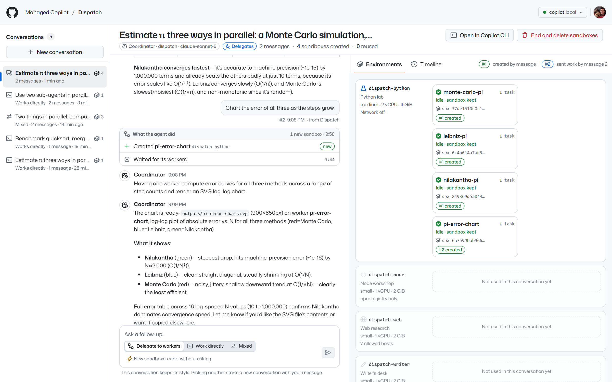
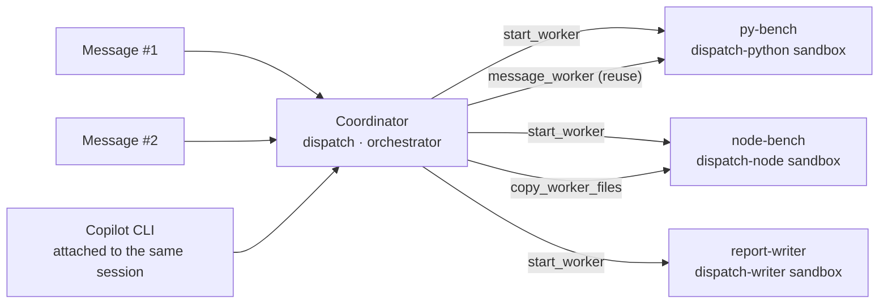
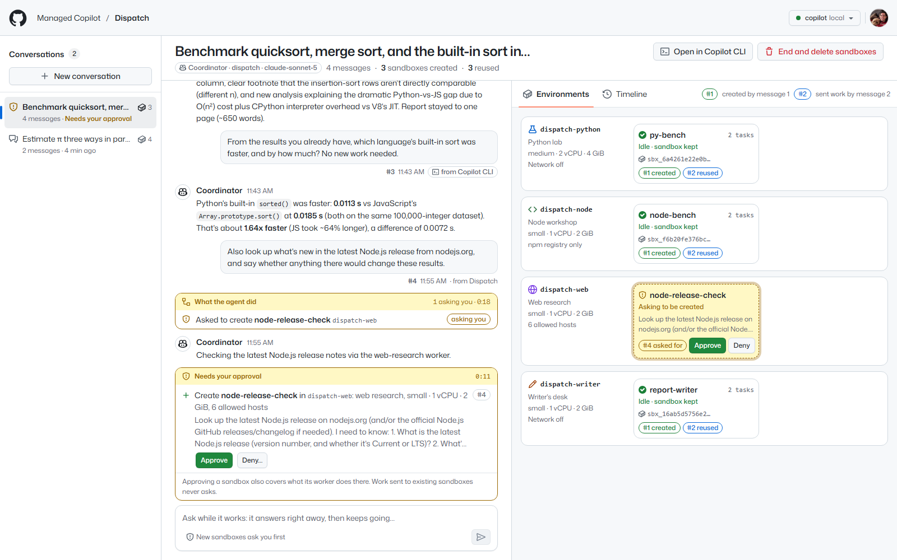
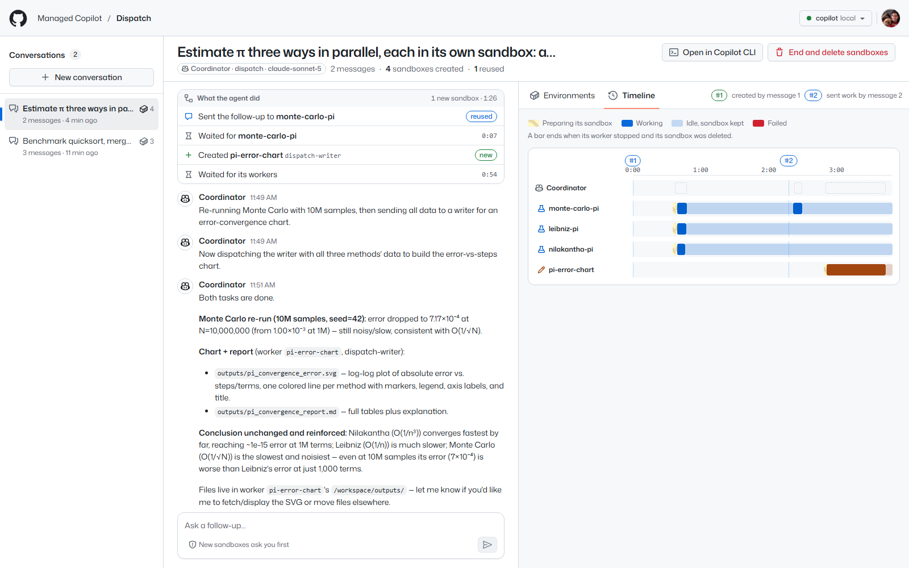

# Dispatch

Talk to one agent, and watch it build the environments your request needs. Dispatch is a chat with an
**orchestrator** agent on **Managed Copilot** ([spec section 17](../../docs/spec/developer-experience.md)). For every
message, the coordinator decides whether to create new sandboxes for the work or to send it to sandboxes it already
has. Dispatch shows each decision and each sandbox as it happens. The app is ordinary Node code built on the stock
`@github/copilot-sdk` and `@managed-copilot/sdk`.



*Estimating π three ways. Message #1 started three workers, each in its own Python sandbox. Message #2 sent more work
to `monte-carlo-pi` (**#2 reused**) and created `pi-error-chart` in the writer's sandbox (**#2 created**). Each
message's **What the agent did** card lists the coordinator's decisions; the right pane groups the sandboxes by the
blueprint they were made from.*



## What it shows

- **One conversation, many environments.** A conversation is one coordinator session. It keeps its workers between
  messages, so a follow-up such as "add insertion sort to both benchmarks" goes to the sandboxes that already have the
  data instead of starting over.
- **Decisions you can follow.** Each user message gets a card with what the coordinator did for it: sandboxes it
  created (**new**), work it sent to existing ones (**reused**), files it copied between sandboxes, workers it stopped,
  and how long it waited for them. The coordinator spends no model time while it waits.
- **Blueprints, not one-off containers.** The AppHost declares four worker environments with their own size and
  network policy: a Python lab (network off), a Node workshop (the npm registry only), web research (a short
  allowlist of documentation sites), and a writer's desk (network off). The coordinator's instructions describe them,
  and it picks one for each part of a request.
- **You approve each new sandbox.** By default, starting a worker asks first, and approving it also covers what that
  worker does in its sandbox. Deny with a reason ("this is Node work, use the Node environment") and the coordinator
  tries again your way. Work sent to existing sandboxes never asks. Switch a conversation to **Create freely** to skip
  the questions.
- **The same session, from anywhere.** **Open in Copilot CLI** attaches Copilot CLI to the coordinator session (or to
  any worker's). Messages typed there appear in Dispatch, labeled **from Copilot CLI**, and the coordinator answers in
  both. Messages sent while the coordinator works go in right away: it answers between waits, then keeps waiting. While
  Dispatch has a conversation open, it answers that conversation's sandbox requests: the platform gives each request
  to the app holding it, so Copilot CLI can't approve it there, but Esc in Copilot CLI cancels its turn, and Dispatch
  drops the request.



*Message #4 needs web access, so the coordinator asks to create a sandbox from the web research blueprint. The request
appears in the chat and in that blueprint's row. Message #3 above it was typed in Copilot CLI.*



*The **Timeline** tab: when each sandbox was preparing, working, or idle, against the messages that drove it.*

Select a sandbox to see its blueprint, size, network policy, and sandbox ID; its workspace files (click one to read
it) and published outputs; every task it was given, with the message it came from; its latest report; and the command
that opens it in Copilot CLI.

## Run it

Everything runs locally against real models. You need the repository's prerequisites (see
[AGENTS.md](../../AGENTS.md)) and a GitHub sign-in with Copilot (`gh auth login`).

```powershell
pnpm install
pnpm build
aspire run          # the platform, sandboxes, and the demos; open the "dispatch" resource
```

Dispatch opens at <http://localhost:7470>. Pick a template, such as **Estimate π three ways**, and send it. Then try
its follow-ups to watch the coordinator reuse its sandboxes. Measured live on a local deployment: estimating π three
ways (three Python sandboxes in parallel) took 49 seconds from message to answer, approvals included; its chart
follow-up (one sandbox reused, a writer's sandbox created) took 87 seconds; and the sorting showdown's insertion sort
follow-up, which reused all three of its sandboxes, took 57 seconds.

### Against another deployment

Dispatch connects like any SDK app: `MANAGED_COPILOT_URL` and your GitHub sign-in. The deployment must declare
Dispatch's environments ([`apphost.mts`](apphost.mts) exports them as plain data).

```powershell
cd demos/dispatch
$env:MANAGED_COPILOT_URL = "https://<your gateway>"
pnpm dev                                       # server and UI with live reload on :7470
```

## How it works

- **The conversation is the coordinator session.** Dispatch creates it with `client.createSession` on a stock
  `CopilotClient` for the `dispatch` environment, with streaming on and a short addition to the coordinator's
  instructions (name workers clearly, always choose an environment, prefer reusing a sandbox that has what the work
  needs). The platform supplies the worker tools and the list of worker environments.
- **Decisions come from the session's own events.** `tool.execution_start` and `tool.execution_complete` for the
  worker tools, and `permission.requested` and `permission.completed` for sandbox requests, are projected into the
  card under the message that caused them. The projection is replayable: after a restart, Dispatch resumes each
  session and rebuilds the same view from `session.getEvents()`. History never contains `session.idle` (it's
  ephemeral), so a turn counts as over when the next one starts or when the platform reports it finished, and events
  that arrive while the history loads are placed by their timestamps. Each decision is resolved to its worker's session
  ID, so a name the coordinator reuses after stopping a worker never mixes the two up.
- **Approvals use the SDK's permission handler.** Only `start_worker` asks for permission. Dispatch holds the
  handler's promise until you answer and resolves it with `approve-once` or `reject` (with your reason as feedback). If
  the request ends some other way (its turn is cancelled, or it was answered while Dispatch was away), Dispatch lets go
  as soon as `permission.completed` or the turn's end arrives. If Dispatch restarts first, it releases the handler
  without answering; the platform keeps the prompt and asks again when the session is resumed.
- **Workers come from the platform.** `managed.workers(session).list()` gives each worker's state, task, and report,
  and the `worker.*` platform events say when to look again. `managed.sessions.get(worker)` gives its sandbox,
  `managed.files(worker)` its workspace (listed every few seconds while it works), and `managed.artifacts(worker)` its
  published outputs.
- **State is the platform's.** Conversations are the orchestrator environment's sessions, rediscovered after every
  connection, so a lost data directory loses nothing that matters. Dispatch's own file (`.data/dispatch.json`) keeps
  each conversation's approval setting, which messages it sent (so others can be labeled), and what it saw of each
  worker (its state changes and outputs) for the timeline.
- **Outages pause the view, not the work.** The connection is checked every 15 seconds and re-established with
  jittered backoff. Conversations and their workers keep running on the platform meanwhile; Dispatch resumes them
  when it reconnects.

## Configuration

| Variable | Default | Purpose |
| --- | --- | --- |
| `PORT` | `7470` | HTTP port for the UI and API |
| `HOST` | `127.0.0.1` | Interface to listen on (`0.0.0.0` in a container, together with `DISPATCH_ALLOWED_HOSTS`) |
| `MANAGED_COPILOT_URL` | local discovery | Gateway URL (Aspire sets it) |
| `DISPATCH_ENVIRONMENT` | `dispatch` | The orchestrator environment conversations run in |
| `DISPATCH_MODEL` | `claude-sonnet-5` | The coordinator's model |
| `DISPATCH_APPROVALS` | `ask` | New conversations' default: `ask` before each new sandbox, or `auto` |
| `DISPATCH_DATA_DIR` | `.data` | Dispatch's small record of settings and what it saw |
| `DISPATCH_ALLOWED_HOSTS` | none | Extra host names allowed to address the server (it accepts loopback names only by default) |
| `DISPATCH_ATTACH_URL` | none | Gateway URL added to "Open in Copilot CLI" commands (`--url`) when users reach the platform at another address, as in a cloud deployment |
| `DISPATCH_NPM_REGISTRY` | `npm config get registry` | Read by the AppHost fragment: the one host the Node sandboxes can reach |

## Layout

| Path | Contents |
| --- | --- |
| `apphost.mts` | AppHost fragment: the orchestrator environment, its four worker environments, and the app resource |
| `src/server` | Platform connection, conversations (one coordinator session each), the event projection, REST and server-sent events |
| `src/shared` | Types shared with the UI, blueprint labels, and templates |
| `src/web` | The UI (React, Tailwind, and GitHub's Primer look from [`packages/github-theme`](../../packages/github-theme); light and dark follow the OS) |
| `test` | Unit tests: the projection, conversations and approvals against an in-memory platform, the API, and the fragment |
| `Dockerfile` | The container `aspire deploy` publishes |
