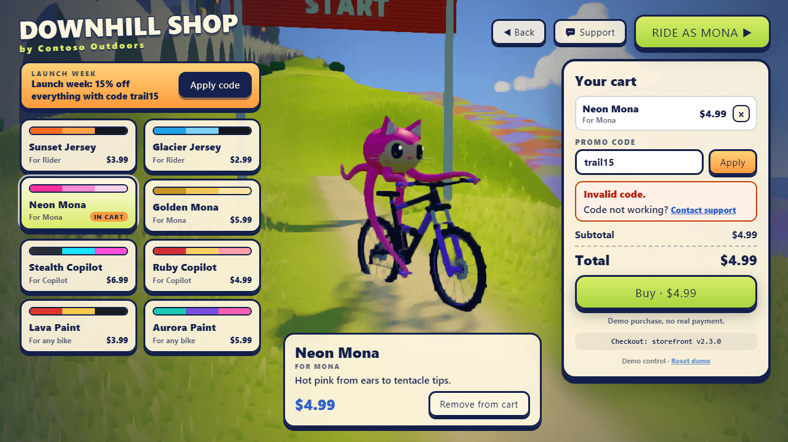
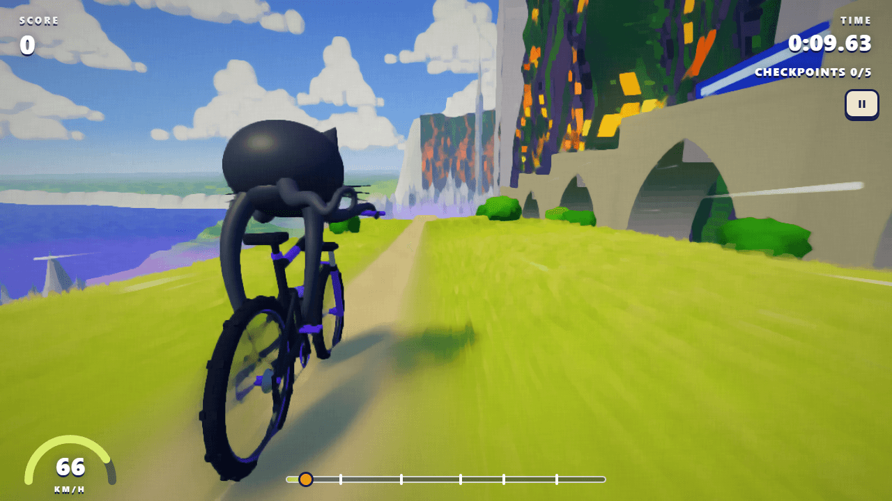
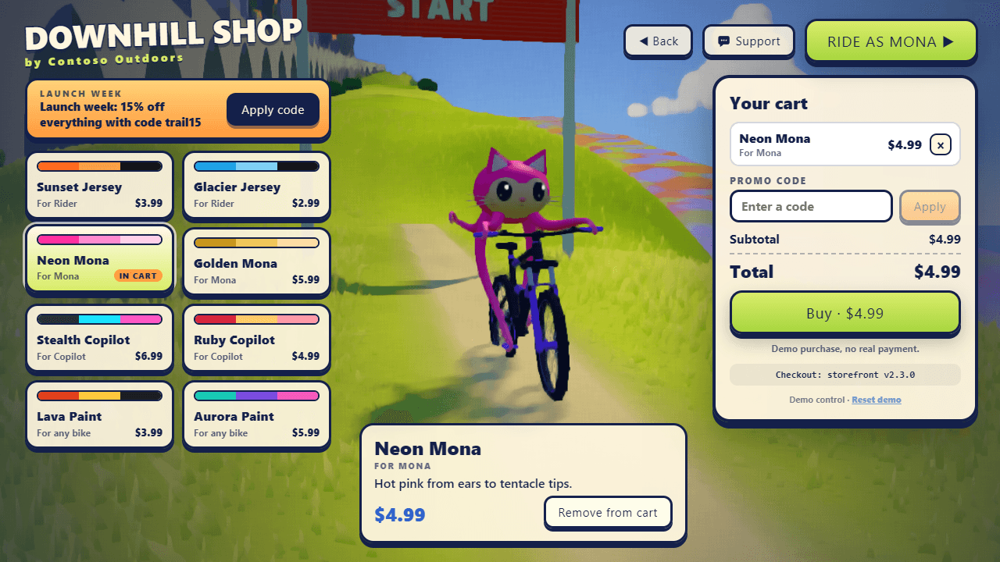
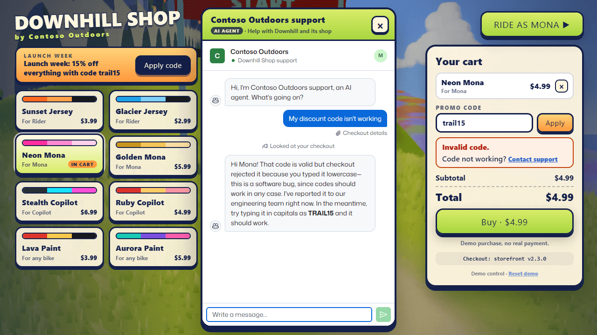
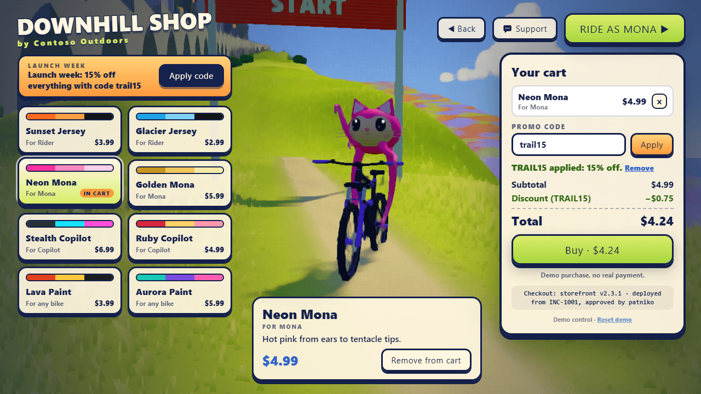

# Downhill

Launch day for Contoso Outdoors' new game: a painterly 3D mountain-biking game for the browser, with three riders, six
courses, and a few upgrades in the **Downhill Shop**. Ride a run, then pause and open the shop to buy a new look for
Mona, Copilot, or the painting's Rider, or a paint job for the bike. The shop's launch-week banner offers 15% off with
code `trail15`, and checkout rejects it. That one failure shows up everywhere:
- The shop's alert opens an incident in [Incident Commander](../incident-commander/README.md).
- The player tells the game's **Support** agent, Contoso Outdoors' AI agent in [Help Desk](../help-desk/README.md). The
  ticket appears live on Help Desk's wall.
- The failed sales reach [Data Desk](../data-desk/README.md), where a chart of promo sales shows the drop starting when
  the banner went live.

When a person approves Incident Commander's fix, it deploys to Downhill, and the same code works in the shop without
reloading the game. The game itself runs no agents: it's a stock Vite and Three.js app with a small Node server.



*The banner offers `trail15`; checkout, running Contoso Outdoors' storefront code, answers "Invalid code."*

## What it shows

- **One bug, seen from every side.** The player sees "Invalid code." in the shop. Incident Commander gets an alert,
  plus the shop's code, logs, and deploy history. Help Desk gets the player's complaint with the checkout attached.
  Data Desk gets the sales. Each demo answers its own question about the same failure.
- **The customer's side of support.** You're the player: a game you just bought into lets you down at checkout, and
  help is one click away inside the game. The agent greets you and you say what's wrong in your own words; the ticket
  already carries what happened at checkout.
- **A real bug in shipped code, fixed in production.** Checkout runs Contoso Outdoors' storefront code
  ([`demos/help-desk/storefront`](../help-desk/storefront/src/promotions.js)) as it shipped. It matches codes exactly,
  so the banner's own lowercase `trail15` fails while `TRAIL15` works. A deploy approved in Incident Commander replaces
  that code in the running game, and the shop's footer says which version checkout runs and where it came from.
- **A launch day with history.** The server simulates the hours since launch, so the alert, the logs, and the charts
  have a real shape before you click anything:
  - Before the banner, players type the newsletter's `TRAIL15` and get their discount.
  - Since the banner went live 45 minutes ago, most promo checkouts fail.
- **The game is the real thing.** Six painted worlds, three riders, tricks and combos, a cinematic camera, procedural
  audio, and an oil-paint post-processing pipeline. The looks you buy change the rider in the shop's live 3D preview,
  on the select screen, and on every ride.



*Racing works: ride, then pause and pick **Shop**.*

## Run it

Everything runs locally. You need the repository's prerequisites (see [AGENTS.md](../../AGENTS.md)). Support, the
alert, and the fix also need Help Desk and Incident Commander running, which need a GitHub sign-in with Copilot
(`gh auth login`).

```powershell
pnpm install
pnpm build
aspire run          # the platform and the demos; open the "downhill" resource
```

Downhill opens at <http://localhost:7455>. To demo launch day:

1. **Ride.** Click **RIDE**, pick **Mona**, and **DROP IN**. Ride a little: the shop is the second act, not the first.
2. **Open the shop.** Press **Esc** and click **Shop**. It's also on the title screen and on the results screen after a
   run.
3. **Pick a look.** Click **Neon Mona**: she appears in the live preview in hot pink. Click **Add to cart**.
4. **Try the launch code.** Click **Apply code** on the launch-week banner. Checkout says **Invalid code.**, and the
   shop's alert fires in Incident Commander.
5. **Ask support.** Click **Support**, or **Code not working? Contact support** under checkout's message.
   - Contoso Outdoors' AI agent greets you in a panel over the shop.
   - Type *My discount code isn't working*.
   - The ticket appears on Help Desk's wall with the code, checkout's message, and the cart.
6. **Chart it.** In Data Desk, chart promo sales from Downhill's sales: promo purchases collapse and rejections climb
   from the moment the banner went live.
7. **Ship the fix.** In Incident Commander, approve the fix.
   - With the shop still open, its footer changes to *Checkout: storefront v2.3.1 · deployed from INC-1004*.
   - **Apply code** now takes 15% off.

A few more things work along the way:
- Typing `TRAIL15` in capitals works all along: that's how the newsletter's readers got their discount.
- **Buy** makes a demo purchase (order `DH-1042`, no real payment). A receipt without the discount offers Contact
  support too.
- **Ride as Mona** drops you in wearing the new look.

**To rehearse,** use **Reset demo** under the cart, labelled as a demo control. It starts launch day over and clears
this browser's purchases and Downhill's live sales, deployed fixes, and alert, so the next run starts from the bug.
`POST /api/demo/reset` does the same for the server alone.

**What the browser keeps:** your purchases in `localStorage` (`downhill.shop`), and your support ticket for the
browser session in `sessionStorage`.

**Without the other demos** (just `pnpm --filter @managed-copilot/demo-downhill dev`, or `start` after a build):
- The game, the shop, and the sales ledger all work.
- Support says *Support isn't connected. Start Help Desk with `aspire run`, or set HELP_DESK_URL.*
- The server logs once that alerts and deploys are off.

The [`happy-path`](scripts/happy-path.ts) script plays the flow above in Microsoft Edge on a fresh profile:
1. It rides as Mona, opens the shop from the pause menu, and checks that checkout rejects `trail15` with "Invalid
   code."
2. It checks that the rejection is in the sales ledger.
3. It opens Support from the shop and types *My discount code isn't working* in the chat.
4. It checks that `TRAIL15` takes 15% off, buys at full price, and rides in the new look.

When Downhill's server has `HELP_DESK_URL`, Support opens one real ticket in Help Desk, whose agent answers with a real
model; otherwise the script checks the not-connected message. Options:
- `--reset` resets the demo first.
- `--screenshots docs/screenshots` refreshes the pictures in this README.

```powershell
pnpm --filter @managed-copilot/demo-downhill happy-path --reset                  # local, MANAGED_COPILOT_PORT_OFFSET applies
pnpm --filter @managed-copilot/demo-downhill happy-path --url https://downhill.<environment-domain>
```

`aspire deploy` publishes Downhill with the root AppHost, next to the other demos (see
[docs/deployment.md](../../docs/deployment.md)).

## Launch day

Times count back from the server's first start, which it keeps in its data directory, so restarts keep the same day.

| When | What happens |
| --- | --- |
| 3 hours before the first start | Launch: Downhill 1.0.0 opens its shop, and checkout runs storefront v2.3.0. A few players type the newsletter's `TRAIL15`, nearly always in capitals, and get 15% off; the odd lowercase `trail15` is rejected. |
| 45 minutes before | Downhill shop 1.1.0: the launch-week banner with one-click **Apply code**. Most promo attempts now come from the banner's lowercase `trail15`, and checkout rejects them: promo sales collapse and rejections climb. |
| Now | You ride, open the shop, and try the banner's code. Yours is the live rejection that fires the alert. |
| After a deploy | Checkout runs the fix. From the deploy on, the simulated players' banner codes go through. |

The simulated players are generated for every 5-minute bucket from launch up to now:
- **Deterministic.** Each bucket is seeded by the start time and the bucket.
- **Lazy.** Buckets are generated when asked for, so traffic keeps flowing however long the server runs.
- **Labelled.** They buy the shop's eight looks and are marked `simulated` in the sales and the logs.
- **Silent.** They never fire the alert; only a live player's rejection does.

## The shop, the code, and support



*Pick a look to try it on in the live preview. The cart and checkout are on the right, with the storefront version
checkout runs.*

The shop sells eight looks. A rider's outfit is for that rider; a paint job goes on whichever bike you ride.

| Look | For | Price | What changes |
| --- | --- | --- | --- |
| Sunset Jersey | Rider | $3.99 | Blaze-orange T-shirt (the sculpted body and the cloth-simulated hem and sleeves) |
| Glacier Jersey | Rider | $2.99 | Ice-blue T-shirt |
| Neon Mona | Mona | $4.99 | Hot pink head and tentacles |
| Golden Mona | Mona | $5.99 | Gold head and tentacles |
| Stealth Copilot | Copilot | $6.99 | Matte black shell, neon cyan trim, pink eyes |
| Ruby Copilot | Copilot | $4.99 | Candy red shell, gold trim, golden eyes |
| Lava Paint | Any bike | $3.99 | Molten red frame, ember-yellow details |
| Aurora Paint | Any bike | $5.99 | Teal frame, violet and pink details |

- **Buying.**
  - **Buy** makes a demo purchase (no real payment): an order number such as `DH-1042` and a receipt.
  - The looks bought are equipped at once. A rider's outfit also makes that rider the one you ride as, so the next ride
    shows it.
  - Owned looks can be worn or taken off from the shop at any time.
- **The code.**
  - The banner says *Launch week: 15% off everything with code trail15*. Its **Apply code** button puts `trail15`,
    exactly as the banner shows it, in the Promo code field and applies it.
  - Checkout calls `applyPromoCode` from whichever storefront version the server runs. As shipped, it only knows
    `TRAIL15`, so it throws `PromoError("Invalid code.")`, and the shop shows that message.
  - Typing `TRAIL15` in capitals works, as it does for Help Desk's customers.
  - The footer under the cart says which version checkout runs: *Checkout: storefront v2.3.0*, or after a fix,
    *Checkout: storefront v2.3.1 · deployed from INC-1001, approved by …*.
- **Support.**
  - A **Support** button with a speech bubble is on the title screen, in the pause menu, and in the shop.
    **Code not working? Contact support** under checkout's message, and on a receipt without the discount, opens the
    same panel.
  - The panel, *Contoso Outdoors support* with an **AI agent** badge, shows Help Desk's chat. Opening it never says
    anything for the player: the agent greets them, and they write the first message.
  - Opening it again in the same browser session reopens the same ticket, with whatever's new at checkout.
  - If support isn't connected or doesn't answer, the panel says why in plain words, with **Try again**.
  - Game keys are off while the shop or the panel is open.



*Support opened from the shop after the rejected code, under `aspire run`: Help Desk's real chat and agent. It looked
at the checkout, reported the bug, and suggested a workaround.*



*After Incident Commander's fix is deployed, the open shop picks it up. The footer names the version and the incident,
and the banner's code takes 15% off.*

### What support receives

The game sends Downhill's server `POST /api/support/tickets` with `{ player: { rider }, opener, ticketId?, checkout? }`:

- **`opener`**: `support-button`, `promo-error`, or `receipt`.
- **`ticketId`**: the ticket this browser session opened before (kept in `sessionStorage`), so opening support again
  reopens it.
- **`checkout`**: sent once the player has tried a code or bought something. It holds:
  - the last code tried and checkout's message;
  - the offer;
  - the cart and its subtotal (the latest order's items once the cart is empty);
  - the latest order.

The server checks it: shapes, a 16 KB body, at most 20 items, and text cut to sane lengths. It adds the rider's name,
the game's version, the browser's user agent, and the time. Then it sends Help Desk this, server to server with a
10-second timeout:

```http
POST {HELP_DESK_URL}/api/player-tickets
Content-Type: application/json

{
  "product": "downhill",
  "player": { "name": "Mona", "rider": "mona" },
  "opener": "promo-error",
  "ticketId": "mwd5egx7000002",
  "checkout": {
    "code": "trail15",
    "error": "Invalid code.",
    "offer": "Launch week: 15% off everything with code trail15",
    "items": [{ "sku": "mona-neon", "name": "Neon Mona", "priceCents": 499 }],
    "subtotalCents": 499,
    "order": { "id": "DH-1042", "totalCents": 499, "paidAt": "2026-11-12T17:30:00.000Z" }
  },
  "gameVersion": "1.0.0",
  "userAgent": "Mozilla/5.0 ...",
  "at": "2026-11-12T17:30:00.000Z"
}
```

- **Optional fields:** `ticketId` only when the player reopens support. `checkout` is left out until the player has tried
  a code or bought something, and `order` only appears once they've bought.
- **Reopening:** Help Desk answers with the same ticket while it's open (updating what happened at checkout), or with a
  new one.
- **No message:** nothing in the request is a message. The player writes their own in Help Desk's chat.
- **Answers:** Help Desk answers `201 { "ticketId", "chatPath": "/chat/<id>" }`. Downhill answers the browser
  `201 { "ticketId", "chatUrl": HELP_DESK_PUBLIC_URL + chatPath }`, which the panel opens.
- **Errors** are `{ "error": { "code", "message" } }` in plain words:
  - `support_not_connected` (503) without `HELP_DESK_URL`;
  - Help Desk's own message when it refuses a ticket (502) or is unavailable (503);
  - a message saying Help Desk didn't answer when it's unreachable (502) or slower than 10 seconds (504).

## Downhill and the other demos

Downhill serves the other demos over HTTP and calls Incident Commander. Every request below is server to server.

### Sales, for Data Desk

`GET /api/sales.csv` serves the sales as CSV, never cached. `GET /api/sales` serves the same as JSON:
`{ "rows": [...] }`, with `null` for empty values.

```csv
time,minutes_since_launch,event,order_id,item,kind,price_usd,promo_code,promo_result,discount_usd,total_usd,player,source
2026-11-12 09:31:05,151.2,promo_rejected,,Neon Mona,outfit,4.99,trail15,rejected,,,Ravi C.,simulated
2026-11-12 09:31:40,151.8,purchase,DH-1042,Neon Mona,outfit,4.99,,none,0.00,4.99,Mona,live
```

- **Purchases:** one `purchase` row per look bought. An order of two looks is two rows, with the discount split between
  them.
- **Rejections:** one `promo_rejected` row per rejected code, with empty `order_id`, `discount_usd`, and `total_usd`. A
  purchase at full price after a rejection is its own row, with `promo_result` `none`.
- **Columns:**
  - `time` is the server's local time, and `minutes_since_launch` counts from launch.
  - Prices are dollars with two decimals.
  - `kind` is `outfit` or `paint`, and `promo_result` is `applied`, `rejected`, or `none`.
  - `player` is the rider's name for live rows and a simulated player's name otherwise; `source` is `live` or
    `simulated`.
- **Order:** rows are sorted by time.

Data Desk reads it with `DOWNHILL_URL` set to Downhill's address.

### The service, for Incident Commander

`GET /api/incident/service` answers `{ "name": "downhill-shop", "version": "2.3.0", "files": [{ "path", "content" }] }`.
The files are the storefront code as checkout runs it now (the originals, overlaid with the latest deploy's):
`package.json`, `README.md`, `src/promotions.js`, `src/cart.js`, `src/order-status.js`, and the tests. Two more files
come with them:

- **`logs/shop.log`** holds the last two hours of checkout events, newest last, one structured line each, plus release
  and deploy markers. The live player's lines end in `live=true`:

  ```text
  2026-11-12T17:29:44Z level=info event=promo_applied code=TRAIL15 source=typed sku=bike-lava subtotal_cents=399 discount_cents=60 player="Ravi C."
  2026-11-12T17:31:05Z level=warn event=promo_rejected code=trail15 source=banner error="Invalid code." sku=mona-neon subtotal_cents=499 player=Mona live=true
  ```

- **`deploys/HISTORY.md`** lists the launch (storefront v2.3.0), then *Downhill shop 1.1.0: launch-week banner with
  one-click Apply code* 45 minutes before the first start, then every deploy.

Incident Commander reads it with `INCIDENT_SERVICE_URLS=downhill-shop=<Downhill>/api/incident/service`.

### The alert, to Incident Commander

The alert is checked only when a live player's code is rejected. It covers the last 10 minutes of checkouts, live and
simulated, or only the time since the last deploy if that's shorter (rejections from before a fix never page anyone
again). It holds when:
- there were at least 3 rejections;
- fewer than half of promo attempts succeeded;
- the alert isn't firing already.

When it holds, the server sends this with `Authorization: Bearer {INCIDENT_ALERT_SECRET}` and a 10-second timeout:

```http
POST {INCIDENT_URL}/api/alerts
Content-Type: application/json

{
  "title": "Downhill shop: launch code rejected at checkout",
  "service": "downhill-shop",
  "severity": "major",
  "status": "firing",
  "id": "downhill-promo-rejected",
  "summary": "23 of 23 promo checkouts failed in the last 10 minutes: \"Invalid code.\"",
  "description": "Since the launch-week banner went live at 17:15 UTC (Downhill shop 1.1.0: launch-week banner with one-click Apply code), most promo checkouts fail; before it, 85% of codes went through.",
  "labels": { "team": "shop", "env": "production" }
}
```

- **Once:** it fires once. When a deploy lands (or the demo is reset), the same `id` is sent with
  `"status": "resolved"`.
- **Off without its settings:** without `INCIDENT_URL` and `INCIDENT_ALERT_SECRET` there are no alerts. The server logs
  that once, and `GET /api/status` says so.
- **Never in the way:** a failed alert, or a failed write of its state, is logged in plain words and never affects the
  player's checkout. The next live rejection tries again.

### Deploys, from Incident Commander

`POST /api/deploys` is Incident Commander's deploy pipeline (its `INCIDENT_DEPLOY_URL`). After a person approves a fix,
Incident Commander sends:

```http
POST /api/deploys
Content-Type: application/json
idempotency-key: <session>:<tool call>
x-incident-commander-signature: t=<unix seconds>,v1=<hex HMAC-SHA256 of "<t>.<body>">

{
  "type": "incident.deploy_approved",
  "incident": "INC-1004",
  "service": "downhill-shop",
  "version": "2.3.1",
  "previousVersion": "2.3.0",
  "summary": "Match promotion codes without regard to case or spaces",
  "tests": "node --test: 17 passed",
  "approvedBy": "patniko",
  "approvedAt": "2026-11-12T17:42:00.000Z",
  "files": [{ "path": "src/promotions.js", "content": "..." }, { "path": "test/promotions.test.js", "content": "..." }]
}
```

- **Signed:** the signature uses `DOWNHILL_DEPLOY_SECRET`, which is Incident Commander's `INCIDENT_DEPLOY_SECRET`.
  - A missing, wrong, or more-than-5-minutes-old signature is refused (401).
  - Without the secret, deploys are off (503).
- **Only storefront code (400 otherwise):**
  - only `incident.deploy_approved` deploys for `downhill-shop`;
  - only `.js` files under `src/` or `test/`, plus `README.md` and `package.json`;
  - 1 to 40 files, at most 256 KB each, with no other paths.
- **A new version:** the files are laid over the current version, under the data directory, and checkout runs the
  result from then on. `package.json` gets the new version: the one sent (Incident Commander sends the next patch), or
  the next patch when it's missing or already taken.
- **Once per key:** the same `idempotency-key` again is the same deploy, with the same answer:
  `200 { "version": "2.3.1", "message": "Downhill's shop now runs storefront v2.3.1." }`.

The server never imports or runs deployed code: it only serves it to the browser, where checkout imports it.

### Reset

`POST /api/demo/reset` comes from the game's own page or server to server. It clears live sales, deployed versions, and
the alert, and sends Incident Commander `resolved` if the alert was firing. The simulated launch day keeps its times;
send `{ "timeline": "restart" }` to start launch day over from now, as the shop's **Reset demo** control and the happy
path's `--reset` do. **Reset demo** also clears the browser's purchases and support ticket.

Launch day lasts a day. When it's more than a day old, the server starts it over by itself, so the story stays
"launched three hours ago" and the sales stay a day's worth (Data Desk reads files up to 5 MB).

## How it works

- **No agents here.** [`apphost.mts`](apphost.mts) declares just the app, with no environments. Downhill doesn't call
  the Managed Copilot platform: the support agent runs in Help Desk, and the incident agent in Incident Commander.
- **Checkout runs the deployed storefront.**
  - The shop asks `GET /api/storefront` which version checkout runs: `{ version, source: "original" | "deployed",
    deployedAt?, incident?, approvedBy?, modules: { promotions, cart } }`. It asks when it opens and every 4 seconds
    while it's open.
  - It imports those modules at runtime ([`src/web/shop/storefront.ts`](src/web/shop/storefront.ts)), so a deploy lands
    in an open shop without a reload.
  - Module URLs carry the version and a hash of the code (`/storefront/2.3.0-<hash>/src/promotions.js`), so they're
    cached for good.
  - The originals are served read-only from `demos/help-desk/storefront` (its `package.json` says v2.3.0), and deployed
    versions from the data directory. The server never imports or runs either.
- **The sales ledger.**
  - The browser reports every checkout outcome to `POST /api/shop/events`: promo applied, promo rejected, and purchase.
    Each report is checked, capped, and sent fire and forget.
  - The server keeps those live events in the data directory, next to launch day's simulation
    ([`src/server/ledger.ts`](src/server/ledger.ts)).
  - The sales, the service's log, and the alert's rule all read the same ledger.
- **The shop.** [`src/web/shop`](src/web/shop) holds:
  - the catalog;
  - the shop's state and checkout: pure functions over a storefront version, unit tested;
  - the screen;
  - the live preview, which stands one rider on the trail past the start arch, turns them slowly, and frames them
    between the shop's panels.

  Owned and equipped looks are saved in `localStorage`.
- **Looks without new art.** Every character is generated in code, so a look is a palette.
  - Mona's and Copilot's parts are tinted flat, and a look repaints those vertex colours
    ([`util.ts`](src/web/game/characters/util.ts) `repaint`).
  - The Rider is sculpted and meshed on a worker. While sculpting, it records how much of each vertex's colour is the
    shirt, so a jersey recolours the body and the cloth simulation without sculpting again.
  - A paint job overrides the bike style's colours.
- **The server.** [`src/server`](src/server) is plain Node `http`, like Help Desk's.
  - It serves the built game (fingerprinted `/assets` cached for good) and the storefront's modules, plus the routes
    above, `/api/health`, `/api/support`, and `/api/status`.
  - Only loopback host names (and `DOWNHILL_ALLOWED_HOSTS`) may address it, and a browser request that changes
    something must come from its own origin.
  - `pnpm dev` runs it with Vite's middleware instead of the build.

## Configuration

| Variable | Default | Purpose |
| --- | --- | --- |
| `PORT` | `7455` | HTTP port for the game and its API |
| `HOST` | `127.0.0.1` | Interface to listen on (`0.0.0.0` in a container, together with `DOWNHILL_ALLOWED_HOSTS`) |
| `HELP_DESK_URL` | none (the root AppHost sets it) | Help Desk's API, which Downhill's server calls to open tickets. Unset: Support says support isn't connected |
| `HELP_DESK_PUBLIC_URL` | `HELP_DESK_URL` | Help Desk's address in the player's browser: the chat panel opens there |
| `INCIDENT_URL` | none (the root AppHost sets it) | Incident Commander's address, for the shop's alert. Unset: no alerts |
| `INCIDENT_ALERT_SECRET` | none | The bearer secret for alerts: Incident Commander's `INCIDENT_ALERT_SECRET`. Unset: no alerts |
| `DOWNHILL_DEPLOY_SECRET` | none | The secret Incident Commander signs deploys with (its `INCIDENT_DEPLOY_SECRET`). Unset: deploys are refused (503) |
| `DOWNHILL_DATA_DIR` | `.data` in the package (`/data` in the container) | Launch day's start time, live sales, the alert's state, and deployed storefront versions |
| `DOWNHILL_STOREFRONT_DIR` | `../help-desk/storefront` | The storefront as it shipped, served read-only |
| `DOWNHILL_ALLOWED_HOSTS` | none | Extra host names allowed to address the server (it accepts loopback names only by default) |
| `DOWNHILL_LOG_LEVEL` | `info` | `debug`, `info`, `warn`, or `error` |

On the other side, the root AppHost sets these:
- **Incident Commander:** `INCIDENT_SERVICE_URLS=downhill-shop=<Downhill>/api/incident/service`,
  `INCIDENT_DEPLOY_URL=<Downhill>/api/deploys`, and the same two secrets (`INCIDENT_DEPLOY_SECRET`,
  `INCIDENT_ALERT_SECRET`).
- **Data Desk:** `DOWNHILL_URL=<Downhill>`.

The game reads these URL parameters:

| Parameter | Effect |
| --- | --- |
| `?play` | Skip the menus and start riding (`&env=alpine&char=mona` to choose) |
| `?select` | Open the rider / world select screen |
| `?shop` | Open the shop |
| `?play&autopilot` | Let the bot ride (`&timescale=4` to fast-forward) |
| `&q=low\|medium\|high\|ultra` | Force a quality preset (default `auto` scales resolution to hold the frame rate) |
| `?view&env=citadel&s=600` | Debug viewer at a trail position (`cam=`, `look=`, `painterly=0`, `speed=`) |

## Layout

| Path | Contents |
| --- | --- |
| `apphost.mts` | AppHost fragment: the app resource (no environments) |
| `src/server` | The server: static files and request checks, support and the Help Desk client, storefront versions, the sales ledger and launch day's simulation, the alert, deploys, and Incident Commander's view of the service |
| `src/shared` | What the server and the browser share: the catalog, the shop's events and sales, and the support contract |
| `src/web` | The game: app shell and main loop, input, procedural audio, bike physics, tricks, camera, riders, worlds, post-processing, menus and HUD |
| `src/web/shop` | The Downhill Shop: catalog, state and checkout, the screen, the live preview, and the runtime storefront loader |
| `src/web/support` | The support panel, its API client (the session's ticket), and the Support button's icon |
| `src/web/dev` | Standalone preview pages for the characters and the audio engine (`pnpm dev`, then `/dev/characters.html` or `/dev/audio.html`) |
| `src/web/public/thumbs` | Select-screen thumbnails, rendered from the game itself |
| `scripts` | The happy path, and the game's headless-Edge playtest, screenshot, and keyboard UI test scripts |
| `test` | Unit tests: the server, support, the shop's API (storefront versions, sales, the service, deploys, reset), the ledger, the alert, the fragment, the shop, and the game's physics, tricks, characters, and camera |
| `Dockerfile` | The container `aspire deploy` publishes, with the storefront's original files |

## Worlds

| World | Vibe |
| --- | --- |
| **Citadel Coast** | The painted original: meadow ridge, cliff-city, viaduct and train, spire town in lavender mist, chalk-cliff bay |
| **Sunset Mesa** | Red-rock canyon country: layered cliffs, a giant arch over the trail, hoodoos, hot-air balloons and a steam train crossing a turquoise river |
| **Alpine Peaks** | Wildflower meadows, pine forests, glaciers, a turquoise lake and a gondola line |
| **Dreamscape** | A surreal pastel sky-world: floating islands, giant mushrooms, crystals, a ringed planet |
| **Dune Coast** | Golden dunes rolling down to a turquoise lagoon: palms, a shipwreck, a lighthouse headland, sea stacks and sailboats |
| **Sunset Blocks** | Bomb the steep bitumen roof of a colossal panel tower at blue hour, with a glowing window wall on the left, a railing and sheer drop on the right, and a boulevard of light trails running between slab blocks into the sun |

Pick a rider (**Rider** from the painting, **Mona** the Octocat, or **Copilot**) and a world, then drop in. Ride the
main line, branch onto flow and pro lines, or freeride anywhere on the mountain. Launch off kickers, gaps and drops,
and stomp flips, spins, grabs, tailwhips and barspins.

## Controls

| Keyboard | Gamepad | Action |
| --- | --- | --- |
| `W` / `↑` | RT | Pedal · in the air: front flip |
| `S` / `↓` | LT | Brake · in the air: back flip |
| `A` `D` / `←` `→` | Left stick | Steer · in the air: spin |
| `Space` (hold, release) | A | Preload and pop: bigger off kicker lips |
| `Q` / `E` | Right stick | Tabletop (air) |
| `J` / `K` / `L` (hold) | X / Y / B | Superman / No-Hander / Can-Can |
| `U` / `I` (tap) | RB / LB | Tailwhip / Barspin |
| `R` | Back | Respawn at the last safe spot |
| `C` | Stick click | Cycle camera: cinematic → far → low → steady (locked chase) |
| `M` | — | Mute |
| `Esc` / `P` | Start | Pause (then **Shop**) |

Touch devices get on-screen buttons.

**Scoring:** airtime, flips, spins and grabs score points; combining different tricks in one air multiplies them,
landing within five seconds of the previous trick builds a combo (up to ×5), and a perfectly lined-up landing adds a
bonus. Release grabs and finish whips before touching down, or you bail. A gentle landing assist (toggle in Settings)
helps line up near-misses.

**Pace:** runs drop in already rolling, pedalling gets you up to speed in a couple of seconds, and every clean trick
landing surges the bike forward. Bigger tricks and perfect landings surge harder.

## How it looks like a painting

[`src/web/post/painterly.ts`](src/web/post/painterly.ts) renders the scene to an HDR target with a 32-bit reversed
depth buffer, then:

1. **Speed blur:** depth-aware radial motion blur from the camera's focus of expansion. The rider is masked out, so the
   ground streaks the way it does in the reference video.
2. **Grade:** exponential tone map, contrast, saturation and vibrance, and split toning.
3. **Brush strokes:** structure tensor, Gaussian smoothing, then an 8-sector **anisotropic Kuwahara** filter with
   polynomial weights (Kyprianidis et al.).
4. **Finish:** bloom, light sharpening, a canvas-weave texture, vignette and dither.

Every material uses a shared atmospheric model ([`src/web/render/globals.ts`](src/web/render/globals.ts)): exponential
height fog with sun in-scatter, plus an optional lavender valley mist. Everything (geometry, textures, characters,
audio, music) is generated procedurally at runtime; the only image files are the select screen's thumbnails.

## The camera

The default camera ([`src/web/game/camera.ts`](src/web/game/camera.ts)) works like a handheld or drone operator rather
than a locked chase cam. It sits close and low behind the rider and never stops moving: it sweeps around the rider,
swinging the scenery through the frame, while arcing between framings every few seconds (a rear three-quarter view on
either side, a low side-on tracking shot, a low close shot looking up at the rider, and a higher, wider shot showing
the trail ahead).

- **Motion:** distance and height drift, and the rider pulls away on steep pitches before the camera catches up. The
  view leads into turns and pans across the scenery.
- **Speed:** the camera tucks in and the lens widens as you go faster. Wind buffets the frame at speed, landings punch
  the camera down, and trick-landing surges flare the lens. Wind streaks, wheel spray, and flyby whooshes
  ([`speedfx.ts`](src/web/game/speedfx.ts)) sell the speed on top of the motion blur.
- **Big air:** the camera swings out to the side and pulls back to show the jump.
- **Safety:** it avoids hillsides and checks half a second ahead for trailside bushes, rocks and trees, swinging back
  into the rider's wake to dodge them. A framing constraint keeps the whole rider in frame, flips included.

`steady` is the classic locked chase camera. A world can adjust the cinematic rig through `EnvironmentDef.camera`.

## The riders

- **Rider** ([`characters/human.ts`](src/web/game/characters/human.ts)), the painting's cyclist: a signed-distance
  sculpt meshed with surface nets and skinned to the IK skeleton, generated in a worker. The T-shirt's lower half and
  sleeves are a real-time position-based cloth simulation that flaps at speed.
- **Mona** ([`mona.ts`](src/web/game/characters/mona.ts)) rides with five tentacles, and **Copilot**
  ([`copilot.ts`](src/web/game/characters/copilot.ts)) is the pilot-robot mascot.
- **Ride dynamics** ([`dynamics.ts`](src/web/game/characters/dynamics.ts)): spring-damper "limb suspension" driven by
  the bike's accelerations and terrain chatter, so riders absorb landings and bumps; Mona also gets a jelly squash.

## Testing

```powershell
pnpm --filter @managed-copilot/demo-downhill test        # server, support, shop API, ledger, alert, deploys, shop, fragment, and the game's own tests
pnpm --filter @managed-copilot/demo-downhill typecheck
pnpm --filter @managed-copilot/demo-downhill uitest      # keyboard-driven test of every screen, the shop included
pnpm --filter @managed-copilot/demo-downhill playtest -- --envs=citadel --chars=mona --timescale=4
pnpm --filter @managed-copilot/demo-downhill shots -- "shop=?shop&readyMs=3000"
```

`uitest`, `playtest`, and `shots` run the game in headless Edge against an in-process Vite server
(`scripts/devserver.mjs`). They write into `.output/`.
- `playtest`: the autopilot rides full runs and reports finish, score, crashes, tricks, checkpoints, and frame rate.
- **No checkout there:** that server has no Downhill API, so checkout can't load its storefront code.
- **Against a running game:** `playtest` and `shots` take `--url` to play a running Downhill instead. The happy path
  covers checkout and support against a running Downhill.

Downhill came from a standalone game whose other tools were left out: frame-rate benchmarks, CPU profiles, thumbnail
rendering, frame-sequence capture, and the character and audio checks. They're for developing the game's look and
performance, not for this demo.
