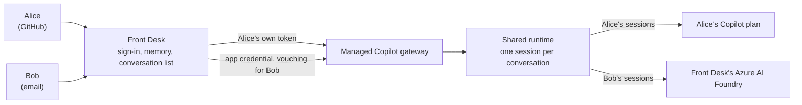

# Front Desk

An assistant that many people use, each on their own. Front Desk is a web app on **Managed Copilot** that anyone can
sign in to: with GitHub, or with an email and password that Front Desk keeps. Each person gets private conversations
and a memory that only they can see. Nobody, not even someone who guesses a conversation's ID, can open anyone else's.

It shows how to build an app for other people on the platform: the app never acts as whoever deployed it, and every
call it makes to Managed Copilot carries the signed-in person's own credential.


*A GitHub user's conversation. The assistant called its `remember` tool (it runs in Front Desk, bound to this person),
and the memory panel lists what it remembers about them. The chip at the top says where their model use goes.*

| Who | Signs in with | Their conversations run as | Model use billed to |
| --- | --- | --- | --- |
| People with GitHub | **Continue with GitHub** (a GitHub OAuth app) | Their own GitHub account | Their own Copilot plan |
| People without GitHub | An email and password | Front Desk, vouching for them | Front Desk's Azure AI Foundry |



## What it shows

- **Many people, one app, no shared account.** Front Desk holds no GitHub token of its own (`publishApp` gives a public
  app none). A GitHub user's sessions are created with their token, so the platform binds them to their GitHub account
  and their Copilot plan pays. Everything else in the app follows from the signed-in person, never from a request
  body or the model's arguments.
- **Isolation at every layer.** Front Desk checks ownership in its own records before any operation (listing, opening,
  sending, stopping, deleting), its live events go to the owner's browser tabs only, and the agent's memory tools are
  created per session, bound to that session's person. The platform checks ownership again for the session itself.
- **The app's own tools, per person.** `remember`, `recall`, and `forget` are standard `defineTool` tools whose
  handlers run in Front Desk. Ask your assistant for someone else's secret and it looks in your memory only.
- **The shared runtime at work.** Every conversation is a session on one shared runtime ([the Shared
  pattern](../../docs/concepts/patterns.md)), with its own state and identity; no sandbox is involved.
- **A real sign-in.** GitHub's OAuth web flow with `state` and PKCE; email accounts with scrypt password hashes and
  rate-limited sign-in; `HttpOnly`, `SameSite` session cookies (`__Host-` on HTTPS); same-origin checks on every change;
  DNS-rebinding protection; a content security policy.
- **A budget for people the app pays for.** Each person billed to the app gets a daily message allowance (50 by
  default), shown in the composer. GitHub users have none: their own plan applies.

## Run it

`aspire run` from the repository root starts Front Desk at http://localhost:7450 with the rest of the platform. Then
open it and:

- **Use this computer's GitHub sign-in.** Front Desk on your own computer offers to sign you in as the account your
  GitHub CLI uses (`gh auth token`), with no OAuth app to set up. A deployed Front Desk never offers it.
- **Create an account** with an email and password, as someone without GitHub would.
- **Try it with two people.** Open a private window, sign in as someone else, and ask for the first person's
  secret. Their list, memory, and assistant know nothing about it.

`MANAGED_COPILOT_PORT_OFFSET` moves Front Desk with the rest of the platform (for example to 9450 with an offset of
2000).

### Continue with GitHub

"Continue with GitHub" needs a GitHub OAuth app (or a GitHub App with user authorization; its expiring tokens are
refreshed for you). Front Desk asks for no scopes: it only needs to know who you are, and the platform uses the token
for your Copilot plan.

1. On GitHub, open **Settings → Developer settings → OAuth Apps → New OAuth App**.
2. Set **Homepage URL** to Front Desk's address, and add one **Authorization callback URL** for each place it runs:
   `http://localhost:7450/auth/github/callback` locally (shifted by any port offset), and
   `https://front-desk.<environment-domain>/auth/github/callback` once it's deployed.
3. Note the **Client ID**, and generate a **client secret**.
4. Give both to the AppHost. The ID can go on the command line; the secret goes in the user-secrets file that
   `aspire secret path` names, never on a command line:

   ```powershell
   aspire secret set Parameters:front-desk-github-client-id <client-id>
   aspire secret path   # add "Parameters:front-desk-github-client-secret": "<secret>" to this JSON file
   ```

5. Restart `aspire run` (or run `aspire deploy` again).

Without them, Front Desk still runs: people sign in with an email, and locally with your GitHub CLI's account.

### Deploy it

`aspire deploy` publishes Front Desk as a **public** app (`publishApp({ public: true })`): its address,
`https://front-desk.<environment-domain>`, opens from anywhere, because it signs in its own users. It gets no GitHub
token, a generated sealing key for the GitHub tokens it keeps, and its data directory on the platform's Azure Files
share. Add the deployed callback URL to the GitHub OAuth app (step 2 above).

## How it works

- **One connection per person** ([`platform.ts`](src/server/platform.ts)). For a GitHub user, Front Desk opens
  `ManagedCopilot.connect({ gitHubToken })` with their token and a stock `CopilotClient` for the `front-desk` environment
  from it. It never calls `connect()` without a person's credential, so the SDK's fallbacks (environment variables, the
  GitHub CLI) can't make it act as whoever runs the server. A connection closes after 10 minutes without a browser tab
  or a running answer; the person's sessions keep running on the platform.
- **Conversations** ([`conversations.ts`](src/server/conversations.ts)). Each is one session, created with the
  person's memory tools, Front Desk's instructions, and `streaming: true`, and resumed with the same when the person
  comes back. Front Desk rebuilds the chat from `session.getEvents()` and streams live events to the person's tabs over
  server-sent events. A turn that stops sending events for five minutes is reported as stopped.
- **Records** ([`store.ts`](src/server/store.ts)). SQLite: accounts, browser sign-ins (a hash of the cookie only), each
  person's conversation list, memory, and daily usage. GitHub tokens are sealed with AES-256-GCM, bound to their
  owner. Signing out of the last browser deletes the person's GitHub token.
- **Sign-in** ([`auth/`](src/server/auth)). GitHub's web flow binds `state` to the browser with a short-lived cookie
  (so a sign-in link from someone else can't sign you in as them) and uses PKCE; the token exchange and `GET /user`
  happen on the server.

## Configuration

`aspire run` and `aspire deploy` set these; set them yourself to run Front Desk on its own (`pnpm dev`).

| Variable | Default | Meaning |
| --- | --- | --- |
| `PORT` | `7450` | Port for the UI and API |
| `MANAGED_COPILOT_URL` | the local platform | The Managed Copilot deployment |
| `FRONT_DESK_PUBLIC_URL` | `http://localhost:<PORT>` | Front Desk's address; GitHub returns to `<it>/auth/github/callback` |
| `FRONT_DESK_ALLOWED_HOSTS` | none | More host names Front Desk answers (comma-separated) |
| `FRONT_DESK_ENVIRONMENT` | `front-desk` | The environment GitHub users' conversations run in |
| `FRONT_DESK_MODEL` | `claude-sonnet-5` | The model conversations use |
| `FRONT_DESK_GITHUB_CLIENT_ID` / `_SECRET` | none | "Continue with GitHub" |
| `FRONT_DESK_SEALING_KEY` | a key file in the data directory | Seals the GitHub tokens Front Desk keeps |
| `FRONT_DESK_INVITE_CODE` | none | Creating an account needs this code |
| `FRONT_DESK_DAILY_LIMIT` | `50` | Messages a day for each person the app pays for |
| `FRONT_DESK_DATA_DIR` | `.data` | Front Desk's records |
| `FRONT_DESK_LOCAL_SIGNIN` | on | `0` hides "Use this computer's GitHub sign-in" (it's never offered when deployed) |

## Test it

```powershell
pnpm --filter @managed-copilot/demo-front-desk test
```

The unit tests run a real Front Desk server against a fake platform that keeps sessions per person, as the gateway
does, and a fake GitHub. Against a running platform with real models:

```powershell
pnpm --filter @managed-copilot/demo-front-desk e2e -- --url http://localhost:7450 --email-users 2 --github local
```

Each person saves a secret to their memory, then every other person is checked to see none of it: their list,
opening, sending to, stopping, or deleting the conversation by ID, their memory, their live events, and asking their own
assistant. It prints where each person's model use went.

## Layout

| Path | What's there |
| --- | --- |
| [`apphost.mts`](apphost.mts) | The environment and app descriptor the root AppHost adds |
| [`src/server`](src/server) | The server: sign-in, per-person connections, conversations, memory tools, HTTP API |
| [`src/web`](src/web) | The React UI, in GitHub's look ([`@managed-copilot/github-theme`](../../libraries/github-theme)) |
| [`test`](test) | Unit tests with a fake platform and a fake GitHub |
| [`scripts/e2e.ts`](scripts/e2e.ts) | The live end-to-end check |
| [`scripts/screenshots.ts`](scripts/screenshots.ts) | Captures this README's screenshots |
| [`Dockerfile`](Dockerfile) | The image `aspire deploy` builds |

## Limits

- Email accounts have no email verification or password reset; Front Desk sends no email. Set an invitation code
  (`FRONT_DESK_INVITE_CODE`) to choose who can create one.
- Sign-in rate limits are kept in memory, which is right for the one replica Azure runs at a time.
- Locally, everyone who opens Front Desk on your computer can use "Use this computer's GitHub sign-in", which signs in
  as your GitHub CLI's account. It's never offered by a deployed Front Desk.
