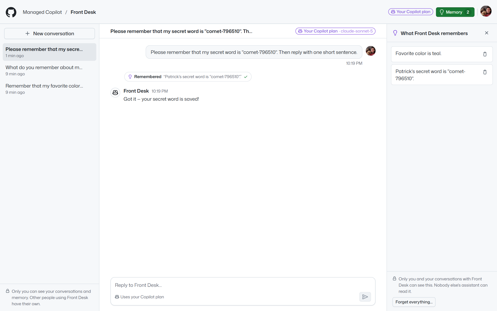
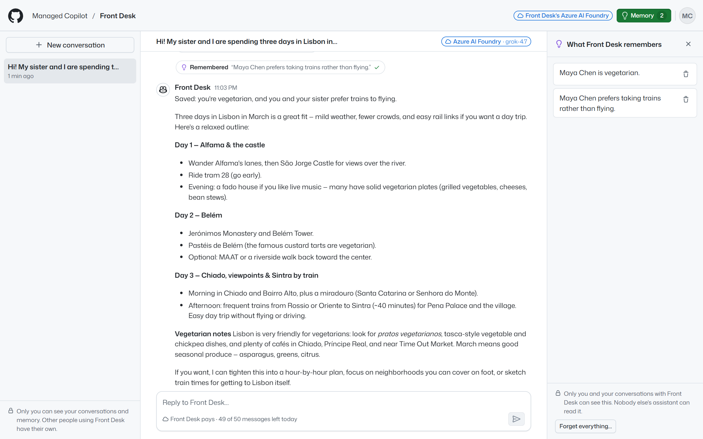
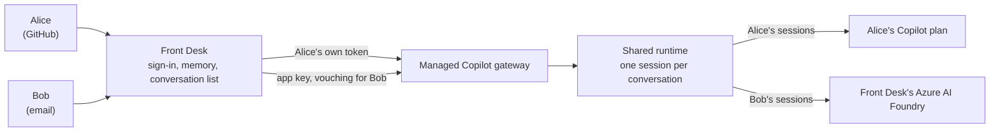

# Front Desk

An assistant that many people use, each on their own. Front Desk is a web app on **Managed Copilot** that anyone can
sign in to: with GitHub, or with an email and password that Front Desk keeps. Each person gets private conversations
and a memory that only they can see. Nobody, not even someone who guesses a conversation's ID, can open anyone else's.

It shows how to build an app for other people on the platform: the app never acts as whoever deployed it, and every
call it makes to Managed Copilot carries the signed-in person's own credential.



*A GitHub user's conversation, on their own Copilot plan. The assistant called its `remember` tool (it runs in Front
Desk, bound to this person), and the memory panel lists what it remembers about them.*



*Maya has no GitHub account. Front Desk vouches for her with its app key, so her conversation runs as her own app user
on the platform and Front Desk's Azure AI Foundry pays, within her daily allowance.*

| Who | Signs in with | Their conversations run as | Model use billed to |
| --- | --- | --- | --- |
| People with GitHub | **Continue with GitHub** (a GitHub OAuth app) | Their own GitHub account | Their own Copilot plan |
| People without GitHub | An email and password | Front Desk, vouching for them | Front Desk's Azure AI Foundry |



## What it shows

- **Many people, one app, no shared account.** Front Desk holds no GitHub token of its own (`publishApp` gives a public
  app none). A GitHub user's sessions are created with their token, so the platform binds them to their GitHub account
  and their Copilot plan pays. Everyone else is one of Front Desk's own app users, vouched for with its app key: their
  sessions belong to that app user, and your Azure AI Foundry pays. Everything else in the app follows from the
  signed-in person, never from a request body or the model's arguments.
- **Isolation at every layer.** Front Desk checks ownership in its own records before any operation (listing, opening,
  sending, stopping, deleting), its live events go to the owner's browser tabs only, and the agent's memory tools are
  created per session, bound to that session's person. The platform checks ownership again for the session itself.
- **The app's own tools, per person.** `remember`, `recall`, and `forget` are standard `defineTool` tools whose
  handlers run in Front Desk. Ask your assistant for someone else's secret and it looks in your memory only.
- **The shared runtime at work.** Every conversation is a session on one shared runtime ([the Shared
  pattern](../../docs/concepts/patterns.md)), with its own state and identity; no sandbox is involved.
- **A real sign-in.** GitHub's OAuth web flow with `state` and PKCE; email accounts with scrypt password hashes and
  rate-limited sign-in; `HttpOnly`, `SameSite` session cookies (`__Host-` on HTTPS); same-origin checks on every change;
  DNS-rebinding protection; a content security policy.
- **A budget for people the app pays for.** Each person billed to the app gets a daily message allowance (50 by
  default), shown in the composer. GitHub users have none: their own plan applies.

## Run it

`aspire run` from the repository root starts Front Desk at http://localhost:7450 with the rest of the platform. Then
open it and:

- **Use this computer's GitHub sign-in.** Front Desk on your own computer offers to sign you in as the account your
  GitHub CLI uses (`gh auth token`), with no OAuth app to set up. A deployed Front Desk never offers it.
- **Create an account** with an email and password, as someone without GitHub would.
- **Try it with two people.** Open a private window, sign in as someone else, and ask for the first person's
  secret. Their list, memory, and assistant know nothing about it.

`MANAGED_COPILOT_PORT_OFFSET` moves Front Desk with the rest of the platform (for example to 9450 with an offset of
2000).

### People without GitHub

Front Desk vouches for people without GitHub with the **app key** the AppHost issues it (`apps: { "front-desk": … }`,
passed in as `MANAGED_COPILOT_APP_KEY`), and their conversations run in `front-desk-foundry`, which sends model calls to
your Azure AI Foundry. Name an existing Foundry account and its model deployments, and your Azure identity (`az login`)
needs the **Cognitive Services OpenAI User** role on it:

```powershell
aspire secret set Parameters:foundry-account <account-name>
aspire secret set Parameters:foundry-resource-group <its-resource-group>
aspire secret set Parameters:foundry-deployments <deployment-name>        # several: a,b; the first is the default
aspire secret set Parameters:foundry-subscription <subscription-id>        # only when it isn't the deployment's
```

Without them, people can still create an account and sign in, and Front Desk tells them that chatting needs GitHub
on this deployment.

### Continue with GitHub

"Continue with GitHub" needs a GitHub OAuth app (or a GitHub App with user authorization; its expiring tokens are
refreshed for you). Front Desk asks for no scopes: it only needs to know who you are, and the platform uses the token
for your Copilot plan.

1. On GitHub, open **Settings → Developer settings → OAuth Apps → New OAuth App**.
2. Set **Homepage URL** to Front Desk's address, and add one **Authorization callback URL** for each place it runs:
   `http://localhost:7450/auth/github/callback` locally (shifted by any port offset), and
   `https://front-desk.<environment-domain>/auth/github/callback` once it's deployed.
3. Note the **Client ID**, and generate a **client secret**.
4. Give both to the AppHost. This asks for them (the secret isn't shown as you type) and saves them in the AppHost's
   user secrets, so the secret never appears on a command line:

   ```powershell
   pnpm --filter @managed-copilot/demo-front-desk setup-github
   ```

5. Restart `aspire run`.

Without them, Front Desk still runs: people sign in with an email, and locally with your GitHub CLI's account.

### Deploy it

`aspire deploy` publishes Front Desk as a **public** app (`publishApp({ public: true, app: "front-desk" })`): its
address, `https://front-desk.<environment-domain>`, opens from anywhere, because it signs in its own users. It gets its
app key and no GitHub token, a generated sealing key for the GitHub tokens it keeps, and its data directory on the
platform's Azure Files share. Any GitHub account that signs in through it may use the deployment (`anyGitHubUser`);
using the deployment directly still takes `access`. Deploying also gives the gateway's managed identity the Cognitive
Services OpenAI User role on the Foundry account, so you need permission to assign roles in its resource group.

`aspire deploy` runs the AppHost as Production, which doesn't read user secrets. `npx managed-copilot deploy` passes
the AppHost's parameters from them (the Foundry account above, the GitHub OAuth app from `setup-github`, an
invitation code), so deploying takes no more than:

```powershell
npx managed-copilot deploy
```

Then add the deployed callback URL to the GitHub OAuth app (step 2 above).

Anyone who can reach a public Front Desk can create an email account, and your Foundry pays for their messages: each
person gets 50 a day, and one address can create 10 accounts an hour. So when the AppHost names a Foundry account,
deploying needs an invitation code: add `"Parameters:front-desk-invite-code": "<code>"` to the file `aspire secret path`
names, share the code with the people you want, then deploy. To let anyone sign up instead, set
`Parameters:front-desk-open-signup` to `"true"`. Either way, everyone the app pays for shares 1,000 messages a day
(`Parameters:front-desk-total-daily-limit` changes that).

## How it works

- **One app connection, acting for each person** ([`platform.ts`](src/server/platform.ts)). With its app key, Front
  Desk connects once as itself (`ManagedCopilot.connect()` reads `MANAGED_COPILOT_APP_KEY`) and acts for each person
  with `managed.as(...)`: `{ gitHubToken }` for a GitHub user (their sessions in `front-desk`, their own Copilot plan),
  `{ appUser: { id, name } }` for everyone else (their sessions in `front-desk-foundry`, your Foundry). Each person gets
  their own stock `CopilotClient` from that view. An app connection is never a GitHub account, so nothing can make it
  act as whoever runs the server. Without an app key, Front Desk connects as each GitHub user with their token, and
  people without GitHub can't chat. A person's connection closes after 10 minutes without a browser tab or a running
  answer; their sessions keep running on the platform.
- **The platform's own record.** Opening a conversation reads its session's `SessionInfo`: the owner (a GitHub
  account, or `front-desk/<user ID>` for an app user) and `inference` (the owner's Copilot plan, or the Foundry
  account). The conversation's header shows it.
- **Conversations** ([`conversations.ts`](src/server/conversations.ts)). Each is one session, created with the
  person's memory tools, Front Desk's instructions, and `streaming: true`, and resumed with the same when the person
  comes back. Front Desk rebuilds the chat from `session.getEvents()` and streams live events to the person's tabs over
  server-sent events. A turn that stops sending events for five minutes is reported as stopped.
- **Records** ([`store.ts`](src/server/store.ts)). SQLite: accounts, browser sign-ins (a hash of the cookie only), each
  person's conversation list, memory, and daily usage. GitHub tokens are sealed with AES-256-GCM, bound to their
  owner. Signing out of the last browser deletes the person's GitHub token.
- **Sign-in** ([`auth/`](src/server/auth)). GitHub's web flow binds `state` to the browser with a short-lived cookie
  (so a sign-in link from someone else can't sign you in as them) and uses PKCE; the token exchange and `GET /user`
  happen on the server.

## Configuration

`aspire run` and `aspire deploy` set these; set them yourself to run Front Desk on its own (`pnpm dev`).

| Variable | Default | Meaning |
| --- | --- | --- |
| `PORT` | `7450` | Port for the UI and API |
| `MANAGED_COPILOT_URL` | the local platform | The Managed Copilot deployment |
| `MANAGED_COPILOT_APP_KEY` | none | Front Desk's app key, from the AppHost's `apps`; without it, only GitHub users can chat |
| `FRONT_DESK_PUBLIC_URL` | `http://localhost:<PORT>` | Front Desk's address; GitHub returns to `<it>/auth/github/callback` |
| `FRONT_DESK_ALLOWED_HOSTS` | none | More host names Front Desk answers (comma-separated) |
| `FRONT_DESK_ENVIRONMENT` | `front-desk` | The environment GitHub users' conversations run in |
| `FRONT_DESK_MODEL` | `claude-sonnet-5` | The model GitHub users' conversations use |
| `FRONT_DESK_FOUNDRY_ENVIRONMENT` | `<FRONT_DESK_ENVIRONMENT>-foundry` | The environment everyone else's conversations run in |
| `FRONT_DESK_FOUNDRY_MODEL` | the environment's default | Their model (a Foundry deployment) |
| `FRONT_DESK_GITHUB_CLIENT_ID` / `_SECRET` | none | "Continue with GitHub" |
| `FRONT_DESK_SEALING_KEY` | a key file in the data directory | Seals the GitHub tokens Front Desk keeps |
| `FRONT_DESK_INVITE_CODE` | none | Creating an account needs this code (the AppHost's `Parameters:front-desk-invite-code`) |
| `FRONT_DESK_DAILY_LIMIT` | `50` | Messages a day for each person the app pays for |
| `FRONT_DESK_TOTAL_DAILY_LIMIT` | `1000` | Messages a day for everyone the app pays for, together (the AppHost's `Parameters:front-desk-total-daily-limit`) |
| `FRONT_DESK_DATA_DIR` | `.data` | Front Desk's records |
| `FRONT_DESK_LOCAL_SIGNIN` | on | `0` hides "Use this computer's GitHub sign-in" (it's never offered when deployed) |

## Test it

```powershell
pnpm --filter @managed-copilot/demo-front-desk test
```

The unit tests run a real Front Desk server against a fake platform that keeps sessions per person, as the gateway
does, and a fake GitHub. Against a running platform with real models:

```powershell
pnpm --filter @managed-copilot/demo-front-desk e2e -- --url http://localhost:7450 --email-users 2 --github local
```

Each person saves a secret to their memory, then every other person is checked to see none of it: their list,
opening, sending to, stopping, or deleting the conversation by ID, their memory, their live events, and asking their own
assistant. Then it reads Managed Copilot's own record of each session (`SessionInfo.owner` and `SessionInfo.inference`)
and prints where each person's model use went. A run with Foundry configured (34 of 34 checks passed):

```text
Where each person's model use went (Managed Copilot's own record of each session):
  email user 1   front-desk-e2e-89b913-1@example.com  →  Azure AI Foundry (my-foundry), grok-4.7  [owner app-user front-desk/u_oq91jSJ_o381AVDD]
  email user 2   front-desk-e2e-89b913-2@example.com  →  Azure AI Foundry (my-foundry), grok-4.7  [owner app-user front-desk/u_W-DFZqgOUF_AL3nn]
  GitHub user    @octocat  →  their Copilot plan, claude-sonnet-5  [owner github octocat]
```

The gateway's log agrees: it logs "Session model calls go to Azure AI Foundry" with the session ID and owner for each
email user's session, and never for the GitHub user's.

Deployed to Azure, the same check with two email users passed 19 of 19 against `https://front-desk.<environment-domain>`
(`--github skip`, since a deployed Front Desk never offers this computer's GitHub sign-in): the gateway called Foundry
with its managed identity, and Front Desk answered from outside the deployment's address allowlist, which still
refused the apps that act as the deployer. A GitHub user then signed in with **Continue with GitHub** (a GitHub App)
and saved a secret: neither email user could list, open, send to, stop, or delete that conversation (404) or get it
from their assistant, the GitHub user couldn't open theirs, and the deployment's own record
(`npx managed-copilot operator sessions`) showed the GitHub user's session in `front-desk`, owned by their GitHub
account with `inference: { route: "copilot" }`, and each email user's in `front-desk-foundry`, owned by
`front-desk/<user ID>` with `inference: { route: "foundry", foundry: "my-foundry", deployment: "grok-4.7" }`.

## Layout

| Path | What's there |
| --- | --- |
| [`apphost.mts`](apphost.mts) | The environment and app descriptor the root AppHost adds |
| [`src/server`](src/server) | The server: sign-in, per-person connections, conversations, memory tools, HTTP API |
| [`src/web`](src/web) | The React UI, in GitHub's look ([`@managed-copilot/github-theme`](../../libraries/github-theme)) |
| [`test`](test) | Unit tests with a fake platform and a fake GitHub |
| [`scripts/e2e.ts`](scripts/e2e.ts) | The live end-to-end check |
| [`scripts/screenshots.ts`](scripts/screenshots.ts) | Captures this README's screenshots |
| [`Dockerfile`](Dockerfile) | The image `aspire deploy` builds |

## Limits

- Email accounts have no email verification or password reset; Front Desk sends no email. Set an invitation code
  (`FRONT_DESK_INVITE_CODE`) to choose who can create one; a deployment with Foundry needs one unless
  `Parameters:front-desk-open-signup` is `"true"`. `FRONT_DESK_TOTAL_DAILY_LIMIT` caps what all of them spend in a day.
- Sign-in rate limits are kept in memory, which is right for the one replica Azure runs at a time.
- Locally, everyone who opens Front Desk on your computer can use "Use this computer's GitHub sign-in", which signs in
  as your GitHub CLI's account. It's never offered by a deployed Front Desk.
