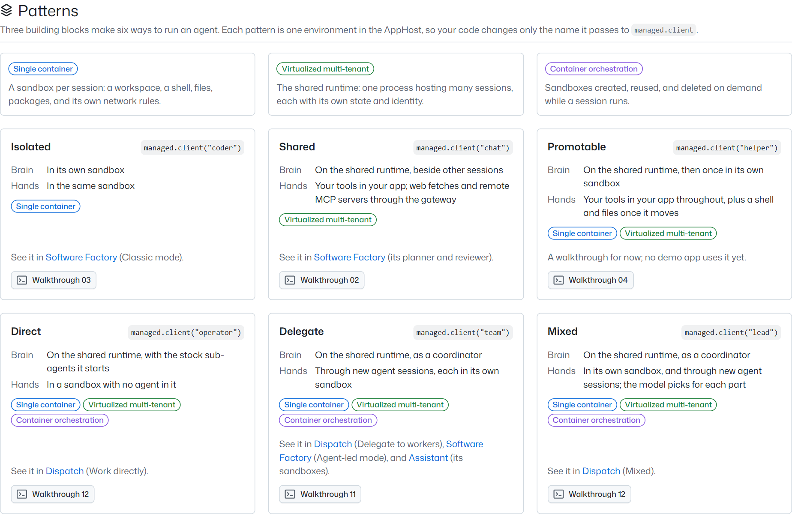

# Demo gallery

One page with the six patterns, every demo, and every walkthrough, linked to your local platform and your Azure
deployment. Use it as the starting point for a live demo.

```powershell
pnpm gallery
```

It opens http://localhost:7460 in your browser.



## What's on it

- **Header**: a **Local** and an **Azure** control. The dot is green when that gateway answers, amber when it refuses
  this network, red when it doesn't answer, and grey when there's no deployment; a spinner means the gallery is still
  looking. Each opens the gateway's address, how the gallery found it, what to do next (`aspire run`, or naming a
  deployment with `--cloud`), and **Check now**.
- **Patterns**: the three building blocks (single container, virtualized multi-tenant, container orchestration), once,
  each with a colored marker, and a card for each of the six patterns made from them: isolated, shared, promotable,
  direct, delegate, and mixed ([patterns](../../docs/concepts/patterns.md)). A card shows:
  - a diagram of where its **brain** (the model loop) runs, the shared runtime or a sandbox, and where its **hands**
    (the tools that act) run: your app, a sandbox, or worker sandboxes with an agent in each. Hover it for the same in
    words.
  - the `managed.client("<environment>")` call that picks it in this repository's AppHost (hover for its settings),
    its building blocks as markers, its walkthrough (which jumps to the list below), and the apps that show it (opened
    when they're up, their README otherwise; hover for where in the app).

  When the catalog lists Pattern Race (`pattern-race`), which runs one job through all six side by side, the section
  links it as **Compare all six**, and its app card says **All six patterns**; no pattern card lists it.
- **Apps**: a card per demo app and the operator console, with its screenshot (or its initials until one is captured),
  tagline (hover for more), the patterns it shows, what to try first, a **Local** and an **Azure** button with a live
  status dot, and its README.
  - Green: it answered. Amber: **IP-restricted**: the deployed app refused this network, because its ingress allows
    only `Parameters:app-allowed-ips` ([deploying to Azure](../../docs/deployment.md)). The button still opens it, for
    when you're on an allowed network. Grey: offline. Without an Azure deployment, the cards leave the Azure button out.
  - The operator console buttons sign you in with your GitHub sign-in, like `npx managed-copilot console`: the gallery
    asks the gateway for a one-time link and redirects to it. A deployment's console stays off until it names operators;
    the gallery says so instead of opening a broken page.
- **Walkthroughs**: the thirteen [samples](../../walkthroughs/README.md) as a list, with their README. The copy button
  copies `pnpm walkthrough 01` after setting `MANAGED_COPILOT_URL` to a gateway, in PowerShell on Windows and `sh`
  elsewhere. The variable stays set in that terminal, so each copy names its target. With both gateways known, a
  **Local** | **Azure** switch picks which one.

The page checks every link every 15 seconds. When the local platform isn't running, one line says so, with
`aspire run` to copy.

## Where the links come from

- **Local**: the AppHost's fixed ports (gateway 7400, Dispatch 7470, software factory 7480, assistant 7490), shifted by
  `MANAGED_COPILOT_PORT_OFFSET` like `aspire run`. Start the platform with `aspire run`; the gallery doesn't need it to
  start.
- **Azure**, the first of:
  1. `--cloud https://copilot.<environment-domain>`
  2. `MANAGED_COPILOT_URL`, when it isn't a local address
  3. the `copilot` container app the signed-in Azure CLI (`az login`) finds in your subscription

  `aspire deploy` gives every app `https://<app>.<environment-domain>`, so the apps' URLs come from the gateway's.

```text
pnpm gallery [--cloud <gateway url>] [--port <port>] [--no-open] [--no-azure]
```

## Deployed

`aspire deploy` (or `npx managed-copilot deploy`) also publishes the gallery at `https://gallery.<environment-domain>`,
a link you can share. The deployed copy shows that deployment only:

- **Azure links only.** There are no Local controls: it can't see visitors' machines.
- **No console sign-in.** Locally, the console button signs you in with your GitHub sign-in. Deployed, that would sign
  every visitor in as one account, so the console card copies `npx managed-copilot console --url <gateway>` instead,
  which each operator runs with their own sign-in. The gallery holds no GitHub token (`publishApp`'s
  `githubToken: false`).
- **Same audience as the demos.** It opens only from `Parameters:app-allowed-ips` (`npx managed-copilot access ips`).
  It checks the apps from inside the deployment, which the allowlist always admits, so its dots say whether an app is
  up, not whether a visitor's network may open it; the page says so.

The image is [`Dockerfile`](Dockerfile) (`GALLERY_HOSTED=1`; `GALLERY_ALLOWED_HOSTS` names the host names it answers).

## Screenshots

The app cards' screenshots are in [`shots/`](shots): each is the real app on a local platform, after a real run. A card
without one shows the app's initials. To refresh them, start the platform, run some work in each demo, then:

```powershell
pnpm --filter @managed-copilot/demo-gallery capture                  # every app
pnpm --filter @managed-copilot/demo-gallery capture --only dispatch  # one card (ids: dispatch, software-factory, assistant, console ...)
pnpm --filter @managed-copilot/demo-gallery capture --only gallery   # docs/gallery.png, from a running pnpm gallery
```

The script drives Microsoft Edge through `playwright-core`; set `GALLERY_BROWSER_CHANNEL=chrome` for Chrome.

## Develop

```powershell
pnpm --filter @managed-copilot/demo-gallery build
pnpm --filter @managed-copilot/demo-gallery test
pnpm --filter @managed-copilot/demo-gallery dev   # http://localhost:7461, hot reload; needs pnpm gallery running
```

`dev` serves the page with hot reload and sends `/api`, `/shots`, and `/open` to a running `pnpm gallery` (both shift
with `MANAGED_COPILOT_PORT_OFFSET`; `GALLERY_WEB_PORT` picks another port). Open `/?preview=live` to see the page with
sample data instead (`offline`, `looking`, `hosted`, `error`, and `loading` too; add `&more` for a full grid of sample
apps). The samples exist only in `dev`: production builds leave them out.

`src/shared/catalog.ts` lists the patterns, apps, and walkthroughs. Add a demo there (with its Aspire resource name,
local port, and health path), then capture its screenshot. A pattern names an environment of the root AppHost and the
settings that make it that pattern; the tests check both against `apphost.mts`. Its diagram is in `src/web/model.ts`
(`SHAPES`); the tests check that each diagram agrees with the pattern's building blocks.
