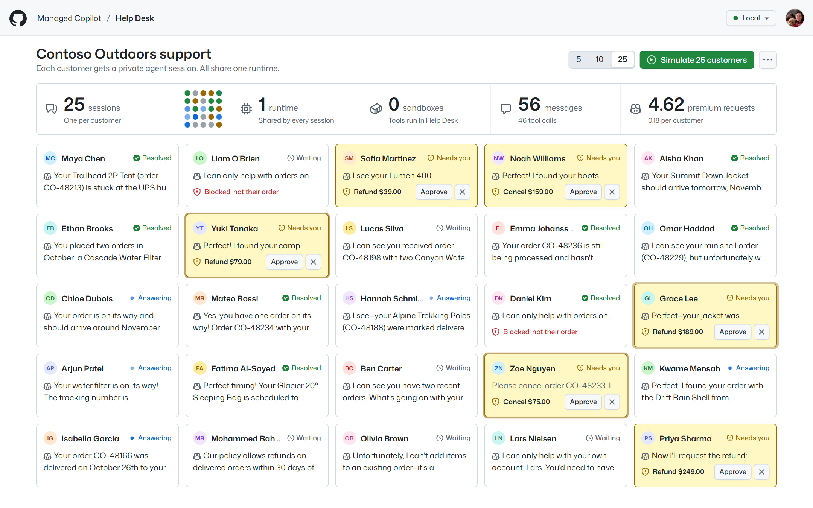
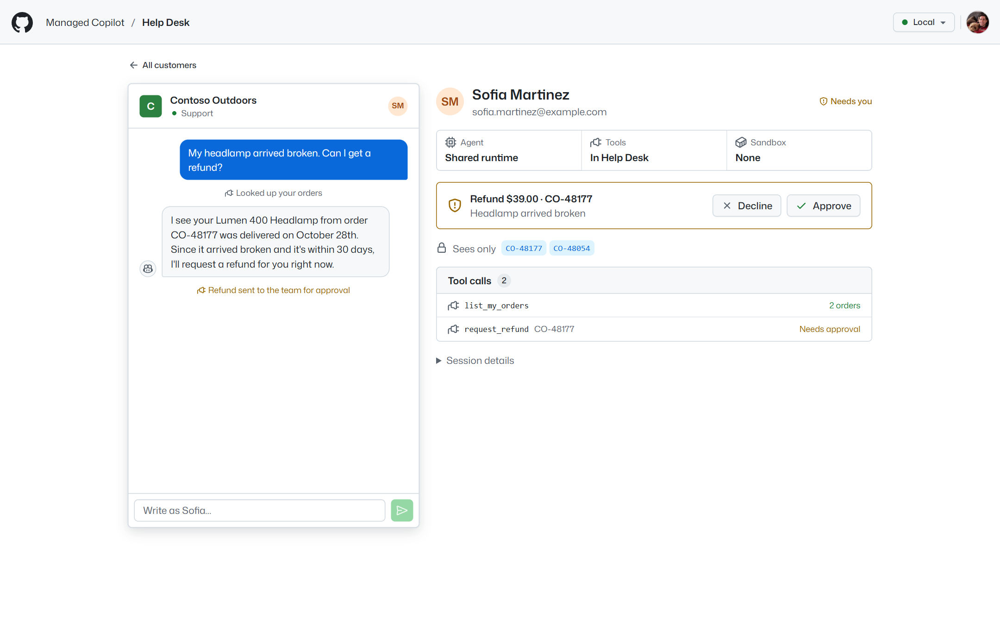
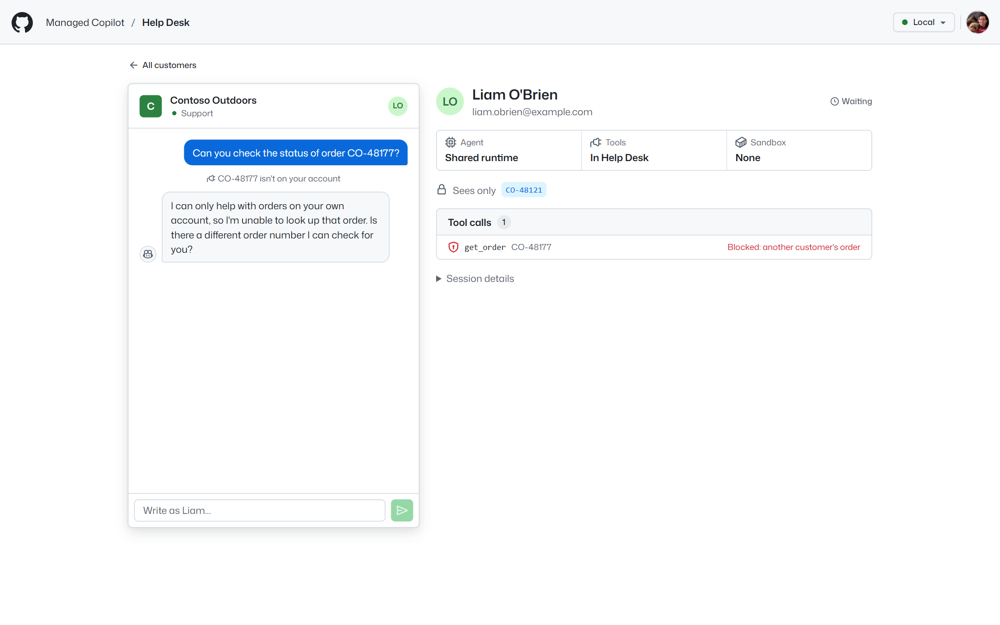
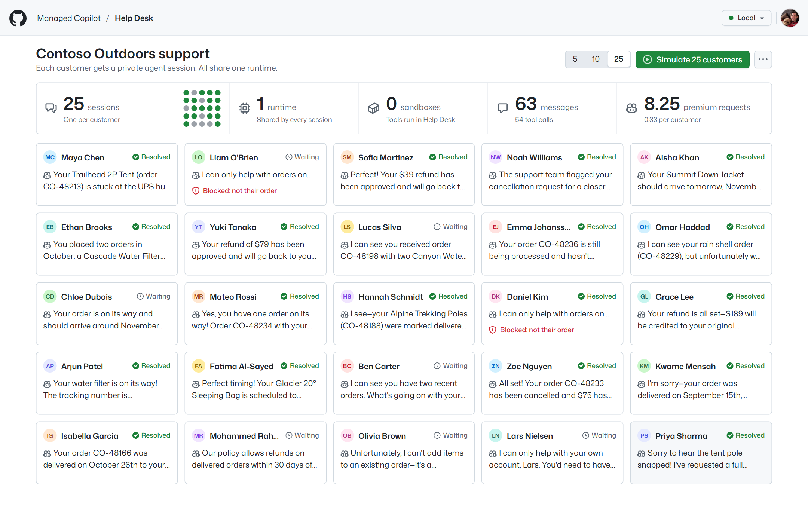

# Help Desk

A support rush on one shared runtime. **Simulate 25 customers** and Help Desk starts 25 real Copilot sessions at once,
one per customer of a demo store, Contoso Outdoors. Each session can only reach its own customer's orders through the
store's tools, refunds and cancellations wait for you on the wall, and the counters show what it took: **25 sessions,
1 runtime, 0 sandboxes**. The app is ordinary Node code built on the stock `@github/copilot-sdk` and
`@managed-copilot/sdk`.



*Twelve seconds into a rush: 25 customers, one session each, all on the one shared runtime. Six refunds and
cancellations wait for the operator (yellow), and two customers asked about orders that aren't theirs (red).*

## What it shows

- **Density.** Every customer gets a private session: their own conversation, model loop, and tools. All 25 run in
  the one shared runtime process (the **shared** pattern, [patterns](../../docs/concepts/patterns.md)), so the rush
  starts in seconds and needs no machine per customer.
- **Isolation by your tools, not by the model.** A session's tools are created for its customer and take no customer
  ID. When Liam asks about order `CO-48177` (Sofia's), `get_order` answers exactly as it would for an order that
  doesn't exist, and the wall marks the attempt **Blocked**. The model never saw Sofia's data, so it couldn't leak it.
- **You stay in control of what costs money.** `request_refund` and `cancel_order` have no `skipPermission`, so the
  runtime asks the app first. Help Desk holds each request on the wall until you approve or decline it. A request the
  store would refuse anyway (outside the 30-day window, an order that already shipped) goes straight to the tool,
  which says why.
- **The economics, counted.** Sessions and messages come from the conversations; runtimes and sandboxes from the
  platform's session records (`placement`, `sandbox`); premium requests from each session's own usage metrics. A full
  rush on Claude Haiku 4.5 costs 8.25 premium requests: 0.33 per customer.



*Click a customer to see their support widget as they see it, and what happened behind it: where the session runs,
the only orders it can see, and every tool call. Approve or decline here or on the wall.*



*Liam's session asked the store for `CO-48177`. The tool refused it like a missing order, so the agent's reply
confirms nothing, while the operator sees that it was another customer's.*

## Run it

Everything runs locally against real models. You need the repository's prerequisites (see
[AGENTS.md](../../AGENTS.md)) and a GitHub sign-in with Copilot (`gh auth login`).

```powershell
pnpm install
pnpm build
aspire run          # the platform and the demos; open the "help-desk" resource
```

Help Desk opens at <http://localhost:7440>. To demo it:

1. Pick **5**, **10**, or **25** customers (25 by default) and click **Simulate**. Watch the sessions count climb to 25
   while runtimes stay at 1 and sandboxes at 0. The first answers arrive within seconds.
2. Approve a refund on a yellow tile, or decline one with **×**.
3. Open **Liam O'Brien** to show the blocked lookup, then **Sofia Martinez** to show her refund as she sees it.
4. Type as a customer in their widget to keep a conversation going.
5. End the simulation from **⋯**: its sessions are deleted. Simulating again replaces it the same way.

Measured on a local deployment: 25 sessions started in about 3 seconds, and every conversation finished within 35
seconds, approvals included.



The [`happy-path`](src/scripts/happy-path.ts) script does a smaller pass through the HTTP API: 5 customers, one refund
or cancellation approved and any others declined, checks that each session touched only its customer's orders and that
the counters read 5 sessions, 1 runtime, and 0 sandboxes, then ends the simulation. It costs about 2 premium requests.

```powershell
pnpm --filter @managed-copilot/demo-help-desk happy-path                          # local, MANAGED_COPILOT_PORT_OFFSET applies
pnpm --filter @managed-copilot/demo-help-desk happy-path --url https://help-desk.<environment-domain>
```

`aspire deploy` publishes Help Desk with the root AppHost, next to the other demos (see
[docs/deployment.md](../../docs/deployment.md), including who can open the apps).

## How it works

- **One shared environment.** [`apphost.mts`](apphost.mts) declares `help-desk`: `type: "shared"` with network off,
  because the agent's only hands are the store's tools in this app. Help Desk keeps one stock `CopilotClient` for it
  and creates every customer's session on that client.
- **Tools bound to one customer.** Each session gets its own `defineTool` tools, created for its customer
  ([`tools.ts`](src/server/tools.ts)), and `availableTools: ["custom:*"]`, so it has no other tools:

  ```ts
  defineTool("get_order", {
    description: "Get one of the customer's orders: items, total, status, and shipping.",
    parameters: z.object({ orderId: z.string() }),
    skipPermission: true,
    handler: ({ orderId }) => shop.getOrder(customerId, orderId), // another customer's order: "No order … on this account."
  });
  ```

- **Approvals use the SDK's permission handler.** Help Desk holds the handler's promise for `request_refund` and
  `cancel_order` until the operator answers, then resolves it with `approve-once` or `reject` (the agent is told a team
  member will follow up). If the turn ends some other way, Help Desk lets go when `permission.completed` or the turn's
  end arrives.
- **The wall is projected from the sessions' events.** Messages (streamed), tool calls, and approvals come from the
  stock session events; a call refused for an order of another customer is marked **Blocked**. The agent marks a
  conversation **Resolved** with a `resolve_conversation` tool.
- **The platform holds the state.** Session IDs carry the simulation and the customer (`hd-<simulation>-<customer>`).
  After a restart, Help Desk lists the environment's sessions, picks up the latest simulation, rebuilds each
  conversation from `session.getEvents()`, replays the refunds and cancellations its history records into the store,
  and deletes leftovers of older simulations. The platform asks again for any approval still pending when a session
  is resumed.

## Configuration

| Variable | Default | Purpose |
| --- | --- | --- |
| `PORT` | `7440` | HTTP port for the UI and API |
| `HOST` | `127.0.0.1` | Interface to listen on (`0.0.0.0` in a container, together with `HELP_DESK_ALLOWED_HOSTS`) |
| `MANAGED_COPILOT_URL` | local discovery | Gateway URL (Aspire sets it) |
| `HELP_DESK_ENVIRONMENT` | `help-desk` | The shared environment customers' sessions are created in |
| `HELP_DESK_MODEL` | first available of Claude Haiku 4.5, Claude Haiku 5.5, GPT-5.6 Luna, Claude Sonnet 5 | The customers' agents' model |
| `HELP_DESK_ALLOWED_HOSTS` | none | Extra host names allowed to address the server (it accepts loopback names only by default) |

## Layout

| Path | Contents |
| --- | --- |
| `apphost.mts` | AppHost fragment: the `help-desk` shared environment and the app resource |
| `src/server` | Platform connection, the store and its tools, one ticket (session) per customer, the event projection, REST and server-sent events |
| `src/scripts` | The happy-path script |
| `src/shared` | Types shared with the UI |
| `src/web` | The UI (React, Tailwind, and GitHub's Primer look from [`libraries/github-theme`](../../libraries/github-theme); light and dark follow the OS) |
| `test` | Unit tests: the store, the tools, the projection, simulations and approvals against an in-memory platform, the API, and the fragment |
| `Dockerfile` | The container `aspire deploy` publishes |
