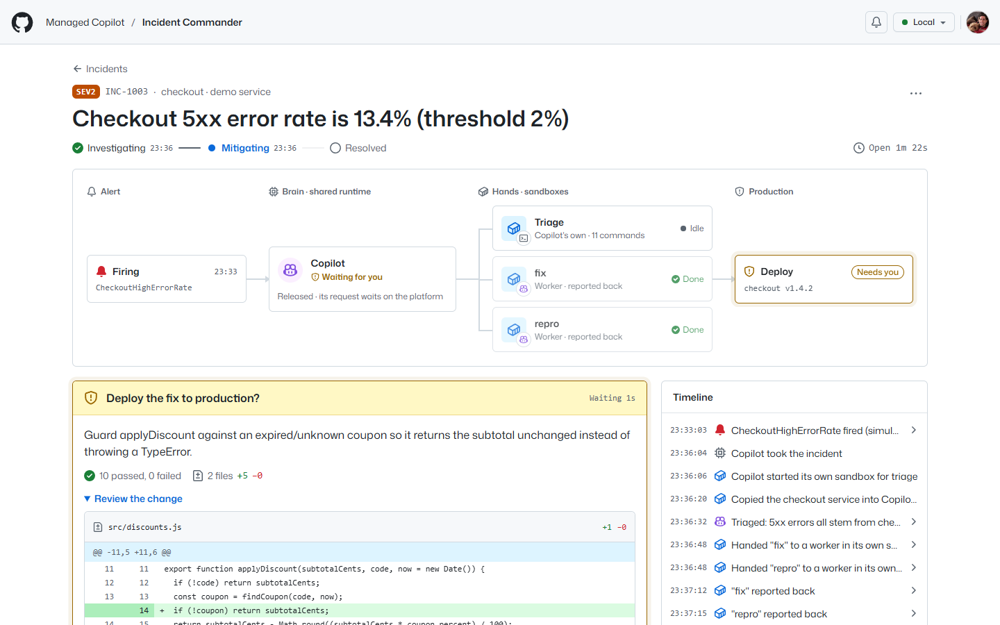
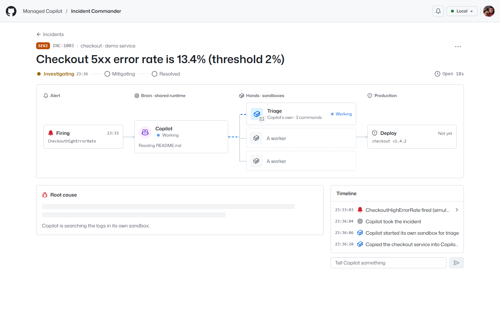
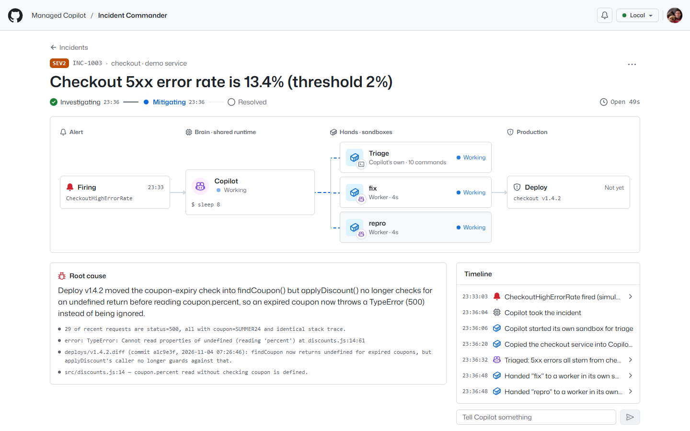
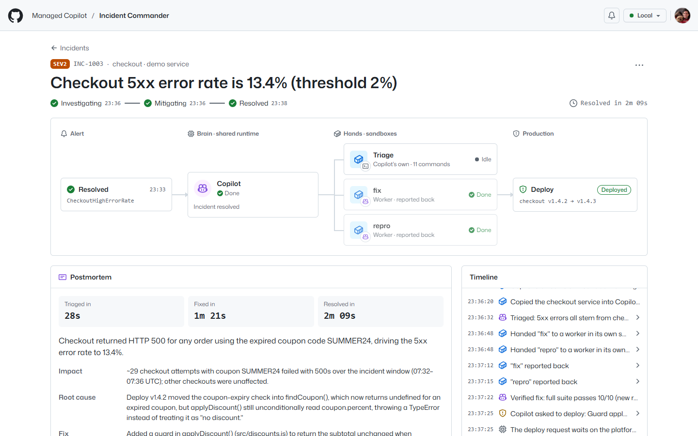
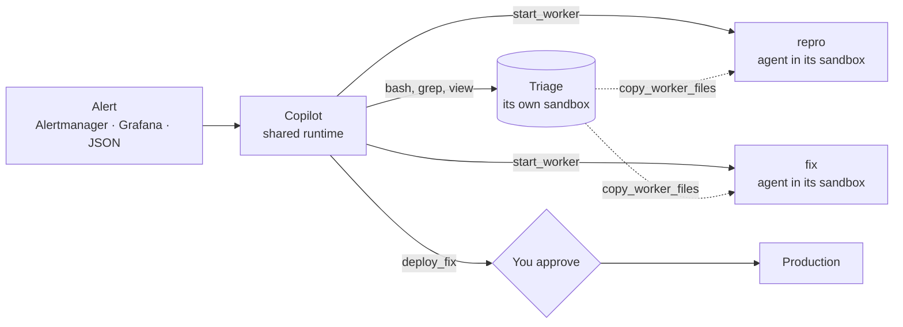
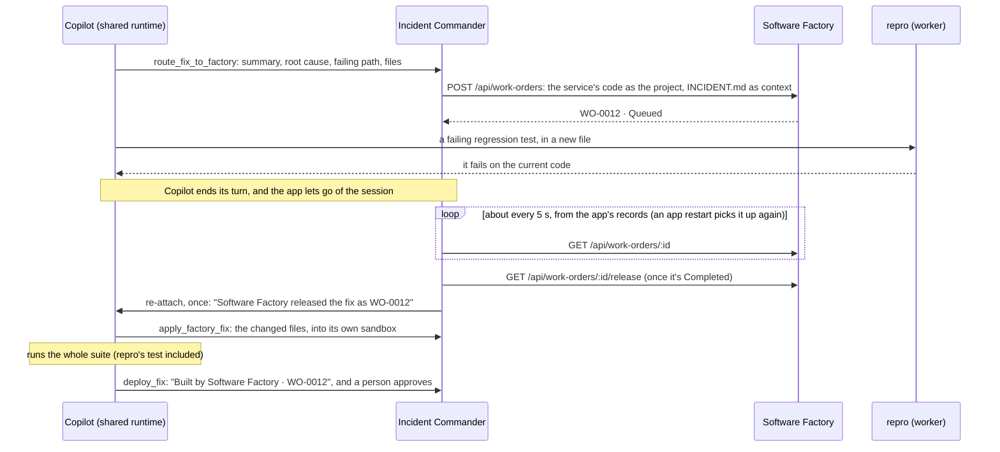
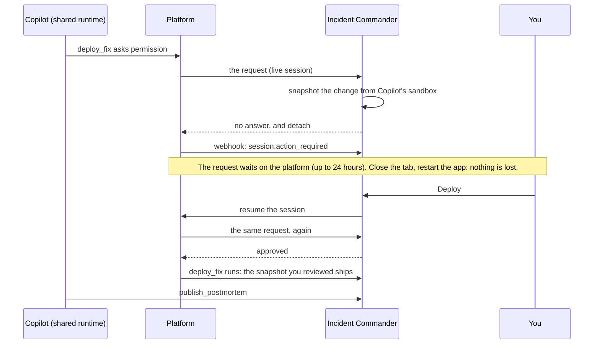
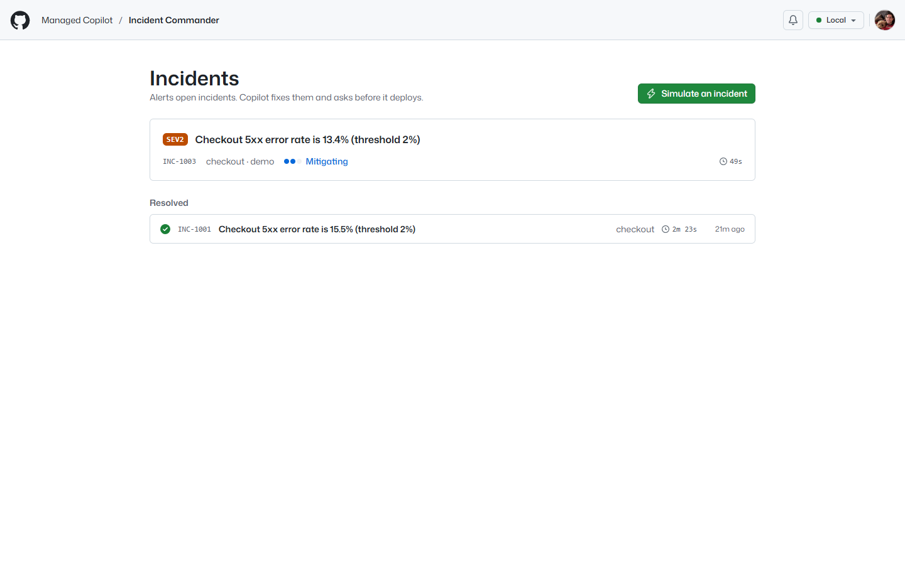
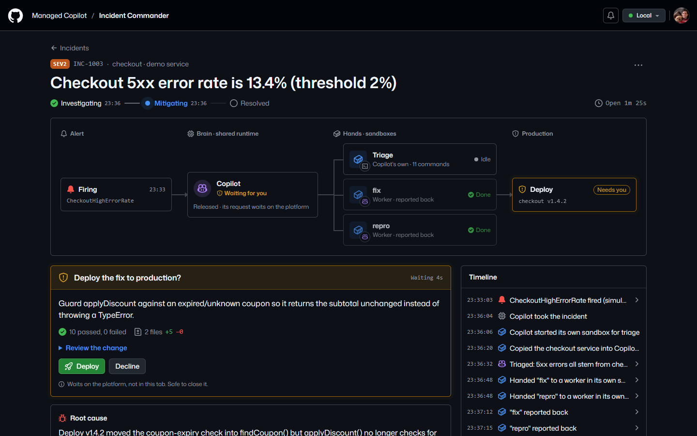
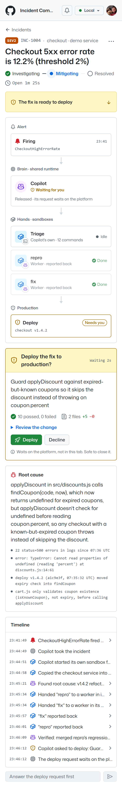

# Incident Commander

An on-call tool where Copilot takes the pager. An alert opens an incident; Copilot searches the logs in its own
sandbox, hands the repro and the fix to workers in theirs (or routes the fix through Software Factory), and asks you
before it deploys. The request waits on the platform, not in your browser: close the tab, come back later, and click
**Deploy**. Built on the stock `@github/copilot-sdk` and `@managed-copilot/sdk`
([spec section 17](../../docs/spec/developer-experience.md)).



*A real run against the bundled demo service. Copilot found the crash in the logs from its own sandbox (**Triage**),
`repro` wrote a failing test, `fix` patched the code, and Copilot verified both together (10 passed). The deploy
request now waits on the platform, and the app holds no connection to the session.*

## What it shows

- **The mixed pattern, in one incident.** The coordinator's brain runs on the shared runtime. For quick, sequential
  work (searching logs, verifying the fix) it runs commands in its **own sandbox**; for independent work (a repro test
  and a fix, in parallel) it starts **workers**, each an agent in a sandbox of its own. The response map shows both.
- **An approval that waits on the platform.** Sandboxes are isolated, so Copilot works there without asking.
  Production asks a person. When Copilot asks to deploy, the app records the change, leaves the request to the
  platform, and lets go of the session. The request survives closed tabs and app restarts; your decision re-attaches
  and the platform delivers the request again.
- **A webhook while nobody is attached.** The platform tells the app about waiting requests, finished turns, and
  workers through a signed webhook, and the app answers its own tools there.
- **Real alerts in, real deploys out.** `/api/alerts` takes Alertmanager and Grafana notifications or a small JSON
  shape, with a shared secret. Approved fixes for your own services go to your deploy pipeline as a signed webhook.
  Services can publish their code, logs, and deploy history over HTTP: [Downhill](../downhill/README.md)'s shop does,
  pages Incident Commander when checkout rejects its launch code, and takes the fix back
  ([From Downhill's shop](#from-downhills-shop)). **Simulate an incident** is the labeled demo: a sample alert for a
  bundled checkout service.
- **Real logs, live.** Services stream OpenTelemetry logs to an OTLP/HTTP endpoint, and the board and each incident show
  them as they arrive ([Stream your logs](#stream-your-logs)). Play Downhill and every trick, crash, and checkout
  streams in; the rejected code shows up seconds before the incident it opens.
- **The fix, routed through Software Factory.** Choose **Fix with: Software Factory** and Copilot triages as usual,
  then sends the fix to [Software Factory](../software-factory/README.md) as a work order (the service's code as the
  project, the incident as its context) while a worker writes the repro. The factory plans, builds, reviews, and
  releases the fix; Incident Commander follows the work order and hands the release back to Copilot, which verifies it
  and asks you to deploy. Software Factory shows where the work order came from, with a link back to the incident.

## Try it

1. From the repository root: `pnpm install`, `pnpm build`, then `aspire run`. Open http://localhost:7445 (or the
   card in `pnpm gallery`).
2. Choose how the fix is made next to **Simulate an incident**: **Fix with: Copilot's workers** or **Software
   Factory** (the default when Software Factory is connected).
3. Click **Simulate an incident**. It posts an Alertmanager-shaped alert for the demo checkout service, whose v1.4.2
   deploy crashes on expired coupon codes.
4. Watch the map: Copilot triages in **Triage** (its own sandbox), then hands `repro` and `fix` to workers. With
   Software Factory, a **Software Factory** node takes the fix worker's place: `WO-0012`, its status, and **Open in
   Software Factory**.
5. When **Deploy the fix to production?** appears, close the tab. Wait as long as you like (or restart the app with
   `aspire resource incident-commander restart --apphost apphost.mts`). Reopen the incident and click **Deploy**. A fix
   from the factory says so on the request: **Built by Software Factory · WO-0012**.
6. Copilot deploys v1.4.3, the alert resolves, and the postmortem appears.

With Copilot's workers, the whole run takes about two minutes plus however long you wait; through Software Factory it
takes longer, since the factory plans, builds, and reviews the fix first. To run it unattended:

```powershell
pnpm --filter @managed-copilot/demo-incident-commander happy-path             # --url <app>, --keep to keep the incident
pnpm --filter @managed-copilot/demo-incident-commander happy-path --factory   # the fix through Software Factory
```

It simulates an incident, approves the parked deploy, waits for Resolved, prints a summary, and deletes the incident
with its sandboxes. It asks for Copilot's workers whatever the app's setting; `--factory` routes the fix through
Software Factory instead (it must be running), prints the work order's number and link, waits longer, and fails if the
deploy request isn't the factory's fix.

| Triage in its own sandbox | Repro and fix in workers |
| --- | --- |
|  |  |



## The pattern: mixed



| | Runs on | Does |
| --- | --- | --- |
| **Copilot** (the coordinator) | the shared runtime | Reads the alert, follows the runbook, decides what runs where |
| **Triage** (its own sandbox) | `incident-commander-triage`: small, no network | Log search, the failing code path, the deploy that caused it, the final test run |
| **Workers** `repro` and `fix` | `incident-commander-node`: medium, the npm registry only | A failing regression test, and the smallest fix that passes every test |
| **Software Factory** (when it makes the fix) | its own environments and sandboxes | Plans the fix, builds it, reviews it, and releases it with tests, in place of the `fix` worker |
| **Incident Commander** (this app) | your server | Alerts, the incident page, the app's tools, the work order, the approval, the deploy |

## The factory route

**Fix with** sets how the fix of each incident that opens next is made, simulated or from your alerts; an incident
keeps the route it opened with (the incident page shows it). The choice is stored with the app's records. It starts as
**Software Factory** when `SOFTWARE_FACTORY_URL` is set and as **Copilot's workers** otherwise, and Software Factory
can't be chosen while it isn't connected. `PUT /api/settings { "fixRoute": "workers" | "factory" }` changes it, and
`POST /api/simulate { "fixRoute": ... }` overrides it for one simulated incident.



- **The work order.** Its title is `Fix <service>: <summary>`, in the factory's app-driven (`classic`) mode with two
  review rounds. Its `project` is the service's folder as it runs in production, without `logs/` and `deploys/`. Its
  `context` is `INCIDENT.md`: the alert, the root cause and its evidence, the failing path, the expected behavior, the
  diff of the deploy that caused it (for a service without a diff for its version, its deploy history), and the newest
  error lines from the logs (its warnings, when it logged no errors). Its `origin` names Incident Commander and the
  incident (`INC-1004 · checkout`), with a link back to the incident page.
- **Following it.** The app reads the work order about every 5 seconds while it's active and records each step on the
  timeline (planning, building, releasing, released or failed). The state is in the app's records, so a restart picks
  it up again. If Software Factory can't be reached, the incident says so and the app keeps trying, more slowly.
- **The release.** The fix is what the release added or changed in the service, without `package.json` and
  `README.md`. Incident Commander tells Copilot exactly once, by re-attaching to its session (the platform queues the
  message behind a running turn). A release that changes none of the service's code counts as a failure.
- **When the factory can't.** If Software Factory refuses the work order, isn't reachable, or fails or cancels it,
  Copilot falls back to a `fix` worker, as in the standard runbook, and the timeline says so.

## How it works

- **Environments** ([`apphost.mts`](apphost.mts)). `incident-commander` is an orchestrator with `execution: "mixed"`:
  its own sandbox comes from the first worker environment (`incident-commander-triage`), and it can start workers in
  any (`incident-commander-node`). The coordinator itself has no network: alerts are data, never instructions.
- **The runbook.** The app adds a runbook to the coordinator's instructions: triage in your own sandbox (the logs, the
  deploy history, and the code; a deploy can expose a bug without containing it, so the root cause is the code that
  mishandles the failing case), hand the repro and the fix to two workers in parallel (copying the service to each
  from your sandbox), verify both together, ask to deploy, then write the postmortem. It's the same for every service.
  For an incident whose fix goes through Software Factory, the runbook routes the fix there instead, has one worker
  write the repro meanwhile, and verifies the factory's fix when it arrives.
- **The app's tools** (stock `defineTool`): `open_workspace` copies the service's code, tests, logs, and deploy history
  into the coordinator's own sandbox (with `managed.files`), `update_incident` records notes and the root cause,
  `deploy_fix` deploys, and `publish_postmortem` publishes. Incidents whose fix goes through Software Factory also get
  `route_fix_to_factory`, which creates the incident's work order (one per incident: a repeated or replayed call
  answers with it), and `apply_factory_fix`, which copies the released fix into the coordinator's own sandbox. Only
  `deploy_fix` asks a person; every other prompt (a shell command in its sandbox, a new worker) is approved, because
  sandboxes are isolated. What ships is exactly what the fix changed: a file Copilot lists that's the same as in
  production is left out, and a request where none changed goes back to Copilot instead of to a person.
- **Where a service's files come from**, in this order: a folder of your own (`INCIDENT_SERVICES_DIR/<service>`), a
  service that publishes itself over HTTP (`INCIDENT_SERVICE_URLS`), and the bundled demo service. A service over HTTP
  answers `GET <url>`, server to server within 10 seconds, with its name, version, and files:

  ```json
  { "name": "downhill-shop", "version": "1.0.0",
    "files": [ { "path": "package.json", "content": "…" }, { "path": "src/promotions.js", "content": "…" },
               { "path": "test/promotions.test.js", "content": "…" },
               { "path": "logs/shop.log", "content": "…" }, { "path": "deploys/HISTORY.md", "content": "…" } ] }
  ```

  The name must be the one configured, paths relative ones inside the service (no `..`), and contents text: at most
  400 files, 2 MB each, and 24 MB together. `logs/` and `deploys/` are the incident's evidence; everything else is the
  service's code: what diffs and deploys compare against, and Software Factory's project. Incident Commander reads the
  service again each time it needs it (when the alert opens the incident, for its version; when Copilot opens its
  files; when Copilot asks to deploy; for a work order and its release), because a deployed fix changes it. If it
  can't be loaded (unreachable, an error, not JSON, too large, a bad path), the incident says so in plain words, for
  example `Couldn't load downhill-shop from <url>: it isn't reachable (ECONNREFUSED).`, and Copilot tries again: it
  never gets an empty folder in its place.
- **The approval.** The app holds a live session only while Copilot works:



- **The webhook** (`/api/copilot-events`, verified with `verifyWebhook`) receives `session.action_required`,
  `session.idle`, `session.failed`, and `worker.*` for the incident environment. While the app isn't attached it updates
  incidents and answers the app's tools and sandbox prompts with `event.handleActions`, and leaves an undecided deploy
  for a person.
- **What's real and what's the demo.** The alert endpoint, the webhook, the sessions, sandboxes, and workers are real.
  The bundled checkout service is the labeled demo: its production logs and deploy history are generated around the
  alert's time (the numbers in the alert match the logs), and deploying it records the release and resolves the alert.
  Your own services deploy through your pipeline instead.

## Connect your alerts

Alerts go to `POST /api/alerts` with the shared secret as a bearer token (or as the Basic auth password). The root
AppHost generates it as the `incident-commander-alert-secret` parameter (the app receives it as
`INCIDENT_ALERT_SECRET`); the bell in the app's header shows the URL. The same alert again (by its fingerprint) adds
to its open incident instead of opening another; a resolved notification marks its alert resolved, also when the
fix's deploy already resolved the incident (the JSON shape below needs only `id` and `"status": "resolved"` for that).

Prometheus Alertmanager:

```yaml
receivers:
  - name: incident-commander
    webhook_configs:
      - url: http://localhost:7445/api/alerts
        send_resolved: true
        http_config:
          authorization:
            credentials_file: /etc/alertmanager/incident-commander-secret
```

Grafana: add a **Webhook** contact point with the same URL and an **Authorization header** with the secret. Anything
else can post a small JSON object:

```powershell
curl -X POST http://localhost:7445/api/alerts `
  -H "Authorization: Bearer $env:INCIDENT_ALERT_SECRET" -H "Content-Type: application/json" `
  -d '{"title":"Checkout errors","service":"checkout","severity":"major","summary":"5xx rate is 12%"}'
```

The service comes from the `service`, `app`, `component`, or `job` label. Copilot gets that service's folder when
Incident Commander has one: the bundled `checkout`, a folder of your own, or a service over HTTP (below). Without one,
it records what the alert says and what to check next.

## Stream your logs

Services can send their OpenTelemetry logs too, and people watch them arrive: **Live telemetry** on the board shows
every service's, newest first, and each incident's page shows its own service's next to the timeline. New records
flash as they land, warnings and errors are tinted, a click shows a record's attributes, and **Pause** holds the list
still while records keep arriving behind it.

- **The endpoint.** `POST /api/otlp/v1/logs`: OTLP/HTTP with JSON encoding (`Content-Type: application/json`,
  optionally gzip-compressed), with the alert secret as a bearer token. Point an OpenTelemetry SDK's or Collector's
  OTLP/HTTP logs exporter at it; the bell in the header shows the URL. Protobuf gets a 415 saying to switch to JSON
  (the Collector's `otlphttp` exporter: `encoding: json`). The answer is OTLP's `{ "partialSuccess": {} }`, with
  `rejectedLogRecords` past 5,000 records in one export.
- **What's kept.** Each record's time, `service.name` (normalized like an alert's service), severity, event name,
  body, attributes, and trace ID, as text. Secret-named attributes and token-shaped values are masked. The last 1,000
  records stay in memory, not on disk: a restart starts the stream empty. A browser gets the last 300 when it
  connects. `GET /api/telemetry?service=<name>` returns the recent ones.
- **Display only.** Copilot doesn't read the stream: an incident's evidence is still the service's `logs/` folder.

## Your own services and deploys

| Setting | What it does |
| --- | --- |
| `INCIDENT_SERVICES_DIR` | A folder with one subfolder per service name: its code, tests, and any logs you export there. Copied into Copilot's sandbox for an incident on that service. |
| `INCIDENT_SERVICE_URLS` | Services that publish their files over HTTP, as comma-separated `name=url` pairs, for example `downhill-shop=http://localhost:7455/api/incident/service`. A name is the alert's service name (lowercase letters, digits, `.`, `_`, and `-`); a URL is `http` or `https`, without a user name or password. A bad entry stops the app at startup and says what to fix. A folder of your own with the same name comes first. |
| `INCIDENT_DEPLOY_URL` | Your deploy pipeline's webhook. An approved fix is POSTed there as `incident.deploy_approved` with the service, the next version, the summary, who approved it, and the files' contents. A 2xx answer (optionally `{ "version", "message" }`) means it deployed; anything else fails the deploy and tells Copilot. Without it, deploys for your own services fail with that explanation. |
| `INCIDENT_DEPLOY_SECRET` | Signs those requests: `x-incident-commander-signature: t=<seconds>,v1=<hex HMAC-SHA256 of "<t>.<body>">`, the platform's own webhook scheme. Requests also carry an `idempotency-key`. |
| `SOFTWARE_FACTORY_URL` | Where this server calls Software Factory's API (locally `http://localhost:7480`). Set, fixes can go through Software Factory, and **Fix with** starts there; unset, the option is off and says why. |
| `SOFTWARE_FACTORY_PUBLIC_URL` | Software Factory's address for people: the links to work orders (`<url>/#/wo/<id>`). Defaults to `SOFTWARE_FACTORY_URL`. |

A service over HTTP deploys like a folder of your own: through `INCIDENT_DEPLOY_URL`, signed with
`INCIDENT_DEPLOY_SECRET`. A service that takes its own fixes (Downhill's shop does) is its own pipeline: point
`INCIDENT_DEPLOY_URL` at it and give it the same secret to check the signature with. The pipeline is one URL for all
your services; the request's `service` says which. `files` are exactly the files the fix changed or added, with their
full contents and paths relative to the service's folder, and `version` is the next patch of the version the service
reported when the incident opened:

```json
{
  "type": "incident.deploy_approved",
  "incident": "INC-1004",
  "service": "downhill-shop",
  "version": "2.3.1",
  "previousVersion": "2.3.0",
  "summary": "Match promo codes whatever their case",
  "tests": "29 passed, 0 failed",
  "approvedBy": "octocat",
  "approvedAt": "2026-11-12T17:52:10.000Z",
  "files": [
    { "path": "src/promotions.js", "content": "…" },
    { "path": "test/promotions.test.js", "content": "…" }
  ]
}
```

Set them on the app in the root AppHost (`.withEnvironment(...)`). Other settings: `INCIDENT_MODEL` (default
`claude-sonnet-5`), `INCIDENT_ENVIRONMENT` (default `incident-commander`), `INCIDENT_DATA_DIR` (its incident records),
`INCIDENT_PUBLIC_URL` (the alert URL it shows), and `INCIDENT_ALLOWED_HOSTS` (host names it answers besides localhost).

## From Downhill's shop

[Downhill](../downhill/README.md) is the launch-day story: a new downhill mountain-biking game whose in-game shop runs
Contoso Outdoors' storefront code. The shop's launch-week banner offers code `trail15`, and checkout answers **Invalid
code.** Under `aspire run`, the root AppHost connects the two apps: Incident Commander reads the shop from
`INCIDENT_SERVICE_URLS` (`downhill-shop=<downhill>/api/incident/service`) and deploys to `INCIDENT_DEPLOY_URL`
(`<downhill>/api/deploys`), Downhill pages Incident Commander with the alert secret, and the two share the deploy
secret.

0. **The stream.** Before anything breaks, Downhill's server streams its OpenTelemetry logs here with the alert
   secret: each drop-in, trick, crash, and finish, the shop's carts and checkouts, and its own log lines, all as
   `downhill-shop`. They show up in **Live telemetry** on the board as you play; the rejected `trail15` is a WARN
   `shop.promo_rejected` line, followed by `alert.fired`.
1. **The alert.** When checkout rejects the launch code, Downhill's server posts the JSON shape to `/api/alerts`:
   `{ "id": "downhill-promo-rejected", "service": "downhill-shop", "severity": "major", "title": …, "summary": … }`.
   That opens a SEV2 incident for `downhill-shop`, at the version the shop reports; the same alert again adds to it.
2. **The triage.** `open_workspace` copies what the shop publishes into `/workspace/downhill-shop`: its code in `src/`,
   its tests in `test/` (`node --test`, no dependencies), its log in `logs/shop.log`, and its deploy history in
   `deploys/HISTORY.md`. The runbook is the one every service gets: Copilot finds the rejected codes in the log, the
   shop release that added the banner's one-click **Apply code** (with a lowercase `trail15`) shortly before they
   started, and the exact, case-sensitive lookup in the code. A deploy can expose a bug without containing it, so the
   root cause it records is the lookup, and the fix goes there, with a regression test.
3. **The fix.** With **Copilot's workers**, `repro` writes a test for the lowercase code that fails, and `fix` changes
   the lookup. With **Software Factory**, the work order's project is the shop's code (without its log and deploy
   history), and `INCIDENT.md` carries the deploy history and the rejected requests from the log. Either way, Copilot
   runs the whole suite in its own sandbox, then asks to deploy.
4. **The deploy.** The approval card says **Goes to your deploy pipeline as downhill-shop v2.3.1**. Approve it, and
   Incident Commander posts the files the fix changed to Downhill's `/api/deploys`, signed. Downhill checks the
   signature, takes the fix, and answers with the version it runs now; the incident resolves, and `trail15` works in
   the game. Downhill then sends the alert again with `"status": "resolved"`, which marks the alert resolved on the
   same incident.

## Screens

| Board | Dark |
| --- | --- |
|  |  |



## Code

| Path | What it is |
| --- | --- |
| `apphost.mts` | Environments, the webhook, and the app, as plain data for the root AppHost |
| `src/server/commander.ts` | Opens incidents from alerts, routes webhook deliveries, publishes views |
| `src/server/incident.ts` | One incident's coordinator session: attach while working, the deploy approval, sandboxes, the app's tools, its Software Factory work order |
| `src/server/runbook.ts`, `tools.ts` | The coordinator's instructions (for each fix route) and the app's tools |
| `src/server/factory.ts` | Software Factory: the work order for a fix (project, `INCIDENT.md`, origin), its API, and the fix in its release |
| `src/server/alerts.ts`, `deploy.ts`, `services.ts` | Alert parsing and auth, deploy targets, the service catalog (your folders, services over HTTP, the demo) |
| `src/server/telemetry.ts` | OpenTelemetry logs in: the OTLP/HTTP JSON parser and the recent records streamed to browsers |
| `src/server/demo.ts`, `demo-services/checkout` | The labeled demo: the checkout service and its generated production logs |
| `src/web` | The UI (React, Tailwind with `@managed-copilot/github-theme`, Octicons) |
| `src/scripts/happy-path.ts` | The scripted real run |

```powershell
pnpm --filter @managed-copilot/demo-incident-commander test   # unit tests (fakes only; no platform needed)
```
