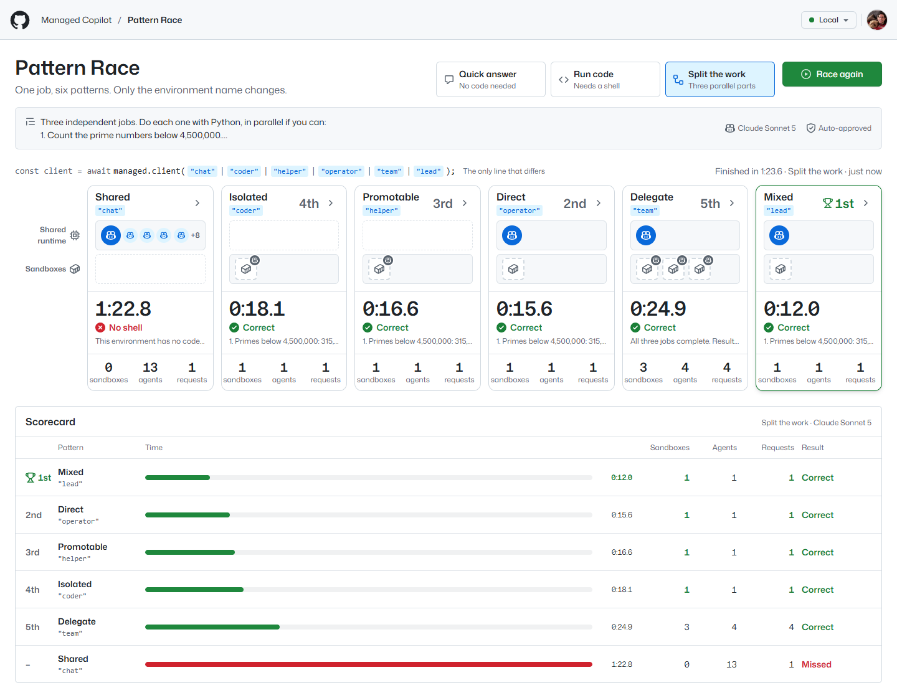
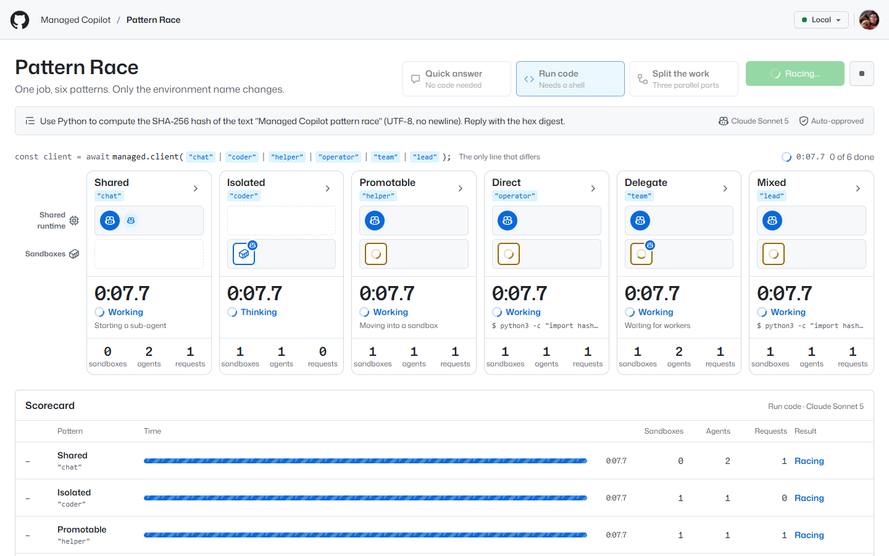
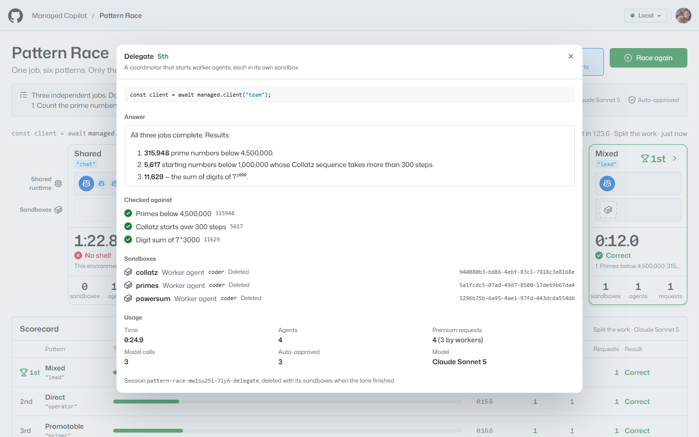

# Pattern Race

One job, six patterns, side by side. Pattern Race sends the same prompt to six real sessions at once, one in each
pattern's environment of the root AppHost, and races them: where each agent thinks and acts, how long it takes, how many
sandboxes and agents it uses, and how many premium requests it spends. The code in every lane is the same stock
`CopilotClient`; the only thing that differs is the environment name passed to `managed.client(...)`.



*A real "Split the work" race on a local deployment. Mixed did all three parts in its own sandbox and won in 12.0
seconds; Delegate started a worker per part (three sandboxes, four agents, four premium requests) and took 24.9; Shared
has no shell, so it started sub-agents looking for one and answered that it couldn't run the code.*

## What it shows

- **The same code, six shapes.** Each lane is `const client = await managed.client("<environment>")`, then
  `client.createSession(...)` and `session.sendAndWait({ prompt })`. The environment decides the rest: a shared
  runtime session, a sandbox per session, a move into a sandbox, or a coordinator that acts in a sandbox, delegates to
  workers, or both.
- **Where the brain and the hands are.** Each lane has two rows: the shared runtime and its sandboxes. A blue Copilot
  mark is an agent's brain (its model loop); a box is a sandbox, with a badge when an agent runs inside it. Watch the
  promotable lane's brain move into a sandbox, direct and mixed act in a sandbox with no agent in it, and delegate start
  a worker per part. Sandboxes turn dashed when the lane's session (and every sandbox it had) is deleted at the end.
- **An honest scorecard.** Every answer is checked against values the server computes itself (a SHA-256 digest,
  prime counts, a Collatz count), so a fast wrong answer doesn't win. Places go to correct answers in the order they
  arrived. The best time, fewest sandboxes, and fewest premium requests among correct lanes are highlighted.
- **True trade-offs, not a rigged race.** The shared lane can't run code, and says so. Delegation pays for a new agent
  and sandbox per part, which wins when parts are big and loses when they're small. A coordinator retyping a worker's
  report can even drop a character (it happened: one run's Delegate lane missed the last digit of the hash). Results
  vary between runs; that is the point.



*A "Run code" race 7.7 seconds in. Isolated thinks inside its own sandbox; Promotable is moving into a sandbox that is
still starting; Direct and Mixed run `python3` in sandboxes with no agent in them; Delegate waits for its worker.*

## The pattern it proves

All six patterns from [Patterns](../../docs/concepts/patterns.md), on the environments the root
[`apphost.mts`](../../apphost.mts) already declares. Pattern Race declares none of its own.

| Lane | `managed.client(...)` | Its brain runs | Its hands act |
| --- | --- | --- | --- |
| Shared | `"chat"` | On the shared runtime | Nowhere with a shell: your app's tools and web fetches only |
| Isolated | `"coder"` | In its own sandbox | In the same sandbox |
| Promotable | `"helper"` | On the shared runtime, then in its own sandbox | In that sandbox, once it moved (`request_sandbox`) |
| Direct | `"operator"` | On the shared runtime, with its sub-agents | In a sandbox with no agent in it |
| Delegate | `"team"` | On the shared runtime, as a coordinator | Through new worker agents, each in its own sandbox |
| Mixed | `"lead"` | On the shared runtime, as a coordinator | In its own sandbox, and through workers; the model picks |

Every lane uses the same model (Claude Sonnet 5 by default; all six environments allow it) and gets the same prompt.

## Run it

Everything runs locally against real models. You need the repository's prerequisites (see
[AGENTS.md](../../AGENTS.md)) and a GitHub sign-in with Copilot (`gh auth login`).

```powershell
pnpm install
pnpm build
aspire run          # the platform, sandboxes, and the demos; open the "pattern-race" resource
```

Pattern Race opens at <http://localhost:7420>.

### Demo it

1. Pick **Run code** and press **Start race**. Six stopwatches start; within seconds the promotable lane asks for a
   sandbox and moves into it, and the coordinators' sandboxes appear.
2. Point at the Shared lane when it finishes: **No shell**. Then at the winner's trophy and the scorecard.
3. Press **Race again** with **Split the work**: three independent parts. Compare Delegate (a worker and sandbox per
   part, more premium requests) with Direct and Mixed (one sandbox).
4. Open any lane's **Details** (the chevron) for its full answer, the values it was checked against, its sandboxes
   with their IDs, and its usage.

Each job costs about one premium request per lane, plus one per message each worker receives: the quick answer costs
six in all, and the run-code and split races we measured cost eight to thirteen. Measured live on a local deployment:
the quick answer finished in 7 seconds (only Isolated paid for a sandbox, 6.0 seconds against 1 to 2 for the rest);
run code in 37 seconds (Mixed won in 12.3); split the work in 25 seconds for every lane with a shell, while Shared kept
looking for one for 83.



### The scripted happy path

One real race through the HTTP API, followed live, then checked: every lane raced and answered, every session (and
its sandboxes) was deleted, and the race had a winner. It defaults to the quick answer, six premium requests.

```powershell
pnpm --filter @managed-copilot/demo-pattern-race happy-path                          # http://localhost:7420
pnpm --filter @managed-copilot/demo-pattern-race happy-path --url http://localhost:7720 --job code
```

It uses `MANAGED_COPILOT_PORT_OFFSET` for its default URL, stops the race on Ctrl+C or after 15 minutes
(`HAPPY_PATH_TIMEOUT_MINUTES`), and exits non-zero on any failure.

### Against another deployment

Pattern Race connects like any SDK app: `MANAGED_COPILOT_URL` and your GitHub sign-in. A lane races only where the
deployment declares its environment as its pattern needs; the others show **Not available** with the reason.

```powershell
cd demos/pattern-race
$env:MANAGED_COPILOT_URL = "https://<your gateway>"
pnpm dev                                       # server and UI with live reload on :7420
```

`aspire deploy` publishes Pattern Race with the root AppHost, next to the other demos (see
[docs/deployment.md](../../docs/deployment.md), including who can open the apps).

## How it works

- **One stock client per lane.** The server connects with `ManagedCopilot.connect()` and starts
  `managed.client(environment)` for each lane whose environment `/v1/info` declares with the right type (and, for the
  coordinators, `execution`), allows the model, and has its capabilities (`shared`, `isolated`, `promotion`,
  `orchestrator`) working. A race creates one session per lane with `client.createSession({ sessionId, model,
  onPermissionRequest })` and sends the job with `sendAndWait`. Session IDs start with `pattern-race-`, so sessions a
  restart cut short are found and deleted when the server connects again.
- **Approvals are automatic, per lane.** Each lane answers its own permission requests with the SDK's `approveAll` (a
  promotion, a worker, a command in a hands sandbox): everything a lane does happens in its own sandboxes, within its
  environment's network rules. The page says so once, and each lane's details count its approvals.
- **What a lane is doing comes from its own session.** `tool.execution_start` and `tool.execution_complete` give its
  current step (`report_intent` included), `subagent.started` counts its sub-agents, the `session.promoted` platform
  event (or its placement in `managed.sessions.get`) moves the promotable lane's brain, and the `worker.*` events and
  `managed.workers(session).list()` give a coordinator's workers and hands sandboxes, without ever attaching to a
  worker. An isolated lane's sandbox comes from `managed.sessions.get` once its session exists.
- **Premium requests are measured where they can be.** Each lane's own session reports its usage
  (`session.rpc.usage.getMetrics()`: `totalPremiumRequestCost`, and model calls including sub-agents'). A worker is a
  session of its own that the race never attaches to, so it counts one premium request per message the worker
  received, its task included, at its model's multiplier (from `client.listModels()`, else the rate its coordinator
  measured).
- **A lane ends when its answer arrives.** Its stopwatch stops at `sendAndWait`'s answer, the answer is checked, and
  then its session is deleted, which deletes its sandbox, hands sandboxes, and workers. A failed lane says why in plain
  words; **Stop** cancels every running lane (`session.abort()`) and deletes their sessions.
- **The page is a live view.** The server pushes its whole state over server-sent events a few times a second; the
  last finished race is kept in `.data/last-race.json`, so the board shows it after a restart.

## Configuration

| Variable | Default | Purpose |
| --- | --- | --- |
| `PORT` | `7420` | HTTP port for the UI and API |
| `HOST` | `127.0.0.1` | Interface to listen on (`0.0.0.0` in a container, together with `PATTERN_RACE_ALLOWED_HOSTS`) |
| `MANAGED_COPILOT_URL` | local discovery | Gateway URL (Aspire sets it) |
| `PATTERN_RACE_MODEL` | `claude-sonnet-5` | The model every lane uses; a lane whose environment doesn't allow it is not raced |
| `PATTERN_RACE_DATA_DIR` | `.data` | Where the last race is kept |
| `PATTERN_RACE_ALLOWED_HOSTS` | none | Extra host names allowed to address the server (it accepts loopback names only by default) |

## Layout

| Path | Contents |
| --- | --- |
| `apphost.mts` | AppHost fragment: the app resource (it races the root AppHost's environments and declares none) |
| `src/server` | Platform connection (one client per lane), the race, answer checks, REST and server-sent events |
| `src/shared` | The lanes, the jobs, the scoring helpers, and types shared with the UI |
| `src/web` | The race board (React, Tailwind, and GitHub's Primer look from [`libraries/github-theme`](../../libraries/github-theme); light and dark follow the OS) |
| `src/scripts/happy-path.ts` | The scripted happy path |
| `test` | Unit tests: the race against an in-memory platform, lane availability, answer checks, scoring, the API, and the fragment |
| `Dockerfile` | The container `aspire deploy` publishes |
