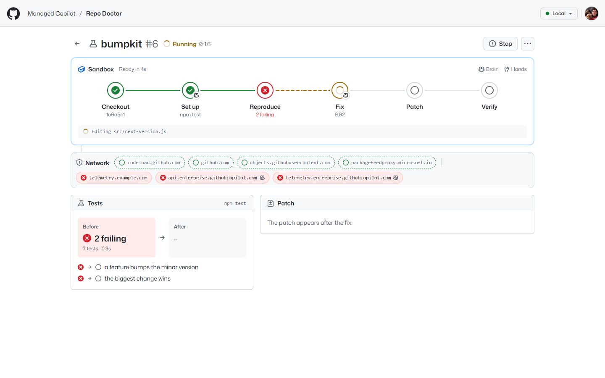
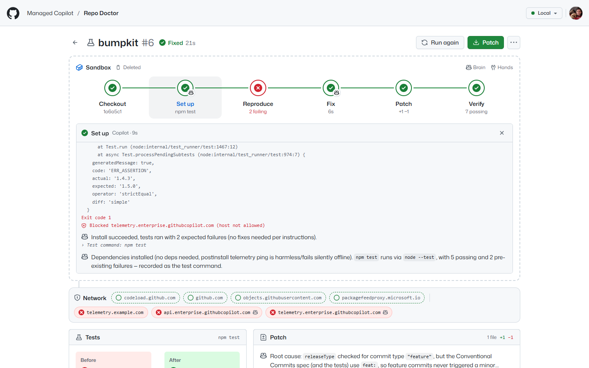

# Repo Doctor

Paste a public GitHub repository with a failing test. Repo Doctor runs it like CI, in one sandbox of its own: it
checks the code out, Copilot gets the tests running, Repo Doctor reproduces the failure, Copilot fixes it, and Repo
Doctor runs the tests again and hands back the patch. A strip under the sandbox shows its network: the hosts its rules
allow in green, and every request they refused in red. The app is ordinary Node code on the stock
`@github/copilot-sdk` and `@managed-copilot/sdk`.


*The bundled sample, fixed in about 20 seconds. The frame is the run's sandbox, dashed once it's deleted. Copilot's
steps carry its mark; Repo Doctor ran the others. In red: the sample's install-time usage ping to
`telemetry.example.com`, and the Copilot runtime's own calls home, blocked like everything else not on the list.*

## What it shows

- **Isolated: the brain and the hands in one sandbox.** Each run is one session of the `repo-doctor` environment
  (`type: "isolated"`). Copilot's model loop and the tools it acts with run inside that run's new sandbox, and Repo
  Doctor runs its own commands (checkout, tests, diff) in the same sandbox with `managed.exec`. When the run ends, the
  sandbox is deleted: the logs and the patch are what come out.
- **Network rules you can watch.** The environment allows GitHub and the package registries its sandboxes use, and
  nothing else. The platform reports every refused request as a `network.blocked` event, and the strip turns each
  blocked host red as it happens. Allowed hosts are green; a check marks the ones a command reached (inferred from
  commands that succeeded, since the platform reports blocks, not allowed requests).
- **Copilot fixes, Repo Doctor verifies.** Copilot reports how to run the tests with a tool that runs in this app.
  Repo Doctor then runs them itself before and after the fix, and builds the patch from the sandbox's files rather than
  from what Copilot says it changed. A run is **Fixed** only when the same tests pass afterwards.



*Mid-run: Reproduce is red, and Copilot is fixing. The network strip fills in live.*

## Run it

```powershell
pnpm install
pnpm build
aspire run                 # the platform and every demo; Repo Doctor at http://localhost:7435
```

Open http://localhost:7435, then:

1. **Try the sample.** `bumpkit` picks the next version from commit messages, and two of its seven tests fail. In
   about half a minute Reproduce turns red, Copilot fixes the code, and Verify turns green.
2. **Click a step** to open its log: the commands and their output, Copilot's edits and words, and each blocked
   request at the moment it happened.
3. **Download the patch**, or paste a public repository (`github.com/owner/repo`; a `/tree/<branch>` URL picks a
   branch) and **Run**.



*A step's log, as the sandbox saw it.*

Scripted: `pnpm --filter @managed-copilot/demo-repo-doctor happy-path` runs the sample through the API, checks the
fix, deletes the run, and exits non-zero on failure. Pass `--url` for another address (it defaults to 7435 plus
`MANAGED_COPILOT_PORT_OFFSET`), `--repo github.com/owner/repo` for a repository, or `--keep` to keep the run.

## How it works

```mermaid
sequenceDiagram
  participant UI as Browser
  participant RD as Repo Doctor (Node)
  participant MC as Managed Copilot
  participant SB as The run's sandbox
  UI->>RD: POST /api/runs
  RD->>MC: client.createSession() in repo-doctor
  MC->>SB: a new sandbox with the environment's network rules
  RD->>SB: Checkout: git clone (managed.exec), or upload the sample
  RD->>SB: Set up: a Copilot turn; it calls report_test_command
  RD->>SB: Reproduce: run the tests (managed.exec)
  RD->>SB: Fix: a Copilot turn
  RD->>SB: Patch: diff the files; Verify: run the tests again
  SB-->>MC: refused requests, from the egress proxy
  MC-->>RD: network.blocked events
  RD->>MC: delete the session, and with it the sandbox
```

| Step | Who acts in the sandbox | What happens |
| --- | --- | --- |
| Checkout | Repo Doctor | `git clone --depth 1`, or the sample's files uploaded and committed |
| Set up | Copilot | installs the dependencies, finds the test command, and reports it with `report_test_command` (or that there are no tests, with `report_no_tests`) |
| Reproduce | Repo Doctor | runs the test command; if everything passes, the run ends **Healthy** |
| Fix | Copilot | changes the code until the tests pass, and replies with the root cause |
| Patch | Repo Doctor | diffs the working tree before and after the fix (through a temporary git index; the repository's history is untouched) |
| Verify | Repo Doctor | runs the same test command again |

- **The environment** comes from [`apphost.mts`](apphost.mts): `repo-doctor` is isolated, medium, and allows
  `github.com`, `codeload.github.com`, `objects.githubusercontent.com`, the npm registry and pip index baked into the
  sandbox image (from `npm config get registry` and pip's `global.index-url`, as the platform resolves them), and any
  `REPO_DOCTOR_EXTRA_HOSTS`.
- **The code:** [`src/server/driver.ts`](src/server/driver.ts) runs one run; [`platform.ts`](src/server/platform.ts)
  keeps the stock `CopilotClient` connected and subscribes to `network.blocked`; [`agent.ts`](src/server/agent.ts)
  holds the prompts and the two tools (their handlers run in this app; a placeholder such as `echo` is refused as a
  test command) and turns the session's standard events into step logs;
  [`inference.ts`](src/server/inference.ts) works out which allowed hosts a successful command reached;
  [`testsummary.ts`](src/server/testsummary.ts) reads counts from node:test, Jest, Vitest, Mocha, pytest, unittest,
  Go, Cargo, and TAP output.
- **Records:** each run's steps, logs, test reports, and patch are kept in `.data/runs` (`REPO_DOCTOR_DATA_DIR`). A
  run that was going when the server stopped reads as interrupted, and its sandbox is deleted when the platform is
  back.

## Settings

| Setting | Default | What it does |
| --- | --- | --- |
| `PORT` | `7435` | The UI and API port (`aspire run` shifts it by `MANAGED_COPILOT_PORT_OFFSET`) |
| `REPO_DOCTOR_MODEL` | `claude-sonnet-5` | Copilot's model |
| `REPO_DOCTOR_MAX_RUNS` | `3` | Runs at once; each holds a sandbox |
| `REPO_DOCTOR_EXTRA_HOSTS` | none | Read by the AppHost: more hosts for the allowlist, comma-separated. For a registry that serves downloads from other hosts, such as an Azure Artifacts upstream: `*.pkgs.visualstudio.com,*.vsblob.vsassets.io` |
| `REPO_DOCTOR_DATA_DIR` | `.data` | The run history |
| `REPO_DOCTOR_ALLOWED_HOSTS` | none | More host names the server answers besides `localhost` (`aspire deploy` sets it) |

`aspire deploy` publishes Repo Doctor with the other demos from its [`Dockerfile`](Dockerfile).

## Limits

- **Public repositories on github.com only.** GitHub tokens never enter a sandbox, so private repositories can't be
  cloned.
- **Only the allowlist is reachable.** Dependencies from anywhere else (other git hosts, binaries an install script
  downloads) are blocked, and show up in red. If your registry hands out download links on other hosts, add them with
  `REPO_DOCTOR_EXTRA_HOSTS`.
- **Allowed hosts are marked used by inference.** The platform reports refused requests only, so a check on a green
  host means a command that names it, a git fetch, or an install that printed what it downloaded, exited 0.
