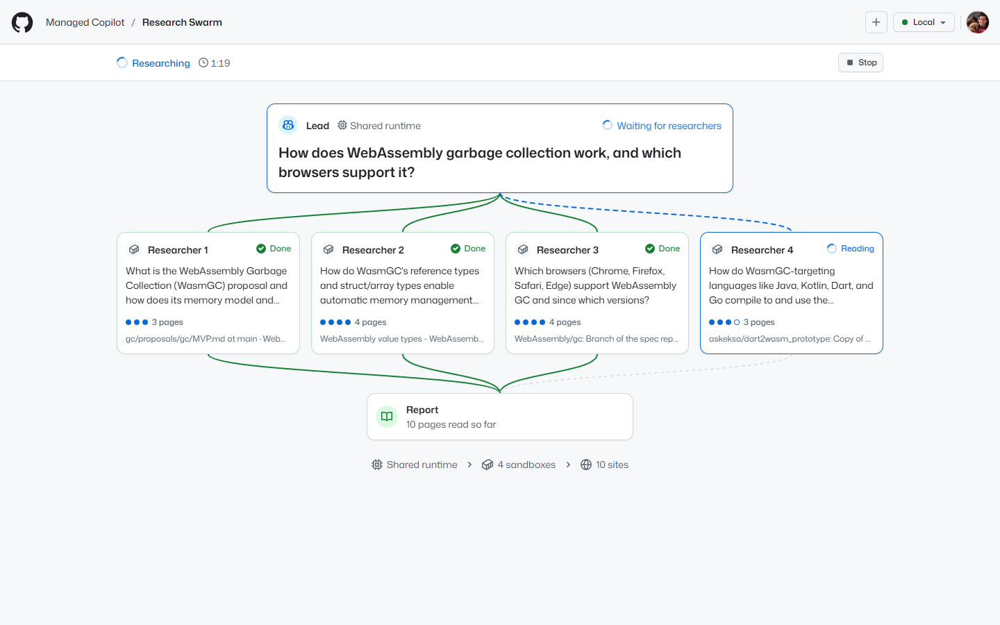
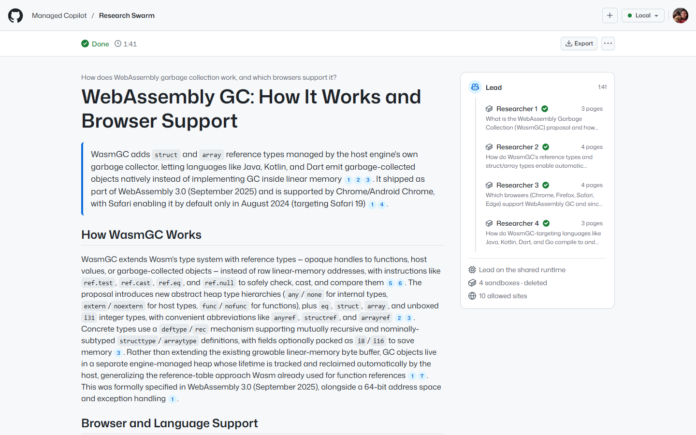
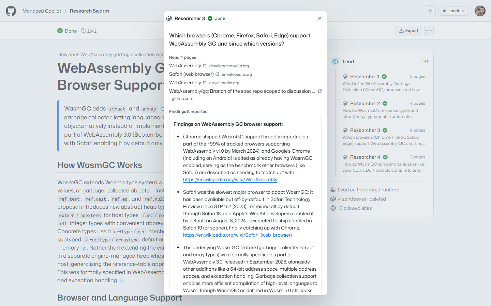
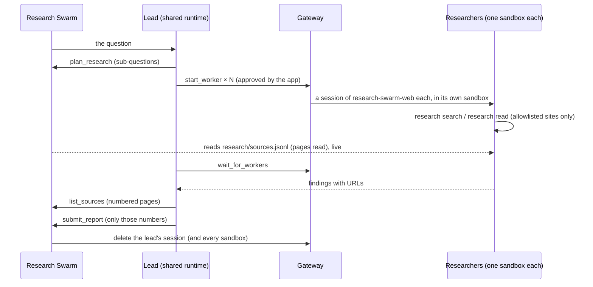

# Research Swarm

Ask one question; several web researchers read in parallel, each in a sandbox of its own, and you get back one report
where every claim cites a page they actually read. Research Swarm is a small app on **Managed Copilot** that shows the
**delegate** pattern ([spec section 17](../../docs/spec/developer-experience.md)): the lead's brain runs on the shared
runtime, and its hands are new agents, each in its own sandbox. It is ordinary Node code on the stock
`@github/copilot-sdk` and `@managed-copilot/sdk`.



*A live run. The lead (top) split the question into four sub-questions and started a researcher for each. The dots are
pages each one has read, and the line under them is the page it read last. Green wires are finished work: three
researchers are done, and their findings are in; the fourth is still reading.*

## What it shows

- **Delegate: a brain on the shared runtime, hands in sandboxes.** The lead is a session of the `research-swarm`
  orchestrator: no sandbox of its own and no network. It plans sub-questions and starts one worker per sub-question in
  `research-swarm-web`, the researchers' isolated environment, so four researchers read the web at once.
- **Sources you can trust.** Researchers read pages with the `research` command, which records each page in their
  sandbox. The lead can cite only those pages: the app numbers them, and refuses a report that cites anything else.
- **Network rules you can see.** Researchers reach only a short list of reference sites (Wikipedia, MDN, Microsoft
  Learn, the Python and Node.js docs, GitHub, and arXiv). A page anywhere else is blocked by the sandbox's egress, and
  the block shows on that researcher's card (from the `network.blocked` platform event).
- **Sandboxes on demand.** Each question gets fresh sandboxes, and they're deleted with the lead's session as soon as
  the report is in (or you stop the run).



*The report. Each citation opens its source in the numbered list below it, which says which researchers read each
page. Beside it, the swarm that wrote it, and where it ran: the lead on the shared runtime, four sandboxes (deleted),
and the ten sites they could read.*



*Click a researcher for its sub-question, the pages it read, any blocked hosts, the findings it reported to the lead,
and (folded away) its worker session, sandbox, environment, and model.*

## The pattern



| | Where it runs | Declared in [`apphost.mts`](apphost.mts) |
| --- | --- | --- |
| **Lead** (brain) | The shared runtime, beside other sessions | `research-swarm`: `type: "orchestrator"`, `workers: ["research-swarm-web"]`, `maxWorkers: 4`, `network: false` |
| **Researchers** (hands) | A small sandbox each, created when the lead starts it | `research-swarm-web`: `type: "isolated"`, `size: "small"`, a network allowlist, and the `researcher` customizations |

## Run it

Everything runs locally against real models. You need the repository's prerequisites (see
[AGENTS.md](../../AGENTS.md)) and a GitHub sign-in with Copilot (`gh auth login`).

```powershell
pnpm install
pnpm build
aspire run          # the platform and the demos; open the "research-swarm" resource
```

Research Swarm opens at <http://localhost:7425>. To demo it:

1. Pick a question under **Try one** (or write your own), and select **Research**.
2. Watch the fan-out: the lead splits the question, four researchers start in their own sandboxes, and their page
   dots fill in as they read. A blocked site shows in red on its researcher.
3. Select a researcher for the pages it read and the findings it reported.
4. Read the report: select a citation to jump to its source, and **Export** it as Markdown.

Measured live on a local deployment, with four researchers each: 50 seconds to 1 minute 40 from question to report,
reading 9 to 17 pages, with the sandboxes deleted a few seconds later. The scripted run below, with two researchers,
took 53 seconds.

### Against another deployment

Research Swarm connects like any SDK app, with `MANAGED_COPILOT_URL` and your GitHub sign-in. The deployment must
declare its environments ([`apphost.mts`](apphost.mts) exports them as plain data).

```powershell
cd demos/research-swarm
$env:MANAGED_COPILOT_URL = "https://<your gateway>"
pnpm dev                                       # server and UI with live reload on :7425
```

`aspire deploy` publishes it with the root AppHost, next to the other demos (see
[docs/deployment.md](../../docs/deployment.md)).

### A scripted run

`happy-path` drives one real run through the HTTP API: it asks a small question with two researchers, follows the run
over the event stream, checks that every cited source is a page a researcher read and that the sandboxes were deleted,
exports the Markdown, and deletes the run. It prints a summary and exits non-zero on failure.

```powershell
pnpm --filter @managed-copilot/demo-research-swarm happy-path                       # http://localhost:7425 (+ MANAGED_COPILOT_PORT_OFFSET)
pnpm --filter @managed-copilot/demo-research-swarm happy-path --url https://research-swarm.<environment-domain>
```

`--question` asks something else, `--keep` keeps the report in the app, and `--timeout-minutes` (default 15) bounds
the run.

## How it works

- **One question, one lead session.** Research Swarm keeps one stock `CopilotClient` for `research-swarm` and creates a
  session per question, with a short addition to the coordinator's instructions (plan, start one researcher per
  sub-question, wait once, list the sources, submit the report) and three app tools: `plan_research` records the
  sub-questions and names the researchers `r1`, `r2`, …; `list_sources` numbers every page the researchers read; and
  `submit_report` saves the report, refusing citations that aren't on that list or a report with none. It ends the
  lead's turn when it succeeds (`isTerminal`). A lead that stops early is asked twice to finish.
- **Researchers know their job from the environment.** `customizations/researcher` deploys with `research-swarm-web`:
  instructions every researcher follows, and the `web-research` skill with `research.py` (standard library only). A
  setup command puts it on the researcher's `PATH` as `research`: `research search` queries the sites' search APIs, and
  `research read <url>` fetches a page through the sandbox's egress, extracts its readable text, and appends it to
  `research/sources.jsonl` in `/workspace`.
- **Asking approves the researchers.** The SDK permission handler approves `start_worker` only in
  `research-swarm-web`, only after a plan, and for at most one researcher per sub-question plus a replacement;
  approving a worker covers what it does in its sandbox, bounded by its network rules. The lead gets nothing else that
  asks, and can't fetch pages itself (its network is off).
- **The app watches; the lead decides.** Researchers' states come from `managed.workers(lead).list()` and the
  `worker.*` events, their pages from reading `research/sources.jsonl` with `managed.files(worker)` every few seconds
  while they work, and their sandboxes from `managed.sessions.get(worker)`. Blocked hosts come from `network.blocked`
  events for the worker's session; the stock runtime's own Copilot service hosts (`*.githubcopilot.com`), which a
  strict allowlist also blocks, aren't research, so they aren't shown.
- **Cleanup is one call.** When the lead's turn ends with a report, or you stop the run, the app deletes the lead's
  session, and the platform deletes its researchers and their sandboxes with it. The finished run (question,
  researchers, pages, and report) stays in `.data/research-swarm.json`.
- **A run lives in this process.** The lead's tools are served by the app, so a run can't continue across an app
  restart or a lost connection: it is marked stopped or failed, and its session is deleted once the platform is
  reachable.

## Configuration

| Variable | Default | Purpose |
| --- | --- | --- |
| `PORT` | `7425` | HTTP port for the UI and API |
| `HOST` | `127.0.0.1` | Interface to listen on (`0.0.0.0` in a container, together with `RESEARCH_SWARM_ALLOWED_HOSTS`) |
| `MANAGED_COPILOT_URL` | local discovery | Gateway URL (Aspire sets it) |
| `RESEARCH_SWARM_ENVIRONMENT` | `research-swarm` | The lead's orchestrator environment; its first worker environment is the researchers' |
| `RESEARCH_SWARM_MODEL` | `claude-sonnet-5` | The lead's model |
| `RESEARCH_SWARM_RESEARCHER_MODEL` | `claude-haiku-5.5` | The researchers' model (the lead passes it to `start_worker`) |
| `RESEARCH_SWARM_MAX_RUNS` | `2` | Questions researched at the same time |
| `RESEARCH_SWARM_DATA_DIR` | `.data` | Research Swarm's record of questions and reports |
| `RESEARCH_SWARM_ALLOWED_HOSTS` | none | Extra host names allowed to address the server (it accepts loopback names only by default) |

## API

| Route | What it does |
| --- | --- |
| `GET /api/health` | `{ status, platform }` |
| `GET /api/state` | The platform, where runs happen (environments, models, allowed sites), and every run's summary |
| `GET /api/events` | Server-sent events: `state`, `run` (a whole run whenever it changes), and `removed` |
| `POST /api/runs` | `{ question, researchers? }` starts a run (`researchers` caps the plan, from 2 to the limit) |
| `GET /api/runs/:id` | One run |
| `POST /api/runs/:id/stop` | Stops a run; its sandboxes are deleted |
| `DELETE /api/runs/:id` | Deletes a run (stopping it first) |
| `GET /api/runs/:id/report.md` | The report as Markdown, with its question and numbered sources |

## Layout

| Path | Contents |
| --- | --- |
| `apphost.mts` | AppHost fragment: the lead's orchestrator, the researchers' isolated environment, and the app resource |
| `customizations/researcher` | The researchers' instructions and the `web-research` skill (`research.py`) |
| `src/server` | Platform connection, runs (one lead session each), sources and citations, REST and server-sent events |
| `src/scripts/happy-path.ts` | The scripted real run |
| `src/shared` | Types shared with the UI, and the sample questions |
| `src/web` | The UI (React, Tailwind, and GitHub's Primer look from [`libraries/github-theme`](../../libraries/github-theme); light and dark follow the OS) |
| `test` | Unit tests: sources and citations, runs against an in-memory platform, the API, the happy-path script, and the fragment |
| `Dockerfile` | The container `aspire deploy` publishes |

## Limits

- Researchers read only the allowlisted sites, and pages that need JavaScript to render come back mostly empty.
- A run doesn't survive an app restart or a lost connection (see above); start it again.
- Unauthenticated GitHub search allows about ten searches a minute per address, so busy runs may see it refuse.
