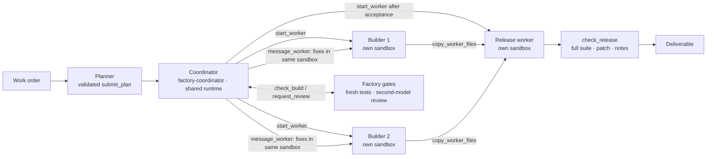

# AI software factory

A work order goes in; a tested, reviewed, and documented release comes out. It runs down an assembly line: **Plan →
Build → Review → Release**, and the product is the release. In **Agent-led** mode (the default), a coordinator agent
decides when to create builder sandboxes, when to reuse them for fixes, and when to create the release sandbox. The
floor shows those workers and the coordinator's decisions live. The factory still validates the plan, checks real test
reports, reviews on a second model, and accepts the deliverable.

**App-driven** mode (API value `classic`) keeps the original pipeline that the app orchestrates itself. Choose either
mode on the new-work-order form or in the API. Both use the same planners, builders, reviewers, harness, and release
gates, built on the stock `@github/copilot-sdk` and `@managed-copilot/sdk` with no runtime modifications.

Or point it at one of your GitHub repositories and an issue: the factory makes the change in a sandbox, reviews it, and
opens a pull request with screenshots and a recording, then takes follow-up requests on the same pull request (see
[Change a GitHub repository](#change-a-github-repository)).


*A real run of the CSV ⇄ JSON toolkit, not fixture data. The coordinator created a builder per task; the reviewer sent
two findings back on one of them, and the coordinator gave them to the **same builder** (marked **Reused**) for round
two. It then created the release worker and copied in the accepted outputs; the release passed **45 tests in 4m 40s**.
An earlier run restarted the factory mid-build, preserved the coordinator and both worker IDs, and passed **58 tests in
6m 31s**.*



## What it shows

| Station | Environment | Placement | What happens |
| --- | --- | --- | --- |
| Plan | `factory-planner` | shared, network off | The `planner` agent splits the work order into 1 to 4 tasks that own disjoint files, and submits the plan through `submit_plan`, a `defineTool` handler that runs in the factory's process. |
| Coordinator | `factory-coordinator` | orchestrator on the shared runtime, network off | Uses platform worker tools alongside the factory's `defineTool` gates. Chooses when to create workers and when to message existing ones. Its worker environments are `factory-builder` and `factory-release`, with up to 6 workers per work order (four tasks, release, and a replacement). |
| Build | `factory-builder` | one fresh sandbox per task, network limited to GitHub and the package registry | The coordinator starts the `builder` agent, the factory prepares its inputs, and the coordinator sends the task. The `factory-check` skill runs `node:test` and publishes code and a test report to `/workspace/outputs`. Independent tasks can build in parallel; dependents wait. |
| Review | `factory-reviewer` | shared, network off, different model family | The `reviewer` agent reads the published code and test report and calls `submit_review`. Requested changes go back to the **same builder sandbox** for another round. |
| Release | `factory-release` | a fresh sandbox | After the factory accepts every task, the coordinator creates this worker and copies the builders' published files into it. The factory verifies those bytes before preparing the inputs. The `release` agent adds integration tests and a README, runs the full suite, and publishes the bundle, patch, test report, and release notes. |

The model creates **sessions and sandboxes from declared environments**, not arbitrary new environment definitions.
App-driven mode uses the same four original station environments without a coordinator.

Managed Copilot features in play (see the [developer experience spec](../../docs/spec/developer-experience.md)):

- **Environments declared in the AppHost** (section 1). [`apphost.mts`](apphost.mts) exports the five environments and the app.
- **Shared sessions with your own tools** (section 3). The planner and reviewer call factory tools that run in the factory's process.
- **A fresh isolated sandbox per session** (section 4), **seeded per session** through `managed.files(session).write()` (section 5).
- **Turn-scoped, versioned artifacts** (section 6). Every build round publishes new versions; the floor diffs them.
- **Network control** (section 7). Office stations run with `network: false`; workshop sandboxes reach only the allowed hosts.
- **Agents, skills, and instructions shipped with the environment** (section 10). See [`customizations/office`](customizations/office) and [`customizations/workshop`](customizations/workshop).
- **Coming back later** (section 11). Work orders survive restarts; in-flight sandbox turns are resumed with `managed.resumeSession`.
- **An orchestrator agent** (section 17). `start_worker`, `message_worker`, `wait_for_workers`, and `copy_worker_files`
  perform the coordinator's decisions. The app observes with `managed.workers(coordinator).list()`, worker platform
  events, and `managed.sessions.get`, never by attaching a client to a worker that would take over its prompts.
- **Open in Copilot CLI** (section 14). Any station's session can be attached from a terminal: on Windows the station
  panel opens a console running `npx managed-copilot attach <session>`; elsewhere it shows the command to copy. The
  CLI and the factory see the same turns.

### A tour

| | |
| --- | --- |
|  |  |
| **Review sends work back.** The factory's reviewer runs on another model family. Round 1's findings went to the **same builder** for round 2 (●● on the cards), rather than to a new sandbox. | **The deliverable.** The release station integrates the tasks, adds integration tests and a README, and publishes the bundle, a patch, a test report, and release notes. |
|  |  |
| **Every artifact, every version.** Each station's published files, per round, with code, diff, Markdown, and test report viewers. | **Start from a template**, choose Agent-led or App-driven, or describe your own work order; history survives restarts. |


The floor adapts down to phone widths: each lane's Build and Review stack top to bottom, and the work order list
becomes a drawer.

<br clear="right">

## Run it

Everything runs locally against real models. You need the repository's prerequisites (see [AGENTS.md](../../AGENTS.md))
and a GitHub sign-in with Copilot (`gh auth login`).

```powershell
pnpm install
pnpm build
aspire run --non-interactive  # the platform, sandboxes, and the factory; open "software-factory"
```

The factory floor opens at <http://localhost:7480>. Pick the **CSV ⇄ JSON toolkit** template and press
**Start work order** with Agent-led selected. The floor is the pipeline: Plan and the coordinator on top, one lane per
task (Build → Review, with ●●○ round dots), then Release and the deliverable. Watch the coordinator create the
builders, reuse them for review fixes (a **Reused** marker on the build), and create the release sandbox only after
the tasks pass. Each card shows where it runs (the coordinator, the shared runtime, or its own sandbox), its status,
and one number; hover for the worker, sandbox ID, agent, and model. The coordinator's decisions are the default side
panel; select a station for its reports, tests, and reviews. **Open in Copilot CLI** on the coordinator reaches the
same session. App-driven shows the same pipeline without the coordinator.

### Scripted happy path

With the factory running, this submits the featured work order, follows it on the factory's event stream, and
downloads the release:

```powershell
pnpm --filter @managed-copilot/demo-software-factory happy-path
pnpm --filter @managed-copilot/demo-software-factory happy-path --mode classic
```

It exits 0 only when the release's nonempty full test suite passes and the bundle downloads. Agent-led runs also
check that the coordinator and every worker are recorded. Add `--require-reuse` to require a builder reused for
review fixes; a correct first-pass build can otherwise legitimately need no fixes.

The script saves the zip, the work-order snapshot, and activity JSON under `.data/happy-path` (or
`HAPPY_PATH_OUTPUT`). It reconnects across a factory restart, following the original work order without resubmitting
it. Set `FACTORY_URL` when using a nondefault port. For parallel local work, start Aspire with
`MANAGED_COPILOT_PORT_OFFSET` and set `MANAGED_COPILOT_URL` explicitly: only offset 0 writes local discovery.

The API uses the same selector (omitting `mode` means `"agent"`):

```ts
await fetch("http://localhost:7480/api/work-orders", {
  method: "POST",
  headers: { "content-type": "application/json" },
  body: JSON.stringify({
    title: "CSV toolkit",
    brief: "Build a CSV and JSON conversion toolkit with tests and independent review.",
    mode: "classic", // or "agent"
    maxReviewRounds: 2,
  }),
});
```

### Without Aspire (development)

```powershell
cd demos/software-factory
pnpm platform                                  # a local gateway with the factory's environments on :7410
$env:MANAGED_COPILOT_HOME = "$PWD/.data/home"  # find that gateway instead of another local platform
pnpm dev                                       # server and UI with live reload on :7480
```

`pnpm smoke:office` runs the planner and reviewer stations against the platform, as a quick live check of the shared
environments.

## Change a GitHub repository

The other way in: switch the new-work-order form to **GitHub repository**, pick one of your repositories (search, or
type `owner/name`), optionally pick an issue (search, or type `#123`), and say what you want done. The factory runs
**Checkout → Change → Review → Pull request**:

| Station | Where | What happens |
| --- | --- | --- |
| Checkout | the factory | Downloads the default branch's head as an archive with its own GitHub token and uploads it into a fresh `factory-repo` sandbox, where it becomes a git repository tagged `factory-base`. The sandbox never gets a credential. |
| Change | `factory-repo`, its own sandbox | The `developer` agent makes the change, runs the repository's tests, and captures screenshots and short recordings of anything visible with the `pr-media` skill (Chromium, Playwright, and ffmpeg are in the image). It reports with `submit_change`: the PR title and description, the test command, and its media. |
| Review | `factory-reviewer`, shared | The factory re-runs the test command itself (a failure goes back to the developer first), then `pr-reviewer` on another model family reviews the diff. Requested changes go back to the same sandbox. |
| Pull request | the factory | Pushes one commit to `factory/wo-NNNN-<title>` through GitHub's Git Data API, uploads the media as GitHub attachments, and opens the pull request: description, screenshots, an inline video, the test run, and the review, closing the issue when merged. |

The **Pull request** tab shows the same: the media, the description, checks, review, and files. From there you can
**Request changes** (the developer continues in the same sandbox, the reviewer checks it again, and the factory pushes
another commit and comments on the pull request with fresh media) or **Squash and merge**. A request that's a question
gets an answer and no pull request. The factory never force-pushes: if someone else pushed to its branch, it stops and
says so.

It works on repositories your account can push to, with the GitHub account the factory already signs in with (`gh auth
login` or `GH_TOKEN` locally; the deployment's token in Azure). `factory-repo` sandboxes reach GitHub, the npm registry
and pip index, and the hosts in `FACTORY_REPO_EXTRA_HOSTS`: list your registry's download hosts there when it hands out
links elsewhere (an Azure Artifacts upstream: `*.pkgs.visualstudio.com,*.vsblob.vsassets.io`), and any other package
source your repositories need.

## How it works

- **The agent chooses; the factory gates.** The coordinator has `prepare_workspace`, `check_build`, `request_review`,
  `prepare_release`, `check_release`, and `factory_status` alongside the platform worker tools. These handlers never
  create or message a worker for it. Starting a worker asks the coordinator's SDK permission handler, which allows
  only the work order's named builders and release worker, their correct environment, agent, model, and readiness
  task. The platform handles each approved worker's own permission requests.
- **Plans are validated before they are accepted.** The `submit_plan` handler rejects overlapping file ownership,
  unsafe paths, unknown or cyclic dependencies, and tasks without tests. It returns problems the planner can fix and
  resubmit.
- **Sandboxes are seeded, not trusted.** The factory generates `package.json` and writes `.factory/task.json`, the
  plan, and the work order into each new sandbox. It never writes credentials. The `factory-check` harness publishes
  only the files a builder added or changed. In Agent-led mode a new worker's first task is just to reply `READY`;
  preparation waits for that turn to finish, then writes the seed before returning the real task to the coordinator.
  For release, `copy_worker_files` stages `outputs/files` under `.factory/incoming/<task>/`. `prepare_release` verifies
  those copied files against the accepted artifacts, then assembles them and handles conflicts just as App-driven mode
  does.
- **Tests are a gate.** A station passes only when the harness's report shows tests ran and none failed. If a turn
  ends without a passing check, the factory sends the agent back up to twice before failing the station. It also
  notices when a builder skipped re-running the check after a fix.
- **Repeated gates are idempotent.** Checks and reviews are pinned to a worker's message number and actual runtime
  turn. The published test report must belong to that latest turn, even if an intermediate turn was never checked. Calling a tool twice
  cannot consume another nudge, count as another review round, or pass an old report as new work. A builder that
  changes while being reviewed must be checked and reviewed again.
- **Review rounds are bounded.** Blockers and majors go back to the builder. After the configured number of rounds,
  the task is accepted with its open findings, and the release notes list them.
- **State is split deliberately.** Sessions, sandboxes, and artifacts live in the platform. The factory keeps its own
  records (work orders, activity, and copies of published text artifacts) in SQLite under `.data/`, so the floor
  loads instantly and survives restarts.
- **Agent-led restarts preserve the coordinator and worker mapping.** The factory resumes the same coordinator
  session with its tools, stops only its unfinished coordinator turn (not its workers), and reconciles the worker
  list and session state. A new coordinator turn reads the persisted gates and waits for existing workers rather
  than blindly resending their tasks. Interrupted preparation is idempotent; an uncertain review is run again.
  Cancelling stops workers through the platform's session-delete API without attaching to them; retry reuses the
  accepted plan and creates replacements for workers that were deleted.
- **App-driven restarts resume work as before.** A work order that was running when the factory stopped resumes from its
  last checkpoint. Plans and reviews are re-run, because they're cheap. Builders and the release reattach to their sandboxes and wait
  for the in-flight turn. If that turn didn't finish, the factory doesn't assume any of it did. It notes why on the
  floor and asks the agent to check its workspace and continue, telling it that the commands it was running may have
  stopped partway. That happens when the platform reports the turn failed or stopped, when the sandbox restarted
  after the turn began (a gateway handover can recreate sandboxes), or when the turn shows no activity for 3 minutes
  (that turn is stopped first). The continued turn passes the same gates as any other: a fresh `npm run check`, then
  review. Builders and the release only change their own sandboxes, and the planner and reviewers only report through
  the factory's tools, so there are no outside effects to replay.
- **Platform outages pause work instead of failing it.** If the factory loses Managed Copilot, for example during a
  gateway handover, it reports `reconnecting` (on the floor and in `/api/health`) and retries with jittered backoff
  from 1 to 30 seconds. Every step has a deadline, so a request that a proxy holds open can't stall it. That includes
  reattaching to a session, which gets 3 minutes. Running work orders pause at their last checkpoint and resume the
  same way as after a restart once the platform is back. Idle connections are pinged every minute, so proxies that
  close quiet WebSockets don't drop them (the Azure Container Apps ingress closes them after 240 seconds).

## Configuration

| Variable | Default | Purpose |
| --- | --- | --- |
| `PORT` | `7480` | HTTP port for the floor and API |
| `HOST` | `127.0.0.1` | Interface to listen on (`0.0.0.0` in a container, together with `FACTORY_ALLOWED_HOSTS`) |
| `MANAGED_COPILOT_URL` | local discovery | Gateway URL (Aspire sets it) |
| `FACTORY_MODEL_PLANNER` / `_BUILDER` / `_REVIEWER` / `_RELEASE` / `_COORDINATOR` / `_DEVELOPER` | first available preference | Override a station's model; agent-led builders and reviewers (and GitHub work orders' developer and reviewer) must use different models |
| `FACTORY_MAX_SANDBOXES` | `4` | Sandboxes App-driven work orders run at once; agent-led limits are the coordinator environment's `maxWorkers` |
| `FACTORY_BUILD_TIMEOUT_MINUTES` and similar | 5 to 20 | Turn timeouts per station (`FACTORY_DEVELOP_TIMEOUT_MINUTES`, 30, for GitHub work orders) |
| `FACTORY_CHECK_TIMEOUT_MINUTES` | `10` | How long the factory's own re-run of a GitHub work order's test command may take |
| `FACTORY_REPO_EXTRA_HOSTS` | none | Read by the AppHost: more hosts `factory-repo` sandboxes may reach, comma-separated (registry download hosts, other package sources) |
| `FACTORY_PIP_INDEX_URL` | `MANAGED_COPILOT_PIP_INDEX_URL`, else pypi.org | Read by the AppHost: the pip index host `factory-repo` sandboxes may reach |
| `FACTORY_COORDINATE_TIMEOUT_MINUTES` | `60` | A coordinator turn covers the whole job, including waits with no model calls |
| `FACTORY_DATA_DIR` | `.data` | The factory's SQLite store |
| `FACTORY_ALLOWED_HOSTS` | none | Extra host names allowed to address the server (it accepts loopback names only by default) |
| `FACTORY_ATTACH_URL` | none | Gateway URL added to "Open in Copilot CLI" commands (`--url`) when users reach the platform at another address, as in a cloud deployment |

The default models are Claude Haiku for planning, Claude Sonnet for coordination, building, and release, and a GPT model for review,
chosen from what your Copilot entitlement offers (`client.listModels()`).

## Layout

| Path | Contents |
| --- | --- |
| `apphost.mts` | AppHost fragment: the six environments, worker limits, and the app resource |
| `customizations/coordinator` | The coordinator's agent and instructions for deciding, reusing, and satisfying factory gates |
| `customizations/office` | `planner`, `reviewer`, and `pr-reviewer` agents, `task-decomposition` and `review-rubric` skills |
| `customizations/workshop` | `builder` and `release` agents, `factory-check` (harness), `node-project`, and `release-checklist` skills |
| `customizations/repo` | The `developer` agent for GitHub work orders and the `pr-media` skill (`capture.mjs`: screenshots, recordings, terminal captures) |
| `src/server` | Pipeline orchestrator, platform connection, GitHub client, REST and server-sent events, SQLite store |
| `src/web` | The factory floor (React, Tailwind, and GitHub's Primer look from [`libraries/github-theme`](../../libraries/github-theme); light and dark follow the OS) |
| `src/scripts` | `happy-path` and `smoke-office` |
| `test` | Unit tests, including the orchestrator against an in-memory platform and the harness end to end |
