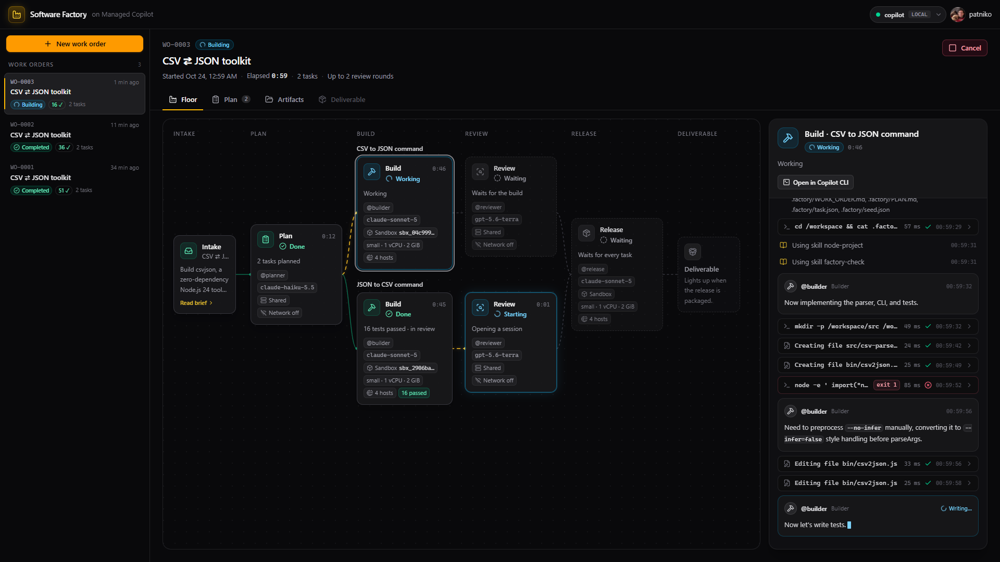
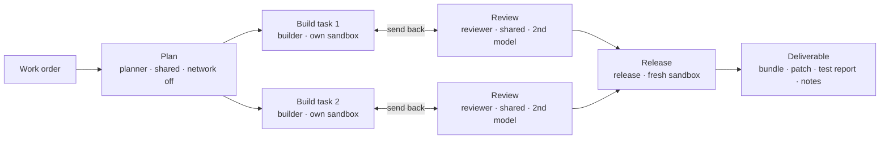
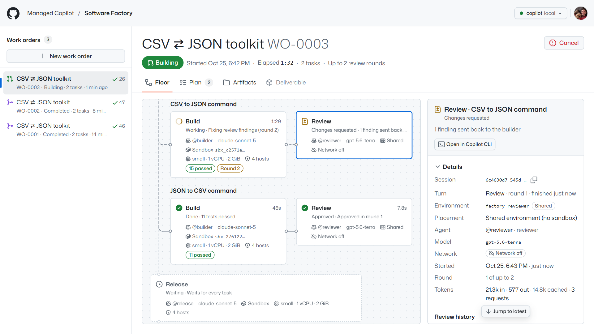
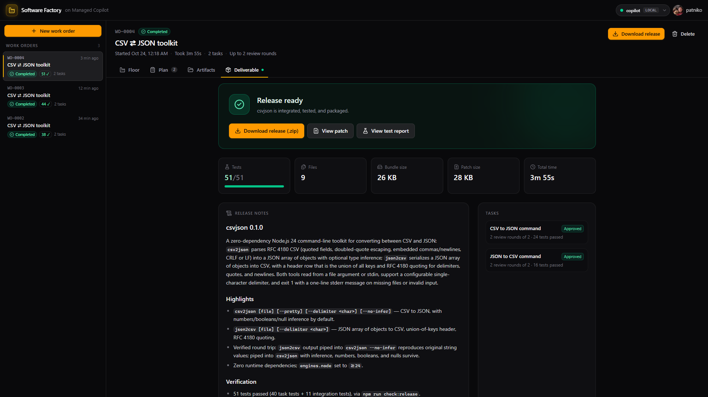
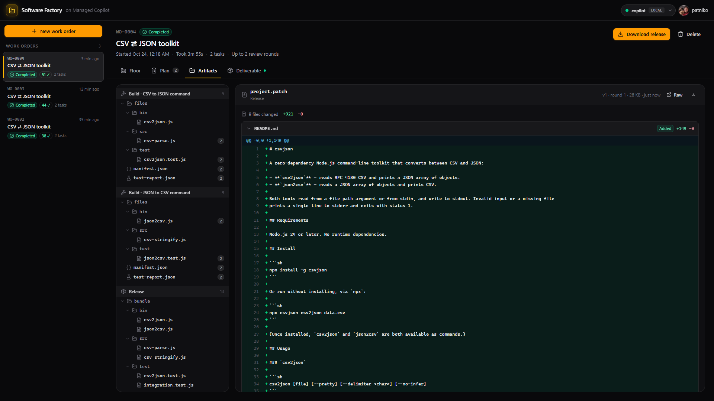
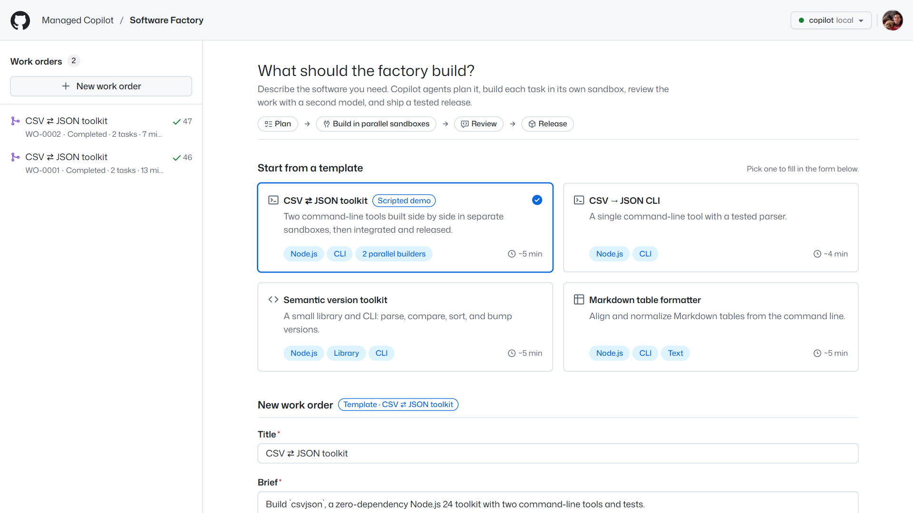
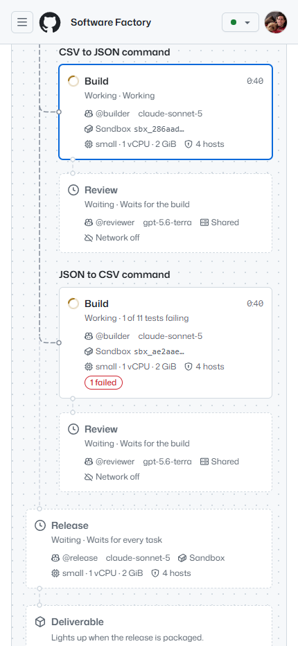

# AI software factory

A work order goes in; a tested, reviewed, and documented release comes out. The factory runs a pipeline of
specialized Copilot agents on **Managed Copilot**. Each station is an environment you declare in the AppHost, with
its own custom agent, skills, isolation, and network policy. The app itself is ordinary Node code built on the stock
`@github/copilot-sdk` and `@managed-copilot/sdk`.



*A live run of the featured work order: the planner split it into two tasks; one builder is still working in its
sandbox while the other's finished work goes to review on a different model. The panel streams the selected
station's activity (skills, commands, file edits, and the agent's text as it's written) and can open the session in
Copilot CLI.*



## What it shows

| Station | Environment | Placement | What happens |
| --- | --- | --- | --- |
| Plan | `factory-planner` | shared, network off | The `planner` agent splits the work order into 1 to 4 tasks that own disjoint files, and submits the plan through `submit_plan`, a `defineTool` handler that runs in the factory's process. |
| Build | `factory-builder` | one fresh sandbox per task, network limited to GitHub and the package registry | The `builder` agent implements its task with tests, then runs the `factory-check` skill. The skill runs `node:test` and publishes code and a test report to `/workspace/outputs`. Tasks build in parallel; dependents wait. |
| Review | `factory-reviewer` | shared, network off, different model family | The `reviewer` agent reads the published code and test report and calls `submit_review`. Requested changes go back to the **same builder sandbox** for another round. |
| Release | `factory-release` | a fresh sandbox | The `release` agent merges every task, adds an integration test and a README, runs the full suite, and publishes the bundle, a patch, a test report, and release notes. |

Managed Copilot features in play (see the [developer experience spec](../../docs/spec/developer-experience.md)):

- **Environments declared in the AppHost** (section 1). [`apphost.mts`](apphost.mts) exports the four environments and the app.
- **Shared sessions with your own tools** (section 3). The planner and reviewer call factory tools that run in the factory's process.
- **A fresh isolated sandbox per session** (section 4), **seeded per session** through `managed.files(session).write()` (section 5).
- **Turn-scoped, versioned artifacts** (section 6). Every build round publishes new versions; the floor diffs them.
- **Network control** (section 7). Office stations run with `network: false`; workshop sandboxes reach only the allowed hosts.
- **Agents, skills, and instructions shipped with the environment** (section 10). See [`customizations/office`](customizations/office) and [`customizations/workshop`](customizations/workshop).
- **Coming back later** (section 11). Work orders survive restarts; in-flight sandbox turns are resumed with `managed.resumeSession`.
- **Open in Copilot CLI** (section 14). Any station's session can be attached from a terminal: on Windows the station
  panel opens a console running `npx managed-copilot attach <session>`; elsewhere it shows the command to copy. The
  CLI and the factory see the same turns.

### A tour

| | |
| --- | --- |
|  |  |
| **Review sends work back.** The reviewer runs on another model family and returns findings with file and line; the builder fixes them in the same sandbox, and the next round is approved. | **The deliverable.** The release station integrates the tasks, adds integration tests and a README, and publishes the bundle, a patch, a test report, and release notes. |
|  |  |
| **Every artifact, every version.** Each station's published files, per round, with code, diff, Markdown, and test report viewers. | **Start from a template** or describe your own work order; history survives restarts. |



The floor adapts down to phone widths: stations stack top to bottom and the work order list becomes a drawer.

<br clear="right">

## Run it

Everything runs locally against real models. You need the repository's prerequisites (see [AGENTS.md](../../AGENTS.md))
and a GitHub sign-in with Copilot (`gh auth login`).

```powershell
pnpm install
pnpm build
aspire run          # the platform, sandboxes, and the factory; open the "software-factory" resource
```

The factory floor opens at <http://localhost:7480>. Pick the **CSV ⇄ JSON toolkit** template and press
**Start work order**: two builders work side by side, the reviewer usually sends work back once, and the release
lands in three to nine minutes. Measured live runs: 2m 52s (51 tests), 3m 34s (44 tests), and 4m 25s (36 tests)
from `main`, and 3m 55s to 8m 32s while the platform was coming together.

### Scripted happy path

With the factory running, this submits the featured work order, follows it on the factory's event stream, and
downloads the release:

```powershell
pnpm --filter @managed-copilot/demo-software-factory happy-path
```

It exits 0 only when the release's full test suite passes.

### Without Aspire (development)

```powershell
cd demos/software-factory
pnpm platform                                  # a local gateway with the factory's environments on :7410
$env:MANAGED_COPILOT_HOME = "$PWD/.data/home"  # find that gateway instead of another local platform
pnpm dev                                       # server and UI with live reload on :7480
```

`pnpm smoke:office` runs the planner and reviewer stations against the platform, as a quick live check of the shared
environments.

## How it works

- **Plans are validated before they are accepted.** The `submit_plan` handler rejects overlapping file ownership,
  unsafe paths, unknown or cyclic dependencies, and tasks without tests. It returns problems the planner can fix and
  resubmit.
- **Sandboxes are seeded, not trusted.** The factory generates `package.json` and writes `.factory/task.json`, the
  plan, and the work order into each new sandbox. It never writes credentials. The `factory-check` harness publishes
  only the files a builder added or changed.
- **Tests are a gate.** A station passes only when the harness's report shows tests ran and none failed. If a turn
  ends without a passing check, the factory sends the agent back up to twice before failing the station. It also
  notices when a builder skipped re-running the check after a fix.
- **Review rounds are bounded.** Blockers and majors go back to the builder. After the configured number of rounds,
  the task is accepted with its open findings, and the release notes list them.
- **State is split deliberately.** Sessions, sandboxes, and artifacts live in the platform. The factory keeps its own
  records (work orders, activity, and copies of published text artifacts) in SQLite under `.data/`, so the floor
  loads instantly and survives restarts.
- **Restarts resume work.** A work order that was running when the factory stopped resumes from its last checkpoint.
  Plans and reviews are re-run, because they're cheap. Builders and the release reattach to their sandboxes and wait
  for the in-flight turn.

## Configuration

| Variable | Default | Purpose |
| --- | --- | --- |
| `PORT` | `7480` | HTTP port for the floor and API |
| `HOST` | `127.0.0.1` | Interface to listen on (`0.0.0.0` in a container, together with `FACTORY_ALLOWED_HOSTS`) |
| `MANAGED_COPILOT_URL` | local discovery | Gateway URL (Aspire sets it) |
| `FACTORY_MODEL_PLANNER` / `_BUILDER` / `_REVIEWER` / `_RELEASE` | first available preference | Override a station's model |
| `FACTORY_MAX_SANDBOXES` | `4` | Sandboxes the factory runs at once |
| `FACTORY_BUILD_TIMEOUT_MINUTES` and similar | 5 to 20 | Turn timeouts per station |
| `FACTORY_DATA_DIR` | `.data` | The factory's SQLite store |
| `FACTORY_ALLOWED_HOSTS` | none | Extra host names allowed to address the server (it accepts loopback names only by default) |
| `FACTORY_ATTACH_URL` | none | Gateway URL added to "Open in Copilot CLI" commands (`--url`) when users reach the platform at another address, as in a cloud deployment |

The default models are Claude Haiku for planning, Claude Sonnet for building and release, and a GPT model for review,
chosen from what your Copilot entitlement offers (`client.listModels()`).

## Layout

| Path | Contents |
| --- | --- |
| `apphost.mts` | AppHost fragment: the four environments and the app resource |
| `customizations/office` | `planner` and `reviewer` agents, `task-decomposition` and `review-rubric` skills |
| `customizations/workshop` | `builder` and `release` agents, `factory-check` (harness), `node-project`, and `release-checklist` skills |
| `src/server` | Pipeline orchestrator, platform connection, REST and server-sent events, SQLite store |
| `src/web` | The factory floor (React, Tailwind) |
| `src/scripts` | `happy-path` and `smoke-office` |
| `test` | Unit tests, including the orchestrator against an in-memory platform and the harness end to end |
