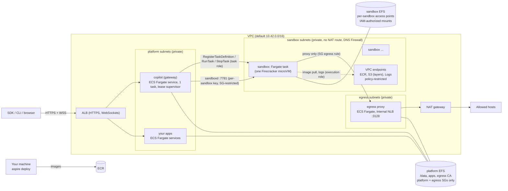

# AWS deployment (planned)

> **Status: proposal, not started.** Nothing in this folder deploys anything yet. This is the plan for adding AWS as a
> second `aspire deploy` target beside [Azure](../azure) so that Managed Copilot is multi-cloud. The customer contract
> is still [the spec](../../docs/spec/developer-experience.md), which today promises "local or Azure"; adopting this
> plan means amending it (see [Spec changes](#spec-changes)). The as-built Azure design this mirrors is in
> [docs/architecture.md](../../docs/architecture.md#azure-deployment-aspire-deploy) and
> [docs/deployment.md](../../docs/deployment.md).

## Goal

The same AppHost and the same customer code run locally, on Azure, or on AWS. Only the deploy target changes.
Customers keep stock `CopilotClient` / `CopilotSession` objects; `ManagedCopilot.connect()` reads `MANAGED_COPILOT_URL`
as it does today. A capability is advertised in `/v1/info` on AWS only after its AWS backend passes the same gates as
Azure; anything not yet qualified fails with `capability_unavailable`, never a silent fallback.

## The customer experience

Calibration snippets. Nothing here is built.

### Choose the target

The AppHost does not change. The target is a deploy-time setting, like the Azure subscription and region today:

```powershell
aspire secret set Deploy:Target aws          # "azure" (default) | "aws"
aspire secret set AWS:Region us-west-2
aspire secret set AWS:Profile my-sso-profile # optional; default credential chain otherwise
aspire secret set Parameters:copilot-github-users your-login   # same access rules as Azure

aspire deploy
```

```text
Managed Copilot: https://copilot.<deployment-domain> (ManagedCopilot.connect({ url }), MANAGED_COPILOT_URL, or managed-copilot attach --url)
Apps open to: 203.0.113.7/32 (change with Parameters:app-allowed-ips)
```

Or with the CLI shortcut, which checks the AWS CLI and its sign-in instead of the Azure CLI:

```powershell
npx managed-copilot deploy --target aws
npx managed-copilot access          # unchanged: who may use, operate, and open the apps
```

### Connect

Identical to local and Azure:

```ts
const copilot = await ManagedCopilot.connect(); // MANAGED_COPILOT_URL, set by the deployment for published apps
const session = await copilot.createSession({ environment: "coder" });
```

### Both clouds from one AppHost

Deploying the same AppHost twice, once per target, gives two independent platforms (separate ledgers, users, and
sessions). Sessions do not move between clouds. A single deployment spanning both clouds is out of scope.

## What gets deployed



### Service mapping

| Concern | Azure (as built) | AWS (proposed) | Notes |
| --- | --- | --- | --- |
| Container runtime for gateway, apps, egress | Container Apps (Consumption) | ECS on Fargate services | One task each, like one replica today |
| Public HTTPS/WSS ingress | Container Apps ingress, `*.azurecontainerapps.io` certificate | ALB with an ACM certificate | ACM does not issue certificates for `*.elb.amazonaws.com`, so HTTPS needs a customer domain or CloudFront; see [open question 2](#open-questions) |
| Idle WebSocket timeout | 240 s (fixed) | ALB idle timeout, configurable up to 4000 s | Existing keepalives still apply |
| Health and the lease | TCP liveness, HTTP readiness, so a standby supervisor can answer 503 | ECS treats a failing ALB target health check as a failed task | A standby gateway answering 503 would be killed; see [open question 7](#open-questions) |
| App IP allowlist | Container Apps IP rules | ALB security group (direct ALB), or WAF / `X-Forwarded-For` rules behind CloudFront | `Parameters:app-allowed-ips` keeps its meaning; behind CloudFront the ALB only sees edge addresses |
| Gateway → app webhooks | `https://<app>.<environment-domain>`, allowed from the platform subnet | Internal service discovery (ECS Service Connect / Cloud Map), not the public URL | Calling the public URL would leave through the NAT address, which the allowlist does not include |
| Durable state (`/data`, SQLite + lease) | Azure Files NFS 4.1 | A **platform** EFS file system (NFS 4.1, POSIX advisory locks), mount targets reachable only from the platform and egress security groups | Same lease supervisor; the NFS/lease qualification must be re-run on EFS. Never reachable from sandboxes, as on Azure |
| Images | ACR | ECR | Tasks pull with their execution role: no registry-token exchange like Azure's `registry.ts`. Sandbox subnets need ECR, S3, and Logs VPC endpoints for that (below) |
| Isolated sandboxes | Container Apps Sandboxes (microVM + data disks) | Fargate task per sandbox over a separate **sandbox** EFS file system (recommended; see [below](#isolated-placement-options)) | New gateway provider `providers/aws/` |
| Sandbox network isolation | Platform egress policy, VNet connection | Per-task ENI and security group: ingress 7781 from the gateway only; egress to the proxy (3128), the sandbox EFS (2049), and the VPC endpoints (443) only; subnets without a NAT route; Route 53 Resolver DNS Firewall | Security groups cannot block the VPC resolver, so DNS needs the firewall. Endpoint policies restrict the endpoints to this deployment's repositories, layer bucket, and log groups, so they are not a way out for the workload |
| Egress proxy | Internal Container Apps environment | Fargate service behind an internal NLB | Same `platform/egress` in external mode. `addressPinning` can be `true` only with client IP preservation enabled on the NLB's IP target group (off by default) and verified in A3; otherwise `false`, as on Azure. The per-sandbox proxy credential stays the primary binding |
| Platform identity | User-assigned managed identity + Azure RBAC | ECS task role + IAM policies | Gateway needs `ecs:RegisterTaskDefinition`/`DeregisterTaskDefinition`/`RunTask`/`StopTask`/`DescribeTasks`/`TagResource`, `iam:PassRole` for the sandbox roles, and EFS access point create/delete, all scoped by tag or ARN |
| Secrets (durable key, vault key, app token) | Secure parameters / Container Apps secrets | Secrets Manager, referenced from task definitions | Never in logs, command lines, or the sandbox task definition |
| Logs | Log Analytics | CloudWatch Logs | Gateway logger `redact` unchanged |
| Infrastructure as code | C# hosting integration (`deployments/azure/hosting`) | `Aspire.Hosting.AWS` (CDK → CloudFormation) or our own CDK app; see [open question 1](#open-questions) | |

### Isolated placement options

The provider must keep the invariants in `platform/gateway/src/modules/sandbox/providers/types.ts`: sandboxd as root
with only CHOWN, KILL, SETGID, SETUID; the workload as uid 10001; persistent `/workspace`, `/home/agent`, and
`/var/lib/managed-copilot` that survive stop/start; no route between sandboxes; no Internet except through the egress
proxy; sandboxd reachable only through `endpoint`.

| Option | Isolation | Storage that outlives compute | Start / resume | Fit |
| --- | --- | --- | --- | --- |
| **A. Fargate task per sandbox + EFS access points** (recommended) | Firecracker microVM per task; per-task ENI and security group | Per-sandbox access points on the sandbox EFS file system, mounted as task volumes; compute stops, access points remain | Cold task start, typically tens of seconds; SOCI lazy loading may help | Closest to the Azure model. Risks: EFS small-file latency for `npm install` / `pip install`; storage authorization (below); 1,000 access points per file system |
| B. Fargate + ECS-managed EBS from snapshots | Same as A | ECS attaches at most one EBS volume per task and it must be **new** (optionally from a snapshot); resume means snapshot on stop, new volume on start | Snapshot and restore add time and cost | Faster disk, slower lifecycle; one volume means the three paths share it. An unexpected task stop loses changes since the last snapshot unless the volume is retained and snapshotted afterwards, which breaks the persistence invariant if it fails |
| C. ECS on EC2 / self-managed Firecracker hosts | Shared-host containers are weaker; Firecracker is strong | Local or EBS volumes we manage | Fastest; warm pools possible | We operate a fleet (patching, packing, capacity). Revisit only for `warm > 0` |
| D. Bedrock AgentCore Runtime / Code Interpreter | microVM sessions | Ephemeral sessions with a bounded lifetime | Fast | Fails the persistent-storage invariant; not a fit |

Option A notes:

- **Task definitions.** `RunTask` cannot override EFS volumes or access point IDs (launch-time volume configuration is
  EBS-only), so the gateway registers one task definition per sandbox binding its access points to the pinned image
  digest, and deregisters it on `remove`. It validates every definition it registers (image from this deployment's
  ECR, the fixed capability set, the sandbox roles and security group) and passes a deterministic `clientToken` and
  tags to `RunTask`, so `inventory()` and crash reconciliation work like Azure's unconfirmed-create tracking.
- **Storage authorization.** Access points alone do not isolate storage: a root process that can reach the mount
  target can speak NFS directly. Sandboxes therefore never reach the platform EFS, and the sandbox EFS file system
  policy denies anonymous access and requires IAM authorization tied to the sandbox's own access points (exact
  mechanism, such as a task role per sandbox or per-sandbox policy conditions, decided in A0; no AWS credential the
  workload can use). Access points with a fixed `PosixUser` rewrite every request to that identity, which would let
  uid 10001 write root-only sandboxd state, so `/var/lib/managed-copilot` is split into a root-owned and a
  uid-10001 access point, or the gateway pre-creates the directories and the access point omits `PosixUser`.
- **Secrets and customizations.** `SANDBOXD_KEY` and `SANDBOXD_RUNTIME_TOKEN` must not travel as `RunTask`
  environment overrides, which CloudTrail records and `DescribeTasks` returns. The gateway writes them to a root-only
  file in the sandbox's state directory before `RunTask` (or uses a per-sandbox Secrets Manager reference), and the AWS
  entrypoint reads and removes it before starting sandboxd. The environment's customizations, which Docker bind-mounts
  and Azure writes through its file API, are copied the same way and exposed read-only at
  `/opt/managed-copilot/customizations`.
- **Capabilities.** Fargate accepts only `SYS_PTRACE` in `capabilities.add`, so the task definition adds nothing and
  explicitly drops every other default capability, leaving CHOWN, KILL, SETGID, and SETUID. Fargate has no
  `dockerSecurityOptions`, so the AWS entrypoint sets `no_new_privs` itself (for example with `setpriv`) before it
  executes sandboxd; sandboxd already starts every workload process with `no_new_privs` and empty capability sets.
- **Images.** `aspire deploy` builds the same base, environment, and `packages.system` layers plus an AWS layer
  (`deployments/aws/sandbox`: the entrypoint above, and seeding empty storage on first boot) and pushes them to ECR.
- **Sizes.** Map small / medium / large to Fargate CPU and memory pairs (to confirm). EFS has no per-directory quota,
  so workspace size limits need enforcement in sandboxd or a documented limit.
- **Warm sandboxes.** `capabilities.warm = false`, like Azure.

## Spec changes

Adopting this plan amends the spec, which is the customer contract:

- "Same code, local or Azure" becomes "local, Azure, or AWS", with the same rule: a mode is advertised only after its
  backend passes the gates.
- The deploy snippets gain `Deploy:Target` and `AWS:*` settings; `managed-copilot deploy` gains `--target`.
- The credential broker wording ("Key Vault in Azure") gains "Secrets Manager in AWS".
- Bedrock as an inference route (the AWS analogue of the Foundry option) is **out of scope**. Inference stays brokered
  through the gateway with the caller's GitHub Copilot entitlement on every target.

## Code changes (where it would live)

| Area | Change | Owner today |
| --- | --- | --- |
| `deployments/aws/**` (this folder) | AWS package: infrastructure, sandbox image layer, qualification probes, live checks | new **aws** workstream |
| `packages/aspire/src/publish/**` | Split into cloud-neutral publish logic plus `azure/` and `aws/` targets chosen by `Deploy:Target` | azure |
| gateway `modules/sandbox/providers/aws/**` | `SandboxProvider` over ECS RunTask and EFS access points; `MANAGED_COPILOT_SANDBOX_PROVIDER=aws` | new **aws** workstream |
| `deployments/azure/src/lease`, `deployments/azure/src/probe` | Cloud-neutral already; move to a shared package (for example `deployments/common`) used by both targets' images | azure |
| `platform/gateway/Dockerfile`, `demos/*/Dockerfile` | An `aws` stage beside `azure`, or one neutral stage | azure |
| `packages/cli` `deploy` / `access` | `--target aws`, AWS CLI checks, ALB allowlist updates instead of Container Apps ingress rules | attach |
| `docs/deployment.md`, `docs/architecture.md`, the spec | AWS sections, capability matrix column, cost, teardown | azure / aws |

## Milestones

Each milestone merges only with `pnpm build` and `pnpm test` green, live evidence recorded in the deployment guide,
and reviews from both Argon and Astra, as for Azure.

| # | Milestone | Exit criteria | Status |
| --- | --- | --- | --- |
| A0 | Qualification probe | A throwaway stack proves, in one region: EFS locking and the lease (the same 10 checks as Azure); a Fargate task with the sandbox capability set, sandboxd as root with `no_new_privs`, and the workload as uid 10001; cold image pulls through the VPC endpoints with no NAT route; security-group isolation between two tasks; no access to the platform EFS or another sandbox's storage (including a userspace NFS client as root); no external DNS resolution; egress only through the proxy; storage surviving stop/start; measured install and start latency; ALB WebSockets past 240 s idle | Not started |
| A1 | Shared platform on AWS | `aspire deploy` with `Deploy:Target=aws` deploys the gateway and published apps; shared sessions and snippets 01–02 pass; `/v1/info` does not advertise `isolated` | Not started |
| A2 | Isolated placement | `providers/aws` passes the isolated live suite: create, real model reply, files, uid 10001, idle stop, resume over the same storage | Not started |
| A3 | Egress and vaults | Network allowlists, `network: false`, vault substitution, persistent proxy CA, address pinning | Not started |
| A4 | Full parity | Snippets 01–09, 11, 13–15; promotion; orchestrators; CLI attach; demos and gallery; revision canaries; scheduled recovery | Not started |
| A5 | Docs and CLI | `managed-copilot deploy --target aws` and `access`; AWS sections in the deployment guide; capability matrix; cost; teardown | Not started |

## Open questions

| # | Question | Leaning | Status |
| --- | --- | --- | --- |
| 1 | IaC: the official `Aspire.Hosting.AWS` integration (CDK, preview, C#) through a hosting project like `deployments/azure/hosting`, or our own TypeScript CDK app run as an `aspire deploy` pipeline step? Does the AWS integration work from our TypeScript AppHost, and does it cover VPC, EFS, NLB, and IAM? | Try the official integration in A0; fall back to our own CDK app | Open |
| 2 | HTTPS without a customer domain: an ALB needs an ACM certificate for a domain we control. Options: require a Route 53 hosted zone; or put CloudFront (default `*.cloudfront.net` certificate, WebSockets supported, VPC origin) in front of the ALB and enforce `app-allowed-ips` with WAF. Check in A0 whether ECS Express Mode offers an AWS-managed HTTPS URL | CloudFront by default; a customer domain when provided | Open |
| 3 | Sandbox storage: EFS access points (A) or EBS snapshots (B)? Decide on measured `npm install` / `pip install` times and resume latency | A | Open |
| 4 | Fargate start latency for sandboxes: is the default 60 s `startTimeoutMs` enough, and does SOCI help with our image sizes? | Measure in A0 | Open |
| 5 | Image architecture: Azure builds `linux/amd64`; Fargate also runs arm64 (Graviton, cheaper), which our ARM64 dev machines build natively | arm64 on AWS, after confirming the stock runtime's linux-arm64 build works in sandboxes | Open |
| 6 | One NAT gateway (cheaper, single AZ) or one per AZ? | One by default, documented | Open |
| 7 | Gateway rollout and health: ECS kills a task whose ALB health check fails, so a standby supervisor answering 503 dies, and a Fargate maintenance replacement carries the same `MANAGED_COPILOT_LEASE_STAMP`, which the supervisor never hands over to. Choose `minimumHealthyPercent` / `maximumPercent`, health check, and SIGTERM handling so the lease behaves like Single revision mode | 0 / 100, release the lease promptly on SIGTERM; revisit 100 / 200 later | Open |
| 8 | Sandbox storage authorization: a task role per sandbox, per-sandbox file system policy conditions, or one file system per sandbox (account quota)? | Decide in A0 | Open |

## Not in scope

- Bedrock or other AWS model routes.
- Kubernetes (EKS) or GCP targets, though the publish split should leave room for them.
- Multi-region or multi-writer HA; AWS stays single-writer, like Azure.
- Moving sessions or ledgers between clouds.
