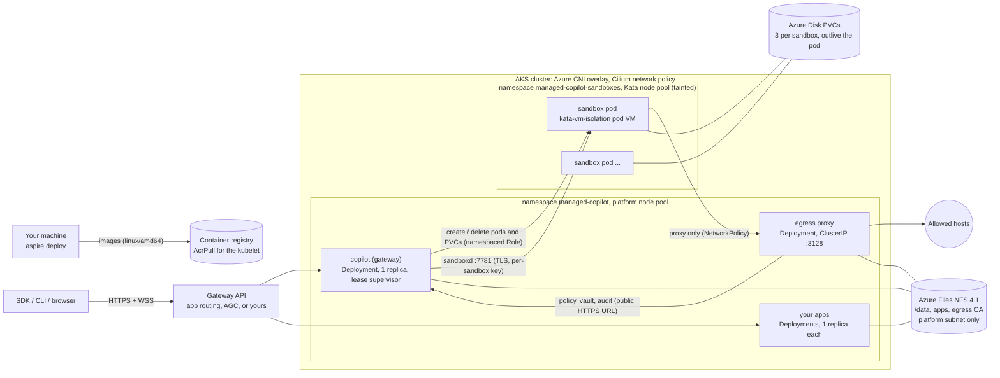

# AKS and Kubernetes deployment (roadmap)

> **Status: roadmap, not started.** Nothing in this folder deploys anything yet. Today the platform runs locally and
> on Azure Container Apps; [AWS](../aws/README.md) is a separate roadmap. This is the plan for running the same AppHost
> on Azure Kubernetes Service (AKS), with a sandbox provider that talks only to the Kubernetes API so that other
> clusters can follow. The customer contract is still [the spec](../../docs/spec/developer-experience.md), which today
> promises "local or Azure"; adopting this plan amends it (see [Spec changes](#spec-changes)). The Container Apps design
> this mirrors is in [docs/architecture.md](../../docs/architecture.md#azure-deployment-aspire-deploy) and
> [docs/deployment.md](../../docs/deployment.md). AKS and Aspire facts were checked on 2026-11-21
> ([Facts this plan relies on](#facts-this-plan-relies-on)); check them again when work starts.

## Why AKS

Many teams already run AKS, with a platform team that owns the cluster's ingress, certificates, node pools, policy,
monitoring, and GitOps. For them, a Container Apps environment is a second platform to approve and operate. AKS also
offers sizes beyond 4 vCPU / 8 GiB, reserved capacity, private clusters, regions without Container Apps Sandboxes
(preview), and room for warm sandboxes. In exchange you operate a cluster, sandbox isolation is off until it is
configured, and nodes cost money whether sandboxes run or not. Container Apps stays the default target: no cluster,
per-second billing, and microVM sandboxes with no setup.

## Goal

The same AppHost and the same customer code run locally, on Container Apps, or on AKS. Only the deploy target changes.
Customers keep stock `CopilotClient` / `CopilotSession` objects; `ManagedCopilot.connect()` reads `MANAGED_COPILOT_URL`
as it does today. A capability is advertised in `/v1/info` on AKS only after its Kubernetes backend passes the same
gates as Container Apps; anything not yet qualified fails with `capability_unavailable`. A sandbox never runs with
weaker isolation than the deployment declares: no silent fallback from a pod VM to a shared kernel, and no `isolated`
while network policy isn't enforced.

## The customer experience

Calibration snippets. Nothing here is built.

### Deploy into a cluster you already have

The common case, and the first milestone. The AppHost doesn't change; the target and the cluster are deploy-time
settings, like the Azure subscription and region today:

```powershell
aspire secret set Deploy:Target aks                        # "azure" (Container Apps, default) | "aks" | "aws" (roadmap)
aspire secret set Kubernetes:Context contoso-prod          # optional; the current kubeconfig context otherwise
aspire secret set Kubernetes:Namespace managed-copilot     # sandboxes go to managed-copilot-sandboxes
aspire secret set Kubernetes:Registry contoso.azurecr.io   # attached to the cluster
aspire secret set Kubernetes:Gateway networking/public     # a Gateway API Gateway with TLS for the domain below
aspire secret set Kubernetes:Domain apps.contoso.com       # copilot.apps.contoso.com, <app>.apps.contoso.com
aspire secret set Parameters:copilot-github-users your-login   # same access rules as Container Apps

aspire deploy
```

```text
Managed Copilot: https://copilot.apps.contoso.com (ManagedCopilot.connect({ url }), MANAGED_COPILOT_URL, or managed-copilot attach --url)
Sandboxes: managed-copilot-sandboxes on kata-vm-isolation (isolation self-test passed)
Apps open to: 203.0.113.7/32: software-factory, dispatch, assistant, gallery (change with Parameters:app-allowed-ips)
```

Before it changes anything, `aspire deploy` checks the cluster and stops with the missing prerequisite: no network
policy engine, no `kata-vm-isolation` runtime class or node pool for it, no NFS storage, a Gateway that can't enforce
`Parameters:app-allowed-ips` while an app acts as the deployer, or missing permissions in the two namespaces.

### Or create a cluster

Like the Container Apps deployment today, in a resource group of its own (`aspire destroy` deletes the whole group):

```powershell
aspire secret set Deploy:Target aks
aspire secret set Azure:SubscriptionId <subscription-id>
aspire secret set Azure:Location westus2
aspire secret set Azure:ResourceGroup managed-copilot-aks
aspire secret set Parameters:copilot-github-users your-login
aspire deploy
```

### Or hand it to GitOps

For private clusters and change-controlled environments, `aspire publish` writes the Helm chart instead of installing
it, and Flux or Argo CD deploys it. The chart refers to Secrets you create (or to Key Vault through the Secrets Store
CSI driver); it never holds their values.

### CLI and code

```powershell
npx managed-copilot deploy --target aks --context contoso-prod   # checks kubectl, Helm 4, and az, then aspire deploy
npx managed-copilot access ips add me                            # updates the apps' allowlist policies in the cluster
```

```ts
const copilot = await ManagedCopilot.connect(); // MANAGED_COPILOT_URL, set by the deployment for published apps
const client = await copilot.client("coder");   // the same stock CopilotClient
```

## What gets deployed



| Resource | Purpose |
| --- | --- |
| Namespace `managed-copilot` | The gateway, your apps, and the egress proxy: one Deployment each, one replica, on the platform node pool. |
| Namespace `managed-copilot-sandboxes` | What the gateway creates at run time: per sandbox one pod, three PVCs, and one Secret. Pod Security Admission `baseline` (sandboxd runs as root with CHOWN, KILL, SETGID, and SETUID, which Baseline allows and Restricted refuses), an admission policy that accepts only the sandbox pod shape, default-deny NetworkPolicies, and a ResourceQuota. |
| Sandbox node pool | Azure Linux with `--workload-runtime KataVmIsolation`, a nested-virtualization size with 32 data-disk slots (for example `Standard_D16ads_v6`), tainted for sandboxes, in its own subnet with no storage service endpoint, autoscaled from at least one node. |
| Platform node pool | The gateway, apps, and egress proxy, apart from sandboxes. |
| Azure Files NFS 4.1 share | Durable state, laid out as today (`gateway/`, `apps/<name>/`, `egress/`), mounted through the Azure Files CSI driver; the storage account admits only the platform subnet. |
| Container registry | Gateway, app, egress proxy, and sandbox images. The kubelet identity pulls them with `AcrPull`. |
| HTTPRoutes and allowlist policies | The gateway at `copilot.<domain>` and each app at `<app>.<domain>`, on the cluster's Gateway. |
| Identities | The gateway's ServiceAccount, with a Role in the sandbox namespace only, and Entra Workload ID for Azure AI Foundry. Sandboxes get a ServiceAccount with no permissions and no token. |

A new cluster also gets its VNet, the cluster itself (Azure CNI overlay with Cilium network policy, Workload ID, and
KMS encryption of Secrets with Key Vault), its node pools, the registry, the storage account, and a zone-redundant disk
class.

## Service mapping

| Concern | Container Apps (today) | AKS (proposed) | Notes |
| --- | --- | --- | --- |
| Gateway, apps, egress proxy | Container apps (Consumption), one replica each | Deployments with one replica each on the platform node pool, generated by Aspire's Kubernetes publisher (Helm) | Pod-spec details (volumes, probes, security context) come from our C# integration: Aspire's TypeScript API can't edit the generated pod spec |
| Public HTTPS and WebSockets | Container Apps ingress with a `*.azurecontainerapps.io` certificate | HTTPRoutes on a Gateway API Gateway: app routing's `approuting-istio` (GA), Application Gateway for Containers (AGC), or the cluster's own; TLS from cert-manager or Key Vault | No free hostname: an existing cluster brings a domain and certificate ([open question 4](#open-questions)). The app routing NGINX add-on loses Azure support after November 2026 and isn't supported |
| Idle WebSocket timeout | 240 s, fixed | Depends on the Gateway: AGC 5 min; an Azure load balancer 4 min by default | The existing 30 s pings cover all of them |
| Health and the lease | TCP liveness, HTTP readiness; a standby supervisor answers 503 | Same probes. Kubernetes keeps a NotReady pod running, so the standby supervisor works unchanged, and RollingUpdate with `maxSurge: 1`, `maxUnavailable: 0` reproduces the Single revision handover: each deploy sets a newer `MANAGED_COPILOT_LEASE_STAMP`, so the old pod hands the lease to the new one while still running, and the new pod becomes ready before the old one is removed | Pods with the same stamp never hand over, so a rollout that keeps it, such as `kubectl rollout restart`, would never finish: restart by deleting the pod, or give each pod its own stamp (decide in K0). A drained node's replacement pod also keeps the stamp and waits until the old pod releases the lease on SIGTERM (verify in K0). No PodDisruptionBudget that blocks upgrades |
| App IP allowlist | IP rules on each app's ingress; none for public apps | A policy per app on the Gateway (Istio `AuthorizationPolicy` with `remoteIpBlocks` on app routing; a WAF policy on AGC); public apps get none and the label `managed-copilot.io/access: public` | Needs client addresses preserved (`externalTrafficPolicy: Local`). If the Gateway can't enforce an allowlist, `aspire deploy` refuses apps that act as the deployer |
| Apps and egress proxy → gateway | The gateway's public HTTPS URL | The same public HTTPS URL | In-cluster plain HTTP would carry GitHub tokens and vault values |
| Gateway → app webhooks | `http://<app>/` inside the environment | `http://<app>/`, the app's Service in the same namespace | The single-label name resolves as it does in a Container Apps environment; the webhook signature still authenticates each delivery |
| Durable state (`/data`, SQLite, the lease) | Azure Files NFS 4.1, reachable only from the platform and egress subnets | The same kind of share through the Azure Files CSI driver as an RWX volume, its storage account admitting only the platform subnet | Rerun the 10 NFS and lease checks through the CSI mount. Mount it through our integration rather than Aspire's experimental `addPersistentVolume`, which forces a StatefulSet and `fsGroup: 2000` |
| Images | ACR; the gateway exchanges its token for registry credentials for disk-image imports (`registry.ts`) | ACR attached to the cluster (`AcrPull` for the kubelet identity); pods pull by digest; no token exchange | `AcrPull` covers the whole registry, and any pod that reaches IMDS can get the kubelet's token: sandboxes must not reach IMDS |
| Isolated sandboxes | Container Apps Sandboxes: a microVM and three data disks per sandbox | A pod per sandbox on `kata-vm-isolation` (AKS Pod Sandboxing, GA) on a tainted Azure Linux node pool, over three Azure Disk PVCs | New provider `providers/kubernetes/`; see [Isolated placement](#isolated-placement) |
| Sandbox network isolation | Platform egress policy: TCP to the proxy only | Default-deny NetworkPolicies (Cilium): in, only the gateway to 7781; out, only the egress proxy's 3128; no DNS | Inert without a policy engine, which neither AKS nor Aspire enables by default: an isolation self-test gates `isolated` |
| Egress proxy | An internal Container Apps environment, TCP 3128 on its load balancer | A Deployment and a ClusterIP Service on 3128 | `addressPinning` can be `true`: the proxy sees pod addresses (verify in K4). The per-sandbox proxy credential stays the primary binding |
| Platform identity | A user-assigned identity with Azure roles (SandboxGroup Data Owner, AcrPull, Foundry) | A ServiceAccount with a Role in the sandbox namespace only; Entra Workload ID for Azure AI Foundry (and for Container Apps Sandboxes in K2) | `credential.ts` gains `workload-identity`: `managed-identity` reads `IDENTITY_ENDPOINT`, which Container Apps sets and AKS doesn't |
| Secrets (sealing keys, app keys, app token) | Secure parameters and Container Apps secrets | Kubernetes Secrets, encrypted at rest with KMS and Key Vault in new clusters, or Key Vault through the Secrets Store CSI driver | Never in pod specs, on a Helm command line, or in a chart a GitOps repository holds |
| Logs | Log Analytics | Container Insights, or the cluster's own stack | Gateway logger `redact` unchanged |
| Infrastructure as code | The C# integration in `deployments/azure/hosting` | Aspire 17's `addKubernetesEnvironment` (existing cluster) or `addAzureKubernetesEnvironment` (new cluster), plus a C# integration for what they don't expose | Aspire's AKS API has no network policy, Kata, or IMDS settings: those go through `configureInfrastructure` |

## Isolated placement

The provider must keep the invariants in `services/gateway/src/modules/sandbox/providers/types.ts`: sandboxd as root
with only CHOWN, KILL, SETGID, and SETUID; the workload as uid 10001; persistent `/workspace`, `/home/agent`, and
`/var/lib/managed-copilot` that survive stop and start; no route between sandboxes; no Internet except through the
egress proxy; sandboxd reachable only through `endpoint`.

### Options

| Option | Isolation | Storage that outlives compute | Start / resume | Fit |
| --- | --- | --- | --- | --- |
| **A. A pod per sandbox, created by the gateway, on `kata-vm-isolation`, over three Azure Disk PVCs** (recommended) | A pod VM with its own kernel (AKS Pod Sandboxing, GA); NetworkPolicy per pod | Three PVCs per sandbox, kept when the pod is deleted | Disk attach, a pod VM boot (unofficially about 5 s), and an image pull on a cold node | Closest to Container Apps Sandboxes: stop deletes compute and resume recreates it over the same disks. GA pieces only, namespaced permissions, no controller to install |
| B. Agent Sandbox `Sandbox` objects (upstream `agents.x-k8s.io/v1beta1`, or the AKS Agent Sandbox extension) | The same runtime class | `volumeClaimTemplates`, kept while `Suspended` and deleted with the Sandbox | As A; warm pools through `SandboxWarmPool` | Built for this, and the path to warm sandboxes. But it needs cluster-wide CRDs and a controller; the AKS extension is preview and needs Kubernetes 1.35, `kata-vm-isolation-v2` (preview), and v6 sizes; claim-time storage and NetworkPolicy are still on its roadmap. Revisit for warm sandboxes (K7) |
| C. Container Apps Sandboxes from a gateway on AKS | The microVM qualified today | Container Apps data disks, as today | As today | The fastest route to isolated sessions with the gateway on AKS: the `azure` provider unchanged apart from a Workload ID credential, the sandbox group's VNet connection in the cluster's VNet, and the egress proxy on an internal load balancer. Keeps a Container Apps (preview) dependency that some AKS users want to avoid (K2) |
| D. `runc` on a dedicated node pool | A shared host kernel | As A | Fastest | Weaker than every other backend. Only with an explicit setting that `/v1/info`, the console, and `status` show as shared-kernel isolation; never a default or a fallback. For development clusters and `kind` tests |
| E. The AKS Agent Sandbox extension's serverless (ACI) runtime | Serverless container groups | Through the extension | No nodes to manage | Preview, limited regions, MCR and ACR images only, a separate CLI. Watch, don't build |

### Option A in detail

What the gateway creates for one sandbox (sketch):

```yaml
apiVersion: v1
kind: Pod
metadata:
  name: copilot-sbx-<id>                      # deterministic: an interrupted create is adopted by name
  namespace: managed-copilot-sandboxes
  labels:
    managed-copilot.io/instance: copilot
    managed-copilot.io/role: sandbox
    managed-copilot.io/sandbox: sbx_<id>
spec:
  runtimeClassName: kata-vm-isolation
  serviceAccountName: sandbox                 # bound to no Role
  automountServiceAccountToken: false
  enableServiceLinks: false
  restartPolicy: Never                        # the gateway recreates a failed pod over the same disks
  nodeSelector: { managed-copilot.io/pool: sandboxes }
  tolerations: [{ key: managed-copilot.io/sandboxes, operator: Exists, effect: NoSchedule }]
  containers:
    - name: sandbox
      image: contoso.azurecr.io/copilot-sandbox-coder@sha256:<digest>   # pinned: a resume never changes it
      envFrom: [{ secretRef: { name: copilot-sbx-<id> } }]              # SANDBOX_ID, SANDBOXD_KEY, SANDBOXD_RUNTIME_TOKEN
      ports: [{ containerPort: 7781 }]
      readinessProbe: { tcpSocket: { port: 7781 } }                     # sandboxd's health route needs its key
      resources:                                                        # medium; the runtime class adds 600 MiB
        requests: { cpu: "2", memory: 4Gi }
        limits: { cpu: "2", memory: 4Gi }
      securityContext:
        runAsUser: 0
        allowPrivilegeEscalation: false
        capabilities: { drop: [ALL], add: [CHOWN, KILL, SETGID, SETUID] }
      volumeMounts:
        - { name: workspace, mountPath: /workspace }
        - { name: home, mountPath: /home/agent }
        - { name: state, mountPath: /var/lib/managed-copilot }
        - { name: customizations, mountPath: /opt/managed-copilot/customizations, readOnly: true }
  volumes:                                    # three claims, not one with subPath: Kata doesn't support subPath
    - { name: workspace, persistentVolumeClaim: { claimName: copilot-sbx-<id>-ws } }
    - { name: home, persistentVolumeClaim: { claimName: copilot-sbx-<id>-home } }
    - { name: state, persistentVolumeClaim: { claimName: copilot-sbx-<id>-state } }
    - name: customizations
      projected: { sources: [{ configMap: { name: copilot-customizations-<digest>-0 } }] }
```

And what `aspire deploy` creates once, so the gateway needs no permission to change it:

```yaml
apiVersion: networking.k8s.io/v1
kind: NetworkPolicy
metadata: { name: sandboxes, namespace: managed-copilot-sandboxes }
spec:
  podSelector: { matchLabels: { managed-copilot.io/role: sandbox } }
  policyTypes: [Ingress, Egress]
  ingress:                                    # only the gateway, only sandboxd
    - from:
        - namespaceSelector: { matchLabels: { kubernetes.io/metadata.name: managed-copilot } }
          podSelector: { matchLabels: { managed-copilot.io/role: gateway } }
      ports: [{ port: 7781 }]
  egress:                                     # only the egress proxy: no DNS, API server, node, or IMDS
    - to:
        - namespaceSelector: { matchLabels: { kubernetes.io/metadata.name: managed-copilot } }
          podSelector: { matchLabels: { managed-copilot.io/role: egress } }
      ports: [{ port: 3128 }]
```

- **The gateway is the controller.** As on Container Apps, the gateway alone decides when a sandbox runs, so a bare pod
  is enough. `start` returns `started` for a running pod, `recreate` when the pod is gone or failed but the three PVCs
  exist, and `gone` when they don't. `stop` deletes the pod and waits until its disks are released. The per-sandbox
  Secret owns the PVCs (owner references), so `remove` deletes the pod and then the Secret, and garbage collection takes
  the disks. `inventory()` lists by the `managed-copilot.io/instance` label. Deterministic names replace Container Apps'
  unconfirmed-create tracking: a create whose answer was lost finds its object by name.
- **The gateway's permissions.** A Role in the sandbox namespace only: pods, PVCs, Secrets, and ConfigMaps (create, get,
  list, watch, delete), pod logs (get, for the self-test), and events (list). No `pods/exec`, nothing cluster-wide. The
  sandbox namespace runs Pod Security Admission `baseline` and a ValidatingAdmissionPolicy that admits only the shape
  above (runtime class, an image from this deployment's registry, the sandbox ServiceAccount without a token, no host
  namespaces or hostPath, `allowPrivilegeEscalation: false`, no capability beyond the four), so a leaked gateway token
  creates sandboxes, not privileged pods.
- **Storage.** Three PVCs, because Kata doesn't support `subPath`. A zone-redundant class (`Premium_ZRS`) lets a resumed
  sandbox land in any zone; otherwise the sandbox pool stays in one zone. Today's Container Apps layer
  (`deployments/azure/sandbox`) already seeds empty ext4 disks from the image's skeleton and fixes top-level ownership,
  so it works on PVCs unchanged. Sizes reuse today's per-size disk defaults without Container Apps' 20 GiB-per-vCPU
  budget, and each directory gets a hard quota for free. Three disks per sandbox make a node's data-disk slots the
  density limit: a 16-vCPU node with 32 slots holds about 10 sandboxes. Azure Container Storage (Elastic SAN) would lift
  that limit if it works with Kata (K0).
- **Secrets.** `SANDBOX_ID`, `SANDBOXD_KEY`, and `SANDBOXD_RUNTIME_TOKEN` live in the per-sandbox Secret and reach
  sandboxd through `envFrom`, never as literal pod environment, which anyone who can read pods sees. sandboxd already
  removes them from its environment before it starts anything.
- **Customizations.** Docker bind-mounts them and Container Apps writes them through its file API. Here the gateway stores
  each pinned bundle as immutable ConfigMaps named by its digest (at most 1 MiB each, so the 8 MiB, 256-file limit is a
  handful), shared by every sandbox with that pin and mounted read-only through a projected volume.
- **Isolation self-test.** A NetworkPolicy does nothing in a cluster without a policy engine, and nothing in AKS or
  Aspire turns one on by default. Before the provider reports ready, and periodically after, the gateway starts a
  short-lived pod with the sandbox's shape and checks that it reaches the egress proxy and nothing else: no peer, kube-dns,
  API server, kubelet, node, IMDS (`169.254.169.254`), or wireserver (`168.63.129.16`). Until it passes, `/v1/info`
  doesn't advertise `isolated`, and `describe()` shows the result in the operator console.
- **Transport.** On Container Apps the gateway reaches sandboxd over HTTPS through the sandbox's port URL. Pod-to-pod
  traffic is plain unless sandboxd serves TLS, so sandboxd gains a TLS listener: the gateway generates a key pair per
  sandbox, puts it in the sandbox's Secret, and pins the certificate. A service mesh is no substitute: Kata's networking
  can bypass in-pod redirection such as Istio ambient's ztunnel.
- **Images and start latency.** Sandbox images are pinned by digest. Artifact Streaming (GA) streams only tag pulls, so
  either pin content-hash tags that ACR locks and stream them, or keep digests and pre-pull with a DaemonSet on the
  sandbox pool when `MANAGED_COPILOT_SANDBOX_PREPARE=1`. Measure both in K0 and set `startTimeoutMs` from the results
  (Container Apps uses 180 s). Keep at least one sandbox node running: a scale-up from zero takes minutes.
- **Node maintenance.** Upgrades and node-image updates drain nodes and evict sandbox pods. That is the compute
  replacement path the service already handles: the running turn ends as interrupted, and the next use recreates the pod
  over the same disks. Use AKS planned maintenance windows rather than PodDisruptionBudgets, which would stall upgrades.
- **Warm sandboxes.** `capabilities.warm = false`, as on Container Apps. Kubernetes makes a pool feasible later
  (Option B, or our own), provided a warm sandbox holds no session's files or credentials before it is assigned.

## Spec changes

Adopting this plan amends the spec, which is the customer contract:

- "Same code, local or Azure" becomes "local, Azure Container Apps, or AKS", with the same rule: a mode is advertised
  only after its backend passes the gates.
- The deploy snippets (section 1 and section 16) gain `Deploy:Target` and the `Kubernetes:*` settings, and
  `managed-copilot deploy` gains `--target` and `--context`. `access ips` updates allowlist policies in the cluster, and
  public apps carry the label `managed-copilot.io/access: public` instead of the Container Apps tag. The two-deploy rule
  for public apps stays: during a rollout, an older ReplicaSet's pods can still hold the token, as older revisions do on
  Container Apps.
- "Durable state and Azure substrate" gains two candidates with what each must prove: pods on `kata-vm-isolation` over
  Azure Disk PVCs (the K0 checks), and Container Apps Sandboxes used from a gateway on AKS.
- `warm` stays unsupported on AKS for now: nonzero values fail deployment.
- The [threat model](../../docs/threat-model.md) gains an AKS column: a pod VM per sandbox whose storage the host serves
  (the pod VM isolates compute, not the storage path), NetworkPolicy and admission policy as the network and API
  boundaries, the gateway's namespaced Kubernetes token as a new credential, and the kubelet identity behind IMDS as a
  new reason sandboxes must not reach IMDS.

## Code changes (where it would live)

| Area | Change |
| --- | --- |
| `aspire.config.json`, AGENTS.md, README prerequisites | Aspire 17 (stable Kubernetes packages; Helm 4 for Kubernetes targets) |
| `libraries/aspire/src/publish/**` | Split into target-neutral publish logic (access rules, config, webhook rewrites, image plans, generated keys, deploy summary) and `container-apps/` and `aks/` targets chosen by `Deploy:Target`. The AWS roadmap needs the same split; do it once. Container Apps output must not change (`publish.test.ts`) |
| `deployments/kubernetes/hosting` | A C# integration like `deployments/azure/hosting`, exported to TypeScript with `[AspireExport]`: pod-spec details Aspire's TypeScript API can't set (volumes, probes, security context, ServiceAccount, node selector, tolerations) and, for a new cluster, the Kata node pool, Cilium, subnets, and the zone-redundant disk class through `configureInfrastructure` |
| `deployments/kubernetes/**` (this folder) | Static manifests (namespaces, RBAC, NetworkPolicies, the admission policy, quotas), qualification probes (`qualify/`), and live checks |
| gateway `modules/sandbox/providers/kubernetes/**` | `SandboxProvider` over the Kubernetes API with the in-cluster ServiceAccount, through a thin client like `providers/azure/api.ts` that unit tests fake; `MANAGED_COPILOT_SANDBOX_PROVIDER=kubernetes`; `MANAGED_COPILOT_K8S_*` settings loaded like `providers/azure/config.ts`; the isolation self-test |
| gateway `providers/azure/credential.ts` and the Foundry credential | `workload-identity` beside `managed-identity` and `cli` |
| `services/sandbox` (sandboxd) | A TLS listener with a certificate the gateway provides and pins |
| `deployments/azure/sandbox`, `deployments/azure/src/{lease,probe}` | Move to a shared `deployments/common` (the AWS roadmap proposes the same) and rename the images' `azure` stage to a neutral one; behavior unchanged |
| `services/gateway/Dockerfile`, `demos/*/Dockerfile` | The neutral supervised stage |
| `libraries/cli` `deploy`, `access`, `status` | `--target aks` and `--context`; checks for `kubectl`, Helm 4, and `az`; `access ips` updates allowlist policies instead of Container Apps ingress rules; the deployment record keyed by target |
| `tests/qa/src/catalog.ts`, `docs/qa.md` | An `aks` tier that reuses the snippet and demo checks with `--url`, `aks.isolated` and `aks.isolation` checks, manual `aks.*` checks (deploy, revision, drain, public apps, CLI attach), and an opt-in `kind` e2e for the provider's lifecycle; then `pnpm qa --update-docs` |
| Docs | `docs/deployment.md` (an AKS guide beside Container Apps, capability matrix column, cost, teardown), `docs/architecture.md` (an AKS deployment section, the provider, `MANAGED_COPILOT_K8S_*` in Ports and environment), `docs/threat-model.md`, `docs/concepts/local-and-azure.md` |

## Milestones

Each milestone merges only with `pnpm build`, `pnpm -r run typecheck`, `pnpm lint`, and `pnpm test` green, live evidence
recorded in the deployment guide, and independent code reviews, as for Container Apps.

| # | Milestone | Exit criteria | Status |
| --- | --- | --- | --- |
| K0 | Qualification probe | A throwaway AKS cluster in one region (Azure CNI overlay with Cilium, a `kata-vm-isolation` pool on a v6 size, Azure Files NFS, app routing Gateway API) proves: the sandbox pod shape (sandboxd as root with the four capabilities and `no_new_privs`, the workload as uid 10001) is admitted and other shapes are refused; three Azure Disk PVCs are seeded on first boot and survive pod deletion, a move to another node, and (zone-redundant) another zone; from a sandbox only the egress proxy answers, not a peer, kube-dns, the API server, the kubelet, a node, IMDS or the kubelet identity's token, the wireserver, the NFS endpoint (a userspace NFS client as root), or the Internet, and the self-test catches a cluster without enforcement; the 10 NFS and lease checks pass through the CSI mount, with cross-node exclusion, a RollingUpdate handover, a restart, and a drained gateway node; HTTPS and WebSockets stay open past 240 s idle with client addresses preserved and an allowlist enforced; the egress proxy sees pod addresses; measured disk attach, pod VM start, cold and pre-pulled image starts, and `npm install` / `pip install` times against Container Apps; Aspire 17 sets the Kata pool, Cilium, and pod-spec details and passes no secret on a Helm command line | Not started |
| K1 | Shared platform on AKS | The repository on Aspire 17 with Container Apps re-qualified (`pnpm qa azure`). `aspire deploy` with `Deploy:Target=aks` into an existing cluster deploys the gateway, apps, and egress proxy behind the cluster's Gateway; shared sessions and snippets 01–02 pass; access rules, operators, public apps, and `access ips` work; `/v1/info` does not advertise `isolated` | Not started |
| K2 | Hybrid isolated (optional) | The gateway on AKS uses Container Apps Sandboxes through Workload ID and passes the isolated live suite, with `MANAGED_COPILOT_AZURE_INGRESS_CIDRS` set to the cluster's outbound address | Not started |
| K3 | Kubernetes-native isolated placement | `providers/kubernetes` with unit tests and an opt-in `kind` e2e; on AKS it passes the isolated live suite (create, real model reply, files, uid 10001, idle stop, resume over the same disks), recovers from a node drain, and gates `isolated` on the self-test | Not started |
| K4 | Egress, vaults, and transport | Network allowlists, `network: false`, vault substitution, persistent proxy CA, address pinning, and sandboxd over pinned TLS | Not started |
| K5 | Full parity | Snippets 01–09, 11, 13–15; promotion; orchestrators (delegate, direct, mixed); CLI attach; Azure AI Foundry through Workload ID; demos and gallery; revision canaries; scheduled recovery | Not started |
| K6 | New cluster, GitOps, docs, CLI | `aspire deploy` creates a cluster with the Kata pool, Cilium, the zone-redundant disk class, the NFS share, and KMS; `aspire publish` writes a chart for GitOps that holds secret references only; `managed-copilot deploy --target aks`; the AKS deployment guide, capability matrix, threat model, cost, and teardown | Not started |
| K7 | Later | Warm sandboxes; the AKS Agent Sandbox extension once GA; `kata-vm-isolation-v2`; other clusters (EKS, GKE, on-premises) as qualification profiles of the same provider | Not started |

## Open questions

| # | Question | Leaning | Status |
| --- | --- | --- | --- |
| 1 | Name and layering: one `aks` target, or a generic `kubernetes` target with AKS as a profile? | `Deploy:Target aks` now. The provider, manifests, and this folder stay cluster-neutral (`kubernetes`); Azure specifics (registry, disks, NFS, Workload ID, the Kata pool) are the AKS profile | Open |
| 2 | Existing cluster or new cluster first? | Existing (K1): it's why teams ask for AKS. New cluster in K6 | Open |
| 3 | Generate workloads with Aspire 17's Kubernetes publisher (Helm) plus our C# integration, or our own chart applied in a pipeline step? | Aspire 17. Fall back to our own chart if the integration can't mount the RWX NFS volume without the experimental `addPersistentVolume` (StatefulSet, `fsGroup: 2000`) or passes secrets on a command line | Open |
| 4 | Ingress, TLS, and allowlists: which Gateways, and HTTPS without a customer domain? | Gateway API only. App routing's `approuting-istio` (GA) first, with Istio `AuthorizationPolicy` allowlists; AGC (add-on preview, WebSockets only through Gateway API) and other Gateways through a small allowlist adapter. A new cluster without a domain uses a `cloudapp.azure.com` DNS label or AGC's generated name, with cert-manager HTTP-01 | Open |
| 5 | Must sandboxes use a pod VM? | Yes: `kata-vm-isolation`, and v2 once GA (less overhead, faster start). `runc` only through an explicit, displayed setting for development clusters | Open |
| 6 | Disk layout: three zone-redundant disks on 32-slot sizes, a single-zone pool with zonal disks, or Azure Container Storage (Elastic SAN) without per-VM attach limits? | Three zone-redundant disks; measure Elastic SAN with Kata in K0 | Open |
| 7 | Bare pods or Agent Sandbox objects? | Bare pods (Option A) now; Sandbox objects when warm sandboxes are built (K7) | Open |
| 8 | Customizations: immutable ConfigMaps, or a root-only sandboxd upload route? | ConfigMaps: no sandboxd change, and the kubelet keeps them read-only | Open |
| 9 | Gateway → sandboxd: sandboxd TLS with a pinned per-sandbox certificate, or the CNI's encryption where available? | sandboxd TLS: it doesn't depend on how the cluster is configured | Open |
| 10 | Images: digest pins and a pre-pull DaemonSet, or locked content-hash tags and Artifact Streaming? | Decide on K0's start-time measurements | Open |
| 11 | Gateway rollout: a Deployment with RollingUpdate over RWX NFS, or a StatefulSet over a single disk? | Deployment over NFS: it mirrors the Container Apps handover, while a node loss can hold a single disk for minutes | Open |
| 12 | Kubernetes client in the gateway: a thin client or `@kubernetes/client-node`? | Thin client, like `providers/azure/api.ts`: a few resources, easy to fake, no large dependency | Open |
| 13 | AKS Automatic: Baseline admits the sandbox pod, and safeguards require readiness and liveness probes and resource requests (TCP probes on 7781 can serve as both). Does Kata through node auto-provisioning work there? The Agent Sandbox extension doesn't support Automatic | Standard clusters first; check Automatic in K0 | Open |
| 14 | Several deployments in one cluster | One namespace pair and one Workload ID identity per deployment (an identity allows 20 federated credentials), resources labelled with `MANAGED_COPILOT_INSTANCE`, and quotas per sandbox namespace | Open |

## Facts this plan relies on

Checked on 2026-11-21. AKS and Aspire change quickly; confirm each before the milestone that depends on it.

| Fact | Status | Source |
| --- | --- | --- |
| Aspire 17.0 (2026-11-17) ships stable Kubernetes deployment packages; on 13.6 they are preview. Its TypeScript API can't edit the generated pod spec; its C# API can (runtime class, security context, tolerations). `addPersistentVolume` is experimental and forces a StatefulSet with `fsGroup: 2000`. `aspire destroy` deletes the whole resource group | GA | [What's new in Aspire 17](https://aspire.dev/whats-new/aspire-17/), [AKS](https://aspire.dev/deployment/kubernetes/aks/), [persistent volumes](https://aspire.dev/deployment/kubernetes/persistent-volumes/) |
| AKS Pod Sandboxing's `kata-vm-isolation` is GA: Azure Linux only, nested-virtualization sizes, no Arm64, FIPS, or Trusted Launch, 600 MiB of pod overhead. `kata-vm-isolation-v2` is preview | GA / preview | [Use Pod sandboxing](https://learn.microsoft.com/en-us/azure/aks/use-pod-sandboxing), [considerations](https://learn.microsoft.com/en-us/azure/aks/considerations-pod-sandboxing) |
| Kata doesn't support `volumeMounts.subPath` | Limitation | [Kata limitations](https://github.com/kata-containers/kata-containers/blob/main/docs/Limitations.md) |
| Agent Sandbox is at v1.0.12 (`agents.x-k8s.io/v1beta1`). The AKS Agent Sandbox extension is preview: Kubernetes 1.35, Kata v2, v6 sizes, not Automatic | Beta / preview | [Releases](https://github.com/kubernetes-sigs/agent-sandbox/releases), [AKS extension](https://learn.microsoft.com/en-us/azure/aks/agent-sandbox-cluster-extension) |
| The app routing NGINX add-on gets Azure support only through November 2026; app routing's Gateway API (`approuting-istio`) is GA | Retiring / GA | [Migration guide](https://learn.microsoft.com/en-us/azure/aks/app-routing-nginx-to-gateway-api-migration), [GA announcement](https://blog.aks.azure.com/2026/06/10/app-routing-gateway-api-ga) |
| Application Gateway for Containers supports WebSockets only through Gateway API, with a 5-minute idle timeout; its AKS add-on is preview | GA / preview | [WebSockets](https://learn.microsoft.com/en-us/azure/application-gateway/for-containers/websockets) |
| Cilium is AKS's recommended network policy engine. A cluster Aspire creates has none unless configured | Recommendation | [Network policies](https://learn.microsoft.com/en-us/azure/aks/use-network-policies) |
| Blocking pods from IMDS is preview and incompatible with Azure Policy, Container Insights, and app routing | Preview | [IMDS restriction](https://learn.microsoft.com/en-us/azure/aks/imds-restriction) |
| Data-disk slots per node (Dasv6): 8 at 4 vCPU, 16 at 8 vCPU, 32 at 16 vCPU and above. Zonal disks attach only in their zone | Limits | [Dasv6 sizes](https://learn.microsoft.com/en-us/azure/virtual-machines/sizes/general-purpose/dasv6-series) |
| AKS Automatic enforces Pod Security Baseline (root with CHOWN, KILL, SETGID, and SETUID passes; Restricted would refuse it) and requires probes and resource requests | GA | [Deployment safeguards](https://learn.microsoft.com/en-us/azure/aks/deployment-safeguards) |
| ACR Artifact Streaming is GA but streams tag pulls only, not digest pulls | GA | [Artifact streaming](https://learn.microsoft.com/en-us/azure/aks/artifact-streaming-overview) |
| Workload ID allows 20 federated credentials per managed identity | GA | [Workload ID](https://learn.microsoft.com/en-us/azure/aks/workload-identity-overview) |

## Not in scope

- Clusters other than AKS before K7, though the provider stays cluster-neutral so they can follow.
- ingress-nginx, including the app routing NGINX add-on.
- Multi-replica or multi-writer gateway HA; AKS stays single-writer, like Container Apps.
- Moving sessions or ledgers between Container Apps and AKS deployments.
- Windows and Arm64 nodes (Pod Sandboxing doesn't support Arm64).
- Operating the cluster (upgrades, node images, capacity) beyond documented guidance.
