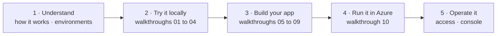

# Start here

Managed Copilot runs **stock** GitHub Copilot SDK agents in environments you own: on your laptop with Aspire, or in
your Azure subscription. These pages explain it one picture at a time, and the walkthroughs let you run each idea for
real in about a minute.

## Pick your path

| I'm… | Read | Then run |
| --- | --- | --- |
| **Evaluating it** | [How it works](concepts/how-it-works.md), then [environments](concepts/environments.md) | [01 · Your first agent](../samples/01-first-agent/README.md) |
| **Building an app** | The concept page linked from each walkthrough | [Walkthroughs 01 to 09](../samples/README.md), and [11](../samples/11-orchestrator/README.md) for multi-agent jobs |
| **Running the platform** | [Local and Azure](concepts/local-and-azure.md), then [identity and access](concepts/identity.md) | [10 · Azure from your laptop](../samples/10-azure/README.md) |

## Concepts

Each page answers one question, diagram first.

| Page | The question it answers |
| --- | --- |
| [How it works](concepts/how-it-works.md) | What is this, and how do the pieces fit together? |
| [Environments](concepts/environments.md) | Where does my agent run, and how do I choose? |
| [Sandboxes](concepts/sandboxes.md) | What is a sandbox's life? How do files get in and results out? |
| [Promotion](concepts/promotion.md) | How does a chat move into a sandbox when it needs one? |
| [Orchestrator](concepts/orchestrator.md) | How do I split a job across agents that each work in their own sandbox? |
| [Identity and access](concepts/identity.md) | Who am I to the platform, where does my token go, and who can use it? |
| [The harness](concepts/harness.md) | How do I shape what the agent knows and can do? |
| [Work while you're away](concepts/offline-work.md) | What happens when my app isn't connected? How do schedules work? |
| [Network and secrets](concepts/network-and-secrets.md) | What can the agent reach? How do I give it credentials safely? |
| [Copilot CLI](concepts/copilot-cli.md) | How do I open a live session in Copilot CLI, and why does it look local? |
| [Local and Azure](concepts/local-and-azure.md) | How do I run it on my machine and in Azure, and watch it run? |

## I want to…

| I want to… | Read | Run |
| --- | --- | --- |
| Run an agent in Azure from a TypeScript script on my laptop | [Local and Azure](concepts/local-and-azure.md) | [10](../samples/10-azure/README.md) |
| Build a chat agent that uses my app's data | [The harness](concepts/harness.md) | [02](../samples/02-your-own-tools/README.md) |
| Let an agent write and run code without touching my machine | [Sandboxes](concepts/sandboxes.md) | [03](../samples/03-sandbox/README.md) |
| Pay for a sandbox only when a chat needs one | [Promotion](concepts/promotion.md) | [04](../samples/04-promotion/README.md) |
| Split a job across agents working in parallel, each in its own sandbox | [Orchestrator](concepts/orchestrator.md) | [11](../samples/11-orchestrator/README.md) |
| Define environments and harnesses together in one app | [Environments](concepts/environments.md), [the harness](concepts/harness.md) | [05](../samples/05-choose-environments/README.md), [06](../samples/06-harness/README.md) |
| Open a session in Copilot CLI | [Copilot CLI](concepts/copilot-cli.md) | [01](../samples/01-first-agent/README.md), [06](../samples/06-harness/README.md) |
| Give an agent an API key without putting it in the sandbox | [Network and secrets](concepts/network-and-secrets.md) | [07](../samples/07-network-and-secrets/README.md) |
| Limit which hosts an agent can reach | [Network and secrets](concepts/network-and-secrets.md) | [07](../samples/07-network-and-secrets/README.md) |
| Keep working while my app is offline | [Work while you're away](concepts/offline-work.md) | [08](../samples/08-offline/README.md) |
| Run an agent every weekday morning | [Work while you're away](concepts/offline-work.md#run-on-a-schedule) | [09](../samples/09-schedules/README.md) |
| Serve many signed-in users from one backend | [Identity and access](concepts/identity.md#serving-many-users-from-one-backend) | |
| Let teammates use our Azure deployment | [Identity and access](concepts/identity.md#let-people-in) | |
| See every session and sandbox that's running | [Local and Azure](concepts/local-and-azure.md#watch-it-run) | `npx managed-copilot console` |

## Glossary

| Term | Meaning |
| --- | --- |
| **AppHost** | The Aspire app model (`apphost.mts`) that declares the platform: environments, access, vaults, webhooks, and your apps |
| **Environment** | A template for sessions: type, sandbox image and size, network rules, setup, models, and shipped agents |
| **Session** | One stock Copilot SDK conversation, owned by one GitHub account |
| **Placement** | Where a session runs: `shared` (the shared runtime) or `sandbox` (its own sandbox) |
| **Shared runtime** | One stock Copilot runtime process that hosts many lightweight sessions; no shell, no files |
| **Sandbox** | A Linux workspace for exactly one session: Docker locally, a microVM on Azure |
| **Promotion** | The one-time move of a `promotable` session from the shared runtime into its own sandbox |
| **Orchestrator** | An environment type whose sessions are coordinators: agents on the shared runtime that start workers and wait for their reports |
| **Worker** | A session a coordinator started: an ordinary session of an isolated environment, in its own sandbox, whose `parentSessionId` names the coordinator |
| **Harness** | How the stock runtime is configured for a session: instructions, agents, skills, tools, models, and limits |
| **Customizations** | A folder of agents, skills, and instructions shipped read-only with an environment |
| **Gateway** | The platform's front door: sign-in, admission, placement, routing, and the durable record of work |
| **Egress proxy** | A sandbox's only way out: it enforces network rules and inserts vault secrets |
| **Vault** | Sealed credentials a sandbox can use without holding them: it gets placeholders, swapped for real values at the egress proxy for approved hosts only |
| **Durable action** | A tool call or approval waiting for an answer, with exactly one owner |
| **Artifact** | A file the agent saved under `/workspace/outputs`, published when its turn completed |
| **Background sign-in** | Your sealed GitHub credential on a deployment, so schedules and offline work can run as you |
| **Operator** | Someone named in the AppHost who may open the console and see every session's configuration |

## Reference

| | |
| --- | --- |
| [README](../README.md) | The project in one page, with screenshots of the demos |
| [Video tour](tutorial/README.md) | Six narrated minutes: the idea, how it works, and both demos running for real |
| [Developer experience spec](spec/developer-experience.md) | The customer contract: every API, decision, and delivery gate |
| [Architecture](architecture.md) | How it's built: topology, protocol facts, and each module |
| [Deploying to Azure](deployment.md) | Everything `aspire deploy` creates, plus cost, limits, and troubleshooting |
| [`managed-copilot` CLI](../packages/cli/README.md) | Every command |
| [Quickstart](../demos/quickstart/README.md) | Every spec snippet as an automated acceptance check |
| [AI software factory](../demos/software-factory/README.md) and [assistant](../demos/assistant/README.md) | Two complete apps built on the platform |
