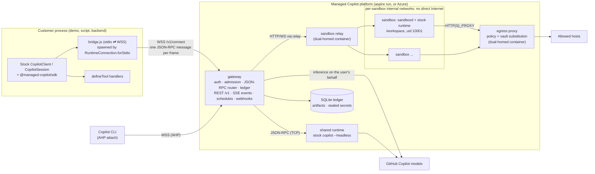
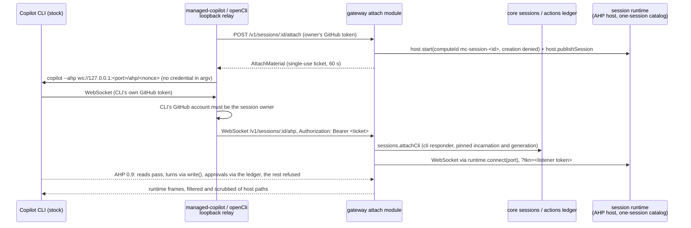

# Architecture

This is how the platform implements the [developer experience spec](spec/developer-experience.md). The spec is the
customer contract; this document records the current implementation, the protocol facts it relies on, and where each
part lives in the code ([code map](#code-map)). Update it with the code.

## Topology

## Protocol facts (SDK 1.0.26, runtime 1.0.103)

Verified from the published package sources (`dist/client.js`, `dist/session.js`, `dist/generated/rpc.js`):

- `RuntimeConnection.forStdio({ path, args, env })` spawns `path` (with node when it ends in `.js`) and appends
  `--headless --no-auto-update --stdio` plus optional flags. The bridge ignores those flags and relays JSON-RPC.
- The SDK speaks LSP-framed JSON-RPC (vscode-jsonrpc 8.2.1). The first request is `connect` (handshake).
  `forUri(url, { connectionToken })` is raw TCP; the runtime's `--headless --port` listener needs
  `COPILOT_CONNECTION_TOKEN` or it accepts any client.
- Every session-scoped request (`session.*`, e.g. `session.send`, `session.abort`, `session.tools.handlePendingToolCall`)
  carries `params.sessionId`, so the gateway routes per session. Connection-level calls include `connect`, `ping`,
  `status.get`, `auth.getStatus`, `models.list`, `session.create`, `session.resume`, `session.list`,
  `session.delete`, `session.getMetadata`, `session.getLastId`, `session.getForeground`/`setForeground`,
  `sessionFs.setProvider`, `llmInference.setProvider`, `plugins.builtin.set`.
- Runtime → client notifications: `session.event` and `session.lifecycle`. **Tool calls and permission prompts are
  events**: `external_tool.requested` (answered by `session.tools.handlePendingToolCall`), `permission.requested`
  (answered by `session.permissions.handlePendingPermissionRequest`), `elicitation.requested`.
- Runtime → client requests include `userInput.request`, `exitPlanMode.request`, `autoModeSwitch.request`,
  `systemMessage.transform`, `gitHubToken.getToken`, `providerToken.getToken`, `llmInference.httpRequestStart`/`Chunk`
  (the experimental public request-handler hook), `sessionFs.*`, `workflow.*`, `tasks.cancel`, and `host.*` (AHP).
- AHP: the runtime exposes `host.start`, `host.publishSession`, `host.unpublishSession`, `host.setSessionCreationPolicy`;
  the SDK exposes `AhpHost`. Copilot CLI attaches with `copilot --ahp <url>` (interactive only).
- `systemMessage` is per-resume configuration, not session state (verified live on 1.0.103): a runtime that resumes a
  session from copied session state without one uses its default prompt, although earlier prompts remain in history
  as `system.message` events; an explicit `systemMessage` on `session.resume` applies. So shared admission sends its locked
  prompt on every resume, and a promoted session's destination only gets what `open()` sends.
- Suspend, close, and resume on the wire (verified live on 1.0.103, a turn waiting on an external tool or streaming):
  between `session.suspend` and its answer the runtime sends only what the suspend causes (`external_tool.completed`,
  `agent.interrupted`, `model.call_finished`, `model.telemetry`, `model.turn_failed`, `model.turn_ended`,
  `assistant.turn_end`, `session.updated` lifecycle); after the answer come `session.usage_checkpoint`, the aborted
  `session.idle`, and the in-flight `sendAndWait`'s `{ aborted: true }` reply. `sessions.close` sends `session.shutdown`
  before its answer. A later `session.resume` (with `continuePendingWork`, the pending call stays pending and is not
  requested again) is answered before the resumed session's first event (`session.resume`).
- Ephemeral events never reach history (verified live on 1.0.103 from a coordinator's `events.jsonl`): `session.idle`,
  `session.title_changed`, `assistant.message_delta`, and `pending_messages.modified` are always ephemeral, so
  `session.getEvents()` has no turn ends. An app rebuilding a session from history infers them: Dispatch takes the next
  turn's `user.message` (delivery `idle`) as the end of the previous turn and `SessionInfo.lastTurn.completedAt` for
  the last one, and places events delivered live while the history loads by timestamp. A permission-gated tool emits
  `tool.execution_start`, then `permission.requested`, `permission.completed` (with `toolCallId`), and
  `tool.execution_complete`, all persisted.

## Components

| Component | Path | Runs as | Responsibility |
| --- | --- | --- | --- |
| Protocol | `libraries/protocol` | library | AppHost config schema, REST DTOs, errors, events, bridge constants, network policy math |
| SDK | `libraries/sdk` | library | `ManagedCopilot` API; stock `CopilotClient` over the bridge; REST features |
| Aspire integration | `libraries/aspire` | library | `addManagedCopilot(builder, name, options)` for TypeScript AppHosts |
| CLI | `libraries/cli` | `managed-copilot` bin | `login`, `logout`, `sessions`, `new`, `attach`, `promote`, `artifacts`, `schedules`, `console`, `operator`, `deploy`, `access` |
| Gateway | `services/gateway` | Node service | Auth, admission, routing, ledger, REST, events, schedules, webhooks, operator API |
| Console | `services/console` | static files served by the gateway | Operator console at `/console`: health, deployed state, sessions, harness configuration, guarded actions |
| GitHub theme | `libraries/github-theme` | CSS library (build time) | GitHub look and feel for every web UI: Primer tokens and light/dark themes, Mona Sans, Primer component classes for Tailwind v4 |
| Sandbox | `services/sandbox` | image + `sandboxd` + relay | Base image with the stock runtime, in-sandbox agent, gateway relay |
| Egress | `services/egress` | container | Network policy enforcement and vault substitution for sandbox traffic |
| Demos | `demos/*` | apps | AI software factory, long-running assistant, Dispatch, and the gallery |
| Walkthroughs | `walkthroughs` | scripts (`pnpm walkthrough <nn>`) | The walkthroughs' runnable code, documented in `walkthroughs/*/README.md` |
| Spec snippets | `tests/snippets` | scripts (Aspire resource `snippets`) | Every spec snippet as an acceptance check against a running platform |
| Environment customizations | `environments/<name>` | files | Agents, skills, and instructions for the root AppHost's environments, one folder per environment (today `chat`) |

### Web UI look and feel

Every web UI (the console, the software factory, the assistant, and Dispatch) looks like part of github.com. The shared
`@managed-copilot/github-theme` package (`libraries/github-theme`) is the single source: GitHub's Primer design tokens
from `@primer/primitives` (light and dark themes selected by `data-color-mode` on `<html>`, `auto` following the OS),
Mona Sans bundled from `@fontsource-variable/mona-sans` (no runtime font fetches, so the console's
`font-src 'self'` holds), Tailwind v4 names for the tokens with the default palette removed, and Primer component
classes under github.com's own names (`btn`, `Label`, `State`, `Box`, `UnderlineNav`, `AppHeader`, `markdown-body`,
...). Icons are Octicons (`@primer/octicons-react`). Each app's `styles.css` starts with
`@import "tailwindcss"; @import "@managed-copilot/github-theme";`. The package is CSS only (no build step); the
gateway and demo images copy it into their build stage and install it with the app.

### Data plane

1. `managed.client(env, options)` constructs a stock `CopilotClient` in the default `copilot-cli` mode with
   `RuntimeConnection.forStdio({ path: <sdk>/dist/bridge.js, env: { MANAGED_COPILOT_BRIDGE: JSON(BridgeConfig) } })`
   and starts it. The bridge opens `WSS /v1/connect` (bearer GitHub token, `BRIDGE_SUBPROTOCOL`), sends one
   `BridgeHello` frame with the environment request, and waits for `BridgeWelcome` before relaying JSON-RPC.
2. The gateway authenticates the GitHub caller, resolves the environment (policy ceilings, caller narrowing), and
   creates a **client connection**. Each client connection can own many sessions.
3. The gateway owns **persistent upstream connections** to runtimes: one to the shared runtime, one per sandbox.
   Client disconnects never close upstream connections or kill sessions; accepted work continues.
4. `session.create`: admission validates and rewrites the request (tool filters, models, MCP, agents, hooks,
   customizations, working directory, platform tools), places the session (shared runtime or a new sandbox), forwards
   it upstream, and records ownership in the ledger. `session.resume` restores placement first.
5. Session-scoped requests route by `sessionId` after an ownership check. Request IDs are remapped per upstream.
6. `session.event` notifications fan out to every attached client and observer. Execution-bearing events
   (`external_tool.requested`, `permission.requested`, ...) are **claimed before emission**: exactly one responder
   receives the actionable event; others get progress-only views. Unclaimed actions stay durable for webhook or poll
   responders. The contract is `services/gateway/src/modules/durable/contract.ts`.
7. Server-to-client requests for platform concerns (`gitHubToken.getToken`, `llmInference.*`, `sessionFs.*`) are
   answered by the gateway, never forwarded to customer code.
8. Connection-global RPCs are **virtualized per client connection, deny by default**. The stock `client.stop()` over
   stdio sends detach/shutdown RPCs (including `runtime.shutdown`); these detach only that client connection and are
   never forwarded upstream. `session.list`, `models.list`, `status.get`, `auth.getStatus`, foreground calls, and
   provider registrations (`sessionFs.setProvider`, `llmInference.setProvider`, `plugins.builtin.set`) are answered or
   rejected by the gateway, scoped to the caller.

**SDK call deadlines.** The SDK's REST calls never wait indefinitely; an ingress can hold a request for minutes while
the gateway behind it is replaced. The bounds are internal defaults (`timings` in `libraries/sdk/src/http.ts`), not
public API:
- `ManagedCopilot.connect()` and the event stream's connection get 45 s, and other calls 60 s for their answer. Both
  exceed the gateway's 35 s GitHub verification, so its explicit errors win.
- `managed.promote` gets 10 minutes, since its answer includes sandbox preparation.
- The publication long poll gets its own wait plus 60 s.
- Streamed uploads and downloads fail after 60 s without progress, however large they are.
- The event stream reconnects with `Last-Event-ID` after 45 s without a byte, which is three of the gateway's 15 s
  heartbeats. A stream that has no usable cursor (a new subscription, or an ID the ledger pruned) starts with an
  id-only SSE block holding the owner's newest event ID, or `start` when the owner has none. The SDK records it
  without dispatching it, so a stream that ends before its first event still replays everything published after it
  began.

An expired bound fails with `timeout`, naming the call. A caller's `AbortSignal` rejects with its own reason. Durable
result submissions are idempotent and retried after a `timeout`.

**Bridge keepalive.** Proxies close WebSockets that carry nothing for a while (Azure Container Apps ingress closes
them after 240 s with code 1006), and a half-open connection never reports itself closed. The bridge therefore pings
the gateway every 30 s. A gateway that answers nothing (no pong, no message) for 90 s ends the bridge with "The
connection to Managed Copilot at … stopped responding", which the stock client reports. The gateway's `/v1/connect`
server answers pings itself (`ws` `autoPong`). The event stream stays busy with the gateway's 15 s `: ping` comments.

### Client mode and safe defaults

The stock `mode: "empty"` validates on the client before transmission (it requires `baseDirectory`/`sessionFs` and an
explicit `availableTools` on every `createSession`, and it sends a post-create `session.options.update`), so the
spec's short snippets cannot run in that mode. Managed clients therefore use the default `copilot-cli` mode, and the
**gateway** enforces the safe configuration: it rewrites upstream `session.create`, `session.resume`, and
`session.options.update` (tool ceilings, discovery off, deployed customizations on, no caller working directory), and
denies configuration RPCs it does not understand.

### Identity

- Gateway callers are one of: a GitHub **user principal**, an internal **platform service** (platform key), or a
  scoped **action capability** (webhook workers). Capabilities authorize only their exact session/action operations
  and are rejected on general user routes.
- `managed.client(env, { gitHubToken })` creates sessions owned by that account. SDK helpers (`files`, `artifacts`,
  `sessions`, actions) must use the identity of the client that created or resumed a session, tracked from the stock
  client's session lifecycle events. Owner checks are never weakened to make a helper work.
- The SDK validates the deployment URL before sending a credential: HTTPS for remote deployments, HTTP only for
  verified loopback, no embedded credentials, and a validated discovery record.
- **GitHub verification** (`auth`). Tokens are verified against GitHub `/user` (cached 5 minutes) plus the AppHost
  access rules. Transport errors, timeouts, and 5xx answers are retried with jittered backoff inside a 35 s deadline;
  rate limits are not retried. While GitHub is unreachable, a token's last successful verification stands in for up
  to 15 minutes (re-checked in the background every 30 s); a rejection (401, a non-rate-limit 403, or `forbidden`)
  replaces it, so it never revives a rejected token. Otherwise callers get `upstream_unavailable` (HTTP 503 with
  `Retry-After` and `details.retryAfterSeconds`), never `authentication_required` for an outage. Long-lived
  connections re-verify at most once a minute and are closed only for `authentication_required`/`forbidden`.

### Credentials and inference

- Shared runtime: per-session user credentials supplied by the gateway at create/resume (in memory), never a shared
  service token. Model attribution follows the session owner.
- Sandboxes: the GitHub token never enters the sandbox's environment, disk, or runtime process. Stock runtime 1.0.103
  refuses to send without a credential, and with a session `gitHubToken` (or `gitHubToken.getToken`) it validates the
  account with a direct call to `api.github.com/copilot_internal/user` that does **not** pass through
  `llmInference.*`. The implemented mechanism avoids that call with stock, public RPCs only:
  1. The gateway's upstream connection to the sandbox runtime calls `llmInference.setProvider` after `connect`, so the
     runtime sends every model-layer HTTP request to the gateway as `llmInference.httpRequestStart`/`httpRequestChunk`.
  2. `session.create` / `session.resume` go upstream with no GitHub token fields (`prepareSessionParams` strips them,
     and rejects a BYOK `provider` with `policy_violation`).
  3. After create/resume succeeds, the gateway resolves `copilot_internal/user` itself with the owner's token and calls
     `session.gitHubAuth.setCredentials({ credentials: { type: "token", host: "https://github.com", token: "mcrt_…",
     copilotUser } })`. The runtime trusts a supplied `copilotUser` verbatim (`copilotUserResolved: true`) and does
     not re-fetch it. `mcrt_…` is an opaque per-session placeholder with no value outside the gateway.
  4. The gateway answers each `llmInference` request only for the sandbox's own session and only for allowlisted
     Copilot API hosts (the identity's `endpoints.api` plus `api[.individual|.business|.enterprise].githubcopilot.com`):
     it swaps the placeholder for the owner's current token (`resolveToken`) and streams the response back with
     `llmInference.httpResponseStart`/`httpResponseChunk`. Anything else is refused.
  5. When GitHub rejects that token (HTTP 401 from the Copilot API, including a refused WebSocket upgrade, or from
     `copilot_internal/user`), the gateway calls core's `auth.invalidate(token)` and drops the token's cached Copilot
     identity, so the next `resolveToken` verifies the token with GitHub again rather than reusing it.
  6. A stock runtime keeps its inference-provider registration with the first connection that registered, even after
     that connection closed, and has no way to release it (verified on 1.0.103 for idle and mid-stream closes, RST and
     FIN): every later `llmInference.setProvider` fails with "Another client is already the LLM inference provider".
     So after a gateway restart or a dropped gateway↔sandbox link, a runtime that kept running cannot be used again.
     When `setProvider` is refused and no other connection of this gateway is open to the runtime, the gateway asks
     sandboxd to replace the runtime process (`POST /v1/runtime/restart`; session state stays on disk) and fails
     `initialize` with `capability_unavailable` and `details.reopen: true`. Core then reopens the connection (at most
     twice) and resumes the session in the new process. Sandboxes whose sandboxd predates the route (pinned older
     images) are stopped and started again instead, which also starts a fresh runtime, before the reopen. A refusal
     while another connection of this gateway is open is a real second provider and fails with `conflict`.

  Evidence (2026-10-23, Windows ARM64, both the SDK's `copilot-runtime` and the `@github/copilot` CLI binary, 1.0.103,
  with all direct network egress blocked): session creation without a token succeeded, `GET <endpoints.api>/models` and
  every `POST /v1/messages` arrived through `llmInference.*` carrying only the placeholder, and real model replies came
  back. Afterwards neither the placeholder nor the token appeared anywhere under `COPILOT_HOME` or in runtime output.
  Limits: runtime features that call GitHub services directly rather than through `llmInference` (the built-in GitHub
  MCP server, telemetry) only ever see the placeholder and fail or are blocked by egress policy; the identity and quota
  snapshot is taken at create/resume time; BYOK providers are not available in sandboxes; when the owner has no usable
  credential, inference fails with `authentication_required` and never falls back to another account.
- Runtime binary: the stock SDK spawns the dedicated headless runtime shipped in `@github/copilot-sdk-<platform>`;
  `@github/copilot` is the larger interactive CLI. The sandbox image installs `@github/copilot-sdk@1.0.26` and runs its
  headless `copilot-runtime` (1.0.103); the shared runtime should use the same binary, resolved through public package
  metadata.

### Isolated placement

As built (`services/gateway/src/modules/sandbox`, `services/sandbox`; contracts in
`services/gateway/src/modules/sandbox/contract.ts`, `.../sandbox/providers/types.ts`, and
`libraries/protocol/src/sandbox.ts`):

- **Backends.** The service owns policy and lifecycle (setup, egress registration, the runtime, idle stop,
  reconciliation, artifacts); a `SandboxProvider` (`providers/types.ts`) owns compute, persistent storage,
  networking, images, and reachability of each sandbox's sandboxd: `ready`/`prepare`, `ensureImage`/`hasImage`,
  `create`/`start` (with cancellation and progress), `stop`/`remove`/`isRunning`, `address` (egress pinning, when
  `capabilities.addressPinning`), `endpoint` (http or https base URL plus headers, also used for WebSocket upgrades),
  optional `egressProxy` (passed to `policy.registerSandbox`), `reportUnreachable`/`reattach`, and `inventory`.
  `MANAGED_COPILOT_SANDBOX_PROVIDER` selects `docker` (local, `providers/docker/`, described below) or `azure`
  (`providers/azure/`). Providers must keep: sandboxd as root with only CHOWN, KILL,
  SETGID, and SETUID; the workload as uid 10001; persistent `/workspace`, `/home/agent`, `/var/lib/managed-copilot`; no
  route between sandboxes and no Internet except through the egress proxy; sandboxd reachable only through `endpoint`.
  `sandboxes.available` is the result of the provider's latest `ready()` (checked at module registration with a 2 s
  bound, every 30 s, and before every backend operation); `/v1/info` should advertise `isolated` and `files` only while
  it is true, so a deployment whose backend is missing or unqualified never advertises a capability that cannot work.
  Docker trusts a successful ping for 15 s.
- **One sandbox per session.** `sandboxes.create` allocates a container `<instance>-sbx-<id>` from the environment's
  pinned image, with per-session volumes for `/workspace`, `/home/agent` (HOME, the Python venv `~/.venv`, and the npm
  prefix `~/.npm-global`), and `/var/lib/managed-copilot` (runtime `COPILOT_HOME` plus root-only sandboxd state). It
  resolves only when setup and the runtime are ready; a failing setup step rejects with `setup_failed` (step, exit code,
  redacted output, and the last output lines in the message) and the session is never reported usable; a failed create
  releases its container, volumes, and subnet. Sizes map to CPU and memory limits; containers drop all capabilities
  except what sandboxd needs to switch identity and signal (CHOWN, KILL, SETGID, SETUID) and run with
  `no-new-privileges`.
- **Networks.** Every sandbox gets its **own internal Docker network** on an explicit /28 from `10.213.0.0/16`
  (probing on overlap), so sandboxes can never reach each other's ports and Docker's default pools are not
  exhausted. Each gateway's shared networks (`<instance>-edge`, `<instance>-sandboxes`, `<instance>-egress-wan`) get
  an explicit /24 from `10.214.0.0/16` the same way, because Docker's default pools hold only about thirty networks and
  a handful of local platforms (checkouts, port-offset copies, end-to-end tests) would otherwise exhaust them.
  The relay and the egress proxy (`<instance>-egress`, alias `mc-egress`) are connected to each sandbox
  network by the gateway on create and resume; nothing else is. The end-to-end test verifies a peer sandbox's IP is
  unreachable and that `network: false` sandboxes have no Internet route.
- **sandboxd** (`services/sandbox/src/sandboxd`) runs as root, never as uid 10001. It serves, behind a per-sandbox
  bearer key: health/status, `POST /v1/start` (NDJSON progress: egress CA trust, one-time setup, runtime start),
  `/v1/runtime` (WebSocket ⇄ the runtime's loopback TCP port 7790), `/v1/tunnel?port=` (loopback TCP for CLI
  attach), `POST /v1/runtime/restart` (replaces the runtime process; health reports a new `runtime.instance` for
  every process), streamed workspace list/read/write, and output manifests. It starts the SDK's stock headless
  `copilot-runtime` as uid 10001 with cwd `/workspace`, `COPILOT_CONNECTION_TOKEN`, its own `COPILOT_HOME`, the egress
  env, and the customer `env` (reserved identity, proxy, trust, and runtime names are rejected), and restarts it after
  unexpected exits. Every workload process (the runtime, setup commands, file workers) starts through `setpriv`:
  uid/gid 10001, cleared groups, `no_new_privs`, and empty inheritable, ambient, and bounding capability sets, so the
  invariant holds on backends that cannot drop container capabilities; the image has no setuid/setgid files. The
  launcher runs as root with only a fixed `PATH`; the workload's environment is installed by `env -i` after the drop,
  so loader variables such as `LD_AUDIT` or `GLIBC_TUNABLES` never reach a root process (the gated e2e probes this
  with `LD_DEBUG_OUTPUT`). Every
  workspace operation (list, read, write, mkdir, and the outputs manifest) runs in a short-lived worker as uid 10001
  that walks the path one segment at a time with `chdir`, refuses symbolic links, verifies the real directory after
  every step, and opens the final component with `O_NOFOLLOW`; sandboxd's root never touches workspace paths, and
  children enter `/workspace` only after dropping privileges.
- **Custom agents.** The stock runtime resolves a named `agent` from `agentDirectories` only when it holds a GitHub
  credential at construction (verified on 1.0.103: without one, `session.create` fails with "Custom agent … not
  found"). A sandbox runtime gets its brokered credential after construction, so the sandbox module removes `agent`
  from create/resume parameters and calls `session.agent.select` right after installing credentials, before core
  replies; an unknown agent still fails the create with `invalid_request`.
- **Setup** (spec section 5) runs once, in order: pip packages into the persisted venv, npm packages into the
  persisted prefix, setup files (≤64, ≤1 MiB each, ≤8 MiB total), then `setupCommands` (`bash -c` as uid 10001).
  Progress, resolved versions, and file digests are recorded in the gateway ledger (authoritative) and in root-only
  sandboxd state. Installs obey the session's network policy; an offline failure says so. Resume never replays
  setup: an interrupted or failed setup makes the sandbox `state_restore_failed`. System packages are built into a
  derived image layer at environment preparation, never installed per session.
- **Images.** The gateway builds the base image from `services/sandbox/image/Dockerfile` (content-hash tag
  `managed-copilot-sandbox:<hash>`, also tagged `ghcr.io/patniko/managed-copilot-sandbox:0.1.0` for customer `FROM`
  lines) with the operator's npm registry and pip index baked in as session defaults. Those URLs reach every
  workload's npm and pip configuration and are recorded as build arguments in the image history, so they must not
  carry credentials: user info (`user:password@`, `token@`), extra slashes before the host (URL parsers skip them,
  so `https:///user:token@host/` still carries user info), query strings, fragments, and spaces, backslashes, or
  control characters (which could smuggle in a configuration line such as an `_authToken`) are refused, both by the
  gateway before any build (a clear `capability_unavailable` naming the setting, and a startup warning when an
  explicit setting is refused) and by the image's own guard for builds outside the gateway; a test runs the guard on
  every URL the gateway accepts. Credentials hidden in a
  URL's path cannot be detected and must not be used; error messages show only the scheme and host. Authenticated
  registries are not supported yet; they need build secrets for image preparation and vault-scoped credentials for
  session-time installs. Environment images are built FROM the base, must carry the base label, and are pinned by
  image ID per sandbox, so a resume never changes the toolchain. `warm > 0` fails gateway start: this backend cannot
  keep warm sandboxes safely.
- **Lifecycle.** Idle stop (environment `idleTimeoutSeconds`, default 900 s) happens only when no turn is running, no
  tool/permission/elicitation action is pending (including open durable actions, which survive gateway restarts), and
  no file transfer or publication is in flight; it closes runtime streams so core resumes on next use. A sandbox found
  running at gateway start stays up while the ledger's last turn is still `running` (up to two hours, or until a root
  `user.message` or `session.idle` re-establishes turn tracking), and idle sweeps begin only after that
  reconciliation. A stop that a restart interrupted is finished. `ensureRunning` restarts (or recreates
  from the pinned image and existing volumes) and re-registers egress. Stops close runtime streams, stop the
  container, then unregister egress and detach the relay and proxy from the sandbox network. `delete` marks
  `deleting`, removes container, volumes, network, and artifacts, and reconciliation finishes after a crash; resources
  labelled with the instance that no current record owns are swept on start.
- **Replaced runtimes and interrupted turns.** A turn cut off mid-inference or mid built-in tool does not survive its
  runtime process: when the session is resumed in a new process (a recreated or restarted sandbox, sandboxd's crash
  recovery, or a restart for a held inference provider), stock runtimes neither continue nor end it, with or without
  `continuePendingWork`, and `session.abort` emits nothing (verified on 1.0.103). Only a turn waiting on actions
  durable still owns (durable's `hasOpenActions` for the session's incarnation, which includes answers recorded but
  not yet delivered) continues, because `continuePendingWork` carries those over. Otherwise the gateway ends the turn:
  core emits a root `session.error` (`errorType: "interrupted"`) and `session.idle` and records `lastTurn` as
  `failed`, and the sandbox service fails the turn's publication ("the sandbox runtime was restarted while this turn
  was running…") and stops holding idle stop for it. Each `openRuntime` reads sandboxd's `runtime.instance`, so a
  process change between connections is noticed. Gateway↔sandboxd runtime and tunnel WebSockets are pinged every 30 s
  and closed after two unanswered pings, so a dead path ends the session's upstream instead of hanging it. Verified
  live (`test/rollover.e2e.test.ts`, real Docker sandboxes and models): a turn cut mid-stream by a killed gateway, by a
  graceful gateway shutdown, and on a shared session each ends as `failed` on the next gateway, and a new turn
  completes; after the kill the same sandbox's runtime was restarted rather than the sandbox recreated.
- **Promotion import.** `sandboxes.importRuntimeState(sessionId, { sessionStateDir, activeTurnId? })` copies the
  regular files of a gateway-host `session-state/<sessionId>` export (no `*.lock` files; links and special files are
  refused; ≤10,000 files, ≤1 GiB) into the running sandbox runtime's COPILOT_HOME as uid 10001. Files are staged under
  `COPILOT_HOME/.mc-import/<random>` and swapped in for `session-state/<sessionId>` with two renames, so a retried
  import replaces rather than merges. `activeTurnId` tracks a turn that started in shared placement so its root
  `session.idle` in the sandbox publishes outputs and idle stop waits for it.
- **The sandbox relay** (`<instance>-relay`, same image, uid 65534, read-only rootfs) is on `<instance>-edge`
  (published on 127.0.0.1) and every sandbox network; it forwards `/relay/<sandboxId>/...` HTTP and upgrades to
  `sbx-<id>:7781` after checking the platform key.
- The **egress proxy** container is connected to each sandbox network and to a bridge network with Internet access;
  sandboxes reach the Internet only through it. It applies each sandbox's effective network policy (pushed by the
  gateway), blocks platform internals, loopback/link-local, private, and metadata addresses after DNS resolution, and
  substitutes vault placeholders in permitted HTTPS headers (see "Network policy, egress, and vaults"). Per start the gateway calls
  `policy.registerSandbox`, pins the credential with `policy.updateSandbox(id, { address })` as soon as the container
  has its address (before setup, so setup installs already pass the proxy), then passes the env and CA to sandboxd; on
  stop and delete, `policy.unregisterSandbox`. Without a policy service, only `network: false` sandboxes without vaults
  start.
- **Artifacts** (spec section 6). A turn starts at a root `user.message` (turn ID = its `messageId`) and completes at
  the next root `session.idle`. Completed turns publish: sandboxd hashes the bounded regular files under
  `/workspace/outputs` (symlinks, special files, changing files, and anything over 256 files / 100 MiB each / 512 MiB
  total are rejected with reasons), the gateway downloads and re-verifies each changed file into content-addressed
  storage under `<dataDir>/artifacts/<sessionId>/`, and records versions, digests, and a per-turn manifest. Rejections,
  cancelled turns, and turns that ended in errors are recorded as `failed` publications, never empty successes.
  Publications run one at a time per session. If a later root turn started before a turn's outputs manifest was
  captured, that publication fails ("cannot be attributed to this turn", logged at info since nothing is lost) rather
  than label the later turn's bytes; the current outputs publish when the later turn completes, so callers that need
  each turn's outputs wait for its publication before sending the next prompt. Publications still pending at gateway
  start are failed with an explicit reason. A publication interrupted by the session's deletion is recorded as
  "deleted" (logged at info), wherever the race lands: the session counts as deleted once core marks it `deleting`, a
  delete of its sandbox is queued, its sandbox is `deleting`/`deleted`, or the deletion removed the turn's records; a
  failure is classified only after sandbox operations already queued for the session (such as the delete) have run.
  Gateway shutdown lets publications under way finish (up to 10 s) before it stops sandboxes. Only a publication
  whose failure surfaced once shutdown had started stopping sandboxes is recorded as interrupted by the shutdown (at
  info; judged when the failure surfaces, not after waiting out queued sandbox work); one that fails during the drain,
  while compute is still up, or for reasons of its own at any time (rejected or changing files) keeps its reason and
  warns. `artifact.published` (through core's events) lists only new
  versions; a turn that changed nothing under `outputs/` emits no event.
- **Known limits (local backend).** No per-volume disk quota; model ceilings are enforced by core's admission, not
  re-checked per brokered request; the built-in GitHub MCP server is unavailable in sandboxes (it only sees the
  placeholder); turn attribution relies on the runtime's `user.message` reaching the gateway before the next turn's
  tools change `outputs/`. A gateway replacement ends the turns its sandboxes were running (gateway shutdown stops
  sandboxes, and the inference stream of a running model call lives in the gateway), so callers resend them. A turn that
  waited on durable actions across a gateway restart can still finish, but its outputs are not published: turns
  running at gateway start are recorded as interrupted.
- **REST** (owner-scoped, shared sessions answer `invalid_request`): `GET /v1/sessions/:id/files?path=&recursive=`,
  `GET|PUT /v1/sessions/:id/files/content?path=&overwrite=` (streamed, 512 MiB limit, atomic replace by default),
  `GET /v1/sessions/:id/artifacts?versions=latest|all`, `GET .../artifacts/publication?turnId=&timeoutMs=` (≤120 s per
  request; the SDK keeps waiting), and `GET .../artifacts/:artifactId/content`.

### Commands run directly in sandboxes

`managed.exec`, `managed.sandboxes.create`, and the sandbox service's `exec` API (spec section 18; the proposal
[direct execution](design/direct-execution.md)). Code: `services/sandbox/src/sandboxd/execs.ts`,
`services/gateway/src/modules/sandbox/execs.ts` (with `store.ts`, `routes.ts`, `service.ts`), core's workspace-only
session kind in `core/sessions.ts`, `libraries/sdk/src/features/exec.ts`, and `libraries/cli/src/commands/exec.ts`.

- **sandboxd command journal.** `POST /v1/exec` (`SandboxExecRequest { id, command, timeoutMs?, stdin? }`) runs
  `bash -c <command>` through `asWorkload` (uid/gid 10001, `no_new_privs`, empty capability sets) in `/workspace` with
  the workload environment of the latest start (customer `env`, proxy settings, vault placeholders, CA variables; never
  `COPILOT_CONNECTION_TOKEN` or a GitHub token), in its own process group (`detached`). Each command is journaled by ID
  in root-only `/var/lib/managed-copilot/sandboxd/exec/<id>.json` **before** it is spawned (a command that cannot be
  journaled is refused and never runs; saves of one entry are serialized, so an older snapshot never replaces a newer
  one; the record, then the newest 1 MiB of combined stdout/stderr, saved every 2 s while output changes and at the
  end). A start with an ID the journal has answers with that command and runs nothing. `GET
  /v1/exec/<id>?offset=&waitMs=` reads output from a byte offset (at most 256 KiB, never splitting a UTF-8 character:
  a character split across writes waits for its last byte; older output than the kept tail is reported as
  `skippedBytes`), long-polling up to 30 s for new output or the end; an offset past the end, or `?output=false`, waits
  for the end only.
  `POST .../input` writes stdin (`{ data?, eof? }`; stdin is closed from the start unless `stdin: "open"`),
  `POST .../stop?reason=` and timeouts send SIGTERM to the group and SIGKILL after 3 s, `GET /v1/exec` lists, and
  `POST /v1/exec-stop?reason=` stops every running command. A command counts as ended at exit plus 250 ms for its
  pipes (a child it left in the background no longer holds it); stopped and timed-out commands' groups are killed.
  Limits: 32 running, 200 ended ones kept, 128 KiB per command, 1 MiB per stdin write. sandboxd shutdown stops running
  commands ("The sandbox stopped…"), and a journal entry still `running` at load reads `stopped` ("The sandbox
  restarted…"). States: `running`, `completed` (any exit code; `signal` when killed from outside), `timed_out`,
  `stopped` (with the reason), `failed` (could not start).
- **Workspace-only sandboxes.** `SandboxStartRequest.runtime: false` (the gateway passes it for
  `CreateSandboxRequest.runtime: false`, stored as `sandbox_sandboxes.runtime`) runs trust and setup and reports ready
  without starting `copilot-runtime`; `ensureRunning` health checks ignore the runtime for such a sandbox, `openRuntime`
  refuses it (`invalid_request`), and sandboxd refuses a runtime restart. No inference broker or placeholder credential
  is ever in use for it.
- **Gateway journal and caller.** `sandboxes.exec(sessionId, command, { id?, actionId?, background?, timeoutMs?,
  waitMs?, stdin?, signal?, sandboxId?, caller? })` starts the sandbox if it is stopped, records the command in
  `sandbox_execs` (keyed by sandbox and ID, with the session, owner, command, `caller` `{ kind: "api" | "platform",
  accountId?, login?, name?, agentId? }`, state, exit, reason, and output size) as `starting`, then asks sandboxd. The
  ID is the caller's, `ex_` + SHA-256 of `actionId` (so a replayed tool call reattaches), or random. A start sandboxd
  refused itself (an error it answered, not a relay's 502/504) never ran: the record goes and the error stands. A start
  whose answer was lost is looked up in sandboxd's journal: found, it is reattached; absent, it is `uncertain` (the
  journal could have been lost since); unreachable, it stays `starting`. A `starting` command the gateway did not see
  confirmed (it restarted) is looked up the same way and, absent, becomes `uncertain`; a `running` one sandboxd no
  longer has becomes `uncertain` too. `uncertain` is final and is never rerun. The call then collects output until the
  end, `waitMs` (a running command is answered at its deadline however much it prints), or `signal`
  (which stops a command that is not `background`), answering an `ExecResult` (`ExecInfo` plus the newest 1 MiB of
  output, `offset`, `skippedBytes`). `readExec`, `writeExec`, `stopExec`, `listExecs`, and `publishOutputs` complete
  the API; every call is pinned to the sandbox like file calls (`sandboxId`). The session's deletion deletes its
  commands' records.
- **Following commands, idle stop, and restarts.** The gateway follows each live command with 25 s `output=false`
  long polls until it ends, so ends are recorded (and published) without readers. A command's wait counts as busy
  (`track`); a background command holds an idle stop while it wrote output (or started) within the environment's idle
  timeout, checked against sandboxd's list at the stop. Any stop first stops the sandbox's running commands with a
  reason ("The sandbox stopped after N min without activity…") and records them; an operator's stop is refused while
  commands run. Gateway shutdown stops sandboxes and so their commands; at start, reconciliation follows the running
  commands of sandboxes still running again and settles those of stopped sandboxes.
- **Core: workspace-only sessions.** `sessions.createWorkspace(principal, { sessionId?, environment, parentSessionId?,
  clientName? })` records a session with `kind: "workspace"` (`core_sessions.kind`), binds network policy and vaults,
  and creates its sandbox with `runtime: false`; failures leave nothing behind. Core never opens a runtime for it: every
  agent path (send, abort, client resume, CLI attach, promotion, `ownerPrincipal`) goes through `#liveFor`, which
  refuses it with `invalid_request` ("…a workspace-only sandbox…"); creating an agent session with its ID is refused
  too. `SessionInfo.kind` is `"workspace"`; its state is `ready`, then `running` while commands run and `idle` after
  (`sessions.execActivity`, called by the sandbox service). Files, artifacts, exec, and delete work as for any sandbox
  session. A standalone one (no `parentSessionId`) publishes `/workspace/outputs` after each command ends, with the
  command's ID as the turn ID (stopped and timed-out commands record a failed publication); one with a parent publishes
  only when its owner calls `publishOutputs` (the orchestrator, on coordinator turns).
- **REST and policy.** `POST /v1/sandboxes` (`CreateSandboxRequest { environment, sessionId? }`, 201 with `SessionInfo`,
  200 for an existing one) needs an isolated environment. `POST /v1/sessions/:id/exec` (`ExecRequest`; waits ≤30 s,
  default 10-minute timeout unless `background`), `GET .../exec`, `GET .../exec/:execId?offset=&waitMs=`,
  `POST .../exec/:execId/input`, and `POST .../exec/:execId/stop` work on any sandbox session the caller owns (isolated,
  worker, or workspace-only), recording `caller: { kind: "api", accountId, login }`. Environment `exec: false`
  (isolated only, default true) makes `POST /v1/sandboxes` and every exec route answer `policy_violation` ("Running
  commands directly is turned off for environment <name>."); it governs only these customer routes, not the service API
  platform tools use. `EnvironmentInfo.exec` reports it, and `/v1/info` advertises `exec` with `isolated`.
- **SDK and CLI.** `managed.sandboxes.create({ environment, sessionId? })` returns the `SessionInfo` plus `sessionId`
  (so it works as a `SessionRef`); `managed.exec(ref, command, { timeoutMs?, background?, id?, stdin?, signal? })`
  starts with a client-chosen ID (a start whose answer was lost is read back by it; one cancelled while starting is
  stopped by it) and long-polls reads, resolving an
  `ExecResult`; with `background: true` it resolves an `ExecHandle` (`output` async iterable, `result`, `write`, `end`,
  `stop`, `info`). `managed.exec.list(ref)` lists. `npx managed-copilot exec <session> [--timeout <s>] -- <command>`
  streams output and exits with the command's code (124 timed out, 130 stopped).
- **Verified.** Unit suites for the journal (`services/sandbox/test/execs.test.ts`, run on Windows and in a Linux
  container, where process-group kills are checked), the gateway service (`test/sandbox-exec.test.ts`), core
  (`test/core.workspace.test.ts`), and the CLI; `services/sandbox/test/exec.e2e.test.ts` (opt-in, real Docker) runs
  uid, cwd, env, stdin, stop, timeout, idempotency, files, publication, and policy against real sandboxes; walkthrough
  13 ran live against `aspire run` with real models (a stock client whose sub-agents' `bash`/`create` ran through
  `managed.exec`). The Azure provider needs no change: exec uses the same sandboxd endpoint, and long polls stay under
  30 s.

### Shared placement egress

One shared runtime process cannot carry per-session egress identity through a proxy. Shared sessions therefore get
no direct workload egress: built-in web tools are disabled by admission, web access is the gateway-executed
`web_fetch` platform tool (per-session policy), and remote MCP servers are reached through a gateway MCP adapter that
applies the session's policy and attaches vault credentials. Anything else is refused with `capability_unavailable`.

### Network policy, egress, and vaults

- **Effective policy.** `policy.bindSession` computes `narrowNetwork(ceiling, caller request)` where the ceiling is the
  environment's `network` over the deployment default (inline sessions use the default; a declared environment always
  uses its own setting, whatever its name), persists it in
  `network_sessions`, and returns it. Every later read re-narrows the stored policy by the environment's *current*
  ceiling (an operator can narrow, never broaden a session; a removed environment means no egress).
  `promoteSession(id, target)` keeps the source environment as the owner of the session's ceiling and AppHost vault
  grants and records the target (`promotedTo`, also in the session's network view). The stored policy is narrowed from
  the *current* effective policy by the isolated target's ceiling, and every read narrows by both environments'
  current ceilings. So `network: false`, a source tightened after creation, and later tightening of either environment
  all survive promotion, and the target neither adds nor removes vaults. Until `commitPromotion(id)`,
  `revertPromotion(id)` restores the pre-promotion type, policy, and target (spec 9.5 pre-commit rollback; kept
  in SQLite across restarts). Bindings promoted by earlier versions (target stored as the environment) are converted
  once at startup: the source comes from a pending snapshot or core's ledger, and fails closed (no access) when only
  promotion records show the promotion. Only isolated sessions have sandbox egress: `registerSandbox` refuses shared and
  promotable sessions, and a sandbox left behind by a reverted promotion is pushed with no access.
- **Shared decision logic.** `evaluateDestination` in `libraries/protocol/src/network.ts` is the single rule set for the
  proxy, `web_fetch`, and the MCP adapter: host patterns (`*.x` matches subdomains, not the apex; IP addresses and
  numeric final labels are not patterns), ports (default
  80/443), canonical hosts (numeric forms such as `2130706433` or `0x7f.1` are rejected before DNS), IP literals
  (refused under host lists), and the address classes allowed after DNS (public only; operator-named private hosts may
  reach RFC 1918/ULA/CGNAT space outside protected ranges; loopback, link-local, metadata including Azure
  `168.63.129.16`, IPv6 transition forms, multicast, and reserved space never). Operator-blocked and protected ranges
  apply to every address, public ones included, and to the IPv4 address inside IPv4-mapped and NAT64 forms. Callers
  connect only to the returned addresses, so rebinding cannot redirect them. `.invalid`, `.local`, and `.onion` fail
  without a lookup.
- **Egress proxy** (`services/egress`, one bundled file, image `managed-copilot-egress:<content hash>`). The gateway's
  supervisor runs it as `${MANAGED_COPILOT_INSTANCE:-mc}-egress` (read-only root, no capabilities, CA volume
  `${instance}-egress-data`) on `${instance}-egress-wan` (its default route) and `${instance}-sandboxes`; the sandbox
  provider connects it to each per-sandbox network with alias `mc-egress`. It listens on `0.0.0.0:3128` and calls the
  gateway at `http://host.docker.internal:<port>` with an egress-scoped key (never the platform key). Every connection
  needs the sandbox's proxy credential (Basic, `sandboxId:secret`; the proxy only holds its SHA-256), optionally
  pinned to the sandbox's address; until the first registration snapshot, or 30 s after the gateway stream drops, it
  fails closed with 503, and at that 30 s deadline it also closes every open connection. Registrations are re-checked
  after DNS and before each connection is admitted, so revocation or narrowing during a lookup or dial still applies.
  CONNECT tunnels, vault tunnels included, must start with a TLS ClientHello whose SNI equals the authorized host
  (parsed strictly: repeated extensions or server names are refused) before any certificate is presented.
  Blocks answer 403 with the reason in the status line and body and are reported to the gateway (no credentials, no
  query strings). The subnets of its non-default interfaces and `10.213.0.0/16` are always protected.
- **Internal API** (`EGRESS_ROUTES`): `hello` (instance and CA certificate), `stream` (SSE `snapshot`/`upsert`/`remove`/
  `ping`), `secrets/resolve` (authorizes one vault use), `reports`. Registrations carry the policy, credential hash,
  pinned address, and vault bindings (placeholder, exact destinations, header names), never values.
- **Sandbox registration.** `await policy.registerSandbox({ sandboxId, sessionId, proxy? })` rotates the proxy
  credential and returns `{ proxyUrl, env, caCertificate, policy }`. `proxyUrl` points at `mc-egress:3128` unless the
  provider passes `proxy: { host, port }` (for example on Azure). `env` holds `HTTP(S)_PROXY`/`http(s)_proxy` (both cases),
  `NO_PROXY=localhost,127.0.0.1,::1`, `NODE_USE_ENV_PROXY=1`, and one placeholder per vault environment variable.
  The sandbox installs `caCertificate` into the system store (`update-ca-certificates`) and sets `NODE_EXTRA_CA_CERTS`,
  `REQUESTS_CA_BUNDLE`, `SSL_CERT_FILE`, and `PIP_CERT`. With the platform-managed proxy every registration waits for
  it (it exists before network attachment); otherwise only sessions with network access or vault credentials do.
  Call `updateSandbox(id, { address })` after start and `unregisterSandbox(id)` on stop or delete (open connections
  close immediately).
- **Vaults.** AppHost vaults resolve `{ secretEnv }` from the gateway's environment at use time. Vaults created in code
  (`POST/GET/DELETE /v1/vaults`, `managed.vaults`) belong to the creating account, are sealed with AES-256-GCM
  (`MANAGED_COPILOT_VAULT_KEY`, else `<data>/network/vault.key`) with the row bound as AAD, and are never returned.
  Binding validates ownership (others' vaults are `not_found`), environment membership for AppHost vaults, and kind
  (sandbox `env` credentials are refused in shared environments). AppHost vault credentials stay usable only while the
  session's environment (the source environment, also after promotion) still grants the vault (inline sessions get
  none), and user vaults only while the owner still owns them. Placeholders (`mcv_placeholder_` + 40 hex) are
  stable per session and credential; deleting a vault revokes it from running sandboxes at once.
- **Substitution.** The proxy terminates TLS (ECDSA P-256 platform CA, key kept in the proxy's volume as
  `ca/cert.pem` and `ca/key.pem`; first creation is atomic and exclusive, so proxies sharing storage agree on one CA,
  and an unusable persisted pair fails startup rather than being replaced; operators can supply their own CA with
  `EGRESS_CA_CERT_FILE`/`EGRESS_CA_KEY_FILE`) only for a
  session's vault hosts on port 443. Per request it re-checks the registration, policy, and `Host`; substitutes a
  placeholder only as literal text in that credential's named headers (default `authorization`); rejects
  placeholders in URLs, Basic credentials, other headers, other sessions, other hosts, plain HTTP, and WebSocket
  upgrades; asks the gateway to authorize each use; writes nothing upstream until the destination's certificate
  verifies (within the connect deadline) and the registration and binding are re-checked once more; forces
  `Accept-Encoding: identity` and redacts reflected values (defense in depth only; matching is leftmost-longest and
  covers overlapping secrets, and streamed bodies such as server-sent events pass through immediately, holding back
  only a tail shorter than the longest secret, in time linear in each chunk). Clients that
  reject the platform CA or pin certificates are reported as `tls_client_untrusted`.
- **Shared placement.** `web_fetch` (`overridesBuiltInTool`) follows redirects itself, re-evaluating each hop, with
  size/time limits (30 s for the whole call, body included) and HTML-to-text; it explains failures instead of
  throwing. `adaptMcpServer` rewrites a server to `http://127.0.0.1:<port>/internal/mcp/<route>`
  plus an HMAC capability header; the adapter re-checks policy per request, does not follow redirects, asks upstreams
  for `Accept-Encoding: identity` (a compressed event stream fails with 502), rewrites legacy SSE `endpoint` events
  (parsed as SSE clients parse them; an event that only becomes `endpoint` after its data passed is renamed so clients
  ignore it), and attaches the vault MCP credential (`Bearer` unless the vault names a header) at request
  time. Gateway-side dials and TLS handshakes are bounded by the connect timeout and the caller's cancellation.
- **Sandbox MCP credentials.** For remote MCP servers of isolated sessions, admission merges
  `vaults.mcpHeaders(id, url, "sandbox")` into the server's headers (the vault header replaces a caller header of the
  same name). It returns only the session's placeholder (`authorization: Bearer <placeholder>`, or the bare
  placeholder in the header the vault names), stable per session and credential, for an exact URL match (fragment
  ignored); `undefined` without a live credential, for shared placement, or for non-isolated sessions; and throws
  `capability_unavailable` when the vault's server is an IP address or uses a port other than 443, which the proxy
  never terminates. The proxy substitutes it only on that session's TLS-terminated requests to the server's exact host
  on port 443; other sessions' placeholders, other hosts, and other headers are refused before anything is sent.
- **Visibility.** Blocks are stored per session (`GET /v1/sessions/:id/network`: policy, vaults, newest blocks) and
  published as `network.blocked` platform events (rate-limited).
- **Limits.** Vault destinations are exact host names on port 443; request bodies, query strings, Basic encodings,
  non-HTTP protocols, HTTP/2 to the proxy, and pinned clients are unsupported for substitution. Shared-placement MCP
  OAuth flows are not proxied. Domain fronting inside an allowed TLS tunnel cannot be seen without interception.
- **Tests.** `pnpm --filter @managed-copilot/egress test` (unit and in-process proxy tests) and
  `pnpm --filter @managed-copilot/egress test:docker` (real gateway module, egress container, echo services, and
  sandbox-like clients; set `MC_E2E_CURL_IMAGE`/`MC_E2E_TOOLS_IMAGE` to prebuilt images on slow networks).

### Durable actions and schedules

As built in `services/gateway/src/modules/durable` (contract: `contract.ts`; live acceptance:
`npx tsx libraries/sdk/test/acceptance/durable.live.ts` after `pnpm build`).

- **One ledger for every responder.** Execution-bearing events are recorded in `durable_actions` (keyed by session,
  kind, runtime `requestId`; carrying tool call, provider, placement generation, deadline) and claimed before
  emission: core's router asks `actions.onSessionEvent` who may receive the event. Live SDK clients are claimed at
  emission or on resume replay (`onAttached`); webhook workers (`mcc_` capability) and owners (polling) claim over
  REST; gateway platform tools (`schedule_task`, ...) are claimed and executed by the ledger itself. Every claim is a
  compare-and-set on `(claim_seq, state)`, so exactly one responder wins and older claim tokens can never commit.
- `PendingAction.requestId` is the runtime request ID the answer RPC is keyed on; `payload` carries the stock
  `PermissionRequest` or the elicitation's message and schema. `idempotencyKey` is `${sessionId}:${toolCallId}` for
  tools, the same identity a live handler sees in its `ToolInvocation`, across webhooks, polling, resume, restarts,
  and placement changes. A runtime that restarts without suspending rebuilds a waiting tool call under a new request
  ID with the same tool call ID: the existing action takes the new ID (its owner, outcome, or uncertainty stays, and
  a recorded answer is delivered again), so the tool never runs twice. Its earlier request IDs stay aliases, so a
  client still answering under one of them is recorded and delivered under the latest. A gateway platform tool the
  stopped runtime ended runs again instead of becoming uncertain: platform tools are idempotent by key, and nobody
  else can reconcile them (except tools registered with `replay: "never"`; see below).
- **Platform tool calls.** The ledger (or core alone, when no ledger is loaded) runs a platform tool's handler with
  `{ sessionId, ownerId, environment, toolCallId, idempotencyKey, agentId?, actionId?, signal }`:
  - `agentId` is the runtime request's `agentId`: set for a sub-agent's call (a stock `task` agent's, the SDK's
    `ToolInvocation.agentId`), undefined for the root agent. The ledger records it with the action
    (`durable_actions.agent_id`), so a call recovered after a restart keeps it. `actionId` is the ledger action
    (ledger path only); `idempotencyKey` is stable on both paths.
  - `signal` aborts, with a `ManagedCopilotError` reason, when the answer can no longer matter: the runtime stopped
    waiting for the call (`external_tool.completed` without the gateway's answer, as when its turn is aborted:
    `conflict`), the session was deleted (`not_found`), the answer deadline passed (`timeout`), or the gateway is
    stopping (`capability_unavailable`). Core alone also keeps its 10-minute limit. A call the runtime stopped
    waiting for is not answered; one that settles after shutdown began records no outcome (it stays `executing` and
    is recovered at the next start). Handlers that ignore the signal behave as before.
  - **No blind replay.** By default (`replay: "always"`) an interrupted call (the gateway restarted while it ran, or
    a restarted runtime rebuilt a call whose run was cut off) runs the handler again. A tool registered with
    `replay: "never"` (a shell command: it may have pushed, paid, or deleted) is never rerun: its `recover(args,
    context)` hook answers instead, with the same context (reattach to the work, or read its recorded outcome), and
    without one the call fails with "… may have run. It was not run again: check its effect before retrying." Core
    alone has no ledger, so nothing is recovered there. `recover` without `replay: "never"` is refused at register.
    A call interrupted by a restart whose tool is not registered at the next start becomes `needs_reconciliation`
    (keeping its platform claim, so a rebuilt request after the tool registers takes the recover path).
- **Session incarnations.** Session IDs are reusable after deletion, so every action belongs to the incarnation that
  asked (`SessionRecord.incarnation`; until core reports one, the session's creation time stands in and is re-keyed
  at startup once it does). Listing, claiming, answering, capabilities (`inc` claim), replay, delivery,
  announcements (to the current incarnation's owner and environment), and deletion only ever see the current
  incarnation, and answers and runtime reads carry the incarnation they are for (`sessions.request(..., { incarnation
  })`; core refuses them for another one, and the answer is then recorded as not delivered). Schedules that continue a
  session are bound to its incarnation, and every run to the incarnation it continues. Startup closes the open
  actions of an incarnation that no longer exists (a deletion no event announced), and binds schedule targets and runs
  recorded before incarnations only to a session that is provably the same one (alive, the owner's, created within
  the row's window); anything else is retired and its schedule paused.
  `actions.hasOpenActions(sessionId)` tells core whether a resume should continue pending work.
- **Permission authority.** A decision is checked against who answers and what the prompt requires: a webhook
  capability may approve once, reject, or report that nobody is available, never attest a person
  (`approvedInteractively`, `denied-interactively-by-user`) or grant standing approvals; a prompt that managed policy
  reserves for a person (`managedApprovalRequired`, read the way the stock SDK documents it) is approved only by an
  attached Copilot CLI, or by the owner's client or poller attesting a person (`approve-once` with
  `approvedInteractively: true`), and an attached CLI gets such prompts first. A prompt the ledger missed is rebuilt
  from the runtime's pending list and the session history, keeping its requirements; one known only from its derived
  form (no raw request) is a person's to answer, whatever its kind.
- **Copilot CLI attach.** `actions.promptVisibility(...)` tells attach whether a prompt its CLI saw on the raw runtime
  channel is answerable there: it waits until core's event stream recorded and arbitrated the request, claims a
  waiting prompt for the CLI, and returns `actionable` only for the CLI holding the claim (`observe` when an app,
  worker, or another CLI holds it; `hidden` otherwise, including for a CLI that detached while it waited). Its answers
  go through `onClientAnswer` with `requireRecorded: true`: unknown requests and answers from anyone but the claim
  holder are refused, never forwarded. An answer for a session that no longer exists is refused for every client.
- **Results before acknowledgment.** Answers (live, REST, platform) are persisted, then delivered to the runtime by
  the ledger through `sessions.request`, retried with backoff if the runtime is unavailable. A delivery and its
  acknowledgment belong to one placement and one runtime request ID: an answer rebound to a rebuilt request gets its
  own delivery even while one to the old request is in flight, whose late acknowledgment never covers it. Duplicates
  (same claim, same canonical result) return the recorded state; different results are `conflict`.
- **Uncertainty is explicit.** A tool whose live client disconnects, whose REST lease expires, or that was in flight
  across a gateway restart becomes `needs_reconciliation` and is never re-offered; the original claimant's late result
  is still accepted, anyone else must claim with `reconcile: true`. Prompts have no external effect and return to
  `pending`. At the 24-hour answer deadline actions `expire`: the runtime receives an error (tool),
  `user-not-available` (permission), or `cancel` (elicitation), never an approval. Completion events and the runtime's
  pending lists (`session.tools.listPendingRequests`, `session.permissions.pendingRequests`) reconcile the ledger.
- **Webhooks.** AppHost subscriptions (environment + event types, operator-authorized for every owner in those
  environments) get signed at-least-once deliveries from an outbox: `x-managed-copilot-signature: t=<s>,v1=<hex
  HMAC-SHA256("<t>.<raw body>")>`, a stable `x-managed-copilot-event-id`, bounded jittered backoff (10 attempts, up to
  5 min apart), no redirects, and a visible `failed` state (`GET /v1/webhooks/deliveries` for the owner,
  `/v1/webhooks/deliveries/all` with the platform key). `session.action_required` deliveries carry a capability minted
  per attempt for the session's actions that are still pending (15 min, audience = this deployment's public URL).
- **Schedules.** Cron (IANA zones; nonexistent DST slots skipped, repeated slots run once at the earliest instant)
  and one-shot `runAt`. Each occurrence is persisted with a stable occurrence ID before anything happens upstream; a
  new-session run uses a session ID derived from the occurrence (so a retried create finds the same session, which it
  adopts only if this schedule created it: core records `scheduleId` only for its server-side create, so a session the
  owner made under that ID after the run's own was deleted is never used, and the run fails without sending), and the
  prompt is sent with `source: "system"` only after `input_state = submitting` is persisted. After a crash the
  session's history (`session.getMessages`) decides whether the prompt was accepted; while the runtime may still hold
  it unrecorded (queued work per `session.queue.hasPending`/`pendingItems`, or a running turn) the run waits rather
  than resending, then reads the history again; if acceptance cannot be established the run ends
  `needs_reconciliation` and is never resent. Right before any send, the run (still queued), its schedule (not
  deleted, not paused), and its session (still the incarnation the run continues) are checked again in the same
  synchronous step, and the send carries that incarnation (`sessions.send(..., { incarnation })`), so core refuses it
  for a session that reuses the ID. History and queue reads and stopping an overdue turn are fenced the same way, and
  a run's turn is followed only in its own incarnation; a run whose session is gone ends (`skipped` before it
  started, `failed` after) and a schedule continuing it pauses. A session whose SDK hooks have no connected handler
  refuses unattended sends (`background_callback_unsupported`), which pauses the schedule. Runs of one schedule never
  overlap (one
  occurrence may wait; more are skipped), owners have a concurrency cap, occurrences later than the grace window (5 min
  cron, 60 min one-shot) are `skipped` with a recorded reason, and delegation, environment policy, webhook routes, and
  the owner's background credential are rechecked at run time (failures pause the schedule with `pausedReason`, which
  blocks every run, including manual ones, and takes over a person's pause until the owner resumes).
  `schedule.run_started` / `schedule.run_completed` carry `{ scheduleId, scheduleName, runId, occurrenceId, status,
  sessionId, scheduledFor, messageId?, reason? }`.
- **Agent scheduling.** With operator-approved `scheduling: true`, sessions get `schedule_task` (`prompt` plus exactly
  one of `delaySeconds`, `runAt` with offset, or `cron` + `timeZone`), `list_schedules`, and `cancel_schedule`. They
  act only on schedules that target the calling session, as its owner, with at most 10 active per session and cron at
  most every 5 minutes; retries are idempotent by the tool call's key.
- **Background sign-in.** `POST /v1/credentials/background` seals the caller's own GitHub token (AES-256-GCM, AAD
  bound to the account) under `MANAGED_COPILOT_DURABLE_KEY` or `<dataDir>/durable.key`. `principalFor` re-verifies it
  with GitHub (cached 2 minutes, as background work: never recorded as the account's live credential); a rejected
  token or a different account invalidates it and pauses the owner's schedules with a visible reason. Logout,
  invalidation, and a new sign-in tell core to forget the removed token (`auth.forgetCredential`), so background
  inference stops using it. No refresh: a revoked or expired token requires `managed-copilot login` again.
- **Session lifecycle.** Deleting a session cancels its open actions (claims and late results are refused), stops
  undeliverable answers, fails its pending `session.action_required` deliveries, and pauses schedules that continue
  it; nothing is recorded or claimed for it afterwards, even by a reconciliation already in flight. Promotion calls
  `actions.onGenerationChanged(sessionId, generation, { carried })` right after committing the new generation
  (`session.promoted` repeats it as a no-op): waiting actions move; actions whose request the new placement still
  awaits (`carried`, kept by `continuePendingWork`) and gateway platform tools keep their claims, so their answers
  resume the turn there; every other claim from the old placement is void (tools become `needs_reconciliation`,
  prompts are offered again but never to a live client that held them only under an older placement, a fence kept
  in the ledger). A recorded answer reaches the current placement only if its runtime still waits for that exact
  request (carried answers are re-delivered even if the old placement acknowledged them), deliveries and their
  acknowledgments are per placement, and an old placement's pending lists or completions never close a moved
  action. `onDetached(connectionId, sessionId?)` releases only that session's live claims when `sessionId` is given.
- Durable REST: `GET /v1/sessions/:id/actions[?state=]`, `POST .../actions/:actionId/claim` (`{ claimToken? }` renews,
  `{ reconcile: true }` takes over uncertain actions), `POST .../actions/:actionId/result` (`{ claimToken, result |
  error | release }`), `/v1/schedules` CRUD with runs, pause, resume, and `run` (`{ invocationId }`), and
  `/v1/credentials/background` (`POST`/`GET`/`DELETE`).
- **AppHost schedules.** A declaration with `runAs` materializes for that account (when it signs in for background
  work or lists its schedules) as **paused, awaiting approval**: naming an account is not a grant. That account
  resuming it is the explicit grant for this deployment, environment, and schedule; a changed declaration pauses it
  again for re-approval, and a removed one is deleted. Declarations without `runAs` are logged as unrunnable.
- Not covered yet: durable answers for `userInput.request`/hooks (they require a live client; unattended hooks fail
  closed), and credential refresh.
- **Incarnations and credentials with core.** Durable passes the expected incarnation to `sessions.send` and
  `sessions.request`, and core checks it again in the step that writes upstream, so a prompt or answer meant for a
  deleted session never reaches a later session that reuses its ID. Background verifications use `authenticate(token,
  { background: true })` and are never recorded as the account's live credential; logout, invalidation, and a new
  sign-in call `auth.forgetCredential`, so core drops the removed token.

### Promotion

A promotable session moves once, from the shared runtime into its own sandbox, with the same session ID, history,
and genuine `CopilotSession` objects (`services/gateway/src/modules/promotion`, contract in `contract.ts`; core's
`PlacementCutover` in `modules/core/contracts.ts`; acceptance in `services/gateway/test/promotion.e2e.test.ts`).

- **Stock mechanism (verified on runtime 1.0.103).** A session's whole runtime state is the
  `session-state/<sessionId>/` directory of its runtime's `COPILOT_HOME` (`events.jsonl`, `workspace.yaml`,
  `checkpoints/`). After `sessions.close` on the source (flushes, releases the in-use lock), a copy of that directory
  in another runtime's `COPILOT_HOME` resumes with `session.resume` and full history, even when that runtime was
  already running. `session.suspend` while an external tool call is pending checkpoints it: resuming with
  `continuePendingWork: true` lists the same `requestId` and `toolCallId` in `session.tools.listPendingRequests`
  (`external_tool.requested` is not re-emitted), and `session.tools.handlePendingToolCall` on the new runtime
  continues the very same turn there. Nothing else under `COPILOT_HOME` is needed; consent and settings files are not
  carried, so nothing is broadened.
- **Triggers.** `POST /v1/sessions/:id/promote` (`managed.promote(session)`, `managed-copilot promote <id>`) promotes an
  idle session as its owner. The agent asks with the `request_sandbox` platform tool, injected only into promotable
  sessions on shared placement with `skipPermission: false`, so the session's permission policy approves it before
  anything is allocated. Both return or report the same `PromoteResult { sessionId, placement, sandboxId, generation }`.
- **Admission** (`promotion_operations`, one open attempt per session by a partial unique index; concurrent and
  repeated API calls join it, a second `request_sandbox` call gets `promotion_busy` at once so the first can drain,
  and an already promoted session returns its result): owned and promotable, the `promoteTo` target is an isolated
  environment that does not route inference to Foundry (a different billing route is incompatible), the router
  supports cutovers, sandboxes import state, at most 4 attempts in flight, and (API) no running turn
  (`session_busy`); a tool call must come from the main agent's still-running turn. All of this is checked before
  anything is allocated.
- **Policy never broadens.** Before allocation, `policy.promoteSession(id, target)` narrows the session's current
  effective network policy by the target's ceiling (`network: false` stays false), and the sandbox is created from the
  target's image, size, setup, and idle policy with the *source's* pinned customizations (no new persona), the
  session's vault bindings, and the caller's recorded additions (`files`, `packages`, `env`). The target supplies
  compute only: model and approval ceilings stay the promotable environment's (core re-admits the caller's requested
  configuration for the sandbox), so the target's `models` list does not apply to promoted sessions.
- **Quiesce.** The source keeps serving while setup runs. API promotions then require an idle session
  (`session.metadata.isProcessing`, no open actions, no running or idle background tasks); otherwise `session_busy`
  and nothing was interrupted. Tool promotions wait up to 20 s until their own `request_sandbox` call (a root-agent
  call) is the only open work: no other pending tool calls, permission prompts, durable actions, background tasks,
  or queued messages; otherwise `promotion_busy` reaches the agent as a failed tool result. The checks run again right
  after `fence()`, against the same session incarnation. Probes fail closed: only the runtime's "session not found"
  (a session it does not hold, therefore idle) is accepted as an answer other than a valid result.
- **Fence and transfer.** `fence()` makes new requests for the session wait and keeps everything the source emits
  from clients, durable, observers, and the ledger. Paths into the source runtime that core does not see, such as an
  attached Copilot CLI's AHP relay, are *participants* (`promotion.participate`). They are fenced right after `fence()`
  (the ledger already says `promoting`, so new attachments are refused), bounded at 15 s (`promotion_busy`
  otherwise), and before the quiescence re-check, so the re-check sees work they started. They are released once the
  cutover ends. A tool promotion calls `session.suspend`, then `sessions.close`.
  The export copies the directory into `<dataDir>/promotion/<operation>`: lock files skipped; host paths under the
  data directory rewritten (the session's shared working directory becomes `/workspace`, its deployed customizations
  `/opt/managed-copilot/customizations`, where the sandbox mounts the same bundle, and anything else `/platform`;
  each path is read once, in the style its separators show, so nested `\n` escapes survive: plain or JSON-escaped,
  a forward-slash root continued with backslashes that cannot be JSON escapes is one plain path, a UNC root keeps its
  `\\` prefix, and punctuation after a path stays outside it); JSONL split on `\n` only, with only lines that mention
  a path re-serialized; JSON and text files up to 32 MiB rewritten, other files copied byte for byte; refused with
  `policy_violation` if any file holds a GitHub token (`gh[pousr]_…`, `github_pat_…`, also inside Markdown emphasis,
  or the owner's live token); at most 10,000 files and 1 GiB; any read or write failure fails the export.
  `sandboxes.importRuntimeState` writes it into the sandbox runtime's `COPILOT_HOME` as uid 10001; a tool promotion
  passes `activeTurnId` so the carried turn's `outputs/` publish when it completes.
- **Open and commit.** `cutover.open({ continuePendingWork })` resumes the session on the sandbox runtime with the
  sandbox admission and the union of attached clients' registrations; a tool promotion verifies the carried call is
  pending there and records its request ID. The destination does not keep the shared prompt's `request_sandbox`
  section: `systemMessage` is per-resume configuration (see the stock facts above), so it gets only what `open()`
  sends. `await commit()` moves placement and generation in one ledger update, switches routing, delivers what the
  cutover held back, and lifts the fence; the old owner never runs again, and nothing after the ledger update can roll
  the move back (a commit that reports an error after it is finished, not undone). Then:
  `policy.commitPromotion`, `actions.onGenerationChanged(id, generation, { carried: [requestId] })` (the carried call
  keeps its platform claim and its answer is delivered into the new generation), the `session.promoted` platform
  event (id `evt_promoted_<operation>`, top-level `sessionId` and `sandboxId`; `data: SessionPromotedData` with
  `generation`, `target`, `trigger`, `toolCallId`, `network`, `durationMs`; published again with the same ID at the
  next start if the event ledger reports it did not store it), and removal of the source's copy of the state, so the
  fenced owner can never be reactivated. Only then does `request_sandbox` return; durable delivers its result to the
  sandbox runtime and the turn continues there with the shell.
- **One `sendAndWait` across the move.** The caller's in-flight `session.sendAndWait` is answered by the source with
  `aborted: true` when it is suspended; core holds that reply and completes the request from the owning runtime's
  events exactly as the stock runtime does (next root `session.idle`; `response` is that message's last root
  `assistant.message`; `aborted` and `completionEventId` from that idle; a root `session.error` becomes the error), so
  the call returns after the continued work in the sandbox, with ordered events and genuine cancellation. The
  source's suspend artifacts (`agent.interrupted`, `model.turn_failed`, `session.idle {aborted}`, `session.shutdown`)
  never reach clients; they remain in the persisted history, followed by the sandbox's `session.resume`.
- **Failures.** Before commit, any failure reverts the network narrowing (`policy.revertPromotion`), aborts the
  cutover (once suspend or close was attempted the source resumes on next use, with `continuePendingWork` for a tool
  promotion so its call can still be answered there with the failure), deletes the candidate sandbox and staging,
  and records the attempt `failed`; the source is the only owner. After commit, nothing undoes the move: later steps
  only log, and core recovers the destination.
- **Session IDs can be reused.** A deleted session's ID can name a new session, even another owner's, so every step
  that touches a session by ID first confirms it is the incarnation the attempt was made for (same creation time).
  The check right before allocation runs in the same synchronous step as the narrowing, and reverts apply only to
  that incarnation. Candidates are released only when provably theirs: the recorded candidate by its ID (unique per
  creation); after a failed creation only a `failed` row (the sandbox module released the rest); after a restart
  during creation whatever is registered. A sandbox already being deleted counts as released. Nothing is deleted
  while the ID names a session in sandbox placement: the promoted session's home, or a new session's sandbox, whose
  creation may already be queued in the sandbox service. A candidate still registered then is retried at the next
  start. Otherwise the check and the queued delete happen in one synchronous step, and core records a session before
  allocating its sandbox, so no other session's creation can be queued ahead of it. The sandbox service also confirms
  the expected sandbox ID under its session lock and skips a delete whose sandbox was replaced.
- **Restarts.** While modules register (before durable replays platform tools), open attempts are reconciled against
  core's ledger: one whose commit reached the ledger is marked committed and its carried call moved to the new
  generation at once (as are committed attempts whose post-commit steps a restart cut short, and a retried
  `request_sandbox` call re-applies that before answering); any other is marked failed and its network narrowing
  reverted (core returns `promoting` rows to `idle`). Candidate sandboxes left behind are released at start (in the
  background, so the gateway is ready without waiting) or by the session's next attempt before it allocates: releases
  and allocations run one at a time per session, and a release happens only while it is still owed, so it never
  undoes a newer attempt's candidate. Committed attempts then finish what they owe (the event, staging, the source's
  copy of the state) for the incarnation that was promoted, or after that session was deleted; a session ID reused by
  a new session is never touched. A restart still interrupts the turn that was moving, as it interrupts any running
  turn.
- **Attach.** Core emits `onLifecycle({ type: "promoted" })` after placement, upstream, and ledger state switched; the
  attach module closes attached clients with `ATTACH_CLOSE_CODES.moved`, the CLI relay redials, and the gateway
  publishes the same session on the sandbox runtime's AHP host. As a participant, attach is told when the cutover ends:
  `committed`, or aborted `sealed` or unsealed (the source never stopped). Sealed means the source was checkpointed
  and core resumes it there, right away when a caller's completion is waiting and otherwise on next use. The shared
  connection and its `connectionId` stay the same, so an AHP host published before the fence is stale and must be
  disposed, not reused. Attachments already past the `promoting` check when the fence started are attach's to stop.
- **Limits.** A shared runtime reached through `MANAGED_COPILOT_RUNTIME_URL` has no local state directory, so its
  sessions cannot be promoted (`capability_unavailable`). Background agents and shells do not survive a runtime move,
  so they make a session busy rather than being abandoned. Only a root-agent `request_sandbox` call can be carried.
  Promotion is one-way. The stock SDK's `sendAndWait` times out after 60 s by default (the work continues); a turn that
  may promote includes sandbox setup, so pass a longer timeout, and prepare the base image ahead of time
  (`MANAGED_COPILOT_SANDBOX_PREPARE=1`) to keep the first promotion fast.

### Orchestrator

An orchestrator session (spec section 17) is a coordinator on shared placement; its workers are ordinary sessions of
declared isolated environments, each in its own sandbox (`services/gateway/src/modules/orchestrator`; DTOs in
`libraries/protocol/src/workers.ts`; acceptance in `test/orchestrator.test.ts`, `test/orchestrator-recovery.test.ts`,
and quickstart snippet 14).

- **Configuration.** `type: "orchestrator"` needs `workers` (isolated environments, the first is the default) and
  takes `maxWorkers` (1 to 16, default 4). It has no sandbox settings, no sandbox vault credentials, and cannot be
  inline. `sandboxedType(type)` in the protocol is the single "can this type have its own sandbox" rule (isolated and
  promotable), used by validation, environment resolution, network vault checks, and the operator views.
- **Coordinator.** Admission treats it as shared placement. The worker tools are platform tools that apply only to
  `type === "orchestrator"` on shared placement, so workers (isolated sessions) never get them. Seeing `start_worker`
  among a session's platform tools, admission replaces the prompt's `environment_context` with the orchestrator
  section (delegate to workers, wait for them, treat their reports as data) and leaves the in-process subagent
  built-ins (`task`, `read_agent`, ...) off by default, since subagents here would have no shell or files. The section
  lists the worker environments in declared order (description, size, network ceiling, custom agents; the first is
  `start_worker`'s default), computed by core at create and resume (`#orchestratorBrief`), and says when to reuse a
  worker: a follow-up on a worker's earlier work goes to that worker with `message_worker` (it keeps its sandbox and
  files), a new worker is for independent parallel work or a different environment, and `maxWorkers` bounds them. The
  app's own tools (`defineTool`) stay available beside the worker tools, as in any shared session.
- **Starting a worker.** `start_worker` has `skipPermission: false`, so the runtime asks the session's permission
  responder (the customer's `onPermissionRequest`, an attached Copilot CLI, or the durable ledger) before the call
  runs. The handler validates the environment, agent (from the worker environment's pinned bundle), and model (the
  argument, else the coordinator's model when the worker environment allows it, else admission picks the
  environment's first model). It then admits the worker in one SQLite transaction (`orchestrator_workers`: the same
  tool call's idempotency key returns the worker it already started; at most `maxWorkers` workers holding a slot, and
  unique names among them) and returns at once. In the background it creates the worker with core's
  `sessions.create(principal, { environment: { name, network: <coordinator's requested network> }, systemMessage:
  { mode: "append", content: WORKER_INSTRUCTIONS }, parentSessionId })`, records its incarnation, and sends the task
  with `sessions.send(..., { lendCredential: false })`. Each principal is `sessions.ownerPrincipal(...)` (the
  coordinator's for the admission check, the worker's just before the send): whatever credential serves that session
  right now, used at once and never stored, and never lent to the worker.
- **Parent sessions (core).** `CreateSessionRequest.parentSessionId` must name the same owner's live session; the
  ledger stores it with that session's incarnation (`core_sessions.parent_session_id`, `parent_incarnation`), and
  `SessionInfo.parentSessionId` reports it. `#ownerToken` for a session with no connected client or presence of its
  own tries its parent's connected clients and presences (one level, only while the parent is still that incarnation
  and the same owner), then the owner's background sign-in. A parent-linked create installs no presence for the
  creating principal, and `sessions.send` with `lendCredential: false` installs none for the sender, so this chain
  serves the worker from its creation on and a credential taken from a connection never outlives it. So a worker's
  brokered inference runs on the coordinator's connected client while there is one.
- **Runs.** The module follows workers through `sessions.subscribe`, using root events only: a `user.message` that
  starts a run (not steering, an autopilot continuation, or a skill prompt, as core reads them) marks the worker
  `working`, the last root `assistant.message` with content becomes its result, a root `session.error` is remembered
  for the run (a later root reply means it went on), and the run's root `session.idle` marks the worker `failed` with
  that error, or `idle` with the result (clipped to 16,000 characters; an aborted turn says so in `error`). These are
  the signals the stock `sendAndWait` completes on, and core's synthesized end of a lost turn arrives the same way. A
  worker is never messageable while its run is open, so no message can start a run before the previous run's idle,
  and only a new run makes a `failed` worker `working` again. A worker's last turn that has not ended (no root
  `session.idle`, whatever its status) is core's to end: core ends a turn whose runtime was lost unless durable work
  carries it, checks one again when the session is restored, and ends the ones a stopped gateway left at startup, also
  when the turn had reported an error (and one a failed deletion of the worker's session cut); its end reaches the
  worker as the run's error and idle. When a worker's runtime
  connection closes (`sessions.onLifecycle("stopped")`), it is checked a second after the latest close, once the
  events core still had queued from that runtime have landed: if it is still `working` and core has no unfinished turn
  for it, its latest message never started a run, and the worker fails. A send to the worker under way then decides by
  its own outcome, and the end of any send cancels the check: a failed send settled the worker itself, and a successful
  one was answered by a connection open then. `sessions.send` settles in the same chain of promise steps as that
  answer, so the close of the connection that answered is seen only after the send ended, and schedules a new check.
  A sandbox's idle stop therefore also settles any worker left `working` with an idle runtime.
- **Waiting.** `wait_for_workers` registers a waiter that every worker state change re-checks; it resolves when none
  of the workers waited for is `starting` or `working`, after `timeoutSeconds` (default 900, at most 3600), or when
  the coordinator's root `session.idle` shows its turn is over. It makes no model calls and holds no runtime resources
  beyond the pending tool call, so a single `sendAndWait` covers a whole job. A user message for the coordinator ends
  the wait early, so chat frontends stay responsive: the stock runtime emits the ephemeral `pending_messages.modified`
  when its queue changes, and the module then reads `session.queue.pendingItems` (experimental on 1.0.103; also once
  when a wait begins). A steering message not yet in the turn (`steeringMessages` beyond `inFlightSteeringCount`)
  reaches the model right after the result, which says so; a queued message (`items` of kind `message`) reaches it
  only after the turn ends, so the result tells it to report where things stand and end its turn, once per message
  in a turn. Queued commands don't count, and a runtime that cannot report its queue leaves waits as they were.
  Verified live on 1.0.103: both kinds ended a wait at once, the coordinator answered, and it waited again. Before
  reporting (not after a message), it waits up to 30
  seconds for finished workers' latest outputs to publish (`artifacts.waitForPublication`) and notes publications that
  failed or are still running. Reports go back as text, each inside `<worker_report>` and clipped to share a
  48,000-character budget, with the worker's published `outputs/`; a working worker whose run waits on a prompt the
  platform leaves to a person (managed policy, repeated failures, a prompt without its full request, or a question)
  is reported as waiting for a person, with the attach command.
- **Shutdown.** Every worker tool call still running when the module stops is left unanswered (the tool wrapper
  never resolves it, and each handler checks after its awaits), so nothing is recorded while the database closes and
  durable runs the call again after the restart; each tool is idempotent by its key, so the rerun answers with what
  the first run did (a message that was being sent says it may have arrived) or does it again (a wait waits again).
  A start or message cut before it admitted the worker or recorded the message records nothing, so its rerun does it.
  Waits on worker state and on publication end at once (each publication wait unsubscribes from shutdown when it
  ends).
- **Approvals.** The module subscribes to the actions ledger's `onChange` and, for a `pending` permission action of
  one of its workers (one no attached client claimed), claims and answers it with `{ kind: "approve-once" }` through
  the ledger's `platform` caller (`ActionCaller { type: "platform", ownerId, responder: "orchestrator" }`; recorded as
  `platform:orchestrator`). That caller has a poller's authority on permission prompts only: durable refuses it for
  tools and elicitations, never lets it attest a person (`approvedInteractively`, `denied-interactively-by-user`), and
  checks managed policy as for any poller, so whether a person is required is the ledger's decision (`needsPerson`:
  the derived `promptRequest` for standard kinds, the raw request otherwise). A prompt known only in its derived form
  waits until the runtime asks again with the full request (the ledger offers it again then). One the ledger refuses
  (`forbidden`) is released for a person and not tried again; other failures are released and retried up to three
  times. The answer happens after the ledger's own step (`setImmediate`), and a startup sweep answers prompts that
  waited across a restart.
- **Messages and files.** `message_worker` takes a worker between runs only (`idle` or `failed`); a `working` one
  answers `session_busy`, so nothing queues behind a run. It records the tool call's key and worker
  (`orchestrator_messages`) in the same step it counts the message and marks the worker `working`, just before
  `sessions.send`, so a replay never sends twice (a replay without a recorded message ID says the outcome is unknown);
  the worker's state is read again after the credential check. When the send fails: if a run started meanwhile, the
  message most likely arrived, so its record stays and the coordinator is told it may have arrived; if the worker was
  stopped meanwhile, the record stays too (bound to that worker, so a rerun never sends the message to a newer worker
  with the same name) and the coordinator is told; otherwise the send is forgotten, its count taken back, the earlier
  state restored, and the failure reported (runtime errors without their own wording). Worker tools report refusals as
  failed tool results (`resultType: "failure"`), so the model reads them. `read_worker_file` and `copy_worker_files` use
  the sandbox service's file API (`readFile`, `listFiles`, `writeFile`, which restart a stopped sandbox), each call
  pinned with the worker's `sandboxId` (read while the session is still the worker's incarnation; the sandbox service
  checks it before and after starting the sandbox), so a call never reaches a newer session that reuses the ID. Text up
  to 256 KiB is read
  (64,000 characters returned, binary files detected), directories are listed, and copies of at most 500 files and
  64 MiB stream sandbox to sandbox through the gateway, so they work on Docker and Azure alike; every download is
  destroyed when its copy ends, and list errors are reported. Paths are workspace-relative and may not contain `..`;
  sandboxd checks them again.
- **Stopping and cleanup.** `stop_worker` records the worker it chose under the tool call's key
  (`orchestrator_stops`), so a replay stops that worker and never a newer one with its name. Stopping marks the worker
  `stopped` with `cleanup` outstanding and deletes its session (core deletes the sandbox and artifacts) only while the
  session is the worker's own (its recorded incarnation, or before that the session its start created, by parent and
  owner); a start still in flight deletes what it created when it ends. A deletion that fails is reported to the
  coordinator, stays outstanding, and is retried with backoff, again on the next `stop_worker`, and at startup. A
  deletion of the session already under way elsewhere (`conflict`) is reported as under way and stays outstanding too:
  the cleanup is recorded done only once the worker's session is gone (`sessions.onLifecycle("deleted")` or a check).
  `sessions.onLifecycle("deleted")` stops the workers of a deleted coordinator (any incarnation other than the current
  one) and marks a worker whose own session was deleted. Platform events `worker.started`, `worker.idle`,
  `worker.failed`, and `worker.stopped` (session ID and environment of the coordinator, `data: WorkerEventData`,
  errors clipped to 500 characters) go through core's events service, so SSE, webhooks, and the operator feed see
  them.
- **Restarts.** At start the module settles what a stopped gateway left: outstanding cleanups run; workers of a
  coordinator that no longer exists are stopped and deleted; a `starting` worker without a session fails and holds no
  slot, and one with its session fails with a note that it never got its task. A `working` worker whose last turn
  has not ended (the rule under **Runs**) is left to core (which ends a turn the restart cut) or to durable (a turn
  waiting on a prompt). Otherwise
  its last recorded turn decides only if it ended after the coordinator's latest message was sent (`sent_at`): the
  worker becomes `idle` (its reply was not captured) or `failed`; if not, that message never started a run, and the
  worker fails with its earlier report kept.
- **REST and clients.** `GET /v1/sessions/:id/workers` and `.../workers/:workerId` (ID or name) are owner-scoped and
  answer `invalid_request` for sessions that are not orchestrators. The SDK's `managed.workers(session)` lists them and
  binds each worker to the identity that owns the coordinator, so `managed.files(worker.id)` acts as the same user.
  The CLI has `workers <session>`, and `sessions` marks workers with their coordinator. `/v1/info` advertises
  `orchestrator` while sandboxes work.
- **Clients.** Each `start_worker` prompt reaches the coordinator's clients as the stock `permission.requested` event
  (`custom-tool`, with its `toolCallId` and arguments) and ends with `permission.completed`, so an app can show sandbox
  requests and their outcome from the session's own history; Dispatch (`demos/dispatch`) does, and a denial's
  feedback is how a person steers the coordinator to another environment. A worker's sandbox takes files only once it
  has started: `read_worker_file` and `copy_worker_files` on a `starting` worker answer `session_busy` ("still
  starting"), and coordinators observed live wait for the worker and copy again. A worker therefore starts its task
  before files copied for it arrive; tasks that depend on them should say so (the coordinator's own task text usually
  does).
- **Apps on coordinators.** Three demos run on coordinator sessions, with the decisions left to the model and the app
  observing workers through `managed.workers(coordinator).list()`, the `worker.*` events, and `managed.sessions.get`,
  never by attaching a client to a worker (which would take over its prompts).
  - *Software factory, agent-led mode* (the default; `demos/software-factory`). `factory-coordinator` is an
    orchestrator with network off, the `coordinator` agent from `customizations/coordinator`, workers
    `factory-builder` (the default) and `factory-release`, and `maxWorkers` 6 (up to four tasks, the release, and a
    replacement). The factory registers `defineTool` gates on the coordinator session (`prepare_workspace`,
    `check_build`, `request_review`, `prepare_release`, `check_release`, `factory_status`) that never start or
    message a worker themselves. Its permission handler approves a `start_worker` only for the work order's named
    builders and release worker, in their environment, with their agent and model, and with a `READY` first task;
    preparation waits for that turn, seeds the sandbox with `managed.files().write()`, and hands the real task back to
    the coordinator. Gates are pinned to the worker's message count and runtime turn, so an earlier report can't pass
    as new work and a repeated call consumes no nudge or review round. Release inputs arrive by `copy_worker_files`
    under `.factory/incoming/<task>/` and are verified against the accepted artifacts. After a restart the factory
    resumes the same coordinator with its tools, stops only the coordinator's unfinished turn, and reconciles worker
    IDs; cancelling deletes worker sessions through the REST API. App-driven mode (API value `classic`) keeps the
    app-orchestrated pipeline on the four station environments. On Azure (westus2, 2026-10-27), a factory run against
    the deployed gateway completed a work order with three Container Apps sandboxes, one builder reused for two fix
    rounds, and a 47-test release.
  - *Dispatch* (`demos/dispatch`). A conversation is a session of the `dispatch` orchestrator (four worker
    environments: Python, Node, web research, writer), rediscovered from `sessions.list` after every connection. Its
    view is projected from the coordinator's own events (worker tool calls and the permission events above), so a
    restart rebuilds it from `getEvents()`; approvals wait in the SDK permission handler, which resolves `no-result`
    on detach so the platform asks again on resume. While Dispatch holds a request, an attached Copilot CLI's answer
    is refused ("Your application is answering this request."), so approvals happen in Dispatch; Esc in the CLI ends
    its turn, and the request's `permission.completed` (`cancelled`) makes Dispatch let go of the held callback.
    Verified live: a message typed in Copilot CLI shown as "from Copilot CLI", a CLI-started turn's request held by
    Dispatch and cancelled from the CLI, and a declined request whose reason the coordinator followed. On Azure
    (2026-10-27), the deployed app ran two approved workers in their own sandboxes, an attached Copilot CLI's
    follow-up reused one, and deleting the conversation deleted all three sessions.
    Execution styles: the fragment declares `dispatch-direct` (`execution: "direct"`, the Python lab only) and
    `dispatch-mixed` (`execution: "mixed"`, all four) beside `dispatch`; Dispatch keeps one stock client per style's
    environment (each `managed.client(env)`), and its composer switch picks which one a new conversation is created
    in. Direct and mixed messages list the hands tool calls of the coordinator and its sub-agents (events with
    `agentId`, named by `subagent.started`; persisted, so they rebuild from history; the exit code is parsed from
    `bash`'s status line), `bash`/`write_bash`/`create`/`edit` ask in the message's list with "approve the rest of this
    message", and the `role: "hands"` sandbox shows `managed.exec.list` with each command's agent. Verified live
    (2026-10-28, local): all three styles with real models; two background sub-agents in one hands sandbox with
    per-command approvals; a mixed coordinator that started two workers and then worked in its own sandbox; a
    Dispatch restart that rebuilt the same commands; and a message typed in an attached Copilot CLI whose `bash` call
    Dispatch approved.
  - *Assistant* (`demos/assistant`). The `assistant` environment is an orchestrator (scheduling on, network off,
    `maxWorkers` 3) with workers `assistant-python` (the default: medium, no network) and `assistant-web` (small,
    `github.com` and `api.github.com` only). Its agent keeps the app's own tools (mail, calendar, reminders) and
    starts a sandbox only for hands-on work, passing the data it needs in the task, since a worker can't see the
    conversation or use the app's tools; follow-ups go to the same worker (`message_worker`). A `start_worker` waits
    in the SDK permission handler for the person: the webhook and the poller never answer permission requests, so a
    scheduled run's request waits until they're back. The server copies each published image as soon as it publishes
    (charts outlive their worker) and times each sandbox card from worker listings, matched to the worker's messages
    by number rather than across clocks. A finish event ends a message only when a listing asked for on the same
    event subscription saw the worker working on it (so no finish since was missed), or when it was an idle event for
    a worker stopped with that single message (a task the platform took back only fails, never goes idle). A
    conversation created before the environment became an orchestrator can't start sandboxes and offers Start over.
    Verified live locally (approval, a reused sandbox, a second kind of sandbox, approval after the tab was closed);
    not yet on Azure.
- **Limits.** Approval is per worker, not per worker prompt; a working worker takes no new message until its run ends
  (no steering mid-run); finished workers' results reach an idle coordinator only when it waits or lists them (no new
  turns are started for it); workers share no disk; workers cannot start workers. On Azure (westus2, 2026-10-27),
  snippet 14, walkthrough 11, and a run of every coordinator tool passed on Container Apps Sandboxes (files read and
  copied between two workers' sandboxes through the sandbox file API, worker prompts answered as
  `platform:orchestrator`, a stop, and deletion with the coordinator); a gateway restart during worker runs has been
  exercised only locally.
- **Execution styles (direct and mixed).** `EnvironmentConfig.execution` (`delegate` default, `direct`, `mixed`) and
  `subagents` (`shared` default, `own`) on orchestrators (protocol validation: `direct` names exactly one worker
  environment; `subagents` only with direct or mixed). Code: `orchestrator/hands.ts` (the tools), the hands section of
  `orchestrator/service.ts` (sandboxes), admission (`core/admission.ts`), and `test/orchestrator-direct.test.ts`,
  `test/hands.docker.test.ts` (opt-in, runs the helper commands in a real sandbox container).
  - *Tools.* The worker tools apply unless the style is `direct`; the ten hands tools (`HANDS_TOOLS`: `bash`,
    `read_bash`, `write_bash`, `stop_bash`, `list_bash`, `view`, `create`, `edit`, `glob`, `grep`) are platform tools
    with `overridesBuiltInTool: true` for `direct` and `mixed`. Their parameters mirror stock runtime 1.0.103's
    (`rpc.tools.list` on a Linux runtime), without `bash`'s `detach`; stock 1.0.103 in a headless Linux runtime lists no
    `write_bash`, so its shape follows `write_powershell` (`shellId`, `input`, `delay`). `bash`, `write_bash`,
    `create`, and `edit` have `skipPermission: false`. They are registered `scoped: true`: core's and durable's
    lookups (`platformTools.get(name, environment)` / `has`) treat the names as platform tools only in environments
    the tool is enabled for, so a client's own `bash` or `view` tool stays the client's elsewhere (and is refused as
    reserved in direct and mixed sessions). Admission, seeing the hands tools, writes the direct or mixed environment
    section (the sandbox environment's description, size, and network; how sub-agents share or own sandboxes; that
    commands run in a fresh process; that output is data; mixed adds the worker environments and describes both
    options neutrally) and turns on `task`, `read_agent`, `write_agent`, `list_agents` (not `send_inbox` or
    `context_board`); the runtime's host shell and file tools stay out of `availableTools` as in every shared session.
  - *Hands sandboxes.* `WorkerManager.hands(context)` finds or creates the calling agent's sandbox: one per coordinator
    incarnation, or with `subagents: "own"` one per `context.agentId`. They are rows of `orchestrator_workers` with
    `role = 'hands'` (migration 4 adds `role` and `agent_id`) and start key `hands:<coordinator>:<incarnation>:<agent>`,
    so creation is admitted in the same transaction as workers (one `maxWorkers` bound for both; over it,
    `policy_violation`) and concurrent calls share one creation. Creation is `sessions.createWorkspace(ownerPrincipal,
    { environment: { name: workers[0], network: <coordinator's narrowing> }, parentSessionId })`; the row becomes
    `idle` with the workspace session's incarnation and `worker.started` (`data.role: "hands"`, `agentId`) is emitted.
    A failed creation fails the row, retires its start key (so the next call tries again), and holds no slot. File and
    exec calls are pinned with the sandbox ID read while the session is still that incarnation. `wait_for_workers`
    skips hands rows, `message_worker` and `stop_worker` refuse them, `start_worker` refuses the names `self` and
    `hands*`, `list_workers` shows them first, and `read_worker_file`/`copy_worker_files` accept `self` for the calling
    agent's sandbox. Recovery settles a `starting` hands row from its workspace session (ready, or failed with no slot)
    and marks one whose session is gone stopped; worker turn recovery never applies. Deleting the coordinator stops
    and deletes them like workers. At each root `session.idle` of the coordinator, `sandboxes.publishOutputs(hands,
    lastTurn.turnId)` publishes each hands sandbox's `/workspace/outputs`.
  - *Sub-agents.* The module records the coordinator's sub-agent `tool.execution_start` events (tool call ID →
    `agentId`; the stock runtime emits them before the external tool request). Under `own`, a call without
    `context.agentId` whose tool call ID was reported as a sub-agent's fails with `capability_unavailable`. A
    sub-agent's `subagent.completed` or `subagent.failed` (event `agentId`, verified on 1.0.103 to equal the
    `ToolInvocation.agentId` of its calls) releases its sandbox: files under `/workspace/outputs` (at most 500) are
    copied through the gateway into the root agent's sandbox under `outputs/<agentId>/` (creating it if needed, within
    `maxWorkers`), then the sandbox is stopped and deleted; one whose copy failed or would exceed 500 files or 64 MiB
    is kept (with a note) until the coordinator goes. At startup, a sub-agent's sandbox whose coordinator turn has
    ended (its sub-agent can no longer report its end) is released the same way.
  - *Commands.* `bash` calls `sandboxes.exec(hands, command, { actionId: idempotencyKey, background: mode === "async",
    stdin: "open", waitMs: initial_wait (async 0), signal (sync only), sandboxId, caller: { kind: "platform", name:
    "bash", agentId } })`; on core's own path (no ledger) waits are capped at 9 minutes, under its 10-minute call
    signal. Results are the output (first 4,000 and last 26,000 characters when longer) and a status line with the
    `shellId` (the exec ID; a model-chosen `shellId` is an in-memory alias). `read_bash` long-polls `readExec` from the
    last offset it returned (in memory per command) until the end or `delay`; `write_bash` translates `{enter}`,
    `{tab}`, arrows, `{ctrl+d}` (end of input) and refuses `{ctrl+c}`; `stop_bash` and `list_bash` (commands whose
    caller is `bash`) complete the set. `bash`, `write_bash`, and `edit` are `replay: "never"`. Before its command starts, a
    `bash` call is bound to its hands sandbox (`orchestrator_hands_calls`, keyed by the call's idempotency key), so its
    `recover` calls exec with the same `actionId` in that sandbox only (the journal reattaches, never reruns); if that
    sandbox is gone, the call fails as "may have run" (`needs_reconciliation`) and nothing is created or started.
    `write_bash`'s recover says the input may have been sent, and `edit`'s that the edit may have been applied (an edit
    whose `new_str` contains its `old_str` would otherwise apply twice). `read_bash` reads an ended command to its end
    and keeps only the start and end of long output while it reads.
  - *Files.* `view`, `glob`, and `grep` run as exec helpers (`caller.name` is the tool; 60 s wait, 120 s timeout) whose
    bash resolves each path with `realpath -e` and refuses any outside `/workspace` (so links are followed only
    inside it). `view` numbers lines (`N. text`), honors `view_range` with `awk`, truncates at 20 KiB (256 KiB with a
    range or `forceReadLargeFiles`), detects binary files, and lists directories two levels deep without hidden
    entries; `glob` is `rg --files --glob` over every resolved root (ripgrep errors are refused as `invalid_request`), `grep` maps the stock options onto `rg` (default `--files-with-matches`).
    Arguments are single-quoted shell words. `create` writes with `overwrite: false` (the same content already there
    counts as created, for replays); `edit` reads the file (8 MiB, text only), requires exactly one match, and writes
    with `ifMatch` = the SHA-256 of what it read. sandboxd serializes writes per path and the file worker hashes the
    current file just before its atomic rename, so a file changed since the read fails with `conflict` and two
    parallel edits never both apply.
  - *Verified live* (2026-10-27, `aspire run`, stock runtime 1.0.103, claude-sonnet-5): walkthrough 12 ran delegate,
    direct (two `task` sub-agents' `bash` calls in one hands sandbox, each recorded with its `agentId`), and mixed;
    quickstart snippet 15 created, edited (compare-and-replace), and `cat`-ed a file and saw it published; a
    `subagents: "own"` run gave two sub-agents their own sandboxes, released both on `subagent.completed`, and copied
    their outputs under `outputs/<agentId>/`. `services/sandbox/test/exec.e2e.test.ts` checks `ifMatch` against real
    sandboxes (a stale write and one of two concurrent edits fail with `conflict`). Copilot CLI 1.0.92 attached to a
    direct coordinator shows an overridden `bash` call as the stock shell line (`$ Shell <command>`) and asks in a
    custom-tool dialog titled `bash` with the JSON arguments (**1. Approve once** / **2. Deny**); its footer reads
    `remote /workspace`. Not yet run on Azure (no provider change is needed: hands sandboxes are workspace-only
    sandboxes, and every tool goes through the exec and file APIs).

### Operator control plane (spec section 16)

The operator module (`services/gateway/src/modules/operator`, registered last) serves the operator API under
`/v1/operator/*` and the console (`services/console`, a React SPA built with Vite) at `/console`. The contract is
`libraries/protocol/src/operator.ts` (`OPERATOR_ROUTES`, DTOs; the browser-safe `@managed-copilot/protocol/operator`
export). The CLI's `console` and `operator` commands use the same API.

- **Who.** `OperatorAccess` reads the AppHost's `operators` (`githubUsers`, `githubOrgs`) and checks them with
  `auth.satisfies(principal, rules)`: a login match, or org membership checked with the principal's own token (cached;
  a GitHub outage is `upstream_unavailable`, never a grant). Operators authenticate through `auth.authenticate`, so
  they must also pass `access`. With no operators named, a `local`-mode gateway listening on loopback grants every
  account (`grant: "local"`); anything else answers `forbidden` with how to name operators, and the `operator`
  capability is not advertised. Publishing merges `Parameters:<name>-operator-users`/`-operator-orgs`
  (`applyOperators`).
- **Console sign-in.** `POST /v1/operator/console/tickets` (bearer only) mints a one-time `mcct_` ticket (60 s, stored
  hashed, at most 200 outstanding); the CLI opens `<publicUrl>/console/signin#ticket=…`, and the console posts the
  ticket from the fragment to `POST /v1/operator/console/session`, which re-authenticates the ticket's credential and
  sets an HttpOnly `SameSite=Strict` cookie (`mc_console`, or `__Host-mc_console` with `Secure` when `publicUrl` is
  HTTPS). Sessions live in memory only (8 h, 1 h idle, at most 500; a gateway restart signs everyone out) and keep
  the GitHub token there, never on disk. Every cookie request needs the `x-managed-copilot-console: 1` header and, when
  the browser sends one, an `Origin` of this gateway; the gateway grants no CORS. Every request (bearer or cookie)
  re-runs `auth.authenticate` and the operator check; a rejected credential or a removed operator ends the console
  session and clears the cookie.
- **Views.** Each module answers for its own state, reading without side effects (core never makes a session
  resident; no runtime RPCs). Core's `coreOperator` service: gateway facts, storage sizes, the shared runtime's
  status, sessions of every owner (filters, harness from the admitted parameters with host paths scrubbed), live
  attachments and connections, accounts, environments and their pinned customization files (path-checked, at most
  256 KiB, binary files flagged), and recent ledger events. Sandbox: `operatorStatus()` (backend `describe()` facts,
  last probe and error), `operatorSandboxes()`. Network: `operatorEgress()` (mode, proxy connection, CA fingerprint,
  registrations), `operatorBlocks()`. Durable: `operatorActions`/`operatorActionCounts` (metadata only),
  `operatorSubscriptions`/`Deliveries`/`Counts`/`Status`, `operatorSchedules`/`operatorRuns`/`schedulerStatus`,
  `credentials.operatorStatuses()`. `OperatorViews` combines them into health per component (`gateway`, `runtime`,
  `sandboxes`, `egress`, `scheduler`, `webhooks`, `storage`: healthy, degraded, unavailable, disabled, or unknown), the
  overview's counts and attention items (unavailable components, environments that cannot start sessions, failed
  deliveries, unsigned webhooks, paused schedules, broken background sign-ins, open access), and session details.
- **Content and secrets.** Operators get configuration, never content. Ledger events (the platform's own event
  stream; the API never reads runtime conversation events) go through `sanitizeEventData`: content keys (`prompt`,
  `content`, `arguments`, `result`, `payload`, `text`, `body`, `output`, …) and credential-like keys are dropped,
  strings are cut at 500 characters and secret-looking ones redacted, and action and artifact lists keep only IDs,
  states, tool names, paths, and sizes. Action views show tool names and states, not arguments. Harness, environment,
  and webhook views pass through `redaction.ts` (`redactValue`, which also redacts URLs inside values such as a
  `DATABASE_URL`; `redactUrl`: query values, user info, and secret-looking path segments become `***` or
  `[redacted]`, including 20+ character mixed-case keys and every Slack webhook path segment; environment `env`
  values under credential-like names are masked). Free text an operator can read (error messages, reasons, run
  reasons, setup commands, package specs, system prompts,
  egress block messages, audit details, and log lines) goes through `redactText`: URLs as `redactUrl`, token-shaped
  words masked, and command output a message carries (sandbox setup failures append it after
  `OUTPUT_TAIL_MARKER`) left out. Sandbox setup records lose their steps' `output`. MCP servers show their original
  URL (redacted) and only the names of their headers and environment variables, with `adapter: true` when shared
  placement routes them through the gateway's MCP adapter. A harness is the stored params with the session's option
  changes (`optionsPatch`) applied, as restores apply them.
- **Actions.** `POST` routes run through `act()`, which records the operator, action, target, outcome, and message
  in the `operator_audit` table (newest 5000 kept; `GET /v1/operator/audit`). Nothing deletes.
  - Re-probe the sandbox backend.
  - Stop a sandbox (`sandboxes.operatorStop`; `conflict` unless running; files and state are kept): `session_busy`
    while the sandbox's own tracking shows a turn, a pending request, an open action, or a busy file transfer; while
    core's `sessions.runtimeActivity(id)` names work (a call written to the runtime and not yet settled, counted in
    `#onOwner`; a restore; a cutover; a deletion; an attached Copilot CLI); or within 5 s of the last activity, since
    a turn the runtime just accepted may not have emitted `user.message` yet. The checks and the runtime's close run
    in one synchronous step under the sandbox lock, and a call that reaches `#onOwner` after the stream was destroyed
    (before its transport reports the close) closes the connection itself and waits for the restore.
  - Pause or resume a schedule: the pause reason (`Paused: an operator (@login) …`) blocks run-now and takes over the
    owner's own pause, whether it came first or later (noted in the reason, and restored when the operator's pause is
    lifted). A platform pause is kept (`conflict`), and a platform pause made later (`#pauseFor`, `pauseAllForOwner`)
    replaces the operator's. Resume lifts operator pauses only: an owner's pause or a platform pause (revoked sign-in,
    AppHost consent, changed definition) is refused with `conflict`, since lifting it would run work as the owner
    without their approval. Otherwise resume makes the owner's checks. The owner's own resume lifts any pause.
  - Retry a failed webhook delivery: one more attempt; refused for webhooks the AppHost no longer declares, or for an
    `action_required` delivery none of whose announced actions is still pending in the session's current incarnation.
- **Live feed.** `GET /v1/operator/stream` (SSE) sends `platform` events (sanitized, every owner) and `log` lines
  from the in-memory log ring (`log.ts` `logRing`, the newest 1000 records, masked by key like the output and passed
  through `redactLogRecord` when served), a `: ping` every 15 s, and re-authenticates every minute; a client that
  falls 1 MB behind is dropped and reconnects. `GET /v1/operator/logs` and `/events` serve recent history.
  `metrics.ts` counts per-minute traffic for the last hour (HTTP requests and errors outside the operator API, RPC
  requests and notifications, connections, events, sessions created, inference requests).
- **Static files.** `/console` redirects to `/console/`; files come from `MANAGED_COPILOT_CONSOLE_DIR` or
  `services/console/dist` beside the gateway (copied into the gateway image). Only `assets/` and root-level files
  (`index.html`) are files; every other path is a console route answered with `index.html` (deep links work, IDs with
  dots included). Responses carry a
  strict CSP (`default-src 'self'`, no inline scripts, `frame-ancestors 'none'`), `nosniff`, `no-referrer`, and
  immutable caching for hashed assets. An unbuilt console serves a page that says to run `pnpm build`.
- **Console app** (`services/console`, details in its README). React SPA on the History API under `/console/`,
  filters and tabs in the query string. Sign-in strips `#ticket=` from the address bar before rendering and redeems
  it once (a retry checks `me` instead of posting it again). Every request is same-origin with the console header;
  a 401 shows the signed-out screen (`details.reason`: `signed_out`, `session_ended`, `credential_rejected`) and a 403
  the not-an-operator screen (`details.login` fills in its AppHost snippet). Views poll every 5 s while visible; the
  live feed reads `/v1/operator/stream` with `fetch` and its own SSE parser (EventSource cannot send the header),
  reconnecting with 1–30 s backoff and reloading history after a reconnect. Markdown from customization files renders
  without raw HTML; only `http(s)` links are clickable and images are never loaded. Sample data (`?fixtures`) exists
  in `vite dev` only.

## Gateway extension points

Modules register in `services/gateway/src/modules/index.ts` and share capabilities through `app.provide(key, value)`
and `app.service(key)`. Core's consumer contracts live in `services/gateway/src/modules/core/contracts.ts`; durable's
in `modules/durable/contract.ts`; sandbox's in `modules/sandbox/contract.ts`. Providers implement the shapes below
structurally (they may add members).

| Service key | Provided by | Shape core provides or consumes |
| --- | --- | --- |
| `auth` | core | `authenticate(token, { background? }) → Principal` (GitHub `/user`, cached; AppHost access rules; `mcc_…` capability tokens rejected; GitHub outages → `upstream_unavailable`, see Identity; `background` for stored credentials, never a live credential); `liveCredential(accountId)` (tokens attached connected callers presented within the cache TTL), `tokenExpiration(token)`, `forgetCredential(token)` (logout), `invalidate(token)` (GitHub rejected it, e.g. a 401 from the Copilot API) |
| `sessions` | core | `get(id)` (`{ id, incarnation, ownerId, environment, state, generation, lastTurn, parentSessionId?, … }`; not interrupted creates), `getOwned`, `info(accountId, id) → SessionInfo`, `list`, `create(principal, { sessionId?, environment, model?, agent?, systemMessage?, tools?, webhook?, scheduleId?, parentSessionId? }) → { sessionId, created, incarnation }` (`parentSessionId`: the same owner's live session, stored with its incarnation; its connected clients serve the new session's credential while it has none of its own), `send(principal, id, { prompt, source?, mode? = "enqueue" }, { incarnation? })`, `request(id, method, params, { incarnation? })` (with `incarnation`, `not_found` unless the session is still that incarnation when the call is written), `abort`, `delete(accountId, id)`, `subscribe(listener)` (synchronous, in order, before fan-out; includes the root `session.error` + `session.idle` core synthesizes to end a turn a lost runtime connection cut), `subscribeSession`, `attached(id)`, `runtime(id) → { connectionId, request, connect(port), closed }`, `presence(id, principal) → release` (owner present without a `/v1/connect` attachment, e.g. CLI attach), `ownerPrincipal(id) → Principal` (the verified credential serving the session now, for platform work on the owner's behalf; never stored), `attachCli(accountId, id, { connectionId, createdAt?, notify, principal? }) → { connectionId, incarnation, generation, write(op, send), answer(method, params), close() }` (an attached Copilot CLI as a `cli` responder; see Core), `onLifecycle`, `cutover(id, { generation }) → PlacementCutover` (promotion; see Core), `runtimeActivity(id) → { busy?, lastRequestAt? }` (synchronous; read by an operator's sandbox stop) |
| `events` | core | `publish(event, { ownerId })` → `true` once stored for replay (also for an ID this owner already stored; listeners hear every call, at-least-once), `emit(type, { ownerId, sessionId?, environment?, data? })`, `subscribe((event, { ownerId }) => …)`; feeds SSE `/v1/events` with `Last-Event-ID` replay (a stream without a usable cursor first gets one: an id-only block with the owner's newest event ID, or `start`) |
| `platformTools` | core | `register({ name, description, parameters?, overridesBuiltInTool?, skipPermission? = true, enabledFor?(env), appliesTo?({ environment, type, placement }), replay? = "always" \| "never", recover?(args, context), scoped?, handler(args, { sessionId, ownerId, environment, toolCallId, idempotencyKey, agentId?, actionId?, signal?, type?, placement? }) })`, `get(name, environment?)` / `has(…)` (a `scoped` tool resolves only with an environment it is enabled for), `forSession(…)`. See **Platform tool calls** under the durable section |
| `runtimeRequests` | core | `register(method \| "ns.*", handler, { upstream: "shared" \| "sandbox" \| "*" })` for runtime → client requests the gateway answers itself (core registers `gitHubToken.getToken` for shared) |
| `environments` | core | `resolve(selector) → ResolvedEnvironment` (ceilings, caller narrowing, pinned customizations), `forSession(record)` |
| `sandboxes` | sandbox | Core calls `create({ sessionId, ownerId, environment, size, network, vaults, additions, resolved })` (resolves only when setup and the runtime are ready), `openRuntime(sessionId, { resolveToken }) → { stream, connectionToken, handlers, initialize, prepareSessionParams, sessionOpened, close }` (gateway-answered `llmInference.*`; when `llmInference.setProvider` is refused because a lost connection still holds the registration, `initialize` restarts the runtime and throws `capability_unavailable` with `details.reopen: true`, and core opens it again, at most twice; a refusal while another handle of this gateway is open is a `conflict`), `ensureRunning`, `delete` (optionally `{ sandboxId }`: applies only if that is still the session's sandbox when it runs, so a stale delete never removes a newer sandbox reusing the session ID), `get`, `connect(sessionId, port)` (loopback tunnels for CLI attach); also `available` (the backend answered its latest readiness check), `probe()`, `stop`, `importRuntimeState(sessionId, { sessionStateDir, activeTurnId })` (promotion), and workspace `listFiles`/`readFile`/`writeFile` |
| `artifacts` | sandbox | Turn-scoped publication from `/workspace/outputs` into immutable, versioned storage: `list(sessionId, { versions })`, `waitForPublication(sessionId, { turnId, timeoutMs })`, `open(sessionId, artifactId)` |
| `policy` | network | Core calls `bindSession({ sessionId, owner, environment, type, requested, vaults }) → NetworkPolicy` on create, `session(id) → { policy, ownerId, environment, type, vaults }` on resume, `releaseSession(id)` on delete, and `adaptMcpServer(sessionId, name, server)` for every shared remote MCP server. Sandbox calls `registerSandbox({ sandboxId, sessionId, proxy?: { host, port } }) → { proxyUrl, env, caCertificate, policy }`, `updateSandbox(id, { address })`, `unregisterSandbox(id)`. Promotion calls `promoteSession(id, target) → NetworkPolicy` before creating the candidate, then `commitPromotion(id)` at commit or `revertPromotion(id) → NetworkPolicy \| undefined` on pre-commit rollback. Also `ceiling(env)`, `effective(env, requested)`, `blocked(id)`, `caCertificate()`, `egressStatus()` |
| `vaults` | network | `list(ownerId)`, `get(ownerId, id)`, `create(ownerId, request)`, `delete(ownerId, id)` (values sealed, never returned), `mcpHeaders(sessionId, url, placement)` (placeholder headers for an isolated session's sandbox MCP servers, `undefined` when none apply, throws `capability_unavailable` for servers the proxy cannot substitute for; shared placement uses the adapter) |
| `actions` | durable | Router hooks (`onSessionEvent`, `onClientAnswer`, `onAttached`, `onDetached`, `releaseLiveClaim`), `list(sessionId, { open })` for `SessionInfo.pendingActions` (current incarnation), `hasOpenActions(sessionId)` for `continuePendingWork` on resume, `promptVisibility(...)` for Copilot CLI attach, REST claim/result (callers: the owner, a webhook capability, or a `platform` module answering permission prompts with a poller's authority and never for a person), capabilities, reconciliation; `onGenerationChanged(id, generation, { carried })` after a promotion commits; `onChange` (pending/resolved changes, used by schedules and the orchestrator) |
| `webhooks` | durable | `enqueue(event, { ownerId })` for AppHost subscriptions (subscribed to `events`), `subscribers`, `deliveries` |
| `schedules` | durable | Cron/one-shot schedules, occurrences, runs, `pauseAllForOwner`; registers the agent scheduling platform tools |
| `credentials` | durable | `store`/`status`/`revoke`/`has`, and `principalFor(accountId)` (re-verified as background work, never another account); tells core `auth.forgetCredential(token)` when a credential is removed or replaced |
| `promotion` | promotion | `promote(principal, id) → PromoteResult` (REST `POST /v1/sessions/:id/promote`), `latest(id)`, `participate({ name, fence(id, signal), release(id, { committed, sealed }) }) → unregister` (paths into the source core's fence does not cover, such as attach); registers the `request_sandbox` platform tool and publishes `session.promoted` |
| `orchestrator` | orchestrator | `listFor(principal, coordinatorId) → WorkerInfo[]` and `getFor(principal, coordinatorId, idOrName)` (REST `GET /v1/sessions/:id/workers[/:workerId]`); registers the seven worker platform tools for orchestrator sessions, answers approved workers' permission prompts, and publishes `worker.*` events (see Orchestrator) |
| `coreOperator` | core | Read-only operator views for the operator module: `gateway()`, `info()`, `storage()`, `runtime()`, `sessions(query)`, `session(id)`, `sessionCounts()`, `connections()`, `upstreams()`, `accounts()`, `accountDirectory()`, `environments()`, `customizationFile(env, path)`, `events(query)`, `toOperatorEvent(event, owner)`. Other modules add optional `operator*` members to their own services (`sandboxes.operatorStatus`/`operatorSandboxes`/`operatorStop`, `policy.operatorEgress`/`operatorBlocks`, `actions.operatorActions`/`operatorActionCounts`, `webhooks.operator*`/`retry`, `schedules.operator*`/`schedulerStatus`, `credentials.operatorStatuses`), read through `modules/operator/contract.ts` |

`/v1/info` advertises `capabilities`: `shared` and `events` from core, plus `isolated`/`files` (`sandboxes`, while
`sandboxes.available` is not `false`), `artifacts`, `vaults`, `actions`, `webhooks`, `schedules`, `background`
(`credentials`) when those services are registered, and anything a module adds to `app.capabilities` (for example
`promotion`, `orchestrator`, `attach.cli`); sandbox-backed module capabilities (`promotion`, `orchestrator`) appear
only while `isolated` does. Stored
artifacts stay readable while the sandbox backend is down, so `artifacts` follows the artifacts service alone.

## Core: shared runtime and router

- **Shared runtime.** The gateway spawns the SDK's stock headless runtime
  (`@github/copilot-sdk-<platform>/prebuilds/<platform>/copilot-runtime`, the binary `CopilotClient` itself uses;
  falls back to the `@github/copilot` CLI binary of the same version) with the SDK's TCP flags plus
  `--no-auto-login`, a random `COPILOT_CONNECTION_TOKEN`, a platform-owned `COPILOT_HOME`/`HOME` under
  `<data>/runtime/shared`, and an allowlisted environment (no `GH_TOKEN`, BYOK provider, or allow-all variables). Its
  cwd contains every shared session's working directory (`<data>/runtime/shared/workspaces/<id>`), which AHP
  publication requires. It is supervised and restarted with backoff; sessions are re-resumed upstream lazily with
  their stored admitted configuration. `MANAGED_COPILOT_RUNTIME_URL`/`_TOKEN` connect to an external runtime instead.
- **Per-session credentials.** Shared sessions get a gateway-owned `gitHubTokenProviderRegistrationId`. The runtime's
  `gitHubToken.getToken` (and a sandbox broker's `resolveToken`) is answered with the token of a connected client of
  the owner, re-verified: one attached to the session, or one present on it (`sessions.presence(id, principal)`, held
  by an attached Copilot CLI while it attaches and by service `create`/`send` while they run). A session another one
  started (an orchestrator's worker, `parentSessionId`) then tries its parent's connected clients and presences the
  same way, while the parent is still that incarnation and the same owner. Without one, only the
  owner's current background sign-in (`credentials.principalFor`, then re-verified by `auth` too, so a token GitHub
  rejected since is never used, and still the owner's sign-in once that finishes) serves the session, never a token
  remembered from an earlier connection; otherwise the answer is `cancelled` (fail closed). A registration answers only
  while its session is on shared placement and not being deleted. Answers expire 300 s past the runtime's one-hour
  refresh threshold (or with the token): the runtime asks again only when a token is within an hour of expiry, and a
  cancelled refresh fails its next model call rather than reusing the old token (verified on 1.0.103), so a departed
  client's token stops serving the session within five minutes. `auth.liveCredential` only remembers tokens attached
  connected callers presented within the cache TTL (never background re-verifications, `authenticate(token, {
  background })`, and never presences, which may be background work such as a schedule's send; a token standing in
  during a GitHub outage counts again once its re-check succeeds); promotion uses it to find secrets an export must not
  contain, and `auth.forgetCredential(token)` drops it at logout.
- **Supported operations** (deny by default). Connection-level: `connect`, `ping`, `status.get`, `auth.getStatus`
  (caller), `models.list` (caller's entitlement via the shared runtime, filtered by the environment's `models`),
  `session.create`/`resume` (admission + placement), `session.list`/`getMetadata`/`getLastId` (ledger, owner-scoped),
  `session.delete`, `session.detach` and `runtime.shutdown` (answered locally, never forwarded). Session-scoped methods
  are forwarded after an ownership and attachment check from an allowlist (`send`, `sendAndWait`, `abort`,
  `getMessages`, `log`, pending-answer RPCs, model/mode/name/agent/skills/usage/quota/plan/canvas reads and
  selections, `options.update` and `tools.set` through admission). Everything else, including `host.*`,
  `sessionFs.setProvider`, `llmInference.setProvider`, shell, workspace, plugin, auth, and permission-mode RPCs, fails
  with JSON-RPC MethodNotFound carrying `capability_unavailable`.
- **Fan-out.** Runtime events are processed in order per session: ledger tracking, `sessions.subscribe` observers, then
  delivery. Execution-bearing events go through `actions.onSessionEvent` when present; otherwise the first attached
  client able to answer, in durable's preference order (the creating connection, then by attach time), gets them and
  other eligible clients are withheld. Replayed actions (`onAttached`) take the same sanitizing path. `session.detach`,
  deletion, and failed creates call `onDetached(connectionId, sessionId)`; only a closed connection calls
  `onDetached(connectionId)`. `session.lifecycle` goes only to
  the session's attachments; runtime-wide notifications (`host.event`) are never relayed. Everything a shared session
  sends to clients (events, responses, lifecycle, runtime requests such as `hooks.invoke`) has platform host paths
  rewritten: the session directory becomes `/workspace`, a pinned customizations bundle the sandbox mount path
  (`/opt/managed-copilot/customizations/...`, so agent and skill paths read the same in both placements), and anything
  else under the data directory (including its resolved form) `/platform`.
- **Agents and models.** `session.agent.select`/`deselect` are persisted with the session's admitted configuration, so a
  restore (shared runtime restart, sandbox idle stop) passes the session's current agent; a resume without `agent`
  keeps it. Sandboxes resolve agents only after their credential is installed, so the sandbox module defers `agent` out
  of create/resume params and selects it in `sessionOpened`. A model selection (`session.model.switchTo`, or an attached
  CLI's) is recorded the same way and replaces the model an earlier `session.options.update` set, since restores apply
  option changes after the session's params.
- **Restores.** The stock runtime persists a session with its first turn, so a restarted runtime does not know a
  session that never ran one: it is created again with the same ID, stored configuration, and current model (never a
  session deleted meanwhile). A session whose history
  the runtime lost fails with `state_restore_failed`. A shared runtime left running by a dead gateway (recorded with its
  pid and start time in `<data>/runtime/shared/runtime.json`) is stopped before a new one starts. Restores and client
  resumes pass `continuePendingWork: true` while durable still owns something the runtime may await
  (`actions.hasOpenActions(id, { incarnation })`, else open `actions.list`), because a resume without it drops the
  runtime's pending tool calls; a caller's own `continuePendingWork` stands.
- **Turns a lost runtime connection cut.** On stock 1.0.103 a running turn does not survive the runtime connection it
  needs: the shared runtime is restarted whenever its connection closes, and a sandbox runtime keeps the
  `llmInference` provider registration of a closed connection, so a turn that was mid-inference (or running a
  built-in tool) never finishes, and a restarted runtime neither continues nor ends it on resume. Core ends such a turn
  itself when the connection closes (not for deletes, cutovers, or gateway shutdown) and, at startup, for turns a
  stopped gateway left running. A deletion that fails (the session stays `failed`, deletable again) handles the runtime
  connection it closed as lost: `stopped`, and the turn it cut ends by the same rules; startup also ends the unfinished
  turns of `failed` sessions, and a turn's end leaves a `failed` session `failed` until it runs another. Attached
  clients and `sessions.subscribe`/`subscribeSession` listeners get an
  ephemeral root `session.error` (`errorType: "interrupted"`, "This turn was interrupted because the platform lost the
  connection to the session's runtime … Send your message again to continue.") and a root `session.idle`. The ledger
  records `lastTurn` `failed` (state `idle`) and emits `session.failed` and `session.idle` (`status: "failed"`), so
  `SessionInfo` shows it. A `sendAndWait` the lost connection cut rejects with a plain message
  (`capability_unavailable`): "The platform lost the connection to the session's runtime before this message's answer
  arrived … The turn may not have finished: check the session before sending the message again." Which turn was the
  call's own cannot be told from stock events (its turn may have completed with only the reply lost, or a steered or
  queued message may have started another), so it never claims the turn was interrupted. The session stays
  resumable; the next turn restores it. A turn waiting on work durable
  owns (`hasOpenActions`) is kept, because `continuePendingWork` keeps the runtime's pending tool call or permission
  and answering it continues the turn. On every restore, a turn the ledger has not seen end is checked against the
  runtime that now owns the session. "Not ended" means no root `session.idle` yet (`lastTurn.completedAt` unset), not
  `status: "running"`: the ledger marks a turn `failed` at a root `session.error` before the turn ends (also an error
  the turn goes on from, and a subagent's), and such a turn is ended or kept by the same rules (also at startup and
  when its connection is lost). It ends only on answers: `session.metadata.isProcessing` is `false`, and, while
  durable has open actions, the runtime lists no pending tool or permission requests. A check the runtime answers
  with an error leaves the turn running. A connection that is gone or silent fails the restore, and the next request
  retries it. The end applies only while that runtime still owns the session, so a cutover that commits meanwhile
  wins, and a client resume overtaken that way is admitted again where the session moved. An external shared runtime
  (`MANAGED_COPILOT_RUNTIME_URL`) keeps running its turns, so nothing ends while its connection is down. A turn it
  no longer processes ends as its history records. Its own root `session.error` fails it, and an abort cancels it. It
  is `completed` only on evidence: a root `session.idle`, a final reply that requested no tools whose model call ended
  (`assistant.turn_end`) with no later model call started, or a later run. Steering messages, autopilot continuations, and
  skill prompts are user messages inside the turn, not new runs. A turn with no recorded ending, or missing from the
  history, was lost to a runtime restart and is interrupted.
- **Reopening a sandbox runtime.** Because the stock runtime refuses `llmInference.setProvider` while a lost
  connection holds the registration, the sandbox module restarts the runtime (session state stays on disk) and its
  handle's `initialize` throws `capability_unavailable` with `details.reopen: true`. Core then opens the runtime again,
  at most twice, for restores and for a promotion's destination alike. A refusal while another handle of this gateway
  is open is a `conflict` and is never reopened.
- **Registration path deadlines.** A session's registration changes run one at a time, so a runtime answer that never
  comes would hold every later resume of the session (seen on Azure: a resume on a dead gateway→sandbox stream, with
  the client's retry queued behind it). The bounded steps are `session.create`, `session.resume` (client resumes,
  restores, and a cutover's destination), the sandbox handle's `initialize` and `sessionOpened`,
  `session.options.update`, `session.tools.set`, and a restore's turn checks. Every 60 s without the answer
  (`upstreamTimings` in `sessions.ts`), the connection is probed with `ping` (10 s). A connection that answers is still
  working on the step, which may yet apply, so core keeps waiting and sends it nothing else for the session. Giving up
  then would let the step land after whatever comes next, such as a resume withdrawing hooks after the reconcile that
  restored them. A connection that does not answer is closed, so nothing it carried can apply later: a sandbox runtime
  is restarted before it serves the session again (the reopen above), and the shared runtime's supervisor restarts it.
  The caller fails with `timeout` (`details: { sessionId, step }`), which it can retry. Deleting a session, or
  stopping the gateway, ends a wait on the session's sandbox runtime at once by closing that connection, which only
  this session uses. A cutover that closes while its destination is still opening never installs it.
  `RuntimeUpstream.open` already bounds the runtime handshake (30 s); starting a sandbox (`ensureRunning`,
  `openRuntime`) is bounded by the sandbox module.
- **Interrupted creates and deletions.** At startup (in the background) and on the next request for the session,
  rows a stopped gateway left `deleting` finish their deletion (sandbox, runtime state, policy, `session.deleted`,
  ledger), and rows left `creating` are discarded (sandbox and policy released), so a schedule retrying its
  deterministic session ID creates the session instead of finding a ghost. Until then such a create is not a session
  for its owner: `get`, `list`, and resumes do not find it, and a client or service create of the same ID cleans it up
  first. Events that still arrive for a session being deleted (such as those a cutover the deletion aborted flushes)
  update its last turn but never replace its `deleting` state.
- **Incarnations.** Session IDs are client-chosen and reusable after deletion, so every ledger row gets an immutable
  `incarnation` (`inc_…`). `sessions.get` returns it, and `create` returns the one it created (or found); durable's
  hooks (`onSessionEvent`, `onAttached`, `onClientAnswer`, `hasOpenActions`, `list`) and the
  `session.created`/`idle`/`failed`/`deleted` platform events carry it in `data`, so state about one session never
  applies to a later one with the same ID. `send` and `request` take `{ incarnation }`: the call fails with `not_found`
  unless that is still the session's incarnation when it is written to the runtime (checked in the same step).
  `SessionInfo` is read for one incarnation (a list skips a session deleted while it was read).
- **Placement cutover** (`sessions.cutover`, used by promotion). `fence()` marks the session `promoting`, holds new
  client and service requests behind its residency, and buffers what the source sends. The first
  `source("session.suspend" | "sessions.close")` seals it: until a sealing call is answered, what the suspend causes
  (the wire facts above) is a handoff artifact and anything else was already on its way and is buffered; once one is
  answered, all of the source's events, lifecycle notifications, and client-bound requests for the session are handoff
  artifacts that reach nobody. Their event IDs are recorded (`core_hidden_events`) so history reads
  (`session.getMessages`, `session.eventLog.read`; client or service) never return them either. Requests are checked
  against the fence and written to the runtime in one synchronous step, so nothing reaches the source after a fence.
  `open(extra)` admits
  the session's stored requested configuration (`AdmittedConfig.requested`, snapshotted before admission rewrites
  anything, e.g. MCP servers keep their original endpoints; a client resume replaces it, like the stored params) for
  sandbox placement with its current model and agent, plus the caller's later option changes (`requestedOptions`,
  minus what a later resume set again), attached clients' registrations, and the sandbox platform tools, then runs
  the sandbox upstream sequence; the destination's runtime requests (including session-less inference chunks) go to
  its sandbox handlers before commit. `await commit()` moves placement, generation (+1), and the admitted
  configuration in one ledger update, switches routing, delivers buffered source events (with the source's placement
  scrubbing and generation) and early destination events in order, then replies the source gave before the seal,
  lifts the fence, and only then emits `onLifecycle("promoted")`. A `sendAndWait` the seal caught in flight is held
  from the seal: if the source's reply is aborted (or fails), the call completes from the owner's events after the
  seal (next root `session.idle`, with the last root `assistant.message`, even when the reply arrives after it; a root
  `session.error` fails it; deleting the session fails it; outside a cutover a session that is not running is resumed
  for it, and fails it if that fails), never from what the source said before the seal; a completed reply means the
  turn ended on the source first and is delivered as is. `abort({ resume })` closes the destination, delivers the
  buffer, and leaves the source the owner; a sealed session is resumed there right away with the `resume` extras, once
  the sealing calls were answered, and what the source sends for it until that resume is answered is still handoff.
  Configuration calls and client resumes a fence overtook are sent again (admitted again for a new placement) to the
  session's owner once the fence lifts; an overtaken resume's client keeps only the attachment it had before until its
  resume succeeds. Deleting the session aborts an open cutover; rows left `promoting` by a crash return to `idle` at
  startup. Durable fences actions by generation, so carrying a pending call across the move is the promotion module's
  job.
- **History scrubbing.** A promotable session's history began on shared placement, so its history reads and action
  replays are scrubbed with shared rules wherever it runs; the actions ledger receives events already sanitized.
- **Registrations.** The runtime scopes tool and handler registrations to a connection, and all clients share the
  gateway's upstream connection, so the gateway sends the union of attached clients' tools and handler flags, stored
  server-side declarations (with their `skipPermission`/`overridesBuiltInTool`), and the session's callback inventory
  on create, resume, restore, promotion, and `tools.set`. The inventory (`AdmittedConfig.callbacks`) records what clients
  registered (tool declarations and `requestPermission`, `requestUserInput`, `requestElicitation`,
  `requestExitPlanMode`, `requestAutoModeSwitch`, `hooks`, `hasSkillProvider`); a disconnect never removes anything, so
  a restore with no client attached keeps the tools declared and the callbacks required. Only the connection that
  registered something can withdraw it (by registering again without it), and only that registration: each tool and
  flag records the revision it was registered at, so a withdrawal never removes what another client registered since.
  A withdrawal of something other attached clients still register passes the stored registration to them, so the last
  of them can withdraw it. Every handler flag is sent explicitly (`false` once nobody registers it), so a withdrawn
  handler is turned off on the runtime. A session's registration changes (client resumes, tools updates) run one at a
  time, each from the last one committed, and a tools update changes the client's registration only in the step that
  writes it to the runtime. One that fails leaves the client's registration as it was, and the session is not routable
  again until it was resumed with the registrations in effect (the runtime may have applied the failed one; a cutover
  that leaves the session on its source keeps it unroutable until then, and while a registration written there is still
  unanswered). Restores and cutover destinations register only what committed (the inventory), never a registration
  still on its way. A client that disconnects while its create or
  resume is in flight is never attached (what it registered stays in the inventory); a deletion waits for queued
  registrations, which then fail with `not_found`.
  Sessions stored before the inventory existed restore with `requestPermission`. Transform, canvas, and user-input
  requests go to the newest connected client that registered that handler, else fail with
  `background_callback_unsupported` (no fabricated answer).
- **SDK hooks** fail closed. The stock wire says only whether a client has hooks, not which, so a session has one
  hooks handler: the connected client that registered them. Another connected client registering hooks is refused
  with `conflict`; `hooks.invoke` goes to the handler only. Without a connected handler (or its answer), and for a
  runtime that does not own the session (a fenced, sealed, or former source, or an unknown session), gating hooks get
  an explicit closed answer, because runtime 1.0.103 treats an error from `hooks.invoke` as "no output" and carries on
  (verified): `preToolUse` denies the tool call, `userPromptSubmitted` blocks the prompt, and `postToolUse` withholds
  the tool's result from the model (`modifiedResult`, `resultType: "denied"`; a result the hooks could not review, for
  example to redact it, never reaches the model); other hooks fail with `background_callback_unsupported`. While hooks
  are required and no handler is connected, new turns (client, service,
  or attached CLI) and resumes without hooks are refused with `background_callback_unsupported`. A client that resumes
  with hooks takes them over (and can withdraw them by resuming again without). A connected handler's own answer is
  passed through unchanged, including the stock SDK's empty answer when one of its hook callbacks throws (native
  callback semantics).
- **Sandbox MCP vault headers.** Whenever params go to a sandbox runtime (create, client resume, restore, promotion
  `open()`), each remote MCP server, custom agents' included, gets `vaults.mcpHeaders(id, url, "sandbox")`, a vault
  placeholder the egress proxy swaps for the secret, replacing a caller header of the same name. They are never stored,
  so a revoked credential's header disappears at the next restore, and a credential the proxy cannot substitute fails
  admission with `capability_unavailable`.
- **Attached Copilot CLI** (`sessions.attachCli`, used by the attach module). The CLI speaks AHP to the runtime, so it is
  not a `/v1/connect` client; `attachCli` makes it a `cli` responder of one session incarnation (permission and
  elicitation prompts only; no tools, hooks, or other callbacks, and no change to the runtime's registrations) and pins
  the incarnation, placement, generation, and runtime it attached to (refused with `session_busy` while fenced). The
  CLI's principal serves a restore the attach needs (a stopped sandbox), then the attachment supplies it.
  `write(op, send)` admits a native AHP operation (a text-only turn, which also needs any required SDK hooks connected; an
  allowed model, recorded for restores; an abort; an answer to `ask_user`, refused with `conflict` while a connected app
  answers questions) and runs the AHP write in the same synchronous step as the checks,
  so input is never queued into another runtime or incarnation (`session_busy` while fenced, `conflict` after a move,
  `not_found` for another incarnation). `answer` sends a permission or elicitation decision through
  `actions.onClientAnswer` (`responderKind: "cli"`, the pinned incarnation and generation, `requireRecorded`); an answer
  the ledger does not record fails with `not_found` and is never forwarded (only without an actions service does it go
  to the pinned runtime). `close` detaches the responder. Recovery, deletion, and discarding an interrupted create each
  re-check the row's incarnation and state under a per-ID reservation before touching anything, so they never act on a
  session created or deleted since. A session being deleted emits `deleted` only, never `stopped` for the runtime
  connection the delete closes; if the deletion fails, the session stays and that close is reported (`stopped`) and
  handled like any lost connection then.
- **Sends.** Shared sessions accept only inline (`blob`) attachments; file, directory, and selection attachments
  name paths the runtime would read on the platform host. Sandbox attachment paths must stay in `/workspace`.
  Credential and routing model headers and shell agent mode are rejected.
- **Known gaps** (stock behavior, reported rather than patched): the stock runtime does not re-emit pending tool or
  permission requests on resume (durable's `onAttached` replay covers it); `models.list` requires the shared runtime
  even for isolated environments. Runtime 1.0.103 never releases the `llmInference` provider registration of a closed
  connection (every later `setProvider` is refused until the runtime restarts; there is no release RPC), and a resume
  neither continues nor ends a turn its runtime lost, so core ends it and the sandbox restarts the runtime (see "Turns
  a lost runtime connection cut"); the turn's work since its last answered request is lost, and the user sends it
  again. Verified on runtime 1.0.103: custom agents' and `task` subagents' tool lists cannot
  escape the session's `availableTools` ceiling.
- **Known limitations** (each fails closed): a registration's owner is the client that registered it last, so when the
  clients that registered the same tool or handler include one that is away, a withdrawal by the newest registrant also
  removes it for the away client until that client resumes (the session then lacks the tool rather than calling an
  unanswered one). Hooks other than `preToolUse`, `userPromptSubmitted`, and `postToolUse` have no closing answer on
  the stock wire; turns that would need them are refused while no handler is connected, but a turn already running
  when the handler leaves runs them without it. A shared session's registration step on a shared runtime that keeps
  answering `ping` but never answers the step is waited for, and so is the session's deletion, because the shared
  runtime serves every shared session and is not closed for one of them (a sandbox session's wait ends at deletion).
  An external shared runtime (`MANAGED_COPILOT_RUNTIME_URL`, for development and tests) cannot be fenced: the gateway
  does not own its process, so a step its connection carried when that connection closed may still apply after the
  gateway reconnects.

## Devloop: AppHost, CLI, and Copilot CLI attach

### AppHost (`@managed-copilot/aspire`, root `apphost.mts`)

- `addManagedCopilot(builder, name, options)` validates the declaration with `ManagedCopilotConfigSchema` (all
  problems reported at once, before anything starts) and runs the gateway as an Aspire Node app on a **fixed,
  unproxied** port (default 7400) with `/healthz`. Relative `image` and `customizations` paths resolve against the
  AppHost directory. In publish mode (`aspire deploy`) it calls the Azure publisher described below.
- Secrets must be Aspire secret parameters. Each becomes a `{ secretEnv }` reference in `MANAGED_COPILOT_CONFIG` and
  an environment variable on the gateway: `MANAGED_COPILOT_SECRET_VAULT_<VAULT>_<HASH>_<INDEX>` and
  `MANAGED_COPILOT_SECRET_WEBHOOK_<NAME>_<HASH>`, where `<HASH>` is the first 8 hex digits of the SHA-256 of the exact
  vault or webhook name, so distinct names never share a variable. Literal strings are rejected. Schedule `session.tools` accept stock
  `defineTool` objects; only the declaration (zod schemas via the same `toJSONSchema()` the SDK sends, flags, and a
  stable `sha256:` revision) is stored.
- The gateway gets a generated persistent `<name>-platform-key`, `MANAGED_COPILOT_DATA_DIR`
  (`<apphost>/.managed-copilot/data`), `MANAGED_COPILOT_APPHOST_DIR`, `MANAGED_COPILOT_NPM_REGISTRY` (from
  `npm config get registry`), and `MANAGED_COPILOT_INSTANCE` (`mc-<hash of the AppHost path>`, so checkouts sharing one
  Docker engine never collide). The gateway builds sandbox images and supervises the relay and egress containers
  itself, so the AppHost declares no containers. When an isolated or promotable environment exists, the AppHost also
  sets `MANAGED_COPILOT_SANDBOX_PREPARE=1` (opt out with `prepareSandboxes: false`), so the base image builds while
  the platform starts rather than on the first sandboxed session.
- The returned `{ gateway, url }` wire other resources: `.withEnvironment("MANAGED_COPILOT_URL", copilot.url)` and
  `.waitFor(copilot.gateway)`. Demo folders export plain data descriptors (no Aspire imports); the root AppHost adds
  them as Node apps on fixed ports with `withPnpm({ install: false })` (the workspace is installed once at the root).
- `aspire run` from the repository root starts: the gateway (7400), `dispatch` (7470), `software-factory` (7480),
  `assistant` (7490), and `snippets` (explicit start; runs every spec snippet). The snippets webhook receives on
  7485. `MANAGED_COPILOT_PORT_OFFSET` shifts all five ports for a second copy, which also sets `discovery: false`
  (`MANAGED_COPILOT_WRITE_DISCOVERY=0`) so it never takes over zero-config discovery from the first.

### Copilot CLI attach (spec section 14)

- **The CLI is a responder, not a pipe.** Once its ticket is redeemed, the gateway registers the CLI with core's
  `sessions.attachCli` as a `cli` responder of the session incarnation the ticket was minted for. The principal that
  requested the ticket (kept in memory with it, never stored) is the session's connected credential while the CLI is
  attached; a ticket minted before a gateway restart is refused (the relay fetches a fresh one). The relay
  (`modules/attach/proxy.ts`) parses and mediates every message in both directions; nothing is forwarded byte for byte.
- **What the CLI may send** (deny by default, `modules/attach/policy.ts`):
  - Reads: `initialize`, `reconnect`, `ping`, `listSessions`, `subscribe` (root, this session, its chats; the stock
    host refuses other sessions' chats too), `fetchTurns`, `completions`, `extensions/getPlan`,
    `extensions/getSessionModels`, and `unsubscribe`. A read that names a channel must name one of these (session
    extensions name the session itself). A request ID already in flight is refused (each response is filtered for the
    request it answers), and a connection keeps the client ID it initialized with.
  - Turns and steering (`chat/turnStarted`, `chat/pendingMessageSet`): text from `origin.kind: "user"` only, without
    attachments or an agent. The AHP write runs inside
    `CliAttachment.write({ kind: "turn" })`, in the same synchronous step as core's admission, ownership, fence, and
    placement checks, so input never reaches a fenced or former runtime. A model on the message is checked by core
    (and recorded for restores) inside that admitted write, so a refused turn records nothing. Cancels
    (`chat/turnCancelled`) go through
    `write({ kind: "abort" })`, and `ask_user` answers (`chat/inputCompleted` for a question with no runtime request
    ID) through `write({ kind: "userInput" })`, refused while a connected app answers questions.
  - State that starts no work (drafts, queue edits, the title, the read flag, `copilot/viewState`, its own
    `session/activeClientSet` without tools or plugins, and `session/configChanged` for `mode` only) is forwarded after
    a synchronous check that the session is not fenced, moved, or replaced.
  - Approvals (`chat/toolCallConfirmed`) and elicitation answers are never forwarded. The runtime's request ID comes
    only from the runtime's own frames (`_meta.requestId` on `chat/toolCallReady`, `session/inputNeededSet`, and
    snapshots), never from the client: not from a client's echoed actions, nor from what clients, the model, or tools
    wrote into state (messages, drafts, answers, view state, client registrations, tool arguments, inputs, results),
    and only when the permission request names the same tool call. The ledger must have recorded the request: durable's
    `actions.promptVisibility` when it is available, otherwise its open actions, waited for up to 5 s
    (`MANAGED_COPILOT_ATTACH_LEDGER_WAIT_MS`), because the runtime reports a prompt to the gateway and to the CLI on
    different connections. `CliAttachment.answer` then records the decision as `responderKind: "cli"`
    (`approve-once` with `approvedInteractively`, or `reject` with the person's feedback; editing a tool's input is
    refused), so a prompt an app, webhook worker, or poller owns is refused (`conflict`). On success the CLI gets its
    own action echoed (the AHP host emits no confirmation for an answer it receives over JSON-RPC), otherwise an AHP
    rejection.
  - Everything else is refused, with JSON-RPC `-32009` for requests and an AHP rejection for actions: terminals
    (`createTerminal`, `terminal/*`, `!command` text; on shared placement the host's terminal is a shell on the
    platform host), file, resource, and changeset access (`resource*`, resource watches, `invokeChangesetOperation`,
    changeset subscriptions, which expose the host repository on shared placement), session and chat creation or
    disposal, approval-mode changes (`allow-all` would bypass the ledger), tool results, history truncation, turn
    resume, working directories, customizations and MCP servers, automations, host configuration, unknown extensions,
    and on shared placement host slash commands other than `/compact` (`/chronicle` reads every session on the runtime).
- **What the CLI sees.** Runtime frames go through core's `pathScrubber` (with every escape in a `file:` URI decoded
  first, `%3A` and `%23` included, a URI's server read as a UNC path, and the URI re-encoded), so working directories,
  plan paths, and context read `/workspace`, `/services/...`, or `/opt/managed-copilot/customizations/...`; state nested
  deeper than 128 levels is replaced rather than passed on unscrubbed. Every result loses the host's `terminalCommandPrefix` and
  `defaultDirectory`, shared sessions' completions lose host commands they can't run, the host's requests to the
  client (its resources) are answered with an error, and OTLP telemetry is not forwarded. A message the relay can't
  handle ends only its own attachment (1008 for the client's, including messages nested deeper than 64 levels; 1011
  for the runtime's); fields of the wrong type are refused, never coerced.
- **Promotion.** Attach is a promotion participant ("Copilot CLI attach"). Its `fence` marks the session fenced and
  bumps the session's epoch, stops every relay at once (clients close with 4307, "The session is moving into a
  sandbox. Reconnecting."), and disposes every host of the session its runtime hasn't confirmed stopping (the current
  one, one still starting, and one whose earlier disposal is still in flight or failed; stock `host.dispose` is
  idempotent, so it is sent again) with `host.dispose` on the runtime that started it (never through core's session
  routing, which waits for the cutover). It resolves once each runtime confirmed. A failed `host.dispose` rejects,
  failing the move before the checkpoint. Until `release`, `POST /attach`
  and upgrades answer `session_busy`, and an attach, host start, or upgrade that straddled the fence is refused when
  it completes, as is a runtime lookup that spanned a fence already lifted. After `release` (a commit, or a sealed or
  unsealed abort) the next attach starts a fresh host through a
  fresh `sessions.runtime()`, even when the runtime connection is the same. Lifecycle releases (`promoted`,
  `stopped`) end only hosts whose runtime lookup started before the event, so a host already on the new runtime stays.
  The fence ends the attached CLIs' attachments, and with them their credential, but the person is still there (the
  CLI reconnects after the move) and may be the session's only credential, which the destination needs to open the
  session and the resumed turn needs for every model call: before closing the relays, the fence keeps each attached
  CLI's principal present on the session (`sessions.presence`) until a CLI attaches to the session again, or at most
  `MANAGED_COPILOT_ATTACH_RECONNECT_GRACE_MS` (60 s) after `release`.
- **Reconnects.** The stock CLI redials the same `--ahp` URL and sends AHP `reconnect` after a dropped connection or a
  1012 (service restart) close, but gives up on private 4xxx codes. The relay therefore turns `moved` and `expired`
  into 1012 and reconnects the CLI with a fresh ticket to the same session wherever it now runs; while a move is under
  way it retries `session_busy` (ticket or socket) with backoff for up to 2 minutes as long as the CLI waits (then
  reports `session_busy`). A dial the CLI abandons ends at once, even mid-handshake, and its redial takes over; a
  message the relay can't filter ends only that CLI connection, never the launcher. The
  relay refuses a reconnect whose material names a different
  conversation (spec section 9), and stops after 5 platform-requested reconnects in a minute. Generic AHP clients
  attach again with new material.
- **Keepalive.** Ingresses close idle WebSockets (Azure Container Apps after 240 s, with 1006). The relay pings the
  deployment every 30 s, and when nothing at all has arrived from it for 90 s (bytes of a large frame still arriving
  count, since a pong waits behind them), a half-open link after sleep or a network change, it reconnects the CLI the
  same way ("Managed Copilot stopped responding. Reconnecting.", counted against the same reconnect limit, then
  `upstream_unavailable`). The gateway pings each attached client every 30 s and ends one it has received nothing from
  for 90 s, which detaches its `cli` responder and releases prompts it claimed instead of waiting on the operating
  system to notice. The gateway's link to a sandbox's listener is a sandbox runtime stream, which the sandbox module
  keeps alive; on shared placement it is loopback.
- **Verified live** (stock Copilot CLI 1.0.92, runtime 1.0.103, real model, captured between the relay and the
  gateway): with an SDK app holding a permission prompt, the CLI's "Approve once" was refused ("Another responder owns
  this action"), the tool did not run, and the app's later answer completed the turn; with no app attached, the CLI's
  approval was recorded as `cli:<connection>` (`approve-once`) and the turn continued, while the app's own tool call
  stayed `pending`; an `ask_user` question was answered from the CLI; 285 and 316 runtime frames of a shared and a
  promotable session contained no data-directory path (long or 8.3 form), user name, `terminalCommandPrefix`, or
  `defaultDirectory`; the CLI no longer opens a host terminal for `!`. Promoting an attached session: the fence closed
  the CLI 1 s after the request, before the state export, attaches answered `session_busy` until the commit (2.8 s),
  the stock CLI reconnected by itself, and its next turn ran in the sandbox (`agent`, `/workspace`, `Linux`) with the
  approval recorded as the CLI's. Again after the review fixes, with durable's `promptVisibility` in place: an
  app-held prompt's CLI approval was refused ("Your application is answering this request.") and the app's answer
  completed it; with the app gone, the real CLI's turn asked for `request_sandbox`, its "Approve once" (recorded as
  `cli:<connection>`) moved the session with the CLI's credential as the only one (before the credential was kept
  through the fence, that move failed with `authentication_required`), the CLI showed "Connection lost.
  Reconnecting...", reconnected through the relay by itself, and approved the shell command in the sandbox
  (`cli-ok`, `Linux`, `/workspace`); Esc on a running turn sent `chat/turnCancelled` through `write({ kind: "abort" })`
  and the runtime ended the turn; `managed-copilot attach` exited 0 with "Detached from ...". 132 more CLI-bound frames
  had no host path. Through a proxy that cuts connections idle for 45 s (standing in for the ingress), the real CLI
  stayed attached for 3 minutes, 2.5 of them idle (pings and pongs every 30 s both ways; an idle raw connection
  through the same proxy was cut at 45 s), and its next turn answered without a reconnect.
- Hosts are disposed after 5 idle minutes (counted from the last use, so an unredeemed ticket doesn't keep one
  alive), on `deleted` and `stopped` lifecycle events and when the runtime connection closes (close code 4410), and on
  `promoted` or a new runtime connection (4307, `moved`). Attachments are capped at 8 hours (4408, `expired`). When the
  listener connection drops abnormally, the client stays open for 500 ms so the lifecycle event that usually follows
  closes it with its own code and reason; otherwise it closes with 1011. Host starts and releases for a session run in
  order, and each start resolves the session's runtime only after earlier releases.
- Tickets are 60-second, single-use, owner- and session-bound, stored as SHA-256 hashes (`attach_tickets`). Upgrades
  re-check ownership, session state, and the incarnation. Generic AHP clients may pass the ticket as `?tkn=`.
- The stock CLI sends its GitHub OAuth token as `Authorization` and in an AHP `authenticate` request. The relay and
  the gateway answer credential-bearing AHP methods and actions themselves, and the gateway never forwards client
  headers, so no CLI token reaches a runtime or sandbox.
- Limits: Copilot CLI 1.0.92 does not show an AHP `rejectionReason` (a refused approval closes its dialog and the tool
  shows as waiting until the real outcome arrives); its `!` shell, attachments, agent selection on a message, and
  approval-mode changes are unavailable; `ask_user` answers are user input, not ledger actions; an elicitation
  question the host doesn't link to its runtime request is refused while the ledger holds an open elicitation; the CLI
  asks once to trust its working folder (`~/.managed-copilot/attach`, empty); its model picker is empty because the host
  cannot list models without an AHP credential. GitHub Copilot app publication is not implemented: a deployment whose
  environment sets `github.publish: true` is refused at gateway startup with `transport_unsupported`, naming the
  environment (never silently ignored).

### CLI and spec snippets

- `npx managed-copilot` (`libraries/cli`): `status`, `login`/`logout` (`ROUTES.backgroundCredential`), `sessions`,
  `new`, `attach`, `promote`, `workers`, `artifacts`, `schedules`, `console` (mints a console ticket and opens the
  sign-in link; `--no-open` prints it), and `operator [overview|infra|environments|sessions|sandboxes|schedules|webhooks]`. It uses
  the SDK and `@managed-copilot/sdk/internal` (first-party only:
  `HttpClient`, URL/token resolution, `findCopilot`, `findExecutable`, `spawnArguments`, `launchAttachedCli`). Tokens never come from argv.
  Errors print the stable code and a hint; usage errors exit 2.
- `deploy` and `access` (`src/commands/deploy.ts`, local tools in `src/host.ts`) work on the AppHost, not the gateway:
  they read and write its user secrets with `aspire secret` (`Azure:*`, `Parameters:<name>-github-users|-github-orgs|
  -operator-users|-operator-orgs`, `Parameters:app-allowed-ips`), then `deploy` runs `aspire deploy` with the caller's
  token in `Parameters__app-github-token`. `access ips` also rewrites the running published apps' `allow-<n>` ingress
  rules with `az containerapp ingress access-restriction` (set before remove; `platform` and hand-made rules stay; only
  apps in the gateway's own environment; a failed lookup or update exits 1). `deploy` refuses to deploy over an existing
  gateway unless this AppHost's Aspire deployment record (`~/.aspire/deployments/<SHA-256 of lowercased AppHost path>/
  production.json`, which holds the generated keys) targets the same subscription and resource group; in a terminal it
  offers to copy another checkout's matching record.
- `new <environment> [--model <id>]` is `managed.createSession` plus `attach`: it checks `attach.cli` in `/v1/info` and
  that Copilot CLI is installed, creates the session through normal admission with a permission handler that answers
  nothing (`{ kind: "no-result" }`, so the inventory records `requestPermission` and prompts reach the `cli`
  responder), stops its SDK client (the session is detached, not deleted), then launches Copilot CLI on it. The model
  defaults to the environment's first allowed model, as admission does for any create.
- `tests/snippets` reports each snippet as pass, fail, **not available yet** (a capability missing from
  `/v1/info`, or `capability_unavailable`), or skipped (a local prerequisite such as background sign-in).

## Azure deployment (`aspire deploy`)

As built (`libraries/aspire/src/publish`, `deployments/azure`, gateway `modules/sandbox/providers/azure`); operator guide and
capability matrix in [deployment.md](deployment.md). A sandbox-service probe (`deployments/azure/qualify`) and the root
AppHost deployment ran in westus2 (2026-10-24). Eleven spec snippets, both deployed demos, ten NFS checks, healthy
cross-host lease exclusion, revision canaries, scheduled recovery, and persistent proxy-CA checks passed. Explicit
isolated compute replacement also retained workspace/HOME markers, the declared Python package, and native
conversation history over the same three data disks. The two
local-quickstart webhook snippets are skipped; the deployed assistant's webhook/reminder journeys were checked
separately. Precise evidence and limits (including no partition-tolerant HA or live Google OAuth claim) are in the
deployment guide.
Bounded factory reconnect operations fixed a 240-second ingress timeout: the latest gateway-only rollover recovered
both services in 26.3 seconds without restarting the factory. A cut native turn is ended visibly as failed/idle;
retaining files and conversation history does not continue the killed process. In Azure, the preserved work order
completed through an explicit, workspace-checking checkpoint Retry, retaining both builder session IDs and producing
a 9-file, 44-test release. This does not authorize blind replay of uncertain external effects.

- **Publish path.** In publish mode `addManagedCopilot` calls `publishManagedCopilot`: a Container Apps environment in
  a new VNet (`platform` and `sandboxes` /23 subnets, `egress` /24) with an Azure Files NFS 4.1 share, and the gateway as a
  Dockerfile container (`services/gateway/Dockerfile`, stage `azure`, plus a generated stage that copies the AppHost's
  customization folders to `/opt/managed-copilot/apphost`) with external HTTPS ingress. Apps that use the platform
  are published with `publishApp` (their own Dockerfile, NFS directory, and IP allowlist, by default the deployer's
  public address). The C# integration in
  `deployments/azure/hosting` adds what the TypeScript AppHost API cannot express (VNet, NFS storage, volumes, probes,
  revision mode, IP rules). Publishing refuses an open gateway: access rules come from the AppHost or from
  `Parameters:<name>-github-users`/`-github-orgs`. Loopback webhooks are rewritten to the published app on that port, by
  its HTTPS address in the environment (`https://<app>.{{CONTAINER_APP_ENV_DNS_SUFFIX}}/...`, filled in by the
  gateway's entrypoint at start). The `push-<name>-sandbox-images` step runs after `provision-<name>-env` (the
  registry address is an environment output) and before `provision-<name>-egress` (the gateway follows the proxy).
  App credentials remain secure parameters/secret references. An explicit `Parameters__app-github-token` environment
  value overrides stale Aspire deployment state; rotation needs a new ready app revision and renewal of any
  already-authorized background credential, without changing its account or re-enabling revoked consent.
- **Durable state.** The gateway's data directory is `/data` on the NFS share (SQLite needs POSIX locks; SMB failed in
  the earlier Copilot SDK Aspire deployment). One replica, Single revision mode, and a lease supervisor as the
  entrypoint (`deployments/azure/src/lease`): an exclusive SQLite lock on `/data/.lease/gateway.lease` held for the
  process's life, a fencing generation with a 5 s heartbeat (losing it kills the gateway), 503 while waiting, and
  handover to strictly newer deployments (`MANAGED_COPILOT_LEASE_STAMP`). The gateway runs in its own process group;
  the lease is released only after every process in it (the shared runtime included) has exited. The demo images use
  the same supervisor. Socket errors from rejected standby WebSocket upgrades are logged locally, so a late client
  reset cannot terminate the supervisor after it acquires the lease. Live checks cover normal handover and cross-host
  exclusion, not network partitions or NFS-server lock loss; this is not a multi-writer/HA storage layer.
- **Isolated placement.** Azure Container Apps Sandboxes (`Microsoft.App/sandboxGroups`, data plane
  `https://management.<region>.azuredevcompute.io`, api-version `2026-02-01-preview`): one microVM per sandbox,
  a root disk plus three data disks per sandbox within the service's 20 GiB-per-vCPU budget, disks that outlive
  compute (stop deletes the microVM; resume recreates it over the disks), and sandboxd reached through the sandbox's
  port URL with its per-sandbox key. `aspire deploy` builds and pushes content-tagged sandbox images (base, environment
  images, a `packages.system` layer, and the `deployments/azure/sandbox` layer that runs the entrypoint as root and seeds
  empty disks) and creates the group and its VNet connection; the gateway's identity has SandboxGroup Data Owner on
  the group and AcrPull on the registry. Disk-image imports cannot use a managed identity, so the gateway exchanges its
  Entra token for an ACR refresh token (`registry.ts`) and passes it as `registryCredentials`.
- **Egress (isolated).** `services/egress` in external mode runs as the `egress` app in an internal Container Apps
  environment on the `egress` subnet (TCP 3128 on its internal load balancer, one replica,
  `EGRESS_PROTECTED_CIDRS` = the VNet). The gateway runs `MANAGED_COPILOT_EGRESS=external` with a generated
  `MANAGED_COPILOT_EGRESS_KEY` and gives each sandbox a platform egress policy that denies HTTP(S) and allows only TCP
  to the proxy (`MANAGED_COPILOT_AZURE_EGRESS_PROXY`). The proxy sees translated source addresses, so
  `capabilities.addressPinning` is false; the per-sandbox `Proxy-Authorization` identifies each sandbox. The proxy's CA
  persists under the NFS share's `egress/` directory, with atomic key-pair creation across revisions and a non-root
  proxy process. An init container makes that directory uid 1000/mode 0700; only platform and trusted egress subnets
  have storage access. The CA fingerprint stayed identical across live proxy revisions. Without sandboxes the gateway
  runs `MANAGED_COPILOT_EGRESS=off`.

## Ports and environment

| Setting | Default | Notes |
| --- | --- | --- |
| Gateway `PORT` | 7400 | Fixed and unproxied under `aspire run` (`addManagedCopilot`'s `port` option); `0` picks a free port |
| `MANAGED_COPILOT_CONFIG` / `_CONFIG_FILE` | dev defaults | Normalized AppHost JSON (`ManagedCopilotConfig`) |
| `MANAGED_COPILOT_APPHOST_DIR` | config file dir or cwd | Base for relative `customizations` paths |
| `MANAGED_COPILOT_DATA_DIR` | `./.managed-copilot/data` | SQLite ledger, artifacts, runtime homes, pinned customizations |
| `MANAGED_COPILOT_PLATFORM_KEY` | random per run | Internal service credential (relay, egress, sandboxd provisioning) |
| `MANAGED_COPILOT_DURABLE_KEY` | `<dataDir>/durable.key` | Base64 32-byte key sealing background credentials and signing action capabilities. When set (`src/key-files.ts`), the key in use is chosen from the stored credentials. A key file that seals them (or any file when nothing is sealed yet) is wrapped under the configured key (`durable.key.wrapped`, written atomically). A stale file the configured key already replaced is renamed `.replaced`. The plaintext is deleted by a later deployment (a different `MANAGED_COPILOT_LEASE_STAMP`) only after a gateway reading the wrapped key served for 15 minutes (`durable.key.served`), so a failed rollout's fallback revision can still read it. On a fresh data directory the configured key itself is recorded wrapped. A missing or different key, or one that opens nothing stored, fails startup |
| `MANAGED_COPILOT_PUBLIC_URL` | the listening address | URL clients use (`app.config.publicUrl` is always the real URL) |
| `MANAGED_COPILOT_GITHUB_API_URL` | `https://api.github.com` | Loopback `http://` allowed for test stubs only |
| `MANAGED_COPILOT_SHARED_RUNTIME` | `1` | `0` disables shared placement (unit tests) |
| `MANAGED_COPILOT_RUNTIME_PATH` / `_URL` / `_TOKEN` / `_LOG_LEVEL` | SDK headless runtime | Override the binary, or attach to an external runtime |
| `MANAGED_COPILOT_ATTACH_TICKET_TTL_MS` / `_IDLE_MS` / `_MAX_LIFETIME_MS` | 60 s / 5 min / 8 h | Attach ticket lifetime, idle AHP host disposal, maximum attachment length |
| `MANAGED_COPILOT_ATTACH_LEDGER_WAIT_MS` / `_RECONNECT_GRACE_MS` | 5 s / 60 s | How long a CLI answer waits for the ledger to record its request; how long a CLI's credential is kept after a move for it to reconnect |
| Demo ports | 7470, 7480, 7490, 7485 | Dispatch, software factory, assistant (fixed for its Google OAuth redirect), spec snippets webhook receiver |
| Demo gallery port | 7460 | `pnpm gallery` (`demos/gallery`); shifted by `MANAGED_COPILOT_PORT_OFFSET`, like the demos it links to |
| `MANAGED_COPILOT_INSTANCE` | `mc` | Prefix for Docker resources (`-egress`, `-egress-wan`, `-sandboxes`, `-relay`, `-sbx-*`) |
| `MANAGED_COPILOT_EGRESS` | `auto` | `auto` starts the egress container on first need, `docker` at gateway start, `external` expects an operator-run proxy, `off` runs none: sandboxes that need egress (network access or vault environment variables) fail at once with `capability_unavailable` unless a proxy is connected, and `network: false` sandboxes work as usual |
| `MANAGED_COPILOT_EGRESS_GATEWAY_URL` | `http://host.docker.internal:<port>` | Gateway URL as seen from the egress container |
| `MANAGED_COPILOT_EGRESS_KEY` | generated, sealed in the ledger | Egress-scoped internal API key (set it on both sides for `external`) |
| `MANAGED_COPILOT_EGRESS_ALLOWED_PORTS` / `_PRIVATE_HOSTS` / `_PROTECTED_CIDRS` / `_BLOCKED_CIDRS` | `80,443` / none / `10.213.0.0/16` / none | Operator destination rules shared by the proxy and gateway-side fetches |
| `MANAGED_COPILOT_EGRESS_UPSTREAM_CA_B64` | none | Extra CA certificates (base64 PEM) the proxy trusts for vault hosts |
| `MANAGED_COPILOT_VAULT_KEY` | `<data>/network/vault.key` | 32-byte base64 key that seals vault values; wraps an existing key file like `MANAGED_COPILOT_DURABLE_KEY`. `aspire deploy` generates both as secret parameters |
| `MANAGED_COPILOT_MCP_ADAPTER_URL` | `http://127.0.0.1:<port>` | Base URL the shared runtime uses for the MCP adapter |
| `MANAGED_COPILOT_CONSOLE_DIR` | `services/console/dist` beside the gateway | Built operator console the gateway serves at `/console` |
| Discovery file | `~/.managed-copilot/local.json` | Written by a local gateway (removed only by the writing pid); read and validated by `ManagedCopilot.connect()` |
| `MANAGED_COPILOT_INSTANCE` | `mc` | Prefix and `managed-copilot.instance` label for Docker networks, containers, and volumes (use a unique value per parallel gateway) |
| `MANAGED_COPILOT_NPM_REGISTRY` | `npm config get registry` | Registry for the sandbox image build and session-time npm installs; must not contain credentials, a query, a fragment, or spaces, backslashes, or control characters (refused) |
| `MANAGED_COPILOT_PIP_INDEX_URL` | `pip config list` `global.index-url` | Optional pip index baked into sandbox images (empty: pip's default index); same restrictions as the npm registry |
| `MANAGED_COPILOT_SANDBOX_IMAGE` | built from `services/sandbox` | Use a prebuilt base image instead (must carry the base label) |
| `MANAGED_COPILOT_SANDBOX_PROVIDER` | `docker` | Sandbox backend: `docker` (local) or `azure` |
| `MANAGED_COPILOT_SANDBOX_PREPARE` | `0` | `1` builds the base image and starts the relay when the gateway starts (instead of on first use) |
| `MANAGED_COPILOT_SANDBOX_IDLE_SECONDS` | `900` | Default idle stop when an environment sets no `idleTimeoutSeconds` |
| `MANAGED_COPILOT_SANDBOX_SUBNET_POOL` | `10.213.0.0` | /16 carved into per-sandbox /28 networks |
| `MANAGED_COPILOT_NETWORK_SUBNET_POOL` | `10.214.0.0` | /16 carved into /24s for each gateway's edge, sandboxes, and egress WAN networks |
| `DOCKER_HOST` | Docker Desktop pipe / `/var/run/docker.sock` | Docker Engine API endpoint for sandboxes |

## Code map

Where each area of the platform lives.

| Area | Code | What it does |
| --- | --- | --- |
| **core** | `services/gateway/src/{app,http,server,config,main,log,db}.ts`, `modules/core/**`; SDK `bridge.ts`, `connection.ts`, `features/{client,sessions,events}.ts`, `managed.ts` | bridge, router, shared runtime, admission, ledger, auth, `/v1/info`, `/v1/me`, sessions, SSE events, platform-tool registry |
| **sandbox** | `services/sandbox/**`, gateway `modules/sandbox/**`, SDK `features/{files,artifacts}.ts` | Isolated placement: image, `sandboxd`, relay, Docker provider, setup, files, artifacts, idle/resume/delete |
| **network** | `services/egress/**`, gateway `modules/network/**`, SDK `features/vaults.ts` | Network policy enforcement, vaults, SSRF protections |
| **durable** | gateway `modules/durable/**`, SDK `features/{actions,schedules,webhooks}.ts` | durable actions, webhooks, polling, schedules, agent scheduling, background login |
| **attach** | `libraries/aspire/**` (except `src/publish/**`, azure), `libraries/cli/**`, root `apphost.mts`, `aspire.config.json`, `tsconfig.apphost.json`, `environments/**`, `tests/snippets/**`, gateway `modules/attach/**`, SDK `features/cli.ts`, `internal.ts` | `aspire run` for the platform and demos, CLI, Copilot CLI attach (mediated: ledger answers, core-gated writes, promotion fencing), runnable spec snippets |
| **factory** | `demos/software-factory/**` | AI software factory demo |
| **assistant** | `demos/assistant/**` | Long-running assistant bot with schedules, Gmail, Google Calendar, and sandboxes it starts as an orchestrator |
| **dispatch** | `demos/dispatch/**` | Dispatch: a chat with an orchestrator agent (delegate, direct, or mixed) that shows each sandbox it creates or reuses and each command it runs |
| **gallery** | `demos/gallery/**`, the root `gallery` script | `pnpm gallery`: one page with the six patterns (each tied to a root AppHost environment its tests check), and every demo and walkthrough linked locally and in Azure, with live status and screenshots. `aspire deploy` also publishes it (`GALLERY_HOSTED=1`: Azure links only, no GitHub token, console opened from each operator's terminal) |
| **promotion** | gateway `modules/promotion/**`, SDK `features/promote.ts`, `libraries/protocol/src/promotion.ts` | one-way promotion, `request_sandbox`, `session.promoted`, attached-session continuity with core and devloop |
| **orchestrator** | gateway `modules/orchestrator/**`, SDK `features/workers.ts`, `libraries/protocol/src/workers.ts`, CLI `workers` command | orchestrator environments, the worker tools, approvals within a worker's start, `worker.*` events, cleanup and recovery |
| **azure** | `deployments/azure/**`, `libraries/aspire/src/publish/**`, gateway `modules/sandbox/providers/azure/**`, `services/gateway/Dockerfile`, `demos/*/Dockerfile`, `docs/deployment.md` | `aspire deploy` to Azure Container Apps, durable state, Azure isolated placement |
| **operator** | gateway `modules/operator/**`, `src/{metrics,redaction}.ts`, core `operator.ts`/`harness.ts`, `services/console/**`, `libraries/protocol/src/operator.ts`, CLI `commands/operator.ts` (each module keeps its own `operator*` views) | Spec section 16: operator API, console, operator CLI commands, audit log |
| **design** | `libraries/github-theme/**`, the tour slides' styles (`docs/tutorial/source/slides.html`) | The GitHub look and feel shared by the console and the demos; the apps build their screens from it |
| **guides** | `docs/README.md`, `docs/concepts/**`, `walkthroughs/**`, their images in `docs/images/` | Start here, the visual concept pages, and the walkthroughs with runnable samples; they summarize the spec and this document, which stay the sources of truth |
