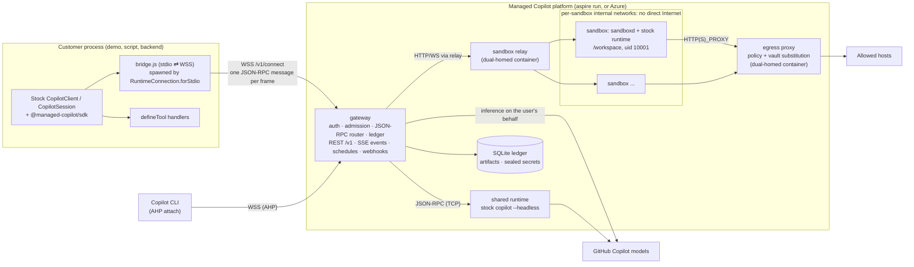
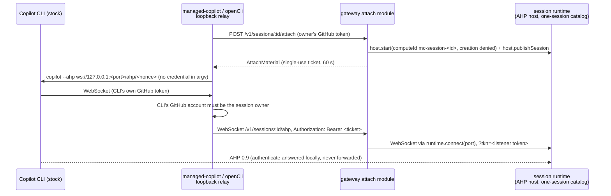

# Architecture and workstreams

This is the as-built design for the [developer experience spec](spec/developer-experience.md). The spec is the
customer contract; this document records how the platform implements it, the protocol facts it relies on, and who
owns what. Update it with the code.

## Topology

## Protocol facts (SDK 1.0.26, runtime 1.0.103)

Verified from the published package sources (`dist/client.js`, `dist/session.js`, `dist/generated/rpc.js`):

- `RuntimeConnection.forStdio({ path, args, env })` spawns `path` (with node when it ends in `.js`) and appends
  `--headless --no-auto-update --stdio` plus optional flags. The bridge ignores those flags and relays JSON-RPC.
- The SDK speaks LSP-framed JSON-RPC (vscode-jsonrpc 8.2.1). The first request is `connect` (handshake).
  `forUri(url, { connectionToken })` is raw TCP; the runtime's `--headless --port` listener needs
  `COPILOT_CONNECTION_TOKEN` or it accepts any client.
- Every session-scoped request (`session.*`, e.g. `session.send`, `session.abort`, `session.tools.handlePendingToolCall`)
  carries `params.sessionId`, so the gateway routes per session. Connection-level calls include `connect`, `ping`,
  `status.get`, `auth.getStatus`, `models.list`, `session.create`, `session.resume`, `session.list`,
  `session.delete`, `session.getMetadata`, `session.getLastId`, `session.getForeground`/`setForeground`,
  `sessionFs.setProvider`, `llmInference.setProvider`, `plugins.builtin.set`.
- Runtime → client notifications: `session.event` and `session.lifecycle`. **Tool calls and permission prompts are
  events**: `external_tool.requested` (answered by `session.tools.handlePendingToolCall`), `permission.requested`
  (answered by `session.permissions.handlePendingPermissionRequest`), `elicitation.requested`.
- Runtime → client requests include `userInput.request`, `exitPlanMode.request`, `autoModeSwitch.request`,
  `systemMessage.transform`, `gitHubToken.getToken`, `providerToken.getToken`, `llmInference.httpRequestStart`/`Chunk`
  (the experimental public request-handler hook), `sessionFs.*`, `workflow.*`, `tasks.cancel`, and `host.*` (AHP).
- AHP: the runtime exposes `host.start`, `host.publishSession`, `host.unpublishSession`, `host.setSessionCreationPolicy`;
  the SDK exposes `AhpHost`. Copilot CLI attaches with `copilot --ahp <url>` (interactive only).

## Components

| Component | Path | Runs as | Responsibility |
| --- | --- | --- | --- |
| Protocol | `packages/protocol` | library | AppHost config schema, REST DTOs, errors, events, bridge constants, network policy math |
| SDK | `packages/sdk` | library | `ManagedCopilot` API; stock `CopilotClient` over the bridge; REST features |
| Aspire integration | `packages/aspire` | library | `addManagedCopilot(builder, name, options)` for TypeScript AppHosts |
| CLI | `packages/cli` | `managed-copilot` bin | `login`, `logout`, `sessions`, `attach`, `promote`, `artifacts`, `schedules` |
| Gateway | `platform/gateway` | Node service | Auth, admission, routing, ledger, REST, events, schedules, webhooks |
| Sandbox | `platform/sandbox` | image + `sandboxd` + relay | Base image with the stock runtime, in-sandbox agent, gateway relay |
| Egress | `platform/egress` | container | Network policy enforcement and vault substitution for sandbox traffic |
| Demos | `demos/*` | apps | Quickstart snippets, AI software factory, long-running assistant |

### Data plane

1. `managed.client(env, options)` constructs a stock `CopilotClient` in the default `copilot-cli` mode with
   `RuntimeConnection.forStdio({ path: <sdk>/dist/bridge.js, env: { MANAGED_COPILOT_BRIDGE: JSON(BridgeConfig) } })`
   and starts it. The bridge opens `WSS /v1/connect` (bearer GitHub token, `BRIDGE_SUBPROTOCOL`), sends one
   `BridgeHello` frame with the environment request, and waits for `BridgeWelcome` before relaying JSON-RPC.
2. The gateway authenticates the GitHub caller, resolves the environment (policy ceilings, caller narrowing), and
   creates a **client connection**. Each client connection can own many sessions.
3. The gateway owns **persistent upstream connections** to runtimes: one to the shared runtime, one per sandbox.
   Client disconnects never close upstream connections or kill sessions; accepted work continues.
4. `session.create`: admission validates and rewrites the request (tool filters, models, MCP, agents, hooks,
   customizations, working directory, platform tools), places the session (shared runtime or a new sandbox), forwards
   it upstream, and records ownership in the ledger. `session.resume` restores placement first.
5. Session-scoped requests route by `sessionId` after an ownership check. Request IDs are remapped per upstream.
6. `session.event` notifications fan out to every attached client and observer. Execution-bearing events
   (`external_tool.requested`, `permission.requested`, ...) are **claimed before emission**: exactly one responder
   receives the actionable event; others get progress-only views. Unclaimed actions stay durable for webhook or poll
   responders. The contract is `platform/gateway/src/modules/durable/contract.ts`.
7. Server-to-client requests for platform concerns (`gitHubToken.getToken`, `llmInference.*`, `sessionFs.*`) are
   answered by the gateway, never forwarded to customer code.
8. Connection-global RPCs are **virtualized per client connection, deny by default**. The stock `client.stop()` over
   stdio sends detach/shutdown RPCs (including `runtime.shutdown`); these detach only that client connection and are
   never forwarded upstream. `session.list`, `models.list`, `status.get`, `auth.getStatus`, foreground calls, and
   provider registrations (`sessionFs.setProvider`, `llmInference.setProvider`, `plugins.builtin.set`) are answered or
   rejected by the gateway, scoped to the caller.

### Client mode and safe defaults

The stock `mode: "empty"` validates on the client before transmission (it requires `baseDirectory`/`sessionFs` and an
explicit `availableTools` on every `createSession`, and it sends a post-create `session.options.update`), so the
spec's short snippets cannot run in that mode. Managed clients therefore use the default `copilot-cli` mode, and the
**gateway** enforces the safe configuration: it rewrites upstream `session.create`, `session.resume`, and
`session.options.update` (tool ceilings, discovery off, deployed customizations on, no caller working directory), and
denies configuration RPCs it does not understand.

### Identity

- Gateway callers are one of: a GitHub **user principal**, an internal **platform service** (platform key), or a
  scoped **action capability** (webhook workers). Capabilities authorize only their exact session/action operations
  and are rejected on general user routes.
- `managed.client(env, { gitHubToken })` creates sessions owned by that account. SDK helpers (`files`, `artifacts`,
  `sessions`, actions) must use the identity of the client that created or resumed a session, tracked from the stock
  client's session lifecycle events. Owner checks are never weakened to make a helper work.
- The SDK validates the deployment URL before sending a credential: HTTPS for remote deployments, HTTP only for
  verified loopback, no embedded credentials, and a validated discovery record.
- **GitHub verification** (`auth`). Tokens are verified against GitHub `/user` (cached 5 minutes) plus the AppHost
  access rules. Transport errors, timeouts, and 5xx answers are retried with jittered backoff inside a 35 s deadline;
  rate limits are not retried. While GitHub is unreachable, a token's last successful verification stands in for up
  to 15 minutes (re-checked in the background every 30 s); a rejection (401, a non-rate-limit 403, or `forbidden`)
  replaces it, so it never revives a rejected token. Otherwise callers get `upstream_unavailable` (HTTP 503 with
  `Retry-After` and `details.retryAfterSeconds`), never `authentication_required` for an outage. Long-lived
  connections re-verify at most once a minute and are closed only for `authentication_required`/`forbidden`.

### Credentials and inference

- Shared runtime: per-session user credentials supplied by the gateway at create/resume (in memory), never a shared
  service token. Model attribution follows the session owner.
- Sandboxes: the GitHub token never enters the sandbox's environment, disk, or runtime process. Stock runtime 1.0.103
  refuses to send without a credential, and with a session `gitHubToken` (or `gitHubToken.getToken`) it validates the
  account with a direct call to `api.github.com/copilot_internal/user` that does **not** pass through
  `llmInference.*`. The implemented mechanism avoids that call with stock, public RPCs only:
  1. The gateway's upstream connection to the sandbox runtime calls `llmInference.setProvider` after `connect`, so the
     runtime sends every model-layer HTTP request to the gateway as `llmInference.httpRequestStart`/`httpRequestChunk`.
  2. `session.create` / `session.resume` go upstream with no GitHub token fields (`prepareSessionParams` strips them,
     and rejects a BYOK `provider` with `policy_violation`).
  3. After create/resume succeeds, the gateway resolves `copilot_internal/user` itself with the owner's token and calls
     `session.gitHubAuth.setCredentials({ credentials: { type: "token", host: "https://github.com", token: "mcrt_…",
     copilotUser } })`. The runtime trusts a supplied `copilotUser` verbatim (`copilotUserResolved: true`) and does
     not re-fetch it. `mcrt_…` is an opaque per-session placeholder with no value outside the gateway.
  4. The gateway answers each `llmInference` request only for the sandbox's own session and only for allowlisted
     Copilot API hosts (the identity's `endpoints.api` plus `api[.individual|.business|.enterprise].githubcopilot.com`):
     it swaps the placeholder for the owner's current token (`resolveToken`) and streams the response back with
     `llmInference.httpResponseStart`/`httpResponseChunk`. Anything else is refused.

  Evidence (2026-10-23, Windows ARM64, both the SDK's `copilot-runtime` and the `@github/copilot` CLI binary, 1.0.103,
  with all direct network egress blocked): session creation without a token succeeded, `GET <endpoints.api>/models` and
  every `POST /v1/messages` arrived through `llmInference.*` carrying only the placeholder, and real model replies came
  back. Afterwards neither the placeholder nor the token appeared anywhere under `COPILOT_HOME` or in runtime output.
  Limits: runtime features that call GitHub services directly rather than through `llmInference` (the built-in GitHub
  MCP server, telemetry) only ever see the placeholder and fail or are blocked by egress policy; the identity and quota
  snapshot is taken at create/resume time; BYOK providers are not available in sandboxes; when the owner has no usable
  credential, inference fails with `authentication_required` and never falls back to another account.
- Runtime binary: the stock SDK spawns the dedicated headless runtime shipped in `@github/copilot-sdk-<platform>`;
  `@github/copilot` is the larger interactive CLI. The sandbox image installs `@github/copilot-sdk@1.0.26` and runs its
  headless `copilot-runtime` (1.0.103); the shared runtime should use the same binary, resolved through public package
  metadata.

### Isolated placement

As built (`platform/gateway/src/modules/sandbox`, `platform/sandbox`; contracts in
`platform/gateway/src/modules/sandbox/contract.ts`, `.../sandbox/providers/types.ts`, and
`packages/protocol/src/sandbox.ts`):

- **Backends.** The service owns policy and lifecycle (setup, egress registration, the runtime, idle stop,
  reconciliation, artifacts); a `SandboxProvider` (`providers/types.ts`) owns compute, persistent storage,
  networking, images, and reachability of each sandbox's sandboxd: `ready`/`prepare`, `ensureImage`/`hasImage`,
  `create`/`start` (with cancellation and progress), `stop`/`remove`/`isRunning`, `address` (egress pinning, when
  `capabilities.addressPinning`), `endpoint` (http or https base URL plus headers, also used for WebSocket upgrades),
  optional `egressProxy` (passed to `policy.registerSandbox`), `reportUnreachable`/`reattach`, and `inventory`.
  `MANAGED_COPILOT_SANDBOX_PROVIDER` selects `docker` (local, `providers/docker/`, described below) or `azure`
  (`providers/azure/`, owned by the azure workstream). Providers must keep: sandboxd as root with only CHOWN, KILL,
  SETGID, and SETUID; the workload as uid 10001; persistent `/workspace`, `/home/agent`, `/var/lib/managed-copilot`; no
  route between sandboxes and no Internet except through the egress proxy; sandboxd reachable only through `endpoint`.
- **One sandbox per session.** `sandboxes.create` allocates a container `<instance>-sbx-<id>` from the environment's
  pinned image, with per-session volumes for `/workspace`, `/home/agent` (HOME, the Python venv `~/.venv`, and the npm
  prefix `~/.npm-global`), and `/var/lib/managed-copilot` (runtime `COPILOT_HOME` plus root-only sandboxd state). It
  resolves only when setup and the runtime are ready; a failing setup step rejects with `setup_failed` (step, exit code,
  redacted output, and the last output lines in the message) and the session is never reported usable; a failed create
  releases its container, volumes, and subnet. Sizes map to CPU and memory limits; containers drop all capabilities
  except what sandboxd needs to switch identity and signal (CHOWN, KILL, SETGID, SETUID) and run with
  `no-new-privileges`.
- **Networks.** Every sandbox gets its **own internal Docker network** on an explicit /28 from `10.213.0.0/16`
  (probing on overlap), so sandboxes can never reach each other's ports and Docker's default pools are not
  exhausted. The relay and the egress proxy (`<instance>-egress`, alias `mc-egress`) are connected to each sandbox
  network by the gateway on create and resume; nothing else is. The end-to-end test verifies a peer sandbox's IP is
  unreachable and that `network: false` sandboxes have no Internet route.
- **sandboxd** (`platform/sandbox/src/sandboxd`) runs as root, never as uid 10001. It serves, behind a per-sandbox
  bearer key: health/status, `POST /v1/start` (NDJSON progress: egress CA trust, one-time setup, runtime start),
  `/v1/runtime` (WebSocket ⇄ the runtime's loopback TCP port 7790), `/v1/tunnel?port=` (loopback TCP for CLI
  attach), streamed workspace list/read/write, and output manifests. It starts the SDK's stock headless
  `copilot-runtime` as uid 10001 with cwd `/workspace`, `COPILOT_CONNECTION_TOKEN`, its own `COPILOT_HOME`, the egress
  env, and the customer `env` (reserved identity, proxy, trust, and runtime names are rejected), and restarts it after
  unexpected exits. Every workload process (the runtime, setup commands, file workers) starts through `setpriv`:
  uid/gid 10001, cleared groups, `no_new_privs`, and empty inheritable, ambient, and bounding capability sets, so the
  invariant holds on backends that cannot drop container capabilities; the image has no setuid/setgid files. Every
  workspace operation (list, read, write, mkdir, and the outputs manifest) runs in a short-lived worker as uid 10001
  that walks the path one segment at a time with `chdir`, refuses symbolic links, verifies the real directory after
  every step, and opens the final component with `O_NOFOLLOW`; sandboxd's root never touches workspace paths, and
  children enter `/workspace` only after dropping privileges.
- **Custom agents.** The stock runtime resolves a named `agent` from `agentDirectories` only when it holds a GitHub
  credential at construction (verified on 1.0.103: without one, `session.create` fails with "Custom agent … not
  found"). A sandbox runtime gets its brokered credential after construction, so the sandbox module removes `agent`
  from create/resume parameters and calls `session.agent.select` right after installing credentials, before core
  replies; an unknown agent still fails the create with `invalid_request`.
- **Setup** (spec section 5) runs once, in order: pip packages into the persisted venv, npm packages into the
  persisted prefix, setup files (≤64, ≤1 MiB each, ≤8 MiB total), then `setupCommands` (`bash -c` as uid 10001).
  Progress, resolved versions, and file digests are recorded in the gateway ledger (authoritative) and in root-only
  sandboxd state. Installs obey the session's network policy; an offline failure says so. Resume never replays
  setup: an interrupted or failed setup makes the sandbox `state_restore_failed`. System packages are built into a
  derived image layer at environment preparation, never installed per session.
- **Images.** The gateway builds the base image from `platform/sandbox/image/Dockerfile` (content-hash tag
  `managed-copilot-sandbox:<hash>`, also tagged `ghcr.io/patniko/managed-copilot-sandbox:0.1.0` for customer `FROM`
  lines) with the operator's npm registry and pip index baked in as session defaults. Environment images are built
  FROM it, must carry the base label, and are pinned by image ID per sandbox, so a resume never changes the toolchain.
  `warm > 0` fails gateway start: this backend cannot keep warm sandboxes safely.
- **Lifecycle.** Idle stop (environment `idleTimeoutSeconds`, default 900 s) happens only when no turn is running, no
  tool/permission/elicitation action is pending (including open durable actions, which survive gateway restarts), and
  no file transfer or publication is in flight; it closes runtime streams so core resumes on next use. A sandbox found
  running at gateway start stays up while the ledger's last turn is still `running` (up to two hours, or until its
  events flow again), and idle sweeps begin only after that reconciliation. `ensureRunning` restarts (or recreates
  from the pinned image and existing volumes) and re-registers egress. Stops close runtime streams, stop the
  container, then unregister egress and detach the relay and proxy from the sandbox network. `delete` marks
  `deleting`, removes container, volumes, network, and artifacts, and reconciliation finishes after a crash; resources
  labelled with the instance that no current record owns are swept on start.
- **Promotion import.** `sandboxes.importRuntimeState(sessionId, { sessionStateDir, activeTurnId? })` copies the
  regular files of a gateway-host `session-state/<sessionId>` export (no `*.lock` files; links and special files are
  refused; ≤10,000 files, ≤1 GiB) into the running sandbox runtime's COPILOT_HOME as uid 10001. Files are staged under
  `COPILOT_HOME/.mc-import/<random>` and swapped in for `session-state/<sessionId>` with two renames, so a retried
  import replaces rather than merges. `activeTurnId` tracks a turn that started in shared placement so its root
  `session.idle` in the sandbox publishes outputs and idle stop waits for it.
- **The sandbox relay** (`<instance>-relay`, same image, uid 65534, read-only rootfs) is on `<instance>-edge`
  (published on 127.0.0.1) and every sandbox network; it forwards `/relay/<sandboxId>/...` HTTP and upgrades to
  `sbx-<id>:7781` after checking the platform key.
- The **egress proxy** container is connected to each sandbox network and to a bridge network with Internet access;
  sandboxes reach the Internet only through it. It applies each sandbox's effective network policy (pushed by the
  gateway), blocks platform internals, loopback/link-local, private, and metadata addresses after DNS resolution, and
  substitutes vault placeholders in permitted HTTPS headers (see "Network policy, egress, and vaults"). Per start the gateway calls
  `policy.registerSandbox`, pins the credential with `policy.updateSandbox(id, { address })` as soon as the container
  has its address (before setup, so setup installs already pass the proxy), then passes the env and CA to sandboxd; on
  stop and delete, `policy.unregisterSandbox`. Without a policy service, only `network: false` sandboxes without vaults
  start.
- **Artifacts** (spec section 6). A turn starts at a root `user.message` (turn ID = its `messageId`) and completes at
  the next root `session.idle`. Completed turns publish: sandboxd hashes the bounded regular files under
  `/workspace/outputs` (symlinks, special files, changing files, and anything over 256 files / 100 MiB each / 512 MiB
  total are rejected with reasons), the gateway downloads and re-verifies each changed file into content-addressed
  storage under `<dataDir>/artifacts/<sessionId>/`, and records versions, digests, and a per-turn manifest. Rejections,
  cancelled turns, and turns that ended in errors are recorded as `failed` publications, never empty successes.
  Publications run one at a time per session. If a later root turn started before a turn's outputs manifest was
  captured, that publication fails ("cannot be attributed to this turn") rather than label the later turn's bytes;
  the current outputs publish when the later turn completes. Publications still pending at gateway start are failed
  with an explicit reason. `artifact.published` (through core's events) lists only new versions; a turn that changed
  nothing under `outputs/` emits no event.
- **Known limits (local backend).** No per-volume disk quota; model ceilings are enforced by core's admission, not
  re-checked per brokered request; the built-in GitHub MCP server is unavailable in sandboxes (it only sees the
  placeholder); turn attribution relies on the runtime's `user.message` reaching the gateway before the next turn's
  tools change `outputs/`.
- **REST** (owner-scoped, shared sessions answer `invalid_request`): `GET /v1/sessions/:id/files?path=&recursive=`,
  `GET|PUT /v1/sessions/:id/files/content?path=&overwrite=` (streamed, 512 MiB limit, atomic replace by default),
  `GET /v1/sessions/:id/artifacts?versions=latest|all`, `GET .../artifacts/publication?turnId=&timeoutMs=` (≤120 s per
  request; the SDK keeps waiting), and `GET .../artifacts/:artifactId/content`.

### Shared placement egress

One shared runtime process cannot carry per-session egress identity through a proxy. Shared sessions therefore get
no direct workload egress: built-in web tools are disabled by admission, web access is the gateway-executed
`web_fetch` platform tool (per-session policy), and remote MCP servers are reached through a gateway MCP adapter that
applies the session's policy and attaches vault credentials. Anything else is refused with `capability_unavailable`.

### Network policy, egress, and vaults (as built)

- **Effective policy.** `policy.bindSession` computes `narrowNetwork(ceiling, caller request)` where the ceiling is the
  environment's `network` over the deployment default (`inline-*` environments use the default), persists it in
  `network_sessions`, and returns it. Every later read re-narrows the stored policy by the environment's *current*
  ceiling (an operator can narrow, never broaden a session; a removed environment means no egress).
  `promoteSession(id, target)` narrows by the isolated target's ceiling, so `network: false` survives promotion.
- **Shared decision logic.** `evaluateDestination` in `packages/protocol/src/network.ts` is the single rule set for the
  proxy, `web_fetch`, and the MCP adapter: host patterns (`*.x` matches subdomains, not the apex), ports (default
  80/443), canonical hosts (numeric forms such as `2130706433` or `0x7f.1` are rejected before DNS), IP literals
  (refused under host lists), and the address classes allowed after DNS (public only; operator-named private hosts may
  reach RFC 1918/ULA/CGNAT space outside protected ranges; loopback, link-local, metadata including Azure
  `168.63.129.16`, IPv6 transition forms, multicast, and reserved space never). Callers connect only to the returned
  addresses, so rebinding cannot redirect them. `.invalid`, `.local`, and `.onion` fail without a lookup.
- **Egress proxy** (`platform/egress`, one bundled file, image `managed-copilot-egress:<content hash>`). The gateway's
  supervisor runs it as `${MANAGED_COPILOT_INSTANCE:-mc}-egress` (read-only root, no capabilities, CA volume
  `${instance}-egress-data`) on `${instance}-egress-wan` (its default route) and `${instance}-sandboxes`; the sandbox
  provider connects it to each per-sandbox network with alias `mc-egress`. It listens on `0.0.0.0:3128` and calls the
  gateway at `http://host.docker.internal:<port>` with an egress-scoped key (never the platform key). Every connection
  needs the sandbox's proxy credential (Basic, `sandboxId:secret`; the proxy only holds its SHA-256), optionally
  pinned to the sandbox's address; until the first registration snapshot, or 30 s after the gateway stream drops, it
  fails closed with 503. CONNECT tunnels must start with a TLS ClientHello whose SNI equals the authorized host.
  Blocks answer 403 with the reason in the status line and body and are reported to the gateway (no credentials, no
  query strings). The subnets of its non-default interfaces and `10.213.0.0/16` are always protected.
- **Internal API** (`EGRESS_ROUTES`): `hello` (instance and CA certificate), `stream` (SSE `snapshot`/`upsert`/`remove`/
  `ping`), `secrets/resolve` (authorizes one vault use), `reports`. Registrations carry the policy, credential hash,
  pinned address, and vault bindings (placeholder, exact destinations, header names), never values.
- **Sandbox registration.** `await policy.registerSandbox({ sandboxId, sessionId })` rotates the proxy credential and
  returns `{ proxyUrl, env, caCertificate, policy }`. `env` holds `HTTP(S)_PROXY`/`http(s)_proxy` (both cases),
  `NO_PROXY=localhost,127.0.0.1,::1`, `NODE_USE_ENV_PROXY=1`, and one placeholder per vault environment variable.
  The sandbox installs `caCertificate` into the system store (`update-ca-certificates`) and sets `NODE_EXTRA_CA_CERTS`,
  `REQUESTS_CA_BUNDLE`, `SSL_CERT_FILE`, and `PIP_CERT`. With the platform-managed proxy every registration waits for
  it (it exists before network attachment); otherwise only sessions with network access or vault credentials do.
  Call `updateSandbox(id, { address })` after start and `unregisterSandbox(id)` on stop or delete (open connections
  close immediately).
- **Vaults.** AppHost vaults resolve `{ secretEnv }` from the gateway's environment at use time. Vaults created in code
  (`POST/GET/DELETE /v1/vaults`, `managed.vaults`) belong to the creating account, are sealed with AES-256-GCM
  (`MANAGED_COPILOT_VAULT_KEY`, else `<data>/network/vault.key`) with the row bound as AAD, and are never returned.
  Binding validates ownership (others' vaults are `not_found`), environment membership for AppHost vaults, and kind
  (sandbox `env` credentials are refused in shared environments). Placeholders (`mcv_placeholder_` + 40 hex) are
  stable per session and credential; deleting a vault revokes it from running sandboxes at once.
- **Substitution.** The proxy terminates TLS (ECDSA P-256 platform CA, key kept in the proxy's volume) only for a
  session's vault hosts on port 443. Per request it re-checks the registration, policy, and `Host`; substitutes a
  placeholder only as literal text in that credential's named headers (default `authorization`); rejects
  placeholders in URLs, Basic credentials, other headers, other sessions, other hosts, plain HTTP, and WebSocket
  upgrades; asks the gateway to authorize each use; writes nothing upstream until the destination's certificate
  verifies; forces `Accept-Encoding: identity` and redacts reflected values (defense in depth only). Clients that
  reject the platform CA or pin certificates are reported as `tls_client_untrusted`.
- **Shared placement.** `web_fetch` (`overridesBuiltInTool`) follows redirects itself, re-evaluating each hop, with
  size/time limits and HTML-to-text. `adaptMcpServer` rewrites a server to `http://127.0.0.1:<port>/internal/mcp/<route>`
  plus an HMAC capability header; the adapter re-checks policy per request, does not follow redirects, rewrites legacy
  SSE `endpoint` events, and attaches the vault MCP credential (`Bearer` unless the vault names a header) at request
  time. For sandbox placement, `vaults.mcpHeaders(id, url, "sandbox")` returns placeholder headers the proxy fills.
- **Visibility.** Blocks are stored per session (`GET /v1/sessions/:id/network`: policy, vaults, newest blocks) and
  published as `network.blocked` platform events (rate-limited).
- **Limits.** Vault destinations are exact host names on port 443; request bodies, query strings, Basic encodings,
  non-HTTP protocols, HTTP/2 to the proxy, and pinned clients are unsupported for substitution. Shared-placement MCP
  OAuth flows are not proxied. Domain fronting inside an allowed TLS tunnel cannot be seen without interception.
- **Tests.** `pnpm --filter @managed-copilot/egress test` (unit and in-process proxy tests) and
  `pnpm --filter @managed-copilot/egress test:docker` (real gateway module, egress container, echo services, and
  sandbox-like clients; set `MC_E2E_CURL_IMAGE`/`MC_E2E_TOOLS_IMAGE` to prebuilt images on slow networks).

### Durable actions and schedules

As built in `platform/gateway/src/modules/durable` (contract: `contract.ts`; live acceptance:
`npx tsx packages/sdk/test/acceptance/durable.live.ts` after `pnpm build`).

- **One ledger for every responder.** Execution-bearing events are recorded in `durable_actions` (keyed by session,
  kind, runtime `requestId`; carrying tool call, provider, placement generation, deadline) and claimed before
  emission: core's router asks `actions.onSessionEvent` who may receive the event. Live SDK clients are claimed at
  emission or on resume replay (`onAttached`); webhook workers (`mcc_` capability) and owners (polling) claim over
  REST; gateway platform tools (`schedule_task`, ...) are claimed and executed by the ledger itself. Every claim is a
  compare-and-set on `(claim_seq, state)`, so exactly one responder wins and older claim tokens can never commit.
- `PendingAction.requestId` is the runtime request ID the answer RPC is keyed on; `payload` carries the stock
  `PermissionRequest` or the elicitation's message and schema. `idempotencyKey` is `${sessionId}:${toolCallId}` for
  tools, the same identity a live handler sees in its `ToolInvocation`, across webhooks, polling, resume, restarts,
  and placement changes.
- **Results before acknowledgment.** Answers (live, REST, platform) are persisted, then delivered to the runtime by
  the ledger through `sessions.request`, retried with backoff if the runtime is unavailable. Duplicates (same claim,
  same canonical result) return the recorded state; different results are `conflict`.
- **Uncertainty is explicit.** A tool whose live client disconnects, whose REST lease expires, or that was in flight
  across a gateway restart becomes `needs_reconciliation` and is never re-offered; the original claimant's late result
  is still accepted, anyone else must claim with `reconcile: true`. Prompts have no external effect and return to
  `pending`. At the 24-hour answer deadline actions `expire`: the runtime receives an error (tool),
  `user-not-available` (permission), or `cancel` (elicitation), never an approval. Completion events and the runtime's
  pending lists (`session.tools.listPendingRequests`, `session.permissions.pendingRequests`) reconcile the ledger.
- **Webhooks.** AppHost subscriptions (environment + event types, operator-authorized for every owner in those
  environments) get signed at-least-once deliveries from an outbox: `x-managed-copilot-signature: t=<s>,v1=<hex
  HMAC-SHA256("<t>.<raw body>")>`, a stable `x-managed-copilot-event-id`, bounded jittered backoff (10 attempts, up to
  5 min apart), no redirects, and a visible `failed` state (`GET /v1/webhooks/deliveries` for the owner,
  `/v1/webhooks/deliveries/all` with the platform key). `session.action_required` deliveries carry a capability minted
  per attempt for the session's actions that are still pending (15 min, audience = this deployment's public URL).
- **Schedules.** Cron (IANA zones; nonexistent DST slots skipped, repeated slots run once at the earliest instant)
  and one-shot `runAt`. Each occurrence is persisted with a stable occurrence ID before anything happens upstream; a
  new-session run uses a session ID derived from the occurrence (so a retried create finds the same session), and the
  prompt is sent with `source: "system"` only after `input_state = submitting` is persisted. After a crash the
  session's history (`session.getMessages`) decides whether the prompt was accepted; if it cannot be read after
  bounded retries the run ends `needs_reconciliation` and is never resent. Runs of one schedule never overlap (one
  occurrence may wait; more are skipped), owners have a concurrency cap, occurrences later than the grace window (5 min
  cron, 60 min one-shot) are `skipped` with a recorded reason, and delegation, environment policy, webhook routes, and
  the owner's background credential are rechecked at run time (failures pause the schedule with `pausedReason`).
  `schedule.run_started` / `schedule.run_completed` carry `{ scheduleId, scheduleName, runId, occurrenceId, status,
  sessionId, scheduledFor, messageId?, reason? }`.
- **Agent scheduling.** With operator-approved `scheduling: true`, sessions get `schedule_task` (`prompt` plus exactly
  one of `delaySeconds`, `runAt` with offset, or `cron` + `timeZone`), `list_schedules`, and `cancel_schedule`. They
  act only on schedules that target the calling session, as its owner, with at most 10 active per session and cron at
  most every 5 minutes; retries are idempotent by the tool call's key.
- **Background sign-in.** `POST /v1/credentials/background` seals the caller's own GitHub token (AES-256-GCM, AAD
  bound to the account) under `MANAGED_COPILOT_DURABLE_KEY` or `<dataDir>/durable.key`. `principalFor` re-verifies it
  with GitHub (cached 2 minutes); a rejected token or a different account invalidates it and pauses the owner's
  schedules with a visible reason. No refresh: a revoked or expired token requires `managed-copilot login` again.
- **Session lifecycle.** Deleting a session cancels its open actions (claims and late results are refused), stops
  undeliverable answers, fails its pending `session.action_required` deliveries, and pauses schedules that continue
  it. On `session.promoted` (or `actions.onGenerationChanged`), waiting actions move to the new placement generation;
  actions owned under the old generation are fenced (their claims are void, tools in flight become
  `needs_reconciliation`, prompts are offered again). `onDetached(connectionId, sessionId?)` releases only that
  session's live claims when `sessionId` is given.
- Durable REST: `GET /v1/sessions/:id/actions[?state=]`, `POST .../actions/:actionId/claim` (`{ claimToken? }` renews,
  `{ reconcile: true }` takes over uncertain actions), `POST .../actions/:actionId/result` (`{ claimToken, result |
  error | release }`), `/v1/schedules` CRUD with runs, pause, resume, and `run` (`{ invocationId }`), and
  `/v1/credentials/background` (`POST`/`GET`/`DELETE`).
- **AppHost schedules.** A declaration with `runAs` materializes for that account (when it signs in for background
  work or lists its schedules) as **paused, awaiting approval**: naming an account is not a grant. That account
  resuming it is the explicit grant for this deployment, environment, and schedule; a changed declaration pauses it
  again for re-approval, and a removed one is deleted. Declarations without `runAs` are logged as unrunnable.
- Not covered yet: durable answers for `userInput.request`/hooks (they require a live client; unattended hooks fail
  closed), and credential refresh.

## Gateway extension points

Modules register in `platform/gateway/src/modules/index.ts` and share capabilities through `app.provide(key, value)`
and `app.service(key)`. Core's consumer contracts live in `platform/gateway/src/modules/core/contracts.ts`; durable's
in `modules/durable/contract.ts`; sandbox's in `modules/sandbox/contract.ts`. Providers implement the shapes below
structurally (they may add members).

| Service key | Provided by | Shape core provides or consumes |
| --- | --- | --- |
| `auth` | core | `authenticate(token) → Principal` (GitHub `/user`, cached; AppHost access rules; `mcc_…` capability tokens rejected; GitHub outages → `upstream_unavailable`, see Identity); `liveCredential(accountId)` |
| `sessions` | core | `get(id)` (`{ id, ownerId, environment, state, generation, lastTurn, … }`), `getOwned`, `info(accountId, id) → SessionInfo`, `list`, `create(principal, { sessionId?, environment, model?, agent?, tools?, webhook?, scheduleId? }) → { sessionId, created }`, `send(principal, id, { prompt, source?, mode? = "enqueue" })`, `request(id, method, params)`, `abort`, `delete(accountId, id)`, `subscribe(listener)` (synchronous, in order, before fan-out), `subscribeSession`, `attached(id)`, `runtime(id) → { connectionId, request, connect(port), closed }`, `onLifecycle` |
| `events` | core | `publish(event, { ownerId })`, `emit(type, { ownerId, sessionId?, environment?, data? })`, `subscribe((event, { ownerId }) => …)`; feeds SSE `/v1/events` with `Last-Event-ID` replay |
| `platformTools` | core | `register({ name, description, parameters?, overridesBuiltInTool?, skipPermission? = true, enabledFor?(env), appliesTo?({ environment, type, placement }), handler(args, { sessionId, ownerId, environment, toolCallId, idempotencyKey, … }) })`, `get(name)`, `forSession(…)` |
| `runtimeRequests` | core | `register(method \| "ns.*", handler, { upstream: "shared" \| "sandbox" \| "*" })` for runtime → client requests the gateway answers itself (core registers `gitHubToken.getToken` for shared) |
| `environments` | core | `resolve(selector) → ResolvedEnvironment` (ceilings, caller narrowing, pinned customizations), `forSession(record)` |
| `sandboxes` | sandbox | Core calls `create({ sessionId, ownerId, environment, size, network, vaults, additions, resolved })` (resolves only when setup and the runtime are ready), `openRuntime(sessionId, { resolveToken }) → { stream, connectionToken, handlers, initialize, prepareSessionParams, sessionOpened, close }` (gateway-answered `llmInference.*`), `ensureRunning`, `delete`, `get`, `connect(sessionId, port)` (loopback tunnels for CLI attach); also `stop`, `importRuntimeState(sessionId, { sessionStateDir, activeTurnId })` (promotion), and workspace `listFiles`/`readFile`/`writeFile` |
| `artifacts` | sandbox | Turn-scoped publication from `/workspace/outputs` into immutable, versioned storage: `list(sessionId, { versions })`, `waitForPublication(sessionId, { turnId, timeoutMs })`, `open(sessionId, artifactId)` |
| `policy` | network | Core calls `bindSession({ sessionId, owner, environment, type, requested, vaults }) → NetworkPolicy` on create, `session(id) → { policy, ownerId, environment, type, vaults }` on resume, `releaseSession(id)` on delete, and `adaptMcpServer(sessionId, name, server)` for every shared remote MCP server. Sandbox calls `registerSandbox({ sandboxId, sessionId }) → { proxyUrl, env, caCertificate, policy }`, `updateSandbox(id, { address })`, `unregisterSandbox(id)`. Promotion calls `promoteSession(id, target) → NetworkPolicy`. Also `ceiling(env)`, `effective(env, requested)`, `blocked(id)`, `caCertificate()`, `egressStatus()` |
| `vaults` | network | `list(ownerId)`, `get(ownerId, id)`, `create(ownerId, request)`, `delete(ownerId, id)` (values sealed, never returned), `mcpHeaders(sessionId, url, placement)` (placeholder headers for sandbox MCP servers; shared placement uses the adapter) |
| `actions` | durable | Router hooks (`onSessionEvent`, `onClientAnswer`, `onAttached`, `onDetached`, `releaseLiveClaim`), `list(sessionId, { open })` for `SessionInfo.pendingActions`, REST claim/result, capabilities, reconciliation |
| `webhooks` | durable | `enqueue(event, { ownerId })` for AppHost subscriptions (subscribed to `events`), `subscribers`, `deliveries` |
| `schedules` | durable | Cron/one-shot schedules, occurrences, runs, `pauseAllForOwner`; registers the agent scheduling platform tools |
| `credentials` | durable | `store`/`status`/`revoke`/`has`, and `principalFor(accountId)` (re-verified, never another account) |

`/v1/info` advertises `capabilities`: `shared` and `events` from core, plus `isolated`/`files` (`sandboxes`),
`artifacts`, `vaults`, `actions`, `webhooks`, `schedules`, `background` (`credentials`) when those services are
registered, and anything a module adds to `app.capabilities` (for example `promotion`, `attach.cli`).

## Core: shared runtime and router

- **Shared runtime.** The gateway spawns the SDK's stock headless runtime
  (`@github/copilot-sdk-<platform>/prebuilds/<platform>/copilot-runtime`, the binary `CopilotClient` itself uses;
  falls back to the `@github/copilot` CLI binary of the same version) with the SDK's TCP flags plus
  `--no-auto-login`, a random `COPILOT_CONNECTION_TOKEN`, a platform-owned `COPILOT_HOME`/`HOME` under
  `<data>/runtime/shared`, and an allowlisted environment (no `GH_TOKEN`, BYOK provider, or allow-all variables). Its
  cwd contains every shared session's working directory (`<data>/runtime/shared/workspaces/<id>`), which AHP
  publication requires. It is supervised and restarted with backoff; sessions are re-resumed upstream lazily with
  their stored admitted configuration. `MANAGED_COPILOT_RUNTIME_URL`/`_TOKEN` connect to an external runtime instead.
- **Per-session credentials.** Shared sessions get a gateway-owned `gitHubTokenProviderRegistrationId`; the runtime's
  `gitHubToken.getToken` is answered with the owner's freshest verified token (else `credentials.principalFor`),
  scoped to that session's registration, or `cancelled` (fail closed).
- **Supported operations** (deny by default). Connection-level: `connect`, `ping`, `status.get`, `auth.getStatus`
  (caller), `models.list` (caller's entitlement via the shared runtime, filtered by the environment's `models`),
  `session.create`/`resume` (admission + placement), `session.list`/`getMetadata`/`getLastId` (ledger, owner-scoped),
  `session.delete`, `session.detach` and `runtime.shutdown` (answered locally, never forwarded). Session-scoped methods
  are forwarded after an ownership and attachment check from an allowlist (`send`, `sendAndWait`, `abort`,
  `getMessages`, `log`, pending-answer RPCs, model/mode/name/agent/skills/usage/quota/plan/canvas reads and
  selections, `options.update` and `tools.set` through admission). Everything else, including `host.*`,
  `sessionFs.setProvider`, `llmInference.setProvider`, shell, workspace, plugin, auth, and permission-mode RPCs, fails
  with JSON-RPC MethodNotFound carrying `capability_unavailable`.
- **Fan-out.** Runtime events are processed in order per session: ledger tracking, `sessions.subscribe` observers, then
  delivery. Execution-bearing events go through `actions.onSessionEvent` when present; otherwise the first attached
  client able to answer, in durable's preference order (the creating connection, then by attach time), gets them and
  other eligible clients are withheld. Replayed actions (`onAttached`) take the same sanitizing path. `session.detach`,
  deletion, and failed creates call `onDetached(connectionId, sessionId)`; only a closed connection calls
  `onDetached(connectionId)`. `session.lifecycle` goes only to
  the session's attachments; runtime-wide notifications (`host.event`) are never relayed. Everything a shared session
  sends to clients (events, responses, lifecycle, runtime requests such as `hooks.invoke`) has platform host paths
  rewritten: the session directory becomes `/workspace`, a pinned customizations bundle the sandbox mount path
  (`/opt/managed-copilot/customizations/...`, so agent and skill paths read the same in both placements), and anything
  else under the data directory (including its resolved form) `/platform`.
- **Agents.** `session.agent.select`/`deselect` are persisted with the session's admitted configuration, so a restore
  (shared runtime restart, sandbox idle stop) passes the session's current agent; a resume without `agent` keeps it.
  Sandboxes resolve agents only after their credential is installed, so the sandbox module defers `agent` out of
  create/resume params and selects it in `sessionOpened`.
- **Registrations.** The runtime scopes tool and handler registrations to a connection, and all clients share the
  gateway's upstream connection, so the gateway sends the union of attached clients' tools and handler flags (plus
  stored server-side declarations) on create, resume, and `tools.set`. Transform, canvas, hook, and user-input
  requests go to a client that registered that handler.
- **Sends.** Shared sessions accept only inline (`blob`) attachments; file, directory, and selection attachments
  name paths the runtime would read on the platform host. Sandbox attachment paths must stay in `/workspace`.
  Credential and routing model headers and shell agent mode are rejected.
- **Known gaps** (stock behavior, reported rather than patched): the stock runtime does not re-emit pending tool or
  permission requests on resume (durable's `onAttached` replay covers it); registrations of a client that detached
  stay registered upstream until the next resume or `tools.set` (calls to them wait for a responder);
  `models.list` requires the shared runtime even for isolated environments. Verified on runtime 1.0.103: custom
  agents' and `task` subagents' tool lists cannot escape the session's `availableTools` ceiling.

## Devloop: AppHost, CLI, and Copilot CLI attach

### AppHost (`@managed-copilot/aspire`, root `apphost.mts`)

- `addManagedCopilot(builder, name, options)` validates the declaration with `ManagedCopilotConfigSchema` (all
  problems reported at once, before anything starts) and runs the gateway as an Aspire Node app on a **fixed,
  unproxied** port (default 7400) with `/healthz`. Relative `image` and `customizations` paths resolve against the
  AppHost directory. It refuses publish mode (`aspire deploy`) until gate G3.
- Secrets must be Aspire secret parameters. Each becomes a `{ secretEnv }` reference in `MANAGED_COPILOT_CONFIG` and
  an environment variable on the gateway: `MANAGED_COPILOT_SECRET_VAULT_<VAULT>_<HASH>_<INDEX>` and
  `MANAGED_COPILOT_SECRET_WEBHOOK_<NAME>_<HASH>`, where `<HASH>` is the first 8 hex digits of the SHA-256 of the exact
  vault or webhook name, so distinct names never share a variable. Literal strings are rejected. Schedule `session.tools` accept stock
  `defineTool` objects; only the declaration (zod schemas via the same `toJSONSchema()` the SDK sends, flags, and a
  stable `sha256:` revision) is stored.
- The gateway gets a generated persistent `<name>-platform-key`, `MANAGED_COPILOT_DATA_DIR`
  (`<apphost>/.managed-copilot/data`), `MANAGED_COPILOT_APPHOST_DIR`, `MANAGED_COPILOT_NPM_REGISTRY` (from
  `npm config get registry`), and `MANAGED_COPILOT_INSTANCE` (`mc-<hash of the AppHost path>`, so checkouts sharing one
  Docker engine never collide). The gateway builds sandbox images and supervises the relay and egress containers
  itself, so the AppHost declares no containers. When an isolated or promotable environment exists, the AppHost also
  sets `MANAGED_COPILOT_SANDBOX_PREPARE=1` (opt out with `prepareSandboxes: false`), so the base image builds while
  the platform starts rather than on the first sandboxed session.
- The returned `{ gateway, url }` wire other resources: `.withEnvironment("MANAGED_COPILOT_URL", copilot.url)` and
  `.waitFor(copilot.gateway)`. Demo folders export plain data descriptors (no Aspire imports); the root AppHost adds
  them as Node apps on fixed ports with `withPnpm({ install: false })` (the workspace is installed once at the root).
- `aspire run` from the repository root starts: the gateway (7400), `software-factory` (7480), `assistant` (7490), and
  `quickstart` (explicit start; runs every spec snippet). The quickstart webhook receives on 7485.

### Copilot CLI attach (spec section 14)

- Verified on Copilot CLI 1.0.92 with runtime 1.0.103 (shared placement): the CLI attaches, shows history, and its
  turns reach the app's own `CopilotSession` events. Re-publishing after host disposal works, so hosts are disposed
  after 5 idle minutes, on `deleted`/`promoted`/`stopped` lifecycle events (close code 4410), and when the runtime
  connection closes. Attachments are capped at 8 hours (4408).
- Tickets are 60-second, single-use, owner- and session-bound, stored as SHA-256 hashes (`attach_tickets`). Upgrades
  re-check ownership and session state. Generic AHP clients may pass the ticket as `?tkn=`.
- The stock CLI sends its GitHub OAuth token as `Authorization` and in an AHP `authenticate` request. The relay and
  the gateway answer credential-bearing AHP methods and actions themselves, and the gateway never forwards client
  headers, so no CLI token reaches a runtime or sandbox.
- Limits: the CLI asks once to trust its working folder (`~/.managed-copilot/attach`, empty); its model picker is
  empty because the host cannot list models without an AHP credential; sandbox sessions need the sandbox module's
  `connect(sessionId, port)`; GitHub Copilot app publication is not implemented (`github.publish`).

### CLI and quickstart

- `npx managed-copilot` (`packages/cli`): `status`, `login`/`logout` (`ROUTES.backgroundCredential`), `sessions`,
  `attach`, `promote`, `artifacts`, `schedules`. It uses the SDK and `@managed-copilot/sdk/internal` (first-party only:
  `HttpClient`, URL/token resolution, `launchAttachedCli`). Tokens never come from argv. Errors print the stable code
  and a hint; usage errors exit 2.
- `demos/quickstart` reports each snippet as pass, fail, **not available yet** (a capability missing from
  `/v1/info`, or `capability_unavailable`), or skipped (a local prerequisite such as background sign-in).

## Azure deployment (`aspire deploy`)

As built (`packages/aspire/src/publish`, `deploy/azure`, gateway `modules/sandbox/providers/azure`); operator guide and
capability matrix in [deployment.md](deployment.md). Not yet qualified on a live deployment.

- **Publish path.** In publish mode `addManagedCopilot` calls `publishManagedCopilot`: a Container Apps environment in
  a new VNet (`platform` and `sandboxes` /23 subnets) with an Azure Files NFS 4.1 share, and the gateway as a
  Dockerfile container (`platform/gateway/Dockerfile`, stage `azure`, plus a generated stage that copies the AppHost's
  customization folders to `/opt/managed-copilot/apphost`) with external HTTPS ingress. Apps that use the platform
  are published with `publishApp` (their own Dockerfile, NFS directory, and IP allowlist). The C# integration in
  `deploy/azure/hosting` adds what the TypeScript AppHost API cannot express (VNet, NFS storage, volumes, probes,
  revision mode, IP rules). Publishing refuses an open gateway: access rules come from the AppHost or from
  `Parameters:<name>-github-users`/`-github-orgs`. Loopback webhooks are rewritten to the published app on that port.
- **Durable state.** The gateway's data directory is `/data` on the NFS share (SQLite needs POSIX locks; SMB failed in
  the earlier Copilot SDK Aspire deployment). One replica, Single revision mode, and a lease supervisor as the
  entrypoint (`deploy/azure/src/lease`): an exclusive SQLite lock on `/data/.lease/gateway.lease` held for the
  process's life, a fencing generation with a 5 s heartbeat (losing it kills the gateway), 503 while waiting, and
  handover to strictly newer deployments (`MANAGED_COPILOT_LEASE_STAMP`). The demo images use the same supervisor.
- **Isolated placement.** Azure Container Apps Sandboxes (`Microsoft.App/sandboxGroups`): one microVM per sandbox,
  three data disks per sandbox that outlive compute (stop deletes the microVM; resume recreates it over the disks),
  sandboxd reached through the sandbox's port URL with its per-sandbox key, and a deny-all platform egress policy.
  `aspire deploy` builds and pushes content-tagged sandbox images (base, environment images, and the
  `deploy/azure/sandbox` layer that runs the entrypoint as root and seeds empty disks) and creates the group, its VNet
  connection, a registry pull identity, and the gateway's identity with only SandboxGroup Data Owner on the group.
  The egress proxy is not deployed to Azure yet, so environments that need network access or vault credentials fail
  with `capability_unavailable` there.

## Ports and environment

| Setting | Default | Notes |
| --- | --- | --- |
| Gateway `PORT` | 7400 | Fixed and unproxied under `aspire run` (`addManagedCopilot`'s `port` option); `0` picks a free port |
| `MANAGED_COPILOT_CONFIG` / `_CONFIG_FILE` | dev defaults | Normalized AppHost JSON (`ManagedCopilotConfig`) |
| `MANAGED_COPILOT_APPHOST_DIR` | config file dir or cwd | Base for relative `customizations` paths |
| `MANAGED_COPILOT_DATA_DIR` | `./.managed-copilot/data` | SQLite ledger, artifacts, runtime homes, pinned customizations |
| `MANAGED_COPILOT_PLATFORM_KEY` | random per run | Internal service credential (relay, egress, sandboxd provisioning) |
| `MANAGED_COPILOT_DURABLE_KEY` | `<dataDir>/durable.key` | Base64 32-byte key sealing background credentials and signing action capabilities |
| `MANAGED_COPILOT_PUBLIC_URL` | the listening address | URL clients use (`app.config.publicUrl` is always the real URL) |
| `MANAGED_COPILOT_GITHUB_API_URL` | `https://api.github.com` | Loopback `http://` allowed for test stubs only |
| `MANAGED_COPILOT_SHARED_RUNTIME` | `1` | `0` disables shared placement (unit tests) |
| `MANAGED_COPILOT_RUNTIME_PATH` / `_URL` / `_TOKEN` / `_LOG_LEVEL` | SDK headless runtime | Override the binary, or attach to an external runtime |
| `MANAGED_COPILOT_ATTACH_TICKET_TTL_MS` / `_IDLE_MS` / `_MAX_LIFETIME_MS` | 60 s / 5 min / 8 h | Attach ticket lifetime, idle AHP host disposal, maximum attachment length |
| Demo ports | 7480, 7490, 7485 | Software factory, assistant (fixed for its Google OAuth redirect), quickstart webhook receiver |
| `MANAGED_COPILOT_INSTANCE` | `mc` | Prefix for Docker resources (`-egress`, `-egress-wan`, `-sandboxes`, `-relay`, `-sbx-*`) |
| `MANAGED_COPILOT_EGRESS` | `auto` | `auto` starts the egress container on first need, `docker` at gateway start, `external` expects an operator-run proxy, `off` disables it (sandboxes with network access then fail) |
| `MANAGED_COPILOT_EGRESS_GATEWAY_URL` | `http://host.docker.internal:<port>` | Gateway URL as seen from the egress container |
| `MANAGED_COPILOT_EGRESS_KEY` | generated, sealed in the ledger | Egress-scoped internal API key (set it on both sides for `external`) |
| `MANAGED_COPILOT_EGRESS_ALLOWED_PORTS` / `_PRIVATE_HOSTS` / `_PROTECTED_CIDRS` / `_BLOCKED_CIDRS` | `80,443` / none / `10.213.0.0/16` / none | Operator destination rules shared by the proxy and gateway-side fetches |
| `MANAGED_COPILOT_EGRESS_UPSTREAM_CA_B64` | none | Extra CA certificates (base64 PEM) the proxy trusts for vault hosts |
| `MANAGED_COPILOT_VAULT_KEY` | `<data>/network/vault.key` | 32-byte base64 key that seals vault values |
| `MANAGED_COPILOT_MCP_ADAPTER_URL` | `http://127.0.0.1:<port>` | Base URL the shared runtime uses for the MCP adapter |
| Discovery file | `~/.managed-copilot/local.json` | Written by a local gateway (removed only by the writing pid); read and validated by `ManagedCopilot.connect()` |
| `MANAGED_COPILOT_INSTANCE` | `mc` | Prefix and `managed-copilot.instance` label for Docker networks, containers, and volumes (use a unique value per parallel gateway) |
| `MANAGED_COPILOT_NPM_REGISTRY` | `npm config get registry` | Registry for the sandbox image build and session-time npm installs |
| `MANAGED_COPILOT_PIP_INDEX_URL` | `pip config list` `global.index-url` | Optional pip index baked into sandbox images |
| `MANAGED_COPILOT_SANDBOX_IMAGE` | built from `platform/sandbox` | Use a prebuilt base image instead (must carry the base label) |
| `MANAGED_COPILOT_SANDBOX_PROVIDER` | `docker` | Sandbox backend: `docker` (local) or `azure` |
| `MANAGED_COPILOT_SANDBOX_PREPARE` | `0` | `1` builds the base image and starts the relay when the gateway starts (instead of on first use) |
| `MANAGED_COPILOT_SANDBOX_IDLE_SECONDS` | `900` | Default idle stop when an environment sets no `idleTimeoutSeconds` |
| `MANAGED_COPILOT_SANDBOX_SUBNET_POOL` | `10.213.0.0` | /16 carved into per-sandbox /28 networks |
| `DOCKER_HOST` | Docker Desktop pipe / `/var/run/docker.sock` | Docker Engine API endpoint for sandboxes |

## Workstreams and ownership

Each workstream is one session and one branch. Edit only owned paths; request changes elsewhere from the owner.

| Workstream | Owns | Delivers |
| --- | --- | --- |
| **core** | `platform/gateway/src/{app,http,server,config,main,log,db}.ts`, `modules/core/**`; SDK `bridge.ts`, `connection.ts`, `features/{client,sessions,events}.ts`, `managed.ts` | G1: bridge, router, shared runtime, admission, ledger, auth, `/v1/info`, `/v1/me`, sessions, SSE events, platform-tool registry |
| **sandbox** | `platform/sandbox/**`, gateway `modules/sandbox/**`, SDK `features/{files,artifacts}.ts` | Isolated placement: image, `sandboxd`, relay, Docker provider, setup, files, artifacts, idle/resume/delete |
| **network** | `platform/egress/**`, gateway `modules/network/**`, SDK `features/vaults.ts` | Network policy enforcement, vaults, SSRF protections |
| **durable** | gateway `modules/durable/**`, SDK `features/{actions,schedules,webhooks}.ts` | G2: durable actions, webhooks, polling, schedules, agent scheduling, background login |
| **devloop** | `packages/aspire/**`, `packages/cli/**`, root `apphost.mts`, `aspire.config.json`, `tsconfig.apphost.json`, `copilot/chat/**`, `demos/quickstart/**`, gateway `modules/attach/**`, SDK `features/cli.ts`, `internal.ts` | `aspire run` for the platform and demos, CLI, Copilot CLI attach, runnable spec snippets |
| **factory** | `demos/software-factory/**` | AI software factory demo |
| **assistant** | `demos/assistant/**` | Long-running assistant bot with schedules, Gmail, and Google Calendar |
| **azure** | `deploy/azure/**`, `packages/aspire/src/publish/**`, gateway `modules/sandbox/providers/azure/**`, `platform/gateway/Dockerfile`, `demos/*/Dockerfile`, `docs/deployment.md` | G3: `aspire deploy` to Azure Container Apps, durable state, Azure isolated placement |

Later workstreams: promotion (G5, SDK `features/promote.ts`) and end-to-end polish.
