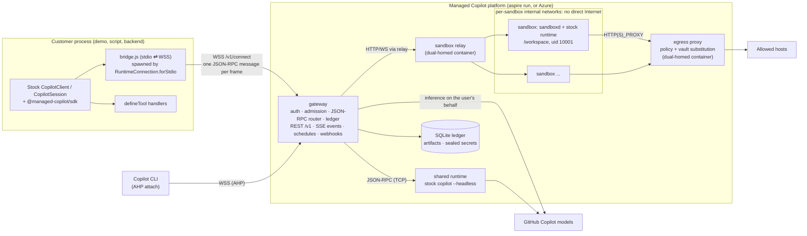

# Architecture and workstreams

This is the as-built design for the [developer experience spec](spec/developer-experience.md). The spec is the
customer contract; this document records how the platform implements it, the protocol facts it relies on, and who
owns what. Update it with the code.

## Topology

## Protocol facts (SDK 1.0.26, runtime 1.0.103)

Verified from the published package sources (`dist/client.js`, `dist/session.js`, `dist/generated/rpc.js`):

- `RuntimeConnection.forStdio({ path, args, env })` spawns `path` (with node when it ends in `.js`) and appends
  `--headless --no-auto-update --stdio` plus optional flags. The bridge ignores those flags and relays JSON-RPC.
- The SDK speaks LSP-framed JSON-RPC (vscode-jsonrpc 8.2.1). The first request is `connect` (handshake).
  `forUri(url, { connectionToken })` is raw TCP; the runtime's `--headless --port` listener needs
  `COPILOT_CONNECTION_TOKEN` or it accepts any client.
- Every session-scoped request (`session.*`, e.g. `session.send`, `session.abort`, `session.tools.handlePendingToolCall`)
  carries `params.sessionId`, so the gateway routes per session. Connection-level calls include `connect`, `ping`,
  `status.get`, `auth.getStatus`, `models.list`, `session.create`, `session.resume`, `session.list`,
  `session.delete`, `session.getMetadata`, `session.getLastId`, `session.getForeground`/`setForeground`,
  `sessionFs.setProvider`, `llmInference.setProvider`, `plugins.builtin.set`.
- Runtime → client notifications: `session.event` and `session.lifecycle`. **Tool calls and permission prompts are
  events**: `external_tool.requested` (answered by `session.tools.handlePendingToolCall`), `permission.requested`
  (answered by `session.permissions.handlePendingPermissionRequest`), `elicitation.requested`.
- Runtime → client requests include `userInput.request`, `exitPlanMode.request`, `autoModeSwitch.request`,
  `systemMessage.transform`, `gitHubToken.getToken`, `providerToken.getToken`, `llmInference.httpRequestStart`/`Chunk`
  (the experimental public request-handler hook), `sessionFs.*`, `workflow.*`, `tasks.cancel`, and `host.*` (AHP).
- AHP: the runtime exposes `host.start`, `host.publishSession`, `host.unpublishSession`, `host.setSessionCreationPolicy`;
  the SDK exposes `AhpHost`. Copilot CLI attaches with `copilot --ahp <url>` (interactive only).

## Components

| Component | Path | Runs as | Responsibility |
| --- | --- | --- | --- |
| Protocol | `packages/protocol` | library | AppHost config schema, REST DTOs, errors, events, bridge constants, network policy math |
| SDK | `packages/sdk` | library | `ManagedCopilot` API; stock `CopilotClient` over the bridge; REST features |
| Aspire integration | `packages/aspire` | library | `addManagedCopilot(builder, name, options)` for TypeScript AppHosts |
| CLI | `packages/cli` | `managed-copilot` bin | `login`, `logout`, `sessions`, `attach`, `promote`, `artifacts`, `schedules` |
| Gateway | `platform/gateway` | Node service | Auth, admission, routing, ledger, REST, events, schedules, webhooks |
| Sandbox | `platform/sandbox` | image + `sandboxd` + relay | Base image with the stock runtime, in-sandbox agent, gateway relay |
| Egress | `platform/egress` | container | Network policy enforcement and vault substitution for sandbox traffic |
| Demos | `demos/*` | apps | Quickstart snippets, AI software factory, long-running assistant |

### Data plane

1. `managed.client(env, options)` constructs a stock `CopilotClient` in the default `copilot-cli` mode with
   `RuntimeConnection.forStdio({ path: <sdk>/dist/bridge.js, env: { MANAGED_COPILOT_BRIDGE: JSON(BridgeConfig) } })`
   and starts it. The bridge opens `WSS /v1/connect` (bearer GitHub token, `BRIDGE_SUBPROTOCOL`), sends one
   `BridgeHello` frame with the environment request, and waits for `BridgeWelcome` before relaying JSON-RPC.
2. The gateway authenticates the GitHub caller, resolves the environment (policy ceilings, caller narrowing), and
   creates a **client connection**. Each client connection can own many sessions.
3. The gateway owns **persistent upstream connections** to runtimes: one to the shared runtime, one per sandbox.
   Client disconnects never close upstream connections or kill sessions; accepted work continues.
4. `session.create`: admission validates and rewrites the request (tool filters, models, MCP, agents, hooks,
   customizations, working directory, platform tools), places the session (shared runtime or a new sandbox), forwards
   it upstream, and records ownership in the ledger. `session.resume` restores placement first.
5. Session-scoped requests route by `sessionId` after an ownership check. Request IDs are remapped per upstream.
6. `session.event` notifications fan out to every attached client and observer. Execution-bearing events
   (`external_tool.requested`, `permission.requested`, ...) are **claimed before emission**: exactly one responder
   receives the actionable event; others get progress-only views. Unclaimed actions stay durable for webhook or poll
   responders. The contract is `platform/gateway/src/modules/durable/contract.ts`.
7. Server-to-client requests for platform concerns (`gitHubToken.getToken`, `llmInference.*`, `sessionFs.*`) are
   answered by the gateway, never forwarded to customer code.
8. Connection-global RPCs are **virtualized per client connection, deny by default**. The stock `client.stop()` over
   stdio sends detach/shutdown RPCs (including `runtime.shutdown`); these detach only that client connection and are
   never forwarded upstream. `session.list`, `models.list`, `status.get`, `auth.getStatus`, foreground calls, and
   provider registrations (`sessionFs.setProvider`, `llmInference.setProvider`, `plugins.builtin.set`) are answered or
   rejected by the gateway, scoped to the caller.

### Client mode and safe defaults

The stock `mode: "empty"` validates on the client before transmission (it requires `baseDirectory`/`sessionFs` and an
explicit `availableTools` on every `createSession`, and it sends a post-create `session.options.update`), so the
spec's short snippets cannot run in that mode. Managed clients therefore use the default `copilot-cli` mode, and the
**gateway** enforces the safe configuration: it rewrites upstream `session.create`, `session.resume`, and
`session.options.update` (tool ceilings, discovery off, deployed customizations on, no caller working directory), and
denies configuration RPCs it does not understand.

### Identity

- Gateway callers are one of: a GitHub **user principal**, an internal **platform service** (platform key), or a
  scoped **action capability** (webhook workers). Capabilities authorize only their exact session/action operations
  and are rejected on general user routes.
- `managed.client(env, { gitHubToken })` creates sessions owned by that account. SDK helpers (`files`, `artifacts`,
  `sessions`, actions) must use the identity of the client that created or resumed a session, tracked from the stock
  client's session lifecycle events. Owner checks are never weakened to make a helper work.
- The SDK validates the deployment URL before sending a credential: HTTPS for remote deployments, HTTP only for
  verified loopback, no embedded credentials, and a validated discovery record.

### Credentials and inference

- Shared runtime: per-session user credentials supplied by the gateway at create/resume (in memory), never a shared
  service token. Model attribution follows the session owner.
- Sandboxes: the GitHub token never enters the sandbox environment or disk. Stock runtime 1.0.103 refuses to send
  without a GitHub token or a Copilot HMAC key, and with a provider-supplied token it validates the account with a
  direct call to `api.github.com/copilot_internal/user` that does **not** pass through `llmInference.*`. Two stock,
  configuration-only candidates (the sandbox workstream picks one with evidence and documents its limits):
  - **A.** The gateway answers `gitHubToken.getToken` with a per-session placeholder; the egress proxy substitutes the
    owner's token only on the path-scoped `api.github.com/copilot_internal/*` calls; the gateway swaps the placeholder
    in model requests it receives through `llmInference.*`.
  - **B.** The runtime gets a placeholder `COPILOT_HMAC_KEY`, so it skips account validation and sends model traffic
    through `llmInference.*`, where the gateway strips the HMAC headers and attaches the owner's credential. Reported
    working on 1.0.103 by the Argon review; must be re-verified.
  If neither holds, fail closed with `inference_unavailable` rather than injecting the token.
- Runtime binary: the stock SDK spawns the dedicated headless runtime shipped in `@github/copilot-sdk-<platform>`;
  `@github/copilot` is the larger interactive CLI. Prefer the SDK's headless runtime for the shared runtime and
  sandboxes (both are stock), resolved through public package metadata.

### Isolated placement

- Every sandbox gets its **own internal Docker network** (explicit small subnets, so Docker's default address pools
  are not exhausted) with no route to the Internet. A single shared internal network would let sandboxes reach each
  other's ports, so peers must not share a network. Tests include direct peer-IP access attempts.
- Each sandbox runs `sandboxd` (platform-owned, not uid 10001) which starts the stock runtime as uid 10001 with
  `COPILOT_CONNECTION_TOKEN`, workdir `/workspace`, and `HTTP(S)_PROXY` pointing at the egress proxy with a
  per-sandbox proxy credential. `sandboxd` exposes, behind a per-sandbox bearer key: health, `/runtime` (WebSocket ⇄
  runtime TCP), streamed workspace files, output snapshots for artifact publication, and setup execution.
- The **sandbox relay** container is connected to each sandbox network and to a published bridge network so the host
  gateway can reach each `sandboxd` (`/relay/<sandboxId>/...`, platform-key authenticated).
- The **egress proxy** container is connected to each sandbox network and to a bridge network with Internet access;
  sandboxes reach the Internet only through it. It applies each sandbox's effective network policy (pushed by the
  gateway), blocks platform internals, loopback/link-local, private, and metadata addresses after DNS resolution, and
  substitutes vault placeholders in permitted HTTPS headers (details below).
- Per-session volumes hold `/workspace`, `HOME`, and runtime state so compute can be replaced without losing them.

### Shared placement egress

One shared runtime process cannot carry per-session egress identity through a proxy. Shared sessions therefore get
no direct workload egress: built-in web tools are disabled by admission, web access is the gateway-executed
`web_fetch` platform tool (per-session policy), and remote MCP servers are reached through a gateway MCP adapter that
applies the session's policy and attaches vault credentials. Anything else is refused with `capability_unavailable`.

### Network policy, egress, and vaults (as built)

- **Effective policy.** `policy.bindSession` computes `narrowNetwork(ceiling, caller request)` where the ceiling is the
  environment's `network` over the deployment default (`inline-*` environments use the default), persists it in
  `network_sessions`, and returns it. Every later read re-narrows the stored policy by the environment's *current*
  ceiling (an operator can narrow, never broaden a session; a removed environment means no egress).
  `promoteSession(id, target)` narrows by the isolated target's ceiling, so `network: false` survives promotion.
- **Shared decision logic.** `evaluateDestination` in `packages/protocol/src/network.ts` is the single rule set for the
  proxy, `web_fetch`, and the MCP adapter: host patterns (`*.x` matches subdomains, not the apex), ports (default
  80/443), canonical hosts (numeric forms such as `2130706433` or `0x7f.1` are rejected before DNS), IP literals
  (refused under host lists), and the address classes allowed after DNS (public only; operator-named private hosts may
  reach RFC 1918/ULA/CGNAT space outside protected ranges; loopback, link-local, metadata including Azure
  `168.63.129.16`, IPv6 transition forms, multicast, and reserved space never). Callers connect only to the returned
  addresses, so rebinding cannot redirect them. `.invalid`, `.local`, and `.onion` fail without a lookup.
- **Egress proxy** (`platform/egress`, one bundled file, image `managed-copilot-egress:<content hash>`). The gateway's
  supervisor runs it as `${MANAGED_COPILOT_INSTANCE:-mc}-egress` (read-only root, no capabilities, CA volume
  `${instance}-egress-data`) on `${instance}-egress-wan` (its default route) and `${instance}-sandboxes`; the sandbox
  provider connects it to each per-sandbox network with alias `mc-egress`. It listens on `0.0.0.0:3128` and calls the
  gateway at `http://host.docker.internal:<port>` with an egress-scoped key (never the platform key). Every connection
  needs the sandbox's proxy credential (Basic, `sandboxId:secret`; the proxy only holds its SHA-256), optionally
  pinned to the sandbox's address; until the first registration snapshot, or 30 s after the gateway stream drops, it
  fails closed with 503. CONNECT tunnels must start with a TLS ClientHello whose SNI equals the authorized host.
  Blocks answer 403 with the reason in the status line and body and are reported to the gateway (no credentials, no
  query strings). The subnets of its non-default interfaces and `10.213.0.0/16` are always protected.
- **Internal API** (`EGRESS_ROUTES`): `hello` (instance and CA certificate), `stream` (SSE `snapshot`/`upsert`/`remove`/
  `ping`), `secrets/resolve` (authorizes one vault use), `reports`. Registrations carry the policy, credential hash,
  pinned address, and vault bindings (placeholder, exact destinations, header names), never values.
- **Sandbox registration.** `await policy.registerSandbox({ sandboxId, sessionId })` rotates the proxy credential and
  returns `{ proxyUrl, env, caCertificate, policy }`. `env` holds `HTTP(S)_PROXY`/`http(s)_proxy` (both cases),
  `NO_PROXY=localhost,127.0.0.1,::1`, `NODE_USE_ENV_PROXY=1`, and one placeholder per vault environment variable.
  The sandbox installs `caCertificate` into the system store (`update-ca-certificates`) and sets `NODE_EXTRA_CA_CERTS`,
  `REQUESTS_CA_BUNDLE`, `SSL_CERT_FILE`, and `PIP_CERT`. With the platform-managed proxy every registration waits for
  it (it exists before network attachment); otherwise only sessions with network access or vault credentials do.
  Call `updateSandbox(id, { address })` after start and `unregisterSandbox(id)` on stop or delete (open connections
  close immediately).
- **Vaults.** AppHost vaults resolve `{ secretEnv }` from the gateway's environment at use time. Vaults created in code
  (`POST/GET/DELETE /v1/vaults`, `managed.vaults`) belong to the creating account, are sealed with AES-256-GCM
  (`MANAGED_COPILOT_VAULT_KEY`, else `<data>/network/vault.key`) with the row bound as AAD, and are never returned.
  Binding validates ownership (others' vaults are `not_found`), environment membership for AppHost vaults, and kind
  (sandbox `env` credentials are refused in shared environments). Placeholders (`mcv_placeholder_` + 40 hex) are
  stable per session and credential; deleting a vault revokes it from running sandboxes at once.
- **Substitution.** The proxy terminates TLS (ECDSA P-256 platform CA, key kept in the proxy's volume) only for a
  session's vault hosts on port 443. Per request it re-checks the registration, policy, and `Host`; substitutes a
  placeholder only as literal text in that credential's named headers (default `authorization`); rejects
  placeholders in URLs, Basic credentials, other headers, other sessions, other hosts, plain HTTP, and WebSocket
  upgrades; asks the gateway to authorize each use; writes nothing upstream until the destination's certificate
  verifies; forces `Accept-Encoding: identity` and redacts reflected values (defense in depth only). Clients that
  reject the platform CA or pin certificates are reported as `tls_client_untrusted`.
- **Shared placement.** `web_fetch` (`overridesBuiltInTool`) follows redirects itself, re-evaluating each hop, with
  size/time limits and HTML-to-text. `adaptMcpServer` rewrites a server to `http://127.0.0.1:<port>/internal/mcp/<route>`
  plus an HMAC capability header; the adapter re-checks policy per request, does not follow redirects, rewrites legacy
  SSE `endpoint` events, and attaches the vault MCP credential (`Bearer` unless the vault names a header) at request
  time. For sandbox placement, `vaults.mcpHeaders(id, url, "sandbox")` returns placeholder headers the proxy fills.
- **Visibility.** Blocks are stored per session (`GET /v1/sessions/:id/network`: policy, vaults, newest blocks) and
  published as `network.blocked` platform events (rate-limited).
- **Limits.** Vault destinations are exact host names on port 443; request bodies, query strings, Basic encodings,
  non-HTTP protocols, HTTP/2 to the proxy, and pinned clients are unsupported for substitution. Shared-placement MCP
  OAuth flows are not proxied. Domain fronting inside an allowed TLS tunnel cannot be seen without interception.
- **Tests.** `pnpm --filter @managed-copilot/egress test` (unit and in-process proxy tests) and
  `pnpm --filter @managed-copilot/egress test:docker` (real gateway module, egress container, echo services, and
  sandbox-like clients; set `MC_E2E_CURL_IMAGE`/`MC_E2E_TOOLS_IMAGE` to prebuilt images on slow networks).

### Durable actions and schedules

- `PendingAction.requestId` is the runtime request ID the answer RPC is keyed on; `payload` carries the permission
  request or elicitation data a handler needs. One invocation identity (`idempotencyKey`) survives live callbacks,
  webhooks, polling, resume, and placement changes.
- Stock `session.send` has no idempotency key. Schedules persist dispatch phases per occurrence; when a crash leaves
  acceptance unknown, reconcile against the session's runtime state instead of resending, or surface
  `needs_reconciliation`. `runNow` accepts a retry-stable `invocationId`.
## Gateway extension points

Modules register in `platform/gateway/src/modules/index.ts` and share capabilities through `app.provide(key, value)`
and `app.service(key)`. Core's consumer contracts live in `platform/gateway/src/modules/core/contracts.ts`; durable's
in `modules/durable/contract.ts`; sandbox's in `modules/sandbox/contract.ts`. Providers implement the shapes below
structurally (they may add members).

| Service key | Provided by | Shape core provides or consumes |
| --- | --- | --- |
| `auth` | core | `authenticate(token) → Principal` (GitHub `/user`, cached; AppHost access rules; `mcc_…` capability tokens rejected); `liveCredential(accountId)` |
| `sessions` | core | `get(id)` (`{ id, ownerId, environment, state, generation, lastTurn, … }`), `getOwned`, `info(accountId, id) → SessionInfo`, `list`, `create(principal, { sessionId?, environment, model?, agent?, tools?, webhook?, scheduleId? }) → { sessionId, created }`, `send(principal, id, { prompt, source?, mode? = "enqueue" })`, `request(id, method, params)`, `abort`, `delete(accountId, id)`, `subscribe(listener)` (synchronous, in order, before fan-out), `subscribeSession`, `attached(id)`, `runtime(id) → { connectionId, request, connect(port), closed }`, `onLifecycle` |
| `events` | core | `publish(event, { ownerId })`, `emit(type, { ownerId, sessionId?, environment?, data? })`, `subscribe((event, { ownerId }) => …)`; feeds SSE `/v1/events` with `Last-Event-ID` replay |
| `platformTools` | core | `register({ name, description, parameters?, overridesBuiltInTool?, skipPermission? = true, enabledFor?(env), appliesTo?({ environment, type, placement }), handler(args, { sessionId, ownerId, environment, toolCallId, idempotencyKey, … }) })`, `get(name)`, `forSession(…)` |
| `runtimeRequests` | core | `register(method \| "ns.*", handler, { upstream: "shared" \| "sandbox" \| "*" })` for runtime → client requests the gateway answers itself (core registers `gitHubToken.getToken` for shared) |
| `environments` | core | `resolve(selector) → ResolvedEnvironment` (ceilings, caller narrowing, pinned customizations), `forSession(record)` |
| `sandboxes` | sandbox | Core calls `create({ sessionId, ownerId, environment, size, network, vaults, additions })`, `openRuntime(sessionId, { resolveToken }) → { stream, connectionToken, handlers, initialize, prepareSessionParams, sessionOpened, close }`, `ensureRunning`, `delete`, `get`, `connect(sessionId, port)` |
| `artifacts` | sandbox | Turn-scoped publication and immutable storage |
| `policy` | network | Core calls `bindSession({ sessionId, owner, environment, type, requested, vaults }) → NetworkPolicy` on create, `session(id) → { policy, ownerId, environment, type, vaults }` on resume, `releaseSession(id)` on delete, and `adaptMcpServer(sessionId, name, server)` for every shared remote MCP server. Sandbox calls `registerSandbox({ sandboxId, sessionId }) → { proxyUrl, env, caCertificate, policy }`, `updateSandbox(id, { address })`, `unregisterSandbox(id)`. Promotion calls `promoteSession(id, target) → NetworkPolicy`. Also `ceiling(env)`, `effective(env, requested)`, `blocked(id)`, `caCertificate()`, `egressStatus()` |
| `vaults` | network | `list(ownerId)`, `get(ownerId, id)`, `create(ownerId, request)`, `delete(ownerId, id)` (values sealed, never returned), `mcpHeaders(sessionId, url, placement)` (placeholder headers for sandbox MCP servers; shared placement uses the adapter) |
| `actions` | durable | Core calls `onSessionEvent` (claim before emit), `onClientAnswer`, `onAttached` (replay), `onDetached`, `releaseLiveClaim`, and `list(id, { open: true })` for `SessionInfo.pendingActions` |
| `webhooks` | durable | Signed delivery with retries and replay protection |
| `schedules` | durable | Cron/one-shot schedules, occurrences, runs, agent scheduling tools |
| `credentials` | durable | Core calls `principalFor(accountId)` when a session owner has no live verified token (background work) |

`/v1/info` advertises `capabilities`: `shared` and `events` from core, plus `isolated`/`files` (`sandboxes`),
`artifacts`, `vaults`, `actions`, `webhooks`, `schedules`, `background` (`credentials`) when those services are
registered, and anything a module adds to `app.capabilities` (for example `promotion`, `attach.cli`).

## Core: shared runtime and router

- **Shared runtime.** The gateway spawns the SDK's stock headless runtime
  (`@github/copilot-sdk-<platform>/prebuilds/<platform>/copilot-runtime`, the binary `CopilotClient` itself uses;
  falls back to the `@github/copilot` CLI binary of the same version) with the SDK's TCP flags plus
  `--no-auto-login`, a random `COPILOT_CONNECTION_TOKEN`, a platform-owned `COPILOT_HOME`/`HOME` under
  `<data>/runtime/shared`, and an allowlisted environment (no `GH_TOKEN`, BYOK provider, or allow-all variables). Its
  cwd contains every shared session's working directory (`<data>/runtime/shared/workspaces/<id>`), which AHP
  publication requires. It is supervised and restarted with backoff; sessions are re-resumed upstream lazily with
  their stored admitted configuration. `MANAGED_COPILOT_RUNTIME_URL`/`_TOKEN` connect to an external runtime instead.
- **Per-session credentials.** Shared sessions get a gateway-owned `gitHubTokenProviderRegistrationId`; the runtime's
  `gitHubToken.getToken` is answered with the owner's freshest verified token (else `credentials.principalFor`),
  scoped to that session's registration, or `cancelled` (fail closed).
- **Supported operations** (deny by default). Connection-level: `connect`, `ping`, `status.get`, `auth.getStatus`
  (caller), `models.list` (caller's entitlement via the shared runtime, filtered by the environment's `models`),
  `session.create`/`resume` (admission + placement), `session.list`/`getMetadata`/`getLastId` (ledger, owner-scoped),
  `session.delete`, `session.detach` and `runtime.shutdown` (answered locally, never forwarded). Session-scoped methods
  are forwarded after an ownership and attachment check from an allowlist (`send`, `sendAndWait`, `abort`,
  `getMessages`, `log`, pending-answer RPCs, model/mode/name/agent/skills/usage/quota/plan/canvas reads and
  selections, `options.update` and `tools.set` through admission). Everything else, including `host.*`,
  `sessionFs.setProvider`, `llmInference.setProvider`, shell, workspace, plugin, auth, and permission-mode RPCs, fails
  with JSON-RPC MethodNotFound carrying `capability_unavailable`.
- **Fan-out.** Runtime events are processed in order per session: ledger tracking, `sessions.subscribe` observers, then
  delivery. Execution-bearing events go through `actions.onSessionEvent` when present; otherwise the first attached
  client able to answer, in durable's preference order (the creating connection, then by attach time), gets them and
  other eligible clients are withheld. `session.lifecycle` goes only to
  the session's attachments; runtime-wide notifications (`host.event`) are never relayed. Everything a shared session
  sends to clients (events, responses, lifecycle, runtime requests such as `hooks.invoke`) has platform host paths
  rewritten (`/workspace` for the session directory, `/platform` otherwise).
- **Registrations.** The runtime scopes tool and handler registrations to a connection, and all clients share the
  gateway's upstream connection, so the gateway sends the union of attached clients' tools and handler flags (plus
  stored server-side declarations) on create, resume, and `tools.set`. Transform, canvas, hook, and user-input
  requests go to a client that registered that handler.
- **Sends.** Shared sessions accept only inline (`blob`) attachments; file, directory, and selection attachments
  name paths the runtime would read on the platform host. Sandbox attachment paths must stay in `/workspace`.
  Credential and routing model headers and shell agent mode are rejected.
- **Known gaps** (stock behavior, reported rather than patched): the stock runtime does not re-emit pending tool or
  permission requests on resume (durable's `onAttached` replay covers it); registrations of a client that detached
  stay registered upstream until the next resume or `tools.set` (calls to them wait for a responder);
  `models.list` requires the shared runtime even for isolated environments. Verified on runtime 1.0.103: custom
  agents' and `task` subagents' tool lists cannot escape the session's `availableTools` ceiling.

## Ports and environment

| Setting | Default | Notes |
| --- | --- | --- |
| Gateway `PORT` | 7400 | Aspire assigns it in `aspire run`; `0` picks a free port |
| `MANAGED_COPILOT_CONFIG` / `_CONFIG_FILE` | dev defaults | Normalized AppHost JSON (`ManagedCopilotConfig`) |
| `MANAGED_COPILOT_APPHOST_DIR` | config file dir or cwd | Base for relative `customizations` paths |
| `MANAGED_COPILOT_DATA_DIR` | `./.managed-copilot/data` | SQLite ledger, artifacts, runtime homes, pinned customizations |
| `MANAGED_COPILOT_PLATFORM_KEY` | random per run | Internal service credential (relay, egress, sandboxd provisioning) |
| `MANAGED_COPILOT_PUBLIC_URL` | the listening address | URL clients use (`app.config.publicUrl` is always the real URL) |
| `MANAGED_COPILOT_GITHUB_API_URL` | `https://api.github.com` | Loopback `http://` allowed for test stubs only |
| `MANAGED_COPILOT_SHARED_RUNTIME` | `1` | `0` disables shared placement (unit tests) |
| `MANAGED_COPILOT_RUNTIME_PATH` / `_URL` / `_TOKEN` / `_LOG_LEVEL` | SDK headless runtime | Override the binary, or attach to an external runtime |
| `MANAGED_COPILOT_INSTANCE` | `mc` | Prefix for Docker resources (`-egress`, `-egress-wan`, `-sandboxes`, `-relay`, `-sbx-*`) |
| `MANAGED_COPILOT_EGRESS` | `auto` | `auto` starts the egress container on first need, `docker` at gateway start, `external` expects an operator-run proxy, `off` disables it (sandboxes with network access then fail) |
| `MANAGED_COPILOT_EGRESS_GATEWAY_URL` | `http://host.docker.internal:<port>` | Gateway URL as seen from the egress container |
| `MANAGED_COPILOT_EGRESS_KEY` | generated, sealed in the ledger | Egress-scoped internal API key (set it on both sides for `external`) |
| `MANAGED_COPILOT_EGRESS_ALLOWED_PORTS` / `_PRIVATE_HOSTS` / `_PROTECTED_CIDRS` / `_BLOCKED_CIDRS` | `80,443` / none / `10.213.0.0/16` / none | Operator destination rules shared by the proxy and gateway-side fetches |
| `MANAGED_COPILOT_EGRESS_UPSTREAM_CA_B64` | none | Extra CA certificates (base64 PEM) the proxy trusts for vault hosts |
| `MANAGED_COPILOT_VAULT_KEY` | `<data>/network/vault.key` | 32-byte base64 key that seals vault values |
| `MANAGED_COPILOT_MCP_ADAPTER_URL` | `http://127.0.0.1:<port>` | Base URL the shared runtime uses for the MCP adapter |
| Discovery file | `~/.managed-copilot/local.json` | Written by a local gateway (removed only by the writing pid); read and validated by `ManagedCopilot.connect()` |

## Workstreams and ownership

Each workstream is one session and one branch. Edit only owned paths; request changes elsewhere from the owner.

| Workstream | Owns | Delivers |
| --- | --- | --- |
| **core** | `platform/gateway/src/{app,http,server,config,main,log,db}.ts`, `modules/core/**`; SDK `bridge.ts`, `connection.ts`, `features/{client,sessions,events}.ts`, `managed.ts` | G1: bridge, router, shared runtime, admission, ledger, auth, `/v1/info`, `/v1/me`, sessions, SSE events, platform-tool registry |
| **sandbox** | `platform/sandbox/**`, gateway `modules/sandbox/**`, SDK `features/{files,artifacts}.ts` | Isolated placement: image, `sandboxd`, relay, Docker provider, setup, files, artifacts, idle/resume/delete |
| **network** | `platform/egress/**`, gateway `modules/network/**`, SDK `features/vaults.ts` | Network policy enforcement, vaults, SSRF protections |
| **durable** | gateway `modules/durable/**`, SDK `features/{actions,schedules,webhooks}.ts` | G2: durable actions, webhooks, polling, schedules, agent scheduling, background login |
| **devloop** | `packages/aspire/**`, `packages/cli/**`, root `apphost.mts`, `aspire.config.json`, `demos/quickstart/**`, SDK `features/cli.ts` | `aspire run` for the platform and demos, CLI, Copilot CLI attach, runnable spec snippets |
| **factory** | `demos/software-factory/**` | AI software factory demo |
| **assistant** | `demos/assistant/**` | Long-running assistant bot with schedules, Gmail, and Google Calendar |

Later workstreams: promotion (G5, SDK `features/promote.ts`), Azure deployment (G3), and end-to-end polish.
