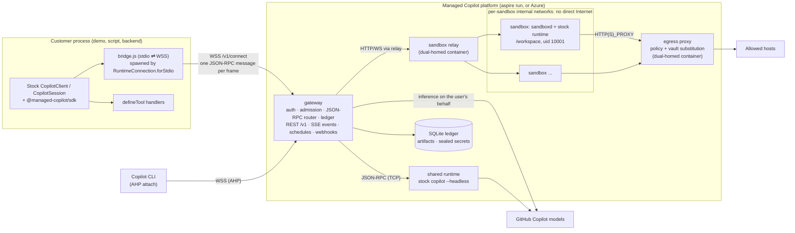

# Architecture and workstreams

This is the as-built design for the [developer experience spec](spec/developer-experience.md). The spec is the
customer contract; this document records how the platform implements it, the protocol facts it relies on, and who
owns what. Update it with the code.

## Topology

## Protocol facts (SDK 1.0.26, runtime 1.0.103)

Verified from the published package sources (`dist/client.js`, `dist/session.js`, `dist/generated/rpc.js`):

- `RuntimeConnection.forStdio({ path, args, env })` spawns `path` (with node when it ends in `.js`) and appends
  `--headless --no-auto-update --stdio` plus optional flags. The bridge ignores those flags and relays JSON-RPC.
- The SDK speaks LSP-framed JSON-RPC (vscode-jsonrpc 8.2.1). The first request is `connect` (handshake).
  `forUri(url, { connectionToken })` is raw TCP; the runtime's `--headless --port` listener needs
  `COPILOT_CONNECTION_TOKEN` or it accepts any client.
- Every session-scoped request (`session.*`, e.g. `session.send`, `session.abort`, `session.tools.handlePendingToolCall`)
  carries `params.sessionId`, so the gateway routes per session. Connection-level calls include `connect`, `ping`,
  `status.get`, `auth.getStatus`, `models.list`, `session.create`, `session.resume`, `session.list`,
  `session.delete`, `session.getMetadata`, `session.getLastId`, `session.getForeground`/`setForeground`,
  `sessionFs.setProvider`, `llmInference.setProvider`, `plugins.builtin.set`.
- Runtime → client notifications: `session.event` and `session.lifecycle`. **Tool calls and permission prompts are
  events**: `external_tool.requested` (answered by `session.tools.handlePendingToolCall`), `permission.requested`
  (answered by `session.permissions.handlePendingPermissionRequest`), `elicitation.requested`.
- Runtime → client requests include `userInput.request`, `exitPlanMode.request`, `autoModeSwitch.request`,
  `systemMessage.transform`, `gitHubToken.getToken`, `providerToken.getToken`, `llmInference.httpRequestStart`/`Chunk`
  (the experimental public request-handler hook), `sessionFs.*`, `workflow.*`, `tasks.cancel`, and `host.*` (AHP).
- AHP: the runtime exposes `host.start`, `host.publishSession`, `host.unpublishSession`, `host.setSessionCreationPolicy`;
  the SDK exposes `AhpHost`. Copilot CLI attaches with `copilot --ahp <url>` (interactive only).

## Components

| Component | Path | Runs as | Responsibility |
| --- | --- | --- | --- |
| Protocol | `packages/protocol` | library | AppHost config schema, REST DTOs, errors, events, bridge constants, network policy math |
| SDK | `packages/sdk` | library | `ManagedCopilot` API; stock `CopilotClient` over the bridge; REST features |
| Aspire integration | `packages/aspire` | library | `addManagedCopilot(builder, name, options)` for TypeScript AppHosts |
| CLI | `packages/cli` | `managed-copilot` bin | `login`, `logout`, `sessions`, `attach`, `promote`, `artifacts`, `schedules` |
| Gateway | `platform/gateway` | Node service | Auth, admission, routing, ledger, REST, events, schedules, webhooks |
| Sandbox | `platform/sandbox` | image + `sandboxd` + relay | Base image with the stock runtime, in-sandbox agent, gateway relay |
| Egress | `platform/egress` | container | Network policy enforcement and vault substitution for sandbox traffic |
| Demos | `demos/*` | apps | Quickstart snippets, AI software factory, long-running assistant |

### Data plane

1. `managed.client(env, options)` constructs a stock `CopilotClient` in the default `copilot-cli` mode with
   `RuntimeConnection.forStdio({ path: <sdk>/dist/bridge.js, env: { MANAGED_COPILOT_BRIDGE: JSON(BridgeConfig) } })`
   and starts it. The bridge opens `WSS /v1/connect` (bearer GitHub token, `BRIDGE_SUBPROTOCOL`), sends one
   `BridgeHello` frame with the environment request, and waits for `BridgeWelcome` before relaying JSON-RPC.
2. The gateway authenticates the GitHub caller, resolves the environment (policy ceilings, caller narrowing), and
   creates a **client connection**. Each client connection can own many sessions.
3. The gateway owns **persistent upstream connections** to runtimes: one to the shared runtime, one per sandbox.
   Client disconnects never close upstream connections or kill sessions; accepted work continues.
4. `session.create`: admission validates and rewrites the request (tool filters, models, MCP, agents, hooks,
   customizations, working directory, platform tools), places the session (shared runtime or a new sandbox), forwards
   it upstream, and records ownership in the ledger. `session.resume` restores placement first.
5. Session-scoped requests route by `sessionId` after an ownership check. Request IDs are remapped per upstream.
6. `session.event` notifications fan out to every attached client and observer. Execution-bearing events
   (`external_tool.requested`, `permission.requested`, ...) are **claimed before emission**: exactly one responder
   receives the actionable event; others get progress-only views. Unclaimed actions stay durable for webhook or poll
   responders. The contract is `platform/gateway/src/modules/durable/contract.ts`.
7. Server-to-client requests for platform concerns (`gitHubToken.getToken`, `llmInference.*`, `sessionFs.*`) are
   answered by the gateway, never forwarded to customer code.
8. Connection-global RPCs are **virtualized per client connection, deny by default**. The stock `client.stop()` over
   stdio sends detach/shutdown RPCs (including `runtime.shutdown`); these detach only that client connection and are
   never forwarded upstream. `session.list`, `models.list`, `status.get`, `auth.getStatus`, foreground calls, and
   provider registrations (`sessionFs.setProvider`, `llmInference.setProvider`, `plugins.builtin.set`) are answered or
   rejected by the gateway, scoped to the caller.

### Client mode and safe defaults

The stock `mode: "empty"` validates on the client before transmission (it requires `baseDirectory`/`sessionFs` and an
explicit `availableTools` on every `createSession`, and it sends a post-create `session.options.update`), so the
spec's short snippets cannot run in that mode. Managed clients therefore use the default `copilot-cli` mode, and the
**gateway** enforces the safe configuration: it rewrites upstream `session.create`, `session.resume`, and
`session.options.update` (tool ceilings, discovery off, deployed customizations on, no caller working directory), and
denies configuration RPCs it does not understand.

### Identity

- Gateway callers are one of: a GitHub **user principal**, an internal **platform service** (platform key), or a
  scoped **action capability** (webhook workers). Capabilities authorize only their exact session/action operations
  and are rejected on general user routes.
- `managed.client(env, { gitHubToken })` creates sessions owned by that account. SDK helpers (`files`, `artifacts`,
  `sessions`, actions) must use the identity of the client that created or resumed a session, tracked from the stock
  client's session lifecycle events. Owner checks are never weakened to make a helper work.
- The SDK validates the deployment URL before sending a credential: HTTPS for remote deployments, HTTP only for
  verified loopback, no embedded credentials, and a validated discovery record.

### Credentials and inference

- Shared runtime: per-session user credentials supplied by the gateway at create/resume (in memory), never a shared
  service token. Model attribution follows the session owner.
- Sandboxes: the GitHub token never enters the sandbox's environment, disk, or runtime process. Stock runtime 1.0.103
  refuses to send without a credential, and with a session `gitHubToken` (or `gitHubToken.getToken`) it validates the
  account with a direct call to `api.github.com/copilot_internal/user` that does **not** pass through
  `llmInference.*`. The implemented mechanism avoids that call with stock, public RPCs only:
  1. The gateway's upstream connection to the sandbox runtime calls `llmInference.setProvider` after `connect`, so the
     runtime sends every model-layer HTTP request to the gateway as `llmInference.httpRequestStart`/`httpRequestChunk`.
  2. `session.create` / `session.resume` go upstream with no GitHub token fields (`prepareSessionParams` strips them,
     and rejects a BYOK `provider` with `policy_violation`).
  3. After create/resume succeeds, the gateway resolves `copilot_internal/user` itself with the owner's token and calls
     `session.gitHubAuth.setCredentials({ credentials: { type: "token", host: "https://github.com", token: "mcrt_…",
     copilotUser } })`. The runtime trusts a supplied `copilotUser` verbatim (`copilotUserResolved: true`) and does
     not re-fetch it. `mcrt_…` is an opaque per-session placeholder with no value outside the gateway.
  4. The gateway answers each `llmInference` request only for the sandbox's own session and only for allowlisted
     Copilot API hosts (the identity's `endpoints.api` plus `api[.individual|.business|.enterprise].githubcopilot.com`):
     it swaps the placeholder for the owner's current token (`resolveToken`) and streams the response back with
     `llmInference.httpResponseStart`/`httpResponseChunk`. Anything else is refused.

  Evidence (2026-10-23, Windows ARM64, both the SDK's `copilot-runtime` and the `@github/copilot` CLI binary, 1.0.103,
  with all direct network egress blocked): session creation without a token succeeded, `GET <endpoints.api>/models` and
  every `POST /v1/messages` arrived through `llmInference.*` carrying only the placeholder, and real model replies came
  back. Afterwards neither the placeholder nor the token appeared anywhere under `COPILOT_HOME` or in runtime output.
  Limits: runtime features that call GitHub services directly rather than through `llmInference` (the built-in GitHub
  MCP server, telemetry) only ever see the placeholder and fail or are blocked by egress policy; the identity and quota
  snapshot is taken at create/resume time; BYOK providers are not available in sandboxes; when the owner has no usable
  credential, inference fails with `authentication_required` and never falls back to another account.
- Runtime binary: the stock SDK spawns the dedicated headless runtime shipped in `@github/copilot-sdk-<platform>`;
  `@github/copilot` is the larger interactive CLI. The sandbox image installs `@github/copilot-sdk@1.0.26` and runs its
  headless `copilot-runtime` (1.0.103); the shared runtime should use the same binary, resolved through public package
  metadata.

### Isolated placement

- Every sandbox gets its **own internal Docker network** (explicit small subnets, so Docker's default address pools
  are not exhausted) with no route to the Internet. A single shared internal network would let sandboxes reach each
  other's ports, so peers must not share a network. Tests include direct peer-IP access attempts.
- Each sandbox runs `sandboxd` (platform-owned, not uid 10001) which starts the stock runtime as uid 10001 with
  `COPILOT_CONNECTION_TOKEN`, workdir `/workspace`, and `HTTP(S)_PROXY` pointing at the egress proxy with a
  per-sandbox proxy credential. `sandboxd` exposes, behind a per-sandbox bearer key: health, `/runtime` (WebSocket ⇄
  runtime TCP), streamed workspace files, output snapshots for artifact publication, and setup execution.
- The **sandbox relay** container is connected to each sandbox network and to a published bridge network so the host
  gateway can reach each `sandboxd` (`/relay/<sandboxId>/...`, platform-key authenticated).
- The **egress proxy** container is connected to each sandbox network and to a bridge network with Internet access;
  sandboxes reach the Internet only through it. It applies each sandbox's effective network policy (fetched from or
  pushed by the gateway), blocks platform internals, loopback/link-local, private, and metadata addresses after DNS
  resolution, and substitutes vault placeholders in permitted HTTPS headers.
- Per-session volumes hold `/workspace`, `HOME`, and runtime state so compute can be replaced without losing them.

### Shared placement egress

One shared runtime process cannot carry per-session egress identity through a proxy. Shared sessions therefore get
no direct workload egress: built-in web tools are disabled by admission, web access is the gateway-executed
`web_fetch` platform tool (per-session policy), and remote MCP servers are reached through a gateway MCP adapter that
applies the session's policy and attaches vault credentials. Anything else is refused with `capability_unavailable`.

### Durable actions and schedules

- `PendingAction.requestId` is the runtime request ID the answer RPC is keyed on; `payload` carries the permission
  request or elicitation data a handler needs. One invocation identity (`idempotencyKey`) survives live callbacks,
  webhooks, polling, resume, and placement changes.
- Stock `session.send` has no idempotency key. Schedules persist dispatch phases per occurrence; when a crash leaves
  acceptance unknown, reconcile against the session's runtime state instead of resending, or surface
  `needs_reconciliation`. `runNow` accepts a retry-stable `invocationId`.
## Gateway extension points

Modules register in `platform/gateway/src/modules/index.ts` and share capabilities through `app.provide(key, value)`
and `app.service(key)`. Proposed services (owners finalize the exact shapes and keep this table current):

| Service key | Provided by | Purpose |
| --- | --- | --- |
| `auth` | core | Verify GitHub tokens, apply AppHost access rules, return a `Principal` |
| `sessions` | core | Ledger lookups with owner checks, internal create/resume/send for schedules, session event subscription |
| `events` | core | Publish platform events (SSE `/v1/events`, webhooks subscribe) |
| `platformTools` | core | Register gateway-executed tools (`schedule_task`, `request_sandbox`, ...) injected per environment |
| `sandboxes` | sandbox | Create, resume, stop, and delete sandboxes; open runtime streams; files; output snapshots |
| `artifacts` | sandbox | Turn-scoped publication and immutable storage |
| `policy` | network | Effective network policy, vault bindings, and egress registration per sandbox/session |
| `vaults` | network | AppHost and per-user vault storage (sealed at rest) |
| `actions` | durable | Durable action ledger, claims, results, reconciliation, polling |
| `webhooks` | durable | Signed delivery with retries and replay protection |
| `schedules` | durable | Cron/one-shot schedules, occurrences, runs, agent scheduling tools |
| `credentials` | durable | Background GitHub credential per user (sealed), revocation |

## Ports and environment

| Setting | Default | Notes |
| --- | --- | --- |
| Gateway `PORT` | 7400 | Aspire assigns it in `aspire run` |
| `MANAGED_COPILOT_CONFIG` | dev defaults | Normalized AppHost JSON (`ManagedCopilotConfig`) |
| `MANAGED_COPILOT_DATA_DIR` | `./.managed-copilot/data` | SQLite ledger, artifacts, runtime homes |
| `MANAGED_COPILOT_PLATFORM_KEY` | random per run | Internal service credential (relay, egress, sandboxd provisioning) |
| `MANAGED_COPILOT_PUBLIC_URL` | `http://localhost:<port>` | URL clients use |
| Discovery file | `~/.managed-copilot/local.json` | Written by a local gateway; read by `ManagedCopilot.connect()` |

## Workstreams and ownership

Each workstream is one session and one branch. Edit only owned paths; request changes elsewhere from the owner.

| Workstream | Owns | Delivers |
| --- | --- | --- |
| **core** | `platform/gateway/src/{app,http,server,config,main,log,db}.ts`, `modules/core/**`; SDK `bridge.ts`, `connection.ts`, `features/{client,sessions,events}.ts`, `managed.ts` | G1: bridge, router, shared runtime, admission, ledger, auth, `/v1/info`, `/v1/me`, sessions, SSE events, platform-tool registry |
| **sandbox** | `platform/sandbox/**`, gateway `modules/sandbox/**`, SDK `features/{files,artifacts}.ts` | Isolated placement: image, `sandboxd`, relay, Docker provider, setup, files, artifacts, idle/resume/delete |
| **network** | `platform/egress/**`, gateway `modules/network/**`, SDK `features/vaults.ts` | Network policy enforcement, vaults, SSRF protections |
| **durable** | gateway `modules/durable/**`, SDK `features/{actions,schedules,webhooks}.ts` | G2: durable actions, webhooks, polling, schedules, agent scheduling, background login |
| **devloop** | `packages/aspire/**`, `packages/cli/**`, root `apphost.mts`, `aspire.config.json`, `demos/quickstart/**`, SDK `features/cli.ts` | `aspire run` for the platform and demos, CLI, Copilot CLI attach, runnable spec snippets |
| **factory** | `demos/software-factory/**` | AI software factory demo |
| **assistant** | `demos/assistant/**` | Long-running assistant bot with schedules, Gmail, and Google Calendar |

Later workstreams: promotion (G5, SDK `features/promote.ts`), Azure deployment (G3), and end-to-end polish.
