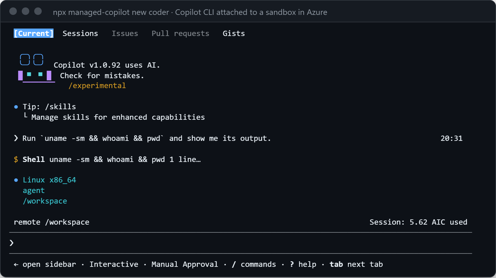
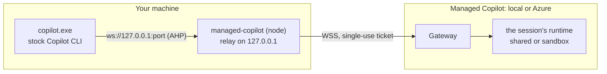
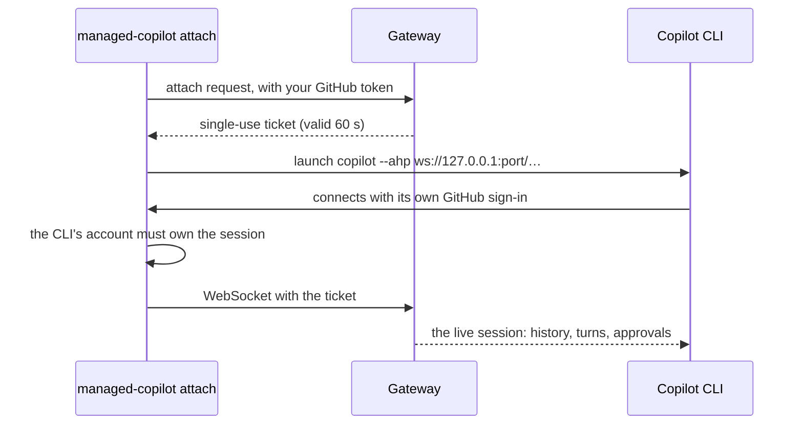

# Copilot CLI on a live session

`npx managed-copilot attach <session>` opens the stock Copilot CLI on a session your app created, or one you start
with `npx managed-copilot new <environment>`. The CLI and your app see the same conversation. It looks local, but the
agent runs on the platform: in a shared runtime, or in the session's own sandbox.

<p align="center">
  
</p>

A live run against an Azure deployment, from an ARM64 Windows laptop: the shell is `Linux x86_64` in the session's
sandbox, as user `agent` in `/workspace`, and the footer reads `remote /workspace`.

## Why it looks local



`managed-copilot` starts a small relay on `127.0.0.1` and launches `copilot --ahp ws://127.0.0.1:<port>/...`. The relay
holds the only connection to the gateway. In the live run above, `copilot.exe` connected only to `127.0.0.1` and to
GitHub's own services, never to the gateway, while the `managed-copilot` node process held the gateway connection.



No credential goes on the CLI's command line. The gateway passes the CLI only the messages it allows, with host paths
scrubbed, and never lets it create other sessions.

## Commands

| Command | What it does |
| --- | --- |
| `npx managed-copilot status` | The deployment, your account, and its environments |
| `npx managed-copilot new chat` | A new session in `chat`, opened in Copilot CLI. Add `--model <id>` to pick a model |
| `npx managed-copilot sessions` | Your sessions, with any unique ID prefix of 4+ characters to use below |
| `npx managed-copilot attach 7f3a2c1` | Copilot CLI on that live session |
| `await managed.openCli(session)` | The same, from your code, in its terminal |

Add `--url <deployment>` (or set `MANAGED_COPILOT_URL`) to use an Azure deployment. Exiting the CLI leaves the
session running:

```text
✓ Detached from 86f68194. The session keeps running.
  Attach again: npx managed-copilot attach 86f68194
```

## Who answers approvals

Each approval has exactly one owner. If your app is connected and answering prompts, the CLI's **Approve once** is
refused with "Your application is answering this request." If no app is connected, the CLI answers it. The CLI can
approve tools, but it can't run your app's tools: those still need your app, a webhook, or a poller.

## What works

| Works | Not available |
| --- | --- |
| Turns, steering, and Esc to cancel | `!` shell commands and file attachments |
| Approving or denying tool calls routed to you | The CLI's model picker (use `new --model`) |
| Answering the agent's questions | Approval modes such as allow-all |
| Staying attached through a promotion: it reconnects by itself | The GitHub Copilot app (not supported yet) |

The first attach asks you to trust an empty folder, `~/.managed-copilot/attach`. That folder is only the CLI's local
working directory; the agent's files are in the remote `/workspace`.

> [!TIP]
> **Try it:** [walkthrough 01](../../samples/01-first-agent/README.md) ends with an attach. [Walkthrough
> 06](../../samples/06-harness/README.md) opens a session with your own harness in Copilot CLI, and your app's tool
> keeps answering.

<details>
<summary><strong>Under the hood</strong></summary>

- [Architecture: Copilot CLI attach](../architecture.md#copilot-cli-attach-spec-section-14): the relay, what the
  CLI may send, path scrubbing, promotion fencing, and reconnects.
- [`managed-copilot` CLI](../../packages/cli/README.md#attach).
- [Spec section 14](../spec/developer-experience.md#14-open-a-session-in-copilot-cli-or-the-github-copilot-app).

</details>

---

**Next:** [Local and Azure](local-and-azure.md) · **Previous:** [Network and secrets](network-and-secrets.md) · **All topics:** [Start here](../README.md)
