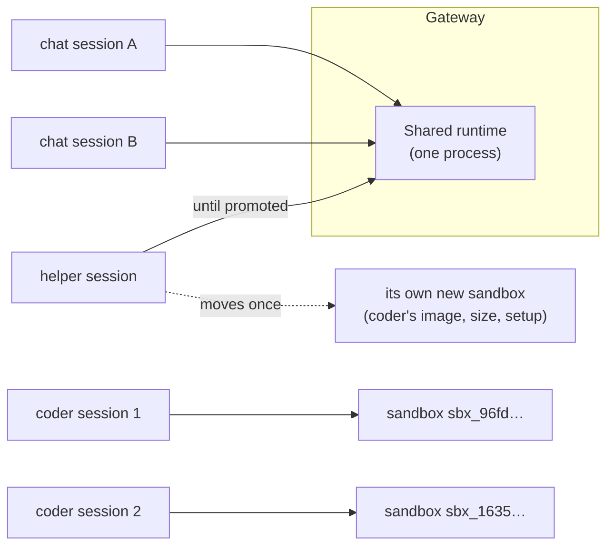
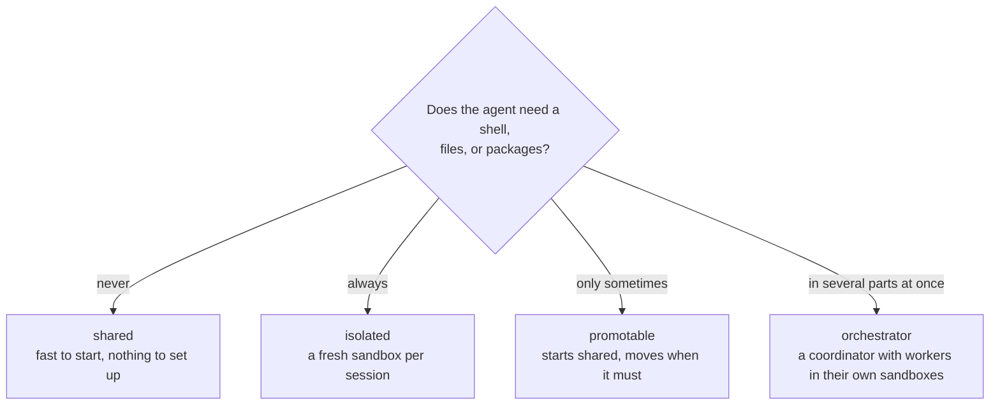
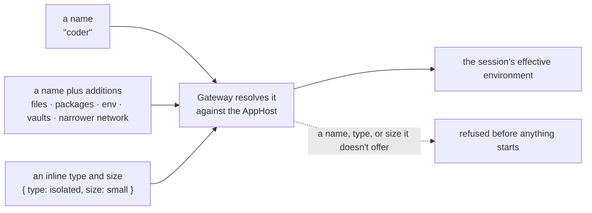

# Environments: where your agent runs

An **environment** is a template the platform declares once: its type, sandbox image and size, network rules, setup,
models, and shipped agents. Your code only picks one by name: `managed.client("coder")` creates nothing by itself.
Each session then runs according to that template.



The sandbox IDs come from a live run: two `coder` sessions created by one client got two different sandboxes.

## Four types

| Type | Where a session runs | Its tools | Good for |
| --- | --- | --- | --- |
| `shared` | In the one shared runtime, next to other sessions | Your app's tools, web fetches, and remote MCP servers; no shell, no files | Chat agents, assistants, high volume |
| `isolated` | In its own new sandbox | A shell, files, packages, git, plus your app's tools | Coding agents, builds, data work |
| `promotable` | Shared at first, then once in its own sandbox | Shared tools, then sandbox tools after the move | Chats that sometimes need to run code |
| `orchestrator` | A coordinator on the shared runtime; each worker it starts gets its own sandbox | Tools to start, message, wait for, and stop workers; workers get their environment's sandbox tools | Jobs with parts that can run in parallel |

## Which type should I use?



## Declare environments once

Environments live in your Aspire AppHost, so the same list runs locally and in Azure. Trimmed from the repository's
own [`apphost.mts`](../../apphost.mts):

```ts
await addManagedCopilot(builder, "copilot", {
  environments: {
    chat: {
      type: "shared",
      customizations: "./copilot/chat",            // agents, skills, and instructions
      models: ["claude-sonnet-5", "claude-haiku-5.5"],
      network: ["learn.microsoft.com"],            // only this host
    },
    coder: { type: "isolated", size: "medium" },
    helper: { type: "promotable", promoteTo: "coder" },
    team: { type: "orchestrator", workers: ["coder"], maxWorkers: 3 }, // workers run as coder sessions
    operator: { type: "orchestrator", workers: ["coder"], execution: "direct" }, // its own hands in a coder sandbox
  },
  inline: { types: ["shared", "isolated"], sizes: ["small"] }, // what code may ask for without a name
});
```

An environment can also set `image` (a Dockerfile folder built on the platform's base image), `packages`,
`setupCommands`, `env`, `vaults`, `idleTimeoutSeconds`, and `scheduling`. Isolated environments can set `exec: false`
to turn off [running commands directly](sandboxes.md#run-commands-directly) (`managed.exec`). Sizes are `small`
(1 vCPU, 2 GiB), `medium` (2 vCPU, 4 GiB), and `large` (4 vCPU, 8 GiB).

## Pick one from code



| You pass | You get | Limits |
| --- | --- | --- |
| `"coder"` | Exactly the declared template | The name must exist in the AppHost |
| `{ name: "coder", files, packages, env, vaults, network }` | The template plus additions for these sessions | Add setup and narrow permissions only; Python and npm packages, not system packages |
| `{ type: "isolated", size: "small" }` | The default sandbox image and settings | Only the types and sizes the AppHost's `inline` lists |

Options on `managed.client(...)` apply to every session that client creates. For one session, use
`managed.createSession({ environment: {...}, ... })`. A name, type, or size the deployment doesn't offer fails at
once, for example `[environment_not_found] This deployment does not allow inline isolated environments of size large`.
A network list is different: it's intersected with the environment's rules, so it can only ever narrow them.

Anything else, such as a new image, a bigger size, broader network access, or a new environment, is an AppHost change:
edit `apphost.mts`, then `aspire run` again locally or `aspire deploy` to Azure. Demo apps can bring their own
environments as plain data: the software factory's [`apphost.mts`](../../demos/software-factory/apphost.mts) exports
four of them, which the root AppHost spreads into its list.

> [!TIP]
> **Try it:** [walkthrough 05](../../samples/05-choose-environments/README.md) creates a session each way and shows the
> sandbox each one got. [Walkthrough 03](../../samples/03-sandbox/README.md) shows one client getting two sandboxes,
> and [walkthrough 11](../../samples/11-orchestrator/README.md) a coordinator splitting a job across two workers.

<details>
<summary><strong>Under the hood</strong></summary>

- [Spec section 1: declare your environments](../spec/developer-experience.md#1-declare-your-environments) and the
  [environment types table](../spec/developer-experience.md#environment-types).
- `EnvironmentConfigSchema` and `EnvironmentRequestSchema` in
  [`packages/protocol/src/config.ts`](../../packages/protocol/src/config.ts) list every field and its rules.
- [Architecture: isolated placement](../architecture.md#isolated-placement): one sandbox per session, images, setup.

</details>

---

**Next:** [Sandboxes](sandboxes.md) · **Previous:** [How it works](how-it-works.md) · **All topics:** [Start here](../README.md)
