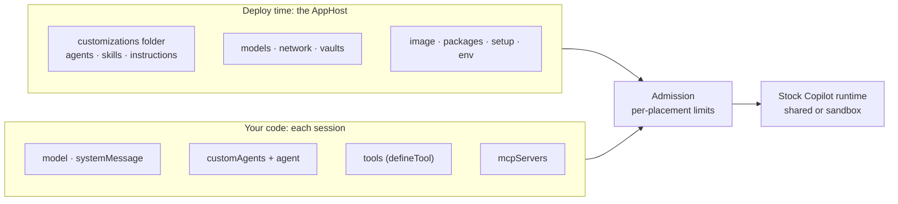
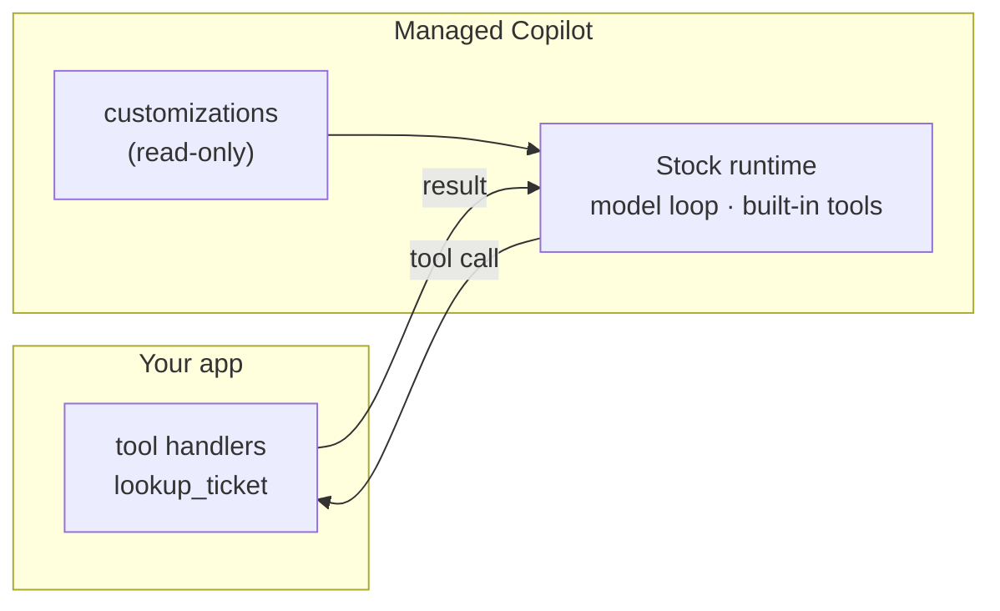

# The harness: shaping what the agent knows and can do

The agent loop is always the stock Copilot runtime. A **harness** is how that runtime is configured for a session:
its instructions, agents, skills, tools, models, and limits. Some of it ships with the environment at deploy time,
and some of it comes from your code for each session. The platform checks both against the session's placement before
anything runs.



## Deploy time: ship it with the environment

Point an environment's `customizations` at a folder in the formats Copilot CLI already reads. The platform pins it and
mounts it read-only; every session in that environment gets it.

```text
copilot/chat/
├── agents/triage.agent.md
├── skills/refund-policy/SKILL.md
└── instructions/contoso.instructions.md
```

```ts
const session = await client.createSession({ agent: "triage", tools: [lookupOrder], onPermissionRequest: approveAll });
```

The environment also fixes the `models` its sessions may use, the network rules, vaults, and, for sandboxes, the
image, packages, and setup commands. Changing any of these means editing the AppHost and deploying again. The
[software factory](../../demos/software-factory/README.md) is built this way: four environments, each with its own
agent, skills, and network rules.

## In code: one harness, any environment

Everything the SDK accepts per session works as usual. Define a harness once and reuse it:

```ts
const harness = {
  model: "claude-sonnet-5",
  systemMessage: { content: "You work on Contoso's support desk. Answer in at most two sentences." },
  customAgents: [{ name: "ticket-desk", prompt: "Look up the ticket first...", tools: ["lookup_ticket"] }],
  agent: "ticket-desk",
  tools: [lookupTicket], // defineTool; its handler runs in your app
  onPermissionRequest: approveAll,
};

for (const environment of ["chat", "coder", "helper"]) {
  const session = await managed.createSession({ environment, ...harness });
}
```

In a live run, that one harness answered from the shared runtime, from its own sandbox, and from a promotable
session, and the `lookup_ticket` handler ran in the app each time.

## Where each piece runs



Your tool code and its credentials stay in your process; only what the handler returns reaches the agent. So keep the
app running, or give it a [webhook or poller](offline-work.md), while sessions might call its tools.

## Limits by placement

| | Shared runtime | Sandbox |
| --- | --- | --- |
| Shell and file tools | No | Yes |
| Network | The gateway's `web_fetch` and remote MCP servers, within the network rules | Anything the network rules allow, through the egress proxy |
| MCP servers | Remote (`http`, `sse`) only | Remote, or local commands that run in the sandbox |
| Skills, agents, instructions | From the environment's folder, plus `customAgents` in code | The same, plus directories inside the sandbox |
| Hooks, plugins, memory | No | Yes |
| Your `defineTool` tools | Yes, in your app | Yes, in your app |
| Model providers (BYOK), custom endpoints, extensions | No | No |

Asking for something a placement doesn't allow, such as a local MCP command in a shared session, fails with a clear
error (for example `policy_violation`) instead of being ignored. The same checks run again on resume, on promotion,
and when a session's options change.

## Good to know

- **Approvals.** Tools without `skipPermission` ask your `onPermissionRequest` handler before every call. Mark
  read-only tools `skipPermission: true` to avoid needless prompts.
- **Copilot CLI keeps the harness.** Attach to a session your code created, and the CLI's turns use the same agent,
  instructions, and tools, as long as your app is still running to answer its tools.
- **`managed-copilot new` has no code harness.** It creates a session with the environment's defaults. To use your
  harness in Copilot CLI, create the session in code, then `npx managed-copilot attach <id>` (or
  `managed.openCli(session)`).
- **TypeScript only, for now.** The SDK integration is built for TypeScript; .NET and Python are not started.

> [!TIP]
> **Try it:** [walkthrough 02](../../samples/02-your-own-tools/README.md) shows tools and approvals;
> [walkthrough 06](../../samples/06-harness/README.md) runs one harness in three environments and, with `--attach`,
> opens it in Copilot CLI.

<details>
<summary><strong>Under the hood</strong></summary>

- [Spec section 3](../spec/developer-experience.md#3-shared-a-chat-agent-with-your-own-tools) and
  [section 10: ship agents with an environment](../spec/developer-experience.md#10-ship-agents-with-an-environment).
- [`platform/gateway/src/modules/core/admission.ts`](../../platform/gateway/src/modules/core/admission.ts): every
  session option and the rule for each placement.

</details>

---

**Next:** [Work while you're away](offline-work.md) · **Previous:** [Identity and access](identity.md) · **All topics:** [Start here](../README.md)
