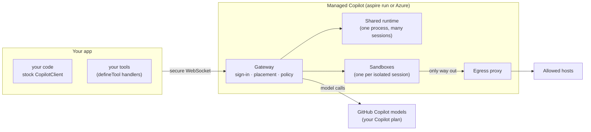
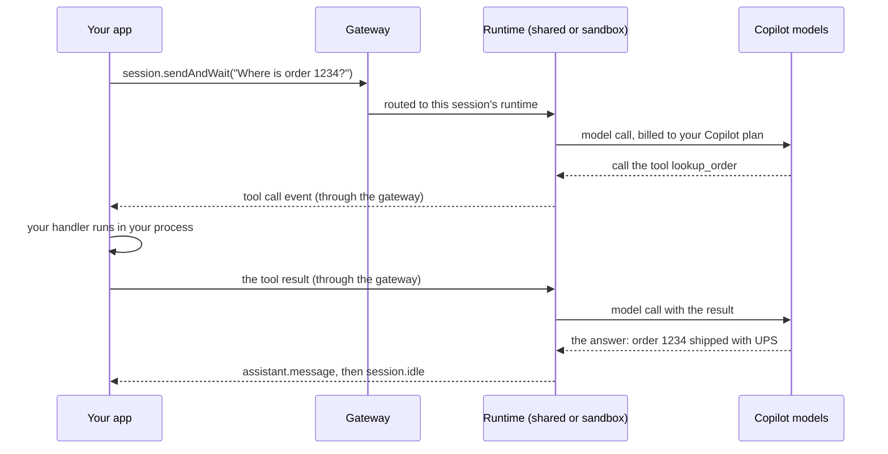

# How Managed Copilot works

Your code uses the GitHub Copilot SDK exactly as published. Managed Copilot changes only where the agent runs: in a
platform you deploy, on your laptop with Aspire or in your Azure subscription.



## What changes in your code

Only the setup lines. Everything after them is the ordinary SDK: real `CopilotClient` and `CopilotSession` objects,
standard session events, and `defineTool` tools.

```ts
// Before: the agent runs next to your code
const client = new CopilotClient();
await client.start();

// After: the agent runs in an environment you deployed
const managed = await ManagedCopilot.connect(); // your local `aspire run`, or MANAGED_COPILOT_URL
const client = await managed.client("chat");    // a stock CopilotClient for the "chat" environment
```

## The pieces

| Piece | What it does |
| --- | --- |
| **Your app** | Runs your code and your tools. `managed.client()` connects a stock client to the gateway through a small bridge process. |
| **Gateway** | Signs callers in with GitHub, checks each session's configuration against its environment, places the session, routes its messages, and records who owns what. |
| **Shared runtime** | One stock Copilot runtime that hosts many lightweight sessions. They have no shell or files; their tools run in your app. |
| **Sandboxes** | One per isolated session: a Linux workspace with a shell, files, and packages. A Docker container locally, a microVM on Azure. |
| **Egress proxy** | A sandbox's only way to the Internet. It enforces the network allowlist and adds secrets at the edge. |
| **Models** | Every model call is billed to the session owner's Copilot plan. Sandboxes never hold a GitHub token; the gateway makes their model calls for them. |

## One message, end to end

What happens when your app asks a question and the agent needs one of your tools:



Tool calls and approval prompts are ordinary SDK events. The gateway hands each one to exactly one responder: your
live app, or, while your app is away, a webhook or a poller ([offline work](offline-work.md)).

## Local and Azure

The same AppHost runs in both places, and your code doesn't change.

| | `aspire run` (your machine) | `aspire deploy` (Azure) |
| --- | --- | --- |
| Gateway and shared runtime | A Node process on `http://localhost:7400` | The `copilot` container app, behind HTTPS |
| Sandboxes | Docker containers, each on its own network | Azure Container Apps Sandboxes, one microVM each |
| Egress proxy | A Docker container | An internal container app |
| Platform state | `.managed-copilot/data` next to the AppHost | An Azure Files NFS share |
| Your code finds it with | Nothing: `connect()` reads a local discovery file | `MANAGED_COPILOT_URL` or `connect({ url })` |

> [!TIP]
> **Try it:** [walkthrough 01](../../samples/01-first-agent/README.md) connects, chats, and opens the same session in
> Copilot CLI in about a minute.

<details>
<summary><strong>Under the hood</strong></summary>

- [Architecture: topology and data plane](../architecture.md#topology): the bridge, JSON-RPC routing, and how the
  gateway virtualizes connection-wide calls.
- [Architecture: credentials and inference](../architecture.md#credentials-and-inference): how sandboxes get model
  calls without a token.
- [Spec: what runs where](../spec/developer-experience.md#what-runs-where): the intended trust boundaries.
- [Deploying to Azure](../deployment.md#what-gets-deployed): every Azure resource.

</details>

---

**Next:** [Patterns](patterns.md) · **All topics:** [Start here](../README.md)
