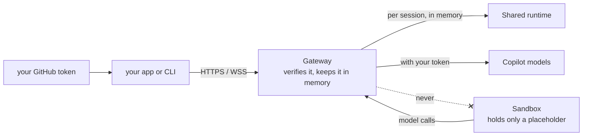
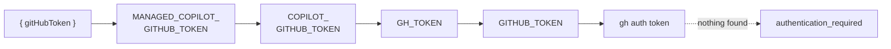
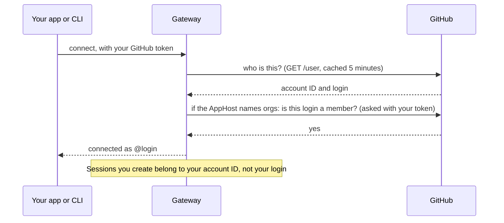
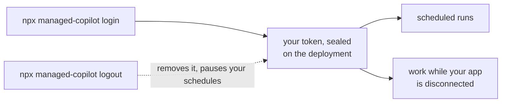

# Identity and access

You are your GitHub sign-in, everywhere: in your code, in the CLI, in Copilot CLI, and in work that runs while you're
away. Sessions belong to your GitHub account, model calls use your Copilot plan, and your token never enters a sandbox.



## Which token your code uses

`ManagedCopilot.connect()` and the `managed-copilot` CLI take the first one they find:



If you're signed in with the GitHub CLI (`gh auth login`), there is nothing to set. The CLI has no token flag, so
tokens never appear on a command line. Without a token, `connect()` fails with `authentication_required`; it never
falls back to another account.

## How the gateway checks you



- **Access rules** come from the AppHost's `access: { githubUsers, githubOrgs }`. Organization membership is checked
  with your own token, so private memberships count. With no rules at all, any GitHub account that can reach the
  gateway may use it: fine for a local gateway, which only listens on your machine.
- **Ownership** binds to your stable GitHub account ID. Listing, resuming, files, and attaching only ever see your own
  sessions.
- **Sandboxes never get your token.** Their runtime holds a per-session placeholder; the gateway makes each model call
  for them with your token, and only to Copilot's API hosts.

## Serving many users from one backend

A backend that signs users in with GitHub acts as each user, so sessions and model use belong to that user:

```ts
const client = await managed.client("chat", { gitHubToken: user.githubToken }); // this user's sessions and plan
```

## Work that continues while you're away

Scheduled runs and offline work need a credential when you're not connected. Turn that on once per deployment:



The platform re-checks the stored token with GitHub before using it. It can't refresh it: if GitHub revokes it or it
expires, your schedules pause with a reason, and `npx managed-copilot login` turns them back on.
`npx managed-copilot status` shows whether background sign-in is on.

## Let people in

| | Local (`aspire run`) | Azure (`aspire deploy`) |
| --- | --- | --- |
| Who can use it | Anyone with a GitHub sign-in on this machine; the gateway listens on localhost only | Only the accounts and organizations you name; `aspire deploy` refuses to publish without them |
| Add people | Not needed | `aspire secret set Parameters:copilot-github-users "alice,bob"`, then `aspire deploy` |
| Operators (console) | Every local account | `aspire secret set Parameters:copilot-operator-users "alice"`, then `aspire deploy` |

`Parameters:copilot-github-users` (or `-github-orgs`) holds the whole list: setting it replaces what was there, and
it adds to any `access` rules the AppHost declares itself. Copilot CLI uses its own GitHub sign-in when it attaches,
and it must be the session's owner.

> [!TIP]
> **Try it:** `npx managed-copilot status` shows the deployment, who you're signed in as, and whether background
> sign-in is on. [Walkthrough 09](../../samples/09-schedules/README.md) runs a schedule as you.

<details>
<summary><strong>Under the hood</strong></summary>

- [Architecture: identity](../architecture.md#identity), including how GitHub outages are handled.
- [Architecture: credentials and inference](../architecture.md#credentials-and-inference): the placeholder and the
  brokered model calls, step by step.
- [Spec section 2: connect](../spec/developer-experience.md#2-connect) and
  [section 15: models and billing](../spec/developer-experience.md#15-models-and-billing).
- [Deploying to Azure: deploy](../deployment.md#deploy): access settings at deploy time.

</details>

---

**Next:** [Harness](harness.md) · **Previous:** [Promotion](promotion.md) · **All topics:** [Start here](../README.md)
