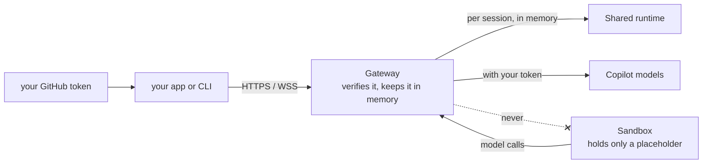
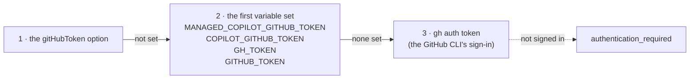
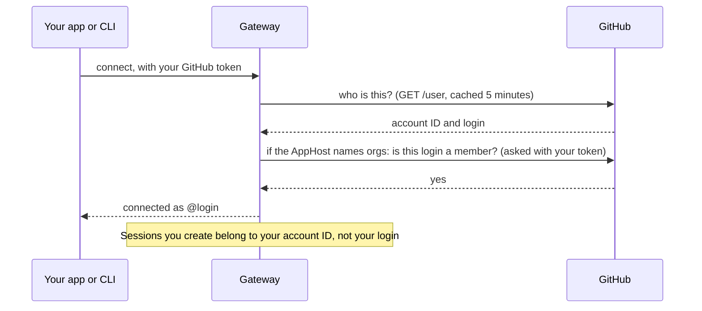
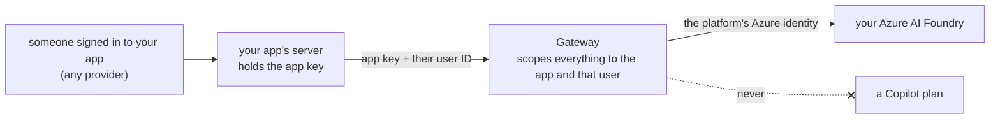
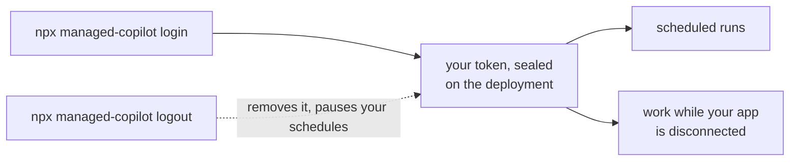

# Identity and access

You are your GitHub sign-in, everywhere: in your code, in the CLI, in Copilot CLI, and in work that runs while you're
away. Sessions belong to your GitHub account, model calls use your Copilot plan, and your token never enters a sandbox.
The people who use an app you build don't need GitHub: the app can vouch for them, and their model calls go to your
Azure AI Foundry ([below](#your-apps-own-users)).



## Which token your code uses

`ManagedCopilot.connect()` and the `managed-copilot` CLI take the first one they find:



If you're signed in with the GitHub CLI (`gh auth login`), there is nothing to set. The CLI has no token flag, so
tokens never appear on a command line. Without a token, `connect()` fails with `authentication_required`; it never
falls back to another account.

## How the gateway checks you



- **Access rules** come from the AppHost's `access: { githubUsers, githubOrgs }`. Organization membership is checked
  with your own token, so private memberships count. With no rules at all, any GitHub account that can reach the
  gateway may use it: fine for a local gateway, which only listens on your machine.
- **Ownership** binds to your stable GitHub account ID. Listing, resuming, files, and attaching only ever see your own
  sessions.
- **Sandboxes never get your token.** Their runtime holds a per-session placeholder; the gateway makes each model call
  for them with your token, and only to Copilot's API hosts.

## Serving many users from one backend

A backend that signs users in with GitHub acts as each user, so sessions and model use belong to that user:

```ts
const client = await managed.client("chat", { gitHubToken: user.githubToken }); // this user's sessions and plan
```

## Your app's own users

People who use your app don't need GitHub or Copilot. Your app signs them in with any provider, then vouches for each
one with the **app key** the AppHost issued to it. Their sessions belong to them, and their model calls go to your
Azure AI Foundry account, billed to your Azure subscription.



```ts
// apphost.mts: declare the Foundry account, a Foundry environment, and the app.
foundry: { "contoso-foundry": { resourceGroup: "contoso-ai", deployments: ["gpt-5-mini"] } },
environments: { support: { type: "shared", inference: { foundry: "contoso-foundry" } } },
apps: { "support-site": { environments: ["support"] } },
// ...and give the app its key:
//   .withEnvironment("MANAGED_COPILOT_APP_KEY", copilot.appKey("support-site"))

// support-site/server.ts: with MANAGED_COPILOT_APP_KEY set, this connection is the app itself.
const managed = await ManagedCopilot.connect();
const client = await managed.client("support", { appUser: { id: user.id, name: user.name } });
const alice = await managed.as({ appUser: { id: user.id } }); // their sessions, files, and artifacts
```

- **The key is the app's word.** Whoever holds it can act for any of the app's users, so keep it on your server like
  any API key. Every request through it is limited to the app's `environments`.
- **App users are not GitHub accounts.** Their sessions show as `<app>/<user ID>` (`owner.kind: "app-user"`). Another
  app, or this app naming another user, never reaches them, and they never count for `access` or `operators`.
- **Foundry only, never a Copilot plan.** App users' sessions run only in environments with `inference: { foundry }`;
  anywhere else fails with `inference_unavailable` (a workspace-only sandbox, which makes no model calls, may use any of
  the app's environments). Background sign-in, schedules, and Copilot CLI attach fail with `capability_unavailable`.
- **Your GitHub users keep their own plan.** The same connection acts for someone who signed in with GitHub:
  `managed.client(env, { gitHubToken })` or `managed.as({ gitHubToken })`. Their sessions are their own account's.
- **Public apps.** A deployment admits only the GitHub accounts in `access`. `anyGitHubUser: true` on an app admits
  every GitHub account that comes through the app's key, without opening the deployment to them directly.

## Work that continues while you're away

Scheduled runs and offline work need a credential when you're not connected. Turn that on once per deployment:



The platform re-checks the stored token with GitHub before using it. It can't refresh it: if GitHub revokes it or it
expires, your schedules pause with a reason. Sign in again with `npx managed-copilot login`, then resume each schedule
with `npx managed-copilot schedules resume <schedule>`. `npx managed-copilot status` shows whether background sign-in
is on.

## Let people in

| | Local (`aspire run`) | Azure (`aspire deploy`) |
| --- | --- | --- |
| Who can use it | Anyone with a GitHub sign-in on this machine; the gateway listens on localhost only | Only the accounts and organizations you name; `aspire deploy` refuses to publish without them |
| Add people | Not needed | `aspire secret set Parameters:copilot-github-users "alice,bob"`, then `aspire deploy` |
| Operators (console) | Every local account | `aspire secret set Parameters:copilot-operator-users "alice"`, then `aspire deploy` |

`Parameters:copilot-github-users` (or `-github-orgs`) holds the whole list: setting it replaces what was there, and
it adds to any `access` rules the AppHost declares itself. People who use your app come in through the app instead:
its own users with its key, and any GitHub account when the app sets `anyGitHubUser: true`. Copilot CLI uses its own GitHub sign-in when it attaches,
and it must be the session's owner.

> [!TIP]
> **Try it:** `npx managed-copilot status` shows the deployment, who you're signed in as, and whether background
> sign-in is on. [Walkthrough 09](../../walkthroughs/09-schedules/README.md) runs a schedule as you.

<details>
<summary><strong>Under the hood</strong></summary>

- [Architecture: identity](../architecture.md#identity), including how GitHub outages are handled.
- [Architecture: credentials and inference](../architecture.md#credentials-and-inference): the placeholder and the
  brokered model calls, step by step.
- [Spec section 2: connect](../spec/developer-experience.md#2-connect), including
  [your app's own users](../spec/developer-experience.md#your-apps-own-users), and
  [section 15: models and billing](../spec/developer-experience.md#15-models-and-billing).
- [Architecture: apps and Azure AI Foundry](../architecture.md#apps-and-azure-ai-foundry): app keys, app-user
  accounts, and how Foundry calls are made.
- [Deploying to Azure: deploy](../deployment.md#deploy): access settings at deploy time.

</details>

---

**Next:** [Harness](harness.md) · **Previous:** [Orchestrator](orchestrator.md) · **All topics:** [Start here](../README.md)
