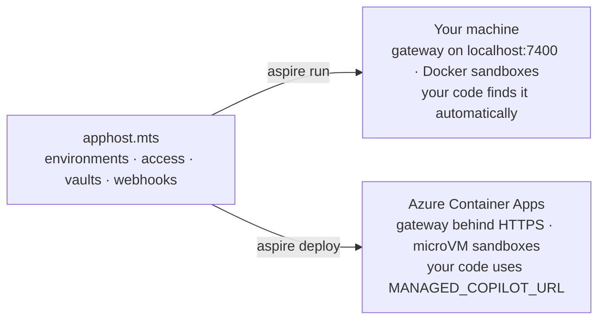
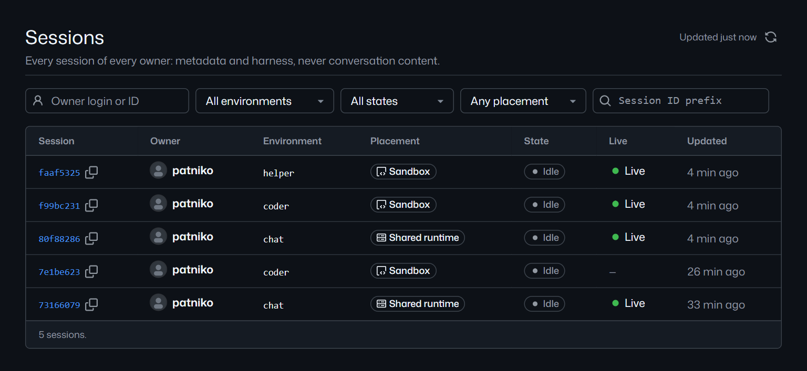

# Run it locally and in Azure

One AppHost describes the whole platform: environments, access, vaults, webhooks, and your apps. `aspire run` starts
it on your machine. `aspire deploy` puts the same AppHost in your Azure subscription. Your code doesn't change, only
where it connects.



## Run it locally

You need Node 24, pnpm 10, Docker Desktop, the Aspire CLI 13.6, a GitHub account with Copilot (`gh auth login`), and
[Copilot CLI](https://docs.github.com/copilot/how-tos/copilot-cli) for attaching.

```powershell
pnpm install
pnpm build
aspire run          # the platform on http://localhost:7400, the demos, and the Aspire dashboard
```

Then, from another terminal:

```text
> npx managed-copilot status
Deployment    copilot · local · v0.1.0 · http://localhost:7400
Signed in     @your-login
Background    off · Not signed in for background work. Sign in once with `npx managed-copilot login` so work can continue while you're away.
Environments  chat (shared, network: learn.microsoft.com), coder (isolated, medium), helper (promotable, small, -> coder), …
Capabilities  actions, artifacts, attach.cli, background, events, files, isolated, network.policy, operator, promotion, schedules, shared, vaults, web_fetch, webhooks
Runtime       Copilot SDK 1.0.26, runtime 1.0.103
```

`isolated`, `files`, and `promotion` appear once Docker is running and the sandbox backend is ready. If `aspire run`
stops at "Trusting certificates…", run `aspire certs trust` once or use `aspire run --non-interactive`. The
[README](../../README.md#run-it-locally) covers ports, NuGet proxies, and running a second copy.

## Deploy to Azure

```powershell
aspire secret set Azure:SubscriptionId <subscription-id>
aspire secret set Azure:Location westus2
aspire secret set Azure:ResourceGroup managed-copilot-dev
aspire secret set Parameters:copilot-github-users your-login   # who may use it; required
aspire deploy
```

The deploy prints the platform's address:

```text
Managed Copilot: https://copilot.<environment-domain> (ManagedCopilot.connect({ url }), MANAGED_COPILOT_URL, or managed-copilot attach --url)
```

Point your code and the CLI at it, and everything works as it did locally:

```powershell
$env:MANAGED_COPILOT_URL = "https://copilot.<environment-domain>"
npx managed-copilot status    # Deployment  copilot · azure · …
pnpm sample 03                # the same sample, now in an Azure sandbox
```

To let more people in, set `Parameters:copilot-github-users` to the full list (or name organizations with
`Parameters:copilot-github-orgs`) and run `aspire deploy` again. See [identity and access](identity.md#let-people-in).

## What's the same, what differs

| | Local | Azure |
| --- | --- | --- |
| Your code, samples, and the CLI | The same | The same |
| Sandboxes | Docker containers | Container Apps Sandboxes microVMs (`linux/amd64`) |
| Who can connect | Anyone signed in to GitHub on this machine | The accounts and organizations you name |
| Webhooks | Your local receiver | Your deployed apps, or any HTTPS endpoint |
| Gateway | One process | One replica. A redeploy pauses the API for seconds; waiting actions, webhooks, and schedules survive it, but a turn that was running ends as failed |
| Warm sandbox pools | No | No |

[Deploying to Azure](../deployment.md#capability-matrix) has the full capability matrix, costs, and teardown.

## Watch it run

Name the people who operate the platform with `operators` in the AppHost (or `Parameters:copilot-operator-users`), then
open the console. Locally, every account on the machine is an operator.

```powershell
npx managed-copilot console       # signs you in to the operator console in your browser
npx managed-copilot operator      # the same overview in the terminal
```

<p align="center">
  
</p>

The console shows health, every owner's sessions with their placement and harness, sandboxes, schedules, webhooks,
and a live event feed. Operators see configuration, never conversation content, and secrets are always redacted.

> [!TIP]
> **Try it:** [walkthrough 10](../../samples/10-azure/README.md) runs the samples against an Azure deployment from
> your laptop and opens one of its sandboxes in Copilot CLI.

<details>
<summary><strong>Under the hood</strong></summary>

- [Deploying to Azure](../deployment.md): what gets deployed, durable state, isolated placement, and troubleshooting.
- [Architecture: Azure deployment](../architecture.md#azure-deployment-aspire-deploy) and
  [the AppHost](../architecture.md#apphost-managed-copilotaspire-root-apphostmts).
- [Spec section 16: operate your deployment](../spec/developer-experience.md#16-operate-your-deployment).

</details>

---

**Previous:** [Copilot CLI](copilot-cli.md) · **All topics:** [Start here](../README.md)
