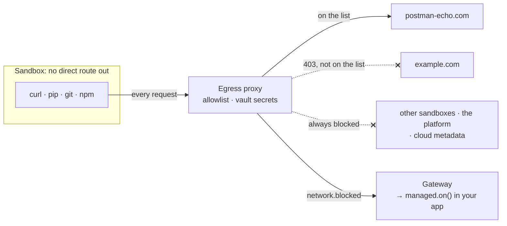
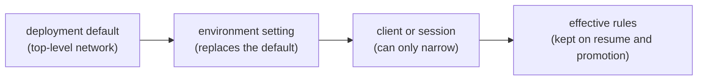
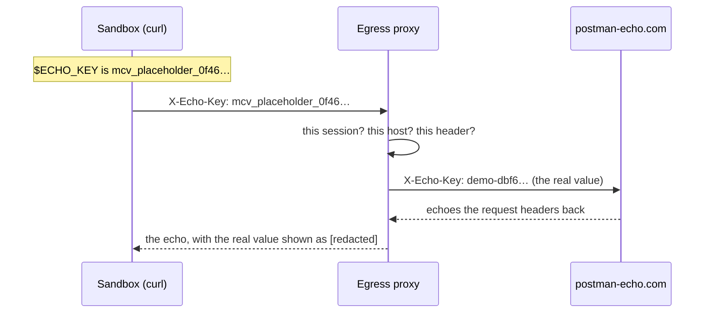

# Network and secrets

A sandbox has no direct route to the Internet. Every request goes through the egress proxy, which applies the
session's network rules and, for hosts a vault names, swaps placeholders for real credentials at the edge. Code in the
sandbox never sees a secret.



## Network rules

Network access is on unless you turn it off. Rules resolve in one direction only: narrower.



| Setting | Meaning |
| --- | --- |
| Omitted | Inherit: the environment's setting, else the deployment default, else on |
| `true` | Public Internet, minus what the platform always blocks |
| `["pypi.org", "*.example.com"]` | Only these hosts. `*.example.com` matches subdomains, not `example.com` itself |
| `false` or `[]` | No outbound access |

```ts
coder: { type: "isolated", network: ["github.com", "*.githubusercontent.com"] }, // in the AppHost
const client = await managed.client("coder", { network: ["postman-echo.com"] });   // narrower, in code
```

- The rules cover everything the workload does: setup installs, shell commands, web tools, and MCP calls. There is
  no exception for package downloads; an offline environment needs its packages in the image.
- Model calls and file transfers don't use the proxy. They go through the gateway, so they keep working even with
  `network: false`.
- The platform always blocks other sandboxes, the platform's own services, loopback and link-local addresses, cloud
  metadata endpoints, and private addresses an operator hasn't allowed, whatever the rules say.
- Blocked attempts become `network.blocked` events: `managed.on("network.blocked", e => ...)`. Under a strict list
  you'll also see the runtime's own direct calls to GitHub (`api.…githubcopilot.com`, `telemetry.…githubcopilot.com`)
  blocked. That's expected: model calls don't need them.

## Secrets: vaults

A **vault** holds a credential the platform seals. The sandbox gets a placeholder; the proxy substitutes the real
value only in the headers and hosts the vault names.



That run is [walkthrough 07](../../samples/07-network-and-secrets/README.md). Declare vaults in the AppHost for a
whole environment, or create one in code for one user:

```ts
// apphost.mts: an environment-wide vault, from an Aspire secret parameter
const stripeKey = await builder.addParameter("stripe-key", { secret: true });
vaults: { payments: [{ env: "STRIPE_API_KEY", value: stripeKey, hosts: ["api.stripe.com"] }] },
environments: { coder: { type: "isolated", vaults: ["payments"], network: ["api.stripe.com"] } },

// your code: a per-user vault, owned by the GitHub account that creates it
const vault = await managed.vaults.create({
  name: `jira-${user.id}`,
  credentials: [{ env: "JIRA_TOKEN", value: user.jiraToken, hosts: ["contoso.atlassian.net"] }],
});
const client = await managed.client("coder", { vaults: [vault.id] });
```

- No API ever returns a vault's value. Deleting a vault revokes it from running sandboxes at once.
- Substitution happens only over HTTPS to the exact hosts listed (port 443), and only in the named headers
  (`authorization` unless you list others). A placeholder anywhere else, such as a URL, another header, another host,
  or another session's request, is refused.
- Both the network rules and the vault must allow a destination.

## Shared sessions

The shared runtime is one process, so its sessions get no direct network access. Web pages come through the
gateway's `web_fetch` tool, and remote MCP servers through a gateway adapter, both under the session's rules. A vault
for a shared environment holds MCP server credentials, which the adapter attaches; your code never handles them.

> [!TIP]
> **Try it:** [walkthrough 07](../../samples/07-network-and-secrets/README.md) shows the placeholder, the real value
> reaching an allowed host, and a blocked host, in one run.

<details>
<summary><strong>Under the hood</strong></summary>

- [Spec section 7: control network access](../spec/developer-experience.md#7-control-network-access) and
  [section 8: keep secrets out of the sandbox](../spec/developer-experience.md#8-keep-secrets-out-of-the-sandbox).
- [Architecture: network policy, egress, and vaults](../architecture.md#network-policy-egress-and-vaults-as-built)
  and [shared placement egress](../architecture.md#shared-placement-egress).

</details>

---

**Next:** [Copilot CLI](copilot-cli.md) · **Previous:** [Work while you're away](offline-work.md) · **All topics:** [Start here](../README.md)
