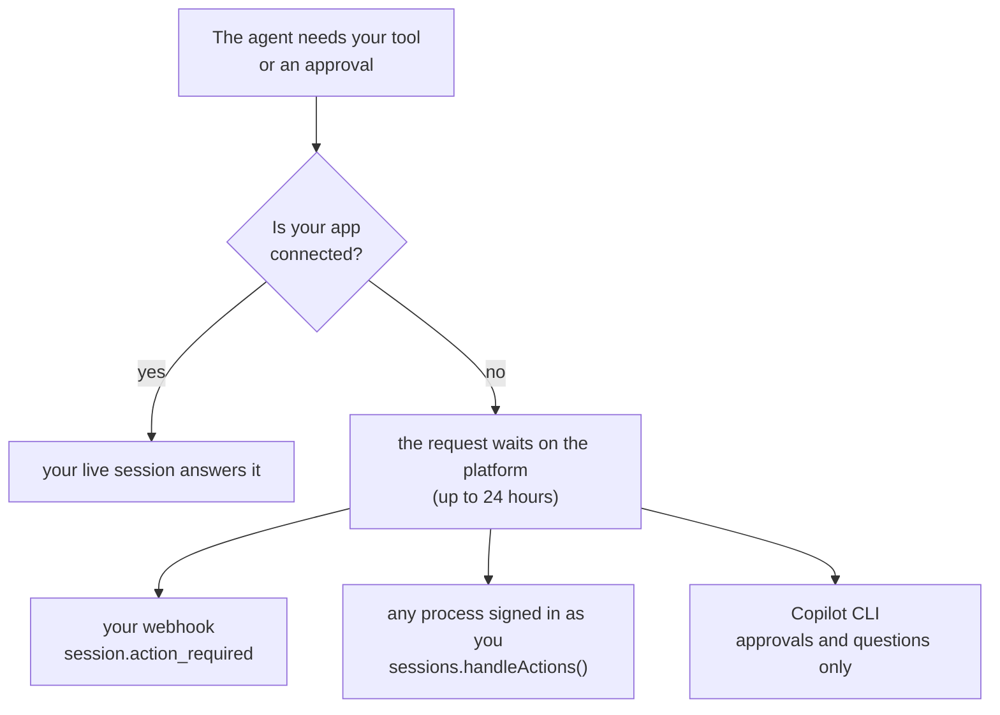
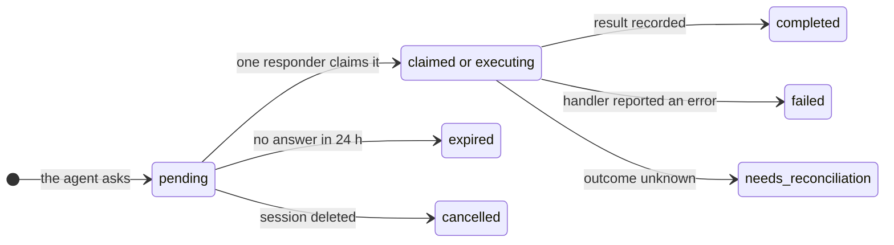
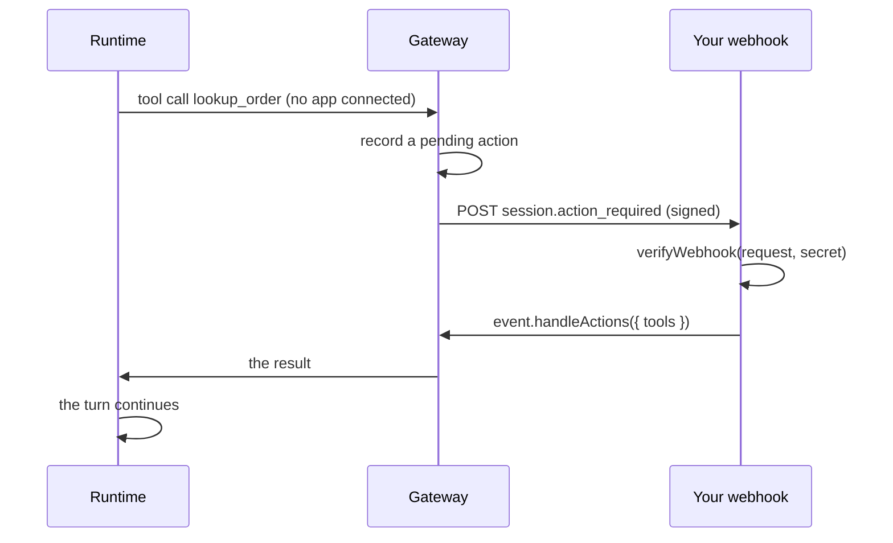
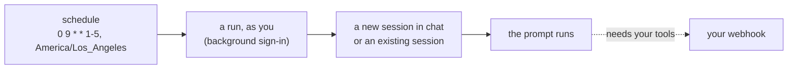

# Work that continues while you're away

Accepted work belongs to the platform, not to your connection. Close your app and the agent keeps going. When it needs
one of your tools or an approval, the request waits on the platform until something you control answers it.



## One owner for every request

Each tool call and approval prompt becomes a durable **action** with exactly one owner. Whoever claims it first
answers it; everyone else sees progress only. A tool never runs twice because two responders raced.



- **`needs_reconciliation`**: a handler disconnected mid-call, so nobody knows whether it ran. The platform never runs
  it again on its own. Use the action's `idempotencyKey` (the session and tool call ID) with downstream services so a
  retry can't repeat a side effect.
- **`expired`**: the agent gets an error for a tool, or "user not available" for an approval. Never an automatic yes.

## Answer by polling

The simplest option, and it works anywhere, including against Azure from your laptop:

```ts
const { pendingActions } = await managed.sessions.get(sessionId);
// [{ kind: "tool", tool: "lookup_order", state: "pending", arguments: { id: "1234" } }]
await managed.sessions.handleActions(sessionId, { tools: [lookupOrder], onPermissionRequest: approveAll });
```

`handleActions` claims what this caller may answer, runs your handlers, and records the results. Polling again never
executes the same call twice.

## Answer with a webhook

Declare an endpoint in the AppHost, and the platform POSTs a signed event when something is waiting:



```ts
const event = await verifyWebhook(request, process.env.COPILOT_WEBHOOK_SECRET!); // rejects a bad signature
if (event.type === "session.action_required") await event.handleActions({ tools: [lookupOrder] });
```

Deliveries are at least once, retried with backoff, and signed with HMAC-SHA256. Each one carries a short-lived
capability for that session's waiting actions only. The [assistant demo](../../demos/assistant/README.md) uses a
webhook and polling together, so nothing is missed while its tab is closed.

## Run on a schedule



- `managed.schedules.create({ name, cron, timeZone, environment, prompt })`; also `list`, `runs`, `pause`, `resume`,
  `delete`, and `runNow`. From a terminal: `npx managed-copilot schedules`.
- Runs act as you, so turn on background sign-in once: `npx managed-copilot login`
  ([identity](identity.md#work-that-continues-while-youre-away)).
- Only a tool's declaration is stored with a schedule, never its code; tool calls are answered through a webhook.
- Runs of one schedule never overlap, and a run that misses its time window is skipped and recorded, not replayed
  later.
- With `scheduling: true` on an environment, the agent itself can set reminders with `schedule_task`,
  `list_schedules`, and `cancel_schedule`. They always target its own session.

## Come back later

```ts
const session = await managed.resumeSession(sessionId, { tools: [lookupOrder], onPermissionRequest: approveAll });
await managed.close(); // detaches this process; it never deletes sessions or cancels accepted work
```

Pass your tools again when you resume: functions are never stored on the platform.

> [!TIP]
> **Try it:** [walkthrough 08](../../samples/08-offline/README.md) sends a prompt, disconnects, and answers the tool
> call by polling. [Walkthrough 09](../../samples/09-schedules/README.md) creates a schedule and runs it now.

<details>
<summary><strong>Under the hood</strong></summary>

- [Spec section 12: keep working while your app is offline](../spec/developer-experience.md#12-keep-working-while-your-app-is-offline)
  and [section 13: run on a schedule](../spec/developer-experience.md#13-run-on-a-schedule).
- [Architecture: durable actions and schedules](../architecture.md#durable-actions-and-schedules): claims, delivery,
  incarnations, and recovery after restarts.

</details>

---

**Next:** [Network and secrets](network-and-secrets.md) · **Previous:** [Harness](harness.md) · **All topics:** [Start here](../README.md)
