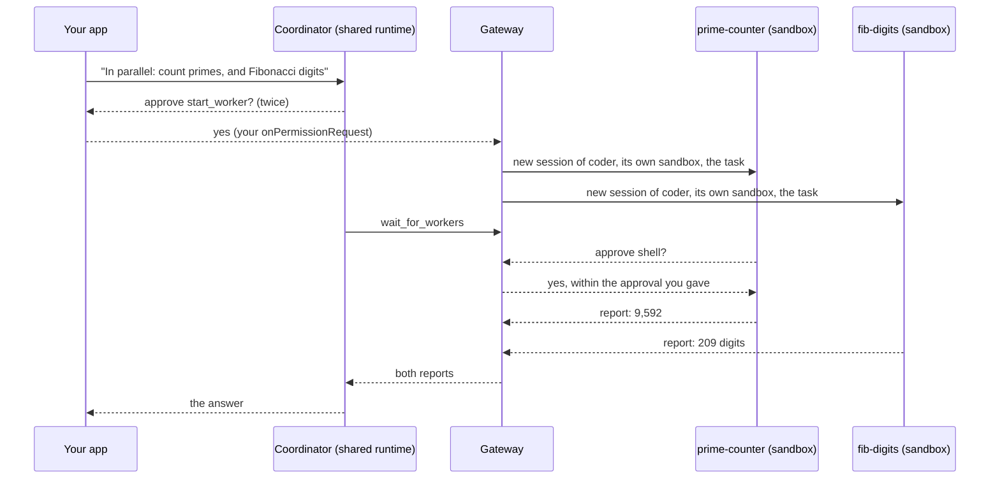
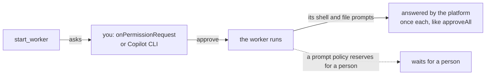

# Orchestrator: split a job across workers

A session in an `orchestrator` environment is a **coordinator**: an agent on the shared runtime that splits a job,
hands each part to a **worker**, and puts their reports together. Each worker is an ordinary session of one of your
isolated environments, in its own sandbox. Your app makes one `sendAndWait` call and gets the finished answer.



This is a live run of [walkthrough 11](../../samples/11-orchestrator/README.md): two workers in two sandboxes, both
done inside one `sendAndWait`.

## Declare one

```ts
environments: {
  coder: { type: "isolated", size: "medium" },
  team: {
    type: "orchestrator",
    workers: ["coder"], // isolated environments its workers run in; the first is the default
    maxWorkers: 3,      // workers one session can have at once (default 4, at most 16)
  },
},
```

The coordinator has no sandbox of its own, so an orchestrator takes no `image`, `size`, or setup. Workers get
everything from their environment: image, size, setup, network rules, vaults, and idle timeout.

## What the coordinator can do

| Tool | What it does |
| --- | --- |
| `start_worker` | Starts a worker with a name and a self-contained task; returns while its sandbox starts |
| `wait_for_workers` | Waits until workers finish, then returns their reports; no polling and no model time |
| `message_worker` | Sends a follow-up to a worker that finished its work (a working one is waited for first) |
| `list_workers` | Shows the worker environments, their agents, and each worker's state |
| `read_worker_file` | Reads a file a worker wrote, or lists a folder |
| `copy_worker_files` | Copies files from one worker's `/workspace` to another's, for example from a builder to a reviewer |
| `stop_worker` | Stops a worker and deletes its sandbox |

## A conversation, not just a job

A coordinator is an ordinary session, so any frontend can talk to it: your app's chat, a pipeline like the software
factory, Copilot CLI (`npx managed-copilot attach <session>`), or a script. Across messages it decides, for each part
of the work, whether to create a sandbox or to reuse one it already has:

- Its instructions list your worker environments (description, size, network, agents), so it picks the right one.
- A follow-up on earlier work goes to the worker that did it (`message_worker`), which still has its files. New,
  independent work, or work that needs another environment, gets a new worker. It stops workers it no longer needs.
- While it waits for workers, a new message from you ends the wait, so it answers right away and the workers keep
  working. Send it with `mode: "immediate"` to reach the coordinator in the same turn.

## Who approves what



- **Starting a worker is the approval.** It comes to your handler like any tool call. Approving it approves the
  worker's work inside its sandbox, which is bounded by that sandbox's network rules and vaults.
- **The coordinator's model never approves anything.** The platform answers worker prompts only within the approval
  you gave, and records each answer as `platform:orchestrator`.
- **A person stays in charge where policy says so.** Prompts that managed policy reserves for a person wait for one:
  attach Copilot CLI to the worker to answer them. The coordinator's reports say when a worker is waiting for a person.

## Workers are sessions

| You can… | How |
| --- | --- |
| List a coordinator's workers | `managed.workers(session).list()`, or `npx managed-copilot workers <session>` |
| Read a worker's files and outputs | `managed.files(worker.id)`, `managed.artifacts(worker.id)` |
| Watch one in Copilot CLI | `npx managed-copilot attach <worker>` |
| Know which coordinator started it | `SessionInfo.parentSessionId` |
| Follow progress | `managed.on("worker.started" \| "worker.idle" \| "worker.failed" \| "worker.stopped")` |

Workers run as you: while a worker has no client of its own, your connected app serves its model calls, then your
background sign-in. Nothing broadens: a worker uses the coordinator's model when its environment allows it, your
client's network narrowing applies to workers too, and workers cannot start workers. Deleting the coordinator deletes
its workers.

> [!TIP]
> **Try it:** [walkthrough 11](../../samples/11-orchestrator/README.md) runs two workers in parallel and prints
> their sandboxes. [Dispatch](../../demos/dispatch/README.md) is a whole app around one coordinator: each message
> shows the sandboxes it created or reused, you approve each new one, and Copilot CLI can join the same conversation.
> The [assistant](../../demos/assistant/README.md) is a coordinator too: it asks before starting a Python or web
> research sandbox for hands-on work, and sends follow-ups to the same one.

<details>
<summary><strong>Under the hood</strong></summary>

- [Spec section 17: orchestrator](../spec/developer-experience.md#17-orchestrator-a-coordinator-with-workers) and its
  contract.
- [Architecture: orchestrator (as built)](../architecture.md#orchestrator-as-built): admission, the worker tools,
  approvals, waiting, cleanup, and recovery.

</details>

---

**Next:** [Identity and access](identity.md) · **Previous:** [Promotion](promotion.md) · **All topics:** [Start here](../README.md)
