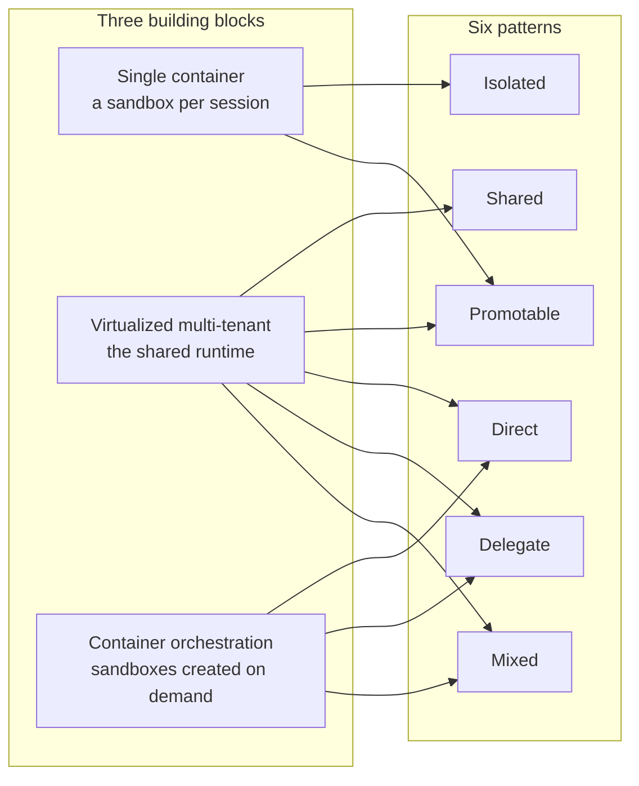
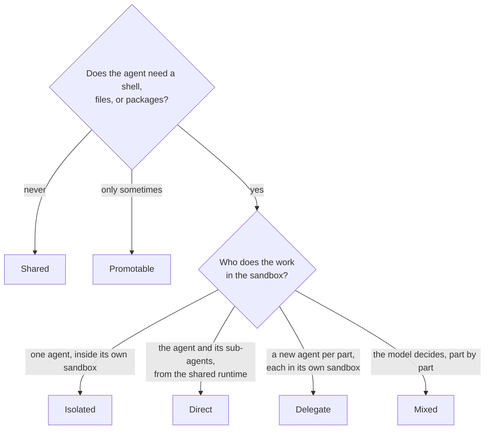

# Patterns: three building blocks, six ways to run an agent

Every way Managed Copilot runs an agent comes from three building blocks: **single containers**, a **virtualized
multi-tenant** runtime, and **container orchestration**. An environment in your AppHost picks how to combine them, and
your code only picks the environment. The same stock `CopilotClient` then gets a different shape: a chat at high
volume, a coding agent in its own machine, or a coordinator that drives sandboxes itself, hands work to new agents, or
does both.



## The three building blocks

| Building block | What it is | What it's good at |
| --- | --- | --- |
| **Single container** | A [sandbox](sandboxes.md) for one session: a Linux workspace with a shell, files, packages, and its own network rules. A Docker container locally, a microVM on Azure | Running untrusted code, builds, and data work, isolated from everything else |
| **Virtualized multi-tenant** | The shared runtime: one stock Copilot runtime process hosting many sessions, each with its own state and identity. No shell, no files; tools run in your app | Starting at once, at high density, with nothing to set up |
| **Container orchestration** | The gateway creating, reusing, and deleting sandboxes while a session runs: when it moves into one, needs hands in one, or starts workers in them | Paying for a sandbox only when the work needs one, and as many as it needs |

## The six patterns

Every agent has a **brain**, its model loop, and **hands**, the tools that act. The patterns differ in where each one
runs.

| Pattern | Its brain runs | Its hands act | Built from | Declare it |
| --- | --- | --- | --- | --- |
| **Isolated** | In its own sandbox | In the same sandbox | Container | `{ type: "isolated" }` |
| **Shared** | On the shared runtime, beside other sessions | Your tools in your app; web fetches and remote MCP servers through the gateway | Multi-tenant | `{ type: "shared" }` |
| **Promotable** | On the shared runtime, then once in its own sandbox | Your tools in your app throughout, plus a shell and files once it moves | Multi-tenant, then a container | `{ type: "promotable", promoteTo: "coder" }` |
| **Direct** | On the shared runtime, with the stock sub-agents it starts | In a sandbox with no agent in it | All three | `{ type: "orchestrator", workers: ["coder"], execution: "direct" }` |
| **Delegate** | On the shared runtime, as a coordinator | Through new agent sessions, each in its own sandbox | All three | `{ type: "orchestrator", workers: ["coder"] }` |
| **Mixed** | On the shared runtime, as a coordinator | In its own sandbox, and through new agent sessions in theirs; the model picks for each part | All three | `{ type: "orchestrator", workers: ["coder"], execution: "mixed" }` |

The repository's own [`apphost.mts`](../../apphost.mts) declares one environment per pattern, so each pattern is one
name away:

```ts
environments: {
  coder:    { type: "isolated", size: "medium" },                                    // Isolated
  chat:     { type: "shared", network: ["learn.microsoft.com"] },                    // Shared
  helper:   { type: "promotable", promoteTo: "coder" },                              // Promotable
  operator: { type: "orchestrator", workers: ["coder"], execution: "direct" },       // Direct
  team:     { type: "orchestrator", workers: ["coder"], maxWorkers: 3 },             // Delegate
  lead:     { type: "orchestrator", workers: ["coder"], execution: "mixed", maxWorkers: 3 }, // Mixed
},
```

```ts
const client = await managed.client("lead"); // the only line that changes between patterns
```

## Which pattern should I use?



| Pattern | Scenarios it fits | Try it | See it in an app |
| --- | --- | --- | --- |
| **Isolated** | A coding agent that edits, builds, and tests a repository; data jobs | [Walkthrough 03](../../walkthroughs/03-sandbox/README.md) | The [software factory](../../demos/software-factory/README.md)'s Classic mode: a sandbox per build task |
| **Shared** | Support, sales, and Q&A chat over your own data, at volume | [Walkthrough 02](../../walkthroughs/02-your-own-tools/README.md) | The factory's planner and reviewer; [Front Desk](../../demos/front-desk/README.md), every person's conversations |
| **Promotable** | An assistant that usually chats but sometimes needs to run code | [Walkthrough 04](../../walkthroughs/04-promotion/README.md) | — |
| **Direct** | A harness with its own planning and sub-agents that must not run code on your host; tight edit-and-run loops | [Walkthrough 12](../../walkthroughs/12-direct-execution/README.md) | [Dispatch](../../demos/dispatch/README.md), **Work directly** |
| **Delegate** | Software factories and research swarms: independent, long-running parts in parallel | [Walkthrough 11](../../walkthroughs/11-orchestrator/README.md) | Dispatch, **Delegate to workers**; the factory's agent-led mode; the [assistant](../../demos/assistant/README.md)'s sandboxes |
| **Mixed** | One conversation that does quick work itself and hands big or differently permitted parts to new agents | [Walkthrough 12](../../walkthroughs/12-direct-execution/README.md) | Dispatch, **Mixed** |

**Bring your own brain.** If you already have an agent loop, keep it in your process and give it hands in a sandbox:
`managed.sandboxes.create` and `managed.exec` use the single-container block directly
([walkthrough 13](../../walkthroughs/13-your-own-harness/README.md)).

## What every pattern shares

- **The same code.** `managed.client("<environment>")` returns a stock `CopilotClient`. Changing the pattern changes
  the environment name, not your code.
- **The same sandboxes, and permissions that never broaden.** Every sandbox gets its environment's image, size, and
  setup, whether a session was placed in it, moved into it, uses it as hands, or runs in it as a worker. Network rules
  and vaults only ever narrow: a worker or hands sandbox gets its environment's, and a promoted session keeps the ones
  it started with, narrowed by its target's ([promotion](promotion.md)).
- **The same controls.** Your `onPermissionRequest` approves the moves that cost or act: a promotion, a new worker, a
  command in a hands sandbox. The [operator console](local-and-azure.md#watch-it-run) and
  [Copilot CLI](copilot-cli.md) show and join sessions of every pattern.

## What doesn't combine

The patterns are the combinations the platform supports. These are not:

- **A coordinator's brain always runs on the shared runtime.** An isolated session can't start workers.
- **Delegation is one level deep.** Workers can't start workers.
- **Promotion moves a session into an isolated environment**, not into a coordinator.

> [!TIP]
> **Try it:** run the six patterns' walkthroughs (`pnpm walkthrough 02`, `03`, `04`, `11`, and `12`) or open
> [Dispatch](../../demos/dispatch/README.md) and send the same request with each of its three styles. `pnpm gallery`
> lists every pattern with its walkthrough and app.

<details>
<summary><strong>Under the hood</strong></summary>

- [Spec: environment types](../spec/developer-experience.md#environment-types) and
  [execution styles](../spec/developer-experience.md#execution-styles-delegate-direct-mixed).
- The building blocks in the gateway: the shared runtime is `services/gateway/src/modules/core/runtime.ts`, sandboxes
  are `modules/sandbox`, and orchestration is `modules/orchestrator`, with `modules/promotion` for the one-time move
  and `modules/orchestrator/hands.ts` for direct and mixed.
- [Architecture: isolated placement](../architecture.md#isolated-placement),
  [promotion](../architecture.md#promotion), and
  [orchestrator](../architecture.md#orchestrator).

</details>

---

**Next:** [Environments](environments.md) · **Previous:** [How it works](how-it-works.md) · **All topics:** [Start here](../README.md)
