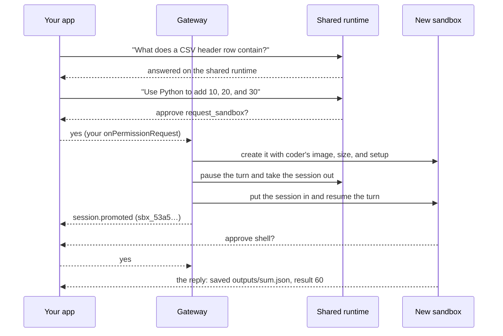

# Promotion: start cheap, move when needed

A session in a `promotable` environment starts on the shared runtime: quick to start, nothing to set up. When the
agent needs a shell or files, the platform moves that same session, once, into a new sandbox. Your
`CopilotSession` object, the session ID, and the conversation stay the same.

This is a live run of [walkthrough 04](../../samples/04-promotion/README.md). Its `sendAndWait` call returned once,
after the work finished in the sandbox.

## Two ways to move

| Trigger | When | How |
| --- | --- | --- |
| The agent asks | Mid-turn, when it needs a shell or files | It calls the `request_sandbox` tool. Your permission handler approves it like any other tool, and the turn continues in the sandbox. |
| You ask | Between turns, on an idle session | `await managed.promote(session)`, or `npx managed-copilot promote <session>` |

`managed.on("session.promoted", e => ...)` tells you when it happened and which sandbox the session moved to.

## What moves, what changes, what never broadens

| Stays the same | Changes | Never broadens |
| --- | --- | --- |
| Session ID and `CopilotSession` object | Placement: shared runtime → its own sandbox | Network: it can only narrow; `network: false` stays off |
| The whole conversation | It gains a shell, files, and packages | Models and approval rules stay the promotable environment's |
| Your tools and handlers | Compute comes from the `promoteTo` environment: image, size, setup | Agents, skills, and instructions stay the ones it started with |

There are no workspace files to carry: a shared session never had a filesystem, so the sandbox starts with a fresh
`/workspace`. Promotion is one way; a promoted session stays in its sandbox.

- An attached Copilot CLI is disconnected during the move and reconnects to the sandbox by itself
  ([Copilot CLI](copilot-cli.md)).
- If the move can't start (the target is unavailable, or other work is still in flight), nothing changes: the
  session keeps running where it was. `managed.promote` on a busy session answers `session_busy`.

> [!TIP]
> **Try it:** [walkthrough 04](../../samples/04-promotion/README.md) asks a question, then a task that needs Python,
> and prints where the session runs before and after.

<strong>Under the hood</strong>

- [Architecture: promotion (as built)](../architecture.md#promotion-as-built): admission, the fence, state export and
  import, and the atomic commit.
- [Spec section 9: the promotion contract](../spec/developer-experience.md#promotion-contract).

---

**Next:** [Orchestrator](orchestrator.md) · **Previous:** [Sandboxes](sandboxes.md) · **All topics:** [Start here](../README.md)
