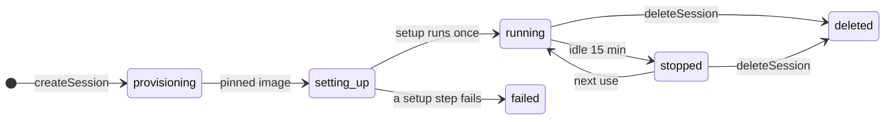
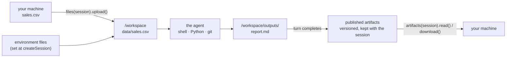
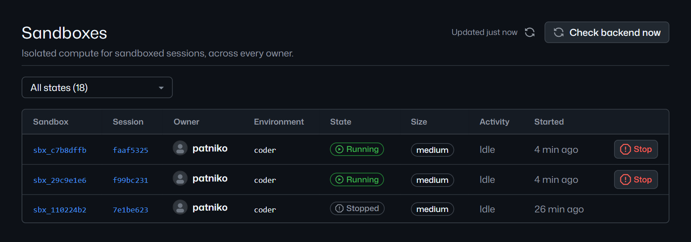

# Sandboxes: lifecycle, files, and results

A sandbox is a Linux workspace that belongs to exactly one session: its own shell, files, packages, and network rules.
The platform creates it with the session, stops it when idle, brings it back on the next use, and deletes it with the
session. There is no warm pool: every sandbox starts fresh from its environment's image.

- **Create.** `createSession` returns only when the sandbox is ready: Python and npm packages installed, files
  written, and `setupCommands` run, in that order. A failing step fails the create with `setup_failed`; you never get a
  half-ready session.
- **Idle stop.** After `idleTimeoutSeconds` (default 900) with no turn running, nothing waiting for an answer, and no
  file transfer in flight, the platform stops the compute and keeps the disks.
- **Resume.** The next message, file call, or attach starts it again from the same pinned image over the same disks.
  Setup does not run again.
- **Delete.** `client.deleteSession(id)` or `managed.sessions.delete(id)` removes the sandbox, its disks, and its
  published files.

## What survives a stop

| Kept | Not kept |
| --- | --- |
| `/workspace`: your files and the agent's | Running processes, servers, and open shells |
| `/home/agent`: home directory, Python venv, npm globals | Anything in memory |
| The session's conversation and runtime state | |

## Files in, results out

- `managed.files(session)` lists, reads, writes, uploads, and downloads workspace files. Paths are workspace-relative.
- When a turn completes, the files under `/workspace/outputs` are **published**: checked, hashed, and copied out of the
  sandbox. `await managed.artifacts(session).waitForPublication()` waits for that, not just for the agent to go idle.
- A file changed in a later turn becomes a new version. `list()` shows the newest; `list({ versions: "all" })` shows
  every version. From a terminal: `npx managed-copilot artifacts <session> --download .\out`.
- Limits: a publication takes up to 256 files, 100 MiB each, 512 MiB in total. Uploads and downloads stream up to 512
  MiB. Small files passed when creating a session: up to 64, 1 MiB each.

## Local and Azure sandboxes

| | Local (`aspire run`) | Azure (`aspire deploy`) |
| --- | --- | --- |
| Compute | A Docker container per session | An Azure Container Apps Sandboxes microVM per session |
| Disks | Docker volumes for the workspace, home, and runtime state | Three data disks that outlive the microVM |
| Network | Its own internal Docker network; out only through the egress proxy | Out only through the egress proxy |
| Idle stop | The container stops; the volumes stay | The microVM is deleted; the disks stay |
| `uname -sm` in a live run | `Linux aarch64` (Docker Desktop on an ARM64 laptop) | `Linux x86_64` |

The agent always runs as the unprivileged user `agent` (uid 10001) in `/workspace`.

The operator console lists every sandbox with its state. Here, two are running and one has stopped after sitting idle:

  

> [!TIP]
> **Try it:** [walkthrough 03](../../samples/03-sandbox/README.md) uploads a CSV, gets a report back as an artifact,
> and shows that a second session gets a second sandbox.

<strong>Under the hood</strong>

- [Architecture: isolated placement](../architecture.md#isolated-placement): sandboxd, the workload user, images,
  setup, idle stop, and artifacts.
- [Deploying to Azure: isolated placement on Azure](../deployment.md#isolated-placement-on-azure): microVMs, disk
  sizes, and egress.
- [Spec sections 4 to 6](../spec/developer-experience.md#4-isolated-a-coding-agent-in-its-own-sandbox): the contract
  for sandboxes, setup, and results.

---

**Next:** [Promotion](promotion.md) · **Previous:** [Environments](environments.md) · **All topics:** [Start here](../README.md)
