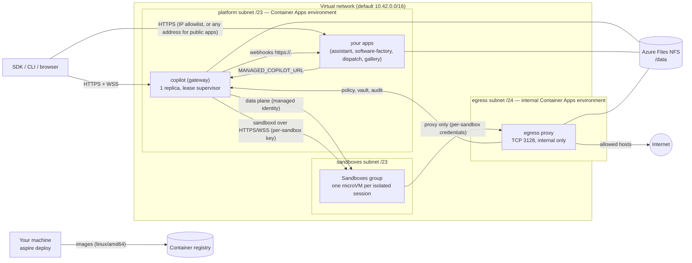

# Deploying to Azure

`aspire run` starts the platform on your machine. `aspire deploy` publishes **the same AppHost** to Azure Container
Apps: the gateway (with its stock shared runtime) behind HTTPS/WSS ingress, your apps, a durable data volume, and an
Azure Container Apps Sandboxes group for isolated sessions. Customer code does not change: `ManagedCopilot.connect()`
reads `MANAGED_COPILOT_URL`, which the deployment sets to the gateway's public URL.

AWS is planned as a second target, not built: see the plan in [deployments/aws](../deployments/aws/README.md).

> **Status.** The root AppHost, all three demos, and the spec snippets that don't need a local webhook receiver run on
> Azure with real models. This is a single-writer deployment, not a highly available one. Capabilities whose backend
> isn't ready aren't advertised and fail with `capability_unavailable`. Details, dates, and remaining limits are in
> [Live qualification](#live-qualification) and the [capability matrix](#capability-matrix).

## What gets deployed



| Resource | Purpose |
| --- | --- |
| Container Apps environment (workload profiles, Consumption) | Runs the gateway and your apps; VNet-integrated (`platform` subnet). Includes the Aspire dashboard. |
| Virtual network | `platform` /23 (the environment), `sandboxes` /23 (the sandbox group's VNet connection), and `egress` /24 (the egress proxy's internal environment). Only `platform` and `egress` have a `Microsoft.Storage` service endpoint. |
| Storage account (FileStorage, Premium SSD v2) + NFS share `managed-copilot` (32 GiB) | Durable state: the gateway at `gateway/`, each app at `apps/<name>/`, proxy CA at `egress/`. NFS 4.1, reachable only from the trusted `platform` and `egress` subnets, not the sandbox subnet; shared-key access disabled. |
| Container registry + pull identity | Holds the gateway, app, egress proxy, and sandbox images. |
| `copilot` container app | The gateway: external HTTPS ingress, exactly one replica, Single revision mode, `/data` on the NFS share, startup/liveness over TCP and readiness over HTTP. |
| One container app per `publishApp` | Your apps (the demos, and the demo gallery at `https://gallery.<environment-domain>`): external HTTPS ingress restricted to `Parameters:app-allowed-ips`, one replica, their own NFS directory. The gallery gets no GitHub token. An app published with `public: true` accepts any address, gets no GitHub token, and is tagged `managed-copilot-access: public` (see "Who can open the apps"). |
| `copilot-gateway-identity` | User-assigned identity of the gateway. Its roles: **Container Apps SandboxGroup Data Owner** on the sandbox group, and **AcrPull** on the registry (for the registry tokens it hands to disk-image imports). |
| Sandboxes group (`Microsoft.App/sandboxGroups`) + VNet connection | Isolated placement. Created only when the AppHost declares isolated environments. |
| Internal Container Apps environment `mc-egress-<suffix>` + `egress` container app | The sandboxes' only way out: the platform's egress proxy (`services/egress`, external mode) on TCP 3128 of the environment's internal load balancer, one replica, linked to the gateway over HTTPS. Created with the sandbox group. |
| Log Analytics workspace | Container logs (both environments). |

## Prerequisites

- An Azure subscription where you can create resources **and role assignments** (Owner, or Contributor plus Role
  Based Access Control Administrator), in a region that offers Container Apps Sandboxes
  (`az provider show -n Microsoft.App --query "resourceTypes[?resourceType=='sandboxGroups'].locations"`).
- Azure CLI, signed in (`az login`); `aspire deploy` uses its credential, and the image step uses `az acr login`.
- Aspire CLI 13.6, Node 24, pnpm 10, and the .NET 10 SDK (the Azure integration in `deployments/azure/hosting` is a C#
  project the CLI builds).
- Docker with BuildKit. Images are built for `linux/amd64`; on ARM64 machines the build stages run natively and only
  the final stages are emulated, so the first sandbox image build takes several minutes.
- `npm config get registry` returns the registry the images install from (it is passed into every build).
- `pnpm install && pnpm build` at the repository root.

## Deploy

> **Shortcut.** From the repository root, `npx managed-copilot deploy` runs the steps below: it checks the tools, fills
> in the subscription, region, resource group, and (on a first deployment) you as a user and operator, passes your
> GitHub sign-in as the apps' token without putting it on a command line, passes the AppHost's own parameters from its
> user secrets the same way (for example OAuth clients; not the platform's generated keys or values the deployment
> already keeps), and runs `aspire deploy`.
> `npx managed-copilot access` shows and changes who may use it, operate it, and open its apps
> ([CLI reference](../libraries/cli/README.md#deploy-and-share)). The manual steps:

1. Choose where it goes (stored in the AppHost's user secrets; `aspire deploy` prompts for anything missing):

   ```powershell
   aspire secret set Azure:SubscriptionId <subscription-id>
   aspire secret set Azure:Location westus2
   aspire secret set Azure:ResourceGroup managed-copilot-dev
   ```

2. Say who may use it. A deployed gateway is on the Internet, so `aspire deploy` refuses to publish one without access
   rules. Set them at deploy time (comma-separated GitHub logins or organizations; the root AppHost declares none of
   its own), or declare `access: { githubUsers: [...] }` / `{ githubOrgs: [...] }` in your own `addManagedCopilot`:

   ```powershell
   aspire secret set Parameters:copilot-github-users your-login
   # or: aspire secret set Parameters:copilot-github-orgs your-org
   ```

   `aspire deploy` runs the AppHost as Production, and with Aspire CLI 13.6.4 it doesn't load user secrets there, so
   these settings, and any other parameter kept only in user secrets, can be missed ("has no access rules" although
   `aspire secret list` shows them). Pass them in the environment too, as `npx managed-copilot deploy` does (`:` becomes
   `__`):

   ```powershell
   ${env:Parameters__copilot-github-users} = "your-login"
   ${env:Parameters__copilot-operator-users} = "your-login"
   ```

3. If the AppHost publishes apps that act as your account (the root AppHost's demos do), set that account. Their
   public address is restricted to this machine's public IPv4 address unless you choose the addresses. Apps published
   with `public: true` need neither (see "Who can open the apps"):

   ```powershell
   ${env:Parameters__app-github-token} = (gh auth token).Trim()   # credential stays out of command arguments
   aspire secret set Parameters:app-allowed-ips "203.0.113.7/32"   # optional; "*" allows any address
   ```

4. Deploy:

   ```powershell
   aspire deploy
   ```

   The pipeline provisions the registry and the environment, builds and pushes the sandbox and egress proxy images
   (only those the registry does not have yet), provisions everything else, deploys the containers, and prints the
   platform URL and who can open the apps:

   ```text
   Managed Copilot: https://copilot.<environment-domain> (ManagedCopilot.connect({ url }), MANAGED_COPILOT_URL, or managed-copilot attach --url)
   Apps open to: 203.0.113.7/32: software-factory, dispatch, assistant, gallery (change with Parameters:app-allowed-ips)
   Public apps: https://front-desk.<environment-domain> (any address; they sign in their own users)
   ```

   The last line appears when the AppHost publishes public apps.

Connect to it exactly as you would locally:

```ts
const copilot = await ManagedCopilot.connect({ url: "https://copilot.<environment-domain>" }); // or MANAGED_COPILOT_URL
```

To watch the deployment, name its operators (`aspire secret set Parameters:copilot-operator-users your-login`, or
`operators` in `addManagedCopilot`), deploy, and open the operator console:

```powershell
npx managed-copilot console --url https://copilot.<environment-domain>
```

Redeploying (`aspire deploy` again) builds a new revision of each app; the gateway's lease hands its data volume to the
new revision (see "Durable state"). `aspire deploy --clear-cache` deploys again without the cached deployment choices
(it asks for them again).

### Configuration and secrets

| Setting | Required | Meaning |
| --- | --- | --- |
| `Parameters:<name>-github-users`, `Parameters:<name>-github-orgs` | One of them, unless the AppHost declares `access` | GitHub accounts or organizations allowed to use the platform. |
| `Parameters:<name>-operator-users`, `Parameters:<name>-operator-orgs` | No | GitHub accounts or organizations that may open the operator console and operator API (spec section 16), added to the AppHost's `operators`. Without any, the deployed console stays off. Operators must also be allowed to use the platform. |
| `Parameters:app-github-token` | When the AppHost publishes an app that acts as your account (one that isn't public and doesn't set `githubToken: false`) | Secret. The GitHub token those apps use (`MANAGED_COPILOT_GITHUB_TOKEN`). |
| `Parameters:app-allowed-ips` | No | IPv4 CIDRs allowed to reach the ingress of every app that isn't public (comma-separated), or `*`. Default: this machine's public IPv4 address as `api.ipify.org` reports it, looked up only when such an app exists. The platform subnet is always allowed (webhooks). |
| `Parameters:<name>-address-space` | No | The VNet's /16 (default `10.42.0.0/16`). Fixed after the first deploy. |
| `Parameters:<name>-durable-key`, `Parameters:<name>-vault-key` | No | Secrets, 32 bytes base64. Generated and persisted with the deployment when not set, so the sealing keys never sit beside the sealed values on the NFS share. A deployment that predates them had its keys generated into `/data`. Its next gateway wraps each key file that still seals stored data under these parameters (`durable.key.wrapped`, `network/vault.key.wrapped`). The following `aspire deploy` deletes the plaintext files once a gateway that reads the wrapped keys has served for 15 minutes (so a failed rollout's fallback is never left without them). A stale key file the parameter already replaced is renamed `.replaced`. Earlier vaults and background sign-ins stay readable. Keep these parameters: without the right one the gateway refuses to start. |
| `Parameters:google-client-id`, `Parameters:google-client-secret` | No | The assistant demo's Google sign-in. Add `https://assistant.<environment-domain>/api/google/callback` as a redirect URI. `npx managed-copilot deploy` passes them from the AppHost's user secrets on the deployment that first uses them; after that, see "Changing a saved parameter". |
| `Parameters:<name>-platform-key`, `Parameters:<name>-egress-key`, and the AppHost's generated secrets | Generated | Kept in the AppHost's user secrets and deployment state; deployed as Container Apps secrets (`secretRef`), never in plain configuration. The egress key links the egress proxy to the gateway. |

Every AppHost secret parameter reaches the gateway as a Container Apps secret, and its `MANAGED_COPILOT_CONFIG` holds
only `{ secretEnv }` references. Webhooks that point at a local app (`http://localhost:<port>/...`) are rewritten to that
app's HTTPS address (`https://<app>.<environment-domain>/...`; calls between apps stay inside the environment, and the
gateway fills in the domain when it starts); a loopback webhook with no published app on that port fails the deploy
with the fix.

### Changing a saved parameter

Aspire saves the parameter values a deployment used with its deployment state (under
`~/.aspire/deployments/<SHA-256 of the lowercased AppHost path>/`) and reuses them on later deploys, ahead of the
AppHost's user secrets and the environment. So a changed user secret, or `Parameters__<name>` in the environment, doesn't
replace a saved value by itself. To make a parameter replaceable (a rotated OAuth client secret, say), have the AppHost
pass the environment's value explicitly when there is one, as `publishApp` does for `Parameters:app-github-token`:

```ts
const name = "google-client-secret";
const replacement = process.env[`Parameters__${name}`]; // set only when replacing; never on a command line
const clientSecret = await builder.addParameter(name, { secret: true, ...(replacement ? { value: replacement } : {}) });
```

Then deploy with the new value in the environment:

```powershell
${env:Parameters__google-client-secret} = Read-Host "New Google client secret" -MaskInput
npx managed-copilot deploy
Remove-Item Env:Parameters__google-client-secret
```

Don't edit the deployment state by hand: it also holds the platform's keys (`<name>-platform-key`, `-durable-key`,
`-vault-key`, `-egress-key`), and without them the gateway can't read what it sealed.

### App credentials and rotation

The demo apps use the selected account's token, not a fallback service account. A GitHub CLI OAuth token can have broad
scopes such as `repo`, `workflow`, and `user`; it is suitable for a controlled, IP-restricted evaluation, not a
least-privilege recommendation. For a long-running deployment, use a dedicated credential for the intended account
with only the permissions its repositories, Copilot access, and integrations actually require. Validate that
credential against the platform and a real model before revoking the old one; not every token type grants the same
Copilot access.

The Aspire user-secret key is `Parameters:app-github-token`. `aspire secret set` manages user secrets, but its value is
a positional argument: do not paste a token into that command, shell history, deployment scripts, or logs. An explicit
`Parameters__app-github-token` environment value overrides Aspire's previously cached deployment parameter. For
example, in PowerShell 7:

```powershell
${env:Parameters__app-github-token} = Read-Host "Replacement token for the same GitHub account" -MaskInput
try {
    aspire deploy
    if ($LASTEXITCODE -ne 0) { throw "Deployment failed; do not revoke the old credential yet." }
} finally {
    Remove-Item Env:Parameters__app-github-token
}
```

The value is delivered as a secure deployment parameter and a Container Apps secret reference, never a Bicep output
or sandbox variable. Treat local Aspire user-secret and deployment-state files as sensitive; do not commit, export,
or print them, enable trace logging around secrets, or dump container environments.

Verify that a **new ready revision** is serving and both apps authenticate before revoking the old credential.
Updating the Container Apps secret and restarting the existing revision alone did not refresh its credential in the
live qualification; redeployment into a new revision did.

An already-enabled background sign-in also stores a sealed copy of the credential in the gateway. Renew that existing
grant with `npx managed-copilot login --url <gateway-url>` using the updated sign-in (for example, supply the
replacement through `MANAGED_COPILOT_GITHUB_TOKEN` for that command). Login replaces an enabled grant without revoking
it first; toggling background work off would pause its schedules. Do not re-enable background work if the account has
turned it off. Rotating only the apps' secret does not rotate this stored grant. Expiry or revocation pauses background
work with an explicit sign-in error; this deployment does not implement automatic GitHub App credential refresh.

### Publishing your own apps

`addManagedCopilot` handles the platform. Apps that use it are ordinary Aspire resources; to deploy one with a durable
directory, the lease supervisor, and an IP allowlist (or public ingress), publish it with `publishApp` in publish mode:

```ts
import { addManagedCopilot, publishApp } from "@managed-copilot/aspire";

const copilot = await addManagedCopilot(builder, "copilot", { /* ... */ });
if (await builder.executionContext().isPublishMode()) {
  await publishApp(builder, copilot, {
    name: "web",
    dockerfile: "web/Dockerfile",      // relative to the repository root (the build context)
    port: 3000,                        // also the port loopback webhooks name
    healthPath: "/healthz",            // readiness: 200 when the app serves
    publicUrlEnv: "WEB_PUBLIC_URL",    // optional: the app's own https URL
    allowedHostsEnv: "WEB_ALLOWED_HOSTS",
    // public: true,                   // for an app that signs in its own users: any address, no GitHub token
  });
} else {
  // aspire run: builder.addNodeApp(...).withEnvironment("MANAGED_COPILOT_URL", copilot.url)
}
```

The app's image should start with the lease supervisor (see `demos/assistant/Dockerfile`), keep its state under
`/data`, and listen on `PORT`. By default it acts as `Parameters:app-github-token` and opens only from
`Parameters:app-allowed-ips`; `githubToken: false` keeps it behind the allowlist without the token, and `public: true`
opens it to any address without the token (see "Who can open the apps").

### Azure AI Foundry and your app's own users

Environments with `inference: { foundry }` send their model calls to an Azure AI Foundry account you own, billed to
its subscription, and are the only ones your app's own users (people without GitHub) can use
([spec section 15](spec/developer-experience.md#15-models-and-billing),
[your app's own users](spec/developer-experience.md#your-apps-own-users)). The account and its model deployments are
yours: the platform never creates or changes them. An AIServices account with a custom subdomain works, for example:

```powershell
az cognitiveservices account create --subscription <subscription-id> -g contoso-ai -n contoso-foundry -l westus2 `
  --kind AIServices --sku S0 --custom-domain contoso-foundry
az cognitiveservices account deployment create --subscription <subscription-id> -g contoso-ai -n contoso-foundry `
  --deployment-name gpt-5-mini --model-name gpt-5-mini --model-version <version> --model-format OpenAI `
  --sku-name GlobalStandard --sku-capacity 50
```

Declare the account, the environments that use it, and the apps that act for their own users:

```ts
const copilot = await addManagedCopilot(builder, "copilot", {
  foundry: { "contoso-foundry": { resourceGroup: "contoso-ai", deployments: ["gpt-5-mini"] } }, // subscription: optional
  environments: { support: { type: "shared", inference: { foundry: "contoso-foundry" } } },
  apps: { "support-site": { environments: ["support"], anyGitHubUser: true } },
});
await publishApp(builder, copilot, { name: "support-site", dockerfile: "support-site/Dockerfile", port: 3000, healthPath: "/healthz", app: "support-site" });
```

- **Model calls.** `aspire deploy` gives the gateway its user-assigned identity and grants it **Cognitive Services
  OpenAI User** on each declared account, with a deployment into the account's own resource group (and subscription).
  You need permission to assign roles there (Owner, User Access Administrator, or Role Based Access Control
  Administrator). An account that names no `subscription` is in the deployment's (`Azure:SubscriptionId`). With
  `aspire run`, the gateway uses your Azure CLI sign-in instead (`az login`, with at least Cognitive Services OpenAI
  User on the account); it asks for tokens in the account's subscription, so the right tenant is used.
- **App keys.** Each app's key is the generated secret parameter `Parameters:<name>-app-<app>-key`, kept with the
  deployment like the other generated secrets. `publishApp(..., { app })` (or, with `aspire run`,
  `.withEnvironment("MANAGED_COPILOT_APP_KEY", copilot.appKey(app))`) gives the app its key as a secret. To replace a
  key, give the parameter a new value of at least 32 characters (an environment value such as
  `Parameters__copilot-app-support-site-key` for `aspire deploy`; never on a command line) and deploy again.
- **Who gets in.** The gateway still admits only the GitHub accounts in its access rules directly. An app's own users
  come in only through its key, and `anyGitHubUser: true` admits any GitHub account through that app's key alone.
- **Checking it.** `/v1/info` lists `foundry` and `apps` in its capabilities, each Foundry environment's `inference`,
  and its deployments as `models`. The gateway logs "Foundry account ready" for each account it can use, or the
  problem (a missing account, deployment, or role assignment); `SessionInfo.inference` says where each session's
  model calls go.

## Durable state

The gateway keeps its ledger (SQLite, WAL), the stock runtime's session state, vault and durable keys, artifacts, and
customizations on an **Azure Files NFS 4.1** share mounted at `/data`.

- **Why NFS.** SQLite needs working POSIX byte-range locks, and the runtime's session store needs POSIX permissions and
  renames. Azure Files SMB failed for exactly this in the previous Copilot SDK Aspire deployment (locking errors).
  NFS 4.1 implements byte-range locks (`fcntl`), and the supervisor limits the database to a single active host
  (below). The live locking and recovery probes qualify this specific mount and deployment, not arbitrary SQLite
  WAL use over a network filesystem. A managed database would have meant replacing the gateway's storage layer;
  the NFS deployment keeps that layer unchanged.
- **Single writer.** Container Apps can run an old and a new revision side by side during a deployment, and can pre-warm
  a replacement replica during maintenance, even with one replica. The image's entrypoint is a lease supervisor
  (`deployments/azure/src/lease`): it holds an exclusive SQLite lock on `/data/.lease/gateway.lease` for the life of the
  process and starts the gateway only while it holds the lease, with a fencing generation and a heartbeat every 5 s. A
  detected lease or heartbeat failure terminates the gateway and its process group. A waiting replica answers `503`
  (readiness fails, so it gets no traffic). A newer deployment (higher `MANAGED_COPILOT_LEASE_STAMP`, set per publish) asks the holder to hand
  over; an older one never takes the lease while a newer one waits; and if the newer replica never takes it, the old
  holder reclaims it and refuses that deployment for 10 minutes instead of flapping. The gateway runs in its own
  process group, and the lease is released only after every process in it (including the shared runtime) has exited.
  The demos' images use the same supervisor for their own directories.
- **Qualification.** `node /opt/managed-copilot/azure/dist/probe/main.js` (in the gateway container; `--dir <path>`
  picks another directory than a fresh one under `/data/.probe`) checks POSIX metadata, atomic rename, fsync,
  cross-process lock exclusion, SQLite WAL and rollback journals under concurrent writers, and crash recovery, and
  prints a JSON report. The deployed Azure NFS share passed all ten checks, including directory fsync and recovery
  from a killed SQLite writer. A separate, non-serving diagnostic revision on a different kernel and NFS client
  could not acquire the serving gateway's lease. It was then deactivated, and Single revision mode and normal
  traffic restored. This proves healthy cross-host exclusion, not unrestricted multi-host WAL safety.

**Limits.** One gateway replica: no horizontal scale-out, and a handover (deploy, restart, or maintenance) makes the API
unavailable for seconds to tens of seconds while the new replica takes the lease and starts. Durable actions, webhooks,
and schedules persist across it; open WebSocket streams reconnect. The share is zone-redundant only if you choose a ZRS
account; the default is LRS. Back up the share with Azure Files snapshots if you need point-in-time recovery.
Network partitions and NFS-server lock loss were not fault-injected; do not treat the lease as a partition-tolerant
HA guarantee or run multiple active writers.

## Isolated placement on Azure

Isolated sessions run in **Azure Container Apps Sandboxes** (`Microsoft.App/sandboxGroups`): one microVM per session in
the deployment's sandbox group (`services/gateway/src/modules/sandbox/providers/azure`, selected with
`MANAGED_COPILOT_SANDBOX_PROVIDER=azure`). It was chosen from the spec's Azure candidates (Container Apps dynamic
sessions, Container Apps jobs, managed session-worker containers) because it gives per-session microVMs, data disks that
outlive their compute, and a default-deny egress engine. Managed session-worker containers remain a candidate fallback,
not an implemented or automatic alternative.

- **Images.** `aspire deploy` builds the base sandbox image, each isolated environment's own `image` folder FROM it, its
  `packages.system` in a layer of their own (as `aspire run` does), and an Azure layer (`deployments/azure/sandbox`) on top,
  for `linux/amd64`, tagged by content and pushed to the registry. The gateway imports each into a disk image when it
  starts (`prepare`), pinned per sandbox. An environment that declares system packages never falls back to the base
  image. The service cannot pull with a managed identity, so the gateway exchanges its own Entra token for a
  short-lived registry token (its identity has AcrPull) and passes it with each import; no registry secret is stored.
- **Per-session isolation.** Each sandbox is its own microVM. sandboxd starts as root and runs every workload process as
  uid 10001 through `setpriv` with `no_new_privs` and empty capability sets; the image has no setuid files. A sandbox's
  platform-managed VM address is not a routable address for a different sandbox.
- **Persistent state.** Three data disks per sandbox (`/workspace`, `/home/agent`, `/var/lib/managed-copilot`). The
  Azure layer seeds an empty disk from the image on first boot. Idle stop deletes the microVM and keeps the disks;
  resume creates a new microVM from the pinned image over the same disks. Deleting the session deletes the disks.
  Azure allows at most 20 GiB of disk (root plus data disks) per vCPU, so the defaults are: small (1 vCPU) 6 GiB root,
  8 GiB workspace, 4 GiB home, 2 GiB state; medium (2 vCPU) 8, 20, 8, 4; large (4 vCPU) 10, 50, 14, 6.
  `MANAGED_COPILOT_AZURE_SANDBOX_DISKS` on the gateway overrides them (for example
  `{"medium":{"workspace":"16Gi"}}`), and the gateway refuses sizes over the budget when it starts.
- **Gateway connectivity.** The gateway reaches each sandbox's sandboxd (HTTP and WebSocket) through the sandbox's port
  URL (`https://<sandbox>--7781.<region>.adcproxy.io`), authenticated with a per-sandbox key that only the gateway and
  that sandbox hold. `MANAGED_COPILOT_AZURE_INGRESS_CIDRS` can also restrict the port to given source addresses.
- **Credentials (option C).** The GitHub token never enters a sandbox. Model calls are brokered through the gateway
  (`llmInference`), as locally, so they need no direct network access from the sandbox.
- **Egress.** Every sandbox gets a platform egress policy that denies all HTTP(S) and allows one TCP destination: the
  egress proxy's internal address on port 3128 (`MANAGED_COPILOT_AZURE_EGRESS_PROXY`). The proxy is the same
  `services/egress` as locally, in external mode: sandboxd's `HTTP(S)_PROXY` carries per-sandbox credentials, so the
  proxy enforces each environment's allowlist, injects vault credentials, reports `network.blocked`, and applies policy
  changes live, while the platform policy keeps a sandbox that ignores its proxy settings off the Internet. Limits: DNS
  resolution stays available to sandboxes (connections still need the proxy); the proxy sees translated source
  addresses, so the platform does not pin credentials to a sandbox's address (the per-sandbox credential still
  authenticates every request). The proxy's CA is stored in the NFS share's `egress/` directory. An init container
  makes only that mounted directory writable by uid 1000; the proxy remains non-root. Atomic CA creation makes
  overlapping revisions share the same key pair. An intentional CA rotation still requires sandbox re-registration.

Qualification (2026-10-24, westus2): a probe deployment (`deployments/azure/qualify`) checked the service directly, and a
gateway using this provider passed the isolated end-to-end suite (`deployments/azure/qualify/isolated.live.ts`: session
create in about 8 s, a real model reply, files, uid 10001, idle stop, and resume over the same disks in about 8 s).

## Who can open the apps

A published app is one of two kinds, chosen in the AppHost:

| | Allowlisted (the default) | Public (`public: true`) |
| --- | --- | --- |
| For | Apps with no sign-in of their own. They act as the GitHub account in `Parameters:app-github-token`, or hold no account (`githubToken: false`, like the gallery) | Apps that sign in their own users: with each user's own GitHub token, or users the app vouches for with an app credential |
| Who can open it | The addresses in `Parameters:app-allowed-ips` (default: this machine's public address, which `aspire deploy` prints), plus the platform subnet for webhooks | Any address |
| GitHub token | `Parameters:app-github-token` as `MANAGED_COPILOT_GITHUB_TOKEN`, unless `githubToken: false` | Never: `githubToken: true` is refused, and `MANAGED_COPILOT_GITHUB_TOKEN` is never passed through `env` |
| `npx managed-copilot access ips` | Changes its allowlist at once | Never applies; `access` lists it under **Public apps** |

Networks that send Azure traffic through a corporate tunnel (a VPN or Microsoft Entra Global Secure Access, for
example) reach Azure from different addresses than the rest of the Internet, often a rotating pool. Allowlisted apps
then answer some or all requests with `403 RBAC: access denied`. Set `Parameters:app-allowed-ips` to the ranges your
network uses for Azure (ask your network team, or see "Troubleshooting") and deploy again. Everyone else behind those
addresses can reach the apps too.

### Public apps

An app built for other people signs its users in itself, so it doesn't need the allowlist:

```ts
await publishApp(builder, copilot, {
  name: "front-desk",
  dockerfile: "demos/front-desk/Dockerfile",
  port: 7450,
  healthPath: "/api/health",
  public: true, // any address can open it; it gets no GitHub token
});
```

- **Ingress.** Its container app has no IP rules and is tagged `managed-copilot-access: public`. `aspire deploy`
  prints its URL under "Public apps", `npx managed-copilot deploy` lists it when it's done, and the gallery labels it
  Public. Nothing at deploy time opens or narrows it: the AppHost decides, so it's reviewed like any other code change.
- **Identity.** It never holds the deployer's token. It calls the platform as each signed-in user:
  `managed.client(environment, { gitHubToken: user.githubToken })` with that user's own GitHub token (the platform's
  access rules must admit them), or as users it vouches for with an app credential.
- **The other apps keep their protection.** Apps that act as your account stay behind `Parameters:app-allowed-ips`;
  only an explicit `"*"` opens them, and `access ips set "*"` asks first.
- **Switching an app that acts as your account takes two deploys.** Container Apps applies ingress to every revision
  at once, while the token leaves only with the new revision, so opening the app in the same deploy would expose the
  old revision, token and all, until the new one took over. Before a public app's ingress changes, `aspire deploy`
  lists the app's active revisions and stops if one still holds `MANAGED_COPILOT_GITHUB_TOKEN`. Deploy it first with
  `githubToken: false` (still behind the allowlist), then with `public: true`.

Verified on Azure on 2026-11-04 with [`deployments/azure/qualify/public-apps`](../deployments/azure/qualify/public-apps/README.md)
(see "Live qualification").

Alternatives when an address allowlist does not fit an app that has no sign-in of its own:

- **Container Apps authentication (Easy Auth).** Configure Microsoft Entra ID or GitHub sign-in and restrict it to the
  intended accounts before removing IP restrictions. This needs an Entra app registration or a GitHub OAuth app.
  Also configure machine-to-machine access for gateway webhooks: an interactive sign-in redirect would otherwise
  block their delivery. This alternative is not part of the default deployment and has not been qualified here.
- **Run the apps locally against the Azure platform.** The gateway itself needs no allowlist: it requires a GitHub
  sign-in that matches its access rules. Run a demo on your machine with `MANAGED_COPILOT_URL` set to the gateway URL
  (for example `$env:MANAGED_COPILOT_URL = "https://copilot.<environment-domain>"; pnpm --filter @managed-copilot/demo-assistant start`).
  Webhooks cannot reach your machine, so the assistant picks up offline tool calls by polling.

## Capability matrix

| Capability | `aspire run` (local) | `aspire deploy` (Azure) |
| --- | --- | --- |
| Gateway API, HTTPS/WSS ingress, GitHub sign-in, access rules | Yes (HTTP on localhost) | Configured-account SDK access verified; live two-account isolation is not qualified here |
| Shared sessions (stock shared runtime) | Yes | Real tools and streaming; conversation history survives a gateway revision |
| Durable state across restarts and redeploys, single writer | Yes (local disk) | NFS 10/10, healthy cross-host lease exclusion, revision canaries, and workspace/HOME/Python/native-history recovery after isolated compute replacement; no partition-tolerant HA claim |
| Durable actions, webhooks, schedules | Yes | Polling without duplicate execution; assistant's tab-closed webhook and reminder; one automatic scheduled occurrence completes exactly once after gateway replacement |
| Isolated sessions (`network: false`) | Yes (Docker) | Real model/files/idle-replacement probe passes; network-denied CONNECT returns 403 while inference works |
| Isolated sessions with network allowlists or vault credentials | Yes (egress proxy) | Enabled network returns 200; vault substitution and response redaction pass; CA fingerprint is unchanged across proxy revisions |
| Files and artifacts in sandboxes | Yes | File injection, upload/read, report output and real PNG artifact pass |
| Promotion (shared → isolated) | Yes | Explicit promotion and continuation pass; broader interactive CLI continuity is a separate gate |
| Orchestrator environments (coordinator with workers in their own sandboxes) | Yes (Docker; snippet 14 and every orchestrator tool live) | Yes: snippet 14, walkthrough 11, and every orchestrator tool passed (2026-10-27). Workers run in Container Apps Sandboxes, and their files move through the sandbox file API, not a shared disk. A gateway restart during worker runs has been tested only locally |
| Direct and mixed orchestrators (the coordinator's own hands sandbox) | Yes (Docker; snippet 15, walkthrough 12, and `subagents: "own"` live) | Not yet run; no provider change: hands sandboxes are workspace-only sandboxes reached through the exec and file APIs |
| CLI attachment | Yes (AHP relay) | Non-interactive AHP probe passes for shared and isolated sessions; this does not claim a complete interactive terminal qualification |
| Your app's own users and Azure AI Foundry (`apps`, `inference: { foundry }`) | Yes (`az login`; shared and Docker sandboxes) | Yes (2026-11-04): the gateway's managed identity with the role `aspire deploy` assigns; shared and Container Apps sandbox sessions, app users, refusals, and `anyGitHubUser` admission |
| Warm sandboxes (`warm > 0`) | No | No |
| Demos (software factory, assistant, Dispatch) | Yes | Happy paths, factory connection recovery and explicit checkpoint Retry after interrupted execution pass; the factory's agent-led mode and Dispatch pass with their workers in Container Apps Sandboxes; assistant uses labelled demo Google data, and its sandboxes (added 2026-10-27) are verified locally only |
| Public apps (`publishApp({ public: true })`) | Not applicable (apps run on localhost) | Yes (2026-11-04): open to any address with no deployer token, beside an app that keeps the allowlist |

## Live qualification

> **Summary.** The root AppHost deploys and both demo happy paths pass in westus2 (2026-10-24), using stock
> SDK 1.0.26 and runtime 1.0.103 with real models. Eleven spec snippets pass; two local-webhook snippets are skipped,
> with the deployed assistant's webhook and reminder journeys checked separately. Orchestrator environments (snippet
> 14 and every orchestrator tool) passed on 2026-10-27, as did two apps built on them: Dispatch and the factory's
> agent-led mode. The assistant's sandboxes, also built on them, have not been checked on Azure yet. NFS locking,
> revision recovery, and persistent proxy trust have been exercised. This is a single-writer deployment, not a
> partition-tolerant HA claim; the evidence and remaining limits are below. Capabilities whose backend is not ready (for
> example isolated sessions before the sandbox group and its role assignment work) are not advertised in `/v1/info`,
> and requests for them fail with `capability_unavailable` naming what is missing.
>
> **Recovery contract.** A gateway-only rollover recovered both services in 26.3 seconds without restarting the
> factory. A native turn cut off by runtime replacement is ended visibly as failed/idle, not left falsely running.
> Retained files and history support a new, workspace-checking continuation or checkpoint Retry; they do not resume
> a killed process. The preserved Azure work order completed through explicit Retry with its original builder
> sessions and a 44-test release. Unknown external effects still require reconciliation, not blind replay.

The checks below used the deployed platform and real model calls, not a fake backend (westus2, 2026-10-24):

| Check | Result |
| --- | --- |
| `aspire deploy` | All 37 pipeline steps succeeded; normal entrypoint, Single revision mode, latest ready gateway receiving 100% of traffic |
| Spec snippets 01-09, 11, 13 | **11 passed**: genuine SDK objects/tools/streaming, repository work, setup, artifacts, network/vault behavior, promotion, resume, durable polling, and AHP attach |
| Spec snippets 10 and 12 | **2 skipped**, not passed: they require the local spec snippets receiver and its `COPILOT_WEBHOOK_SECRET`, deliberately not published by the root AppHost |
| Isolated idle/recreate probe | **8/8 passed** in Phase A; real-model create and resume each took about 8 seconds; compute was replaced over retained disks |
| Explicit isolated compute replacement | A new microVM retained the same three data disks, workspace and HOME markers, declared Python package version, and conversation-only native history marker; workload remained uid 10001 before and after |
| NFS and lease | **10/10 storage checks**; a second host's contender was excluded while the original gateway served |
| Gateway revision canaries | One shared conversation retained its marker; two isolated sessions retained different files at the same path and their distinct sandbox identities |
| Scheduled recovery | A one-shot schedule created before redeployment automatically completed exactly once on the replacement gateway, using the renewed same-account background credential |
| Proxy trust | Identical CA fingerprint across two real proxy revisions; NFS directory owned by uid 1000 with mode 0700; proxy remains non-root |
| Gateway-only rollover | Latest check: gateway interruption about 17 seconds; factory recovered 9 seconds after the gateway served (26.3 seconds total), then stayed healthy for 20 seconds. Same factory replica, zero restarts |
| Software factory | Initial happy path: **9 files, 37/37 tests**, parallel builds and a reviewer-requested fix/review loop (319 seconds). A checkpoint retry produced a 37-test release, independently checked offline |
| Interrupted factory work | The previously stuck native turns became **failed/idle** with their original turn IDs. Explicit checkpoint Retry retained both builder session IDs, verified the current workspace, passed review/fix rounds and produced a downloadable **9-file, 44/44-test** release. No killed-process continuation or unknown-effect replay is claimed |
| Assistant | Browser triage, approval before a demo calendar action, background-work consent, one-minute reminder, and tab-closed webhook handling passed; light/dark/mobile views checked |
| Orchestrator (2026-10-27) | Snippet 14 (34 s) and walkthrough 11 (50 s) passed, each worker in its own sandbox. A run of every orchestrator tool passed 10/10 checks: a builder's script read with `read_worker_file`, copied to a second worker's sandbox with `copy_worker_files` and run there after `message_worker`, worker prompts answered as `platform:orchestrator`, `stop_worker` deleting the builder's session, and deleting the coordinator deleting the other |
| Software factory, agent-led (2026-10-27) | Run from this machine against the deployed gateway (the apps' allowlist excluded this machine's tunnel). The coordinator created two builders and later a release worker, each in its own Container Apps sandbox. It reused one builder for two fix rounds until the second-model review approved it, then copied both builders' files into the release sandbox. Completed in 541 s: **9 files, 47/47 tests**, which also passed in an offline, read-only container. The coordinator stopped all three workers afterwards |
| Apps and Azure AI Foundry (2026-11-04) | A deployment of its own (gateway, two Foundry environments, a Copilot environment, an app with `anyGitHubUser`, access limited to another account) in its own resource group, deleted afterwards. `aspire deploy` granted the gateway's identity Cognitive Services OpenAI User on an existing Foundry account in another resource group, and the gateway reported it ready. With real model calls to its `grok-4.7` deployment, all 23 checks passed in one run: an app user's shared session with a tool call and a resume; a command in a Container Apps sandbox whose model calls the gateway brokered to Foundry; isolation between app users; refusals of Copilot-billed environments, background sign-in, schedules, and Copilot CLI attach; and a GitHub account outside `access` refused directly but admitted through the app, with a Foundry session and a Copilot session on its own plan. (An earlier run lost one connection before it reached the gateway; the SDK's bridge now reports such failures as `capability_unavailable` with the cause.) |
| Dispatch (2026-10-27) | The deployed app started and connected to the gateway. This machine's network tunnel reaches the apps from an address outside their allowlist, so the app was driven through its own API from inside its container (`az containerapp exec`). Two approved requests each created a worker in its own sandbox: Python (`dispatch-python`) and web research (`dispatch-web`, which read en.wikipedia.org through its allowlist). A follow-up typed in Copilot CLI, attached to the same coordinator, reused the Python worker without a new approval; Dispatch labeled it "from Copilot CLI" and showed the reuse. Deleting the conversation removed the coordinator and both workers |
| Public apps (2026-11-04) | A separate deployment of [`deployments/azure/qualify/public-apps`](../deployments/azure/qualify/public-apps/README.md) (a gateway and the gallery image twice; no model calls), made with `npx managed-copilot deploy` into its own resource group in 6 m 35 s with `Parameters:app-allowed-ips` set to an address that isn't this machine's. Its `check.mjs` passed **10/10**: the public app (tagged `managed-copilot-access: public`, no IP rules, no `MANAGED_COPILOT_GITHUB_TOKEN`) answered this machine with 200, while the app acting as the deployer (its allowlist plus the platform rule, the token as a secret reference) answered `403 RBAC: access denied`. `access` listed the public app apart, and `access ips add` updated only the allowlisted app. This machine's tunnel reaches Azure from an address other than the one `api.ipify.org` reports, so the allowlisted app kept refusing it after `access ips add me`; the public app didn't care. The resource group was deleted afterwards. A second deployment then checked the switch to public, with the guard step running live each time: switching the app that acted as the deployer straight to `public: true` was refused (`check-deployer-gallery-public` named its token-holding revision) and left its ingress as it was (`allow-1`, `platform`); `githubToken: false` deployed and its old revision was deactivated; `public: true` then passed, and the app answered this machine with 200, tagged `public` with no IP rules. That resource group was deleted too |

The assistant's real Google provider is implemented but Google OAuth was not configured for this deployment. No real
email or calendar invitation was sent. GitHub App credential refresh, real two-account access isolation, unsupported
subprocess/subagent suspension, and arbitrary network-partition recovery are not established by these results.

To rerun the applicable snippets against your deployment:

```powershell
$env:MANAGED_COPILOT_URL = "https://copilot.<environment-domain>"
pnpm --filter @managed-copilot/snippets acceptance 01 02 03 04 05 06 07 08 09 11 13 14 --strict
```

`deployments/azure/qualify/isolated.live.ts` covers idle compute replacement (use an environment with a short idle timeout,
or allow the default 900 seconds). `deployments/azure/qualify/revision.live.mjs` prepares session canaries before a deploy
and verifies them afterwards, deleting only its own test sessions.

## Cost

Estimates for westus2 in USD, using 730 hours/month. Compute and storage meters were checked on 2026-10-24 against the
[Azure Retail Prices API](https://learn.microsoft.com/en-us/rest/api/cost-management/retail-prices/azure-retail-prices);
check your subscription's rates and discounts before deploying.

| Item | Idle | Notes |
| --- | --- | --- |
| Gateway, 3 demo apps, the demo gallery, and the egress proxy (Container Apps Consumption, 0.5 vCPU / 1 GiB each, always one replica) | ~$95/month at idle rates; ~$331/month continuously active | Before the subscription's shared free grant. Observed meters: $0.000034/vCPU-second active, $0.000004/vCPU-second idle, $0.000004/GiB-second. Both environments are Consumption-only. Each demo app you don't publish saves about a sixth. |
| Azure Files NFS (Premium SSD v2, 32 GiB provisioned) | ~$5–10/month | Live share: 3,032 IOPS and 129 MiB/s. Capacity plus provisioned performance above included baselines; snapshots are extra. See [Azure Files cost guidance](https://learn.microsoft.com/en-us/azure/storage/files/file-estimate-cost). |
| Container registry (Basic) | ~$5/month | |
| Log Analytics | ~$0–10/month | Per GB ingested. |
| Sandboxes (per isolated session) | Usage-based | microVM time while a sandbox runs, plus its data disks while they exist. Delete sessions you no longer need; idle stop keeps only disks. Check the resource group in Cost Management for actual figures. |

Standing WebSocket/SSE connections and background work can keep replicas at active rates even without a browser open.
The six apps alone cost roughly $0.13/hour at idle rates or $0.45/hour when active, before free grants. These are
estimates, not a spending cap: sandbox usage, additional network/bandwidth charges, model usage billed to the
authorized GitHub account, and model usage in Azure AI Foundry environments (billed per token to each Foundry
account's subscription; set its deployments' capacity to the spend you accept) are separate.

The probe resource group was created at 15:31 UTC and confirmed deleted by 16:28 UTC on 2026-10-24.
At 22:30 UTC, Cost Management reported **$0.0032710244 USD pretax posted so far** for `mc-azure-probe`.
Earlier empty results were unposted usage, not evidence of zero cost. This is a posted subtotal, not a settled
invoice; delayed usage charges can still arrive.

## Teardown

Everything lives in the resource group you deployed to:

```powershell
az group delete --subscription <subscription-id> --name managed-copilot-dev --yes
```

Deleting the group deletes the sandbox group (with its sandboxes and disks), both Container Apps environments (and the
`ME_...` infrastructure groups Azure manages for them), the NFS share (all platform state), the registry, and the
identities. Your AppHost's user secrets stay on your machine.

## Troubleshooting

- **"has no access rules"**: set `Parameters:<name>-github-users` / `-github-orgs`, or add `access` to the AppHost. If
  `aspire secret list` already shows them, `aspire deploy` didn't load user secrets: use `npx managed-copilot deploy`,
  or set them as environment variables (`Parameters__<name>-github-users`).
- **"This deployment names no operators, so its operator console is off"**: set `Parameters:<name>-operator-users` /
  `-operator-orgs` (or add `operators` to the AppHost) and deploy again.
- **"Apps that aren't public open only from Parameters:app-allowed-ips … could not be detected"**: this machine's
  public address could not be detected; set `Parameters:app-allowed-ips`. An app that signs in its own users can be
  published with `public: true` instead.
- **"is public, so it can't act as your GitHub account"**: a public app can't hold `Parameters:app-github-token`. Sign
  its users in (their own GitHub tokens, or users it vouches for with an app credential) and remove
  `githubToken: true`, or remove `public: true` to keep it behind the allowlist.
- **"runs now as an app that acts as your GitHub account … githubToken: false instead of public: true"**: the app is
  deployed with your token, and opening it in the same deploy would expose that revision. Deploy it once with
  `githubToken: false`, then with `public: true` (see "Public apps"). If a revision that holds the token stays active
  (a rollout that never became ready), fix or deactivate it first.
- **An app answers `403 RBAC: access denied`** (some or all requests): its ingress allowlist does not include the
  address Azure sees for your machine. See "Who can open the apps".
- **"belongs to another account than the Azure CLI's current one"** (`npx managed-copilot deploy`): `aspire deploy`
  signs in as the Azure CLI's current account, so it can't deploy to another signed-in account's subscription. Run
  `az account set --subscription <id>` and deploy again. (A subscription of the current account in another tenant
  needs nothing: `deploy` passes its tenant as `Azure__TenantId`. With `aspire deploy` alone, set `Azure__TenantId` in
  the environment.)
- **"Foundry account unavailable"** in the gateway's log, or sessions failing with `inference_unavailable`: the message
  names the problem. "was not found": check the account name, resource group, and subscription in `foundry`. A 403
  or "Cognitive Services OpenAI User": the role assignment is missing or still propagating (a few minutes); locally,
  your `az login` account needs that role. "no ready deployment": create the model deployment, or fix `deployments`.
- **`aspire deploy` fails with `AuthorizationFailed` for `roleAssignments/write`** in a Foundry account's resource
  group: your account can't assign roles there. Ask its owner for Role Based Access Control Administrator on that group.
- **`/v1/info` lists no `isolated` capability**: the gateway's log names what the sandbox backend is missing (for
  example the role assignment, which can take a few minutes to propagate; the gateway re-checks every 30 s).
- **Isolated sessions with network access fail with `capability_unavailable`**: the egress proxy is not connected to
  the gateway. Check the `egress` app's log in the `mc-egress-<suffix>` environment (it names the gateway URL it
  cannot reach) and that its key matches the gateway's (`Parameters:<name>-egress-key`).
- **The image step fails at `az acr login`**: install the Azure CLI and sign in with the account you deploy with.
- **`login-to-acr-…` fails with "error storing credentials … Not enough memory resources are available"** (Windows):
  the registry's token is larger than the Windows credential store Docker Desktop saves it in accepts. Deploy with
  `DOCKER_CONFIG` pointing at a copy of `%USERPROFILE%\.docker` whose `config.json` has no `credsStore` and at least
  one entry under `auths` (any placeholder; with none, Docker falls back to the Windows store), then delete the copy,
  which holds the registry credential.
- **"Azure did not confirm whether … was created" / "An earlier attempt … has not been confirmed"**: Azure's answer to a
  create was lost. The gateway retains its write-ahead record across restarts and retries only the lookup, not the
  create. Neither elapsed time nor an empty lookup proves failure. It preserves associated disks until the operation
  is reconciled. If Azure never reports the outcome, establish it with Azure support before repairing the journal;
  do not delete the journal simply to force a retry.
- **A gateway replica stays "not ready"**: it is waiting for the lease; its log says which replica holds it.
