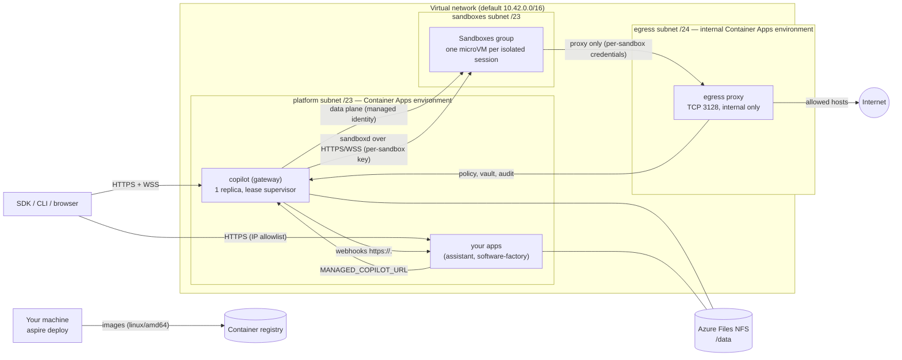

# Deploying to Azure

`aspire run` starts the platform on your machine. `aspire deploy` publishes **the same AppHost** to Azure Container
Apps: the gateway (with its stock shared runtime) behind HTTPS/WSS ingress, your apps, a durable data volume, and an
Azure Container Apps Sandboxes group for isolated sessions. Customer code does not change: `ManagedCopilot.connect()`
reads `MANAGED_COPILOT_URL`, which the deployment sets to the gateway's public URL.

> **Status.** The root AppHost has deployed successfully to westus2. The deployed NFS share passed all ten storage
> checks; shared-session snippets and isolated network-deny/allow checks have passed against its HTTPS gateway.
> Demo, recovery, and remaining acceptance checks are still in progress; the capability matrix marks what is pending.
> Capabilities whose backend is not ready (for example
> isolated sessions before the sandbox group and its role assignment work) are not advertised in `/v1/info`, and
> requests for them fail with `capability_unavailable` naming what is missing.

## What gets deployed



| Resource | Purpose |
| --- | --- |
| Container Apps environment (workload profiles, Consumption) | Runs the gateway and your apps; VNet-integrated (`platform` subnet). Includes the Aspire dashboard. |
| Virtual network | `platform` /23 (the environment, with a `Microsoft.Storage` service endpoint), `sandboxes` /23 (the sandbox group's VNet connection), and `egress` /24 (the egress proxy's internal environment). |
| Storage account (FileStorage, Premium SSD v2) + NFS share `managed-copilot` (32 GiB) | Durable state: the gateway at `gateway/`, each app at `apps/<name>/`. NFS 4.1, reachable only from the `platform` subnet, shared-key access disabled. |
| Container registry + pull identity | Holds the gateway, app, egress proxy, and sandbox images. |
| `copilot` container app | The gateway: external HTTPS ingress, exactly one replica, Single revision mode, `/data` on the NFS share, startup/liveness over TCP and readiness over HTTP. |
| One container app per `publishApp` | Your apps (the demos): external HTTPS ingress restricted to `Parameters:app-allowed-ips`, one replica, their own NFS directory. |
| `copilot-gateway-identity` | User-assigned identity of the gateway. Its roles: **Container Apps SandboxGroup Data Owner** on the sandbox group, and **AcrPull** on the registry (for the registry tokens it hands to disk-image imports). |
| Sandboxes group (`Microsoft.App/sandboxGroups`) + VNet connection | Isolated placement. Created only when the AppHost declares isolated environments. |
| Internal Container Apps environment `mc-egress-<suffix>` + `egress` container app | The sandboxes' only way out: the platform's egress proxy (`platform/egress`, external mode) on TCP 3128 of the environment's internal load balancer, one replica, linked to the gateway over HTTPS. Created with the sandbox group. |
| Log Analytics workspace | Container logs (both environments). |

## Prerequisites

- An Azure subscription where you can create resources **and role assignments** (Owner, or Contributor plus Role
  Based Access Control Administrator), in a region that offers Container Apps Sandboxes
  (`az provider show -n Microsoft.App --query "resourceTypes[?resourceType=='sandboxGroups'].locations"`).
- Azure CLI, signed in (`az login`); `aspire deploy` uses its credential, and the image step uses `az acr login`.
- Aspire CLI 13.6, Node 24, pnpm 10, and the .NET 10 SDK (the Azure integration in `deploy/azure/hosting` is a C#
  project the CLI builds).
- Docker with BuildKit. Images are built for `linux/amd64`; on ARM64 machines the build stages run natively and only
  the final stages are emulated, so the first sandbox image build takes several minutes.
- `npm config get registry` returns the registry the images install from (it is passed into every build).
- `pnpm install && pnpm build` at the repository root.

## Deploy

1. Choose where it goes (stored in the AppHost's user secrets; `aspire deploy` prompts for anything missing):

   ```powershell
   aspire secret set Azure:SubscriptionId <subscription-id>
   aspire secret set Azure:Location westus2
   aspire secret set Azure:ResourceGroup managed-copilot-dev
   ```

2. Say who may use it. A deployed gateway is on the Internet, so `aspire deploy` refuses to publish one without access
   rules. Set them at deploy time (comma-separated GitHub logins or organizations; the root AppHost declares none of
   its own), or declare `access: { githubUsers: [...] }` / `{ githubOrgs: [...] }` in your own `addManagedCopilot`:

   ```powershell
   aspire secret set Parameters:copilot-github-users your-login
   # or: aspire secret set Parameters:copilot-github-orgs your-org
   ```

3. If the AppHost publishes apps (the root AppHost publishes both demos), set the account they act as. Their public
   address is restricted to this machine's public IPv4 address unless you choose the addresses (see "Who can open
   the apps"):

   ```powershell
   ${env:Parameters__app-github-token} = (gh auth token).Trim()   # credential stays out of command arguments
   aspire secret set Parameters:app-allowed-ips "203.0.113.7/32"   # optional; "*" allows any address
   ```

4. Deploy:

   ```powershell
   aspire deploy
   ```

   The pipeline provisions the registry and the environment, builds and pushes the sandbox and egress proxy images
   (only those the registry does not have yet), provisions everything else, deploys the containers, and prints the
   platform URL and who can open the apps:

   ```text
   Managed Copilot: https://copilot.<environment-domain> (ManagedCopilot.connect({ url }), MANAGED_COPILOT_URL, or managed-copilot attach --url)
   Apps open to: 203.0.113.7/32 (change with Parameters:app-allowed-ips)
   ```

Connect to it exactly as you would locally:

```ts
const copilot = await ManagedCopilot.connect({ url: "https://copilot.<environment-domain>" }); // or MANAGED_COPILOT_URL
```

Redeploying (`aspire deploy` again) builds a new revision of each app; the gateway's lease hands its data volume to the
new revision (see "Durable state"). `aspire deploy --clear-cache` deploys again without the cached deployment choices
(it asks for them again).

### Configuration and secrets

| Setting | Required | Meaning |
| --- | --- | --- |
| `Parameters:<name>-github-users`, `Parameters:<name>-github-orgs` | One of them, unless the AppHost declares `access` | GitHub accounts or organizations allowed to use the platform. |
| `Parameters:<name>-allow-any-github-account` | No | `true` deploys without access rules on purpose. |
| `Parameters:app-github-token` | When the AppHost publishes apps | Secret. The GitHub token the published apps use (`MANAGED_COPILOT_GITHUB_TOKEN`). |
| `Parameters:app-allowed-ips` | No | IPv4 CIDRs allowed to reach the apps' ingress (comma-separated), or `*`. Default: this machine's public IPv4 address as `api.ipify.org` reports it. The platform subnet is always allowed (webhooks). |
| `Parameters:<name>-address-space` | No | The VNet's /16 (default `10.42.0.0/16`). Fixed after the first deploy. |
| `Parameters:<name>-durable-key`, `Parameters:<name>-vault-key` | No | Secrets, 32 bytes base64. Without them the gateway generates its keys in its data directory on the NFS share. |
| `Parameters:google-client-id`, `Parameters:google-client-secret` | No | The assistant demo's Google sign-in. Add `https://assistant.<environment-domain>/api/google/callback` as a redirect URI. |
| `Parameters:<name>-platform-key`, `Parameters:<name>-egress-key`, and the AppHost's generated secrets | Generated | Kept in the AppHost's user secrets and deployment state; deployed as Container Apps secrets (`secretRef`), never in plain configuration. The egress key links the egress proxy to the gateway. |

Every AppHost secret parameter reaches the gateway as a Container Apps secret, and its `MANAGED_COPILOT_CONFIG` holds
only `{ secretEnv }` references. Webhooks that point at a local app (`http://localhost:<port>/...`) are rewritten to that
app's HTTPS address (`https://<app>.<environment-domain>/...`; calls between apps stay inside the environment, and the
gateway fills in the domain when it starts); a loopback webhook with no published app on that port fails the deploy
with the fix.

### Publishing your own apps

`addManagedCopilot` handles the platform. Apps that use it are ordinary Aspire resources; to deploy one with a durable
directory, the lease supervisor, and an IP allowlist, publish it with `publishApp` in publish mode:

```ts
import { addManagedCopilot, publishApp } from "@managed-copilot/aspire";

const copilot = await addManagedCopilot(builder, "copilot", { /* ... */ });
if (await builder.executionContext().isPublishMode()) {
  await publishApp(builder, copilot, {
    name: "web",
    dockerfile: "web/Dockerfile",      // relative to the repository root (the build context)
    port: 3000,                        // also the port loopback webhooks name
    healthPath: "/healthz",            // readiness: 200 when the app serves
    publicUrlEnv: "WEB_PUBLIC_URL",    // optional: the app's own https URL
    allowedHostsEnv: "WEB_ALLOWED_HOSTS",
  });
} else {
  // aspire run: builder.addNodeApp(...).withEnvironment("MANAGED_COPILOT_URL", copilot.url)
}
```

The app's image should start with the lease supervisor (see `demos/assistant/Dockerfile`), keep its state under
`/data`, and listen on `PORT`.

## Durable state

The gateway keeps its ledger (SQLite, WAL), the stock runtime's session state, vault and durable keys, artifacts, and
customizations on an **Azure Files NFS 4.1** share mounted at `/data`.

- **Why NFS.** SQLite needs working POSIX byte-range locks, and the runtime's session store needs POSIX permissions and
  renames. Azure Files SMB failed for exactly this in the previous Copilot SDK Aspire deployment (locking errors).
  NFS 4.1 implements byte-range locks (`fcntl`), and the database has a single host at a time (below), which is the
  configuration SQLite supports on network file systems. A managed database would have meant replacing the gateway's
  storage layer; a single-replica gateway on a supported persistent volume keeps it unchanged.
- **Single writer.** Container Apps can run an old and a new revision side by side during a deployment, and can pre-warm
  a replacement replica during maintenance, even with one replica. The image's entrypoint is a lease supervisor
  (`deploy/azure/src/lease`): it holds an exclusive SQLite lock on `/data/.lease/gateway.lease` for the life of the
  process and starts the gateway only while it holds the lease, with a fencing generation and a heartbeat every 5 s. A
  replica that loses the lease kills its gateway immediately. A waiting replica answers `503` (readiness fails, so it
  gets no traffic). A newer deployment (higher `MANAGED_COPILOT_LEASE_STAMP`, set per publish) asks the holder to hand
  over; an older one never takes the lease while a newer one waits; and if the newer replica never takes it, the old
  holder reclaims it and refuses that deployment for 10 minutes instead of flapping. The gateway runs in its own
  process group, and the lease is released only after every process in it (including the shared runtime) has exited.
  The demos' images use the same supervisor for their own directories.
- **Qualification.** `node /opt/managed-copilot/azure/dist/probe/main.js` (in the gateway container; `--dir <path>`
  picks another directory than a fresh one under `/data/.probe`) checks POSIX metadata, atomic rename, fsync,
  cross-process lock exclusion, SQLite WAL and rollback journals under concurrent writers, and crash recovery, and
  prints a JSON report. The deployed Azure NFS share passed all ten checks, including directory fsync and recovery
  from a killed SQLite writer. These are single-replica/cross-process checks; they do not establish unrestricted
  multi-host WAL safety.

**Limits.** One gateway replica: no horizontal scale-out, and a handover (deploy, restart, or maintenance) makes the API
unavailable for seconds to tens of seconds while the new replica takes the lease and starts. Durable actions, webhooks,
and schedules persist across it; open WebSocket streams reconnect. The share is zone-redundant only if you choose a ZRS
account; the default is LRS. Back up the share with Azure Files snapshots if you need point-in-time recovery.

## Isolated placement on Azure

Isolated sessions run in **Azure Container Apps Sandboxes** (`Microsoft.App/sandboxGroups`): one microVM per session in
the deployment's sandbox group (`platform/gateway/src/modules/sandbox/providers/azure`, selected with
`MANAGED_COPILOT_SANDBOX_PROVIDER=azure`). It was chosen from the spec's Azure candidates (Container Apps dynamic
sessions, Container Apps jobs, managed session-worker containers) because it gives per-session microVMs, data disks that
outlive their compute, and a default-deny egress engine; managed session-worker containers remain the fallback.

- **Images.** `aspire deploy` builds the base sandbox image, each isolated environment's own `image` folder FROM it, its
  `packages.system` in a layer of their own (as `aspire run` does), and an Azure layer (`deploy/azure/sandbox`) on top,
  for `linux/amd64`, tagged by content and pushed to the registry. The gateway imports each into a disk image when it
  starts (`prepare`), pinned per sandbox. An environment that declares system packages never falls back to the base
  image. The service cannot pull with a managed identity, so the gateway exchanges its own Entra token for a
  short-lived registry token (its identity has AcrPull) and passes it with each import; no registry secret is stored.
- **Per-session isolation.** Each sandbox is its own microVM. sandboxd starts as root and runs every workload process as
  uid 10001 through `setpriv` with `no_new_privs` and empty capability sets; the image has no setuid files. A sandbox's
  platform-managed VM address is not a routable address for a different sandbox.
- **Persistent state.** Three data disks per sandbox (`/workspace`, `/home/agent`, `/var/lib/managed-copilot`). The
  Azure layer seeds an empty disk from the image on first boot. Idle stop deletes the microVM and keeps the disks;
  resume creates a new microVM from the pinned image over the same disks. Deleting the session deletes the disks.
  Azure allows at most 20 GiB of disk (root plus data disks) per vCPU, so the defaults are: small (1 vCPU) 6 GiB root,
  8 GiB workspace, 4 GiB home, 2 GiB state; medium (2 vCPU) 8, 20, 8, 4; large (4 vCPU) 10, 50, 14, 6.
  `MANAGED_COPILOT_AZURE_SANDBOX_DISKS` on the gateway overrides them (for example
  `{"medium":{"workspace":"16Gi"}}`), and the gateway refuses sizes over the budget when it starts.
- **Gateway connectivity.** The gateway reaches each sandbox's sandboxd (HTTP and WebSocket) through the sandbox's port
  URL (`https://<sandbox>--7781.<region>.adcproxy.io`), authenticated with a per-sandbox key that only the gateway and
  that sandbox hold. `MANAGED_COPILOT_AZURE_INGRESS_CIDRS` can also restrict the port to given source addresses.
- **Credentials (option C).** The GitHub token never enters a sandbox. Model calls are brokered through the gateway
  (`llmInference`), as locally, so they need no direct network access from the sandbox.
- **Egress.** Every sandbox gets a platform egress policy that denies all HTTP(S) and allows one TCP destination: the
  egress proxy's internal address on port 3128 (`MANAGED_COPILOT_AZURE_EGRESS_PROXY`). The proxy is the same
  `platform/egress` as locally, in external mode: sandboxd's `HTTP(S)_PROXY` carries per-sandbox credentials, so the
  proxy enforces each environment's allowlist, injects vault credentials, reports `network.blocked`, and applies policy
  changes live, while the platform policy keeps a sandbox that ignores its proxy settings off the Internet. Limits: DNS
  resolution stays available to sandboxes (connections still need the proxy); the proxy sees translated source
  addresses, so the platform does not pin credentials to a sandbox's address (the per-sandbox credential still
  authenticates every request). The proxy's CA is stored in the NFS share's `egress/` directory. An init container
  makes only that mounted directory writable by uid 1000; the proxy remains non-root. Atomic CA creation makes
  overlapping revisions share the same key pair. An intentional CA rotation still requires sandbox re-registration.

Qualification (2026-10-24, westus2): a probe deployment (`deploy/azure/qualify`) checked the service directly, and a
gateway using this provider passed the isolated end-to-end suite (`deploy/azure/qualify/isolated.live.ts`: session
create in about 8 s, a real model reply, files, uid 10001, idle stop, and resume over the same disks in about 8 s).

## Who can open the apps

The published apps act as the GitHub account in `Parameters:app-github-token` and have no sign-in of their own, so
their ingress accepts only the addresses in `Parameters:app-allowed-ips` (plus the platform subnet, for webhooks). The
default is this machine's public address as `api.ipify.org` reports it, which `aspire deploy` prints.

Networks that send Azure traffic through a corporate tunnel (a VPN or Microsoft Entra Global Secure Access, for
example) reach Azure from different addresses than the rest of the Internet, often a rotating pool. The apps then
answer some or all requests with `403 RBAC: access denied`. Set `Parameters:app-allowed-ips` to the ranges your network
uses for Azure (ask your network team, or see "Troubleshooting") and deploy again. Everyone else behind those addresses
can reach the apps too.

Alternatives when an address allowlist does not fit:

- **Container Apps authentication (Easy Auth).** Configure Microsoft Entra ID or GitHub sign-in and restrict it to the
  intended accounts before removing IP restrictions. This needs an Entra app registration or a GitHub OAuth app.
  Also configure machine-to-machine access for gateway webhooks: an interactive sign-in redirect would otherwise
  block their delivery. This alternative is not part of the default deployment and has not been qualified here.
- **Run the apps locally against the Azure platform.** The gateway itself needs no allowlist: it requires a GitHub
  sign-in that matches its access rules. Run a demo on your machine with `MANAGED_COPILOT_URL` set to the gateway URL
  (for example `$env:MANAGED_COPILOT_URL = "https://copilot.<environment-domain>"; pnpm --filter @managed-copilot/demo-assistant start`).
  Webhooks cannot reach your machine, so the assistant picks up offline tool calls by polling.

## Capability matrix

| Capability | `aspire run` (local) | `aspire deploy` (Azure) |
| --- | --- | --- |
| Gateway API, HTTPS/WSS ingress, GitHub sign-in, access rules | Yes (HTTP on localhost) | Live HTTPS/WSS SDK sessions pass; broader access tests pending |
| Shared sessions (stock shared runtime) | Yes | Spec snippets 01 and 02 pass on the deployed gateway |
| Durable state across restarts and redeploys, single writer | Yes (local disk) | NFS probe passed all ten checks; revision lease generation advanced from 1 to 2; full recovery checks pending |
| Durable actions, webhooks, schedules | Yes | Implemented; webhooks to published apps over HTTPS inside the environment; pending live qualification |
| Isolated sessions (`network: false`) | Yes (Docker) | Live real-model/files/idle-replacement probe passed; spec snippet 06 passes on the deployed gateway |
| Isolated sessions with network allowlists or vault credentials | Yes (egress proxy) | Proxy deployment is live; network-disabled and network-enabled checks pass; vault tests pending |
| Files and artifacts in sandboxes | Yes | Implemented with isolated sessions; pending live qualification |
| Promotion (shared → isolated) | Yes | Implemented with isolated sessions; pending live qualification |
| Warm sandboxes (`warm > 0`) | No | No |
| Demos (software factory, assistant) | Yes | Published with `publishApp`; real happy-path checks in progress |

## Cost

Estimates for the default configuration in a US region at pay-as-you-go prices (check the Azure pricing calculator for
yours):

| Item | Idle | Notes |
| --- | --- | --- |
| Gateway, 2 demo apps, and the egress proxy (Container Apps Consumption, 0.5 vCPU / 1 GiB each, always one replica) | ~$45–160/month | About $12/month per replica at the idle rate and $40 when busy. The monthly free grant applies once per subscription. Both environments are Consumption-only, so there is no environment fee. |
| Azure Files NFS (Premium SSD v2, 32 GiB provisioned) | ~$3–10/month | Provisioned capacity, IOPS, and throughput. |
| Container registry (Basic) | ~$5/month | |
| Log Analytics | ~$0–10/month | Per GB ingested. |
| Sandboxes (per isolated session) | Usage-based | microVM time while a sandbox runs, plus its data disks while they exist. Delete sessions you no longer need; idle stop keeps only disks. Check the resource group in Cost Management for actual figures. |

The probe resource group was created at 15:31 UTC and confirmed deleted by 16:28 UTC on 2026-10-24.
Cost Management has not posted its usage yet; an empty billing result must not be interpreted as a zero-cost run.

## Teardown

Everything lives in the resource group you deployed to:

```powershell
az group delete --name managed-copilot-dev --yes
```

Deleting the group deletes the sandbox group (with its sandboxes and disks), both Container Apps environments (and the
`ME_...` infrastructure groups Azure manages for them), the NFS share (all platform state), the registry, and the
identities. Your AppHost's user secrets stay on your machine.

## Troubleshooting

- **"has no access rules"**: set `Parameters:<name>-github-users` / `-github-orgs`, or add `access` to the AppHost.
- **"acts as your GitHub account, so its public address must be restricted"**: this machine's public address could not
  be detected; set `Parameters:app-allowed-ips`.
- **An app answers `403 RBAC: access denied`** (some or all requests): its ingress allowlist does not include the
  address Azure sees for your machine. See "Who can open the apps".
- **`/v1/info` lists no `isolated` capability**: the gateway's log names what the sandbox backend is missing (for
  example the role assignment, which can take a few minutes to propagate; the gateway re-checks every 30 s).
- **Isolated sessions with network access fail with `capability_unavailable`**: the egress proxy is not connected to
  the gateway. Check the `egress` app's log in the `mc-egress-<suffix>` environment (it names the gateway URL it
  cannot reach) and that its key matches the gateway's (`Parameters:<name>-egress-key`).
- **The image step fails at `az acr login`**: install the Azure CLI and sign in with the account you deploy with.
- **"Azure did not confirm whether … was created" / "An earlier attempt … has not been confirmed"**: Azure's answer to a
  create was lost. The gateway retains its write-ahead record across restarts and retries only the lookup, not the
  create. Neither elapsed time nor an empty lookup proves failure. It preserves associated disks until the operation
  is reconciled. If Azure never reports the outcome, establish it with Azure support before repairing the journal;
  do not delete the journal simply to force a retry.
- **A gateway replica stays "not ready"**: it is waiting for the lease; its log says which replica holds it.
