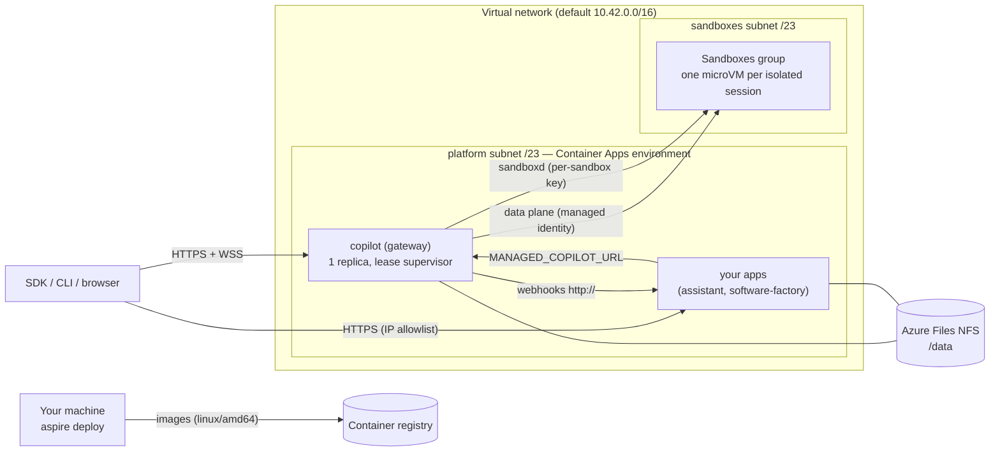

# Deploying to Azure

`aspire run` starts the platform on your machine. `aspire deploy` publishes **the same AppHost** to Azure Container
Apps: the gateway (with its stock shared runtime) behind HTTPS/WSS ingress, your apps, a durable data volume, and an
Azure Container Apps Sandboxes group for isolated sessions. Customer code does not change: `ManagedCopilot.connect()`
reads `MANAGED_COPILOT_URL`, which the deployment sets to the gateway's public URL.

> **Status.** Everything below is implemented and validated offline (unit tests, container tests of the lease and the
> images, `aspire publish` output compiled with `az bicep build`). It has **not yet been qualified on a live Azure
> deployment**; the capability matrix marks what is pending. Until a capability passes, the gateway does not advertise
> it in `/v1/info` and fails requests for it with `capability_unavailable`.

## What gets deployed



| Resource | Purpose |
| --- | --- |
| Container Apps environment (workload profiles, Consumption) | Runs the gateway and your apps; VNet-integrated (`platform` subnet). Includes the Aspire dashboard. |
| Virtual network | `platform` /23 (the environment, with a `Microsoft.Storage` service endpoint) and `sandboxes` /23 (the sandbox group's VNet connection). |
| Storage account (FileStorage, Premium SSD v2) + NFS share `managed-copilot` (32 GiB) | Durable state: the gateway at `gateway/`, each app at `apps/<name>/`. NFS 4.1, reachable only from the `platform` subnet, shared-key access disabled. |
| Container registry + pull identity | Holds the gateway, app, and sandbox images. |
| `copilot` container app | The gateway: external HTTPS ingress, exactly one replica, Single revision mode, `/data` on the NFS share, startup/liveness over TCP and readiness over HTTP. |
| One container app per `publishApp` | Your apps (the demos): external HTTPS ingress restricted to `Parameters:app-allowed-ips`, one replica, their own NFS directory. |
| `copilot-gateway-identity` | User-assigned identity of the gateway. Its only role is **Container Apps SandboxGroup Data Owner** on the sandbox group. |
| Sandboxes group (`Microsoft.App/sandboxGroups`) + VNet connection + sandbox pull identity | Isolated placement. Created only when the AppHost declares isolated environments. |
| Log Analytics workspace | Container logs. |

## Prerequisites

- An Azure subscription where you can create resources **and role assignments** (Owner, or Contributor plus Role
  Based Access Control Administrator), in a region that offers Container Apps Sandboxes
  (`az provider show -n Microsoft.App --query "resourceTypes[?resourceType=='sandboxGroups'].locations"`).
- Azure CLI, signed in (`az login`); `aspire deploy` uses its credential, and the image step uses `az acr login`.
- Aspire CLI 13.6, Node 24, pnpm 10, and the .NET 10 SDK (the Azure integration in `deploy/azure/hosting` is a C#
  project the CLI builds).
- Docker with BuildKit. Images are built for `linux/amd64`; on ARM64 machines the build stages run natively and only
  the final stages are emulated, so the first sandbox image build takes several minutes.
- `npm config get registry` returns the registry the images install from (it is passed into every build).
- `pnpm install && pnpm build` at the repository root.

## Deploy

1. Choose where it goes (stored in the AppHost's user secrets; `aspire deploy` prompts for anything missing):

   ```powershell
   aspire secret set Azure:SubscriptionId <subscription-id>
   aspire secret set Azure:Location westus2
   aspire secret set Azure:ResourceGroup managed-copilot-dev
   ```

2. Say who may use it. A deployed gateway is on the Internet, so `aspire deploy` refuses to publish one without access
   rules. Either declare `access: { githubUsers: [...] }` / `{ githubOrgs: [...] }` in `addManagedCopilot`, or set
   them at deploy time (comma-separated; added to the AppHost's own rules):

   ```powershell
   aspire secret set Parameters:copilot-github-users your-login
   # or: aspire secret set Parameters:copilot-github-orgs your-org
   ```

3. If the AppHost publishes apps (the root AppHost publishes both demos), set the account they act as and who can
   open them:

   ```powershell
   aspire secret set Parameters:app-github-token <a GitHub token for the account the apps act as>
   aspire secret set Parameters:app-allowed-ips "203.0.113.7/32"   # your address; "*" allows any
   ```

4. Deploy:

   ```powershell
   aspire deploy
   ```

   The pipeline provisions the registry, builds and pushes the sandbox images (only those the registry does not have
   yet), provisions everything else, deploys the containers, and prints the platform URL:

   ```text
   Managed Copilot: https://copilot.<environment-domain> (ManagedCopilot.connect({ url }), MANAGED_COPILOT_URL, or managed-copilot attach --url)
   ```

Connect to it exactly as you would locally:

```ts
const copilot = await ManagedCopilot.connect({ url: "https://copilot.<environment-domain>" }); // or MANAGED_COPILOT_URL
```

Redeploying (`aspire deploy` again) builds a new revision of each app; the gateway's lease hands its data volume to the
new revision (see "Durable state"). `aspire deploy --clear-cache` forgets cached deployment choices for the
environment.

### Configuration and secrets

| Setting | Required | Meaning |
| --- | --- | --- |
| `Parameters:<name>-github-users`, `Parameters:<name>-github-orgs` | One of them, unless the AppHost declares `access` | GitHub accounts or organizations allowed to use the platform. |
| `Parameters:<name>-allow-any-github-account` | No | `true` deploys without access rules on purpose. |
| `Parameters:app-github-token` | When the AppHost publishes apps | Secret. The GitHub token the published apps use (`MANAGED_COPILOT_GITHUB_TOKEN`). |
| `Parameters:app-allowed-ips` | When the AppHost publishes apps | IPv4 CIDRs allowed to reach the apps' ingress, or `*`. The platform subnet is always allowed (webhooks). |
| `Parameters:<name>-address-space` | No | The VNet's /16 (default `10.42.0.0/16`). Fixed after the first deploy. |
| `Parameters:<name>-durable-key`, `Parameters:<name>-vault-key` | No | Secrets, 32 bytes base64. Without them the gateway generates its keys in its data directory on the NFS share. |
| `Parameters:google-client-id`, `Parameters:google-client-secret` | No | The assistant demo's Google sign-in. Add `https://assistant.<environment-domain>/api/google/callback` as a redirect URI. |
| `Parameters:<name>-platform-key` and the AppHost's generated secrets | Generated | Kept in the AppHost's user secrets and deployment state; deployed as Container Apps secrets (`secretRef`), never in plain configuration. |

Every AppHost secret parameter reaches the gateway as a Container Apps secret, and its `MANAGED_COPILOT_CONFIG` holds
only `{ secretEnv }` references. Webhooks that point at a local app (`http://localhost:<port>/...`) are rewritten to that
app inside the environment (`http://<app>/...`); a loopback webhook with no published app on that port fails the deploy
with the fix.

### Publishing your own apps

`addManagedCopilot` handles the platform. Apps that use it are ordinary Aspire resources; to deploy one with a durable
directory, the lease supervisor, and an IP allowlist, publish it with `publishApp` in publish mode:

```ts
import { addManagedCopilot, publishApp } from "@managed-copilot/aspire";

const copilot = await addManagedCopilot(builder, "copilot", { /* ... */ });
if (await builder.executionContext().isPublishMode()) {
  await publishApp(builder, copilot, {
    name: "web",
    dockerfile: "web/Dockerfile",      // relative to the repository root (the build context)
    port: 3000,                        // also the port loopback webhooks name
    healthPath: "/healthz",            // readiness: 200 when the app serves
    publicUrlEnv: "WEB_PUBLIC_URL",    // optional: the app's own https URL
    allowedHostsEnv: "WEB_ALLOWED_HOSTS",
  });
} else {
  // aspire run: builder.addNodeApp(...).withEnvironment("MANAGED_COPILOT_URL", copilot.url)
}
```

The app's image should start with the lease supervisor (see `demos/assistant/Dockerfile`), keep its state under
`/data`, and listen on `PORT`.

## Durable state

The gateway keeps its ledger (SQLite, WAL), the stock runtime's session state, vault and durable keys, artifacts, and
customizations on an **Azure Files NFS 4.1** share mounted at `/data`.

- **Why NFS.** SQLite needs working POSIX byte-range locks, and the runtime's session store needs POSIX permissions and
  renames. Azure Files SMB failed for exactly this in the previous Copilot SDK Aspire deployment (locking errors).
  NFS 4.1 implements byte-range locks (`fcntl`), and the database has a single host at a time (below), which is the
  configuration SQLite supports on network file systems. A managed database would have meant replacing the gateway's
  storage layer; a single-replica gateway on a supported persistent volume keeps it unchanged.
- **Single writer.** Container Apps can run an old and a new revision side by side during a deployment, and can pre-warm
  a replacement replica during maintenance, even with one replica. The image's entrypoint is a lease supervisor
  (`deploy/azure/src/lease`): it holds an exclusive SQLite lock on `/data/.lease/gateway.lease` for the life of the
  process and starts the gateway only while it holds the lease, with a fencing generation and a heartbeat every 5 s. A
  replica that loses the lease kills its gateway immediately. A waiting replica answers `503` (readiness fails, so it
  gets no traffic). A newer deployment (higher `MANAGED_COPILOT_LEASE_STAMP`, set per publish) asks the holder to hand
  over; an older one never takes the lease while a newer one waits; and if the newer replica never takes it, the old
  holder reclaims it and refuses that deployment for 10 minutes instead of flapping. The demos' images use the same
  supervisor for their own directories.
- **Qualification.** `node /opt/managed-copilot/azure/dist/probe/main.js /data/.probe` (in the gateway container)
  checks POSIX metadata, atomic rename, fsync, cross-process lock exclusion, SQLite WAL and rollback journals under
  concurrent writers, and crash recovery, and prints a JSON report. *Pending: a run on the deployed share.*

**Limits.** One gateway replica: no horizontal scale-out, and a handover (deploy, restart, or maintenance) makes the API
unavailable for seconds to tens of seconds while the new replica takes the lease and starts. Durable actions, webhooks,
and schedules persist across it; open WebSocket streams reconnect. The share is zone-redundant only if you choose a ZRS
account; the default is LRS. Back up the share with Azure Files snapshots if you need point-in-time recovery.

## Isolated placement on Azure

Isolated sessions run in **Azure Container Apps Sandboxes**: one microVM per session in the deployment's sandbox
group (`platform/gateway/src/modules/sandbox/providers/azure`, selected with `MANAGED_COPILOT_SANDBOX_PROVIDER=azure`).

- **Images.** `aspire deploy` builds the base sandbox image, each isolated environment's own `image` folder FROM it, and
  an Azure layer (`deploy/azure/sandbox`) on top, for `linux/amd64`, tagged by content and pushed to the registry. The
  gateway imports each into a disk image on first use (`prepare`), pinned per sandbox.
- **Per-session isolation.** Each sandbox is its own microVM. sandboxd starts as root and runs every workload process as
  uid 10001 through `setpriv` with `no_new_privs` and empty capability sets; the image has no setuid files.
- **Persistent state.** Three data disks per sandbox (`/workspace`, `/home/agent`, `/var/lib/managed-copilot`). The
  Azure layer seeds an empty disk from the image on first boot. Idle stop deletes the microVM and keeps the disks;
  resume creates a new microVM from the pinned image over the same disks. Deleting the session deletes the disks.
- **Gateway connectivity.** The gateway reaches each sandbox's sandboxd (HTTP and WebSocket) through the sandbox's port
  URL, authenticated with a per-sandbox key. `MANAGED_COPILOT_AZURE_INGRESS_CIDRS` can also restrict the port to the
  gateway's outbound addresses.
- **Credentials (option C).** The GitHub token never enters a sandbox. Model calls are brokered through the gateway
  (`llmInference`), as locally, so they need no direct network access from the sandbox.
- **Egress.** Every sandbox gets a deny-all platform egress policy. The egress proxy that enforces per-environment
  allowlists and vault credentials is not deployed to Azure yet, so isolated environments that need network access or
  vault credentials fail with `capability_unavailable`; environments with `network: false` work.

## Capability matrix

| Capability | `aspire run` (local) | `aspire deploy` (Azure) |
| --- | --- | --- |
| Gateway API, HTTPS/WSS ingress, GitHub sign-in, access rules | Yes (HTTP on localhost) | Implemented; pending live qualification |
| Shared sessions (stock shared runtime) | Yes | Implemented (container verified locally); pending live qualification |
| Durable state across restarts and redeploys, single writer | Yes (local disk) | Implemented (NFS + lease; lease verified in containers); pending NFS probe run |
| Durable actions, webhooks, schedules | Yes | Implemented; webhooks to published apps over the environment network; pending live qualification |
| Isolated sessions (`network: false`) | Yes (Docker) | Implemented (ACA Sandboxes); pending live qualification |
| Isolated sessions with network allowlists or vault credentials | Yes (egress proxy) | Not yet: `capability_unavailable` (no egress proxy on Azure) |
| Files and artifacts in sandboxes | Yes | Implemented with isolated sessions; pending live qualification |
| Promotion (shared → isolated) | Yes | Implemented with isolated sessions; pending live qualification |
| Warm sandboxes (`warm > 0`) | No | No |
| Demos (software factory, assistant) | Yes | Published with `publishApp`; the factory's builders need network access, so they wait on Azure egress |

## Cost

Estimates for the default configuration in a US region at pay-as-you-go prices (check the Azure pricing calculator for
yours):

| Item | Idle | Notes |
| --- | --- | --- |
| Gateway + 2 demo apps (Container Apps Consumption, 0.5 vCPU / 1 GiB each, always one replica) | ~$35–115/month | Idle replicas bill vCPU at the reduced idle rate; busy ones at the active rate. The monthly free grant applies once per subscription. |
| Azure Files NFS (Premium SSD v2, 32 GiB provisioned) | ~$3–10/month | Provisioned capacity, IOPS, and throughput. |
| Container registry (Basic) | ~$5/month | |
| Log Analytics | ~$0–10/month | Per GB ingested. |
| Sandboxes (per isolated session) | Usage-based | microVM time plus data disks while they exist. Delete sessions you no longer need; idle stop keeps only disks. |

## Teardown

Everything lives in the resource group you deployed to:

```powershell
az group delete --name managed-copilot-dev --yes
aspire deploy --clear-cache   # optional: forget the cached deployment choices
```

Deleting the group deletes the sandbox group (with its sandboxes and disks), the NFS share (all platform state), the
registry, and the identities. Your AppHost's user secrets stay on your machine.

## Troubleshooting

- **"has no access rules"**: set `Parameters:<name>-github-users` / `-github-orgs`, or add `access` to the AppHost.
- **"acts as your GitHub account, so its public address must be restricted"**: set `Parameters:app-allowed-ips`.
- **`/v1/info` lists no `isolated` capability**: the gateway's log names what the sandbox backend is missing (for
  example the role assignment, which can take a few minutes to propagate; the gateway re-checks every 30 s).
- **The image step fails at `az acr login`**: install the Azure CLI and sign in with the account you deploy with.
- **A gateway replica stays "not ready"**: it is waiting for the lease; its log says which replica holds it.
