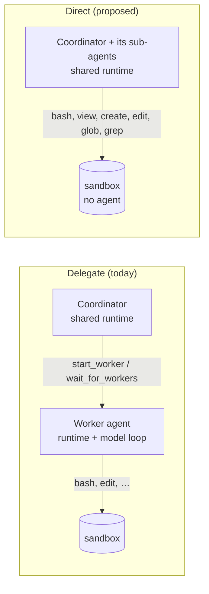

# Proposal: direct execution (one brain, hands in sandboxes)

> **Status: research and calibration.** Nothing here is built or part of the customer contract
> ([spec](../spec/developer-experience.md)). The snippets show the intended customer experience so we can agree on it
> before implementation. The core mechanism is verified on the stock SDK and runtime (see [Evidence](#evidence)).

Today an orchestrator **delegates**: the coordinator talks to workers, and each worker is a whole agent (its own
runtime, model loop, and context) inside its own sandbox. That is the right shape for independent, long-running
parts of a job. It is the wrong shape for a multi-tenant harness that already has its own planning and sub-agents and
just wants them to *act* inside an isolated machine.

This proposal adds a second orchestration style, **direct execution**: the brain (the coordinator and its stock
sub-agents) stays on the shared runtime, and its hands (`bash`, `view`, `create`, `edit`, `glob`, `grep`) run inside a
sandbox. No agent runs in the sandbox.



## The customer experience

### Declare it

One knob on the orchestrator type. Both styles use the same worker environments, so image, size, setup, network rules,
vaults, and idle stop are shared.

```ts
// apphost.mts
environments: {
  python: { type: "isolated", size: "medium", setup: { packages: { python: ["pandas"] } } },

  // Delegate: each part of the job goes to a worker agent in its own sandbox (today's behavior, the default).
  team: { type: "orchestrator", workers: ["python"] },

  // Direct: the coordinator and its sub-agents act in a sandbox themselves.
  operator: {
    type: "orchestrator",
    workers: ["python"],     // exactly one environment in direct mode: the one the hands run in
    execution: "direct",     // "delegate" (default) | "direct"
    subagents: "shared",     // "shared" (default): one workspace for the whole session | "own": a sandbox per sub-agent
  },
},
```

### Use it

Customer code is identical to any other session: a genuine `CopilotSession`, standard events, standard tools.

```ts
const client = await managed.client("operator");
const session = await client.createSession({
  model: "claude-sonnet-5",
  tools: [lookupCustomer],            // your own defineTool tools sit beside the sandbox tools
  onPermissionRequest: (request) => {
    // Every command is a tool call in *this* session, so you see each one (not one approval per worker).
    if (request.kind === "custom-tool" && request.toolName === "bash") console.log("run?", request.arguments);
    return { kind: "approved" };
  },
});

session.on("tool.execution_start", (e) => console.log(`${e.agentId ?? "root"} → ${e.data.toolName}`));

const reply = await session.sendAndWait(
  { prompt: "Use two sub-agents in parallel: one counts primes below 100,000 in Python, the other finds how many digits the 1000th Fibonacci number has. Report both." },
  10 * 60_000,
);

// The sandbox is still a session-scoped workspace: files and artifacts work as they do for workers.
for (const sandbox of await managed.workers(session).list()) {
  console.log(sandbox.name, sandbox.role);                 // "hands", "hands"
  console.log(await managed.files(sandbox.id).list("/"));  // primes.py, fib.py
}
```

### What the coordinator's tools become

| Delegate (`execution: "delegate"`) | Direct (`execution: "direct"`) |
| --- | --- |
| `start_worker`, `wait_for_workers`, `message_worker`, `list_workers`, `read_worker_file`, `copy_worker_files`, `stop_worker` | `bash`, `view`, `create`, `edit`, `glob`, `grep` (the built-in names and shapes models already know), plus the stock sub-agent tools `task`, `read_agent`, `write_agent`, `list_agents` |
| No shell or files of its own; sub-agents off | Sub-agents on: each `task` sub-agent's calls run in the sandbox too (its own sandbox with `subagents: "own"`) |

## When to use which

| | Delegate | Direct |
| --- | --- | --- |
| **Who thinks** | One agent per worker, plus the coordinator | The coordinator and the stock sub-agents it chooses to start |
| **Context** | Each worker has its own; the coordinator sees only reports | The root agent sees its own commands; each sub-agent has its own context and returns a summary, as stock sub-agents do |
| **Inference** | A runtime and model loop per worker, in its sandbox | The same kinds of loops, all in the shared runtime; sandboxes run no runtime or model |
| **Sandbox footprint** | Runtime + sandboxd per worker | sandboxd only; **no runtime and no placeholder credential in the sandbox** |
| **Approvals** | One per worker (`start_worker`); the platform answers the worker's own prompts | One per command, in your `onPermissionRequest` (or tool-level `skipPermission` for reads) |
| **Long or independent work** | Best: workers run while the coordinator waits or chats | The brain's turn is busy while commands run |
| **Prompt-injection blast radius** | Worker output reaches the coordinator as marked, clipped data; workers can't call your tools | Sandbox output enters the same context that can call your `defineTool` tools: decide tool approvals with that in mind |
| **Copilot CLI** | Attach to the coordinator or to any worker | Attach to the coordinator; there is no agent in a sandbox to attach to |
| **Fits** | Software factory, research swarms, anything that runs for minutes per part | Multi-tenant harnesses with their own planning, tight edit-run loops, data analysis, "do it yourself, but not on my host" |

Both styles are worth demonstrating side by side: same prompt, same environment, different shape (see
[Demos](#demos)).

## How it works (stock SDK and runtime only)

1. **Tool replacement is a stock feature.** A session's tools can replace built-ins with `overridesBuiltInTool: true`.
   The gateway already does this for `web_fetch` on shared placement. In direct mode, admission adds
   `bash`, `view`, `create`, `edit`, `glob`, and `grep` as **platform tools** (gateway-side handlers, registered with
   `platformTools.register({ overridesBuiltInTool: true, … })`), leaves the shared runtime's own host shell and file
   tools out of `availableTools` as it does today, and turns the sub-agent built-ins on.
2. **Sub-agents use the session's tools.** A stock `task` sub-agent's tool calls arrive at the same handlers, and
   the request carries the sub-agent's `agentId` (`ToolInvocation.agentId` in the SDK; undefined for the root agent).
   The gateway's platform-tool context does not pass it on today, so that plumbing is part of the work (see
   [Hard parts](#hard-parts)).
3. **The environment section tells the truth.** Admission replaces `environment_context` (as it does for every shared
   session) with "your tools act on a Linux sandbox in /workspace", so the model doesn't assume the gateway host.
4. **Handlers run in the gateway, not your app.** So direct sessions keep working while your app is offline, schedules
   can use them, and nothing about the sandbox reaches your process unless you ask for files.

## What the platform needs to build

| Area | Change |
| --- | --- |
| sandboxd | `POST /v1/exec`: runs `bash -c` as uid 10001 through `asWorkload` (cwd `/workspace`, egress env and vault placeholders, never the GitHub token), streams NDJSON output, bounded output tail, timeout and cancel kill the process group. Each execution is journaled by action ID, so a caller can reattach to it or read its outcome. File tools reuse the existing uid-10001 file worker; `edit` is an atomic compare-and-replace in that worker |
| sandbox service | `sandboxes.exec(sessionId, command, { actionId, timeoutMs, signal, sandboxId })`, pinned like file calls; a `runtime: false` create option so a hands sandbox never starts `copilot-runtime` (no inference broker, no placeholder) |
| core | A **workspace-only** session kind: a child session with a sandbox and no runtime. Core must not open a runtime for it, refuses agent operations on it (`send`, `resume`, attach) with `invalid_request`, and gives it its own busy accounting (a running exec), idle stop, and artifact publication (at the end of each of the coordinator's root turns, since the hands sandbox has no turns of its own). sandboxd and the sandbox service skip runtime start and runtime health checks when `runtime: false`. Platform-tool context gains `agentId` and the runtime's cancellation of the tool call, on both the live and durable paths |
| orchestrator | `execution` and `subagents` config; the six tool handlers; a persisted (coordinator incarnation, agent) → hands-session map with atomic lazy creation inside the `maxWorkers` bound; worker recovery and `wait_for_workers` skip workspace-only children |
| durable actions | Direct tools opt out of "platform tools run again after a restart": an interrupted exec is reattached through the sandbox journal, or reported as an uncertain outcome; it is never rerun blindly |
| core admission | Direct-mode tool filters (add the six platform tools and the sub-agent built-ins) and the direct-mode environment section |
| protocol | Additive: `OrchestratorEnvironment.execution`, `.subagents`, `WorkerInfo.role` |
| docs and samples | Spec section 17 extension, concept page section, walkthrough 12, a mode switch in Dispatch |

Sandbox creation is lazy: the first tool call that needs a sandbox creates it (seconds on Docker, longer on Azure),
reported with the existing `worker.started` event.

## Hard parts

The probe proves the mechanism; these are what make it a platform feature rather than a demo.

| Problem | Why it matters | Proposed answer |
| --- | --- | --- |
| **Replay after a gateway restart** | Durable recovery reruns interrupted platform tools because today's are idempotent by key (`durable/actions/service.ts`, `recover`). A shell command is not: it may have pushed, paid, or deleted before the crash | sandboxd journals each exec by action ID; recovery reattaches to a running exec or reads its result, and an exec whose outcome is unknown fails with an explicit "may have run" error. Never a blind rerun |
| **Cancellation** | Platform-tool handlers get only a 10-minute timeout signal (`core/sessions.ts`, `#runPlatformTool`) and none on the durable path. An aborted turn could leave commands mutating files | Pass the runtime's tool-call cancellation, session deletion, and shutdown through to `sandboxes.exec`, which kills the process group. Background processes a command started (`&`) keep running until the sandbox stops; documented |
| **Sub-agent attribution** | `subagents: "own"` needs the calling agent, and the gateway's handler context has no `agentId` today. Treating "missing" as root would put a sub-agent in the root's sandbox | Carry the request's `agentId` through the live and durable paths. If attribution is unavailable, `"own"` fails the call with `capability_unavailable`; it never falls back to sharing |
| **Workspace-only sessions** | Core opens a runtime for every sandbox session, and worker recovery treats every child as an agent | A distinct session kind with its own lifecycle (see the core row above), not just `WorkerInfo.role` |
| **Parallel sub-agents on one workspace** | With `subagents: "shared"`, two `edit`s to the same file could each read, replace, and write, silently losing one change | `edit` is an atomic compare-and-replace that fails with `conflict` when the file changed underneath it. Concurrent shell commands stay unsynchronized, as on any shared machine; `"own"` is the answer when that matters |
| **Untrusted output in a privileged context** | Sandbox output lands in the context that can call your own tools | Tool results stay ordinary tool results (no special trust); the environment section says sandbox content is data; approvals on your tools are your boundary. Documented in the comparison above |
| **Sub-agent calls across a runtime restart** | Stock sub-agent tool requests can be answered only while that sub-agent is running; a shared-runtime restart loses them (spec, "Waiting requests") | Same as any shared session today: the turn ends visibly as failed and the user retries. The exec journal still reports what ran |
| **Sub-agent sandboxes under `"own"`** | Each `task` call is a new `agentId`, so sandboxes would pile up against `maxWorkers`, and their files would be stranded | A sub-agent's sandbox is released when its `subagent.completed`/`failed` event arrives, after its `/workspace/outputs` is copied into the root agent's sandbox under `outputs/<agent>/`. A call over the bound fails with `policy_violation`, as `start_worker` does |
| **File-tool fidelity** | The model expects the built-in shapes (`view` with `view_range`, `edit` with `old_str`/`new_str`, `grep`/`glob` options). The file worker refuses symbolic links, which `bash` (for example `npm install`) creates freely | Mirror the built-in schemas exactly (taken from `rpc.tools.list`). `view`, `glob`, and `grep` run as uid-10001 subprocesses like `bash`, following links inside `/workspace` only; writes go through the file worker, which keeps refusing links |

## Demos

- **Walkthrough 12 · Direct execution**, the twin of walkthrough 11: the same primes and Fibonacci prompt against
  `team` and then `operator`, printing which agent ran which command, how many sandboxes and model loops each used,
  and the wall time. One script shows both shapes.
- **Dispatch**: a switch beside the composer, "Delegate to workers" / "Work directly in a sandbox". The message's
  sandbox cards stay the same; in direct mode each card lists the commands the brain and its sub-agents ran.

## Evidence

Verified 2026-10-27 on Windows ARM64 with the published `@github/copilot-sdk` 1.0.26 and `@github/copilot` 1.0.103,
using [`probes/direct-execution.mjs`](probes/direct-execution.mjs): a stock client on this machine, with
`bash`/`view`/`create`/`edit`/`glob`/`grep` overridden to run in a `--network none` container of the sandbox image
through `docker exec`, and the host's `powershell` tools excluded.

```text
  [brain] sub-agent started: general-purpose
  [brain] sub-agent started: general-purpose
  [hands] subagent f6087643 create {"path":"/workspace/primes.py",…}
  [hands] subagent f6087643 bash {"command":"cd /workspace && python3 primes.py"}
  [hands] subagent 0b45f9ee create {"path":"/workspace/fib.py",…}
  [hands] subagent 0b45f9ee bash {"command":"cd /workspace && python3 fib.py"}
  [hands] root              bash {"command":"cat /etc/os-release | grep -E '^(NAME|PRETTY_NAME)='"}

BRAIN: Primes below 100,000: 9,592 · Digits in the 1000th Fibonacci number: 209 · OS: Debian GNU/Linux 12 (bookworm)
```

- `rpc.tools.list` on a Windows host lists `powershell` (and `read_/write_/stop_/list_powershell`), `glob`, `grep`,
  `create`, `edit`, `view`, `web_fetch`, `task`, `read_agent`, `list_agents`, `write_agent`, and `skill`. A Linux
  runtime names its shell `bash`.
- `overridesBuiltInTool: true` replaced `create` and `view`, and was accepted on `bash`, which does not clash on a
  Windows host.
- Both parallel `general-purpose` sub-agents called the overridden tools, with their own `agentId`; the root agent's
  call had none. The files existed in the container afterwards; nothing was written on the host.

Not yet verified: how Copilot CLI renders overridden `bash` calls and their permission prompts in an attached
coordinator, and whether `subagent.*` events and `agentId` survive the gateway's routing unchanged (they are standard
events, so they should).

## Open decisions

| # | Decision | Recommendation |
| --- | --- | --- |
| 1 | `execution: "direct"` on `orchestrator`, or a new environment type | The knob: same workers list, same events, and one place to compare the two styles |
| 2 | Mixed mode (a coordinator that both delegates and acts directly), or several hands environments | Not in the first cut: direct mode takes exactly one environment. The knob leaves room for `"both"` and an environment selector later |
| 3 | Default approval for direct tools | Ask for `bash`, `create`, `edit`; skip for `view`, `glob`, `grep` |
| 4 | Sub-agent isolation default | `"shared"`: one workspace, like one machine; `"own"` when parallel sub-agents would collide |
| 5 | Long-running commands | First cut: synchronous with a timeout (default 2 min, at most 30); background processes (`… &`) survive in the sandbox. A stock-shaped `read_bash`/`stop_bash` family can follow |
| 6 | A public `managed.exec(sandbox, command)` | Later, so customers can build their own direct harnesses in their own process with `overridesBuiltInTool`, exactly as the probe does |
