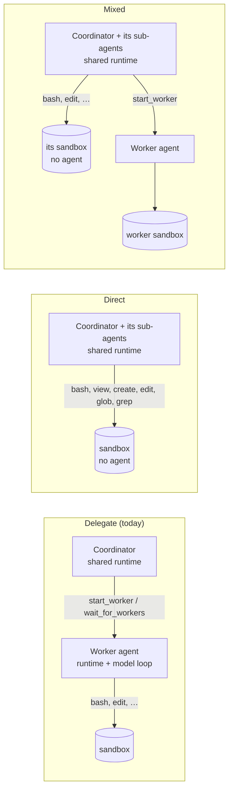

# Proposal: direct execution (one brain, hands in sandboxes)

> **Status: research and calibration.** Nothing here is built or part of the customer contract
> ([spec](../spec/developer-experience.md)). The snippets show the intended customer experience so we can agree on it
> before implementation. The core mechanism is verified on the stock SDK and runtime (see [Evidence](#evidence)).

Today an orchestrator **delegates**: the coordinator talks to workers, and each worker is a whole agent (its own
runtime, model loop, and context) inside its own sandbox. That is the right shape for independent, long-running
parts of a job. It is the wrong shape for a multi-tenant harness that already has its own planning and sub-agents and
just wants them to *act* inside an isolated machine.

This proposal adds two more orchestration styles beside it:

- **Direct**: the brain (the coordinator and its stock sub-agents) stays on the shared runtime, and its hands (`bash`
  and its background-command tools, `view`, `create`, `edit`, `glob`, `grep`) run inside a sandbox. No agent runs in
  the sandbox.
- **Mixed**: both at once. The coordinator does quick hands-on work in its own sandbox and hands big, independent parts
  to worker agents.

And one SDK call, **`managed.exec`**, so an integrator can build its own direct-style harness in its own process.



## The customer experience

### Declare it

One knob on the orchestrator type. Every style uses the same worker environments, so image, size, setup, network
rules, vaults, and idle stop are shared.

```ts
// apphost.mts
environments: {
  python: { type: "isolated", size: "medium", setup: { packages: { python: ["pandas"] } } },
  coder:  { type: "isolated", size: "large", exec: false },  // operators: no managed.exec in this environment's sandboxes

  // Delegate: each part of the job goes to a worker agent in its own sandbox (today's behavior, the default).
  team: { type: "orchestrator", workers: ["python"] },

  // Direct: the coordinator and its sub-agents act in a sandbox themselves.
  operator: {
    type: "orchestrator",
    workers: ["python"],     // direct takes exactly one environment: the one its hands run in
    execution: "direct",     // "delegate" (default) | "direct" | "mixed"
    subagents: "shared",     // "shared" (default): one workspace for the session | "own": a sandbox per sub-agent
  },

  // Mixed: hands in the first environment, workers in any of them.
  lead: { type: "orchestrator", workers: ["python", "coder"], execution: "mixed" },
},
```

### Use it

Customer code is identical to any other session: a genuine `CopilotSession`, standard events, standard tools.

```ts
const client = await managed.client("operator");
const session = await client.createSession({
  model: "claude-sonnet-5",
  tools: [lookupCustomer],            // your own defineTool tools sit beside the sandbox tools
  onPermissionRequest: (request) => {
    // bash, create, and edit ask here, once per call; view, glob, and grep don't ask.
    if (request.kind === "custom-tool") console.log(`${request.toolName}?`, request.arguments);
    return { kind: "approved" };
  },
});

session.on("tool.execution_start", (e) => console.log(`${e.agentId ?? "root"} → ${e.data.toolName}`));

const reply = await session.sendAndWait(
  { prompt: "Use two sub-agents in parallel: one counts primes below 100,000 in Python, the other finds how many digits the 1000th Fibonacci number has. Report both." },
  10 * 60_000,
);

// The hands sandbox is a workspace you can read like a worker's: files and artifacts work the same way.
const [hands] = (await managed.workers(session).list()).filter((w) => w.role === "hands");
console.log(await managed.files(hands).list());   // primes.py, fib.py, outputs/
```

### What the coordinator's tools become

| Style | Tools |
| --- | --- |
| `delegate` (today) | `start_worker`, `wait_for_workers`, `message_worker`, `list_workers`, `read_worker_file`, `copy_worker_files`, `stop_worker`. No shell or files of its own; sub-agents off |
| `direct` | `bash`, `read_bash`, `write_bash`, `stop_bash`, `list_bash`, `view`, `create`, `edit`, `glob`, `grep` (the built-in names and shapes models already know), plus the stock sub-agent tools `task`, `read_agent`, `write_agent`, `list_agents`. Each sub-agent's calls run in the sandbox too (its own sandbox with `subagents: "own"`) |
| `mixed` | Both sets. The environment section describes both options neutrally (its own sandbox, and each worker environment with its description, size, network, and agents) and leaves the choice to the model, without rules for when to use which; `copy_worker_files` also copies between its own sandbox and a worker's |

### Long commands

`bash` works like the stock shell tool: `mode: "sync"` (default) waits up to `initial_wait` seconds (default 120, at
most 1,800) and, if the command is still running, returns what it printed so far with a `shellId`; `mode: "async"`
returns at once. `read_bash` reads new output (waiting up to `delay` seconds), `write_bash` sends input, `stop_bash`
kills the command's process group, and `list_bash` shows the session's commands. A 20-minute test suite runs as an
async command while the brain keeps working, or waits for it with `read_bash`.

### Build your own: `managed.exec`

For an integrator whose harness already runs the agent loop in its own process: create a sandbox with no agent in
it, then run commands and move files in it from your code. This is exactly what the [probe](probes/direct-execution.mjs)
does with Docker, on the platform's sandboxes.

```ts
// A workspace-only sandbox of an isolated environment: setup, network rules, and vaults apply; no agent runs in it.
const sandbox = await managed.sandboxes.create({ environment: "python" });

const result = await managed.exec(sandbox, "python3 -c 'print(6 * 7)'", { timeoutMs: 60_000 });
console.log(result.exitCode, result.output);      // 0 "42\n"

// Long-running: start it, read as it goes, stop it.
const job = await managed.exec(sandbox, "pytest -q", { background: true });
for await (const chunk of job.output) process.stdout.write(chunk);
console.log((await job.result).exitCode);         // or: await job.stop()

// Your own harness: override the stock tools so your agent's hands (and its sub-agents') are in the sandbox.
const bash = defineTool("bash", {
  description: "Run a bash command in the Linux workspace (/workspace).",
  parameters: z.object({ command: z.string() }),
  overridesBuiltInTool: true,
  handler: async ({ command }) => (await managed.exec(sandbox, command)).output,
});

await managed.sessions.delete(sandbox.id);        // deletes the sandbox and its files
```

These handlers run in your process, so they stop when your app does; platform direct mode runs them in the gateway.

In an environment with `exec: false`, `managed.sandboxes.create` and `managed.exec` fail with `policy_violation`
("Running commands directly is turned off for environment coder."), and `/v1/info` reports it so apps can check first.

## When to use which

| | Delegate | Direct |
| --- | --- | --- |
| **Who thinks** | One agent per worker, plus the coordinator | The coordinator and the stock sub-agents it chooses to start |
| **Context** | Each worker has its own; the coordinator sees only reports | The root agent sees its own commands; each sub-agent has its own context and returns a summary, as stock sub-agents do |
| **Inference** | A runtime and model loop per worker, in its sandbox | The same kinds of loops, all in the shared runtime; sandboxes run no runtime or model |
| **Sandbox footprint** | Runtime + sandboxd per worker | sandboxd only; **no runtime and no placeholder credential in the sandbox** |
| **Approvals** | One per worker (`start_worker`); the platform answers the worker's own prompts | `bash`, `write_bash`, `create`, and `edit` ask your `onPermissionRequest` once per call; reads (`view`, `glob`, `grep`, `read_bash`, `list_bash`) and `stop_bash` don't ask |
| **Long or independent work** | Best: workers run while the coordinator waits or chats | Async `bash` commands run while the brain works; the brain itself is one turn at a time. Use `mixed` to hand long parts to workers |
| **Prompt-injection blast radius** | Worker output reaches the coordinator as marked, clipped data; workers can't call your tools | Sandbox output enters the same context that can call your `defineTool` tools: decide tool approvals with that in mind |
| **Copilot CLI** | Attach to the coordinator or to any worker | Attach to the coordinator; there is no agent in a sandbox to attach to |
| **Fits** | Software factory, research swarms, anything that runs for minutes per part | Multi-tenant harnesses with their own planning, tight edit-run loops, data analysis, "do it yourself, but not on my host" |

Delegate and direct are worth demonstrating side by side: same prompt, same environment, different shape; `mixed`
shows a coordinator choosing between them (see [Demos](#demos)).

## How it works (stock SDK and runtime only)

1. **Tool replacement is a stock feature.** A session's tools can replace built-ins with `overridesBuiltInTool: true`.
   The gateway already does this for `web_fetch` on shared placement. In direct and mixed mode, admission adds the
   ten hands tools as **platform tools** (gateway-side handlers, registered with
   `platformTools.register({ overridesBuiltInTool: true, … })`), leaves the shared runtime's own host shell and file
   tools out of `availableTools` as it does today, and turns the sub-agent built-ins on.
2. **Sub-agents use the session's tools.** A stock `task` sub-agent's tool calls arrive at the same handlers, and
   the request carries the sub-agent's `agentId` (`ToolInvocation.agentId` in the SDK; undefined for the root agent).
   The gateway's platform-tool context does not pass it on today, so that plumbing is part of the work (see
   [Hard parts](#hard-parts)).
3. **The environment section tells the truth.** Admission replaces `environment_context` (as it does for every shared
   session) with "your tools act on a Linux sandbox in /workspace", so the model doesn't assume the gateway host.
4. **Handlers run in the gateway, not your app.** So direct sessions keep working while your app is offline, schedules
   can use them, and nothing about the sandbox reaches your process unless you ask for files.

## What the platform needs to build

| Area | Change |
| --- | --- |
| sandboxd | `POST /v1/exec` and `/v1/exec/<id>` (read, input, stop, list): runs `bash -c` as uid 10001 through `asWorkload` (cwd `/workspace`, egress env and vault placeholders, never the GitHub token), in its own process group. Each execution is journaled by ID with a bounded output buffer and its exit, so a caller can reattach, read new output since an offset, send input, or stop it; timeouts and stops kill the process group. File tools reuse the existing uid-10001 file worker; `edit` is an atomic compare-and-replace in that worker |
| sandbox service | `sandboxes.exec(sessionId, command, { actionId, background, timeoutMs, signal, sandboxId })` plus `readExec`, `writeExec`, `stopExec`, `listExecs`, pinned like file calls; a `runtime: false` create option so a hands sandbox never starts `copilot-runtime` (no inference broker, no placeholder). A running exec holds off idle stop |
| core | A **workspace-only** session kind: a child session with a sandbox and no runtime. Core must not open a runtime for it, refuses agent operations on it (`send`, `resume`, attach) with `invalid_request`, and gives it its own busy accounting (a running exec), idle stop, and artifact publication (at the end of each of the coordinator's root turns, since the hands sandbox has no turns of its own). sandboxd and the sandbox service skip runtime start and runtime health checks when `runtime: false`. Platform-tool context gains `agentId` and the runtime's cancellation of the tool call, on both the live and durable paths |
| orchestrator | `execution` (`delegate`, `direct`, `mixed`) and `subagents` config; the ten hands tool handlers; a persisted (coordinator incarnation, agent) → hands-session map with atomic lazy creation inside the `maxWorkers` bound; worker recovery and `wait_for_workers` skip workspace-only children; in `mixed`, `copy_worker_files` accepts the coordinator's own sandbox as a source or target |
| durable actions | Hands tools opt out of "platform tools run again after a restart": an interrupted exec is reattached through the sandbox journal, or reported as an uncertain outcome; it is never rerun blindly |
| core admission | Direct- and mixed-mode tool filters (the hands tools, the sub-agent built-ins, and in `mixed` the worker tools) and environment sections; validation that `direct` names exactly one worker environment |
| REST and SDK | `POST /v1/sandboxes` (a workspace-only session of an isolated environment, owned by the caller), `POST /v1/sessions/:id/exec` and the matching read, input, stop, and list routes; `managed.sandboxes.create`, `managed.exec` (result, or a background handle with `output`, `result`, `write`, `stop`). They work on any sandbox session the caller owns: an isolated session, a worker, or a hands sandbox. Every exec is recorded in the actions ledger with its caller |
| CLI | `npx managed-copilot exec <session> -- <command>` for debugging |
| protocol | Additive: `EnvironmentConfig` gains `execution` and `subagents` (orchestrator) and `exec` (isolated), `EnvironmentInfo` reports `exec`; plus `WorkerInfo.role`, `ExecResult`, `ExecInfo`, and the new routes |
| docs and samples | Spec section 17 extension and a new section for `managed.exec`, concept page sections, walkthroughs 12 and 13, a mode switch in Dispatch |

Sandbox creation is lazy: the first tool call that needs a sandbox creates it (seconds on Docker, longer on Azure),
reported with the existing `worker.started` event.

## Hard parts

The probe proves the mechanism; these are what make it a platform feature rather than a demo.

| Problem | Why it matters | Proposed answer |
| --- | --- | --- |
| **Replay after a gateway restart** | Durable recovery reruns interrupted platform tools because today's are idempotent by key (`durable/actions/service.ts`, `recover`). A shell command is not: it may have pushed, paid, or deleted before the crash | sandboxd journals each exec by action ID; recovery reattaches to a running exec or reads its result, and an exec whose outcome is unknown fails with an explicit "may have run" error. Never a blind rerun |
| **Cancellation** | Platform-tool handlers get only a 10-minute timeout signal (`core/sessions.ts`, `#runPlatformTool`) and none on the durable path. An aborted turn could leave commands mutating files | Pass the runtime's tool-call cancellation, session deletion, and shutdown through to `sandboxes.exec`, which kills a sync command's process group. Async commands outlive the turn by design and stop with `stop_bash`, idle stop, or deletion; processes a command detached itself (`nohup … &`) run until the sandbox stops. Documented |
| **Sub-agent attribution** | `subagents: "own"` needs the calling agent, and the gateway's handler context has no `agentId` today. Treating "missing" as root would put a sub-agent in the root's sandbox | Carry the request's `agentId` through the live and durable paths. If attribution is unavailable, `"own"` fails the call with `capability_unavailable`; it never falls back to sharing |
| **Workspace-only sessions** | Core opens a runtime for every sandbox session, and worker recovery treats every child as an agent | A distinct session kind with its own lifecycle (see the core row above), not just `WorkerInfo.role` |
| **Parallel sub-agents on one workspace** | With `subagents: "shared"`, two `edit`s to the same file could each read, replace, and write, silently losing one change | `edit` is an atomic compare-and-replace that fails with `conflict` when the file changed underneath it. Concurrent shell commands stay unsynchronized, as on any shared machine; `"own"` is the answer when that matters |
| **Untrusted output in a privileged context** | Sandbox output lands in the context that can call your own tools | Tool results stay ordinary tool results (no special trust); the environment section says sandbox content is data; approvals on your tools are your boundary. Documented in the comparison above |
| **Sub-agent calls across a runtime restart** | Stock sub-agent tool requests can be answered only while that sub-agent is running; a shared-runtime restart loses them (spec, "Waiting requests") | Same as any shared session today: the turn ends visibly as failed and the user retries. The exec journal still reports what ran |
| **Sub-agent sandboxes under `"own"`** | Each `task` call is a new `agentId`, so sandboxes would pile up against `maxWorkers`, and their files would be stranded | A sub-agent's sandbox is released when its `subagent.completed`/`failed` event arrives, after its `/workspace/outputs` is copied into the root agent's sandbox under `outputs/<agent>/`. A call over the bound fails with `policy_violation`, as `start_worker` does |
| **File-tool fidelity** | The model expects the built-in shapes (`view` with `view_range`, `edit` with `old_str`/`new_str`, `grep`/`glob` options). The file worker refuses symbolic links, which `bash` (for example `npm install`) creates freely | Mirror the built-in schemas exactly (taken from `rpc.tools.list`). `view`, `glob`, and `grep` run as uid-10001 subprocesses like `bash`, following links inside `/workspace` only; writes go through the file worker, which keeps refusing links |
| **Async commands and idle stop** | A sandbox stopped for idleness would kill a 20-minute test suite, and one that never stops costs money | A running exec counts as activity, up to the environment's idle timeout after its last output; `list_bash` shows each command's state, and a command killed by an idle stop or a restart reads as `stopped`, with the reason |
| **`managed.exec` is a new trust surface** | Any owner's code can run commands in its sandboxes without an agent turn or an approval prompt | It is the owner acting directly, like `managed.files().write()` today: owner-scoped, recorded in the actions ledger, and bounded by the sandbox's network rules and vaults. Operators turn it off per environment with `exec: false` |

## Demos

- **Walkthrough 12 · Direct execution**, the twin of walkthrough 11: the same primes and Fibonacci prompt against
  `team` and then `operator`, printing which agent ran which command, how many sandboxes and model loops each used,
  and the wall time. One script shows both shapes, then a `lead` (mixed) session gets a job with a long test suite and
  a quick fix, and the script prints which parts the model chose to do itself and which it gave to a worker.
- **Walkthrough 13 · Your own harness**: `managed.sandboxes.create`, `managed.exec` with a background command, and
  a stock client whose overridden `bash` and file tools run through `managed.exec`: the probe, on the platform.
- **Dispatch**: a three-way switch beside the composer, "Delegate to workers" / "Work directly" / "Mixed". The
  message's sandbox cards stay the same; direct work lists the commands the brain and its sub-agents ran.

## Evidence

Verified 2026-10-27 on Windows ARM64 with the published `@github/copilot-sdk` 1.0.26 and `@github/copilot` 1.0.103,
using [`probes/direct-execution.mjs`](probes/direct-execution.mjs): a stock client on this machine, with
`bash`/`view`/`create`/`edit`/`glob`/`grep` overridden to run in a `--network none` container of the sandbox image
through `docker exec`, and the host's `powershell` tools excluded.

```text
  [brain] sub-agent started: general-purpose
  [brain] sub-agent started: general-purpose
  [hands] subagent f6087643 create {"path":"/workspace/primes.py",…}
  [hands] subagent f6087643 bash {"command":"cd /workspace && python3 primes.py"}
  [hands] subagent 0b45f9ee create {"path":"/workspace/fib.py",…}
  [hands] subagent 0b45f9ee bash {"command":"cd /workspace && python3 fib.py"}
  [hands] root              bash {"command":"cat /etc/os-release | grep -E '^(NAME|PRETTY_NAME)='"}

BRAIN: Primes below 100,000: 9,592 · Digits in the 1000th Fibonacci number: 209 · OS: Debian GNU/Linux 12 (bookworm)
```

- `rpc.tools.list` on a Windows host lists `powershell` (and `read_/write_/stop_/list_powershell`), `glob`, `grep`,
  `create`, `edit`, `view`, `web_fetch`, `task`, `read_agent`, `list_agents`, `write_agent`, and `skill`. A Linux
  runtime names its shell `bash`. The shell tool takes `command`, `description`, `shellId`, `mode` (`sync`|`async`),
  `detach`, and `initial_wait`; `read_` takes `shellId` and `delay`; `stop_` takes `shellId`. The hands tools mirror
  these, without `detach`.
- `overridesBuiltInTool: true` replaced `create` and `view`, and was accepted on `bash`, which does not clash on a
  Windows host.
- Both parallel `general-purpose` sub-agents called the overridden tools, with their own `agentId`; the root agent's
  call had none. The files existed in the container afterwards; nothing was written on the host.

Not yet verified: how Copilot CLI renders overridden `bash` calls and their permission prompts in an attached
coordinator, and whether `subagent.*` events and `agentId` survive the gateway's routing unchanged (they are standard
events, so they should).

## Decisions

Agreed in review on 2026-10-27.

| # | Decision | Status |
| --- | --- | --- |
| 1 | `execution` on the `orchestrator` type, not a new environment type or a per-session option | Decided |
| 2 | Three styles: `delegate` (default), `direct`, and `mixed`. `direct` takes exactly one environment; `mixed` puts its hands in the first and starts workers in any | Decided |
| 3 | `bash`, `write_bash`, `create`, and `edit` ask for permission; reads and `stop_bash` don't | Decided |
| 4 | `subagents: "shared"` by default; `"own"` gives each sub-agent its own sandbox | Decided |
| 5 | Long commands: stock-shaped `bash` with `mode`/`initial_wait`, plus `read_bash`, `write_bash`, `stop_bash`, `list_bash`, in the first cut | Decided |
| 6 | Public `managed.sandboxes.create` and `managed.exec` (with background handles) in the first cut | Decided |
| 7 | `mixed` mode informs the model of both options (its own sandbox and the worker environments) and lets it decide; no platform rules for when to delegate | Decided |
| 8 | Operators turn off `managed.exec` per environment with `exec: false` (default `true`). It governs `managed.exec` and the exec REST routes only; a `direct` or `mixed` coordinator's own hands tools still work in that environment's sandboxes | Decided |
