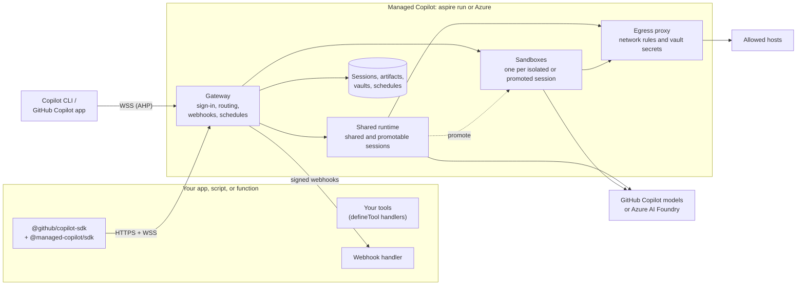

# Managed Copilot SDK: developer experience

> **Status: draft for calibration, revised 2026-10-23.** Nothing is built yet. This revision designs the six gaps
> found in the [comparison with OpenAI's Agents API](#comparison-with-openais-agents-api). The
> [decision tracker](#decision-tracker) records what is decided and what is still proposed.

## The idea in one snippet

Today the Copilot SDK runs the agent next to your code:

```ts
import { CopilotClient, approveAll } from "@github/copilot-sdk";

const client = new CopilotClient();
await client.start();

const session = await client.createSession({ model: "claude-sonnet-5", onPermissionRequest: approveAll });
const reply = await session.sendAndWait({ prompt: "Summarize what changed in Aspire 13" });
console.log(reply?.data.content);
```

With Managed Copilot, the same code runs the agent in an **environment** you deployed, either locally under Aspire
or in your Azure subscription:

```ts
import { approveAll } from "@github/copilot-sdk";
import { ManagedCopilot } from "@managed-copilot/sdk";

const managed = await ManagedCopilot.connect(); // your local `aspire run`, or your Azure deployment
const client = await managed.client("chat");    // a CopilotClient for the "chat" environment

const session = await client.createSession({ model: "claude-sonnet-5", onPermissionRequest: approveAll });
const reply = await session.sendAndWait({ prompt: "Summarize what changed in Aspire 13" });
console.log(reply?.data.content);
```

Only the setup lines change. Everything after `managed.client(...)` is the Copilot SDK you already know: sessions,
events, tools, hooks, permissions, and resume.

For a one-off session, a single call picks the environment and creates the session:

```ts
const session = await managed.createSession({ environment: "chat", model: "claude-sonnet-5", onPermissionRequest: approveAll });
```

## Principles

1. **It's still the Copilot SDK.** `managed.client()` returns a `CopilotClient`, and sessions are `CopilotSession`s.
   There is no new message, event, or tool model to learn.
2. **One new concept: the environment.** It decides where the agent loop and its built-in tools run, and how they
   are isolated.
3. **Same code, local or Azure.** `aspire run` for the inner loop and `aspire deploy` for Azure. Only the URL changes.
4. **Your tools stay in your app.** Tools you define with `defineTool` run in your process, so the environment never
   sees your secrets. Your app doesn't have to stay connected: a call made while it's away waits for an answer.
   Built-in tools such as shell and file editing run in the environment.
5. **One identity: GitHub.** The login you use for Copilot is how you sign in to the platform, attach from Copilot
   CLI, and pay for model calls, including work that continues while you're away.
6. **Every session is attachable.** Open any running session in Copilot CLI, and in the GitHub Copilot app where
   supported, and work alongside your app.
7. **Secure by default, easy to lock down.** Only the platform's gateway is reachable, over HTTPS and WSS. Every
   request is authenticated, sessions belong to the GitHub user who created them, and secrets stay in vaults outside
   the sandbox. Outbound network access is on, as in OpenAI's API, and `network: false` turns it off.

## Environment types

| Type | Where the agent runs | Built-in tools | Start | Isolation boundary | Typical use |
| --- | --- | --- | --- | --- | --- |
| `shared` | One runtime shared by many sessions | A safe set with no shell or files; plus your tools, MCP servers, and web fetch when the network setting allows | Instant | Per-session state and identity in a shared process | Chat, support, Q&A, high volume |
| `isolated` | A fresh Linux **sandbox** (container) for each session | Everything: shell, files, git, and your image's toolchain | Seconds, or instant from a warm pool | A container per session | Coding and data agents, untrusted work |
| `promotable` | Starts `shared`, then moves once into its own fresh sandbox | The safe set, then everything | Instant, then a sandbox start at promotion | Shared, then a container | Assistants that occasionally need a shell |
| `orchestrator` *(later)* | A shared coordinator that starts workers in dynamic containers | Per worker | | A container per worker | Parallel and multi-agent work |

## 1. Declare your environments

Environments are part of your Aspire app model, so the same declaration runs locally and deploys to Azure:

```ts
// apphost.mts
import { createBuilder } from "./.aspire/modules/aspire.mjs";
import { addManagedCopilot } from "@managed-copilot/aspire";

const builder = await createBuilder();

await addManagedCopilot(builder, "copilot", {
  access: { githubOrgs: ["contoso"] }, // GitHub accounts allowed to use the deployed platform

  environments: {
    chat: {
      type: "shared",
      customizations: "./copilot/chat", // agents, skills, and instructions (section 10)
      models: ["claude-sonnet-5", "claude-haiku-5.5"],
      network: ["learn.microsoft.com"], // only this host
    },
    coder: {
      type: "isolated",
      image: "./sandboxes/coder",
      size: "medium",
      warm: 2,
    },
    helper: { type: "promotable", promoteTo: "coder" },
  },

  // Optional: lets code request { type, size } without a name, using the default sandbox image and settings.
  inline: { types: ["shared", "isolated"], sizes: ["small"] },
});

await builder.build().run();
```

```powershell
aspire run      # local: gateway, shared runtime, and sandboxes in Docker, plus the Aspire dashboard
aspire deploy   # the same model in Azure Container Apps
```

- The platform enforces every setting in an environment. Code can add setup and narrow settings, but never broaden
  them.
- **`models`** lists the models its sessions may use.
- **`network`** controls outbound access. It's on unless you turn it off with `network: false`, here or for every
  environment at once ([section 7](#7-control-network-access)).
- **`size`** is `small` (1 vCPU, 2 GiB), `medium` (2 vCPU, 4 GiB), or `large` (4 vCPU, 8 GiB).
- **`warm`** keeps that many sandboxes started and waiting, so new sessions skip the cold start. Warm sandboxes cost
  money while they wait.

A sandbox image is an ordinary Dockerfile on top of the base image:

```dockerfile
# sandboxes/coder/Dockerfile
FROM ghcr.io/patniko/managed-copilot-sandbox:latest
RUN apt-get update && apt-get install -y python3-pip
```

When the AppHost allows `inline` requests, a quick demo can skip the name:

```ts
const client = await managed.client({ type: "isolated", size: "small" });
```

A request outside the `inline` list, or for an environment name that isn't declared, fails at `managed.client(...)`.

## 2. Connect

```ts
// Local: finds the running AppHost. Nothing to configure.
const managed = await ManagedCopilot.connect();

// Azure: the URL printed by `aspire deploy`.
const managed = await ManagedCopilot.connect({ url: "https://copilot.contoso.example" });
```

With no arguments, `connect()` uses `MANAGED_COPILOT_URL` when it is set and the local AppHost otherwise.

Either way, **you are your GitHub login**: the account signed in to Copilot CLI, or `GH_TOKEN` or `GITHUB_TOKEN`. The
platform admits the accounts in the AppHost's `access` list, and your sessions use your Copilot entitlement. Locally,
the platform listens on loopback only.

A backend that serves signed-in users acts as each user with that user's GitHub token, obtained as in the SDK's
GitHub OAuth guide:

```ts
const client = await managed.client("chat", { gitHubToken: user.githubToken });
```

The SDK's per-session `gitHubToken` option also works, and the platform verifies it the same way.

### Work that continues without you

Some work outlives your connection: a long turn you left running, a tool call waiting for an answer, or a scheduled
run. It still runs as you. Before using it the first time, sign in once:

```powershell
npx managed-copilot login   # authorizes the platform's GitHub App to act for you while you're away
```

The platform keeps a refreshable GitHub credential for you, encrypted (in Azure Key Vault when deployed), and uses it
only for your own sessions and schedules. `npx managed-copilot logout` revokes it.

## 3. Shared: a chat agent with your own tools

```ts
import { approveAll, defineTool } from "@github/copilot-sdk";
import { z } from "zod";

const lookupOrder = defineTool("lookup_order", {
  description: "Look up an order by id",
  parameters: z.object({ id: z.string() }),
  handler: async ({ id }) => orders.get(id), // runs in YOUR process; your database credentials never leave it
});

const client = await managed.client("chat");
const session = await client.createSession({
  model: "claude-sonnet-5",
  systemMessage: { content: "You are Contoso's order assistant. Be brief." },
  tools: [lookupOrder],
  onPermissionRequest: approveAll,
});

session.on("assistant.message_delta", (e) => process.stdout.write(e.data.deltaContent));
await session.sendAndWait({ prompt: "Where is order 1234?" });
```

You don't need `availableTools`: the environment decides which built-in tools exist, and you can narrow them further
with `availableTools` or `excludedTools`. A `shared` environment has no shell or file tools, so asking for them fails
at `createSession` rather than halfway through a conversation.

## 4. Isolated: a coding agent in its own sandbox

```ts
const client = await managed.client("coder");

// Each session gets its own fresh sandbox.
const session = await client.createSession({ model: "claude-sonnet-5", onPermissionRequest: approveAll });
await session.sendAndWait({
  prompt: "Clone https://github.com/microsoft/aspire, count the *.cs files per top-level folder, and save outputs/report.md",
});

// Files under /workspace/outputs are published when the turn ends (section 6).
console.log(await managed.artifacts(session).read("report.md"));
```

`approveAll` is reasonable here: the agent can affect only its own sandbox and the hosts its network setting allows,
not your machine or other sessions.

The sandbox's working directory is `/workspace`. While the sandbox exists, `managed.files(session)` reads, writes, and
lists any file in it.

A sandbox lives exactly as long as its session:

- It is created with the session and never shared with another session.
- When the session goes idle, the sandbox stops and keeps its files. Resuming the session wakes it.
- Deleting the session deletes its sandbox: `await client.deleteSession(session.sessionId)`.

```ts
const info = await managed.sessions.get(session.sessionId);
console.log(info.sandbox); // { id: "sbx_7f3a…", size: "medium", state: "running" }
```

## 5. Set up the sandbox

An environment can install packages, run setup commands, and set environment variables before every session starts:

```ts
// apphost.mts: every "coder" session starts like this
coder: {
  type: "isolated",
  image: "./sandboxes/coder",
  packages: { python: ["pandas==2.2.3"], npm: ["typescript"], system: ["jq"] },
  setupCommands: ["git config --global user.name 'Contoso Agent'"],
  env: { TZ: "UTC" },
},
```

Code can add to it for the sessions one client creates, for example to provide input files:

```ts
const client = await managed.client({
  name: "coder",
  files: { "data/sales.csv": await readFile("./sales.csv") },
  packages: { python: ["matplotlib"] },
  env: { REPORT_TITLE: "Q3 sales" },
});
const session = await client.createSession({ model: "claude-sonnet-5", onPermissionRequest: approveAll });
```

- Setup runs in order before the agent starts: packages, then files, then setup commands. File paths are relative to
  `/workspace`. If a command fails, `createSession` throws with its output.
- Packages install from their public registries even when network access is off. Setup commands follow the network
  setting.
- Warm sandboxes have already run the environment's own setup. A client's additions run when its session claims one,
  so keep them small and bake anything slow into the image.
- `env` values are visible to everything in the sandbox. Put secrets in a vault
  ([section 8](#8-keep-secrets-out-of-the-sandbox)).

## 6. Get results out

Continuing that session:

```ts
await session.sendAndWait({ prompt: "Chart monthly revenue from data/sales.csv and save outputs/revenue.png" });

const artifacts = managed.artifacts(session);
for (const artifact of await artifacts.list()) {
  console.log(artifact.path, artifact.size, artifact.publishedAt); // revenue.png 48213 2026-10-23T21:04:11Z
}
await artifacts.download("revenue.png", "./revenue.png");
```

- When a turn ends, the platform publishes every file under `/workspace/outputs` as an immutable artifact.
- Artifacts outlive the sandbox. They're deleted with the session.
- A file changed in a later turn becomes a new version. `list()` shows the newest version of each file, and
  `list({ versions: "all" })` shows every version.

## 7. Control network access

Network access is on by default, as in OpenAI's API. Turning it off, or limiting it to a few hosts, takes one line:

```ts
coder: { type: "isolated", network: false },                                    // nothing leaves the sandbox
docs:  { type: "isolated", network: ["github.com", "*.githubusercontent.com"] }, // only these hosts
```

Set it once at the top level to change the default for every environment. An environment that needs access says so:

```ts
await addManagedCopilot(builder, "copilot", {
  network: false, // off for every environment below, unless it says otherwise
  environments: {
    chat: { type: "shared" },                          // off
    coder: { type: "isolated", network: ["pypi.org"] }, // only PyPI
  },
});
```

Code can turn it off for the sessions one client creates:

```ts
const client = await managed.client({ name: "coder", network: false });
```

| Setting | Behavior |
| --- | --- |
| Omitted, or `true` | Any host (the default) |
| A list of hosts | Only those hosts; `*.example.com` matches any subdomain |
| `false` | No outbound access |

OpenAI's longer form works too: `{ access: "enabled" | "restricted" | "disabled", allowedDomains }`.

- The setting covers everything the agent runs: shell commands, web fetches, and the MCP servers it starts. Model
  calls and platform traffic aren't affected.
- Even with access on, the agent can't reach the platform's internal network or cloud metadata endpoints.
- Code can narrow access but never broaden it.
- A blocked request fails immediately with an error the agent can read, and the platform records it with the
  session.

## 8. Keep secrets out of the sandbox

A **vault** holds credentials the agent can use but never see. There are two kinds:

- **Sandbox credentials.** The sandbox gets an environment variable that holds a placeholder. The platform's egress
  proxy replaces the placeholder with the real value on requests to the credential's hosts, and nowhere else.
- **MCP server credentials.** The platform adds the credential when a session connects to that MCP server.

Declare vaults for a whole environment in the AppHost:

```ts
// apphost.mts
const stripeKey = builder.addParameter("stripe-key", { secret: true }); // a user secret locally, Key Vault in Azure
const docsToken = builder.addParameter("docs-mcp-token", { secret: true });

await addManagedCopilot(builder, "copilot", {
  vaults: {
    payments: [{ env: "STRIPE_API_KEY", value: stripeKey, hosts: ["api.stripe.com"] }],
    docs: [{ mcpServer: "https://mcp.contoso.example/docs", value: docsToken }],
  },
  environments: {
    coder: { type: "isolated", vaults: ["payments"], network: ["api.stripe.com"] },
    chat: { type: "shared", vaults: ["docs"] },
  },
});
```

Inside a `coder` sandbox:

```bash
echo "$STRIPE_API_KEY"   # mcv_placeholder_6f1c…, never the real key
curl -s -H "Authorization: Bearer $STRIPE_API_KEY" https://api.stripe.com/v1/balance   # works
```

In a `chat` session, the MCP server needs no credential in your code:

```ts
const chat = await managed.client("chat");
const session = await chat.createSession({
  mcpServers: { docs: { type: "http", url: "https://mcp.contoso.example/docs" } },
  onPermissionRequest: approveAll,
});
```

Create per-user vaults in code, for credentials that belong to one end user:

```ts
const vault = await managed.vaults.create({
  name: `jira-${user.id}`,
  credentials: [{ env: "JIRA_TOKEN", value: user.jiraToken, hosts: ["contoso.atlassian.net"] }],
});
const client = await managed.client("coder", { vaults: [vault.id] });
```

- No API returns a vault's values. AppHost vaults serve the environments that list them; vaults created in code
  belong to the GitHub user who created them.
- A credential's hosts must also be allowed by the environment's network setting.

## 9. Promotable: start cheap, move when needed

```ts
managed.on("session.promoted", (e) => console.log(`${e.sessionId} moved to sandbox ${e.sandboxId}`));

const client = await managed.client("helper");
const session = await client.createSession({ model: "claude-sonnet-5", onPermissionRequest: approveAll });

// Shared and instant.
await session.sendAndWait({ prompt: "What does a CSV header row usually contain?" });

// Needs a shell: the agent calls its built-in `promote_to_sandbox` tool, which you approve like any other tool.
await session.sendAndWait({ prompt: "Download https://example.com/sales.csv and compute summary stats with pandas" });
```

The session moves into its own fresh sandbox from the `promoteTo` environment. The same `session` object keeps
working across the move, with its full history. Your app can also promote a session with
`await managed.promote(session)`. Promotion is one way: a promoted session never returns to `shared`.

## 10. Ship agents with an environment

Reusable agent configurations are ordinary **Copilot custom agents**, deployed with an environment. Skills and
instructions can ship in the same folder, in the formats Copilot CLI already reads:

```text
copilot/chat/
├── agents/
│   └── triage.agent.md
├── skills/
│   └── refund-policy/SKILL.md
└── instructions/
    └── contoso.instructions.md
```

```markdown
---
name: triage
description: Triage Contoso support requests and route them to the right team
model: claude-sonnet-5
tools: ["lookup_order", "web_fetch"]
---
You triage support requests for Contoso. Look up the order first, then decide which team owns the request.
```

Select one with the SDK's standard `agent` option:

```ts
const client = await managed.client("chat");
const session = await client.createSession({ agent: "triage", tools: [lookupOrder], onPermissionRequest: approveAll });
```

The platform loads the folder through the SDK's `agentDirectories`, `skillDirectories`, and
`instructionDirectories`, so these files behave exactly as they do in Copilot CLI. Agents you pass in `customAgents`
are added alongside the deployed ones. The environment's settings apply whichever agent runs.

## 11. Come back later

```ts
// The platform knows where every session lives, so its id is enough. Resuming wakes its sandbox if needed.
const session = await managed.resumeSession(sessionId, { tools: [lookupOrder], onPermissionRequest: approveAll });

for (const s of await managed.sessions.list()) {
  console.log(s.id, s.environment, s.placement, s.updatedAt); // placement is "shared" or "sandbox"
}

await managed.close(); // disconnects this process; sessions and sandboxes keep running
```

As with the SDK, pass your tools and handlers again when you resume; they still run in your process. Anything that
was waiting for them is delivered as soon as you resume ([section 12](#12-keep-working-while-your-app-is-offline)).
Sessions belong to the GitHub user who created them, so `list()` returns only yours.

## 12. Keep working while your app is offline

Sessions don't need your app to stay connected. Send work and leave:

```ts
await session.send({ prompt: "Reconcile last month's refunds against the ledger" }); // returns once the work is queued
await managed.close(); // the agent keeps working
```

If the agent calls one of your tools, or needs a permission decision, while no app is connected, the request waits in
the session, as OpenAI's required actions do. Answer it in one of three ways.

**Resume the session.** Waiting requests go to your handlers as soon as you resume, as in section 11.

**Handle a webhook.** Declare an endpoint in the AppHost:

```ts
const webhookSecret = builder.addParameter("webhook-secret", { secret: true });

await addManagedCopilot(builder, "copilot", {
  webhooks: {
    orders: {
      url: "https://contoso-orders.azurewebsites.net/api/copilot-events",
      events: ["session.action_required", "session.idle", "session.failed", "artifact.published"],
      secret: webhookSecret,
    },
  },
  // environments: { ... }
});
```

Then handle the events, for example in Azure Functions:

```ts
import { app } from "@azure/functions";
import { approveAll } from "@github/copilot-sdk";
import { verifyWebhook } from "@managed-copilot/sdk";

app.http("copilot-events", {
  methods: ["POST"],
  handler: async (request) => {
    const event = await verifyWebhook(request, process.env.COPILOT_WEBHOOK_SECRET!); // rejects a bad signature
    if (event.type === "session.action_required") {
      await event.handleActions({ tools: [lookupOrder], onPermissionRequest: approveAll });
    }
    return { status: 200 };
  },
});
```

Each event carries a short-lived token that can only read that session and answer its waiting requests, so the
function holds no GitHub credential. `handleActions` answers what is waiting and returns. If the agent asks for more
later, another event follows.

**Poll.**

```ts
const { pendingActions } = await managed.sessions.get(sessionId);
// [{ kind: "tool", tool: "lookup_order", arguments: { id: "1234" } }]
```

| Event | Sent when |
| --- | --- |
| `session.action_required` | A tool call or permission request is waiting, and no connected app answered it within a few seconds |
| `session.idle` | A turn finished |
| `session.failed` | A turn failed |
| `artifact.published` | A turn published files under `/workspace/outputs` |
| `schedule.run_started` | A schedule started a run ([section 13](#13-run-on-a-schedule)) |

- A waiting session costs nothing extra: its sandbox stops while it waits, wakes when you answer, and the turn
  continues.
- A request still unanswered after the environment's `actionTimeout` (24 hours by default) fails, and the agent sees
  the failure.

## 13. Run on a schedule

```ts
const schedule = await managed.schedules.create({
  name: "weekday-triage",
  cron: "0 9 * * 1-5",
  timeZone: "America/Los_Angeles",
  environment: "chat",
  session: { agent: "triage" }, // createSession options for each run
  prompt: "Triage the issues opened since the last run",
});

for (const run of await managed.schedules.runs(schedule.id)) {
  console.log(run.startedAt, run.status, run.sessionId);
}
```

- Each run starts a new session. Set `target: { sessionId }` to continue one session instead.
- Runs execute as the schedule's creator, through the access from
  [Work that continues without you](#work-that-continues-without-you). Your app's tools are answered through
  webhooks ([section 12](#12-keep-working-while-your-app-is-offline)).
- `managed.schedules` also has `list`, `pause`, `resume`, `delete`, and `runNow`.

Declare schedules in the AppHost to deploy them with your app. `runAs` names the GitHub account they run as, which
must have signed in with `npx managed-copilot login`:

```ts
schedules: {
  "weekday-triage": {
    cron: "0 9 * * 1-5",
    timeZone: "America/Los_Angeles",
    environment: "chat",
    session: { agent: "triage" },
    prompt: "Triage the issues opened since the last run",
    runAs: "contoso-bot",
  },
},
```

Agents can schedule their own follow-ups. Setting `scheduling: true` on an environment gives its sessions
`schedule_task`, `list_schedules`, and `cancel_schedule` tools. Their schedules continue the same session, run as its
owner, and need approval through `onPermissionRequest` like any other tool.

## 14. Open a session in Copilot CLI or the GitHub Copilot app

From your code:

```ts
await managed.openCli(session); // runs Copilot CLI in this terminal, attached to the live session
```

From any terminal:

```powershell
npx managed-copilot sessions        # your sessions, locally or in Azure
npx managed-copilot attach 7f3a2c1  # Copilot CLI attached to that session over a secure WebSocket (AHP)
```

The attached CLI uses your GitHub login, and only the session's owner can attach. Your app and the CLI can be
attached at the same time: both see every message and tool call, and either can steer. Attaching needs an
interactive terminal.

For the GitHub Copilot app, an environment can register with GitHub:

```ts
chat: { type: "shared", github: { publish: true } },
```

Its sessions would then appear as a remote host in the GitHub Copilot app and in Copilot CLI
(`/ahp cloud <environment-id>`). *To validate: app support for self-hosted environments, how per-session sandboxes
appear, and that only the registering account sees them.*

## 15. Models and billing

Sessions use the Copilot entitlement of the GitHub user who creates them, limited to the environment's `models`.

An environment can send model calls to Azure AI Foundry instead:

```ts
support: { type: "shared", inference: { foundry: "contoso-foundry" } },
```

Callers still sign in with GitHub, but model calls go to your Foundry resource with the platform's managed identity
(your `az login` locally) and use no Copilot entitlement.

## What runs where



## What ships

| Piece | What it is |
| --- | --- |
| `@managed-copilot/sdk` | The client: `connect`, `client`, `createSession`, `resumeSession`, `sessions`, `files`, `artifacts`, `vaults`, `schedules`, `promote`, `openCli`, and `verifyWebhook` |
| `@managed-copilot/aspire` | `addManagedCopilot(builder, ...)` for your AppHost |
| `managed-copilot` CLI | `login`, `sessions`, `attach`, `promote`, `artifacts`, and `schedules` |
| Platform images | Gateway, shared runtime, egress proxy, and the sandbox base image you can extend |
| Samples | Runnable locally or in Azure: `shared-chat.ts`, `isolated-coder.ts`, `promotable-helper.ts`, `deployed-agent.ts`, `vault-secrets.ts`, `webhook-function.ts`, `weekday-schedule.ts`, `attach-cli.ts` |

## Comparison with OpenAI's Agents API

Reviewed on 2026-10-23 against OpenAI's documentation. Their API is in beta and can change.

The concepts match: an agent configuration, an environment, and a durable session that you continue and steer. An
`isolated` environment behaves like an OpenAI-hosted sandbox, with a fresh workspace for each session. The first
comparison found six gaps; each now has a design: sandbox setup ([section 5](#5-set-up-the-sandbox)), artifacts
([section 6](#6-get-results-out)), network control ([section 7](#7-control-network-access)), vaults
([section 8](#8-keep-secrets-out-of-the-sandbox)), work while your app is offline
([section 12](#12-keep-working-while-your-app-is-offline)), and schedules ([section 13](#13-run-on-a-schedule)). The
differences that remain are deliberate: the agent loop runs in your deployment instead of at OpenAI, you program it
through the Copilot SDK instead of REST calls, and identity and billing go through GitHub.

### Where they match

| Concept | OpenAI Agents API | Managed Copilot |
| --- | --- | --- |
| Session | Create with `input`, stream events, continue later, and steer during a turn | `createSession`, `send`, session events, `resumeSession`, and the SDK's steering |
| Agent configuration | Inline `agent`, or a saved agent's `agent_id` with per-session overrides | `createSession` options, or a deployed `.agent.md` selected with `agent`, with per-session overrides |
| No sandbox | `environment.type: "none"`: no shell or files; remote MCP servers and your functions still work | `shared` |
| Sandbox | `openai_hosted`: a Linux workspace for each session | `isolated`: a fresh sandbox for each session |
| Sizes | `small` (1 vCPU, 1 GB), `medium` (2 vCPU, 4 GB, the default), `large` (4 vCPU, 16 GB) | Proposed: `small` (1 vCPU, 2 GiB), `medium` (2 vCPU, 4 GiB), `large` (4 vCPU, 8 GiB) |
| Reusable environment settings | Environment templates | Named environments in the AppHost |
| Sandbox setup | `packages`, `files`, `setup_commands`, and `env` | The same fields, on environments and clients |
| Fast starts | Pre-warm a sandbox before creating its session | `warm: n` ready sandboxes per environment |
| Network control | `enabled` (the default), `disabled`, or `restricted` to at most 100 exact host names | The same modes and default, plus one-line forms (`network: false`, or a list of hosts) and wildcard subdomains |
| Output files | Files under `/workspace/outputs` published as artifacts that outlive the sandbox | The same convention, through `managed.artifacts(session)` |
| Secrets | Vaults: placeholders that a proxy swaps for sandbox requests, plus MCP server credentials | Vaults with the same two kinds of credential, declared in the AppHost or created in code |
| Your functions while you're away | `required_actions` wait for a `tool_result`, and webhooks notify you | Waiting requests, answered by resuming, a signed webhook, or polling |
| Schedules | Automations: cron schedules that start or continue sessions, and an `automations` tool for agents | `managed.schedules` and AppHost schedules, and scheduling tools for agents |
| Multi-agent | Subagents with their own context, coordinated by the main agent in the same environment | Copilot sub-agents within a session today; `orchestrator` workers in their own containers later |

### Where they differ by design

| Topic | OpenAI Agents API | Managed Copilot |
| --- | --- | --- |
| Where the agent loop runs | Always at OpenAI, in its hosted Codex harness. A `self_hosted` environment moves only command execution | In your deployment: the shared runtime or the session's own sandbox |
| Programming model | REST: create sessions, post input events, stream events, and receive webhooks | The Copilot SDK's live connection with in-process callbacks, plus webhooks for work that continues without you |
| Choosing an environment | Per request: `environment: { type, container_size, network, packages, ... }` | By name, declared in the AppHost. Code can add setup and narrow settings; inline `{ type, size }` works only where allowed |
| Custom images | Only with `self_hosted`, where you run the compute and manage its lifecycle | Any environment, built from a Dockerfile and run by the platform |
| Changing a running session's environment | Not supported: session updates change only the model, reasoning effort, service tier, and metadata | `promotable` |
| Attaching a person | Streaming and webhooks; no CLI attach documented | Copilot CLI, and the GitHub Copilot app where supported |
| Identity and billing | API keys with scopes; model usage at API rates plus container rates | GitHub identity; Copilot entitlement or Foundry, with compute on your Azure bill |
| Models | OpenAI models | Any model your Copilot entitlement offers, or your Foundry deployments |
| Idle sandboxes | Deleted after an hour without activity, which isn't configurable; published artifacts remain | Stopped with their files kept, and woken when the session resumes; published artifacts remain |

Sources: OpenAI's Agents API
[overview](https://developers.openai.com/api/docs/guides/agents-api/overview),
[quickstart](https://developers.openai.com/api/docs/guides/agents-api/quickstart),
[architecture](https://developers.openai.com/api/docs/guides/agents-api/architecture),
[configuration](https://developers.openai.com/api/docs/guides/agents-api/configuration),
[sessions](https://developers.openai.com/api/docs/guides/agents-api/sessions),
[multi-agent](https://developers.openai.com/api/docs/guides/agents-api/multi-agent),
[OpenAI-hosted sandboxes](https://developers.openai.com/api/docs/guides/agents-api/environments/openai-hosted),
[sandbox lifecycle](https://developers.openai.com/api/docs/guides/agents-api/environments/lifecycle),
[files and artifacts](https://developers.openai.com/api/docs/guides/agents-api/environments/files),
[functions](https://developers.openai.com/api/docs/guides/agents-api/tools/functions),
[vaults](https://developers.openai.com/api/docs/guides/agents-api/tools/vaults), and
[scheduled automations](https://developers.openai.com/api/docs/guides/agents-api/sessions/automations).

## Decision tracker

Statuses: **Decided** (agreed in review), **Proposed** (recommended, needs your OK), **To validate** (needs a
prototype), **Later** (outside the first delivery).

| # | Decision | Choice | Status |
| --- | --- | --- | --- |
| 1 | Client shape | `managed.client(env)` returns a `CopilotClient`; `managed.createSession({ environment })` is one-call sugar. A drop-in `connection` for a plain `CopilotClient` was rejected because it can't follow a promoted session | Decided |
| 2 | Isolated granularity | A fresh sandbox per session, as in OpenAI's hosted environments | Decided |
| 3 | Where environments come from | Declared in the AppHost and picked by name; inline `{ type, size }` only within the AppHost's `inline` list | Decided |
| 4 | Reusable agent configurations | Copilot custom agents (`.agent.md`) deployed with an environment, selected with the SDK's `agent` option | Decided |
| 5 | Identity and billing | GitHub identity end to end; sessions use the caller's Copilot entitlement; Azure AI Foundry optional per environment | Decided |
| 6 | Background sign-in | Work that continues while you're away runs as you, after a one-time `npx managed-copilot login` | Decided |
| 7 | Network default | On, as in OpenAI's API; `network: false` turns it off for one environment, a whole deployment, or one client's sessions | Decided |
| 8 | Names | `@managed-copilot/sdk`, `@managed-copilot/aspire`, `ManagedCopilot`, "sandbox" | Proposed |
| 9 | Languages | TypeScript first; .NET and Python later | Proposed |
| 10 | Skills and instructions | Ship in the environment's `customizations` folder beside its agents | Proposed |
| 11 | Environment settings | Enforced by the platform; code can add setup and narrow settings, never broaden them | Proposed |
| 12 | Session ownership | Only the creating GitHub user can list, resume, attach to, or delete a session | Proposed |
| 13 | Promotion | The agent's `promote_to_sandbox` tool, approved through `onPermissionRequest`, plus `managed.promote()`; one way | Proposed |
| 14 | Sizes and warm pools | `small`, `medium`, and `large`; `warm: n` per environment, default 0 | Proposed |
| 15 | Idle and retention | Idle sandboxes stop and keep their files; deleting a session deletes its sandbox and artifacts; retention period not yet set | Proposed |
| 16 | Sandbox setup | `packages`, `files`, `setupCommands`, and `env` on environments and clients; packages install even when network access is off | Proposed |
| 17 | Files and artifacts | Live files through `managed.files(session)`; `/workspace/outputs` published as versioned artifacts at the end of each turn | Proposed |
| 18 | Network rules | A list of hosts with wildcard subdomains, or OpenAI's `{ access, allowedDomains }` form; covers everything the agent runs; internal and cloud metadata addresses are always blocked | Proposed |
| 19 | Vaults | AppHost and per-user vaults; sandbox placeholders swapped by the egress proxy; MCP server credentials | Proposed |
| 20 | Work without a connection | Waiting requests answered by resuming, signed webhooks with session-scoped tokens, or polling; `actionTimeout` defaults to 24 hours | Proposed |
| 21 | Schedules | Created in code or the AppHost; cron and time zone; a new or continued session per run; agent scheduling tools | Proposed |
| 22 | GitHub Copilot app | Environments register with GitHub so the owner's sessions appear in the app | To validate |
| 23 | Egress proxy | One proxy enforces network rules and swaps vault placeholders for all outbound traffic, including HTTPS | To validate |
| 24 | GitHub tokens in sandboxes | Route model calls through the gateway so the caller's token never enters a sandbox | To validate |
| 25 | Background credential | Behind `npx managed-copilot login`: a refreshable GitHub credential per user, from a GitHub App authorization, stored encrypted | To validate |
| 26 | Suspended waits | A sandbox stops while its session waits for an answer, and wakes and continues the turn when answered | To validate |
| 27 | Entra ID for app backends | Managed identity as an alternative to GitHub tokens for service callers | Later |
| 28 | `orchestrator` environments | A coordinator with workers in dynamic containers | Later |

## What these choices ask of the platform

These notes feed the next spec, the architecture. They don't change the API above.

- **A session router.** One `CopilotClient` spans many runtimes, because each isolated session has its own sandbox.
  The gateway speaks the SDK's JSON-RPC protocol and routes each session's traffic to its runtime, including the tool,
  permission, and hook callbacks back to your process. The same routing lets a promoted session keep its connection.
- **Per-session sandboxes in Azure.** Locally they are Docker containers. Azure candidates are Container Apps dynamic
  sessions (prewarmed pools; persistent storage still to be checked) and Container Apps jobs (slower to start, with
  Azure Files). Sandboxes that dial out to the gateway need no ingress.
- **Attach routing.** Each runtime runs an AHP host through the SDK's `startAhpHost`, and the gateway routes attach
  connections by session after checking the caller's GitHub identity.
- **Customizations.** The platform mounts an environment's folder read-only and passes it as `agentDirectories`,
  `skillDirectories`, and `instructionDirectories`.
- **Empty-mode defaults.** In `mode: "empty"`, the SDK requires a `baseDirectory` or `sessionFs`, and an
  `availableTools` list on every session. The platform supplies both from the environment's settings.
- **An egress proxy.** All outbound traffic from sandboxes and the shared runtime goes through it. It enforces the
  network setting, always blocks internal and cloud metadata addresses, and swaps vault placeholders. Swapping a header inside HTTPS means terminating TLS with a platform
  certificate authority that the sandbox base image trusts; traffic to hosts without a credential can pass through
  untouched.
- **Waiting requests and webhooks.** The gateway watches each session's `external_tool.requested` and
  `permission.requested` events. When no connected client answers within a grace period, it sends
  `session.action_required`. A reconnecting client lists what is waiting with the runtime's
  `session.tools.listPendingRequests` and `session.permissions.pendingRequests`.
- **Artifacts.** At the end of each turn, the platform copies `/workspace/outputs` to blob storage: Azure Blob Storage
  when deployed, and a local volume under `aspire run`.
- **Schedules.** Durable timers in the platform's database, with an idempotent ID per run so a retry never starts two
  sessions.
- **Background credential.** Behind `npx managed-copilot login`: a GitHub App authorization with refresh tokens,
  stored in Key Vault.

Evidence so far, collected on 2026-10-23 on Windows ARM64:

| Check | Result |
| --- | --- |
| `@github/copilot-sdk` 1.0.26 (runtime 1.0.103): `startAhpHost({ localServer })` and `publishSession` | Works: a token-protected `ws://127.0.0.1` listener, with an existing session published as `ahp-session:/<id>` |
| `copilot --headless --port 0` (CLI 1.0.92) | Serves the SDK protocol; warns that it accepts any client when `COPILOT_CONNECTION_TOKEN` is unset |
| `copilot --ahp <url>` (CLI 1.0.92) | Accepted, but refuses non-interactive use; interactive attach is not yet tested. `--host-ahp` is not in this release |
| `BuiltInTools.Isolated` | `ask_user`, `task_complete`, `exit_plan_mode`, `task`, `read_agent`, `write_agent`, `list_agents`, `send_inbox`, `context_board`, and `skill`: no file, shell, or network tools |
| Waiting requests in the SDK 1.0.26 protocol | `session.tools.listPendingRequests`, `session.tools.handlePendingToolCall`, and `session.permissions.pendingRequests` exist. The typings say waiting tool calls survive a session being suspended and resumed. Not yet exercised |
