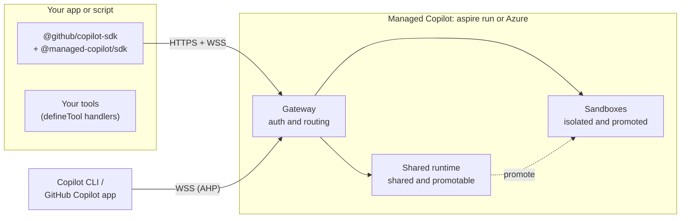

# Managed Copilot SDK: developer experience

> **Status: draft for calibration.** Nothing here is built yet. Every name and signature is a proposal; the
> [open questions](#open-questions) list the decisions we still need to make.

## The idea in one snippet

Today the Copilot SDK runs the agent next to your code:

```ts
import { CopilotClient, approveAll } from "@github/copilot-sdk";

const client = new CopilotClient();
await client.start();

const session = await client.createSession({ model: "gpt-5", onPermissionRequest: approveAll });
const reply = await session.sendAndWait({ prompt: "Summarize what changed in Aspire 13" });
console.log(reply?.data.content);
```

With Managed Copilot, the same code runs the agent in an **environment** you deployed, either locally under
Aspire or in your Azure subscription:

```ts
import { approveAll } from "@github/copilot-sdk";
import { ManagedCopilot } from "@managed-copilot/sdk";

const managed = await ManagedCopilot.connect(); // your local `aspire run`, or your Azure deployment
const client = await managed.client("chat");    // a real CopilotClient, connected to the "chat" environment

const session = await client.createSession({ model: "gpt-5", onPermissionRequest: approveAll });
const reply = await session.sendAndWait({ prompt: "Summarize what changed in Aspire 13" });
console.log(reply?.data.content);
```

Two lines change. Everything after `managed.client(...)` is the Copilot SDK you already know: sessions, events,
tools, hooks, permissions, and resume.

## Principles

1. **It's still the Copilot SDK.** `managed.client()` returns a `CopilotClient` and sessions are `CopilotSession`s.
   There is no new message, event, or tool model to learn.
2. **One new concept: the environment.** It decides where the agent loop and its built-in tools run, and how
   they are isolated.
3. **Same code, local or Azure.** `aspire run` for the inner loop and `aspire deploy` for Azure. Only the connection
   target changes.
4. **Your tools stay in your app.** Tools you define with `defineTool` run in your process, so the environment never
   sees your secrets. Built-in tools such as shell and file editing run in the environment.
5. **Every session is attachable.** Open any running session in Copilot CLI (and the GitHub Copilot app, where
   supported) and work alongside your app.
6. **Secure by default.** Only the platform gateway is reachable, over HTTPS and WSS, and every connection is
   authenticated. Runtimes and sandboxes have no public endpoint and hold no platform credentials.

## Environment types

| Type | Where the agent runs | Built-in tools | Start | Isolation boundary | Typical use |
| --- | --- | --- | --- | --- | --- |
| `shared` | One runtime shared by many sessions | A safe set: no shell and no host files. Your tools, MCP servers, and web fetch when allowed | Instant | Per-session state and identity inside a shared process | Chat, support, Q&A, high volume |
| `isolated` | A dedicated Linux **sandbox** (container) per client | Everything: shell, files, git, and your image's toolchain | Seconds when cold, instant when warm | Container | Coding and data agents, untrusted work |
| `promotable` | Starts `shared`, then moves once into a sandbox when it needs to | The safe set, then everything | Instant, then a cold start at promotion | Shared, then container | Assistants that occasionally need a shell |
| `orchestrator` *(later)* | A shared coordinator that starts workers in dynamic containers | Per worker | | Container per worker | Parallel and multi-agent work |

## 1. Declare your environments

Environments are part of your Aspire app model, so the same declaration runs locally and deploys to Azure:

```ts
// apphost.mts
import { createBuilder } from "./.aspire/modules/aspire.mjs";
import { addManagedCopilot } from "@managed-copilot/aspire";

const builder = await createBuilder();

await addManagedCopilot(builder, "copilot", {
  environments: {
    chat:   { type: "shared" },
    coder:  { type: "isolated", image: "./sandboxes/coder", size: "medium" },
    helper: { type: "promotable", promoteTo: "coder" },
  },
});

await builder.build().run();
```

```powershell
aspire run      # local: gateway, shared runtime and sandboxes in Docker, plus the Aspire dashboard
aspire deploy   # the same model in Azure Container Apps
```

A sandbox image is an ordinary Dockerfile on top of the base image:

```dockerfile
# sandboxes/coder/Dockerfile
FROM ghcr.io/patniko/managed-copilot-sandbox:latest
RUN apt-get update && apt-get install -y python3-pip
```

For a quick demo you can skip the declaration and ask for a type inline, which uses the default sandbox image:

```ts
const client = await managed.client({ type: "isolated", size: "small" });
```

## 2. Connect

```ts
// Local: finds the running AppHost and its development key. Nothing to copy or paste.
const managed = await ManagedCopilot.connect();

// Azure: the gateway URL printed by `aspire deploy`; you sign in with your Azure identity.
const managed = await ManagedCopilot.connect({ url: process.env.MANAGED_COPILOT_URL });
```

With no arguments, `connect()` uses `MANAGED_COPILOT_URL` when it is set and the local AppHost otherwise. In Azure
the credential defaults to `DefaultAzureCredential`: `az login` on your machine, managed identity in your app.

## 3. Shared: a chat agent with your own tools

```ts
import { approveAll, defineTool } from "@github/copilot-sdk";
import { z } from "zod";

const client = await managed.client("chat");

const session = await client.createSession({
  model: "gpt-5",
  systemMessage: { content: "You are Contoso's order assistant. Be brief." },
  tools: [
    defineTool("lookup_order", {
      description: "Look up an order by id",
      parameters: z.object({ id: z.string() }),
      handler: async ({ id }) => orders.get(id), // runs in YOUR process; your database credentials never leave it
    }),
  ],
  onPermissionRequest: approveAll,
});

session.on("assistant.message_delta", (e) => process.stdout.write(e.data.deltaContent));
await session.sendAndWait({ prompt: "Where is order 1234?" });
```

A `shared` environment has no shell or host-file tools. Asking for them fails at `createSession`, not halfway through
a conversation.

## 4. Isolated: a coding agent in its own sandbox

```ts
const client = await managed.client("coder"); // starts a dedicated sandbox for this client

const session = await client.createSession({ model: "gpt-5", onPermissionRequest: approveAll });
await session.sendAndWait({
  prompt: "Clone https://github.com/microsoft/aspire, count the *.cs files per top-level folder, and write report.md",
});

console.log(client.sandbox); // { id: "sbx_7f3a…", environment: "coder", state: "running" }
```

`approveAll` is reasonable here: the agent can only affect its own sandbox, not your machine.

Sessions created from one client share its sandbox, the way sessions on one laptop share a disk. Name a sandbox to
keep it across runs, for example one per end user:

```ts
const client = await managed.client("coder", { sandbox: `user-${user.id}` }); // same name, same container and files
```

Idle sandboxes stop by themselves and keep their files. The next `managed.client(...)` call for that sandbox wakes it.

## 5. Promotable: start cheap, move when needed

```ts
managed.on("session.promoted", (e) => console.log(`${e.sessionId} moved to sandbox ${e.sandboxId}`));

const client = await managed.client("helper");
const session = await client.createSession({ model: "gpt-5", onPermissionRequest: approveAll });

// Shared and instant.
await session.sendAndWait({ prompt: "What does a CSV header row usually contain?" });

// Needs a shell: the agent calls its built-in `promote_to_sandbox` tool, which you approve like any other tool.
await session.sendAndWait({ prompt: "Download https://example.com/sales.csv and compute summary stats with pandas" });
```

The same `session` object keeps working across the move, with its full history. Your app can also promote a session
itself with `await managed.promote(session)`. Promotion is one way: a promoted session never returns to `shared`.

## 6. Come back later

```ts
// The platform knows where every session lives, so its id is enough.
const session = await managed.resumeSession(sessionId, { onPermissionRequest: approveAll });

for (const s of await managed.sessions.list()) {
  console.log(s.id, s.environment, s.placement, s.updatedAt); // placement is "shared" or a sandbox id
}

await managed.close(); // stops the clients this object created; sessions and sandboxes keep running
```

## 7. Open a session in Copilot CLI or the GitHub Copilot app

From your code:

```ts
await managed.openCli(session); // runs `copilot` in this terminal, attached to the live session
```

From any terminal:

```powershell
npx managed-copilot sessions        # your sessions, locally or in Azure
npx managed-copilot attach 7f3a2c1  # Copilot CLI attached to that session over a secure WebSocket (AHP)
```

Your app and the CLI can be attached at the same time: both see every message and tool call, and either can steer.

For the GitHub Copilot app, an environment can publish each sandbox as a GitHub environment that you own:

```ts
coder: { type: "isolated", image: "./sandboxes/coder", github: { publish: true } },
```

Published sandboxes appear as remote hosts in the Copilot app and in Copilot CLI (`/ahp cloud <environment-id>`).
*To validate: app support, and the GitHub identity the sandbox needs to register.*

## 8. Who pays for the model?

By default a session uses **the caller's GitHub Copilot entitlement**. Locally, the wrapper forwards your signed-in
GitHub identity, exactly as the local SDK does. In a multi-user app, pass each user's token with the standard option:

```ts
const session = await client.createSession({ model: "gpt-5", gitHubToken: user.githubToken, onPermissionRequest });
```

Alternatively, give an environment its own model access, for example Azure AI Foundry through managed identity, so
callers need no GitHub token:

```ts
chat: { type: "shared", models: { foundry: "my-foundry", deployments: ["gpt-5"] } },
```

## 9. Optional: ship agent defaults with an environment

Instructions, skills, MCP servers, and custom agents can be deployed with an environment, so client code stays small:

```ts
triage: {
  type: "shared",
  defaults: {
    model: "gpt-5",
    systemMessage: { content: await readFile("./agents/triage.md", "utf8") },
    mcpServers: { docs: { type: "http", url: "https://learn.microsoft.com/api/mcp" } },
  },
},
```

```ts
const client = await managed.client("triage");
const session = await client.createSession({ onPermissionRequest: approveAll });
```

Whatever you pass to `createSession` overrides the defaults. The environment's **policy** (allowed tools, models, and
network access) is enforced by the platform either way.

## What runs where



## What ships

| Piece | What it is |
| --- | --- |
| `@managed-copilot/sdk` | The client wrapper: `connect`, `client`, `resumeSession`, `sessions`, `promote`, `openCli` |
| `@managed-copilot/aspire` | `addManagedCopilot(builder, ...)` for your AppHost |
| `managed-copilot` CLI | `sessions`, `attach`, `promote`, `sandboxes` |
| Platform images | Gateway, shared runtime, and the sandbox base image you can extend |
| Samples | Runnable against local or Azure: `shared-chat.ts`, `isolated-coder.ts`, `promotable-helper.ts`, `attach-cli.ts` |

## Alternatives for the client shape

The proposal above is **A**. B and C are shown for calibration:

```ts
// A (proposed): an environment-bound client. Supports every environment type, including promotion.
const client = await managed.client("coder");
const session = await client.createSession({ model: "gpt-5", onPermissionRequest: approveAll });

// B: a drop-in connection for a plain CopilotClient. The smallest change, but it cannot follow a session that is
//    promoted to another runtime.
const client = new CopilotClient({ connection: await managed.connection("coder") });
await client.start();

// C: OpenAI Agents API style, one call per session. Could be offered as sugar on top of A.
const session = await managed.createSession({
  environment: { type: "isolated", size: "small" },
  model: "gpt-5",
  onPermissionRequest: approveAll,
});
```

## Open questions

1. **Isolated granularity.** A sandbox per client, shared by that client's sessions (proposed), or a fresh sandbox per
   session as in OpenAI's hosted environments?
2. **Where environments come from.** Declared only in the AppHost and deployed, or also created at runtime from code?
3. **Agent definitions.** Environment `defaults` (proposed), or a separate named "agent" concept like OpenAI's?
4. **Platform authentication in Azure.** Microsoft Entra ID through `DefaultAzureCredential` (proposed), or API keys?
5. **Default model identity.** The caller's GitHub token (proposed), or environment-level BYOK?
6. **Names.** `@managed-copilot/sdk`, `ManagedCopilot`, and "sandbox".
7. **Languages.** TypeScript first, with .NET and Python later?
