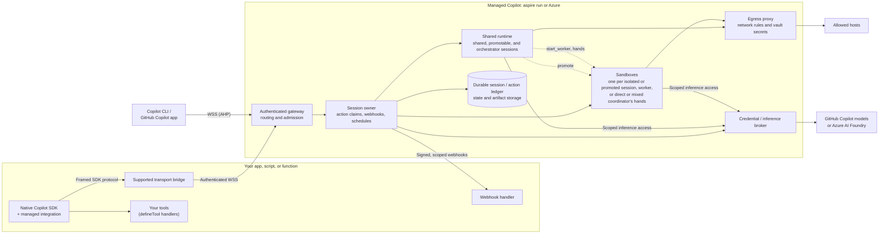

# Managed Copilot SDK: developer experience

> **Status: built, and qualified within the limits recorded below (2026-10-24; orchestrator environments on
> 2026-10-26, and on Azure on 2026-10-27).** The SDK, Aspire integration, CLI, gateway, sandbox image, and egress
> proxy are implemented on the published `@github/copilot-sdk` 1.0.26 and runtime 1.0.103, unmodified. They run
> locally with `aspire run` and on Azure with `aspire deploy`, orchestrator environments included. The 14 customer
> snippets run as acceptance checks in [`tests/snippets`](../../tests/snippets), and the
> [software factory](../../demos/software-factory), [assistant](../../demos/assistant), and
> [Dispatch](../../demos/dispatch) demos use the platform end to end with real models. The six OpenAI gaps are
> implemented and exercised; that is not a claim of full parity. The
> [delivery gates](#delivery-gates) record what each gate proved and what it did not, and the
> [decision tracker](#decision-tracker) separates user decisions from their delivery state.
> [architecture.md](../architecture.md) and [deployment.md](../deployment.md) describe the current implementation.

## The idea in one snippet

Today the Copilot SDK runs the agent next to your code:

```ts
import { CopilotClient, approveAll } from "@github/copilot-sdk";

const client = new CopilotClient();
await client.start();

const session = await client.createSession({ model: "claude-sonnet-5", onPermissionRequest: approveAll });
const reply = await session.sendAndWait({ prompt: "Summarize what changed in Aspire 13" });
console.log(reply?.data.content);
```

The intended Managed Copilot experience runs the agent in an **environment** you deployed, either locally under
Aspire or in your Azure subscription:

```ts
import { approveAll } from "@github/copilot-sdk";
import { ManagedCopilot } from "@managed-copilot/sdk";

const managed = await ManagedCopilot.connect(); // your local `aspire run`, or your Azure deployment
const client = await managed.client("chat");    // a CopilotClient for the "chat" environment

const session = await client.createSession({ model: "claude-sonnet-5", onPermissionRequest: approveAll });
const reply = await session.sendAndWait({ prompt: "Summarize what changed in Aspire 13" });
console.log(reply?.data.content);
```

Only the setup lines change in this example. The goal is to retain genuine `CopilotClient` and `CopilotSession`
objects, standard session events, and SDK tool definitions. That is a compatibility target, not a promise that every
raw RPC or callback already works remotely. The [connection contract](#native-sdk-connection-contract) and
[callback contract](#callback-support-and-disconnection) bound the supported surface without inventing a new agent
API. If a required behavior needs an upstream SDK extension, that is a prerequisite, not a private-method patch.

For a one-off session, a single call picks the environment and creates the session:

```ts
const session = await managed.createSession({ environment: "chat", model: "claude-sonnet-5", onPermissionRequest: approveAll });
```

## Principles

1. **It's still the Copilot SDK.** Target genuine SDK client and session objects through a supported transport
   adapter. Keep the message, event, and tool model; advertise only the remotely supported operations.
2. **One new concept: the environment.** It decides where the agent loop and its built-in tools run, and how they
   are isolated.
3. **Same code, local or Azure.** Aspire is the local and deployment entry point. The customer code stays the same;
   a mode is advertised in Azure only after its chosen backend passes the same behavioral gates.
4. **Your tools stay in your app.** `defineTool` handlers run in your process or your authorized webhook worker;
   their code and credentials are not uploaded as sandbox code. Returned data still reaches the agent. Supported
   external calls can wait while your app is away; hooks and other callbacks have explicit disconnect rules.
5. **One identity: GitHub.** The login you use for Copilot is how you sign in to the platform, attach from Copilot
   CLI, and pay for model calls, including work that continues while you're away.
6. **Attach to the same session.** Copilot CLI attachment is a delivery requirement; GitHub Copilot app attachment
   is conditional on actual interoperability and authorization support. Neither path may create a shadow session.
7. **Enforced boundaries, easy controls.** The target is authenticated HTTPS/WSS ingress, owner-scoped sessions,
   credential isolation, and enforced egress policy. Shared placement is application isolation, not a hostile-code
   boundary; a container is not a VM boundary. Outbound network access is on, and `network: false` turns it off.

## Environment types

| Type | Where the agent runs | Built-in tools | Start | Isolation boundary | Typical use |
| --- | --- | --- | --- | --- | --- |
| `shared` | One runtime shared by many sessions | Session-safe tools, approved remote MCP, and filtered web access; no workload filesystem or subprocess tools | No per-session container allocation | Per-session state and identity in a shared process | Chat, support, Q&A, high volume |
| `isolated` | A fresh Linux **sandbox** (container) for each session | Policy-approved shell, files, git, and image toolchain | Cold start or warm allocation; latency to measure | A container per session | Coding and data agents |
| `promotable` | Starts `shared`, then moves once into its own fresh sandbox | Shared tools, then the admitted sandbox tools | Shared start plus an explicit cutover | Shared, then a container | Assistants that occasionally need a shell |
| `orchestrator` | A shared coordinator that starts workers, each a session with its own sandbox ([section 17](#17-orchestrator-a-coordinator-with-workers)) | Coordinator: session-safe tools and worker tools; workers: their environment's sandbox tools | Shared start; each worker starts like an isolated session | Shared coordinator; a container per worker | Parallel and multi-agent work |

An orchestrator's [execution style](#execution-styles-delegate-direct-mixed) decides whether its coordinator starts
workers (`delegate`), acts in a sandbox itself (`direct`), or both (`mixed`). The four types and three styles give six
patterns, built from three blocks: a container per session, the shared multi-tenant runtime, and sandboxes
orchestrated on demand. [Patterns](../concepts/patterns.md) compares them.
## 1. Declare your environments

Environments are part of your Aspire app model, so the same declaration runs locally and deploys to Azure:

```ts
// apphost.mts
import { createBuilder } from "./.aspire/modules/aspire.mjs";
import { addManagedCopilot } from "@managed-copilot/aspire";

const builder = await createBuilder();

await addManagedCopilot(builder, "copilot", {
  access: { githubOrgs: ["contoso"] }, // GitHub accounts allowed to use the deployed platform

  environments: {
    chat: {
      type: "shared",
      customizations: "./environments/chat", // agents, skills, and instructions (section 10)
      models: ["claude-sonnet-5", "claude-haiku-5.5"],
      network: ["learn.microsoft.com"], // only this host
    },
    coder: {
      type: "isolated",
      image: "./sandboxes/coder",
      size: "medium",
      warm: 2,
    },
    helper: { type: "promotable", promoteTo: "coder" }, // placement target, not a policy override
  },

  // Optional: lets code request { type, size } without a name, using the default sandbox image and settings.
  inline: { types: ["shared", "isolated"], sizes: ["small"] },
});

await builder.build().run();
```

```powershell
aspire run      # target: local platform and Docker sandboxes, with the Aspire dashboard
aspire deploy   # target: deploy modes supported by the qualified Azure backend
```

- The platform enforces the environment's policy. Callers can add permitted setup and narrow permissions, never
  broaden them. Defaults and policy ceilings are different; a top-level network default is not a hard deny that the
  operator cannot override in a named environment.
- **`models`** lists the models its sessions may use.
- **`network`** controls outbound access. It's on unless you turn it off with `network: false`, here or for every
  environment at once ([section 7](#7-control-network-access)).
- **`size`** is `small` (1 vCPU, 2 GiB), `medium` (2 vCPU, 4 GiB), or `large` (4 vCPU, 8 GiB).
- **`warm`** requests that many prepared, unassigned sandboxes. This is an optional backend capability, not a
  universal Azure primitive. Unsupported nonzero values fail deployment. Warm capacity costs money and must never
  contain another session's files or credentials.

A sandbox image is a Dockerfile on top of the proposed base image. The image must retain the platform's non-root
execution, transport, and certificate-trust contract; a custom image does not get an exemption from policy.

```dockerfile
# sandboxes/coder/Dockerfile
FROM ghcr.io/patniko/managed-copilot-sandbox:0.1.0
USER root
RUN apt-get update && apt-get install -y python3-pip
USER 10001:10001
```

The image name and version above are illustrative, not a published artifact. Deployments pin the resolved image
digest and configuration revision so a resume does not accidentally change its runtime or toolchain. The proposed
base image reserves UID/GID 10001 for execution; elevated package installation is an image-build step only.

When the AppHost allows `inline` requests, a quick demo can skip the name:

```ts
const client = await managed.client({ type: "isolated", size: "small" });
```

A request outside the `inline` list, or for an unknown environment name, fails at `managed.client(...)`. A client
selects a policy/template and does not allocate its own sandbox. Each isolated `createSession` allocates a distinct
sandbox. In every mode, creation resolves only when that session's admitted setup and runtime are ready.

## 2. Connect

```ts
// Local: finds the running AppHost. Nothing to configure.
const managed = await ManagedCopilot.connect();

// Azure: the URL printed by `aspire deploy`.
const managed = await ManagedCopilot.connect({ url: "https://copilot.contoso.example" });
```

With no arguments, `connect()` uses `MANAGED_COPILOT_URL` when it is set and the local AppHost otherwise.

Either way, **you are your GitHub login**. Reuse an explicitly supplied token or a supported signed-in credential
flow; do not scrape CLI credential storage. Without a usable credential, request sign-in or return
`authentication_required`, rather than silently using another account. Token lookup order and CLI sign-in reuse
must be documented with the qualified auth integration. Locally, public-facing platform endpoints use loopback.

The platform verifies the account and the AppHost's access rules, and binds ownership to a stable GitHub account ID,
not a mutable login. Authentication to this platform is distinct from permission to use a model. A backend serving
several users creates an identity-bound managed client for each user; a request body cannot reassign ownership.

A backend that serves signed-in users acts as each user with that user's GitHub token, obtained as in the SDK's
GitHub OAuth guide:

```ts
const client = await managed.client("chat", { gitHubToken: user.githubToken });
```

The SDK's per-session `gitHubToken` is a compatibility target: trusted admission must verify it and convert it into
a scoped credential reference before any execution runtime sees the request. It cannot silently switch the owner
of an existing managed client or session. The credential-broker gate must prove both this flow and entitlement
attribution; until then, it is not an advertised supported shortcut.

### Work that continues without you

Some work outlives your connection: a long turn you left running, a tool call waiting for an answer, or a scheduled
run. It still runs as you. Before using it the first time, sign in once:

```powershell
npx managed-copilot login   # target UX: authorize this deployment for your background work
```

**Background sign-in is approved; the implementation is still gated.** A candidate is a GitHub App user
authorization with a refreshable credential stored by a trusted broker (Key Vault in Azure). The operator setup
must declare who owns that GitHub App and its callback registration; a shared registration versus an
operator-owned registration remains a product decision. A login name alone is not delegation.

The broker must prove refresh, current Copilot entitlement/model access, and revocation without giving the
sandbox a GitHub token, refresh token, or Azure provisioning credential. Inference and session-authentication
requests both cross this boundary. Failure blocks background work with `authentication_required` or
`inference_unavailable`; it does not substitute a service account or a different inference route.
`logout` invalidates this deployment's credential references and pauses dependent schedules/new work. Requests
already sent upstream cannot be retroactively unsent. Revocation and expiry must also stop new privileged calls
from already-connected clients.

## 3. Shared: a chat agent with your own tools

```ts
import { approveAll, defineTool } from "@github/copilot-sdk";
import { z } from "zod";

const lookupOrder = defineTool("lookup_order", {
  description: "Look up an order by id",
  parameters: z.object({ id: z.string() }),
  handler: async ({ id }) => orders.get(id), // runs in YOUR process; your database credentials never leave it
});

const client = await managed.client("chat");
const session = await client.createSession({
  model: "claude-sonnet-5",
  systemMessage: { content: "You are Contoso's order assistant. Be brief." },
  tools: [lookupOrder],
  streaming: true,
  onPermissionRequest: approveAll,
});

session.on("assistant.message_delta", (e) => process.stdout.write(e.data.deltaContent));
await session.sendAndWait({ prompt: "Where is order 1234?" });
```

The intended snippet omits `availableTools`: the integration supplies environment defaults **before the native
SDK's local validation**, and the service independently enforces them. A gateway cannot repair a call that the SDK
rejected before transmission; this exact snippet is part of gate G1. You may narrow the effective tools further
with `availableTools` or `excludedTools`.

Shared admission rejects shell, workload file tools, local/stdio MCP commands, file hooks, arbitrary executable
plugins, and equivalent capabilities nested in custom agents. Remote MCP endpoints and tools require admission
and per-session egress attribution. Apply the same validation on create, resume, tool changes, agent selection, and
option updates, not only to the first request. SDK callbacks still execute in the customer's app, outside this
shared-runtime boundary.

For demonstrating why that boundary exists, a shared environment can set `unsafeHostTools: true`. Its sessions
then get the runtime's built-in shell and file tools and its standard environment prompt; every other shared rule
still applies. Those tools run on the shared runtime's host, so any session can read and change every other
session's state. Never use it for real users. `managed.files(session)` also works on these sessions: it reads and
writes the session's working directory on the host, which the agent sees as `/workspace`. Artifacts stay isolated
only.

## 4. Isolated: a coding agent in its own sandbox

```ts
const client = await managed.client("coder");

// Each session gets its own fresh sandbox.
const session = await client.createSession({ model: "claude-sonnet-5", onPermissionRequest: approveAll });
await session.sendAndWait({
  prompt: "Clone https://github.com/microsoft/aspire, count the *.cs files per top-level folder, and save outputs/report.md",
});

const artifacts = managed.artifacts(session);
await artifacts.waitForPublication(); // the completed turn's outputs, not just runtime idleness
console.log(await artifacts.read("report.md"));
```

`approveAll` above is demo shorthand, not an isolation guarantee or a production recommendation. The agent can
still cause external effects through permitted network access, vault-backed APIs, or your application tools.
Managed deny rules remain authoritative; unattended actions require an explicitly permitted approval policy.

The sandbox's logical working directory is `/workspace`. `managed.files(session)` reads, writes, and lists its
authorized workload files, not platform metadata or credentials. Paths are workspace-relative and checked against
traversal and symlink escapes. Host filesystem paths in this document are illustrative Linux sandbox paths;
local Windows file paths refer to the customer's machine, never to the remote runtime.

A session owns one sandbox allocation at a time, but compute lifetime and durable session lifetime are distinct:

- It is created with the session and never shared with another session.
- An idle session can stop compute only after pending work and snapshot writes have drained. The idle event alone
  is not a safe shutdown signal. The exact timeout/retention policy remains proposed.
- Resuming restores declared persistent state. It does not promise the same process or container instance, or
  survival of background servers, child shells, or in-memory subagents.
- A pending external action is not an idle session. Keep its runtime resident unless the exact suspension boundary
  is qualified; [offline behavior](#12-keep-working-while-your-app-is-offline) defines the limits and cost.
- `await client.deleteSession(session.sessionId)` prevents new work and requests deletion of the sandbox and
  artifacts. Reconciliation must finish cleanup even after a crash; expose `deleting`/cleanup errors rather than
  returning a false success. Schedules targeting a deleted session cannot recreate it implicitly.

```ts
const info = await managed.sessions.get(session.sessionId);
console.log(info.sandbox); // { id: "sbx_7f3a…", size: "medium", state: "running" }
```

## 5. Set up the sandbox

An environment can declare packages, setup commands, and non-secret environment variables. Preparation must be
reproducible without treating arbitrary setup commands as safe to replay:

```ts
// apphost.mts: every "coder" session starts like this
coder: {
  type: "isolated",
  image: "./sandboxes/coder",
  packages: { python: ["pandas==2.2.3"], npm: ["typescript"], system: ["jq"] },
  setupCommands: ["git config --global user.name 'Contoso Agent'"],
  env: { TZ: "UTC" },
},
```

Settings passed to `managed.client(...)` are defaults for **every** session it creates. For inputs that differ per
session, use the one-call form with the same environment descriptor:

```ts
const session = await managed.createSession({
  environment: {
    name: "coder",
    files: { "data/sales.csv": await readFile(".\\sales.csv") },
    packages: { python: ["matplotlib"] },
    env: { REPORT_TITLE: "Q3 sales" },
  },
  model: "claude-sonnet-5",
  onPermissionRequest: approveAll,
});
```

Or reuse one client and upload separately before sending work:

```ts
const session = await client.createSession({ model: "claude-sonnet-5", onPermissionRequest: approveAll });
await managed.files(session).upload(".\\sales.csv", "data/sales.csv");
await session.sendAndWait({ prompt: "Summarize data/sales.csv into outputs/summary.md" });
```

Small `files` entries are convenient; `upload`/`download` must stream large files with explicit size limits, rather
than buffering them through a session JSON-RPC request. Concurrent uploads require explicit overwrite/version
semantics. An upload never races the agent's initial prompt in the one-call form.

- Initial session setup runs admitted packages, files, then setup commands before the agent starts. Record progress,
  resolved versions, hashes, and redacted errors. A nonzero exit prevents readiness; do not report a created,
  usable session while setup is failing.
- **No package-download exception to `network: false`.** Session-time installers, their lifecycle scripts, and setup
  commands follow the effective session network policy. Offline setup uses a prepared image or approved local
  cache; a missing package fails with an actionable setup error. Operator image builds occur separately, before any
  session credentials or input files exist, and have their own explicitly reviewed build-network policy.
- System packages belong in operator-controlled image preparation; client/session requests for system-package
  installation are rejected. Python/npm additions use a persisted per-session environment or an immutable prepared
  layer. On resume, retain or reconstruct those dependencies from the recorded manifest; do not silently reinstall
  different versions.
- Persist workload files, the declared tool environment, required `HOME` settings, and runtime state under separate
  appropriate storage boundaries. A `/workspace` mount alone does not preserve global package installs or catalogs.
  The trusted action/policy ledger is never authoritative from sandbox-writable files.
- `setupCommands` run on initial creation, not automatically on every wake. Non-idempotent or interrupted setup
  cannot be replayed blindly. A backend that cannot restore its effects must reject that configuration or require
  an explicit recovery action; do not silently start with missing setup.
- Warm instances contain only immutable, operator-prepared defaults. Session input, writable state, setup effects,
  and secrets are attached after assignment and never reused for a different session. Whether a backend can do
  that with durable state is part of gate G3, not an assumed volume hot-attach capability.
- `env` values are visible to sandbox code. Reserved identity, proxy, and trust settings cannot be overridden. Use
  [vaults](#8-keep-secrets-out-of-the-sandbox) for secrets.

## 6. Get results out

Continuing that session:

```ts
await session.sendAndWait({ prompt: "Chart monthly revenue from data/sales.csv and save outputs/revenue.png" });

const artifacts = managed.artifacts(session);
await artifacts.waitForPublication();
for (const artifact of await artifacts.list()) {
  console.log(artifact.path, artifact.size, artifact.publishedAt); // revenue.png 48213 2026-10-23T21:04:11Z
}
await artifacts.download("revenue.png", ".\\revenue.png");
```

- Publication runs at an explicit completed-turn checkpoint and is distinct from runtime `session.idle`.
  `waitForPublication()` captures the most recent completed turn known to the handle and waits for its manifest.
  Concurrent callers may pass a specific `turnId`. Failure or timeout returns an explicit error, not an empty
  success-shaped list.
- Copy bounded, authorized regular files under `/workspace/outputs` into immutable storage. Reject traversal,
  symlink escapes, and changing files rather than exposing another path or a corrupt snapshot.
- Record `turnId`, artifact ID, digest, size, and `pending`/`published`/`failed` state. Files from interrupted turns
  are not labeled successful outputs. Published artifacts outlive compute replacement and are deleted with the
  session under the retention policy.
- A file changed in a later turn becomes a new version. `list()` shows the newest version of each file, and
  `list({ versions: "all" })` shows every version.

## 7. Control network access

Network access is on by default, as in OpenAI's API. Turning it off, or limiting it to a few hosts, takes one line:

```ts
coder: { type: "isolated", network: false },                                    // no workload Internet access
docs:  { type: "isolated", network: ["github.com", "*.githubusercontent.com"] }, // only these hosts
```

Set it once at the top level to change the default for every environment. An environment that needs access says so:

```ts
await addManagedCopilot(builder, "copilot", {
  network: false, // off for every environment below, unless it says otherwise
  environments: {
    chat: { type: "shared" }, // off
    coder: { type: "isolated", network: ["pypi.org", "files.pythonhosted.org"] },
  },
});
```

Code can turn it off for the sessions one client creates:

```ts
const client = await managed.client({ name: "coder", network: false });
```

| Setting | Behavior |
| --- | --- |
| Omitted | Inherit the containing environment/deployment setting; enabled only if no setting was supplied |
| `true` | Public outbound access, subject to non-overridable platform protections |
| A list of hosts | Restricted access; `*.example.com` matches subdomains, not the apex `example.com` |
| `false`, or an empty host list | No workload outbound access |

The proposed object form is `{ access: "enabled" | "restricted" | "disabled", allowedDomains }`, normalized to the
same policy as the shorthands. This is conceptually similar to OpenAI's form, not identical casing or wildcard
semantics.

- The top-level field supplies an **operator default**; a named environment can explicitly override it. After
  admission, caller options can only narrow that environment's ceiling. A caller's `network: true` cannot re-enable
  an environment set to false. Store the effective restriction across resume and promotion.
- The setting covers all workload egress: setup/package scripts, shell commands, web tools, and admitted MCP calls.
  Model calls, file transfer, and narrow platform control operations use authenticated service channels, not a
  general-purpose proxy exemption. `network: false` does not mean inference or customer uploads stop working.
- Application-side `defineTool` handlers run outside the sandbox and can still access the application's services.
  This setting does not firewall the customer's process; tool authorization remains the application's duty.
- Even when enabled, workload traffic cannot reach platform internals, loopback/link-local services, or cloud
  metadata. A host string is not sufficient authorization: validate resolved addresses, redirects, ports, and the
  actual connection destination. Custom proxy/DNS settings cannot bypass enforcement.
- Shared-runtime requests carry trusted session identity through the outbound path; process-wide environment
  variables or a caller-selected session header cannot establish that identity.
- Gate G4 must prove the selected Azure and local backends enforce these rules for supported protocols, including
  direct-IP and non-HTTP bypass attempts. If a requested restriction cannot be enforced, refuse the environment.
  Report blocked traffic to the session without disclosing credentials.

## 8. Keep secrets out of the sandbox

A **vault** keeps stored secret values out of session configuration and sandbox storage. It authorizes specific
uses, not arbitrary access to every secret. An allowed service can still cause external effects or return sensitive
data; a vault is not a substitute for choosing trusted destinations and least-privilege credentials.

- **Sandbox credentials.** An assigned isolated sandbox gets a per-session opaque placeholder. A trusted proxy
  substitutes it only in supported HTTP request headers to the credential's exact HTTPS destinations.
- **MCP server credentials.** The platform attaches a credential to an admitted MCP endpoint, scoped to the owning
  session, without publishing it as a process-wide environment variable.

Declare vaults for a whole environment in the AppHost:

```ts
// apphost.mts
const stripeKey = await builder.addParameter("stripe-key", { secret: true });
const docsToken = await builder.addParameter("docs-mcp-token", { secret: true });

await addManagedCopilot(builder, "copilot", {
  vaults: {
    payments: [{ env: "STRIPE_API_KEY", value: stripeKey, hosts: ["api.stripe.com"] }],
    docs: [{ mcpServer: "https://mcp.contoso.example/docs", value: docsToken }],
  },
  environments: {
    coder: { type: "isolated", vaults: ["payments"], network: ["api.stripe.com"] },
    chat: { type: "shared", vaults: ["docs"] },
  },
});
```

Inside a `coder` sandbox:

```bash
echo "$STRIPE_API_KEY"   # mcv_placeholder_6f1c…, never the real key
curl -s -H "Authorization: Bearer $STRIPE_API_KEY" https://api.stripe.com/v1/balance   # works
```

In a `chat` session, the MCP server needs no credential in your code:

```ts
const chat = await managed.client("chat");
const session = await chat.createSession({
  mcpServers: { docs: { type: "http", url: "https://mcp.contoso.example/docs" } },
  onPermissionRequest: approveAll,
});
```

Create per-user vaults in code, for credentials that belong to one end user:

```ts
const vault = await managed.vaults.create({
  name: `jira-${user.id}`,
  credentials: [{ env: "JIRA_TOKEN", value: user.jiraToken, hosts: ["contoso.atlassian.net"] }],
});
const client = await managed.client("coder", { vaults: [vault.id] });
```

- No API returns a vault's values. AppHost vaults serve the environments that list them; vaults created in code
  belong to the GitHub user who created them.
- Vault attachment and each use require current owner/delegation authorization. A short-lived placeholder is bound
  to the session and credential; copying it to another session must not grant access. Revocation prevents new uses.
- Sandbox `env` credentials are valid only after isolated placement. A promotable session can bind them for its
  future sandbox, not expose them in the shared process. A purely shared environment rejects them; use scoped MCP
  credentials there. Never set per-user secrets or placeholders in the shared runtime's global `process.env`.
- Both network and credential-destination policy must allow the call. Vault destination matching uses exact
  HTTPS hosts and ports, not wildcard network rules. Match verified TLS destination/SNI and HTTP authority, and
  re-evaluate every redirected request; substitution never grants permission to follow a different destination.
- Initially support literal placeholders in Bearer and explicitly named request headers. Basic-auth encodings,
  URLs/query strings, request bodies, non-HTTP protocols, and pinned TLS clients need separate support; reject
  unsupported uses instead of transmitting a secret through a fallback.
- HTTPS header substitution requires explicit proxy TLS termination with the signing key outside the sandbox.
  The base image configures supported trust stores for Node, Python, curl, and git. Never disable TLS verification
  to make a custom image work. Pinning/trust failures must be visible.
- Response/log redaction is defense in depth, not a guarantee against an authorized upstream reflecting or
  transforming a secret. The platform must not claim a malicious allowed service can never disclose one.

### Connect any MCP server

> **Proposed, not built** ([decisions 37–40](#decision-tracker), gate G7). Everything else in this section is built.

Agents get tools from MCP servers: GitHub's MCP server, Work IQ for Microsoft 365, Slack, or any other. A
**connector** is one of those servers plus the credential it needs. You declare it once, and each person connects
their own account once per deployment, with an OAuth sign-in or, where the service uses them, a token. The platform
keeps the credential, refreshes it, and attaches it to the server's requests, so agents act as that person in all of
their sessions. Sign-ins in your local Copilot stay on your machine; `connectors import` brings over your local
servers' definitions, never their credentials, so you can connect the same servers here.

Connecting a service doesn't depend on GitHub. The OAuth client is yours, consent happens at the service, the
callback is your deployment's, and the credential stays in your deployment; neither GitHub's connector service nor
your platform sign-in takes part. GitHub's own MCP server is one more connector, with a grant separate from your
platform sign-in. GitHub remains how people sign in to the platform itself (principle 5), so it identifies who owns a
personal connection.

Declare connectors in the AppHost and list them in the environments that use them:

```ts
// apphost.mts
const githubAppSecret = await builder.addParameter("github-app-secret", { secret: true });
const entraSecret = await builder.addParameter("entra-client-secret", { secret: true });
const slackSecret = await builder.addParameter("slack-client-secret", { secret: true });

await addManagedCopilot(builder, "copilot", {
  connectors: {
    // GitHub's MCP server, through your GitHub App; people may use a personal access token instead.
    github: {
      mcpServer: "https://api.githubcopilot.com/mcp/",
      oauth: { clientId: "Iv23liExampleAppId", clientSecret: githubAppSecret },
      token: true,
    },
    // Work IQ (Microsoft 365), through your Entra app registration.
    workiq: {
      mcpServer: "https://workiq.svc.cloud.microsoft/mcp",
      oauth: {
        clientId: "3f2b8c1e-5d4a-4c6b-9e7f-0a1b2c3d4e5f",
        clientSecret: entraSecret,
        authorizationServer: "https://login.microsoftonline.com/contoso.onmicrosoft.com/v2.0", // your tenant
        scopes: ["api://workiq.svc.cloud.microsoft/WorkIQAgent.Ask"],
      },
    },
    // Slack, through your Slack app.
    slack: {
      mcpServer: "https://mcp.slack.com/mcp",
      oauth: { clientId: "1601185624273.8899143856786", clientSecret: slackSecret },
    },
    // A server that needs no credential, or registers OAuth clients itself, needs nothing more.
    tickets: { mcpServer: "https://mcp.fabrikam.example/tickets" },
  },
  connectorReturnUrls: ["https://app.contoso.example/connected"], // where your app's sign-ins may return
  environments: {
    chat: { type: "shared", connectors: ["github", "workiq", "slack", "tickets"] },
    coder: { type: "isolated", connectors: ["github", "slack"] },
  },
});
```

`aspire run` and `aspire deploy` print the callback URL to register as the redirect URL of each OAuth client (the
GitHub App, the Entra app registration, the Slack app), such as
`https://copilot.contoso.example/v1/connectors/callback`. Services that accept only HTTPS callbacks, such as Slack,
need your Azure deployment or an HTTPS tunnel in front of the local gateway. Some services need setup that no sign-in
replaces: Work IQ has to be enabled for the tenant, with admin consent for the app's `WorkIQAgent.Ask` permission and
the licensing and user assignment its setup describes; a GitHub App reaches only what its installation and
permissions allow, since it doesn't use OAuth scopes; and Slack accepts only internal or Marketplace-published apps.

Connect once, from any terminal:

```powershell
npx managed-copilot connect workiq          # opens your browser; you sign in at Microsoft, not GitHub
npx managed-copilot connect github --token  # prompts for a personal access token instead of signing in
npx managed-copilot connectors              # what you've connected, and which sessions wait for you
npx managed-copilot connectors import       # your local Copilot CLI's remote MCP servers, without credentials
npx managed-copilot disconnect slack        # revokes it; your sessions lose access at once
```

```text
CONNECTOR  STATE          ACCOUNT          SERVER
github     connected      octocat (token)  https://api.githubcopilot.com/mcp/
workiq     connected      pat@contoso.com  https://workiq.svc.cloud.microsoft/mcp
slack      not connected                   https://mcp.slack.com/mcp  (session 7f3a2c1 is waiting)
tickets    not connected                   https://mcp.fabrikam.example/tickets
```

An environment's connectors join every session in it under their names, so code needs nothing new:

```ts
const session = await managed.createSession({ environment: "chat", onPermissionRequest: approveAll });
await session.sendAndWait({ prompt: "What did #incidents decide today, and is there a GitHub issue for it?" });
```

A connector its owner hasn't connected starts switched off, and a session can leave one out with the SDK's
`disabledMcpServers`. A connector whose hosts a session's own narrower network rules exclude stays out of that
session, and the session's info lists it as left out. A session that names a connector's server in `mcpServers`, its
own or a custom agent's, configures that same server (its headers and tool filters apply) rather than adding a second
one. This is also how managed sessions get GitHub tools: the runtime's built-in GitHub MCP server stays off, because
it would need your platform sign-in.

**From your app.** A backend acting for its signed-in users starts a sign-in, sends the browser to it, and finishes
it when the browser comes back:

```ts
// Your app's "Connect Slack" button
const { id, url } = await managed.connectors.connect("slack", {
  gitHubToken: user.githubToken,                     // whose connection this is
  returnTo: "https://app.contoso.example/connected", // listed in connectorReturnUrls
});
appSession.connectorSignIn = id; // finish only in the app session that started it
return Response.redirect(url);

// At https://app.contoso.example/connected, for the same signed-in user
await managed.connectors.complete(request.url, { id: appSession.connectorSignIn, gitHubToken: user.githubToken });
```

A sign-in finishes only in the browser that opened its link, and only when the account that started it calls
`complete` from the same app session, so a forwarded link can't attach someone else's account to yours.
`npx managed-copilot connect` does both steps through a loopback URL. For a token, call
`managed.connectors.connect("github", { token })` instead. `managed.connectors.list()` shows each connector with its
state and, to its owner, the connected account: `connected`; `not_connected`; `needs_sign_in`; or `needs_setup`, when
the service refused for a reason another sign-in won't fix, such as missing admin consent, an app that isn't
installed, or a missing license, with the service's message. A server that needs no credential is `connected` for
everyone. `disconnect(name)` revokes a credential, and no API returns one.

**Your own connectors.** People can connect servers the AppHost doesn't declare, when an environment they can use
allows the server's host. A connector created in code belongs to the account that created it and joins only that
account's sessions that name its server; `delete(name)` removes it:

```ts
await managed.connectors.create({ name: "wiki", mcpServer: "https://mcp.fabrikam.example/wiki" }); // registers itself
await managed.connectors.create({
  name: "jira",
  mcpServer: "https://mcp.atlassian.example/v1/mcp",
  oauth: { clientId: "my-jira-app", clientSecret: process.env.JIRA_CLIENT_SECRET! }, // your own OAuth app
});
```

From a terminal, `npx managed-copilot connect https://mcp.fabrikam.example/wiki --name wiki` does the same, and
`connectors import` offers each remote server in your local Copilot CLI configuration. Import sends only server
names and URLs, one confirmed server at a time. It never sends tokens, header values, environment values, or the OAuth
client registrations of your local apps, and it skips URLs with user info or a query string, which can hold secrets.
Local (stdio) servers are listed, not imported. An imported server then connects like any other: through the
AppHost's connector for the same URL, automatic registration, or an OAuth client you add. When two connectors could
serve one server URL in a session, such as the AppHost's and your own, the session fails with `conflict` instead of
choosing one.

**Tokens, service accounts, and local servers.** The same declaration covers servers that take an API key, one
account shared by every session, and credentials for local (stdio) servers and command-line tools in isolated
sandboxes, with or without a remote server:

```ts
connectors: {
  // People paste an API key; the platform sends it in the header the server expects.
  search: { mcpServer: "https://mcp.fabrikam.example/search", token: { header: "x-api-key" } },
  // One service account for every session; no person signs in.
  ops: {
    mcpServer: "https://mcp.contoso.example/ops",
    account: "service",
    oauth: { clientId: "copilot-ops", clientSecret: opsSecret, grantType: "client_credentials" },
  },
  // A credential with no remote server, for a local server or CLI that reads LINEAR_API_KEY.
  linear: { token: true, env: { LINEAR_API_KEY: ["api.linear.app"] } },
  // The same GitHub connection as above, also as a placeholder for GitHub's local MCP server.
  github: {
    mcpServer: "https://api.githubcopilot.com/mcp/",
    oauth: { clientId: "Iv23liExampleAppId", clientSecret: githubAppSecret },
    token: true,
    env: { GITHUB_PERSONAL_ACCESS_TOKEN: ["api.github.com"] },
  },
},
```

A connector's `env` gives each isolated sandbox a per-session placeholder in each variable, which the egress proxy
replaces with the person's current credential only on the listed hosts, as it does for vault credentials. In shared
placement only the connector's server is used, and a promotable session gets the placeholders when it moves into its
sandbox. Names the runtime reads for its own identity (`COPILOT_GITHUB_TOKEN`, `GH_TOKEN`, `GITHUB_TOKEN`) are
refused; hand the value to a tool explicitly instead, as in `GH_TOKEN="$GITHUB_PERSONAL_ACCESS_TOKEN" gh pr list`. A
local server that runs its own sign-in inside the sandbox, such as Work IQ's local server, isn't supported, because
its tokens would live there; connect the service's remote server instead.

**Bring a grant you already have.** If your app runs the service's sign-in itself, store the grant and the platform
refreshes it. This corresponds to OpenAI's `mcp_oauth` vault credential:

```ts
await managed.connectors.create(
  {
    name: "wiki",
    mcpServer: "https://mcp.fabrikam.example/wiki",
    grant: {
      accessToken: tokens.access_token,
      expiresIn: tokens.expires_in,
      refresh: {
        tokenEndpoint: "https://login.fabrikam.example/oauth/token",
        clientId,
        clientSecret,
        refreshToken: tokens.refresh_token,
      },
    },
  },
  { gitHubToken: user.githubToken },
);
```

**When an agent needs a service its owner hasn't connected.** The session still starts, with that server switched
off. The platform's `request_sign_in` tool names the session's connectors that still need a connection; an agent
that needs one calls it and waits, the way a tool call waits for an offline app
([section 12](#12-keep-working-while-your-app-is-offline)). The call records a `sign_in` action, so the person can
unblock it from anywhere: `npx managed-copilot connectors` lists waiting sessions and `connect` resumes them, and
apps hear about it through `session.action_required`:

```ts
// In your webhook handler: ask the person to connect; their agent continues when they do.
if (event.type === "session.action_required") {
  for (const action of event.data.actions) {
    if (action.kind === "sign_in" && action.by === "owner") {
      await notifyOwner(event.sessionId, `Connect ${action.connector} so your agent can continue`);
    }
  }
}
```

When the person connects, the platform starts the server in each of their sessions that lacked it, and
`request_sign_in` returns once its tools are available; the agent continues with them. A service connector's
`sign_in` action says `by: "operator"`: operators see it in the console and `npx managed-copilot operator`, and
connecting the service account resumes every session waiting on it. For a connector in `needs_setup`,
`request_sign_in` returns at once with the service's reason, since no sign-in can fix it. Aborting the turn ends the
wait, and the 24-hour answer deadline ends it with `authentication_required`; the agent sees either result. Only a
connection answers a `sign_in` action; `handleActions` and webhook capabilities leave it alone. Nothing falls back to
another account.

- **Where credentials live.** Grants and tokens are sealed like vault values, stored only in your deployment, and
  never returned. Sandboxes and the shared runtime never receive them. An isolated session's runtime and processes
  hold per-session placeholders that the egress proxy replaces with the current credential only on TLS requests to
  the connector's exact hosts on port 443. As with vault credentials, any process in that sandbox can use a
  placeholder against those hosts, so grant only scopes the agent may use. A shared session reaches the server
  through the gateway's MCP adapter, which attaches the credential. A credential serves only its connector's server
  and the hosts its `env` lists.
- **Whose account.** By default (`account: "user"`), each session uses its owner's credential and never another
  person's; without one, the server stays off rather than falling back. With `account: "service"`, one credential
  serves every session in the environments that list the connector: an operator connects it once, or a
  `client_credentials` grant needs no person at all. Only operators can connect, replace, or disconnect a service
  account.
- **Client registration.** A connector uses the OAuth client it names, the AppHost's or a person's own; GitHub,
  Microsoft Entra (Work IQ), and Slack all need one. Otherwise the platform follows the MCP authorization spec's
  registration order: a registration it already holds, then a client ID metadata document when the service supports
  one and can reach your deployment, then dynamic client registration when the service offers it. Registrations stay
  bound to the service's verified issuer; a different issuer needs a new registration and sign-in.
- **Refresh and revocation.** The platform refreshes a grant before it expires and after the service rejects it,
  one refresh at a time. When a refresh's outcome is unknown, for example because its response was lost after the
  service may have rotated the refresh token, the connection needs a new sign-in instead of a retry. A credential
  that stops working becomes `needs_sign_in`: the call that found it fails with an explicit error and is never
  replayed, the server is off in the sessions using it until the person connects again, and agents can wait with
  `request_sign_in`. `disconnect` revokes the grant at the service where the service supports revocation and stops
  new requests at once; requests already sent can't be recalled.
- **Scopes.** Scopes come from the connector (`oauth.scopes`) or the server's challenge, and `oauth.parameters` adds
  any other authorization parameter a service requires. A server that asks for more (`insufficient_scope`) needs a
  new sign-in; scopes never widen silently.
- **Sign-in links** are single-use, expire after 10 minutes, keep their secret in the URL fragment, and return only
  to a loopback URL or an entry of `connectorReturnUrls`. Like any OAuth authorization request, a link is a bearer
  secret until it's used, so don't share it. A `sign_in` action carries no link; the person's own client asks for
  one.
- **Policy still applies.** A connector grants no network access: the environment's network policy must allow the
  server's and `env` hosts, and deployment fails when an environment lists a connector its policy blocks. A purely
  shared environment admits only remote servers and refuses a connector that has `env` but no server. The platform's
  own requests for a connector (discovery, registration, tokens, and revocation, including an imported grant's token
  endpoint) pass the same destination checks as sandbox egress, at every redirect. Promotion keeps the source
  environment's connectors, as it does vault grants.
- **Operators** see connectors and connection states, never credentials or the connected account.
- **Not supported:** plain HTTP or ports other than 443, credentials in URLs or request bodies (including servers
  whose URL itself is a secret), and sign-ins run by the runtime or a local server (a browser login started inside
  a sandbox or the shared runtime). The platform answers the runtime's credential requests for connector servers, so
  no credential reaches it.

Later, connections made on GitHub could become another source for connectors, once the stock runtime can use them
without a GitHub token in the sandbox ([decision 40](#decision-tracker)). Connectors will never require them.

## 9. Promotable: start cheap, move when needed

```ts
managed.on("session.promoted", (e) => console.log(`${e.sessionId} moved to sandbox ${e.sandboxId}`));

const client = await managed.client("helper");
const session = await client.createSession({ model: "claude-sonnet-5", onPermissionRequest: approveAll });

// Starts on shared placement.
await session.sendAndWait({ prompt: "What does a CSV header row usually contain?" });

// Needs a shell: promotion goes through the session's permission policy before allocation.
await session.sendAndWait({ prompt: "Use Python to calculate the sum of 10, 20, and 30 and save outputs/summary.json" });
```

The target is the **same native session object and application session ID**, with its history, after one-way
promotion. This requires an execution handoff, not only a WebSocket route change. It remains gated by G5.
`promoteTo` selects prepared compute; it does not select a new agent persona or discard the source's policy.

### Promotion contract

1. Admit one idempotent promotion operation for the current placement generation. Check approval, capacity, target
   availability, current policy, and caller restrictions before allocating. Reject incompatible targets explicitly.
2. Quiesce the source at a supported checkpoint. A promotion tool finishes its own request before source teardown;
   unrelated tool calls, subagents, permission waits, and callbacks must not be abandoned. If they cannot drain,
   return `promotion_busy`. A direct `managed.promote(session)` on an active turn returns `session_busy` in the
   conservative proposal, rather than interrupting work invisibly.
3. Persist runtime state and the callback/action ledger under a single-owner generation. Shared placement has
   private conversation/consent state, but **no workload `/workspace` tree**; promotion does not invent files that
   never existed. The target initializes its admitted workspace and retains the existing history and agent revision.
4. Start and verify the destination, then atomically commit ownership and routing to its new generation. Fence the
   old owner before the new owner can execute. Reconnects resolve the committed generation, not a cached host.
5. Before commit, a failure releases the candidate and leaves or restores the source as the only owner. After commit,
   recover only the destination; never reactivate the source or automatically replay an uncertain side effect.

The target for an agent-initiated promotion is one caller-visible `sendAndWait` operation that returns after the
continued work finishes, not at an intermediate source checkpoint. Preserve message correlation, ordered events,
and genuine completion/cancellation outcomes. The gateway cannot merely suppress every `session.idle` notification.
If the pinned SDK/runtime cannot represent this handoff faithfully, require a supported extension or an explicit
customer-visible continuation decision before claiming transparent promotion.

Promotion may enable the target's pre-admitted shell/file tools, but never broaden the source or caller's network,
vault, model, or approval ceilings. In particular, `network: false` stays false even if the target defaults to on.
If broader access is desired, that is a separate explicit policy decision, not an effect of naming `promoteTo`.
Attached CLI clients may reconnect with new authenticated connection material; the launcher must not silently
accept a changed host key or switch to a different conversation.

## 10. Ship agents with an environment

Reusable agent configurations are ordinary **Copilot custom agents**, deployed with an environment. Skills and
instructions can ship in the same folder, in the formats Copilot CLI already reads:

```text
environments/chat/
├── agents/
│   └── triage.agent.md
├── skills/
│   └── refund-policy/SKILL.md
└── instructions/
    └── contoso.instructions.md
```

```markdown
---
name: triage
description: Triage Contoso support requests and route them to the right team
model: claude-sonnet-5
tools: ["lookup_order", "web_fetch"]
---
You triage support requests for Contoso. Look up the order first, then decide which team owns the request.
```

Select one with the SDK's standard `agent` option:

```ts
const client = await managed.client("chat");
const session = await client.createSession({ agent: "triage", tools: [lookupOrder], onPermissionRequest: approveAll });
```

These are native Copilot formats, not a new saved-agent resource. The platform pins and mounts the reviewed bundle
read-only, supplies `agentDirectories`, `skillDirectories`, and `instructionDirectories`, and explicitly enables the
needed discovery behavior. Directory settings alone are insufficient in `mode: "empty"`, whose defaults can disable
skills and custom instructions. Gate G1 covers the SDK's initial configuration and subsequent option patches.

Enable skills only for the approved bundle (`enableSkills` plus the allowed `skill` tool). Configure
`skipCustomInstructions: false` where needed for its instruction files while keeping ambient user/repository
discovery disabled (`enableConfigDiscovery: false`); prove the directory scope rather than relying on a switch
alone. Explicit file hooks or executable customizations are still rejected in shared placement. A client-supplied
working directory or discovery path must not resolve against the gateway's host filesystem.

Inline `customAgents` remain subject to the same nested validation; reject ambiguous duplicate names rather than
silently shadowing a deployed agent. Existing sessions retain their admitted configuration revision across resume
and promotion, while current policy can narrow access or refuse further work. New deployment files are not an
implicit reconfiguration of existing sessions.

An `.agent.md` tool list is a filter, **not a tool implementation or JSON schema**. `lookup_order` still needs the
standard SDK tool declaration. Interactive code supplies it above; scheduled sessions supply a stored declaration
and an authorized handler route as described in [section 13](#13-run-on-a-schedule).

## 11. Come back later

```ts
// The platform resolves placement and restores the supported state for this owner.
const session = await managed.resumeSession(sessionId, { tools: [lookupOrder], onPermissionRequest: approveAll });

for (const s of await managed.sessions.list()) {
  console.log(s.id, s.environment, s.placement, s.updatedAt); // placement is "shared" or "sandbox"
}

await managed.close(); // detaches this process; it does not delete sessions or cancel accepted work
```

As with the SDK, pass your tools and handlers again; functions are not serialized into session storage.
The managed integration must reconcile the runtime's pending requests with its ledger and route only claims owned
by this responder. Native `resumeSession` does not automatically drain the pending-request APIs; that behavior is
part of G2, not established by the existence of `listPendingRequests`.

`list()` and resume are owner-scoped. Required callbacks missing on resume are reported, not silently removed.
Keep the same admitted bundle, effective policy, tool declaration revisions, and persistence namespace.
Restoring a transcript does not prove that pending execution continued successfully.

## 12. Keep working while your app is offline

The intended experience for a session with qualified background capabilities and valid delegated identity is:

```ts
await session.send({ prompt: "Reconcile last month's refunds against the ledger" }); // durable admission before acknowledgment
await managed.close(); // detach; accepted work belongs to the service
```

The service, not the caller's connection, owns the upstream runtime participation and tool declarations.
`close`, `client.stop`, and a dropped transport must not erase that registration or kill unrelated sessions.
After an ambiguous send failure, inspect the persisted operation outcome before submitting it again.

### Callback support and disconnection

| SDK surface | Proposed hosted contract | While no qualified handler is available |
| --- | --- | --- |
| `defineTool` callbacks | Persist name, schema, provider/revision, arguments, and request identity; execute code in its registered app/worker | A durable required action waits; supported root-agent recovery is gated separately from subagent/process recovery |
| `onPermissionRequest` | Route one attributable decision under current managed policy; distinguish app policy from a person's approval | Wait or fail closed; never interpret disconnect or timeout as approval |
| SDK hooks, including `onPreToolUse` | Keep the native live callback semantics; required hooks need an explicit durable route before unattended support can be advertised | Block/fail the dependent operation. Reject unattended admission with `background_callback_unsupported` when its required hook cannot be held or restored |
| Questions, elicitation, plan-exit, and mode/limit decisions | Preserve each request type and allowed responder; ordinary tool output is not a human decision | Report `needs_input`; no automatic approval or fabricated answer |
| Token providers and session storage callbacks | Platform-owned services must remain available independent of the caller | Authentication/storage failure is explicit; never fall back to host identity or a different persistence namespace |

Hooks use a different RPC path from tool events. A `handleActions({ tools, onPermissionRequest })` helper does not
magically implement hook recovery. Required callback registrations must be inventoried on create, resume, and
update. A required callback does not become optional merely because its handler disconnected; an observational
callback needs an explicit non-blocking contract rather than an inferred exemption.

**Resume the session.** Reconcile and route waiting requests after registering the handlers, as in section 11.

**Handle a webhook.** Declare an endpoint in the AppHost:

```ts
const webhookSecret = await builder.addParameter("webhook-secret", { secret: true });

await addManagedCopilot(builder, "copilot", {
  webhooks: {
    orders: {
      url: "https://contoso-orders.azurewebsites.net/api/copilot-events",
      environments: ["chat"], // authorized subscriber scope, not a deployment-wide broadcast
      events: ["session.action_required", "session.idle", "session.failed", "artifact.published"],
      secret: webhookSecret,
    },
  },
  // environments: { ... }
});
```

Then handle the events, for example in Azure Functions:

```ts
import { app } from "@azure/functions";
import { approveAll } from "@github/copilot-sdk";
import { verifyWebhook } from "@managed-copilot/sdk";

app.http("copilot-events", {
  methods: ["POST"],
  handler: async (request) => {
    const event = await verifyWebhook(request, process.env.COPILOT_WEBHOOK_SECRET!); // rejects a bad signature
    if (event.type === "session.action_required") {
      await event.handleActions({ tools: [lookupOrder], onPermissionRequest: approveAll });
    }
    return { status: 200 };
  },
});
```

Delivery is at least once. Verify the signature against the raw request bytes and timestamp, enforce a replay
window, and retain event IDs for deduplication. A webhook subscription is bound to authorized environments,
owners/delegations, and event types; a filter alone does not grant access to another owner's sessions.

An action event may carry a short-lived capability for **that session's listed actions**, not arbitrary session
control or GitHub access. It cannot change policy, create sessions, execute unrelated pending calls, or grant human
authority. Verify its audience, expiry, action IDs, and deployment endpoint; do not trust an arbitrary response URL
in a payload. A redelivery refreshes capability material only while the same authorized action is still pending.

`handleActions` claims and answers eligible actions and returns. A normal, short lookup can run in this handler.
For longer work, verify and durably enqueue first, then acknowledge the webhook; a 200 response before durable
acceptance can lose work. The platform retries notification with bounded backoff and an operator-visible failed
delivery state, not repeated blind tool execution.

**Poll.**

```ts
const { pendingActions } = await managed.sessions.get(sessionId);
// [{ id: "...", kind: "tool", tool: "lookup_order", state: "pending", arguments: { id: "1234" } }]
await managed.sessions.handleActions(sessionId, {
  tools: [lookupOrder],
  onPermissionRequest: approveAll,
});
```

The polling helper follows exactly the same claim/result contract as live delivery and webhook handling.
Customers must not execute a pending tool merely because it appeared in a list.

### One owner for each action

Every execution path uses a durable action record keyed by session, originating turn/tool call, provider revision,
and action ID, with a placement generation for fencing. Notifications are not execution ownership.

| State | Required behavior |
| --- | --- |
| `pending` | No responder owns execution; an eligible live client or webhook worker may atomically claim it |
| `claimed` / `executing` | One responder and lease generation own it; delivery retries return ownership state, not permission for a second execution |
| `completed` / `failed` | Persist the result before acknowledging it; duplicate submissions with the same identity return the recorded result, conflicting results are rejected |
| `needs_reconciliation` | Execution may have happened but its result is unknown; do not automatically run a non-idempotent handler again |
| `expired` / `cancelled` | Fence response acceptance and report the actual outcome; neither state proves an external effect did not occur |

The gateway claims **before emitting a callback-triggering SDK notification**. The native SDK invokes a handler on
receipt, so a lease acquired only when the handler submits its result is too late. Other attached clients receive
progress-only views, not duplicate execution-bearing requests. Slow but healthy handlers renew ownership; a grace
period without a result does not trigger a second handler.

Lease expiry does not provide generic exactly-once side effects. Preserve a stable idempotency identity across
live callbacks, resume, webhook retries, and placement changes; expose it through the action record and stable SDK
invocation identity. Side-effecting tools must use it at the downstream service or reconcile the effect before retry.
An expired executing claim becomes uncertain unless the effect can be safely resolved. Stale responders cannot
commit a result into a newer generation.

Permission races between a person, a policy handler, and a webhook use the same authoritative record with
responder-type checks. If an application callback is unavailable, the CLI may answer an authorized human prompt,
but it cannot execute that application's missing function.

| Event | Sent when |
| --- | --- |
| `session.action_required` | An action is durably pending and needs an eligible responder, not simply a slow handler's result |
| `session.idle` | The runtime became idle; inspect the recorded turn outcome rather than assuming success |
| `session.failed` | A turn failed |
| `artifact.published` | A turn published files under `/workspace/outputs` |
| `schedule.run_started` | A schedule started a run ([section 13](#13-run-on-a-schedule)) |

### Waiting, suspension, and cost

The conservative proposal keeps active waits resident. Shared compute, retained storage, and running sandbox time
can still cost money. **There is no zero-cost-wait or arbitrary process-hibernation promise.**

Qualify root-agent suspension separately with explicit `continuePendingWork` behavior, persistence, and an actual
process replacement. Published SDK types limit answerability of subagent calls to the lifetime of the running
subagent; background processes and MCP subprocesses also do not survive ordinary container replacement.
Do not stop such a session automatically while its work is pending. An unexpected crash reports interrupted or
uncertain work; resuming must not blindly restart commands or duplicate completed effects.

If retained compute exceeds a configured limit, surface `needs_attention` and the explicit cancel/recovery policy
rather than silently stopping it and promising a transparent wake. Residency limits and suspend eligibility remain
user-facing policy decisions before implementation. The proposed 24-hour `actionTimeout` is an answer deadline,
not an entitlement to 24 hours of free compute; expiry closes the pending action but cannot undo work already done.

## 13. Run on a schedule

```ts
const schedule = await managed.schedules.create({
  name: "weekday-triage",
  cron: "0 9 * * 1-5",
  timeZone: "America/Los_Angeles",
  environment: "chat",
  session: { agent: "triage", tools: [lookupOrder] },
  webhook: "orders", // supplies an authorized handler while the creating process is offline
  prompt: "Triage the issues opened since the last run",
});

for (const run of await managed.schedules.runs(schedule.id)) {
  console.log(run.startedAt, run.status, run.sessionId);
}
```

- Each run starts a new session. Alternatively specify `target: { sessionId }`, without conflicting environment
  or new-session settings, to continue an owned session.
- Runs execute as the schedule's creator, through the access from
  [Work that continues without you](#work-that-continues-without-you). Your app's tools are answered through
  webhooks ([section 12](#12-keep-working-while-your-app-is-offline)).
- `managed.schedules` also has `list`, `pause`, `resume`, `delete`, and `runNow`.

The schedule serializer extracts only the standard tool declaration (name, description, JSON schema, and revision)
from `lookupOrder`; it does not upload the handler closure. Creation requires a matching authorized handler route
for external tools. Reject missing schemas, incompatible handlers, or other nonserializable callback options
without an approved durable registration. A model cannot request a tool that was never declared.

Declare schedules in the AppHost to deploy them with your app. `runAs` must resolve to a stable account ID with an
explicit grant for this deployment, environment, and schedule; naming an account that once logged in is insufficient:

```ts
schedules: {
  "weekday-triage": {
    cron: "0 9 * * 1-5",
    timeZone: "America/Los_Angeles",
    environment: "chat",
    session: { agent: "triage", tools: [lookupOrder] },
    webhook: "orders",
    prompt: "Triage the issues opened since the last run",
    runAs: "contoso-bot",
  },
},
```

### Schedule execution contract

- Persist each scheduled occurrence and its resolved agent/tool/environment revisions before creating a session or
  admitting input. A stable occurrence ID deduplicates both session creation **and input submission**, including a
  restart between those operations. `runNow` also has an idempotent invocation ID.
- Recheck owner delegation, current policy, handler availability, and capacity at execution time. Revoked identity
  pauses/fails the run with a visible reason; it never borrows another user's entitlement.
- Proposed collision behavior: enqueue behind an existing turn without steering it, and do not overlap runs of the
  same schedule. Backlog and maximum run lifetime are bounded, visible policy, not an unbounded queue.
- Record cron expression, time zone, and resolved scheduled instant. The proposed missed-run policy is skip with a
  recorded outcome, not automatic backfill. Repeated daylight-saving wall-clock slots run at most once; nonexistent
  slots are skipped. These defaults remain proposed until confirmed.
- Expose invocation states such as `queued`, `running`, `waiting`, `completed`, `failed`, and `skipped`. Input
  admission or runtime idleness alone does not mean a scheduled task succeeded.

With operator-approved `scheduling: true`, an agent may propose a follow-up using `schedule_task`, `list_schedules`,
or `cancel_schedule`. Agent-created schedules target only their existing session and admitted capabilities.
Creating cost-bearing or persistent work follows the configured approval policy and delegation limits; a
model-authored prompt or webhook capability never creates new human authority. Budgets, count/concurrency limits,
and maximum lifetime bound amplification. Exact ceilings remain operator-policy work, not an unlimited default.

## 14. Open a session in Copilot CLI or the GitHub Copilot app

From your code:

```ts
await managed.openCli(session); // runs Copilot CLI in this terminal, attached to the live session
```

From any terminal:

```powershell
npx managed-copilot sessions        # your sessions, locally or in Azure
npx managed-copilot attach 7f3a2c1  # Copilot CLI attached to that session over a secure WebSocket (AHP)
npx managed-copilot new chat        # a new session in the chat environment, opened in Copilot CLI
```

`new` creates the session through normal admission, exactly as `managed.createSession({ environment })` does, then
attaches Copilot CLI to it; an attached CLI never creates sessions itself. The creating process leaves before the CLI
attaches, so the CLI answers the session's permission prompts.

The intended direct attach path authenticates the session owner, returns short-lived session-scoped connection
material, and publishes the same resident session. It must not expose an entire runtime's session catalog or allow
creation outside normal admission. Your app and CLI can observe and steer the same conversation, while callback
execution and permission arbitration follow the single-action-owner contract. The CLI cannot replace an offline
application tool implementation.

Interactive terminal support, host-key verification, reconnect, and CLI feature eligibility must be qualified on a
specific CLI/runtime pair. A successful SDK `publishSession` call alone does not establish interactive attachment.

For the GitHub Copilot app, optional GitHub environment publication remains a design candidate:

```ts
chat: { type: "shared", github: { publish: true } },
```

Registration is host/account-scoped, not automatically a per-session multi-tenant authorization boundary.
Do not enable `github.publish` on a shared multi-user host until owner-filtered discovery, file access, creation,
and attachment are proven. If unavailable, explicitly return `transport_unsupported`; do not publish every user's
sessions under one operator account. Direct authenticated WSS remains the baseline.

The app must actually discover, open, and continue the SDK-created session before support is advertised. No custom
deep link or generic AHP compatibility claim substitutes for that result. CLI relay commands such as
`/ahp cloud <environment-id>` are also version/eligibility-dependent.

## 15. Models and billing

The target is model use attributed to the creating GitHub user, limited by current entitlement and the environment's
`models`. Gate G4 must prove this through the trusted broker rather than by injecting the caller's token into the
sandbox. No automatic shared-service-token fallback is permitted.

An environment can send model calls to Azure AI Foundry instead:

```ts
support: { type: "shared", inference: { foundry: "contoso-foundry" } },
```

In that explicitly selected route, callers still sign in with GitHub, but model calls use the trusted platform's
Foundry identity (`az login` locally, managed identity in Azure). That Azure credential stays outside execution
sandboxes too. A missing route or unsupported model fails explicitly; switching billing/provider is not recovery
from an authentication failure.

## 16. Operate your deployment

Name the people who run the platform in the AppHost:

```ts
await addManagedCopilot(builder, "copilot", {
  access: { githubOrgs: ["contoso"] },
  operators: { githubUsers: ["octocat"], githubOrgs: ["contoso-platform"] }, // who may operate this deployment
  environments: { /* ... */ },
});
```

Then open the operator console from any terminal, locally or for your Azure deployment:

```powershell
npx managed-copilot console                            # signs you in to the console in your browser
npx managed-copilot operator                           # the same overview in the terminal
npx managed-copilot operator sessions --owner octocat  # every owner's sessions, not just yours
```

The console shows the platform as it runs: the health of the gateway, shared runtime, sandbox backend, egress proxy,
scheduler, webhook delivery, and storage, with what needs attention first; traffic; every owner's sessions with
their placement, state, connections, sandbox, and effective harness (model, tools, MCP servers, custom agents,
skills, network rules, and vault references); the deployed environments and their customization files; durable
actions, webhook deliveries, schedules, and accounts; and a live feed of platform events and gateway logs.

Operators see configuration, never content:

- **Secrets are redacted** everywhere: vault values, webhook secrets, tokens, header values, URL query values, user
  info, and secret-looking path segments, environment variables under credential-like names, and anything that looks
  like a credential, including inside error messages and log lines. Vault references show names and destinations only.
- **Conversations stay private.** Prompts, messages, tool arguments and results, file contents, and the output of
  sandbox setup commands stay with the session owner; an operator sees an event's type, time, and size, not its
  content.

Operators can take a few guarded actions. Each is recorded in an audit log, and none deletes anything:

| Action | Guard |
| --- | --- |
| Re-check the sandbox backend | None |
| Stop an idle sandbox | Refused with `session_busy` while its session has a turn, a call to its runtime, a pending request, an open action, or an attached Copilot CLI, or was active in the last few seconds |
| Pause or resume a schedule | The pause shows the operator and reason on the schedule and blocks manual runs too. Operators resume only their own pauses; an owner's pause, or one the platform made (a revoked sign-in, a definition awaiting approval), is the owner's to lift |
| Retry a failed webhook delivery | Failed deliveries of webhooks the AppHost still declares; for `session.action_required`, only while an action it announced still waits |

Who may operate:

- **`operators`** names GitHub users and organizations; membership is checked with the caller's own token, as for
  `access`. Operators must also be allowed to use the deployment.
- **A local gateway** that listens only on loopback and names no operators treats every account that can use it as
  an operator.
- **Any other deployment that names none keeps its console off**, and the operator API answers `forbidden` with how
  to turn it on. On Azure, `Parameters:<name>-operator-users` and `-operator-orgs` add to the AppHost's list at deploy
  time.

`console` signs you in with your CLI GitHub sign-in: it mints a one-time ticket that expires in 60 seconds and opens
the console with the ticket in the URL fragment, which never reaches server logs. The gateway redeems it for an
HttpOnly, `SameSite=Strict` session cookie that lasts 8 hours (1 hour idle) and re-verifies the operator's GitHub
credential on every request. Scripts call the same operator API (`/v1/operator/*`) with a GitHub bearer token.

Deploy and manage who's in from the AppHost's directory. These edit the AppHost's deploy-time settings (its user
secrets) and run `aspire deploy`; they don't call the gateway:

```powershell
npx managed-copilot deploy                       # checks Aspire, Azure CLI, and Docker; fills in missing settings; deploys
npx managed-copilot access                       # platform users, operators, and who can open the published apps
npx managed-copilot access users add me alice    # Parameters:<name>-github-users ("me" is your GitHub sign-in)
npx managed-copilot access operators add alice   # Parameters:<name>-operator-users
npx managed-copilot access ips add me            # Parameters:app-allowed-ips, applied to the running apps at once
```

`deploy` targets `Azure:SubscriptionId`, `Azure:Location`, and `Azure:ResourceGroup` (defaults: the Azure CLI's
subscription, `westus2`, `managed-copilot-dev`, or `--subscription`, `--location`, `--resource-group`). A first
deployment with no access rules or operators adds the caller to both. The published apps' token is the caller's
GitHub sign-in, passed to `aspire deploy` in `Parameters__app-github-token`, never as an argument. It asks before
deploying (`--yes` skips the question). If the resource group already holds a deployment, it deploys only when this
AppHost's Aspire deployment record (`~/.aspire/deployments/<SHA-256 of the lowercased AppHost path>/`) targets it;
otherwise, in a terminal, it offers to adopt another checkout's record for that target so the deployment keeps its
generated keys. User and operator changes take effect on the next deploy. Allowlist changes also update the running apps'
`allow-<n>` ingress rules through the Azure CLI, adding before removing and leaving the platform subnet's rule and
any hand-made rule alone; `*` (any address) waits for the next deploy. A failed live update keeps the saved list and
exits non-zero.

## 17. Orchestrator: a coordinator with workers

An `orchestrator` environment runs a coordinator agent that splits work across **workers**. The coordinator runs on
the shared runtime. Each worker is an ordinary session of one of your isolated environments, with its own sandbox.

```ts
// apphost.mts
environments: {
  coder: { type: "isolated", size: "medium" },
  team: {
    type: "orchestrator",
    workers: ["coder"], // isolated environments its workers run in; the first is the default
    maxWorkers: 3,      // workers one session can have at once (default 4, at most 16)
  },
},
```

```ts
managed.on("worker.started", (e) => console.log(`${e.data.name} started in ${e.data.environment}`));

const client = await managed.client("team");
const session = await client.createSession({ model: "claude-sonnet-5", onPermissionRequest: approveAll });

// The coordinator starts workers, waits for their reports, and answers: one sendAndWait covers the whole job.
const reply = await session.sendAndWait(
  {
    prompt:
      "In parallel, use one worker to compute the sum of the integers from 1 to 1000 with Python and another to compute 20 factorial with Python. Report both numbers.",
  },
  25 * 60_000,
);
console.log(reply?.data.content);

for (const worker of await managed.workers(session).list()) {
  console.log(worker.name, worker.environment, worker.state, worker.result);
}
```

The coordinator manages its workers with platform tools that only orchestrator sessions get:

| Tool | What it does |
| --- | --- |
| `start_worker` | Starts a worker in a worker environment with a name and a self-contained task, and optionally a custom `agent` and `model`. Returns at once while the sandbox starts. Asks for the session's permission |
| `wait_for_workers` | Waits until the named workers (by default, every busy one) finish, then returns each one's state and final report. Uses no model time. Returns early when a message from the user is waiting, and after at most an hour; the coordinator calls it again to keep waiting |
| `message_worker` | Sends a follow-up to a worker that finished or failed its current work. A working worker is waited for first (`session_busy`) |
| `list_workers` | The worker environments and their agents, and each worker's state and latest report |
| `read_worker_file` | Reads a text file from a worker's `/workspace`, or lists a directory |
| `copy_worker_files` | Copies files or directories from one worker's `/workspace` to another's, through the gateway |
| `stop_worker` | Cancels a worker's work and deletes its session and sandbox |

### Orchestrator contract

1. **Workers are sessions.** A worker is a session of a declared isolated environment, owned by the coordinator's
   owner, in its own sandbox with that environment's image, setup, network policy, vaults, and idle stop. Its
   `SessionInfo.parentSessionId` names the coordinator. `managed.files(worker.id)`, `managed.artifacts(worker.id)`,
   `managed.resumeSession(worker.id)`, and `npx managed-copilot attach <worker>` work on it unchanged, and
   `npx managed-copilot workers <session>` lists a coordinator's workers.
2. **One approval per worker.** `start_worker` asks the coordinator session's permission: your `onPermissionRequest`,
   or the person in an attached Copilot CLI. Approving it approves the worker's work in its sandbox. The platform then
   answers the worker's own permission prompts once each, as `approveAll` does, and records each answer in the actions
   ledger as `platform:orchestrator`. Whether managed policy reserves a prompt for a person is the ledger's decision
   (read as the stock SDK documents it); those prompts wait for one (attach Copilot CLI to the worker), the
   coordinator's reports say a worker is waiting for a person, and a client attached to a worker answers that worker's
   prompts itself. The coordinator's model never approves anything.
3. **No polling, and a conversation stays responsive.** `wait_for_workers` holds the coordinator's turn open without
   model calls, so one `sendAndWait` covers the whole job. Pass a timeout longer than the work (the stock default is
   60 seconds). A message the user sends while the coordinator waits ends the wait early so it can answer, and the
   workers keep working: one sent with `mode: "immediate"` reaches it in the same turn, and a queued one once it ends
   its turn (it is told to). A worker run that reports an error fails when it ends, as `sendAndWait` reports it.
   Before it reports, `wait_for_workers` waits up to 30 seconds for finished workers' outputs to publish. Worker
   reports are clipped to a bounded size and reach the coordinator marked as data from another agent, never as
   instructions.
4. **Workers run as the owner, within the coordinator's limits.** While a worker has no client of its own, the
   coordinator's connected client serves its model calls, then the owner's background sign-in
   (`npx managed-copilot login`), from the worker's creation on: a credential taken from a connection never serves a
   worker after that connection closes, even while a message to the worker is being sent. Nothing broadens: a worker
   uses the coordinator's model when its environment allows it (otherwise the environment's own), a client's network
   narrowing of the coordinator applies to its workers, and workers cannot start workers.
5. **Bounded and cleaned up.** A session has at most `maxWorkers` workers at once. Stopped workers, and starts that
   failed before a session existed, don't count. `stop_worker`, or deleting the coordinator, deletes workers with
   their sandboxes and files; a deletion that fails, or that another deletion still has under way, is reported and
   followed up until the session is gone, also after a restart. Tool calls are idempotent, and a call a gateway
   shutdown interrupts runs again after the restart: a replayed `stop_worker` stops the worker it chose, never a newer
   one with the same name, and a replayed `message_worker` never sends twice. After a gateway restart, a start the
   restart interrupted fails, a worker turn it cut ends, and a message that never started a run fails the worker with
   the earlier report kept, so waits finish.
6. **Files move through the gateway.** Workers don't share a disk, so the same tools work on Docker and on Azure:
   `read_worker_file` returns up to 64,000 characters of text, and `copy_worker_files` copies at most 500 files and
   64 MiB per call. File calls are pinned to the worker's own sandbox, so they never reach a newer session that reuses
   a deleted worker's ID. A worker's `/workspace/outputs` publishes as that worker's artifacts.

Platform events report workers on the coordinator's session: `worker.started`, `worker.idle`, `worker.failed`, and
`worker.stopped`, with `data: { workerId, name, environment, state, error?, role?, agentId? }` (`role: "hands"` for a
direct or mixed coordinator's own sandbox, below).

Not in this delivery: delivering worker results to an idle coordinator as new turns (the coordinator waits instead),
steering a worker in the middle of its work, relaying each worker prompt to your `onPermissionRequest`, a shared
volume between workers, nested workers, and worker environments written by the model.

### Execution styles: delegate, direct, mixed

One knob on the orchestrator type chooses how the coordinator gets work done. Every style uses the same worker
environments, so image, size, setup, network rules, vaults, and idle stop are shared.

```ts
// apphost.mts
environments: {
  coder: { type: "isolated", size: "medium" },
  team: { type: "orchestrator", workers: ["coder"] },                          // delegate (default)
  operator: { type: "orchestrator", workers: ["coder"], execution: "direct" }, // exactly one environment
  crew: { type: "orchestrator", workers: ["coder"], execution: "direct", subagents: "own" },
  lead: { type: "orchestrator", workers: ["coder", "python"], execution: "mixed" },
},
```

```ts
const client = await managed.client("operator");
const session = await client.createSession({
  model: "claude-sonnet-5",
  // bash, write_bash, create, and edit ask here, once per call; view, glob, grep, read_bash, list_bash, and stop_bash don't.
  onPermissionRequest: approveAll,
});
session.on("tool.execution_start", (e) => console.log(`${e.agentId ?? "root"} → ${e.data.toolName}`));
await session.sendAndWait({ prompt: "Use two sub-agents in parallel: one counts primes below 100,000 in Python, the other finds the digits of the 1,000th Fibonacci number." }, 10 * 60_000);

const [hands] = (await managed.workers(session).list()).filter((w) => w.role === "hands");
console.log(await managed.files(hands.id).list());                        // the files its agents made
for (const command of await managed.exec.list(hands.id)) console.log(command.caller?.agentId ?? "root", command.command);
```

| Style | The coordinator's tools |
| --- | --- |
| `delegate` (default) | The worker tools above. No shell or files of its own; the stock sub-agent tools are off |
| `direct` | `bash`, `read_bash`, `write_bash`, `stop_bash`, `list_bash`, `view`, `create`, `edit`, `glob`, `grep` (the built-in names and argument shapes, acting on a sandbox of its one worker environment), and the stock sub-agent tools `task`, `read_agent`, `write_agent`, `list_agents`. No worker tools |
| `mixed` | Both sets. Its own sandbox is in the first worker environment, and it can start workers in any. `copy_worker_files` and `read_worker_file` call its own sandbox `self` |

#### Execution styles contract

7. **Validation.** `execution` and `subagents` are valid only on orchestrator environments; `direct` needs exactly one
   worker environment, and `subagents` applies only to `direct` and `mixed`. `/v1/info` reports `execution` (and
   `subagents`) for orchestrators. `delegate` is unchanged.
8. **Hands sandboxes.** The coordinator's hands run in a **hands sandbox**: a workspace-only sandbox (section 18) of
   the environment, owned by the session's owner, with no runtime, agent, or credential in it. It is created the first
   time an agent needs it, counts against `maxWorkers` (over the bound, `policy_violation`, like `start_worker`), is
   listed by `managed.workers(session).list()` with `role: "hands"` (and `agentId` for a sub-agent's), is announced
   with `worker.started`, and is deleted with the coordinator. `wait_for_workers`, `message_worker`, and
   `stop_worker` refuse it, and worker recovery skips it. Its `/workspace/outputs` publishes as its artifacts at the
   end of each of the coordinator's turns. `exec: false` on the environment governs only `managed.exec` and its routes,
   never a coordinator's own tools.
9. **Sub-agents.** `subagents: "shared"` (default): the coordinator and every sub-agent use one sandbox; `edit` is an
   atomic compare-and-replace that fails with `conflict` if the file changed underneath it, and commands are not
   otherwise synchronized. `subagents: "own"`: each sub-agent (by its `agentId`) gets its own sandbox; when its
   `subagent.completed` or `subagent.failed` arrives, the files it saved under `/workspace/outputs` are copied into the
   coordinator's sandbox under `outputs/<agentId>/` and its sandbox is deleted. A call the runtime reported as a
   sub-agent's that arrives without its `agentId` fails with `capability_unavailable`; it never falls back to the
   root agent's sandbox.
10. **Commands.** Each `bash` call runs `bash -c` in a fresh process as the workload identity in `/workspace` (no state
   carries over between calls). `mode: "sync"` (default) waits up to `initial_wait` seconds (default 120, at most
   1,800), then returns the output so far and a `shellId` while the command keeps running; `mode: "async"` returns at
   once. `read_bash` returns output since the last read (waiting up to `delay` seconds), `write_bash` sends input
   (`{enter}`, `{tab}`, `{ctrl+d}`), `stop_bash` kills the process group, and `list_bash` lists the commands with their
   state. A cancelled sync call stops its command; async commands run on until stopped, the sandbox's idle stop, or
   deletion. Every command is recorded with the tool and the calling agent (`ExecInfo.caller`).
11. **Never run twice.** `bash`, `write_bash`, and `edit` are never rerun after a gateway or runtime restart: an
   interrupted `bash` reattaches to its command in the sandbox it started in (or reports that it may have run, never
   starting it elsewhere), an interrupted `write_bash` reports that its input may have been sent, and an interrupted
   `edit` that it may have been applied. A sub-agent's sandbox whose outputs can't be copied (over 500 files or
   64 MiB, or no room under `maxWorkers` for the coordinator's sandbox) is kept until the session is deleted.
12. **Files.** Paths must be under `/workspace`. `view`, `glob`, and `grep` run as the workload identity and follow
   symbolic links only inside `/workspace`; `create` and `edit` write through the sandbox's file worker, which never
   follows links. `glob` and `grep` use ripgrep (hidden and ignored files are skipped).
13. **Mixed is the model's choice.** A mixed coordinator's environment section describes its own sandbox and each
   worker environment neutrally; the platform sets no rule for when to delegate.
14. **Untrusted output.** Command output and files are ordinary tool results that enter the same context that can
   call your `defineTool` tools; the environment section marks them as data. Decide approvals of your own tools with
   that in mind.

A tool your app defines with a hands tool's name (`bash`, `view`, …) is refused in direct and mixed sessions
(`conflict`) and stays your own tool everywhere else.

## 18. Run commands directly: `managed.exec`

For a harness that already runs its own agent loop and only wants its hands somewhere isolated: create a sandbox with
no agent in it, and run commands and move files in it from your code. It works on any sandbox you own.

```ts
// A workspace-only sandbox of an isolated environment: setup, network rules, and vaults apply; no agent runs in it.
const sandbox = await managed.sandboxes.create({ environment: "python" });

const result = await managed.exec(sandbox, "python3 -c 'print(6 * 7)'", { timeoutMs: 60_000 });
console.log(result.exitCode, result.output);      // 0 "42\n"

// Long-running: start it, read as it goes, stop it.
const job = await managed.exec(sandbox, "pytest -q", { background: true });
for await (const chunk of job.output) process.stdout.write(chunk);
console.log((await job.result).exitCode);         // or: await job.stop()

// Your own harness: override the stock tools so your agent's hands (and its sub-agents') are in the sandbox.
const bash = defineTool("bash", {
  description: "Run a bash command in the Linux workspace (/workspace).",
  parameters: z.object({ command: z.string() }),
  overridesBuiltInTool: true,
  handler: async ({ command }) => (await managed.exec(sandbox, command)).output,
});

await managed.sessions.delete(sandbox.id);        // deletes the sandbox and its files
```

```ts
// apphost.mts: operators turn it off per isolated environment (default true).
coder: { type: "isolated", size: "large", exec: false },
```

```powershell
npx managed-copilot exec 7f3a2c1 -- python3 --version
```

### `managed.exec` contract

1. **Workspace-only sandboxes.** `managed.sandboxes.create({ environment })` creates a session of an isolated
   environment, owned by the caller, with `kind: "workspace"`: its image, setup, network policy, vaults, and idle stop
   apply, and no Copilot runtime starts in it (no inference, no placeholder credential). Prompts, resume, and Copilot
   CLI attach are refused with `invalid_request`; `managed.files`, `managed.artifacts`, `managed.exec`, and
   `managed.sessions.delete` work. Its state is `running` while commands run and `idle` otherwise. `/workspace/outputs`
   publishes after each command ends, with the command's ID as the turn ID.
2. **Commands.** `managed.exec(session, command)` runs `bash -c <command>` in `/workspace` as the sandbox's
   unprivileged user, with the environment's variables, proxy settings, and vault placeholders, never a GitHub token,
   in its own process group, starting a stopped sandbox. It resolves when the command ends with an `ExecResult`:
   `state` (`completed` with any `exitCode`, `timed_out`, `stopped` with a `reason`, `failed` if it could not start, or
   `uncertain`), and the newest 1 MiB of combined output (`skippedBytes` counts what was dropped). A non-zero exit is a
   result, not an error. Default `timeoutMs`: 10 minutes; a timeout or `stop` kills the whole process group; stdin is
   closed. It works on any sandbox the caller owns: a workspace-only sandbox, an isolated session's, or a worker's.
3. **Background commands.** `{ background: true }` resolves at once with a handle: `output` (an async iterable of the
   output from the start), `result`, `write`/`end` (stdin, open by default), `stop`, and `info`. No timeout unless you
   set one. A running command holds off its sandbox's idle stop for up to the environment's idle timeout after its
   last output; an idle stop, sandbox stop, or platform restart stops it, and it then reads as `stopped` with the
   reason. Processes a command detached itself run until the sandbox stops.
4. **Never run twice.** Each command is journaled by ID in the sandbox before it runs, and recorded by the platform
   with who ran it (`managed.exec.list(session)`, `caller`). Passing your own `id` makes a call idempotent: the same ID
   again answers with that command. A command whose outcome the platform lost reads as `uncertain` and is never run
   again by itself.
5. **Owner-scoped and policy-bound.** Only the session's owner can run commands, like `managed.files().write()`;
   commands run within the sandbox's network rules and vaults. Operators turn it off per isolated environment with
   `exec: false`: then `managed.sandboxes.create` and `managed.exec` fail with `policy_violation` ("Running commands
   directly is turned off for environment <name>."), and `EnvironmentInfo.exec` reports `false` so apps can check
   first. It governs these customer APIs only.

REST: `POST /v1/sandboxes`, `POST|GET /v1/sessions/:id/exec`, `GET /v1/sessions/:id/exec/:execId?offset=&waitMs=`,
`POST .../exec/:execId/input`, and `POST .../exec/:execId/stop`.

Not in this delivery: the orchestrator's `direct` and `mixed` styles, whose coordinator tools are built on the same
platform service ([design note](../design/direct-execution.md)).

## What runs where

This is the intended trust topology, not a deployed system. The bridge is transport code on the customer's
machine; it does not run a local agent. Credential brokerage and session ownership remain in the trusted platform.



## Deliverables

Status as of 2026-10-24. **Built** means implemented, covered by tests, and exercised with real models; what that
proves, and the limits, are in the [delivery gates](#delivery-gates). Listing a capability is not evidence of parity.

| Piece | What it is | Status |
| --- | --- | --- |
| `@managed-copilot/sdk` | Supported transport/defaults integration, native clients/sessions, `connect`, `client`, `createSession`, `resumeSession`, `sessions`, `files`, `artifacts`, `vaults`, `schedules`, `promote`, `workers`, `openCli`, and `verifyWebhook` | Built: `libraries/sdk` |
| `@managed-copilot/aspire` | `addManagedCopilot(builder, ...)` for your AppHost | Built: `libraries/aspire`, for `aspire run` and `aspire deploy` to Azure Container Apps |
| `managed-copilot` CLI | `login`, `logout`, `sessions`, `new`, `attach`, `promote`, `workers`, `artifacts`, `schedules`, `console`, and `operator` | Built: `libraries/cli`, plus `status` |
| Platform services/images | Admission/router, durable session ownership, credential broker, shared runtime, egress enforcement, and sandbox base image | Built: `services/gateway`, `services/sandbox`, `services/egress` |
| Orchestrator environments | A shared coordinator with worker tools, workers as sessions in their own sandboxes, approvals within each worker's start, and cleanup (section 17) | Built: gateway `modules/orchestrator`, with real models locally and on Azure |
| Operator console | Web console and operator API for health, deployed state, sessions, harness configuration, and guarded actions (section 16) | Built: `services/console`, served by the gateway at `/console` |
| Samples | Local and Azure acceptance examples for shared chat, isolated coding, promotion, deployed agents, vaults, offline handlers, schedules, same-session CLI attachment, and orchestrator workers | Built: `tests/snippets` (14 snippets; on Azure, 10 and 12 need the local webhook receiver), `demos/software-factory`, `demos/assistant` (which asks before starting Python or web research sandboxes for hands-on work), and `demos/dispatch` (a chat with an orchestrator that shows each sandbox it creates or reuses) |

## Comparison with OpenAI's Agents API

Reviewed on 2026-10-23 against OpenAI's documentation. Their API is in beta and can change.

The intended concepts match: an agent configuration, an environment, and a durable session that you continue and
steer. `isolated` targets the per-session workspace experience of an OpenAI-hosted sandbox. The first comparison
found six gaps; each is now **implemented and exercised with real models**, within the limits in the
[delivery gates](#delivery-gates): setup
([section 5](#5-set-up-the-sandbox)), artifacts
([section 6](#6-get-results-out)), network control ([section 7](#7-control-network-access)), vaults
([section 8](#8-keep-secrets-out-of-the-sandbox)), work while your app is offline
([section 12](#12-keep-working-while-your-app-is-offline)), and schedules ([section 13](#13-run-on-a-schedule)). The
intended differences are deliberate: the agent loop runs in your deployment instead of at OpenAI, the client uses
the Copilot SDK, and identity/billing use GitHub or explicitly selected Foundry. Other differences below are
limitations or unresolved gates, not reasons to claim feature parity.

### Target correspondence, not verified parity

| Concept | OpenAI Agents API, documented | Managed Copilot, planned |
| --- | --- | --- |
| Session | Create with `input`, stream events, continue later, and steer during a turn | `createSession`, `send`, session events, `resumeSession`, and the SDK's steering |
| Agent configuration | Inline `agent`, or a saved agent's `agent_id` with per-session overrides | `createSession` options, or a deployed `.agent.md` selected with `agent`, with per-session overrides |
| No sandbox | `environment.type: "none"`: no shell or files; remote MCP servers and your functions still work | `shared` |
| Sandbox | `openai_hosted`: a Linux workspace for each session | `isolated`: a fresh sandbox for each session |
| Sizes | `small` (1 vCPU, 1 GB), `medium` (2 vCPU, 4 GB, the default), `large` (4 vCPU, 16 GB) | Proposed: `small` (1 vCPU, 2 GiB), `medium` (2 vCPU, 4 GiB), `large` (4 vCPU, 8 GiB) |
| Reusable environment settings | Environment templates | Named environments in the AppHost |
| Sandbox setup | `packages`, `files`, `setup_commands`, and `env` | Similar fields on environments and per-session descriptors; client fields are reusable defaults. Session-time setup obeys network policy; restore semantics are gated |
| Fast starts | Pre-warm a sandbox before creating its session | `warm: n` only on a backend qualified for isolated assignment and persistent state |
| Network control | `enabled` (the default), `disabled`, or `restricted` to at most 100 exact host names | Same default and concepts, plus `network: false` and host-list shorthand; wildcard semantics differ and enforcement is gated |
| Output files | Files under `/workspace/outputs` published as artifacts that outlive the sandbox | Same convention; turn-scoped immutable publication and explicit pending/failure state |
| Secrets | Vaults for sandbox requests and MCP, including documented credential types | Target placeholders and scoped MCP credentials; header/TLS support is bounded. Connectors for any MCP server, with OAuth sign-in and refresh, are proposed (section 8), not built |
| Your functions while you're away | `required_actions` wait for a `tool_result`, and webhooks notify you | Durable actions with claims, replay reconciliation, signed webhooks, and polling; no blanket hook or process-resumption guarantee |
| Schedules | Automations start/continue sessions; agents can request schedules | Same intended journeys, with stored tool declarations, authorized handler routes, and idempotent occurrences |
| Multi-agent | Subagents with their own context in the same environment | `orchestrator` environments: a coordinator starts workers, each a session with its own sandbox (section 17). Native SDK subagents remain a candidate within admitted policy; their crash/suspend recovery is not established |

### Where they differ by design

| Topic | OpenAI Agents API | Managed Copilot |
| --- | --- | --- |
| Where the agent loop runs | Always at OpenAI, in its hosted Codex harness. A `self_hosted` environment moves only command execution | In your deployment: the shared runtime or the session's own sandbox |
| Programming model | REST: create sessions, post input events, stream events, and receive webhooks | The Copilot SDK's live connection with in-process callbacks, plus webhooks for work that continues without you |
| Choosing an environment | Per request: `environment: { type, container_size, network, packages, ... }` | By name, declared in the AppHost. Code can add setup and narrow settings; inline `{ type, size }` works only where allowed |
| Custom images | `self_hosted` supplies custom compute and lifecycle | Operator-approved sandbox images for isolated placement; not arbitrary code in the shared host |
| Changing a running session's environment | No equivalent promotion operation was found in the reviewed documentation | One-way `promotable` handoff, conditional on native event/lifecycle compatibility |
| Attaching a person | No equivalent live CLI attachment found in the reviewed docs | Same-session Copilot CLI is a requirement; app/relay compatibility and ownership filtering remain gated |
| Identity and billing | API keys with scopes; model usage at API rates plus container rates | GitHub identity; Copilot entitlement or Foundry, with compute on your Azure bill |
| Models | OpenAI models | Any model your Copilot entitlement offers, or your Foundry deployments |
| Idle sandboxes | Can expire after an hour without activity/keep-alives; published artifacts remain | Restore declared durable state after safe idle stop; active waits may incur compute cost. No general process hibernation |
| MCP credentials | Your application stores a static token or an OAuth grant it obtained (`static_bearer`, `mcp_oauth`); OpenAI refreshes OAuth grants | Proposed: connectors cover both, and the deployment can also run the sign-in itself (CLI, an app's link, or a waiting agent) with your own OAuth client; credentials refresh outside every runtime |

These six areas do not exhaust the entire OpenAI API. MCP credentials, refreshable OAuth grants included, now
have a proposed contract ([connectors](#connect-any-mcp-server)) that is not built, and additional vault protocol
forms still need their own; static MCP credentials are not equivalent to connectors.
Do not silently declare such gaps intentional or closed. They remain in the parity backlog within the requested
vault work, and have to be explicitly implemented or reported unsupported.

Sources: OpenAI's Agents API
[overview](https://developers.openai.com/api/docs/guides/agents-api/overview),
[quickstart](https://developers.openai.com/api/docs/guides/agents-api/quickstart),
[architecture](https://developers.openai.com/api/docs/guides/agents-api/architecture),
[configuration](https://developers.openai.com/api/docs/guides/agents-api/configuration),
[sessions](https://developers.openai.com/api/docs/guides/agents-api/sessions),
[multi-agent](https://developers.openai.com/api/docs/guides/agents-api/multi-agent),
[OpenAI-hosted sandboxes](https://developers.openai.com/api/docs/guides/agents-api/environments/openai-hosted),
[sandbox lifecycle](https://developers.openai.com/api/docs/guides/agents-api/environments/lifecycle),
[files and artifacts](https://developers.openai.com/api/docs/guides/agents-api/environments/files),
[functions](https://developers.openai.com/api/docs/guides/agents-api/tools/functions),
[vaults](https://developers.openai.com/api/docs/guides/agents-api/tools/vaults), and
[scheduled automations](https://developers.openai.com/api/docs/guides/agents-api/sessions/automations).

## Decision tracker

Statuses: **Decided** means a user-approved product choice. **Proposed** means a reviewed design to calibrate.
**Needs decision** marks an unresolved customer/operational tradeoff. **To validate** means a technical prerequisite;
**Validated** and **Partly validated** record what live checks showed. **Later** remains out of the first delivery.
The Delivery column records what is built as of 2026-10-24; the [delivery gates](#delivery-gates) hold the evidence.

| # | Decision | Choice | Status | Delivery |
| --- | --- | --- | --- | --- |
| 1 | Client shape | Native `CopilotClient` / `CopilotSession` through `managed.client(env)`, plus one-call `managed.createSession` sugar. Transport and defaults compatibility are gated, not an excuse to replace the API | Decided | Built: genuine SDK objects (G1) |
| 2 | Isolated granularity | A fresh sandbox per session, as in OpenAI's hosted environments | Decided | Built: Docker locally, Container Apps Sandboxes on Azure |
| 3 | Where environments come from | Declared in the AppHost and picked by name; inline `{ type, size }` only within the AppHost's `inline` list | Decided | Built |
| 4 | Reusable agent configurations | Copilot custom agents (`.agent.md`) deployed with an environment, selected with the SDK's `agent` option | Decided | Built: the software factory ships four |
| 5 | Identity and billing | GitHub identity end to end; sessions use the caller's Copilot entitlement; Azure AI Foundry optional per environment | Decided | Partly built: GitHub identity and entitlement end to end; a Foundry environment fails with `capability_unavailable` |
| 6 | Background sign-in | Work that continues while you're away runs as you, after a one-time `npx managed-copilot login` | Decided | Built; no token refresh (row 25) |
| 7 | Network default | On, as in OpenAI's API; `network: false` turns it off for one environment, a whole deployment, or one client's sessions | Decided | Built |
| 8 | Names | `@managed-copilot/sdk`, `@managed-copilot/aspire`, `ManagedCopilot`, "sandbox" | Proposed | Built with these names |
| 9 | Languages | TypeScript first; .NET and Python later | Proposed | Built for TypeScript; .NET and Python not started |
| 10 | Skills and instructions | Ship in the environment's `customizations` folder beside its agents | Proposed | Built |
| 11 | Environment settings | Separate operator defaults from enforced ceilings; validate nested configuration and later updates; caller restrictions survive resume/promotion | Proposed | Built |
| 12 | Session ownership | Stable GitHub account IDs, owner/delegation checks on every SDK, file, action, and AHP operation, and single runtime execution ownership | Proposed | Built; a live check with two real GitHub accounts is not run (G4) |
| 13 | Promotion | One-way checkpointed handoff with atomic generation fencing, explicit failure behavior, and same-object/event compatibility gate | Proposed | Built (G5) |
| 14 | Sizes and warm pools | `small`, `medium`, `large`; optional backend-qualified `warm: n`, default 0; no instant-start promise | Proposed | Partly built: sizes; `warm > 0` fails gateway start on both backends |
| 15 | Idle and retention | Safe idle stop, restoration of declared state, explicit delete reconciliation; timeout/retention/cost limits still need values | Proposed | Partly built: idle stop (default 900 s), restore, and delete reconciliation; retention and cost limits have no values |
| 16 | Sandbox setup | Per-session descriptors plus reusable client defaults; no session-time network exception; system packages in image preparation; no blind setup replay | Proposed | Built |
| 17 | Files and artifacts | Stream live transfers; bounded immutable turn-scoped artifacts with pending/publication failure outcomes | Proposed | Built |
| 18 | Network rules | Boolean/host-list/object forms with unambiguous inheritance and wildcard semantics; session-time setup included, internal/metadata traffic blocked | Proposed | Built |
| 19 | Vaults | Scoped placeholders, exact HTTPS destinations and supported header forms; isolated and shared credential kinds differ | Proposed | Built for static credentials (row 35) |
| 20 | Work without a connection | Claim-before-execution, durable results, pending replay, explicit uncertainty and callback compatibility; proposed 24-hour answer deadline | Proposed | Built, with the 24-hour answer deadline |
| 21 | Schedules | Store tool schemas and routes; deduplicate session creation and input; queue collisions, bounded backlog, explicit time-zone/missed-run policy | Proposed | Built |
| 22 | GitHub Copilot app | Real same-session interoperability and per-owner discovery; no shared multi-user relay publication without authorization proof | Partly validated | Copilot CLI attaches to the same session (live, stock CLI); GitHub Copilot app publication is refused with `transport_unsupported` |
| 23 | Egress enforcement | Prove network isolation, per-session shared attribution, and supported vault TLS behavior on local and Azure backends | Validated | Local and Azure (G4) |
| 24 | Credential boundary | Trusted admission and inference broker; prove native per-session auth/model attribution without sandbox GitHub or Azure credentials | Validated | Sandboxes hold a placeholder; the gateway brokers inference (G4) |
| 25 | Background credential | Supported refreshable GitHub user authorization, current entitlement, revocation, and pause/error behavior | Partly validated | Sealed sign-in, re-verification, revocation, and visible pauses work; no refresh, so an expired token needs `login` again |
| 26 | Suspended waits | Qualify root-agent checkpoints independently; no promise for subagent or OS-process survival | Validated | Root-agent waits on durable actions outlast the app and gateway restarts; other interrupted turns end visibly as failed (G2) |
| 27 | Entra ID for app backends | Managed identity as an alternative to GitHub tokens for service callers | Later | Not built |
| 28 | `orchestrator` environments | A shared coordinator whose workers are sessions of declared isolated environments, each in its own sandbox; one approval per worker at `start_worker` covers its prompts (as `approveAll`); waits without polling (section 17) | Decided | Built with Docker sandboxes and real models (G6), and run on Azure Container Apps Sandboxes |
| 29 | GitHub App registration | Operator-owned registration versus a supported shared registration, including callback setup and tenant separation | Needs decision | Not built: callers use their own GitHub sign-in (`gh` or `GH_TOKEN`) |
| 30 | Active-wait cost policy | Proposed resident waits until a qualified checkpoint; exact limits and cancel/recovery behavior need agreement | Needs decision | Interim: waits stay resident until the 24-hour answer deadline |
| 31 | Background callback scope | Reject unsupported required hooks rather than bypass them; decide release scope after G2 without claiming full SDK callback parity | Needs decision | Interim: while a session's hook handler is away, new turns on it, unattended ones included, are refused (`background_callback_unsupported`). A turn already running when the handler leaves runs hooks other than `preToolUse`, `userPromptSubmitted`, and `postToolUse` without it |
| 32 | Six-gap scope | Setup, artifacts, network controls, vaults, offline actions, and schedules all remain required; no parity claim from documentation alone | Decided | Built: all six exercised with real models |
| 33 | Native transport/defaults | Public adapter and supported SDK APIs only; required upstream extensions block the affected capability | Validated | Stock SDK and runtime only; [upstream gaps](#upstream-gaps) have platform mitigations or fail explicitly |
| 34 | Azure persistence | Select a backend that preserves declared state and safe ownership; do not equate Docker volumes with Azure Files compatibility | Validated | Container Apps Sandboxes with retained data disks; gateway state on Azure Files NFS; one gateway replica (G3) |
| 35 | Broader vault parity | MCP OAuth lifecycle and additional request/auth formats need explicit designs and qualification, not a static-token parity claim | To validate | MCP OAuth proposed as connectors (rows 37–40); other request and auth formats not designed |
| 36 | Operator control plane | A gateway-served web console, operator API, and CLI; operators named in the AppHost (every account on a loopback local gateway that names none); configuration with secrets redacted but no conversation content; a few guarded, audited actions and no deletes | Decided | Built (section 16) |
| 37 | Any MCP server through connectors | Agents use any MCP server through one mechanism, such as GitHub's MCP server, Work IQ, Slack, and others, remote or local; each person connects their own account once per deployment (OAuth sign-in or token), the platform keeps and refreshes the credential outside every runtime, and an agent that needs a missing connection can be unblocked instead of failing (mechanism in row 39) | Decided | Not built: proposed in section 8, gate G7 |
| 38 | Independence from GitHub | Connecting a service needs neither GitHub's connector service nor the platform's GitHub sign-in: the customer's own OAuth client (in the AppHost, in code, or automatic MCP registration), a token, or a grant their app imports, with consent, callback, and credentials at the service and the deployment. GitHub's MCP server is one more connector; GitHub stays the platform identity that owns personal connections (principle 5) | Decided | Not built |
| 39 | Connector API shape | AppHost `connectors` (`mcpServer`, `oauth`, `token`, `env`, `account: "user"` or `"service"`), environment `connectors` that join every session, and `connectorReturnUrls`; `connect` (with `--token`), `connectors` (with `import`), and `disconnect` in the CLI; `managed.connectors` (`connect`, `complete`, `list`, `create`, `disconnect`, `delete`); `sign_in` actions and the `request_sign_in` platform tool; runtime credentials only through host-answered MCP headers | Proposed | Not built |
| 40 | GitHub Connectors as a source | Optionally use connections made on GitHub once the stock runtime can use them without a GitHub token in the sandbox; never required | Later | Not built: sandboxes hold only a placeholder GitHub token |

## Platform contracts

These contracts replace the earlier assumption that a JSON-RPC proxy, a pending-request API, and a volume mount
would by themselves establish the customer guarantees. They are design requirements, not implementation evidence.

### Native SDK connection contract

Published SDK 1.0.26's `RuntimeConnection.forUri` uses raw TCP; an `https://` spelling does not turn it into TLS or
WebSocket transport. Do not expose it over the Internet or treat a connection token as encryption.

The first candidate is a bundled **stdio-to-authenticated-WSS bridge**, selected using the SDK's public
`RuntimeConnection.forStdio` support. The bridge carries framed SDK JSON-RPC to the trusted gateway and starts no
local Copilot agent. Credentials go through protected configuration/IPC, not command-line URLs, ordinary logs, or
model-visible state. A supported upstream transport API is an alternative if the bridge cannot preserve behavior.
Do not rely on `_internalConnection`, patch private handler maps, or silently return a different session type.

That transport alone does not solve defaults or routing. G1 must demonstrate:

- The exact short snippets pass client-side validation, including empty-mode persistence/tool requirements.
  Environment-derived defaults must be supplied through a supported integration before `createSession`, not only
  injected into a request that never left the caller. If public SDK APIs cannot express this, an upstream defaults
  extension is a prerequisite.
- The service separately owns the execution mode, workspace, persistence namespace, admitted customizations, and
  effective capabilities. Do not forward the customer's `process.cwd()` or ambient configuration into a remote
  runtime, and do not let the SDK's post-create/post-resume option patch reopen denied capabilities.
- Maintain an explicit supported-operation matrix for the pinned SDK/protocol version. Scope connection-wide
  model discovery, status, session lists, and auth to the caller; reject host-global configuration and unsupported
  raw RPCs. A route must not become unrestricted access to one shared runtime.
- One client reaches multiple session owners; request/response correlation, callback provider identity, event
  ordering, cancellation, and disconnect remain correct. Register tool handlers before delivery; reconcile pending
  tools/permissions and route only the current execution owner's notifications.
- `client.stop` or local bridge exit detaches this caller. Upstream ownership remains in the service; cleanup may
  not shut down another session's runtime or erase its tools/history.

### Durable state and Azure substrate

| State | Required lifetime and boundary |
| --- | --- |
| Workload files | A private session volume or complete verified snapshot, with stable path semantics and no cross-session reuse |
| Packages and setup effects | Pinned immutable layer or persisted tool environment/HOME; reconstruction must preserve resolved versions and not replay arbitrary effects |
| Runtime history and consent | Original namespace with qualified filesystem/SessionFS semantics, locking, and single-writer fencing; no ambient host consent fallback |
| Action/configuration/schedule ledger | Durable trusted service storage, including generations, tool schemas, claims, results, delegation references, and occurrence IDs |
| Published artifacts | Immutable blob objects plus turn-scoped manifests, independent of a runtime or sandbox replacement |
| Running processes and subagents | Volatile unless separately demonstrated; not covered by retaining files or pending-request metadata |

Local Docker behavior is not evidence for an Azure persistence guarantee. Select one Azure implementation after
G3, and publish a capability matrix instead of silently falling back between modes.

| Candidate | Why evaluate it | What must be proved before selection |
| --- | --- | --- |
| Container Apps dynamic sessions | Prepared pools and per-session allocation | Supported authenticated connectivity, state export/restore, toolchain persistence, enforced egress, and supported lifecycle; do not assume stop/resume of the same writable root filesystem |
| Container Apps jobs | On-demand session-owned execution | Allocation/routing controller, durable ownership and files, reconnect latency, and a real warm-capacity design if `warm` is requested |
| Managed session-worker containers | Explicit control of a longer-lived owner/pool | Per-session compute isolation, safe assignment and storage attachment, cost, eviction, and stale-owner fencing during rollout |
| Container Apps Sandboxes (`Microsoft.App/sandboxGroups`; added after this table was written) | One microVM per session, data disks that outlive compute, a default-deny egress engine | **Selected for the bounded deployment qualified in [deployment.md](../deployment.md).** Live checks cover real models through sandboxd's authenticated HTTPS/WSS port, private assignment, retained data disks across compute replacement, proxy-controlled egress, and deployed demos. This is not blanket completion of G3/G4: warm assignment, live two-account isolation, automatic credential refresh, and partition-tolerant recovery are not claimed. Managed session-worker containers remain a candidate fallback, never a silent runtime fallback |

An outbound-only sandbox tunnel is a proposed connection strategy, not an established capability of every backend.
Unsupported combinations fail deployment with the missing prerequisite. The previous project's Azure Files SMB
SQLite/locking failures are a warning to requalify native runtime storage on the selected backend. Do not fix them
by disabling locks or quietly moving required durable state to ephemeral disk. A single-replica setting alone does
not prevent overlap during deployment; leases/generations must fence old and replacement owners.

### Connector contract

Proposed with [connectors](#connect-any-mcp-server). Gate G7 qualifies it on the pinned SDK 1.0.26 and
runtime 1.0.103, where the runtime APIs it relies on are marked experimental.

- **Admission.** Each environment's connectors join every session in it as MCP servers named after them; a person's
  own connectors join the sessions that name their server. A server of the session or one of its custom agents whose
  URL matches a connector configures that same server, and more than one matching connector is `conflict`. Admission
  hands connector servers to the runtime as host-managed servers (`managedMcpServers`, whose credentials come only
  from dynamic-header refresh) or as HTTP servers with dynamic headers (`headersRefreshTtlMs`), in both placements,
  whichever keeps the customer's server and tool names. A server without a usable credential starts in
  `disabledMcpServers`, so the runtime never contacts it unauthenticated. Environment connectors whose server or
  `env` hosts the session's own narrower network policy excludes are left out and reported in the session's info;
  naming such a server explicitly is `policy_violation`. A connector's `env` binding gives isolated sandboxes one
  placeholder per variable, registered with the egress proxy for its hosts like a vault credential; in shared
  placement only its server is used, a promoted session gets the placeholders with its sandbox, and a connector with
  `env` but no server is refused in purely shared environments. Variable names the runtime reads for its own identity
  (`COPILOT_GITHUB_TOKEN`, `GH_TOKEN`, `GITHUB_TOKEN`) are refused. A server that answers without a credential is
  used without one, for everyone.
- **Workers and workspaces.** An orchestrator worker ([section 17](#17-orchestrator-a-coordinator-with-workers)) is a
  session of its isolated environment owned by the coordinator's owner, so that environment's connectors join it with
  the owner's credentials, as its vaults do. A workspace sandbox
  ([section 18](#18-run-commands-directly-managedexec)) starts no runtime, so it gets a connector's `env` placeholders
  but none of its servers.
- **Answers.** The gateway registers its own interest in `mcp.headers_refresh_required` and `mcp.oauth_required` on
  every create and resume, and clients' `registerInterest` and `releaseInterest` calls don't change it. For connector
  servers, header requests (`session.mcp.headers.handlePendingHeadersRefreshRequest`) get `headers` carrying the
  session's placeholder in isolated placement, `none` in shared placement (the adapter attaches the credential), or
  `error` naming the connection when no credential is usable. OAuth requests (`session.mcp.oauth.handlePendingRequest`)
  always get `cancelled`, never a token or `runtimeRefresh`. Client answers for connector servers are refused
  (`conflict`).
- **Refresh where tokens are resolved.** The egress proxy's per-use authorization and the shared adapter receive the
  current access token, refreshed before expiry, and each request carries the token generation it used. A 401 from
  the service invalidates only that generation, so a late 401 from a request that used an older token never discards
  a newer one, and an `auth-failed` header request joins the refresh for its generation instead of starting another.
  The runtime's retry then resolves the new token behind the same placeholder. A refresh records its attempt before
  sending it and commits with a compare-and-set on the grant's generation; an unknown outcome makes the grant
  `needs_sign_in`, and disconnect or revocation fences refreshes and callbacks still in flight.
- **Reconnect.** When a grant becomes usable, the gateway starts the server (`session.mcp.startServer` or
  `restartServer`) only in live sessions where it is disabled or failed for want of a grant. It never restarts a
  connected server, so no call in flight is interrupted or replayed. `request_sign_in` returns once the server's tools
  have loaded.
- **The wait.** `request_sign_in` is a gateway platform tool in the durable ledger, like `schedule_task`, and its
  description names the session's connectors without a usable grant. A call records one `sign_in` action per session
  and connector (`ActionKind` gains `sign_in`), is idempotent by tool call, survives app disconnects and gateway
  restarts like other root-agent waits, and ends on connection, an aborted turn, or the answer deadline
  (`authentication_required`). The action names who can resolve it: `by: "owner"`, or `by: "operator"` for a service
  grant, which the operator console and API list and which one operator sign-in resolves for every waiting session.
  For a connector in `needs_setup`, `request_sign_in` returns at once with the service's reason instead of waiting,
  since no sign-in can fix it. Subagent calls keep the existing subagent limits.
- **Sign-in flow.** Authorization code with PKCE (S256), `state`, an exact redirect URI, issuer checks (RFC 9207)
  where the server advertises them, and `offline_access` when the authorization server lists it, so the grant can
  refresh. The MCP server goes in a `resource` parameter (RFC 8707) only when its metadata or challenge calls for one
  and the authorization server accepts it; Microsoft Entra v2.0 refuses it, since Work IQ's scopes already name the
  resource. `oauth.parameters` supplies any other parameter a service requires. A link's one-time secret travels
  in its URL fragment, as with `console`; opening it sets a short-lived `HttpOnly`, `SameSite=Lax` cookie, and the
  service's callback must return to that browser before the gateway exchanges the code. The gateway then holds the
  grant pending and sends the browser to `returnTo` with a one-time completion code. `returnTo` must be a loopback
  URL or an exact entry of `connectorReturnUrls`, without credentials or other schemes. `complete` binds the grant
  only for the account that minted the link, with the sign-in `id` its app kept in that person's session, and only
  within 10 minutes; otherwise the platform discards the grant and revokes it where the service supports revocation.
  A link stolen before its first use remains a bearer secret, as an OAuth authorization request is. A token
  connection skips the flow: the owner's authenticated call stores it. Connecting, importing, or disconnecting a
  service account requires an operator.
- **Import.** `connectors import` runs on the person's machine and reads only the MCP server definitions in their
  Copilot CLI configuration. It validates each URL locally first, skipping any with user info or a query string, and
  sends only a name and URL per server the person confirms: never tokens, header values, environment values, or
  local OAuth client registrations, which belong to local apps and their redirect URLs.
- **Gateway requests.** Discovery, registration, token, and revocation requests go through `evaluateDestination`
  with pinned DNS answers: HTTPS on port 443, protected addresses blocked, private ones only for hosts an operator
  names, and every redirect hop checked again. Before contacting a user-created connector's server, the gateway
  checks that an environment its owner can use allows the host.
- **Grants.** Sealed with the vault key, with the owner and connector bound as additional authenticated data.
- **Validate first.** On the pinned runtime, separately for `managedMcpServers` and for `headersRefreshTtlMs`: header
  requests at startup, on TTL expiry, and after a 401, and their answer window; that with the gateway's interest
  registered, no server starts the runtime's own OAuth; that a server in `disabledMcpServers` stays out of the tool
  list without failing session creation, and `startServer` later brings it up with headers; what an `error` answer
  does to a running server and its calls; that a running agent sees tools that load mid-turn; that local (stdio)
  servers the runtime starts in a sandbox see connector variables; and that the connector's credential reaches
  GitHub's MCP endpoint. The runtime adds its own GitHub credential (here a placeholder) to GitHub MCP endpoints. An
  explicit `Authorization` header in the server's configuration takes precedence over it, but the runtime documents
  that dynamic headers don't replace SDK-managed request headers, so isolated sessions may need the placeholder as a
  configured header, as vault MCP credentials already use. If any of these fails, connector servers fail with
  `capability_unavailable` and the gap joins the [upstream gaps](#upstream-gaps); the platform never falls back to
  giving the runtime a token.

### Errors and recovery

Errors below are stable codes (`@managed-copilot/protocol`) surfaced through the SDK error path and platform status,
not silent fallbacks. Diagnostic output must be redacted and scoped to the owner.

| Condition | Required outcome |
| --- | --- |
| Unsupported transport, defaults integration, or backend feature | `capability_unavailable` with the concrete prerequisite; never substitute a local agent or a weaker hosting mode |
| Required unattended callback cannot be restored | `background_callback_unsupported`; block/fail dependent work rather than skip its policy hook |
| Concurrent execution/promotion cannot safely proceed | `session_busy` / `promotion_busy`; preserve the current owner |
| Tool execution outcome is uncertain | `needs_reconciliation`; no automatic non-idempotent retry |
| Setup or state restore is incomplete | `setup_failed` / `state_restore_failed`; retain diagnostics and do not mark ready |
| Artifact publication is incomplete | Explicit pending or `publication_failed`, not successful empty output |
| Identity or entitlement is missing/revoked | `authentication_required` / `inference_unavailable`; no silent alternate account or billing route |
| A platform dependency (GitHub) is briefly unreachable or rate-limited | `upstream_unavailable` (HTTP 503, `Retry-After`); a recent successful verification may stand in briefly, a rejected credential never does |
| App/relay attachment lacks safe owner scoping | `transport_unsupported`; keep the explicitly supported direct path |

## Review disposition

Two independent model reviews of the earlier draft shaped this plan; the last seven rows come from their review of the
proposed connectors (2026-10-26). The changes below incorporate their findings, and the Qualification column names the
gates whose [results](#gate-results) cover each. The same reviewers also reviewed every implementation milestone and
the final integration; their findings were fixed before merge.

| Finding | Plan response | Qualification |
| --- | --- | --- |
| Native SDK transport and resume replay were assumed | Public bridge/defaults contract and explicit pending reconciliation | G1, G2 |
| Shared tool allowlists did not cover subprocess/nested configuration | Shared admission on every mutation, plus server-owned namespace and mode | G1, G4 |
| Empty-mode defaults could disable deployed customizations | Explicit approved skills/instruction activation without ambient discovery | G1 |
| Live/webhook/reconnect could execute the same tool twice | Claim before callback delivery, durable results, idempotency and uncertainty states | G2 |
| Offline hook support was missing | Callback matrix and fail-closed unsupported background admission | G2 |
| Pending wait suspension was confused with process hibernation | Resident-wait proposal and separately qualified root-agent checkpoints | G2, G3 |
| Promotion was treated as routing rather than execution cutover | Safe checkpoints, single owner, generation fencing, event correlation, and rollback rules | G5 |
| Credential-free sandboxes did not follow from model proxying | Trusted admission/inference broker plus refresh/revocation and account attribution | G4 |
| Azure package/HOME/runtime persistence and warm assignment were unresolved | Explicit state contract and substrate selection gate | G3 |
| Scheduled tools lacked schemas and concurrency rules | Stored declarations/handler routes, input deduplication, and collision policies | G2 |
| Per-session files were awkwardly expressed as client defaults | Equivalent per-session descriptor and streaming file transfer | G1, G3 |
| Vault protocol and shared-process credential semantics were too broad | Typed credential use, exact destinations, explicit TLS/header limits and no global secrets | G4 |
| A forwarded sign-in link could attach someone else's service account (connection fixation) | A sign-in finishes only in the browser that opened its link, for the account and app session that started it; links return only to loopback or `connectorReturnUrls` | G7 |
| The gateway's own OAuth requests (discovery, registration, tokens) sat outside network policy | Destination checks with pinned DNS at every hop, issuer-bound registrations, and an environment check before contacting a user's server | G7 |
| Runtime OAuth and header answers were conflated, and shared startup without a grant was unspecified | One answer mapping per protocol, gateway-owned event interest, and servers without a grant starting disabled | G7 |
| Refresh and reconnection could lose a rotated token or replay work | Refresh where tokens are resolved, 401s scoped to the token generation they used, recorded attempts and fencing, `needs_sign_in` on unknown outcomes, no restart of connected servers or replay of failed calls | G7 |
| Several connectors could match one URL, and service grants lacked an operator check | `conflict` for ambiguous matches; only operators manage service grants, and service-grant sign-ins are routed to them | G7 |
| General support left gaps: secret-bearing URLs on import, local client IDs, servers without credentials, credential-only connectors, and the runtime's identity variables | Import sends only confirmed clean URLs; no-credential and `env`-only connectors; `env` only in sandboxes; identity variable names refused; narrowed sessions leave out connectors they block | G7 |
| Provider specifics: Entra v2.0 refuses `resource`, GitHub Apps use installations rather than scopes, Slack limits app distribution, Work IQ needs licensing | `resource` only where accepted, `oauth.parameters`, documented prerequisites, and `needs_setup` for failures no sign-in fixes | G7 |

The network-off package exception, blanket sandbox safety of `approveAll`, and unqualified latency/parity claims
were also removed or bounded. The approved network-on default and one-line off switch are unchanged.

## Delivery gates

Gates G1–G6 were run against the platform with real models: locally on Windows ARM64 with Docker sandboxes, and on
Azure Container Apps in westus2. G7 belongs to the proposed connectors and has not run. The [results](#gate-results)
follow the table. Gate failures must be visible in supported-capability reporting; a local result alone does not
qualify Azure.

| Gate | Bounded objective and acceptance evidence | Prerequisites |
| --- | --- | --- |
| G1: Native SDK connection and configuration | Run the exact short snippets with pinned published SDK/runtime versions, genuine client/session types, and no local agent. One client creates two isolated sessions on different runtime owners. Tools, streaming, stop/detach, and safe empty-mode defaults work; denied nested configuration and post-create updates stay denied | None |
| G2: Durable actions and background execution | Slow live handler, duplicate webhooks, reconnect, and an attached CLI race without a second execution claim. Crash around external effects produces a retained result or explicit reconciliation state. Resume restores supported pending actions; absent required hooks never run unguarded. Signed/scoped webhook failures are rejected. Scheduled declarations produce real tool calls and restart does not duplicate session/input | G1 |
| G3: Azure substrate and persistence | On the chosen Azure backend, create two isolated sessions, verify private assignment, replace compute, and recover files, declared package environment, HOME, and native runtime state. Test actual native locking/recovery and old-owner overlap. Demonstrate warm assignment only if advertised. Unsupported subprocess/subagent suspension fails visibly; no blind replay of setup effects | G1 |
| G4: Identity, isolation, and egress | Two GitHub users cannot cross-read/list/attach/answer. Real user-attributed inference, refresh, expiry, and revocation work through the broker without exposing provider/platform tokens in the sandbox. Network-on works; false blocks session-time packages and shell/MCP/web egress while scoped inference still works. Shared attribution, direct-IP/DNS/redirect bypasses, and supported TLS vault clients are exercised locally and on the chosen Azure backend | G1, G3 for Azure qualification |
| G5: Promotion and attached-session continuity | Preserve the same client/session identity, native caller-visible operation, history, and ordered outcomes through promotion. Inject pre/post-commit failures and stale responses; only one owner executes. Caller network restrictions remain. A real interactive CLI reconnects to that same session. App/relay support is a separate acceptance result, not inferred from CLI success | G2, G3, G4 |
| G6: Orchestrator workers | A coordinator starts workers in their own sandboxes only through the session's permission policy; one `sendAndWait` covers waiting for their reports without polling; worker prompts are answered within that approval and never on a person's behalf; files move between workers; workers are deleted with their coordinator; a restart settles interrupted starts and turns | G1, G2, G3 for Azure qualification |
| G7: Connectors | Two accounts connect the same connector, and in shared and isolated placement each session uses only its owner's grant. No access token, refresh token, or client secret appears in a sandbox's environment, files, runtime state, events, or logs, and the runtime never starts its own OAuth. Refresh before expiry and after a 401, with rotation, holds under concurrent sessions, and late or duplicate 401s never discard a newer token; a crash around a refresh or a callback leaves a usable grant or `needs_sign_in`, never a reused refresh token; disconnect and revocation stop new requests at once. A call that fails for want of a grant fails explicitly and is not replayed, and connecting never restarts a connected server. An agent waiting on `request_sign_in` outlasts an app disconnect and a gateway restart, then continues after sign-in, including a non-operator owner's session resumed by a separate operator's service sign-in. A link forwarded to another person, a replayed link, a callback in a browser other than the one that opened the link, a completion by another account or app session, a `returnTo` outside the allowed list, two connectors for one URL, and gateway OAuth requests to protected addresses are all refused. Import never sends a URL with user info or a query string, or a local client registration, and a setup failure such as missing admin consent shows `needs_setup` rather than asking for another sign-in. Run with GitHub's MCP server (GitHub App sign-in and a personal access token), Work IQ (Entra sign-in with admin consent), Slack, a server that registers automatically, a server that needs no credential, and a local server using an `env` placeholder in an isolated sandbox, locally and on Azure | G2, G4 |

### Gate results

Results as of 2026-10-24. **Passed** means the gate's acceptance evidence was shown. **Passed with limits** means it
was shown except for the items in the last column, which fail explicitly or are not claimed. Azure details are in
[deployment.md](../deployment.md#live-qualification).

| Gate | Result | Local evidence | Azure evidence | Not established |
| --- | --- | --- | --- | --- |
| G1 | Passed | The 13 quickstart snippets pass through the AppHost: genuine SDK objects, caller-process tools, streaming, and stop/detach, and one client's next isolated session gets a different sandbox. Gated SDK e2e tests; admission tests keep nested configuration and post-create updates denied | Snippets 01–09, 11, and 13 pass (11); 10 and 12 need the local webhook receiver, which the deployment does not publish | — |
| G2 | Passed with limits | The durable live suite passes 6/6 (webhook, poll, resume, reconcile, schedule, agent). The assistant held an approval while its app was stopped and resolved it exactly once on restart. Crash tests around external effects keep the result or report `needs_reconciliation` | Polling without duplicate execution; a schedule created before a redeploy ran exactly once on the new gateway; the assistant's tab-closed webhook and reminder | SDK hooks need a connected handler: while it is away, new turns on the session are refused (`background_callback_unsupported`), and in a turn already running when it leaves, hooks other than `preToolUse`, `userPromptSubmitted`, and `postToolUse` have no closing answer and run without it. A turn whose runtime process died ends as failed; the user retries from retained state |
| G3 | Passed with limits | Docker sandbox e2e (idle stop and resume with workspace and tools intact); gateway rollover e2e 3/3 | Container Apps Sandboxes: idle/recreate probe 8/8; a compute replacement kept data disks, workspace, HOME, the declared Python package, and native history. NFS storage 10/10 with cross-host lease exclusion; revision canaries. Interrupted factory work recovered by explicit Retry (9 files, 44/44 tests) | Warm assignment (`warm > 0` is refused); more than one gateway replica; partition-tolerant recovery |
| G4 | Passed with limits | Egress Docker suite 11/11, 7 cases in sandbox-like client containers and 4 in real sandboxes: `network: false` blocks curl, pip, npm, git, and raw sockets; host lists; metadata, private, direct-IP, port, and peer destinations blocked; vault substitution scoped to session, host, and header. Sandboxes hold no GitHub token. Gated SDK e2e keeps another account's sessions invisible | Network-denied CONNECT returns 403 while inference works; allowed hosts return 200; vault substitution and response redaction pass | A live check with two real GitHub accounts (tests use distinct identities); refresh of expiring user tokens |
| G5 | Passed for Copilot CLI | Promotion e2e and snippet 08: same session object and ID, ordered outcomes, published artifact. The stock Copilot CLI attached live: one responder per prompt, `ask_user`, no host paths, and promotion of an attached session with the CLI reconnecting by itself | Explicit promotion and continuation; non-interactive AHP probe for shared and isolated sessions | GitHub Copilot app publication (refused with `transport_unsupported`); an interactive terminal check on Azure |
| G6 | Passed (locally 2026-10-26, again after review fixes 2026-10-27; Azure 2026-10-27) | Snippet 14: the coordinator started two workers in parallel in Docker sandboxes, approved through `approveAll`, and reported both results in one `sendAndWait`; their Python prompts were answered as `platform:orchestrator`, and deleting the coordinator deleted both sandboxes. A live run of every coordinator tool: a builder's files read and copied to a reviewer, a follow-up message, and a stop. After the review fixes: snippet 14 and walkthrough 11 again, and a live run in which `message_worker` refused a working worker and the model waited and sent it again, a copy and read went through pinned sandboxes, `wait_for_workers` listed a published output, and two stops deleted their sessions. Gateway integration and restart tests cover limits, prompts a person must answer, the credential fallback, replays, and cleanup. Three apps run on coordinators: Dispatch (approvals held in the app, a declined request's reason followed, a pending approval resumed after a hard restart, and a follow-up typed in an interactive Copilot CLI attached to the coordinator), the factory's agent-led mode (builders reused for fixes, and a factory restart mid-build that kept the coordinator and its workers), and the assistant (a sandbox started only after the person approved, a follow-up sent to the same sandbox, a second kind of sandbox, and an approval that waited while the tab was closed) | Passed (westus2, 2026-10-27): snippet 14 and walkthrough 11, each worker in its own Container Apps sandbox. A run of every coordinator tool passed 10/10 checks: a builder's script read, copied to a second worker's sandbox and run there after a follow-up message, worker prompts answered as `platform:orchestrator`, a stop that deleted the builder's session, and deleting the coordinator deleting the other worker. Dispatch: two approved workers, and a follow-up from an interactive Copilot CLI attached to the coordinator that reused one. The agent-led factory: a 47-test release built from three sandboxes | A gateway restart during worker runs on Azure (covered by local restart tests); the assistant's sandboxes on Azure; an interactive Copilot CLI attached to a worker |
| G7 | Not run | — | — | Connectors are proposed, not built |

The demos run end to end on both targets. The software factory completed work orders locally (most recently the
two-builder CSV ⇄ JSON toolkit on the final build: reviewed, fixed, and released with 40/40 tests) and on Azure (9
files, 37/37 tests), and recovered interrupted Azure work through explicit checkpoint Retry. The assistant's
triage, approvals, reminders, and background work passed locally and on Azure with its labelled demo Google data;
its sandboxes, on an orchestrator, passed locally.
Its real Gmail and Google Calendar provider is implemented, but it needs the operator's own Google OAuth client and
was not run against real accounts.

These checks use real models, so a check that depends on the model's choices can occasionally miss. On the final
build, snippet 03 failed once in six runs: the turn completed and published normally, but without the report under
`outputs/`. The other five runs passed.

Still requiring a user decision before the affected behavior is finalized: GitHub App ownership/setup; active-wait
cost limits and cancellation policy; the initial background callback subset; concrete retention/schedule collision
and missed-run defaults; and the connector API shape (decision 39). Until then the platform uses the interim behavior
in the decision tracker and [architecture.md](../architecture.md). Updating this plan does not imply those choices
were approved.

## Evidence and limits

### Pre-implementation probes

Evidence collected on 2026-10-23 on Windows ARM64, before implementation, plus the reviewers' targeted source
inspection. Implementation results are in [gate results](#gate-results). Published SDK evidence takes precedence over
newer default-branch docs when describing version 1.0.26.

| Evidence | Result and limitation |
| --- | --- |
| `@github/copilot-sdk` 1.0.26 (runtime 1.0.103): `startAhpHost({ localServer })` and `publishSession` | Works: a token-protected `ws://127.0.0.1` listener, with an existing session published as `ahp-session:/<id>` |
| `copilot --headless --port 0` (CLI 1.0.92) | Serves the SDK protocol; warns that it accepts any client when `COPILOT_CONNECTION_TOKEN` is unset |
| `copilot --ahp <url>` (CLI 1.0.92) | Accepted, but refuses non-interactive use. `--host-ahp` is not in this release. Interactive attach was later verified through `managed-copilot attach` (G5) |
| `BuiltInTools.Isolated` | `ask_user`, `task_complete`, `exit_plan_mode`, `task`, `read_agent`, `write_agent`, `list_agents`, `send_inbox`, `context_board`, and `skill`: no file, shell, or network tools |
| Native connection source in SDK 1.0.26 | `forUri` connects by raw TCP, not HTTPS/WSS; a secure bridge or supported extension is still required |
| Empty-mode defaults in SDK 1.0.26 | Requires explicit persistence and tools; additional defaults can disable skills/instructions. Supplying directories alone is not qualification |
| Waiting requests in SDK 1.0.26 | Pending tools/permission APIs exist. Root-agent calls require continued pending work on resume; subagent requests depend on a running subagent. The ordinary high-level resume path does not automatically drain them |
| Callback dispatch source in SDK 1.0.26 | Local tool handlers execute before result submission; first-result acceptance alone cannot prevent duplicate external effects. Hooks have a separate RPC path |
| Session authentication source in SDK 1.0.26 | Per-session GitHub tokens are normally sent to the runtime. Credential isolation requires more than changing the inference endpoint |
| Previous Azure storage experiment | The prior project reported SQLite/locking failures on Azure Files SMB. The deployment here uses Azure Files NFS 4.1 instead, which passed its locking and recovery checks (G3) |

Source references used in the reviews: the locally installed published `@github/copilot-sdk` 1.0.26
(`dist/client.js`, `dist/session.js`, `dist/types.d.ts`, `dist/host.d.ts`, and `dist/generated/rpc.d.ts`);
[Copilot SDK multi-tenancy guidance](https://github.com/github/copilot-sdk/blob/main/docs/setup/multi-tenancy.md),
[runtime-supervised hosting](https://github.com/github/copilot-sdk/blob/main/docs/runtime-supervised-host.md), and
[GitHub OAuth guidance](https://github.com/github/copilot-sdk/blob/main/docs/setup/github-oauth.md) as explanatory,
potentially newer sources; and the
[prior deployment record](https://github.com/patniko/copilot-sdk-aspire/blob/main/docs/DEPLOYMENT.md).

### Upstream gaps

Behaviors of the stock SDK 1.0.26, runtime 1.0.103, and Copilot CLI 1.0.92 that the platform works around or fails on
explicitly. Each would need an upstream change to remove its limit; none is patched locally.

| Gap | Platform behavior |
| --- | --- |
| The runtime never releases an `llmInference` provider registration when its connection closes, and in-flight exchanges are not failed; every later `setProvider` is refused | The gateway restarts the sandbox runtime and reopens the session; keepalive pings close dead links |
| A turn cut off mid-inference is neither continued nor ended when its session resumes in a new runtime process, even with `continuePendingWork` | The gateway ends the turn visibly as failed, unless it waits on durable actions, and the user retries from retained state |
| A JSON-RPC error answering `hooks.invoke` fails open, and the wire reports only `hooks: true`, not which hooks a client registered | While no hook handler is connected, the gateway refuses new turns on any session with hooks (`background_callback_unsupported`) and answers `preToolUse`, `userPromptSubmitted`, and `postToolUse` with an explicit deny, block, or withheld result. Other hooks have no closing answer, so a turn already running when the handler leaves runs them without it |
| Pending tool calls rebuilt after a restart get a new `requestId` (same `toolCallId`) and are not emitted again on resume | Durable rebinds actions by `toolCallId` and replays pending work when a handler attaches |
| `session.send` has no idempotency key or caller-chosen message ID | Durable records each send's phase and reconciles against history; an unknown outcome becomes `needs_reconciliation`, never a resend |
| Copilot CLI 1.0.92 refuses non-interactive `--ahp`, does not show a `rejectionReason`, and has an empty model picker in attached sessions | Attach is interactive only. A refused approval closes the CLI's dialog, and the tool shows as waiting until the real outcome arrives |
