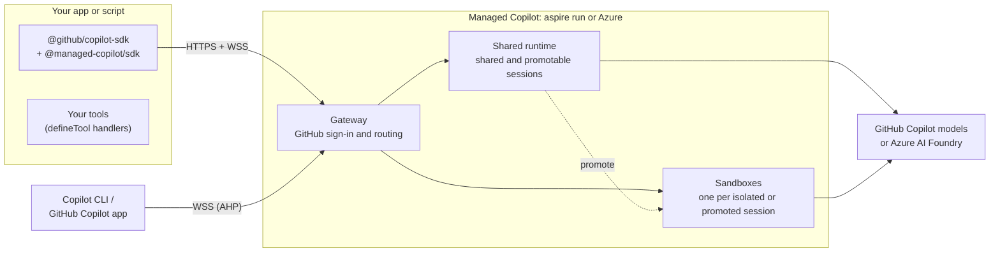

# Managed Copilot SDK: developer experience

> **Status: draft for calibration, revised 2026-10-23 after the first review.** Nothing is built yet. The
> [decision tracker](#decision-tracker) records what is decided and what is still proposed.

## The idea in one snippet

Today the Copilot SDK runs the agent next to your code:

```ts
import { CopilotClient, approveAll } from "@github/copilot-sdk";

const client = new CopilotClient();
await client.start();

const session = await client.createSession({ model: "claude-sonnet-5", onPermissionRequest: approveAll });
const reply = await session.sendAndWait({ prompt: "Summarize what changed in Aspire 13" });
console.log(reply?.data.content);
```

With Managed Copilot, the same code runs the agent in an **environment** you deployed, either locally under Aspire
or in your Azure subscription:

```ts
import { approveAll } from "@github/copilot-sdk";
import { ManagedCopilot } from "@managed-copilot/sdk";

const managed = await ManagedCopilot.connect(); // your local `aspire run`, or your Azure deployment
const client = await managed.client("chat");    // a CopilotClient for the "chat" environment

const session = await client.createSession({ model: "claude-sonnet-5", onPermissionRequest: approveAll });
const reply = await session.sendAndWait({ prompt: "Summarize what changed in Aspire 13" });
console.log(reply?.data.content);
```

Only the setup lines change. Everything after `managed.client(...)` is the Copilot SDK you already know: sessions,
events, tools, hooks, permissions, and resume.

For a one-off session, a single call picks the environment and creates the session:

```ts
const session = await managed.createSession({ environment: "chat", model: "claude-sonnet-5", onPermissionRequest: approveAll });
```

## Principles

1. **It's still the Copilot SDK.** `managed.client()` returns a `CopilotClient`, and sessions are `CopilotSession`s.
   There is no new message, event, or tool model to learn.
2. **One new concept: the environment.** It decides where the agent loop and its built-in tools run, and how they
   are isolated.
3. **Same code, local or Azure.** `aspire run` for the inner loop and `aspire deploy` for Azure. Only the URL changes.
4. **Your tools stay in your app.** Tools you define with `defineTool` run in your process, so the environment never
   sees your secrets. Built-in tools such as shell and file editing run in the environment.
5. **One identity: GitHub.** The login you use for Copilot is how you sign in to the platform, attach from Copilot
   CLI, and pay for model calls.
6. **Every session is attachable.** Open any running session in Copilot CLI, and in the GitHub Copilot app where
   supported, and work alongside your app.
7. **Secure by default.** Only the platform's gateway is reachable, over HTTPS and WSS. Every request is
   authenticated, sessions belong to the GitHub user who created them, and runtimes and sandboxes have no public
   endpoint.

## Environment types

| Type | Where the agent runs | Built-in tools | Start | Isolation boundary | Typical use |
| --- | --- | --- | --- | --- | --- |
| `shared` | One runtime shared by many sessions | A safe set with no shell or files; plus your tools, MCP servers, and web fetch when policy allows | Instant | Per-session state and identity in a shared process | Chat, support, Q&A, high volume |
| `isolated` | A fresh Linux **sandbox** (container) for each session | Everything: shell, files, git, and your image's toolchain | Seconds, or instant from a warm pool | A container per session | Coding and data agents, untrusted work |
| `promotable` | Starts `shared`, then moves once into its own fresh sandbox | The safe set, then everything | Instant, then a sandbox start at promotion | Shared, then a container | Assistants that occasionally need a shell |
| `orchestrator` *(later)* | A shared coordinator that starts workers in dynamic containers | Per worker | | A container per worker | Parallel and multi-agent work |

## 1. Declare your environments

Environments are part of your Aspire app model, so the same declaration runs locally and deploys to Azure:

```ts
// apphost.mts
import { createBuilder } from "./.aspire/modules/aspire.mjs";
import { addManagedCopilot } from "@managed-copilot/aspire";

const builder = await createBuilder();

await addManagedCopilot(builder, "copilot", {
  access: { githubOrgs: ["contoso"] }, // GitHub accounts allowed to use the deployed platform

  environments: {
    chat: {
      type: "shared",
      customizations: "./copilot/chat", // agents, skills, and instructions (section 6)
      policy: { models: ["claude-sonnet-5", "claude-haiku-5.5"], network: ["learn.microsoft.com"] },
    },
    coder: { type: "isolated", image: "./sandboxes/coder", size: "medium", warm: 2 },
    helper: { type: "promotable", promoteTo: "coder" },
  },

  // Optional: lets code request { type, size } without a name, using the default sandbox image and policy.
  inline: { types: ["shared", "isolated"], sizes: ["small"] },
});

await builder.build().run();
```

```powershell
aspire run      # local: gateway, shared runtime, and sandboxes in Docker, plus the Aspire dashboard
aspire deploy   # the same model in Azure Container Apps
```

- **`policy`** is enforced by the platform, whatever the caller asks for: the models, tools, and network hosts the
  agent may use.
- **`size`** is `small` (1 vCPU, 2 GiB), `medium` (2 vCPU, 4 GiB), or `large` (4 vCPU, 8 GiB).
- **`warm`** keeps that many sandboxes started and waiting, so new sessions skip the cold start. Warm sandboxes cost
  money while they wait.

A sandbox image is an ordinary Dockerfile on top of the base image:

```dockerfile
# sandboxes/coder/Dockerfile
FROM ghcr.io/patniko/managed-copilot-sandbox:latest
RUN apt-get update && apt-get install -y python3-pip
```

When the AppHost allows `inline` requests, a quick demo can skip the name:

```ts
const client = await managed.client({ type: "isolated", size: "small" });
```

A request outside the `inline` list, or for an environment name that isn't declared, fails at `managed.client(...)`.

## 2. Connect

```ts
// Local: finds the running AppHost. Nothing to configure.
const managed = await ManagedCopilot.connect();

// Azure: the URL printed by `aspire deploy`.
const managed = await ManagedCopilot.connect({ url: "https://copilot.contoso.example" });
```

With no arguments, `connect()` uses `MANAGED_COPILOT_URL` when it is set and the local AppHost otherwise.

Either way, **you are your GitHub login**: the account signed in to Copilot CLI, or `GH_TOKEN` or `GITHUB_TOKEN`. The
platform admits the accounts in the AppHost's `access` list, and your sessions use your Copilot entitlement. Locally,
the platform listens on loopback only.

A backend that serves signed-in users acts as each user with that user's GitHub token, obtained as in the SDK's
GitHub OAuth guide:

```ts
const client = await managed.client("chat", { gitHubToken: user.githubToken });
```

The SDK's per-session `gitHubToken` option also works, and the platform verifies it the same way.

## 3. Shared: a chat agent with your own tools

```ts
import { approveAll, defineTool } from "@github/copilot-sdk";
import { z } from "zod";

const lookupOrder = defineTool("lookup_order", {
  description: "Look up an order by id",
  parameters: z.object({ id: z.string() }),
  handler: async ({ id }) => orders.get(id), // runs in YOUR process; your database credentials never leave it
});

const client = await managed.client("chat");
const session = await client.createSession({
  model: "claude-sonnet-5",
  systemMessage: { content: "You are Contoso's order assistant. Be brief." },
  tools: [lookupOrder],
  onPermissionRequest: approveAll,
});

session.on("assistant.message_delta", (e) => process.stdout.write(e.data.deltaContent));
await session.sendAndWait({ prompt: "Where is order 1234?" });
```

You don't need `availableTools`: the environment's policy decides which built-in tools exist, and you can narrow them
further with `availableTools` or `excludedTools`. A `shared` environment has no shell or file tools, so asking for
them fails at `createSession` rather than halfway through a conversation.

## 4. Isolated: a coding agent in its own sandbox

```ts
const client = await managed.client("coder");

// Each session gets its own fresh sandbox.
const session = await client.createSession({ model: "claude-sonnet-5", onPermissionRequest: approveAll });
await session.sendAndWait({
  prompt: "Clone https://github.com/microsoft/aspire, count the *.cs files per top-level folder, and write report.md",
});

// Read results straight from the session's sandbox.
console.log(await managed.files(session).read("report.md"));
```

`approveAll` is reasonable here: the agent can only affect its own sandbox, not your machine or other sessions.

Put files in before the agent starts work:

```ts
const files = managed.files(session);
await files.write("data/sales.csv", await readFile("./sales.csv"));
await session.sendAndWait({ prompt: "Summarize data/sales.csv into summary.md" });
console.log(await files.list("."));
```

A sandbox lives exactly as long as its session:

- It is created with the session and never shared with another session.
- When the session goes idle, the sandbox stops and keeps its files. Resuming the session wakes it.
- Deleting the session deletes its sandbox: `await client.deleteSession(session.sessionId)`.

```ts
const info = await managed.sessions.get(session.sessionId);
console.log(info.sandbox); // { id: "sbx_7f3a…", size: "medium", state: "running" }
```

## 5. Promotable: start cheap, move when needed

```ts
managed.on("session.promoted", (e) => console.log(`${e.sessionId} moved to sandbox ${e.sandboxId}`));

const client = await managed.client("helper");
const session = await client.createSession({ model: "claude-sonnet-5", onPermissionRequest: approveAll });

// Shared and instant.
await session.sendAndWait({ prompt: "What does a CSV header row usually contain?" });

// Needs a shell: the agent calls its built-in `promote_to_sandbox` tool, which you approve like any other tool.
await session.sendAndWait({ prompt: "Download https://example.com/sales.csv and compute summary stats with pandas" });
```

The session moves into its own fresh sandbox from the `promoteTo` environment. The same `session` object keeps
working across the move, with its full history. Your app can also promote a session with
`await managed.promote(session)`. Promotion is one way: a promoted session never returns to `shared`.

## 6. Ship agents with an environment

Reusable agent configurations are ordinary **Copilot custom agents**, deployed with an environment. Skills and
instructions can ship in the same folder, in the formats Copilot CLI already reads:

```text
copilot/chat/
├── agents/
│   └── triage.agent.md
├── skills/
│   └── refund-policy/SKILL.md
└── instructions/
    └── contoso.instructions.md
```

```markdown
---
name: triage
description: Triage Contoso support requests and route them to the right team
model: claude-sonnet-5
tools: ["lookup_order", "web_fetch"]
---
You triage support requests for Contoso. Look up the order first, then decide which team owns the request.
```

Select one with the SDK's standard `agent` option:

```ts
const client = await managed.client("chat");
const session = await client.createSession({ agent: "triage", tools: [lookupOrder], onPermissionRequest: approveAll });
```

The platform loads the folder through the SDK's `agentDirectories`, `skillDirectories`, and
`instructionDirectories`, so these files behave exactly as they do in Copilot CLI. Agents you pass in `customAgents`
are added alongside the deployed ones. The environment's `policy` applies whichever agent runs.

## 7. Come back later

```ts
// The platform knows where every session lives, so its id is enough. Resuming wakes its sandbox if needed.
const session = await managed.resumeSession(sessionId, { tools: [lookupOrder], onPermissionRequest: approveAll });

for (const s of await managed.sessions.list()) {
  console.log(s.id, s.environment, s.placement, s.updatedAt); // placement is "shared" or "sandbox"
}

await managed.close(); // disconnects this process; sessions and sandboxes keep running
```

As with the SDK, pass your tools and handlers again when you resume; they still run in your process. Sessions belong
to the GitHub user who created them, so `list()` returns only yours.

## 8. Open a session in Copilot CLI or the GitHub Copilot app

From your code:

```ts
await managed.openCli(session); // runs Copilot CLI in this terminal, attached to the live session
```

From any terminal:

```powershell
npx managed-copilot sessions        # your sessions, locally or in Azure
npx managed-copilot attach 7f3a2c1  # Copilot CLI attached to that session over a secure WebSocket (AHP)
```

The attached CLI uses your GitHub login, and only the session's owner can attach. Your app and the CLI can be
attached at the same time: both see every message and tool call, and either can steer. Attaching needs an
interactive terminal.

For the GitHub Copilot app, an environment can register with GitHub:

```ts
chat: { type: "shared", github: { publish: true } },
```

Its sessions would then appear as a remote host in the GitHub Copilot app and in Copilot CLI
(`/ahp cloud <environment-id>`). *To validate: app support for self-hosted environments, how per-session sandboxes
appear, and that only the registering account sees them.*

## 9. Models and billing

Sessions use the Copilot entitlement of the GitHub user who creates them, with the models that account can use,
narrowed by the environment's `policy`.

An environment can use Azure AI Foundry instead:

```ts
support: { type: "shared", models: { foundry: "contoso-foundry" } },
```

Callers still sign in with GitHub, but model calls go to your Foundry resource with the platform's managed identity
(your `az login` locally) and use no Copilot entitlement.

## What runs where



## What ships

| Piece | What it is |
| --- | --- |
| `@managed-copilot/sdk` | The client: `connect`, `client`, `createSession`, `resumeSession`, `sessions`, `files`, `promote`, `openCli` |
| `@managed-copilot/aspire` | `addManagedCopilot(builder, ...)` for your AppHost |
| `managed-copilot` CLI | `sessions`, `attach`, `promote` |
| Platform images | Gateway, shared runtime, and the sandbox base image you can extend |
| Samples | Runnable locally or in Azure: `shared-chat.ts`, `isolated-coder.ts`, `promotable-helper.ts`, `deployed-agent.ts`, `attach-cli.ts` |

## Decision tracker

Statuses: **Decided** (agreed in review), **Proposed** (recommended, needs your OK), **To validate** (needs a
prototype), **Later** (outside the first delivery).

| # | Decision | Choice | Status |
| --- | --- | --- | --- |
| 1 | Client shape | `managed.client(env)` returns a `CopilotClient`; `managed.createSession({ environment })` is one-call sugar. A drop-in `connection` for a plain `CopilotClient` was rejected because it can't follow a promoted session | Decided |
| 2 | Isolated granularity | A fresh sandbox per session, as in OpenAI's hosted environments | Decided |
| 3 | Where environments come from | Declared in the AppHost and picked by name; inline `{ type, size }` only within the AppHost's `inline` list | Decided |
| 4 | Reusable agent configurations | Copilot custom agents (`.agent.md`) deployed with an environment, selected with the SDK's `agent` option | Decided |
| 5 | Identity and billing | GitHub identity end to end; sessions use the caller's Copilot entitlement; Azure AI Foundry optional per environment | Decided |
| 6 | Names | `@managed-copilot/sdk`, `@managed-copilot/aspire`, `ManagedCopilot`, "sandbox" | Proposed |
| 7 | Languages | TypeScript first; .NET and Python later | Proposed |
| 8 | Skills and instructions | Ship in the environment's `customizations` folder beside its agents | Proposed |
| 9 | Session ownership | Only the creating GitHub user can list, resume, attach to, or delete a session | Proposed |
| 10 | Promotion | The agent's `promote_to_sandbox` tool, approved through `onPermissionRequest`, plus `managed.promote()`; one way | Proposed |
| 11 | Sandbox files | `managed.files(session)` with `read`, `write`, and `list` | Proposed |
| 12 | Sizes and warm pools | `small`, `medium`, and `large`; `warm: n` per environment, default 0 | Proposed |
| 13 | Idle and retention | Idle sandboxes stop and keep their files; deleting a session deletes its sandbox; retention period not yet set | Proposed |
| 14 | GitHub Copilot app | Environments register with GitHub so the owner's sessions appear in the app | To validate |
| 15 | Sandbox network policy | Enforce `policy.network` for shell commands in sandboxes, not only for web tools | To validate |
| 16 | GitHub tokens in sandboxes | Keep the caller's token out of reach of the sandbox's shell commands | To validate |
| 17 | Entra ID for app backends | Managed identity as an alternative to GitHub tokens for service callers | Later |
| 18 | `orchestrator` environments | A coordinator with workers in dynamic containers | Later |

## What these choices ask of the platform

These notes feed the next spec, the architecture. They don't change the API above.

- **A session router.** One `CopilotClient` spans many runtimes, because each isolated session has its own sandbox.
  The gateway speaks the SDK's JSON-RPC protocol and routes each session's traffic to its runtime, including the tool,
  permission, and hook callbacks back to your process. The same routing lets a promoted session keep its connection.
- **Per-session sandboxes in Azure.** Locally they are Docker containers. Azure candidates are Container Apps dynamic
  sessions (prewarmed pools; persistent storage still to be checked) and Container Apps jobs (slower to start, with
  Azure Files). Sandboxes that dial out to the gateway need no ingress.
- **Attach routing.** Each runtime runs an AHP host through the SDK's `startAhpHost`, and the gateway routes attach
  connections by session after checking the caller's GitHub identity.
- **Customizations.** The platform mounts an environment's folder read-only and passes it as `agentDirectories`,
  `skillDirectories`, and `instructionDirectories`.
- **Empty-mode defaults.** In `mode: "empty"`, the SDK requires a `baseDirectory` or `sessionFs`, and an
  `availableTools` list on every session. The platform supplies both from the environment's policy.

Evidence so far, collected on 2026-10-23 on Windows ARM64:

| Check | Result |
| --- | --- |
| `@github/copilot-sdk` 1.0.26 (runtime 1.0.103): `startAhpHost({ localServer })` and `publishSession` | Works: a token-protected `ws://127.0.0.1` listener, with an existing session published as `ahp-session:/<id>` |
| `copilot --headless --port 0` (CLI 1.0.92) | Serves the SDK protocol; warns that it accepts any client when `COPILOT_CONNECTION_TOKEN` is unset |
| `copilot --ahp <url>` (CLI 1.0.92) | Accepted, but refuses non-interactive use; interactive attach is not yet tested. `--host-ahp` is not in this release |
| `BuiltInTools.Isolated` | `ask_user`, `task_complete`, `exit_plan_mode`, `task`, `read_agent`, `write_agent`, `list_agents`, `send_inbox`, `context_board`, and `skill`: no file, shell, or network tools |
