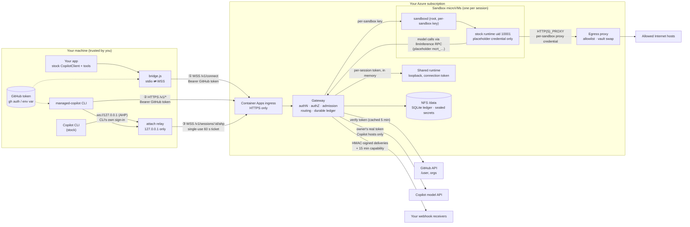
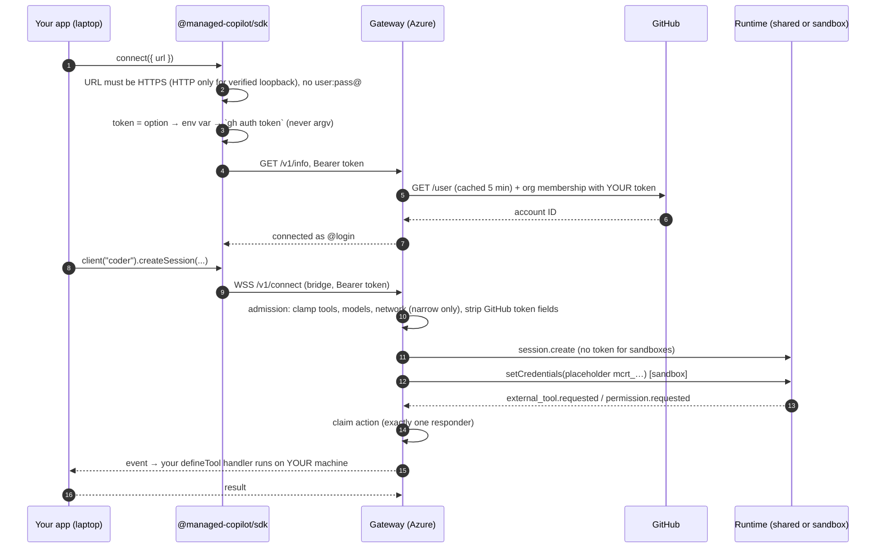
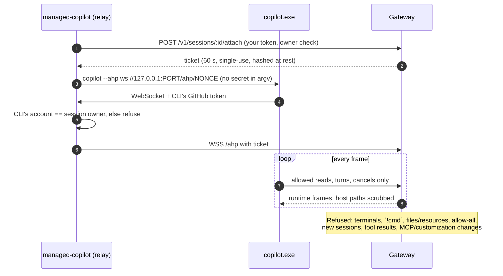

# Security model and threat model

How Managed Copilot keeps your machine, your GitHub identity, your secrets, and other people's sessions safe when a
local app or Copilot CLI drives agents running in the cloud. This page describes the current implementation: each claim links to
the [architecture](architecture.md) section or code that implements it. Review findings and open risks are at the
end.

## The picture

Your machine never runs agent code, and the cloud never holds a credential it doesn't need. Everything crosses one
door, the gateway, over HTTPS/WSS with your GitHub token.

### Trust boundaries

| # | Boundary | What crosses it | Primary control |
| --- | --- | --- | --- |
| TB1 | Your app/CLI → gateway (Internet) | GitHub token, prompts, tool calls and results, files | TLS; GitHub token verified against `/user` plus AppHost `access`; ownership by stable account ID |
| TB2 | Copilot CLI → local relay | CLI's GitHub OAuth token, AHP messages | Relay binds `127.0.0.1`, random path nonce, CLI's account must equal the session owner |
| TB3 | Relay → gateway attach socket | Ticket, AHP frames | 60 s single-use, owner- and session-bound ticket (stored as SHA-256); every frame parsed and filtered, deny by default |
| TB4 | Gateway → shared runtime | Per-session token (memory), JSON-RPC | Loopback + `COPILOT_CONNECTION_TOKEN`; gateway rewrites `session.create/resume` to a safe harness |
| TB5 | Gateway → sandbox | Session state, files, JSON-RPC | Per-sandbox bearer key to sandboxd; **no GitHub token**; workload uid 10001, no capabilities |
| TB6 | Sandbox → gateway (inference) | Model HTTP requests with placeholder | Only that session, only allowlisted Copilot API hosts; gateway swaps in the owner's token |
| TB7 | Sandbox → Internet | Arbitrary agent traffic | Egress proxy only; per-session allowlist; metadata, loopback, platform, and peer sandboxes always blocked |
| TB8 | Gateway → your webhooks / your workers → gateway | Events, capability tokens, answers | HMAC-SHA256 signatures; capabilities scoped to one session's pending actions, 15 min, audience-bound |
| TB9 | Browser → operator console | Ticket, cookie | One-time `mcct_` ticket in URL fragment; HttpOnly `SameSite=Strict` `__Host-` cookie; custom header + Origin check; strict CSP; no content shown |
| TB10 | Gateway → storage | Ledger, sealed vaults, background tokens | AES-256-GCM with row AAD; keys outside the DB when configured; single-writer lease |
| TB11 | Your app's server → gateway, for its own users | App key, app user ID, prompts | Key compared by SHA-256 digest in constant time; every request limited to the app's environments; app users own only their own sessions (negative, app-scoped account IDs) and only use Foundry |
| TB12 | Gateway → Azure AI Foundry | Model requests with an Entra ID token | Token from `az login` (local) or the gateway's managed identity (Azure), with only Cognitive Services OpenAI User on the declared accounts; sandboxes hold a placeholder and reach only their account's host through the gateway |

### Assets

| Asset | Where it lives | Never goes |
| --- | --- | --- |
| Your GitHub token (live) | Your machine; gateway memory (auth cache, per-session credential) | Sandboxes, disk, logs, argv, runtime env |
| Background GitHub token (`managed-copilot login`) | Sealed in the ledger (`MANAGED_COPILOT_DURABLE_KEY`) | Sandboxes; returned by any API |
| Vault secrets | Sealed in the ledger (`MANAGED_COPILOT_VAULT_KEY`) or Aspire secret parameters | Sandboxes (placeholders only); any API response |
| Conversation content and workspace files | Runtime `COPILOT_HOME`, sandbox disks, artifacts on `/data` | Operators (configuration only), other accounts |
| Platform, durable, egress, vault keys | Gateway environment / `/data` | Sandboxes, clients |
| Your Copilot quota | Billed per session owner | Another account (no fallback) |
| App keys | Aspire secret parameters (`<name>-app-<app>-key`); the app's server environment; digests in gateway memory | Sandboxes, the ledger, logs, any API response |
| The platform's Azure token (Foundry) | Gateway memory (from `az` or the managed identity) | Sandboxes, disk, logs, runtime env |
| Your Foundry usage | Billed to the Azure subscription of each declared account | A Copilot plan (app users never use one); an undeclared account |

## How a local client connects to cloud agents

### 1. Your app (`ManagedCopilot.connect` → `managed.client`)

What this guarantees:

- **Your tools run locally.** A `defineTool` handler executes in your process; the cloud agent sees only its
  result. The agent cannot execute anything on your machine except through tools you register and approve.
- **Approvals are yours.** `onPermissionRequest` answers prompts; the gateway claims each prompt for exactly one
  responder so a webhook, poller, or attached CLI can't race your answer.
- **Disconnects are safe.** Closing your app detaches; it never kills accepted work, and global RPCs such as
  `runtime.shutdown` never reach the runtime.

### 2. Copilot CLI attach (`managed-copilot attach`)

The CLI's own token is consumed by the relay and gateway; it is never forwarded to a runtime or sandbox.

### 3. What changes between local (`aspire run`) and Azure (`aspire deploy`)

| Control | Local | Azure |
| --- | --- | --- |
| Network exposure | Gateway on loopback | Public HTTPS ingress; demo apps IP-allowlisted to the deployer |
| Who may connect | Any GitHub account on the machine | Only `Parameters:copilot-github-users/orgs`; deploy **refuses** an open gateway |
| Operators | Every local account | Named operators only |
| Sandbox isolation | Docker container, own `/28` network, cap-drop | Container Apps Sandboxes microVM, platform egress policy allows only the proxy |
| Secrets at rest | `./.managed-copilot/data` (keys generated beside the DB) | NFS `/data` (VNet-restricted storage) |

## Threat model (STRIDE)

Likelihood/impact are for an Azure deployment with access rules set. ✅ = mitigated by design and verified in code or
tests; ⚠️ = partial or depends on operator configuration; ❌ = open.

### TB1 · Your app/CLI ↔ gateway

| Threat | Category | Mitigation | Status |
| --- | --- | --- | --- |
| Attacker with any GitHub account connects to your deployment | Spoofing / EoP | `access` rules required to publish; org membership checked with caller's token | ✅ |
| Stolen GitHub token used against the gateway | Spoofing | Token revocation honored within the 5 min cache; long-lived sockets re-verify each minute; but a stolen token is a full user credential by design | ⚠️ inherent |
| User A reads/attaches/drives user B's session | Info disclosure / EoP | Ownership bound to stable account ID on every session-scoped RPC and REST route; others see `not_found` | ✅ |
| Client sends a crafted `session.create` (broader tools, network, BYOK provider, cwd) | Tampering / EoP | Gateway admission rewrites create/resume/options; BYOK refused; network can only narrow; unknown config RPCs denied | ✅ |
| SDK sends token to a look-alike or downgraded URL | Info disclosure | HTTPS required for non-loopback; credentials in URL refused; discovery file validated | ✅ |
| GitHub outage turns into lockout or open door | DoS / EoP | Last good verification honored ≤15 min; outages are `upstream_unavailable`, never a grant | ✅ |
| Malicious cloud agent abuses your local tools | EoP on laptop | Only tools you `defineTool` exist; each call is gated by your permission handler; tool args are attacker-influenced (prompt injection) | ⚠️ your tool's responsibility |
| Tokens in logs / errors | Info disclosure | Gateway logger `redact`; errors use stable codes, no stack traces | ✅ |

### TB2/TB3 · Copilot CLI attach

| Threat | Category | Mitigation | Status |
| --- | --- | --- | --- |
| Another local process connects to the relay | Spoofing | Loopback bind + unguessable path nonce + CLI account must equal owner | ✅ |
| Ticket replay or theft | Spoofing | 60 s, single-use, hashed at rest, owner/session/incarnation bound, refused after restart | ✅ |
| CLI opens a host shell on the shared runtime | EoP | Terminals, `!cmd`, resources, changesets, host slash commands refused | ✅ |
| CLI approves a prompt your app owns, or enables allow-all | Tampering | Ledger claim; approval-mode changes refused; request IDs taken only from runtime frames | ✅ |
| Host paths/usernames leak to CLI | Info disclosure | `pathScrubber` on every frame; verified on 700+ frames | ✅ |

### TB11/TB12 · Apps acting for their users, and Azure AI Foundry

| Threat | Category | Mitigation | Status |
| --- | --- | --- | --- |
| Stolen app key acts for any of the app's users, or any GitHub user via `anyGitHubUser` | Spoofing | Server-side secret like any API key; limited to the app's environments; app users can't use background sign-in, schedules, operators, or Copilot CLI; GitHub users still need their own valid token. A stolen key is a full app credential by design: rotate it by replacing the parameter | ⚠️ inherent |
| App A reads app B's users, or an app user reads another user's session | Info disclosure / EoP | Accounts keyed by (app, user ID) with distinct negative IDs; every session route checks the owner ID; other apps' environments are `environment_not_found` | ✅ |
| An app user is confused with a GitHub account (`access`, `operators`, a login that matches) | Spoofing / EoP | Logins are `<app>/<id>` (no GitHub login contains `/`); operator and access checks accept only GitHub principals | ✅ |
| `anyGitHubUser` opens the deployment to everyone | EoP | Admission through the key only; the same token without it stays `forbidden`; sessions are scoped to the app's environments | ✅ |
| An app reads a GitHub user's sessions from elsewhere on the deployment (another app's, or their direct ones) | Info disclosure | Through a key, every session route, list, event stream, and bridge call sees only sessions in the app's environments (and their orchestrators' workers) | ✅ |
| An app user's model calls bill a Copilot plan, or silently fall back to one | Repudiation / EoP | App users only in Foundry environments (`inference_unavailable` elsewhere); a session's route is fixed at create and checked on resume and promotion | ✅ |
| Foundry token leaks into a sandbox or to another host | Info disclosure | Placeholder in the sandbox; the broker forwards only to the session's own account host on 443 and refuses `api-key` headers and other hosts | ✅ |
| Foundry spend runs away | DoS (cost) | Per-deployment capacity and quotas are set on the Foundry account; the platform adds no per-user limit yet | ⚠️ operator configuration |

### TB5–TB7 · Sandboxes and egress

| Threat | Category | Mitigation | Status |
| --- | --- | --- | --- |
| Agent exfiltrates the user's GitHub token | Info disclosure | Token never enters sandbox; runtime holds `mcrt_` placeholder valid only through the gateway | ✅ |
| Agent uses placeholder to call arbitrary GitHub APIs as the user | EoP | Gateway forwards inference only to allowlisted Copilot API hosts for that session | ✅ |
| Agent reaches IMDS / platform / other sandboxes | EoP | Proxy blocks metadata (incl. `168.63.129.16`), loopback, link-local, protected CIDRs; DNS-rebinding safe; per-sandbox networks | ✅ |
| Agent exfiltrates data to an allowed host | Info disclosure | Only the per-session allowlist; domain fronting inside an allowed TLS tunnel is not visible | ⚠️ inherent with `network: true` |
| Vault secret leaks to a different host/header/session | Info disclosure | Substitution only on TLS-terminated 443 to exact hosts, named headers, owning session; reflected values masked | ✅ (a hostile allowed host can still echo transformed secrets) |
| Sandbox escape to sandboxd (root) | EoP | `setpriv` drop, `no_new_privs`, empty capability sets, no setuid files, `env -i`, O_NOFOLLOW workspace workers; microVM on Azure | ✅ |
| Prompt injection from fetched content drives tools | Tampering | Tool ceilings per environment; approvals; network allowlists | ⚠️ inherent to agents |

### TB8 · Webhooks and durable actions

| Threat | Category | Mitigation | Status |
| --- | --- | --- | --- |
| Forged webhook to your receiver | Spoofing | HMAC-SHA256 over `t.body`; the SDK's `verifyWebhook` checks it in constant time with a replay window | ⚠️ receiver must call `verifyWebhook` |
| Leaked action capability approves more than one prompt | EoP | Capability scoped to the session's pending actions, 15 min, audience-bound; cannot attest a person or grant standing approval | ✅ |
| Replayed tool side-effects after restart | Tampering | `replay: "never"` tools use `recover`; uncertain calls become `needs_reconciliation` | ✅ |
| Background token misuse | EoP | Sealed; re-verified before use; revocation pauses schedules; never refreshed silently | ✅ |

### TB9/TB10 · Operator console and storage

| Threat | Category | Mitigation | Status |
| --- | --- | --- | --- |
| CSRF / clickjacking on the console | Tampering | `SameSite=Strict`, custom header, Origin check, no CORS, `frame-ancestors 'none'` | ✅ |
| Operator reads conversations or secrets | Info disclosure | Configuration only; `sanitizeEventData`, `redactValue/Url/Text` | ✅ |
| Theft of `/data` (NFS) | Info disclosure | Vaults/background tokens sealed (AES-256-GCM, AAD); **keys kept off the share** (secret parameters; wrapped key files) | ✅ R2 fixed |
| Split-brain writers corrupt the ledger | Tampering | Lease supervisor with fencing generation | ✅ (not partition-tolerant) |

## Keeping it secure: checklist

For each Azure deployment:

1. Set `Parameters:copilot-github-users` or `-orgs`; prefer an org you control. Name operators explicitly.
2. Keep the deployment's `Parameters:copilot-durable-key` and `Parameters:copilot-vault-key` (generated by
   `aspire deploy`, or set by you as 32 random bytes in base64). They seal vaults and background sign-ins and are kept
   off the NFS share; losing them makes those values unreadable.
3. Give environments the narrowest `network` list and tool ceilings they need; use `network: false` for code that
   needs no Internet.
4. Bind vault credentials only to hosts you trust.
5. Call `verifyWebhook` from the SDK in every webhook receiver.
6. Treat tool arguments from the agent as untrusted input in your `defineTool` handlers; require approval for
   anything with side effects.
7. Watch the console's attention items: open access, unsigned webhooks, broken background sign-ins.
8. Keep app keys on your app's server only, give each app the fewest environments it needs, and set
   `anyGitHubUser` only for apps meant for the public. Size each Foundry deployment's capacity for the spend you accept.

## Findings from the security review

A full-repository review (2026-10-28), done by reading the code and focused on the local↔cloud boundary, found **no
high-confidence exploitable vulnerabilities**. Every place where untrusted input reaches a sensitive operation had a
guard the review could name. The residual risks below are defense-in-depth gaps or depend on deployment choices.

| # | Severity | Where | Risk | Suggested fix |
| --- | --- | --- | --- | --- |
| R1 | ✅ Fixed (was 🟡 Medium) | `services/gateway/src/modules/sandbox/artifacts.ts` | The gateway used the `sha256` reported by sandboxd as a filename without validating it. A sandbox that reached root (sandboxd) could report `../../…`: an existing file skipped the download, and `open()` later served it. That could expose gateway-host files. | Fixed: manifests are refused when a digest isn't 64 lowercase hex characters, a size is invalid or over the artifact limits, or a path isn't a clean relative path. Downloads stop once they exceed the declared size, and `open()` refuses malformed stored digests |
| R2 | ✅ Fixed (was 🟡 Medium) | `libraries/aspire/src/publish/index.ts`, `services/gateway/src/key-files.ts` | The sealing keys were generated into `/data`, beside the sealed values | Fixed: `aspire deploy` generates both keys as persisted secret parameters. A key file that seals stored data is wrapped under the parameter. Its plaintext is retired by a later deployment only after a gateway reading the wrapped key has served for 15 minutes, so a failed rollout can always fall back |
| R3 | ⚪ Low | `services/gateway/src/modules/sandbox/providers/azure/provider.ts:153` | Sandbox port URLs accept any source address unless `MANAGED_COPILOT_AZURE_INGRESS_CIDRS` is set, which leaves the per-sandbox key as the only gate | Default the CIDR to the gateway's egress range |
| R4 | ⚪ Low | `services/sandbox/src/relay/main.ts`, `providers/docker/provider.ts:252` | One platform key authorizes both the gateway's platform routes and the sandbox relay | Split into separate keys |
| R5 | ⚪ Low | `services/gateway/src/modules/attach/index.ts:44-46`, `src/redaction.ts:18` | Generic AHP clients may pass the attach ticket as `?tkn=`, but the redaction patterns don't include the `mcat_` prefix | Add `mcat_` to the redaction patterns |
| R6 | ⚪ Low | `libraries/aspire/src/publish/index.ts:350-375` | Published apps act as one GitHub account (`app-github-token`) and are gated only by an IP allowlist; `*` removes the gate | Warn or refuse when the allowlist is `*` |
| R7 | ℹ️ By design | `services/gateway/src/modules/network/policy.ts:241-250` | An AppHost vault can be used, by substitution only, by every account admitted to that environment | Use per-user vaults (`managed.vaults.create`) for personal credentials |
| R8 | ℹ️ By design | `services/gateway/src/modules/operator/access.ts:72-76` | A local gateway with no operators named makes every local GitHub account an operator | Name operators on shared machines |
| R9 | ℹ️ By design | Gateway memory, sealed background credentials | Users must trust the deployment's operator: it holds their full GitHub tokens (in memory, and sealed at rest for background work) | Document it; prefer narrowly scoped tokens; `managed-copilot logout` when background work isn't needed |

Controls the review traced in code, by boundary: GitHub-token auth on every non-opt-out route
(`services/gateway/src/http.ts:159`, `modules/core/auth.ts:105-145`); account-ID ownership with a per-session
incarnation counter (`modules/core/sessions.ts:555-625`); a JSON-RPC allowlist (`modules/core/router.ts:151-156`);
an admission allowlist that refuses cwd, plugins, BYOK, and local MCP servers (`modules/core/admission.ts:350-593`);
HMAC action capabilities compared in constant time (`modules/durable/actions/capability.ts:37-62`); hashed single-use
attach tickets (`modules/attach/tickets.ts:72-103`); an SDK relay that binds loopback and checks the CLI is the owner
(`libraries/sdk/src/features/cli.ts:212-312`); keys compared in constant time for the relay and for sandboxd
(`services/sandbox/src/relay/main.ts:21-37`, `sandboxd/server.ts:71-90`); a promotion export that refuses
secret-shaped content (`modules/promotion/export.ts:168-214`); SSRF resolve-then-connect (`libraries/protocol/src/network.ts:277-438`);
AES-256-GCM sealing with row AAD (`modules/network/sealing.ts:42-64`); `verifyWebhook` in the SDK with a constant-time
compare and a replay window (`libraries/sdk/src/features/webhooks.ts:87-121`); and least-privilege managed identity
(`libraries/aspire/src/publish/sandbox-group.ts:48-66`).
