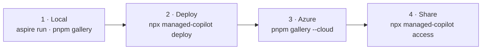

# Demo walkthrough: local, deploy, Azure, share

One pass through everything you'd show the team: run the platform locally and check each demo from the gallery, deploy
the same AppHost to Azure, check the demos again there, and let other people in. Every step lists the command, what to
click, and what you should see. Tick each box as you go.



Run every command from the repository root in PowerShell. Keep three terminals: **T1** for `aspire run`, **T2** for the
gallery, **T3** for the CLI.

The scripted parts of this walkthrough (each demo's `happy-path`, the walkthroughs, and the spec snippets) also run
unattended with `pnpm qa local`; see [quality assurance](qa.md). This walkthrough adds what only a person can check: the
UIs, Copilot CLI in a terminal, and sharing.

## 0 · Before you start

- [ ] `node -v` prints 24.x, `pnpm -v` prints 10.x, `aspire --version` prints 13.6, and Docker Desktop is running.
- [ ] `gh auth status` shows the GitHub account with Copilot you'll demo as.
- [ ] `copilot --version` works ([Copilot CLI](https://docs.github.com/copilot/how-tos/copilot-cli), for "Open in
      Copilot CLI").
- [ ] `az account show` shows the subscription you'll deploy to (only for part 2).

```powershell
pnpm install
pnpm build
```

## 1 · Local

### 1.1 Start the platform (T1)

```powershell
aspire run --non-interactive
```

`--non-interactive` skips the hidden "Trusting certificates…" prompt (or run `aspire certs trust` once). It prints the
Aspire dashboard URL. Wait until the dashboard shows `copilot` and every demo as **Running / Healthy**. The first run
builds the sandbox image, which takes a few minutes.

| Resource | Local URL | Pattern |
| --- | --- | --- |
| Gateway (`copilot`) | http://localhost:7400 | |
| Hack the Harness | http://localhost:7415 | Shared by default; its README steps through five |
| Pattern Race | http://localhost:7420 | All six |
| Research Swarm | http://localhost:7425 | Delegate |
| Data Desk | http://localhost:7430 | Promotable |
| Repo Doctor | http://localhost:7435 | Isolated |
| Help Desk | http://localhost:7440 | Shared |
| Incident Commander | http://localhost:7445 | Mixed |
| Front Desk | http://localhost:7450 | Shared |
| Downhill | http://localhost:7455 | Its support tickets run in Help Desk (shared) |
| Dispatch | http://localhost:7470 | Direct, delegate, mixed |
| Software factory | http://localhost:7480 | Delegate, isolated |
| Assistant | http://localhost:7490 | Shared, delegate |
| Gallery (next step) | http://localhost:7460 | |

- [ ] Dashboard shows every resource healthy.

### 1.2 Check the platform from the terminal (T3)

```powershell
npx managed-copilot status       # deployment "local", you as "Signed in", environments, capabilities
```

- [ ] `Capabilities` includes `isolated`, `files`, and `promotion` (they appear once Docker and the sandbox backend are
      ready; run it again after a minute if they're missing).

### 1.3 Open the gallery (T2)

```powershell
pnpm gallery            # opens http://localhost:7460; add --no-azure to hide the Azure column for now
```

- [ ] Header shows the local gateway as up.
- [ ] The **Patterns** row shows the three building blocks and six pattern cards, each with its brain and hands
  diagram; each card's walkthrough button jumps to its walkthrough below, and **Compare all six** opens Pattern Race.
- [ ] Every app card, and the Operator console's, has a green **Local** dot.

Open each app from its **Local** button and run the checks below. They're in pattern order; each lists the scripted
check that runs the same path through the app's API (real models, small spend, and it cleans up after itself).

### 1.4 Pattern Race (all six patterns on one job)

1. Pick **Run code** and press **Start race**.
2. When it finishes, press **Race again** with **Split the work**, and open a lane's details (its chevron).

- [ ] Six lanes start at once, one per pattern environment; only the `managed.client("…")` name differs.
- [ ] The promotable lane moves into a sandbox; Direct and Mixed act in a sandbox with no agent in it; Delegate starts a
      worker sandbox per part; Shared ends with **No shell**.
- [ ] The scorecard ranks the correct lanes and shows each one's time, sandboxes, agents, and premium requests.

```powershell
pnpm --filter @managed-copilot/demo-pattern-race happy-path    # the quick answer: six premium requests
```

### 1.5 Help Desk (shared: many sessions, one runtime)

1. Keep **25** customers and press **Simulate 25 customers**.
2. Approve a refund on a yellow tile, then open **Liam O'Brien**.
3. Open **Downhill** (http://localhost:7455): ride a run, open the **Shop**, press **Apply code** on the launch offer,
   buy anyway, then press **Contact support**.

- [ ] The counters read 25 sessions, 1 runtime, 0 sandboxes while answers arrive.
- [ ] Liam's lookup of another customer's order shows as **Blocked**; his agent confirms nothing.
- [ ] Downhill's checkout says **Invalid code.**; the support chat opens in the game and the agent answers.
- [ ] The wall shows the player's tile (**Downhill**, **Live**); its report joins **Promo codes rejected at checkout**,
      and the refund the agent asks for waits on the wall.

```powershell
pnpm --filter @managed-copilot/demo-help-desk happy-path       # 5 customers and one approval
pnpm --filter @managed-copilot/demo-downhill happy-path        # a ride, the rejected code, a live ticket (Microsoft Edge)
```

### 1.6 Repo Doctor (isolated, with network rules)

1. Press **Try the sample: bumpkit**.
2. Open a step's log, then download the patch.

- [ ] Checkout through Verify run in one sandbox; Reproduce turns red with 2 failing, then Verify green.
- [ ] The network strip shows the allowed hosts in green and the blocked requests in red as they happen.

```powershell
pnpm --filter @managed-copilot/demo-repo-doctor happy-path
```

### 1.7 Data Desk (promotable: a move into a sandbox)

1. Pick **Coffee shop sales** and ask **Which store made the most revenue in 2025?**
2. Ask **Chart monthly revenue for each store**, then press **Move**.

- [ ] The first answer comes from the app's own tools on the shared runtime.
- [ ] The track moves the same session ID into a sandbox, and the chart appears; the meter shows premium requests on
      each side of the move.

```powershell
pnpm --filter @managed-copilot/demo-data-desk happy-path       # the move included
```

### 1.8 Dispatch (direct, delegate, and mixed in one chat)

1. On the home page, keep **Delegate to workers** and **Ask first**, pick **Estimate π three ways**, and send it.
2. **Approve** each sandbox request (or deny one with a reason and watch it retry your way).
3. Send a follow-up, such as the chart, then open the **Timeline** tab and select a sandbox tile.
4. Press **Open in Copilot CLI**, type a message there, then `/exit`.
5. Start a new conversation with **Work directly**, then one with **Mixed** and the **Prime check, with sources**
   template.

- [ ] Message #1 creates three Python lab sandboxes, each tile badged **#1**; the follow-up reuses at least one.
- [ ] A sandbox's details show the work it was given, its report, and its files.
- [ ] The message typed in Copilot CLI appears in Dispatch labeled **from Copilot CLI**.
- [ ] Work directly lists each command with who ran it and its exit code; Mixed works in its own sandbox and starts a
      web research worker.

### 1.9 Research Swarm (delegate: parallel researchers)

1. Pick a question under **Try one** and press **Research**.
2. Select a researcher, then a citation in the report, and **Export** it.

- [ ] Four researchers start in their own sandboxes, and their page dots fill in as they read.
- [ ] Every claim in the report cites a page a researcher read; the sandboxes are deleted when it's done.

```powershell
pnpm --filter @managed-copilot/demo-research-swarm happy-path  # two researchers
```

### 1.10 Incident Commander (mixed, with an approval that waits)

1. Press **Simulate an incident**.
2. When **Deploy the fix to production?** appears, close the tab, wait a minute, reopen the incident, and press
   **Deploy**.

- [ ] Copilot triages in its own sandbox, then hands the repro and the fix to two workers.
- [ ] The deploy waits on the platform while the tab is closed; after **Deploy**, the incident resolves and the
      postmortem appears.

```powershell
pnpm --filter @managed-copilot/demo-incident-commander happy-path
```

### 1.11 Software factory (coordinator, builders, review, release)

1. Pick the **CSV ⇄ JSON toolkit** template, keep **Agent-led**, and press **Start work order**.
2. Watch the floor and the decision log; select a station for its reports.
3. When it finishes, open the **Deliverable** and the **Artifacts** diff viewer.

- [ ] The coordinator creates a builder sandbox per task, sends review findings back to the **same** builder, then
      creates the release sandbox.
- [ ] The deliverable shows release ready with all tests passed (a run takes about 5 to 7 minutes).

Scripted check of the same path (exits 0 only when the release's tests pass and the bundle downloads):

```powershell
pnpm --filter @managed-copilot/demo-software-factory happy-path
```

### 1.12 Assistant (long-running, approvals, schedules, sandboxes)

1. If the side panel says **Background work is off**, press **Turn on** (**What this means** explains it first), or
   run `npx managed-copilot login`.
2. Ask: "What's on my calendar tomorrow? Find a free 30 minutes and book a meeting with Sam."
3. Ask: "Remind me in 2 minutes to stretch." Close the tab, wait 3 minutes, reopen it.
4. Ask: "Chart my meeting load for this week."

- [ ] The side panel marks the inbox and calendar **Demo data** (unless you configured Google).
- [ ] Booking the meeting shows an approval card; nothing changes until you approve.
- [ ] The reminder arrives as a proactive message while the tab is closed, waiting for you when you reopen it.
- [ ] The chart asks to start a Python sandbox, then shows the chart under the reply; a follow-up is marked **reused**.

Scripted check in Microsoft Edge (`--fresh` starts a new conversation and resets the demo workspace):

```powershell
pnpm --filter @managed-copilot/demo-assistant happy-path -- --fresh --reminder --offline --sandbox --enable-background
```

### 1.13 Front Desk (many people, each with private conversations)

Email accounts chat only when the AppHost names an Azure AI Foundry account for them (`Parameters:foundry-account`
and the rest, in [Front Desk's README](../demos/front-desk/README.md#people-without-github)); without one, Front Desk
tells them chatting needs GitHub here.

1. Open http://localhost:7450 and press **Use this computer's GitHub sign-in**.
2. Ask: "Remember that my favorite color is teal." Open **Memory**.
3. In a private window, open Front Desk again and **Create an account** with any email and password.
4. As that person, ask: "What's my favorite color?"

- [ ] The GitHub user's chip says **Your Copilot plan**; the email account's says **Front Desk's Azure AI Foundry**,
      with a daily allowance. Each conversation's header shows the platform's own record of where its model calls go
      (**Your Copilot plan · claude-sonnet-5**, or **Azure AI Foundry · \<deployment\>**).
- [ ] The memory panel lists the favorite color for the GitHub user only; the other person's list and memory are empty,
      and their assistant doesn't know it.

Scripted check (two email accounts and your GitHub CLI's account; each saves a secret, and every other person is checked
to see none of it):

```powershell
pnpm --filter @managed-copilot/demo-front-desk e2e -- --url http://localhost:7450
```

### 1.14 Operator console

Press the console card's **Local** button, or:

```powershell
npx managed-copilot console      # the console in your browser; locally every account is an operator
npx managed-copilot operator     # the same overview in the terminal
```

- [ ] Health shows every component up.
- [ ] Sessions lists the sessions the demos just created (Help Desk's customers, coordinators and their workers,
      Repo Doctor's sandbox), with placement and sandbox; conversation content is not shown.
- [ ] The live feed moves while a demo runs.

### 1.15 The CLI and the walkthroughs (T3)

```powershell
npx managed-copilot sessions              # your sessions
npx managed-copilot new chat              # a new chat session, opened in Copilot CLI; /exit to leave
npx managed-copilot new coder             # the same in its own sandbox; ask it to run `uname -a`
npx managed-copilot workers <id>          # an orchestrator session's workers (use a Dispatch conversation's ID)
npx managed-copilot exec <id> -- ls -la   # a command in a session's sandbox
pnpm walkthrough 01                            # walkthrough 01; the gallery lists all of them
pnpm --filter @managed-copilot/snippets acceptance   # every spec snippet against the local platform
```

- [ ] `new coder` opens Copilot CLI with the footer `remote /workspace`.

### 1.16 Stop

```powershell
aspire stop --apphost apphost.mts --non-interactive
```

Stopping the `aspire run` terminal alone leaves the gateway and demos holding their ports.

## 2 · Deploy to Azure

One command runs the whole flow from the repository root (full reference: [deploying to Azure](deployment.md)):

```powershell
npx managed-copilot deploy
```

It checks that the Aspire CLI, the Azure CLI (signed in with `az login`), and Docker are ready, then shows the plan and
asks before deploying:

```text
Deploying apphost.mts to Azure
  Subscription    <your subscription> (<id>)
  Resource group  managed-copilot-dev · westus2 · new deployment
  Platform users  @your-login
  Operators       @your-login
  Apps act as     @your-login (your GitHub sign-in)
  Apps open to    203.0.113.7/32 (this machine); public apps: any address
  Added you (@your-login) to platform users and operators. Change with `npx managed-copilot access`.

Deploy? [y/N]
```

- **Where it goes.** The Azure CLI's current subscription, `managed-copilot-dev`, and `westus2`, unless you've set them
  before or pass `--subscription`, `--resource-group`, or `--location`. They're saved for next time.
- **Who may use it.** A first deployment adds you as a platform user and an operator (the deployed console is off
  without operators). Add others in part 4.
- **The demo apps' account.** The deployed demos have no sign-in of their own: they act as your GitHub sign-in, passed
  to `aspire deploy` in an environment variable, never on a command line.
- **Who can open the apps.** Your machine's public address, unless you've set a list with
  `npx managed-copilot access ips`.

The first deploy builds and pushes the images (several minutes on ARM64). It ends with:

```text
✓ Deployed: https://copilot.<environment-domain>
  Demo gallery: https://gallery.<environment-domain>
```

- [ ] The deploy succeeds and prints the gateway URL.

Run it again after any change (code, users, operators); it updates the same deployment. The deployment's generated
keys live in Aspire's deployment record for the checkout that made it. From another checkout (a new clone or
worktree), `deploy` stops and, if that record is on this machine, offers to copy it so the deployment keeps its keys.
Say yes; deploying with new keys can leave the gateway unable to start.

<details>
<summary>The same steps by hand</summary>

```powershell
aspire secret set Azure:SubscriptionId <subscription-id>
aspire secret set Azure:Location westus2
aspire secret set Azure:ResourceGroup managed-copilot-dev
# aspire deploy doesn't load user secrets for the AppHost, so the lists go in the environment:
${env:Parameters__copilot-github-users} = "your-login"           # the whole list
${env:Parameters__copilot-operator-users} = "your-login"
${env:Parameters__app-github-token} = (gh auth token).Trim()
aspire deploy
Remove-Item Env:Parameters__app-github-token
```

</details>

Find the URL again later with:

```powershell
az containerapp list --query "[?name=='copilot'].properties.configuration.ingress.fqdn" -o tsv
```

## 3 · Azure

### 3.1 Check the platform (T3)

```powershell
$env:MANAGED_COPILOT_URL = "https://copilot.<environment-domain>"
npx managed-copilot status       # Deployment copilot · azure, you as Signed in
npx managed-copilot login        # once per deployment, so schedules and offline work run as you
```

- [ ] `Capabilities` includes `isolated` (if not, see [troubleshooting](deployment.md#troubleshooting): the role
      assignment can take a few minutes; the gateway re-checks every 30 seconds).

### 3.2 Open the gallery

The deployment has its own gallery, at the address `deploy` printed: **https://gallery.&lt;environment-domain&gt;**.
That's the link to share. It shows the Azure apps only, and its console card copies the command each operator runs
(`npx managed-copilot console --url …`).

- [ ] The deployed gallery opens and its header shows Azure as up.
- [ ] Each app card's **Azure** dot is green, and each app opens.

From your laptop, the local gallery shows both columns side by side (T2):

```powershell
pnpm gallery --cloud https://copilot.<environment-domain>
```

Without `--cloud`, it finds the `copilot` container app through `az login`. Here an **amber** dot means the app refused
your network address (see 3.4); the deployed gallery can't tell, because the apps always admit it.

### 3.3 The demos and console in Azure

Repeat 1.4 to 1.14 with each card's **Azure** button. Differences to expect:

- Sandboxes are Azure Container Apps microVMs (`Linux x86_64`), so the first one in a conversation takes a little
  longer to start.
- "Open in Copilot CLI" commands include `--url https://copilot.<environment-domain>`.
- The console button signs you in with a one-time link; it works only for operators (`npx managed-copilot access`
  lists them).
- Front Desk is a public app: it opens from any network, and it doesn't offer this computer's GitHub sign-in. Sign in
  with **Continue with GitHub** (its OAuth app needs the deployed callback URL; see its README) or create an email
  account.

- [ ] Dispatch: π template with approvals, a reused follow-up, Copilot CLI follow-up.
- [ ] Software factory: CSV ⇄ JSON toolkit, Agent-led, release with all tests passed.
- [ ] Assistant: approval card, reminder while the tab is closed, a sandbox chart. (Its sandboxes haven't been
      verified on Azure before, so this is the one to watch.)
- [ ] Front Desk: a GitHub user on their own Copilot plan and an email account on Foundry, neither seeing the other's
      conversations or memory; it opens from a phone off Wi-Fi, where the other apps answer 403.
- [ ] Pattern Race, Help Desk, Downhill, Repo Doctor, Data Desk, Research Swarm, and Incident Commander: their scripted
      checks above, each with `--url https://<app>.<environment-domain>`. They have run locally only so far, so watch
      them too.
- [ ] Console: health, sessions with Azure sandboxes, live feed.

Platform checks from the terminal:

```powershell
pnpm walkthrough 03                   # an Azure sandbox: prints Linux x86_64
npx managed-copilot new coder    # Copilot CLI on an Azure sandbox
pnpm --filter @managed-copilot/snippets acceptance 01 02 03 04 05 06 07 08 09 11 13 14 --strict
```

Snippets 10 and 12 need a local webhook receiver, so they're left out against Azure.

### 3.4 If an Azure button is amber (403 "RBAC: access denied")

Corporate VPNs and Global Secure Access send Azure traffic from different addresses than `deploy` detected, often a
rotating pool. `npx managed-copilot access` shows each running app's allowlist. Either:

- Add your network's Azure egress ranges. This updates the running apps at once, no redeploy needed:

  ```powershell
  npx managed-copilot access ips add 203.0.113.0/24
  ```
- Run the demos on your machine against the Azure platform. The gateway needs no IP allowlist; it checks your GitHub
  sign-in. Stop any local `aspire run` first so the ports are free:

  ```powershell
  $env:MANAGED_COPILOT_URL = "https://copilot.<environment-domain>"
  pnpm --filter @managed-copilot/demo-dispatch start           # http://localhost:7470
  pnpm --filter @managed-copilot/demo-software-factory start   # http://localhost:7480
  pnpm --filter @managed-copilot/demo-assistant start          # http://localhost:7490
  ```

  Sessions and sandboxes still run in Azure. The assistant polls for offline tool calls, since Azure can't reach a
  webhook on your laptop.

## 4 · Share it

`npx managed-copilot access` shows and changes three lists. Run it from the repository root:

```text
> npx managed-copilot access
copilot · apphost.mts · managed-copilot-dev
Platform users  @your-login
Platform orgs   none
Operators       @your-login
Operator orgs   none
Apps act as     @your-login (your GitHub sign-in when you deploy)
Apps open to    203.0.113.7/32
                dispatch now: 203.0.113.7/32
                software-factory now: 203.0.113.7/32
                assistant now: 203.0.113.7/32
```

| List | Command | What it allows | Takes effect |
| --- | --- | --- | --- |
| Platform users | `access users add alice bob` (or `access orgs add contoso`) | Use the gateway with their own GitHub sign-in and Copilot plan: the CLI, samples, Copilot CLI, and demos they run themselves | Next `npx managed-copilot deploy` |
| Operators | `access operators add alice` | Open the operator console and operator API. Operators must also be platform users | Next `npx managed-copilot deploy` |
| Who can open the deployed apps | `access ips add 203.0.113.50` | Open the deployed gallery, Dispatch, factory, and assistant from those addresses, **acting as your account** (except the gallery, which holds no account) | At once |

`me` means you: `access users add me` adds your GitHub login, and `access ips add me` adds this machine's public
address. Each list also takes `remove` and `set` (which replaces the whole list).

```powershell
npx managed-copilot access users add alice bob
npx managed-copilot access operators add alice
npx managed-copilot deploy                          # applies user and operator changes
npx managed-copilot access ips add me               # applies at once, no deploy needed
```
**The deployed demos are not per-user.** There is no GitHub allow list for them: anyone who can reach them shares your
account, your Copilot usage, and the same conversations. Pick one:

- **Teammates use their own accounts (recommended).** Add them with `access users add`, then `deploy`. They clone the
  repository, run `pnpm install; pnpm build`, and use the commands in 3.4 and 3.1 with your gateway URL. Their
  sessions are theirs, on their Copilot plan.
- **Teammates open your deployed demos.** Add their addresses (or a shared network's range) with `access ips add`. Fine for a supervised demo, not for unsupervised use. `"*"` opens the apps to anyone
  on the Internet as you; don't.

What to send a teammate who uses their own account:

```powershell
git clone https://github.com/patniko/managed-copilot-sdk; cd managed-copilot-sdk
pnpm install; pnpm build
gh auth login                                            # their GitHub account with Copilot
$env:MANAGED_COPILOT_URL = "https://copilot.<environment-domain>"
npx managed-copilot status                               # should show them as Signed in
npx managed-copilot new chat                             # a chat in Copilot CLI
pnpm walkthrough 03                                           # an Azure sandbox
pnpm --filter @managed-copilot/demo-dispatch start       # Dispatch on http://localhost:7470, running in Azure
npx managed-copilot console                              # operators only
```

A teammate who isn't on the list gets an access error from `status`; add them with `access users add` and redeploy.

## 5 · Cost and teardown

The deployment costs roughly $0.11/hour idle and more while demos run, plus sandbox time
([cost](deployment.md#cost)). Delete sessions you're done with; an idle sandbox stops after 15 minutes and keeps only
its disks. To remove everything:

```powershell
az group delete --subscription <subscription-id> --name managed-copilot-dev --yes
```

Your settings (lists, region) stay on your machine for the next `npx managed-copilot deploy`.
