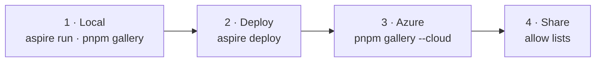

# Demo walkthrough: local, deploy, Azure, share

One pass through everything you'd show the team: run the platform locally and check each demo from the gallery, deploy
the same AppHost to Azure, check the demos again there, and let other people in. Every step lists the command, what to
click, and what you should see. Tick each box as you go.



Run every command from the repository root in PowerShell. Keep three terminals: **T1** for `aspire run`, **T2** for the
gallery, **T3** for the CLI.

## 0 · Before you start

- [ ] `node -v` prints 24.x, `pnpm -v` prints 10.x, `aspire --version` prints 13.6, and Docker Desktop is running.
- [ ] `gh auth status` shows the GitHub account with Copilot you'll demo as.
- [ ] `copilot --version` works ([Copilot CLI](https://docs.github.com/copilot/how-tos/copilot-cli), for "Open in
      Copilot CLI").
- [ ] `az account show` shows the subscription you'll deploy to (only for part 2).

```powershell
pnpm install
pnpm build
```

## 1 · Local

### 1.1 Start the platform (T1)

```powershell
aspire run --non-interactive
```

`--non-interactive` skips the hidden "Trusting certificates…" prompt (or run `aspire certs trust` once). It prints the
Aspire dashboard URL. Wait until the dashboard shows `copilot`, `dispatch`, `software-factory`, and `assistant` as
**Running / Healthy**. The first run builds the sandbox image, which takes a few minutes.

| Resource | Local URL |
| --- | --- |
| Gateway (`copilot`) | http://localhost:7400 |
| Dispatch | http://localhost:7470 |
| Software factory | http://localhost:7480 |
| Assistant | http://localhost:7490 |
| Gallery (next step) | http://localhost:7460 |

- [ ] Dashboard shows every resource healthy.

### 1.2 Check the platform from the terminal (T3)

```powershell
npx managed-copilot status       # deployment "local", you as "Signed in", environments, capabilities
```

- [ ] `Capabilities` includes `isolated`, `files`, and `promotion` (they appear once Docker and the sandbox backend are
      ready; run it again after a minute if they're missing).

### 1.3 Open the gallery (T2)

```powershell
pnpm gallery            # opens http://localhost:7460; add --no-azure to hide the Azure column for now
```

- [ ] Header shows the local gateway as up.
- [ ] Dispatch, Software factory, Assistant, and Operator console cards each have a green **Local** dot.

Open each app from its **Local** button and run the checks below.

### 1.4 Dispatch (orchestrator, a sandbox per part of the request)

1. Keep **Delegate to workers** selected, pick the **Estimate π three ways** template, and send it.
2. **Approve** each "start a sandbox" request (or deny one with a reason and watch it retry your way).
3. Send a suggested follow-up, such as the chart.
4. Open the **Timeline** tab, then select a sandbox in the right pane.
5. Press **Open in Copilot CLI** on the conversation, type a message there, then `/exit`.
6. Switch the style to **Work directly**, send a template, and approve its commands.

- [ ] Message #1 created three Python sandboxes (**#1 created**) and answered, in about a minute.
- [ ] The follow-up reused at least one sandbox (**reused**) and the card says what the agent did.
- [ ] A sandbox shows its blueprint, network policy, files, and outputs.
- [ ] The message typed in Copilot CLI appears in Dispatch labeled **from Copilot CLI**.
- [ ] Work directly lists each command with who ran it and its exit code.

### 1.5 Software factory (coordinator, builders, review, release)

1. Pick the **CSV ⇄ JSON toolkit** template, keep **Agent-led**, and press **Start work order**.
2. Watch the floor and the decision log; select a station for its reports.
3. When it finishes, open the **Deliverable** and the **Artifacts** diff viewer.

- [ ] The coordinator creates a builder sandbox per task, sends review findings back to the **same** builder, then
      creates the release sandbox.
- [ ] The deliverable shows release ready with all tests passed (a run takes about 5 to 7 minutes).

Scripted check of the same path (exits 0 only when the release's tests pass and the bundle downloads):

```powershell
pnpm --filter @managed-copilot/demo-software-factory happy-path
```

### 1.6 Assistant (long-running, approvals, schedules, sandboxes)

1. If the side panel says **Background work is off**, press **Turn on background work** (or
   `npx managed-copilot login`).
2. Ask: "What's on my calendar tomorrow? Find a free 30 minutes and book a meeting with Sam."
3. Ask: "Remind me in 2 minutes to stretch." Close the tab, wait 3 minutes, reopen it.
4. Ask: "Chart my meeting load for this week."

- [ ] The header labels the inbox and calendar as the **demo workspace** (unless you configured Google).
- [ ] Booking the meeting shows an approval card; nothing changes until you approve.
- [ ] The reminder arrives as a proactive message while the tab is closed, waiting for you when you reopen it.
- [ ] The chart asks to start a Python sandbox, then shows the chart under the reply; a follow-up is marked **reused**.

Scripted check in Microsoft Edge (`--fresh` starts a new conversation and resets the demo workspace):

```powershell
pnpm --filter @managed-copilot/demo-assistant happy-path -- --fresh --reminder --offline --sandbox --enable-background
```

### 1.7 Operator console

Press the console card's **Local** button, or:

```powershell
npx managed-copilot console      # the console in your browser; locally every account is an operator
npx managed-copilot operator     # the same overview in the terminal
```

- [ ] Health shows every component up.
- [ ] Sessions lists the sessions the demos just created (Dispatch coordinators, factory builders, assistant workers),
      with placement and sandbox; conversation content is not shown.
- [ ] The live feed moves while a demo runs.

### 1.8 The CLI and the walkthroughs (T3)

```powershell
npx managed-copilot sessions              # your sessions
npx managed-copilot new chat              # a new chat session, opened in Copilot CLI; /exit to leave
npx managed-copilot new coder             # the same in its own sandbox; ask it to run `uname -a`
npx managed-copilot workers <id>          # an orchestrator session's workers (use a Dispatch conversation's ID)
npx managed-copilot exec <id> -- ls -la   # a command in a session's sandbox
pnpm sample 01                            # walkthrough 01; the gallery lists all of them
pnpm --filter @managed-copilot/quickstart acceptance   # every spec snippet against the local platform
```

- [ ] `new coder` opens Copilot CLI with the footer `remote /workspace`.

### 1.9 Stop

```powershell
aspire stop --apphost apphost.mts --non-interactive
```

Stopping the `aspire run` terminal alone leaves the gateway and demos holding their ports.

## 2 · Deploy to Azure

Full reference: [deploying to Azure](deployment.md). Settings are kept in the AppHost's user secrets, so you set them
once; `aspire deploy` asks for anything missing.

### 2.1 Where it goes

```powershell
aspire secret set Azure:SubscriptionId <subscription-id>
aspire secret set Azure:Location westus2
aspire secret set Azure:ResourceGroup managed-copilot-dev
```

### 2.2 Who may use it (required)

```powershell
aspire secret set Parameters:copilot-github-users "your-login"        # comma-separated, the whole list
# or: aspire secret set Parameters:copilot-github-orgs "your-org"
aspire secret set Parameters:copilot-operator-users "your-login"      # turns on the deployed operator console
```

### 2.3 The demo apps' account and who can open them

The deployed demos have no sign-in of their own: they act as one GitHub account, so their ingress is limited to IP
addresses. Pass the token through the environment so it never appears in a command line:

```powershell
${env:Parameters__app-github-token} = (gh auth token).Trim()
aspire secret set Parameters:app-allowed-ips "203.0.113.7/32"   # optional; default is this machine's public IPv4
```

### 2.4 Deploy

```powershell
aspire deploy
Remove-Item Env:Parameters__app-github-token
```

The first deploy builds and pushes the images (several minutes on ARM64). It ends with:

```text
Managed Copilot: https://copilot.<environment-domain> (...)
Apps open to: 203.0.113.7/32 (change with Parameters:app-allowed-ips)
```

- [ ] The deploy succeeds and prints the gateway URL and the apps' allowed addresses.

Find the URL again later with:

```powershell
az containerapp list --query "[?name=='copilot'].properties.configuration.ingress.fqdn" -o tsv
```

## 3 · Azure

### 3.1 Check the platform (T3)

```powershell
$env:MANAGED_COPILOT_URL = "https://copilot.<environment-domain>"
npx managed-copilot status       # Deployment copilot · azure, you as Signed in
npx managed-copilot login        # once per deployment, so schedules and offline work run as you
```

- [ ] `Capabilities` includes `isolated` (if not, see [troubleshooting](deployment.md#troubleshooting): the role
      assignment can take a few minutes; the gateway re-checks every 30 seconds).

### 3.2 Open the gallery with the Azure column (T2)

```powershell
pnpm gallery --cloud https://copilot.<environment-domain>
```

Without `--cloud`, the gallery finds the `copilot` container app through `az login`.

- [ ] Header shows the Azure gateway as up.
- [ ] Each app card's **Azure** dot is green. **Amber** means the app refused your network address (see 3.4).

### 3.3 The demos and console in Azure

Repeat 1.4 to 1.7 with each card's **Azure** button. Differences to expect:

- Sandboxes are Azure Container Apps microVMs (`Linux x86_64`), so the first one in a conversation takes a little
  longer to start.
- "Open in Copilot CLI" commands include `--url https://copilot.<environment-domain>`.
- The console button signs you in with a one-time link; it works only for accounts in
  `Parameters:copilot-operator-users`.

- [ ] Dispatch: π template with approvals, a reused follow-up, Copilot CLI follow-up.
- [ ] Software factory: CSV ⇄ JSON toolkit, Agent-led, release with all tests passed.
- [ ] Assistant: approval card, reminder while the tab is closed, a sandbox chart. (Its sandboxes haven't been
      verified on Azure before, so this is the one to watch.)
- [ ] Console: health, sessions with Azure sandboxes, live feed.

Platform checks from the terminal:

```powershell
pnpm sample 03                   # an Azure sandbox: prints Linux x86_64
npx managed-copilot new coder    # Copilot CLI on an Azure sandbox
pnpm --filter @managed-copilot/quickstart acceptance 01 02 03 04 05 06 07 08 09 11 13 14 --strict
```

Snippets 10 and 12 need a local webhook receiver, so they're left out against Azure.

### 3.4 If an Azure button is amber (403 "RBAC: access denied")

Corporate VPNs and Global Secure Access send Azure traffic from different addresses than `aspire deploy` detected,
often a rotating pool. Either:

- Set `Parameters:app-allowed-ips` to your network's Azure egress ranges and `aspire deploy` again, or
- Run the demos on your machine against the Azure platform. The gateway needs no IP allowlist; it checks your GitHub
  sign-in. Stop any local `aspire run` first so the ports are free:

  ```powershell
  $env:MANAGED_COPILOT_URL = "https://copilot.<environment-domain>"
  pnpm --filter @managed-copilot/demo-dispatch start           # http://localhost:7470
  pnpm --filter @managed-copilot/demo-software-factory start   # http://localhost:7480
  pnpm --filter @managed-copilot/demo-assistant start          # http://localhost:7490
  ```

  Sessions and sandboxes still run in Azure. The assistant polls for offline tool calls, since Azure can't reach a
  webhook on your laptop.

## 4 · Share it

Three separate lists. Each setting holds the **whole** list (setting it replaces what was there), and each change takes
effect on the next `aspire deploy`.

| Who | Setting | What it allows |
| --- | --- | --- |
| Platform users | `Parameters:copilot-github-users` (or `-github-orgs`) | Use the gateway with their own GitHub sign-in and Copilot plan: the CLI, samples, Copilot CLI, and demos they run themselves |
| Operators | `Parameters:copilot-operator-users` (or `-operator-orgs`) | Open the operator console and operator API. Operators must also be platform users |
| Deployed demo apps | `Parameters:app-allowed-ips` | Open the deployed Dispatch, factory, and assistant from those IP addresses, **acting as the account in `Parameters:app-github-token`** |

```powershell
aspire secret set Parameters:copilot-github-users "your-login,alice,bob"
aspire secret set Parameters:copilot-operator-users "your-login,alice"
${env:Parameters__app-github-token} = (gh auth token).Trim()
aspire deploy
Remove-Item Env:Parameters__app-github-token
```

**The deployed demos are not per-user.** There is no GitHub allow list for them: anyone who can reach them shares your
account, your Copilot usage, and the same conversations. Pick one:

- **Teammates use their own accounts (recommended).** Add them to `Parameters:copilot-github-users`. They clone the
  repository, run `pnpm install; pnpm build`, and use the commands in 3.4 and 3.1 with your gateway URL. Their
  sessions are theirs, on their Copilot plan.
- **Teammates open your deployed demos.** Add their addresses (or a shared network's range) to
  `Parameters:app-allowed-ips`. Fine for a supervised demo, not for unsupervised use. `"*"` opens the apps to anyone
  on the Internet as you; don't.

What to send a teammate who uses their own account:

```powershell
git clone https://github.com/patniko/managed-copilot-sdk; cd managed-copilot-sdk
pnpm install; pnpm build
gh auth login                                            # their GitHub account with Copilot
$env:MANAGED_COPILOT_URL = "https://copilot.<environment-domain>"
npx managed-copilot status                               # should show them as Signed in
npx managed-copilot new chat                             # a chat in Copilot CLI
pnpm sample 03                                           # an Azure sandbox
pnpm --filter @managed-copilot/demo-dispatch start       # Dispatch on http://localhost:7470, running in Azure
npx managed-copilot console                              # operators only
```

A teammate who isn't on the list gets an access error from `status`; add them and redeploy.

## 5 · Cost and teardown

The deployment costs roughly $0.11/hour idle and more while demos run, plus sandbox time
([cost](deployment.md#cost)). Delete sessions you're done with; an idle sandbox stops after 15 minutes and keeps only
its disks. To remove everything:

```powershell
az group delete --subscription <subscription-id> --name managed-copilot-dev --yes
```

Your user secrets (allow lists, region) stay on your machine for the next `aspire deploy`.
