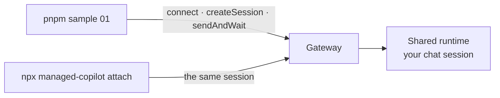
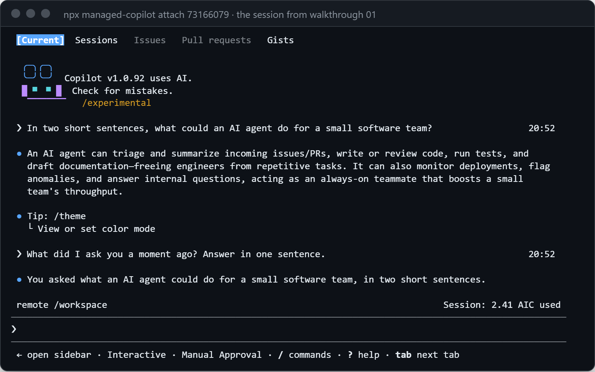

# 01 · Your first agent

Connect to your platform, chat with an agent, and open the same conversation in Copilot CLI.

**You need:** the platform running (`aspire run`) and a GitHub sign-in with Copilot. **Concepts:**
[how it works](../../docs/concepts/how-it-works.md), [Copilot CLI](../../docs/concepts/copilot-cli.md).



## Run it

```powershell
pnpm sample 01
```

## What you'll see

```text
Connected to http://localhost:7400 (local) as @your-login

Copilot: An AI agent can triage and summarize incoming issues/PRs, write or review code, run tests, and draft
documentation—freeing engineers from repetitive tasks. It can also monitor deployments, flag anomalies, and answer
internal questions, acting as an always-on teammate that boosts a small team's throughput.

Session 73166079-2a00-4039-9d1f-33f8ea1cd177
  environment: chat (shared)
  placement:   shared
  state:       idle

Open it in Copilot CLI:  npx managed-copilot attach 73166079
```

Now run the command it printed:

```powershell
npx managed-copilot attach 73166079
```

<p align="center">
  
</p>

Copilot CLI shows the turn your script started, and its next answer remembers it: one conversation, two clients.
Type `/exit` to leave. The session keeps running.

## What happened

1. `ManagedCopilot.connect()` found your local platform through the discovery file `aspire run` wrote, and signed you
   in with your GitHub token.
2. `managed.client("chat")` returned a stock `CopilotClient` for the `chat` environment. Its connection goes to the
   gateway, not to a local runtime.
3. `createSession` and `sendAndWait` are the ordinary SDK calls. The gateway placed the session on the shared runtime
   (`placement: shared`), and the model call used your Copilot plan.
4. `managed.close()` detached the script. The session stayed on the platform, so Copilot CLI could open it.

## The code

```ts
const managed = await ManagedCopilot.connect();
const client = await managed.client("chat");
const session = await client.createSession({ model: "claude-sonnet-5", onPermissionRequest: approveAll });

const reply = await session.sendAndWait({ prompt: "In two short sentences, what could an AI agent do for a small software team?" });
console.log(`Copilot: ${reply?.data.content}`);

const info = await managed.sessions.get(session.sessionId); // environment, placement, state, sandbox, ...
await managed.close(); // detaches; the session keeps running
```

Full script: [`main.ts`](main.ts).

## Try next

- Skip the script: `npx managed-copilot new chat` creates a session and opens it in Copilot CLI in one step.
- `npx managed-copilot sessions` lists your sessions; any unique ID prefix works with `attach`.
- Next walkthrough: [02 · Give it your own tools](../02-your-own-tools/README.md).
